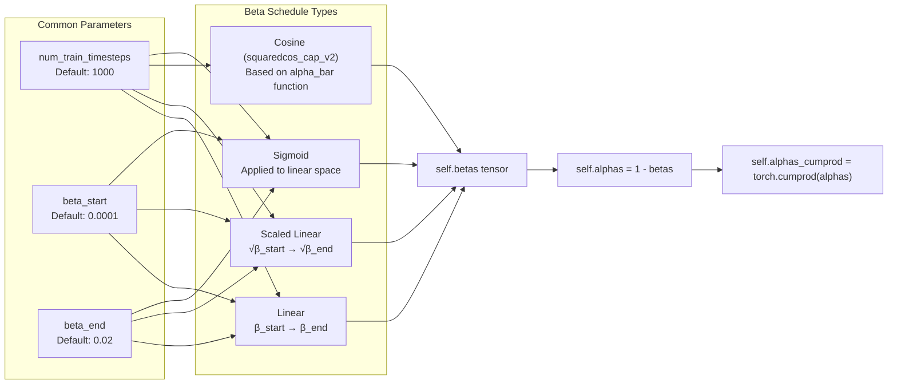
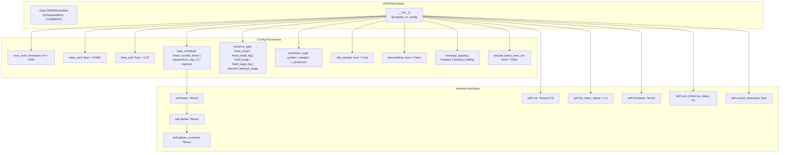
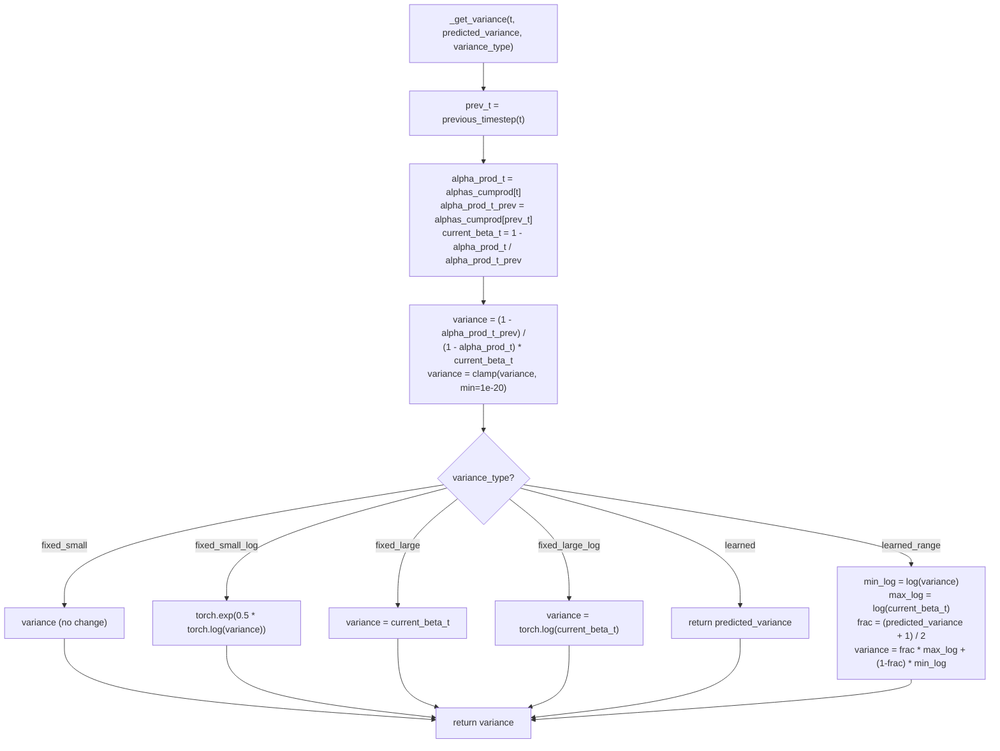
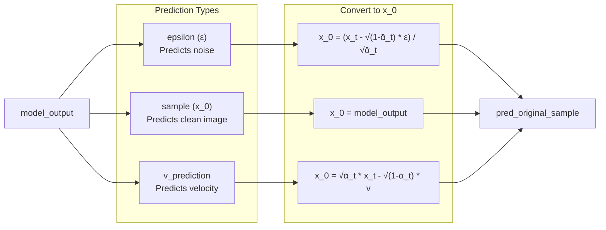
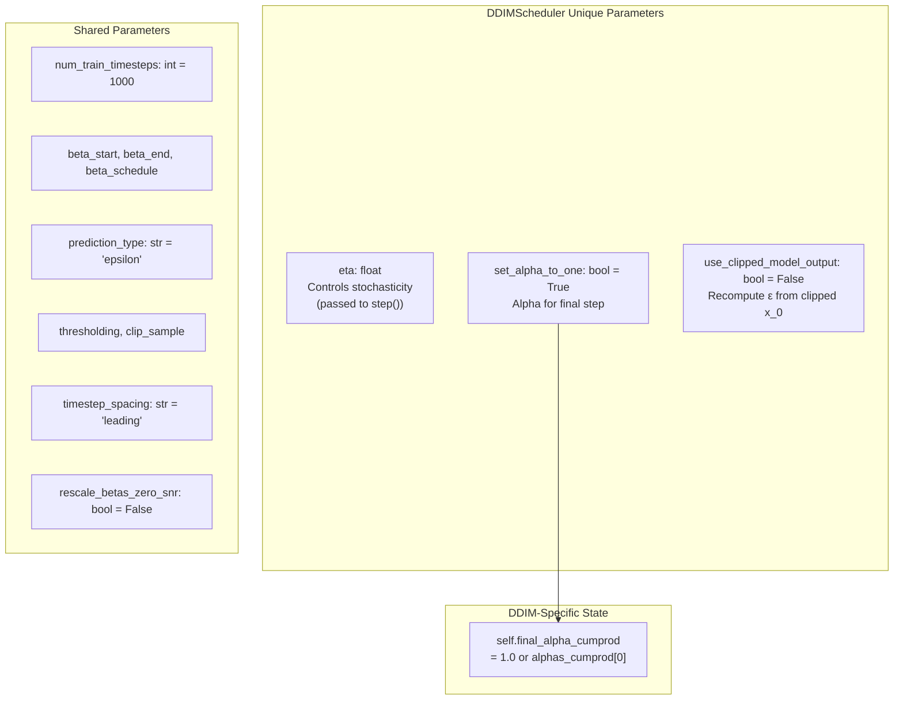
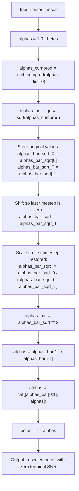
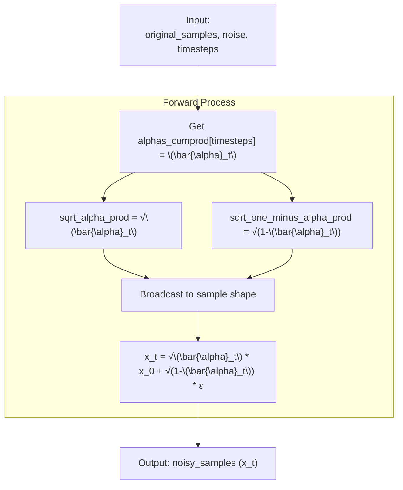
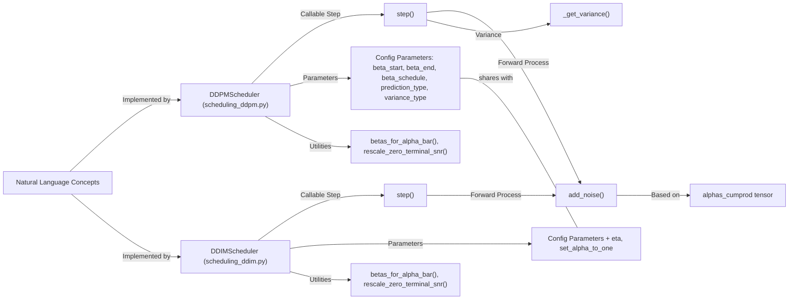

<!-- source: DeepWiki mcp.deepwiki.com · repo huggingface/diffusers · page 7.2 DDPM and DDIM · fetched 2026-10-21 -->

# DDPM and DDIM

<details>
<summary>Relevant source files</summary>

The following files were used as context for generating this wiki page:

- [src/diffusers/configuration_utils.py](src/diffusers/configuration_utils.py)
- [src/diffusers/pipelines/ddim/pipeline_ddim.py](src/diffusers/pipelines/ddim/pipeline_ddim.py)
- [src/diffusers/pipelines/ddpm/pipeline_ddpm.py](src/diffusers/pipelines/ddpm/pipeline_ddpm.py)
- [src/diffusers/pipelines/dit/pipeline_dit.py](src/diffusers/pipelines/dit/pipeline_dit.py)
- [src/diffusers/pipelines/joyimage/pipeline_joyimage_edit.py](src/diffusers/pipelines/joyimage/pipeline_joyimage_edit.py)
- [src/diffusers/pipelines/latent_diffusion/pipeline_latent_diffusion.py](src/diffusers/pipelines/latent_diffusion/pipeline_latent_diffusion.py)
- [src/diffusers/schedulers/scheduling_ddim.py](src/diffusers/schedulers/scheduling_ddim.py)
- [src/diffusers/schedulers/scheduling_ddpm.py](src/diffusers/schedulers/scheduling_ddpm.py)
- [src/diffusers/schedulers/scheduling_deis_multistep.py](src/diffusers/schedulers/scheduling_deis_multistep.py)
- [src/diffusers/schedulers/scheduling_dpmsolver_multistep.py](src/diffusers/schedulers/scheduling_dpmsolver_multistep.py)
- [src/diffusers/schedulers/scheduling_dpmsolver_multistep_inverse.py](src/diffusers/schedulers/scheduling_dpmsolver_multistep_inverse.py)
- [src/diffusers/schedulers/scheduling_dpmsolver_sde.py](src/diffusers/schedulers/scheduling_dpmsolver_sde.py)
- [src/diffusers/schedulers/scheduling_dpmsolver_singlestep.py](src/diffusers/schedulers/scheduling_dpmsolver_singlestep.py)
- [src/diffusers/schedulers/scheduling_euler_ancestral_discrete.py](src/diffusers/schedulers/scheduling_euler_ancestral_discrete.py)
- [src/diffusers/schedulers/scheduling_euler_discrete.py](src/diffusers/schedulers/scheduling_euler_discrete.py)
- [src/diffusers/schedulers/scheduling_heun_discrete.py](src/diffusers/schedulers/scheduling_heun_discrete.py)
- [src/diffusers/schedulers/scheduling_k_dpm_2_ancestral_discrete.py](src/diffusers/schedulers/scheduling_k_dpm_2_ancestral_discrete.py)
- [src/diffusers/schedulers/scheduling_k_dpm_2_discrete.py](src/diffusers/schedulers/scheduling_k_dpm_2_discrete.py)
- [src/diffusers/schedulers/scheduling_lms_discrete.py](src/diffusers/schedulers/scheduling_lms_discrete.py)
- [src/diffusers/schedulers/scheduling_pndm.py](src/diffusers/schedulers/scheduling_pndm.py)
- [src/diffusers/schedulers/scheduling_sasolver.py](src/diffusers/schedulers/scheduling_sasolver.py)
- [src/diffusers/schedulers/scheduling_sde_ve.py](src/diffusers/schedulers/scheduling_sde_ve.py)
- [src/diffusers/schedulers/scheduling_unipc_multistep.py](src/diffusers/schedulers/scheduling_unipc_multistep.py)
- [src/diffusers/schedulers/scheduling_utils.py](src/diffusers/schedulers/scheduling_utils.py)
- [tests/pipelines/ddim/test_ddim.py](tests/pipelines/ddim/test_ddim.py)
- [tests/pipelines/ddpm/test_ddpm.py](tests/pipelines/ddpm/test_ddpm.py)
- [tests/pipelines/dit/test_dit.py](tests/pipelines/dit/test_dit.py)
- [tests/pipelines/dreamlite/testing_utils.py](tests/pipelines/dreamlite/testing_utils.py)
- [tests/pipelines/joyimage/test_joyimage_edit.py](tests/pipelines/joyimage/test_joyimage_edit.py)
- [tests/pipelines/joyimage/test_joyimage_edit_plus.py](tests/pipelines/joyimage/test_joyimage_edit_plus.py)

</details>


## Purpose and Scope

This document covers the foundational schedulers `DDPMScheduler` and `DDIMScheduler`, which implement the original diffusion probabilistic models. These schedulers form the basis for most other schedulers in the Diffusers library.

**Key Topics:**
- DDPM (Denoising Diffusion Probabilistic Models) - stochastic Markovian sampling [[src/diffusers/schedulers/scheduling_ddpm.py:137-254]]()
- DDIM (Denoising Diffusion Implicit Models) - deterministic non-Markovian sampling [[src/diffusers/schedulers/scheduling_ddim.py:139-229]]()
- Shared beta scheduling functions: `betas_for_alpha_bar()`, `rescale_zero_terminal_snr()` [[src/diffusers/schedulers/scheduling_ddpm.py:48-134]]()
- Forward process: `add_noise()`, `get_velocity()` [[src/diffusers/schedulers/scheduling_ddpm.py:535-609]]()
- Reverse process: `step()` with variance computation [[src/diffusers/schedulers/scheduling_ddpm.py:462-568]]()

**Related Pages:**
- Advanced schedulers (DPM-Solver, UniPC, Euler): see page 7.3
- Noise schedules and timestep strategies: see page 7.4
- Scheduler base classes and interface: see page 7.1

---

## Mathematical Foundation

Both DDPM and DDIM are based on the diffusion probabilistic model framework, which consists of a forward diffusion process that gradually adds noise to data and a learned reverse denoising process for image generation.

### Forward Diffusion Process

The forward (noising) process for timestep \(t\) is modeled as a Gaussian transition:

\[
q(x_t | x_{t-1}) = \mathcal{N}(x_t; \sqrt{1-\beta_t} x_{t-1}, \beta_t I)
\]

The marginal distribution at timestep \(t\) conditioned on clean data \(x_0\) is:

\[
q(x_t | x_0) = \mathcal{N}(x_t; \sqrt{\bar{\alpha}_t} x_0, (1-\bar{\alpha}_t) I)
\]

where \(\bar{\alpha}_t = \prod_{s=1}^t (1-\beta_s)\) is the cumulative product of \(\alpha\) values.

The noise \(\epsilon\) added at each step is standard Gaussian:

\[
x_t = \sqrt{\bar{\alpha}_t} x_0 + \sqrt{1-\bar{\alpha}_t} \epsilon
\]

**Sources:** [[src/diffusers/schedulers/scheduling_ddpm.py:228-229]]()

### Beta Schedules

Diffusion noise schedules define the sequence of \(\beta_t\) controlling the noise variance at each step. Supported schedules include linear, scaled linear, cosine, and sigmoid.



These are instantiated through the shared utility function `betas_for_alpha_bar()` which constructs \(\beta\) from a continuous function \(\bar{\alpha}_t\), supporting "cosine", "exp", or "laplace" transforms.

**Sources:** [[src/diffusers/schedulers/scheduling_ddpm.py:48-91]](), [[src/diffusers/schedulers/scheduling_ddim.py:51-94]]()

---

## DDPMScheduler Implementation

### Class Structure and Initialization

The `DDPMScheduler` class inherits the basic scheduler interface and configuration system. It encapsulates noise schedule parameters and inference state.



Initialization computes:
- Beta sequences according to the specified `beta_schedule`
- Alphas and cumulative alpha products \(\bar{\alpha}_t\) from betas
- Setup of internal tensors and variables

**Sources:** [[src/diffusers/schedulers/scheduling_ddpm.py:137-254]]()

### Variance Computation

DDPM uses stochastic reverse diffusion. The variance for noise addition in each step is calculated in `_get_variance()`. The scheduler supports multiple `variance_type` modes:

| Variance Type      | Formula / Description                                  | Use Case                                 |
|--------------------|-------------------------------------------------------|------------------------------------------|
| `fixed_small`      | \(\frac{1-\bar{\alpha}_{t-1}}{1-\bar{\alpha}_t} \beta_t\) | Default, numerical stability              |
| `fixed_small_log`  | \(\exp(0.5 \log(\text{variance}))\)                   | Used in RL-Diffuser                       |
| `fixed_large`      | \(\beta_t\)                                           | Larger noise injection                    |
| `fixed_large_log`  | \(\log(\beta_t)\)                                     | Glide implementation                      |
| `learned`          | Model directly predicts variance                       | For learned variance                      |
| `learned_range`    | Interpolates log variance between min and max         | Learned mixing weights                    |



**Sources:** [[src/diffusers/schedulers/scheduling_ddpm.py:348-417]]()

### Core DDPM Step Function

The main reverse denoising step performs:

1. Predict \(x_0\) from model output according to `prediction_type`.
2. Clip or threshold \(x_0\) for numerical stability/dynamic thresholding.
3. Compute the mean of \(x_{t-1}\) as a linear combination of predicted \(x_0\) and noisy input \(x_t\).
4. Add noise with computed variance if timestep > 0.

```mermaid
sequenceDiagram
    participant Pipeline
    participant step["DDPMScheduler.step()"]
    participant helpers["Helper Methods"]
    
    Pipeline->>step: step(model_output, timestep, sample, generator)
    
    Note over step: 1. Get previous timestep
    step->>helpers: previous_timestep(t)
    helpers->>step: prev_t
    
    Note over step: 2. Compute alpha products
    step->>step: alpha_prod_t = alphas_cumprod[t]
    step->>step: alpha_prod_t_prev = alphas_cumprod[prev_t]
    
    Note over step: 3. Predict x_0 based on prediction_type
    alt config.prediction_type == "epsilon"
        step->>step: pred_original_sample = (sample - √(1-ᾱ_t) * model_output) / √ᾱ_t
    else config.prediction_type == "sample"
        step->>step: pred_original_sample = model_output
    else config.prediction_type == "v_prediction"
        step->>step: pred_original_sample = √ᾱ_t * sample - √(1-ᾱ_t) * model_output
    end
    
    Note over step: 4. Clip or threshold pred_original_sample
    alt config.thresholding == True
        step->>helpers: _threshold_sample(pred_original_sample)
        helpers->>step: thresholded x_0
    else config.clip_sample == True
        step->>step: Clamp pred_original_sample between ±clip_sample_range
    end
    
    Note over step: 5. Compute mean of prev sample
    step->>step: Compute coefficients
    step->>step: pred_prev_sample = coeff_0 * pred_original_sample + coeff_1 * sample
    
    Note over step: 6. Add variance noise if t > 0
    alt t > 0
        step->>helpers: _get_variance(t, predicted_variance)
        helpers->>step: variance
        step->>step: prev_sample += √variance * noise
    end
    
    step->>Pipeline: DDPMSchedulerOutput(
    prev_sample=pred_prev_sample,
    pred_original_sample=pred_original_sample
    )
```

Key formula for previous sample mean (\(x_{t-1}\)):

\[
\hat{x}_{t-1} = \sqrt{\bar{\alpha}_{t-1}} \frac{\beta_t}{1-\bar{\alpha}_t} x_0 + \sqrt{1-\bar{\alpha}_{t-1}} \frac{1-\bar{\alpha}_{t-1}}{1-\bar{\alpha}_t} x_t
\]

**Sources:** [[src/diffusers/schedulers/scheduling_ddpm.py:462-568]]()

### Prediction Types

DDPM supports multiple prediction types that determine how the model output is interpreted and inverted to \(x_0\):



**Sources:** [[src/diffusers/schedulers/scheduling_ddpm.py:161-164]](), [[src/diffusers/schedulers/scheduling_ddpm.py:481-507]]()

### Dynamic Thresholding

When configured, dynamic thresholding prevents pixel saturation by clipping predicted \(x_0\) selectively per batch:

**Algorithm:**
1. Compute quantile \(s = \text{quantile}(|x_0|, \text{dynamic_thresholding_ratio})\) per batch [[src/diffusers/schedulers/scheduling_ddpm.py:448-450]]()
2. Clamp \(s\) between 1 and `sample_max_value` [[src/diffusers/schedulers/scheduling_ddpm.py:452-453]]()
3. Threshold and rescale: \(x_0 = \text{clamp}(x_0, -s, s) / s\) [[src/diffusers/schedulers/scheduling_ddpm.py:455-456]]()

**Sources:** [[src/diffusers/schedulers/scheduling_ddpm.py:419-460]]()

---

## DDIMScheduler Implementation

### Key Differences: Non-Markovian Forward Process & Deterministic Sampling

`DDIMScheduler` extends the DDPM formulation by enabling a non-Markovian diffusion process that allows deterministic sampling via the η parameter:

- \(\eta = 0\): fully deterministic DDIM sampling
- \(\eta = 1\): recovers stochastic DDPM sampling
- \(0 < \eta < 1\): interpolates between deterministic and stochastic processes

This approach reduces sample diversity but significantly speeds up sampling.

**Sources:** [[src/diffusers/schedulers/scheduling_ddim.py:139-181]]()

### DDIMScheduler Configuration

The key configuration parameters include those shared with DDPM and some unique ones:



**Sources:** [[src/diffusers/schedulers/scheduling_ddim.py:186-229]]()

### DDIM Step Function Logic

`DDIMScheduler.step()` proceeds as follows:

```mermaid
sequenceDiagram
    participant Pipeline
    participant step["DDIMScheduler.step()"]
    participant helpers["Helper Methods"]
    
    Pipeline->>step: step(model_output, timestep, sample,\n eta, use_clipped_model_output,\n generator, variance_noise)
    
    Note over step: 1. Validate and compute previous timestep
    step->>step: Confirm num_inference_steps is set
    step->>step: prev_timestep = timestep - num_train_timesteps // num_inference_steps
    
    Note over step: 2. Get alpha values
    step->>step: alpha_prod_t = alphas_cumprod[timestep]
    step->>step: alpha_prod_t_prev = alphas_cumprod[prev_timestep] if prev_timestep >= 0 else final_alpha_cumprod
    step->>step: beta_prod_t = 1 - alpha_prod_t
    
    Note over step: 3. Predict x_0 and ε from model output based on prediction_type
    alt config.prediction_type == "epsilon"
        step->>step: pred_original_sample =\n(sample - sqrt(beta_prod_t) * model_output) / sqrt(alpha_prod_t)
        step->>step: pred_epsilon = model_output
    else config.prediction_type == "sample"
        step->>step: pred_original_sample = model_output
        step->>step: pred_epsilon = (sample - sqrt(alpha_prod_t) * pred_original_sample) / sqrt(beta_prod_t)
    else config.prediction_type == "v_prediction"
        step->>step: pred_original_sample = sqrt(alpha_prod_t) * sample - sqrt(beta_prod_t) * model_output
        step->>step: pred_epsilon = sqrt(alpha_prod_t) * model_output + sqrt(beta_prod_t) * sample
    end
    
    Note over step: 4. Clip/threshold pred_original_sample
    alt config.thresholding == True
        step->>helpers: _threshold_sample(pred_original_sample)
        helpers->>step: thresholded x_0
    else config.clip_sample == True
        step->>step: Clamp pred_original_sample between ±clip_sample_range
    end
    
    Note over step: 5. Compute variance and std_dev of noise
    step->>helpers: _get_variance(timestep, prev_timestep)
    helpers->>step: variance
    step->>step: std_dev_t = eta * sqrt(variance)
    
    Note over step: 6. Use clipped model output if option set
    alt use_clipped_model_output == True
        step->>step: pred_epsilon = (sample - sqrt(alpha_prod_t) * pred_original_sample) / sqrt(beta_prod_t)
    end
    
    Note over step: 7. Compute direction pointing to x_t
    step->>step: pred_sample_direction = sqrt(1 - alpha_prod_t_prev - std_dev_t^2) * pred_epsilon
    
    Note over step: 8. Compute x_{t-1} without noise
    step->>step: prev_sample = sqrt(alpha_prod_t_prev) * pred_original_sample + pred_sample_direction
    
    Note over step: 9. Add stochastic noise if eta > 0
    alt eta > 0
        alt variance_noise provided
            step->>step: variance = std_dev_t * variance_noise
        else generator provided
            step->>step: variance_noise = randn_tensor(...)
            step->>step: variance = std_dev_t * variance_noise
        end
        step->>step: prev_sample += variance
    end
    
    step->>Pipeline: DDIMSchedulerOutput(
        prev_sample=prev_sample,
        pred_original_sample=pred_original_sample
    )
```

Important formula for variance:

\[
\text{variance} = \frac{\beta_{t-1}(1-\frac{\bar{\alpha}_t}{\bar{\alpha}_{t-1}})}{\beta_t}
\]
\[
\sigma_t = \eta \sqrt{\text{variance}}
\]

**Sources:** [[src/diffusers/schedulers/scheduling_ddim.py:384-514]]()

---

## Shared Components and Utilities

### Beta Schedule Functions

Both DDPM and DDIM share the `betas_for_alpha_bar()` function, creating noise schedules from a continuous alpha-bar function \(\bar{\alpha}(t)\).

Example cosine schedule function:

\[
\bar{\alpha}(t) = \cos^2\left(\frac{t+0.008}{1.008} \frac{\pi}{2}\right)
\]

**Sources:** [[src/diffusers/schedulers/scheduling_ddpm.py:48-97]](), [[src/diffusers/schedulers/scheduling_ddim.py:51-94]]()

### Zero Terminal SNR Rescaling

`rescale_zero_terminal_snr()` rescales betas to ensure zero final signal-to-noise ratio in the schedule, which may improve stability.



**Sources:** [[src/diffusers/schedulers/scheduling_ddpm.py:101-134]](), [[src/diffusers/schedulers/scheduling_ddim.py:103-136]]()

---

## Forward Diffusion: `add_noise()` Method

Both schedulers implement the forward diffusion step using the following formula:

\[
x_t = \sqrt{\bar{\alpha}_t} x_0 + \sqrt{1-\bar{\alpha}_t} \epsilon
\]

where \(\epsilon \sim \mathcal{N}(0, I)\).



**Sources:** [[src/diffusers/schedulers/scheduling_ddpm.py:535-575]](), [[src/diffusers/schedulers/scheduling_ddim.py:510-550]]()

---

## Velocity Prediction: `get_velocity()` Method

This method calculates the "velocity" used when `prediction_type="v_prediction"`:

\[
v = \sqrt{\bar{\alpha}_t} \epsilon - \sqrt{1 - \bar{\alpha}_t} x_0
\]

This can be interpreted as a scaled difference capturing the instantaneous change.

**Sources:** [[src/diffusers/schedulers/scheduling_ddpm.py:577-609]](), [[src/diffusers/schedulers/scheduling_ddim.py:553-585]]()

---

## State Management and Workflow

### State Variables and Methods

The schedulers maintain important internal state such as:

- `betas`, `alphas`, `alphas_cumprod`: noise schedule tensors
- `timesteps`: active timesteps for inference
- `num_inference_steps`: number of denoising steps used at inference

At runtime, users typically:

1. Initialize the scheduler with a configuration specifying betas, schedule, and prediction type.
2. Call `set_timesteps(num_inference_steps, device)` to prepare inference timesteps.
3. Call the `step()` function in a loop to perform iterative reverse diffusion.
4. Optionally use `add_noise()` and `get_velocity()` for forward process and velocity calculations.

**Sources:** [[src/diffusers/schedulers/scheduling_ddpm.py:186-254]](), [[src/diffusers/schedulers/scheduling_ddim.py:193-243]]()

---

### Mapping Natural Language to Code Entities



**Sources:** [[src/diffusers/schedulers/scheduling_ddpm.py]](), [[src/diffusers/schedulers/scheduling_ddim.py]]()

---

### Mapping Pipeline Integration

Both schedulers integrate into pipelines such as `DDPMPipeline` (for DDPM) and variants for DDIM. Their use typically involves:

- Initialize the pipeline with a UNet model and a scheduler instance (`DDPMScheduler` or `DDIMScheduler`)
- The pipeline calls the scheduler's `set_timesteps()` with the inference step count
- Iteratively call scheduler `step()` inside the denoising loop

```mermaid
graph TD
    NL["User Request: Generate Image"] --> Pipeline["DDPMPipeline (pipeline_ddpm.py)"]
    Pipeline --> Scheduler["Scheduler (DDPMScheduler or DDIMScheduler)"]
    Scheduler --> UNet["UNet2DModel (unet.py)"]

    Pipeline -->|set_timesteps()| Scheduler
    Pipeline -->|step()| Scheduler
    Pipeline -->|predict noise| UNet
    Scheduler -->|add_noise(), get_velocity()| InternalUtils["Internal methods"]

    Scheduler -->|outputs| Pipeline
```

**Sources:** [[src/diffusers/pipelines/ddpm/pipeline_ddpm.py:33-146]](), [[src/diffusers/schedulers/scheduling_ddpm.py]](), [[src/diffusers/schedulers/scheduling_ddim.py]]()

---

# Summary

`DDPMScheduler` and `DDIMScheduler` implement the fundamental diffusion sampling strategies in this library. Key differences:

- DDPM implements a Markovian stochastic sampling process with variance injection.
- DDIM allows non-Markovian, typically deterministic sampling controlled by \(\eta\).

Both use shared utilities for noise scheduling and support multiple prediction types \((\epsilon, x_0, v)\). They provide interfaces for forward diffusion (adding noise), velocity computation, and iterative reverse denoising through their `step()` functions.

Understanding these schedulers is essential for grasping diffusion's iterative denoising flow, configuring noise schedules, and integrating diffusion models into pipelines for image generation.

---

**Sources:**  
- `src/diffusers/schedulers/scheduling_ddpm.py` (lines: 1-669)  
- `src/diffusers/schedulers/scheduling_ddim.py` (lines: 1-596)  
- `src/diffusers/pipelines/ddpm/pipeline_ddpm.py` (lines: 33-146)  
- `src/diffusers/configuration_utils.py` (general config usage)

---

