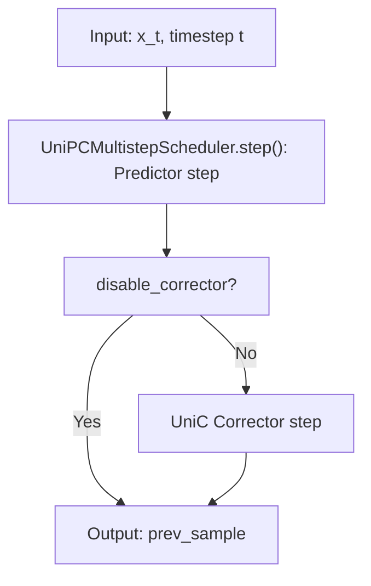
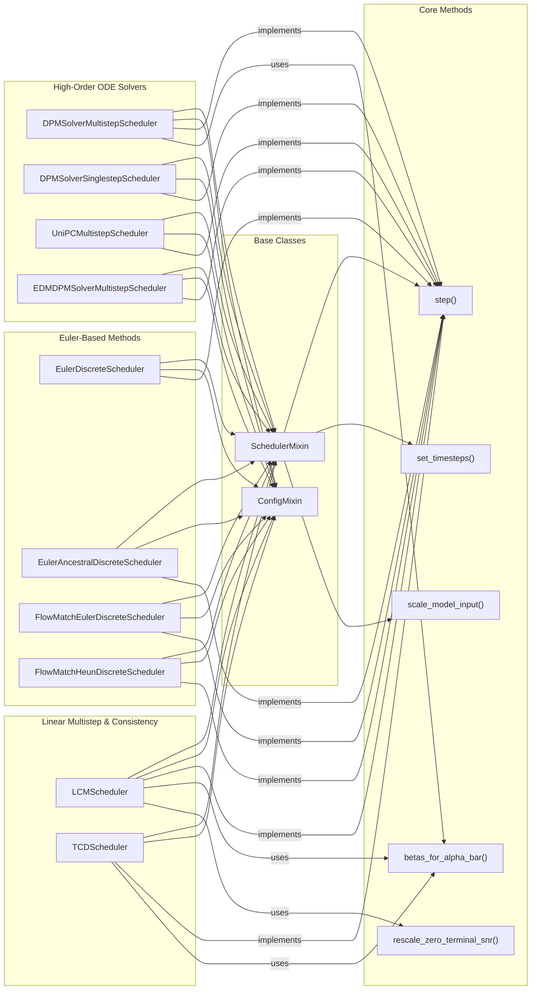

<!-- source: DeepWiki mcp.deepwiki.com · repo huggingface/diffusers · page 7.3 Advanced Schedulers · fetched 2026-10-21 -->

# Advanced Schedulers

Relevant source files

The following files were used as context for generating this wiki page:

- [src/diffusers/schedulers/scheduling_cosine_dpmsolver_multistep.py](src/diffusers/schedulers/scheduling_cosine_dpmsolver_multistep.py)
- [src/diffusers/schedulers/scheduling_ddim_cogvideox.py](src/diffusers/schedulers/scheduling_ddim_cogvideox.py)
- [src/diffusers/schedulers/scheduling_ddim_parallel.py](src/diffusers/schedulers/scheduling_ddim_parallel.py)
- [src/diffusers/schedulers/scheduling_ddpm_parallel.py](src/diffusers/schedulers/scheduling_ddpm_parallel.py)
- [src/diffusers/schedulers/scheduling_dpm_cogvideox.py](src/diffusers/schedulers/scheduling_dpm_cogvideox.py)
- [src/diffusers/schedulers/scheduling_edm_dpmsolver_multistep.py](src/diffusers/schedulers/scheduling_edm_dpmsolver_multistep.py)
- [src/diffusers/schedulers/scheduling_edm_euler.py](src/diffusers/schedulers/scheduling_edm_euler.py)
- [src/diffusers/schedulers/scheduling_flow_match_euler_discrete.py](src/diffusers/schedulers/scheduling_flow_match_euler_discrete.py)
- [src/diffusers/schedulers/scheduling_flow_match_heun_discrete.py](src/diffusers/schedulers/scheduling_flow_match_heun_discrete.py)
- [src/diffusers/schedulers/scheduling_flow_match_lcm.py](src/diffusers/schedulers/scheduling_flow_match_lcm.py)
- [src/diffusers/schedulers/scheduling_helios.py](src/diffusers/schedulers/scheduling_helios.py)
- [src/diffusers/schedulers/scheduling_lcm.py](src/diffusers/schedulers/scheduling_lcm.py)
- [src/diffusers/schedulers/scheduling_tcd.py](src/diffusers/schedulers/scheduling_tcd.py)
- [src/diffusers/schedulers/scheduling_unclip.py](src/diffusers/schedulers/scheduling_unclip.py)
- [tests/schedulers/test_scheduler_lcm.py](tests/schedulers/test_scheduler_lcm.py)
- [tests/schedulers/test_schedulers.py](tests/schedulers/test_schedulers.py)

This page documents advanced schedulers that extend beyond the foundational DDPM and DDIM schedulers. These schedulers offer higher-order solvers, enhanced noise schedules, and other optimizations that accelerate inference and improve sample quality.

**Scope**: This page covers advanced schedulers including DPM-Solver variants, UniPC multistep, Euler-based methods, the EDM Euler scheduler, Linear Consistency Models (LCM/TCD), and Flow Matching schedulers. For foundational material, see [Scheduler Base and Interface](7.1) and [DDPM and DDIM](7.2). For noise schedule details, see [Noise Schedules and Timesteps](7.4).

---

## Overview of Advanced Schedulers

Advanced schedulers typically improve over DDPM/DDIM by incorporating:

- **High-order ODE/SDE solvers:** Reduce the number of sampling steps by leveraging multistep numerical methods.
- **Specialized noise schedules:** Support for Karras, exponential, beta, and flow matching sigma transformations.
- **Multistep methods with state history:** Use multiple past model outputs for better integration accuracy.
- **Stochastic sampling components:** Variants add controlled noise to enhance diversity.
- **Innovative algorithms:** Variants like dpmsolver++, sde-dpmsolver++, and unified predictor-corrector methods.

All advanced schedulers subclass `SchedulerMixin` and `ConfigMixin` for uniform interface support such as `set_timesteps()`, `step()`, and `scale_model_input()`.

### Taxonomy of Advanced Schedulers

```mermaid
graph TB
  Base["SchedulerMixin + ConfigMixin"]

  subgraph "High-Order ODE Solvers"
    DPMMulti["DPMSolverMultistepScheduler<br/>Multistep high-order solver"]
    DPMSingle["DPMSolverSinglestepScheduler<br/>Single-step variant"]
    UniPC["UniPCMultistepScheduler<br/>Predictor-corrector, training-free"]
    DEIS["DEISMultistepScheduler<br/>Fast high-order method"]
  end

  subgraph "Euler-Based Methods"
    Euler["EulerDiscreteScheduler<br/>First-order Euler"]
    EulerAnc["EulerAncestralDiscreteScheduler<br/>Stochastic Euler"]
    Heun["HeunDiscreteScheduler<br/>Second-order Heun"]
    FlowEuler["FlowMatchEulerDiscreteScheduler<br/>Flow matching Euler"]
  end

  subgraph "Linear Multistep Methods"
    LMS["LMSDiscreteScheduler<br/>Linear multi-step"]
    PNDM["PNDMScheduler<br/>Runge-Kutta + PLMS"]
  end

  subgraph "Karras DPM2 Methods"
    KDPM2["KDPM2DiscreteScheduler<br/>Second-order Karras"]
    KDPM2Anc["KDPM2AncestralDiscreteScheduler<br/>Stochastic Karras"]
  end

  subgraph "SDE-Based Methods"
    DPMSDE["DPMSolverSDEScheduler<br/>Brownian noise sampling"]
    ScoreSDE["ScoreSdeVeScheduler<br/>Variance Exploding SDE"]
  end

  Base --> DPMMulti
  Base --> DPMSingle
  Base --> UniPC
  Base --> DEIS
  Base --> Euler
  Base --> EulerAnc
  Base --> LMS
  Base --> PNDM
  Base --> DPMSDE
  Base --> FlowEuler
  Base --> ScoreSDE
```

---

## High-Order ODE Solvers

These solvers minimize inference steps by implementing advanced numerical methods.

### DPM-Solver Family

The DPM-Solver family implements fast, dedicated high-order ODE solvers for diffusion. They maintain a cache of previous model outputs, enabling higher-order updates.

#### DPMSolverMultistepScheduler

- **Description:** Multistep numerical ODE solver using cached history of model predictions.
- **Key params:**

| Parameter       | Type   | Default      | Description                                    |
|-----------------|--------|--------------|------------------------------------------------|
| `solver_order`  | int    | 2            | Order of solver (1, 2, or 3)                    |
| `algorithm_type`| str    | "dpmsolver++"| Algorithm variant: `dpmsolver`, `dpmsolver++`, `sde-dpmsolver`, `sde-dpmsolver++` |
| `solver_type`   | str    | "midpoint"   | Solver for 2nd order: `midpoint` or `heun`     |
| `prediction_type`| str   | "epsilon"    | Model prediction type: `epsilon`, `sample`, `v_prediction`, `flow_prediction` |
| `thresholding`  | bool   | False        | Dynamic thresholding for pixel-space diffusion |
| `lower_order_final`| bool | True         | Use low-order solver final steps for stability |

- **Key functions:**  
  - `step()`: Performs a solver step using current and cached derivatives.  
  - `scale_model_input()`: Adjust input scaling based on sigma.  
  - `set_timesteps()`: Configures inference step schedule.

**Sources:** [src/diffusers/schedulers/scheduling_dpmsolver_multistep.py:123-209]()

#### DPMSolverSinglestepScheduler

Single-step variant of DPM-Solver computing each step directly without caching.

**Sources:** [src/diffusers/schedulers/scheduling_dpmsolver_singlestep.py:88-159]()

### UniPCMultistepScheduler

- Implements a training-free unified predictor-corrector sampling framework.
- Efficiently combines predictor with a corrector step for accuracy.
- Recommended to use `solver_order=2` for guided and `solver_order=3` for unconditional sampling.

**Predictor-Corrector Data Flow:**

**Sources:** [src/diffusers/schedulers/scheduling_unipc_multistep.py:123-193]()

---

## Euler-Based Schedulers

These schedulers implement Euler-style methods, often used as baselines or building blocks for more advanced solvers.

### EulerDiscreteScheduler

- **Description:** Implements the first-order Euler method in the EDM noise scheduling framework.
- Supports multiple sigma transforms — Karras, exponential, and beta.
- Provides `scale_model_input()` to normalize inputs for the model based on sigma scale at the current timestep.
- Maintains `timesteps` and `sigmas` tensors for inference.

**Sources:** [src/diffusers/schedulers/scheduling_edm_euler.py:49-156]()

### EulerAncestralDiscreteScheduler

- Extends EulerDiscreteScheduler by adding stochasticity with ancestral sampling.
- Adds Gaussian noise at each step to improve sample diversity.

**Sources:** [src/diffusers/schedulers/scheduling_euler_ancestral_discrete.py:1-189]()

### FlowMatchEulerDiscreteScheduler

- Implements a flow matching variant of the Euler scheduler.
- Uses a shifted timestep schedule with options for dynamic shifting based on image resolution.
- Provides specialized attributes like `shift`, `use_dynamic_shifting`, and options for different sigma schedule modes.
- Outputs a `FlowMatchEulerDiscreteSchedulerOutput` with `prev_sample`.

**Key Attributes:**

| Attribute            | Description                               |
|----------------------|-------------------------------------------|
| `shift`              | Float controlling timestep schedule shift |
| `use_dynamic_shifting` | Whether to adjust shift based on resolution |
| `base_shift` and `max_shift` | Parameters to stabilize or encourage variation |
| `use_karras_sigmas`, `use_exponential_sigmas`, `use_beta_sigmas` | Flags for sigma schedule types |

**Sources:** [src/diffusers/schedulers/scheduling_flow_match_euler_discrete.py:48-169]()

---

## Linear Multistep and Consistency Models

### LCMScheduler

- Extends DDPM denoising with non-Markovian guidance for consistency distillation.
- Supports custom beta schedules with various transforms (`cosine`, `exp`, `laplace`).
- Provides `betas_for_alpha_bar()` utility to compute noise schedules discretizing alpha_bar function.
- Outputs `LCMSchedulerOutput` which includes predicted previous sample and optionally denoised sample.
- Supports dynamic configuration of inference steps and guided sampling parameters.

**Sources:** [src/diffusers/schedulers/scheduling_lcm.py:30-166]()

### TCDScheduler

- Implements trajectory consistency distillation (TCD), an extension of multistep consistency sampling.
- Supports `beta_schedule` and other parameters similar to LCMScheduler.
- Includes stochastic sampling methods.
- Outputs include predicted previous sample and optionally predicted noised sample.

**Sources:** [src/diffusers/schedulers/scheduling_tcd.py:141-166]()

---

## EDM DPMSolverMultistepScheduler

- Combines DPMSolver multistep with EDM formulation.
- Supports Karras and exponential sigma schedules with noise levels spanning multiple orders of magnitude.
- Configurable solver parameters such as `solver_order`, `algorithm_type`, `solver_type`, and thresholding options.
- Supports 1st, 2nd, and 3rd order solvers with options for dynamic thresholding.

**Sources:** [src/diffusers/schedulers/scheduling_edm_dpmsolver_multistep.py:28-123]()

---

## Flow Matching Schedulers

### FlowMatchHeunDiscreteScheduler

- Implements a flow matching variant of the classical second-order Heun method (improved Euler).
- Used for flow matching diffusion models where deterministic trajectories are estimated.
- Supports shift parameter for timestep schedule.
- Includes methods for scaling noise for forward diffusion and computing previous samples.

**Sources:** [src/diffusers/schedulers/scheduling_flow_match_heun_discrete.py:43-179]()

---

## Sigma Schedule Transformations

Advanced schedulers employ various transformations on sigma/noise scales to improve sample quality and stability, including:

| Transformation      | Description                                                                |
|---------------------|----------------------------------------------------------------------------|
| **Karras Sigmas**   | Power-law used in EDM for balanced noise schedules [EDM Euler scheduler] [src/diffusers/schedulers/scheduling_edm_euler.py:107-110]() |
| **Exponential Sigmas** | Exponential noise scaling used in some EDM configurations              |
| **Beta Sigmas**     | Utilizes beta distributions for noise scales [FlowMatchEuler scheduler] [src/diffusers/schedulers/scheduling_flow_match_euler_discrete.py:109-110]() |

---

## Code Entity Association Diagram

The following diagram connects key scheduler concepts with their respective classes and functions in the diffusers codebase. It highlights the inheritance structure and main methods across advanced schedulers.

---

## Summary Table of Key Advanced Scheduler Classes

| Scheduler Class                     | Type                          | Order | Goal / Characteristic                                | Key File (Lines)                                   |
|-----------------------------------|-------------------------------|-------|----------------------------------------------------|---------------------------------------------------|
| `DPMSolverMultistepScheduler`     | High-order multistep solver    | 1–3   | Fast and accurate multistep ODE solver              | scheduling_dpmsolver_multistep.py (123-209)       |
| `DPMSolverSinglestepScheduler`    | Single-step solver             | 1–3   | Single-step variant of DPMSolver                     | scheduling_dpmsolver_singlestep.py (88-159)        |
| `UniPCMultistepScheduler`          | Predictor-corrector multistep  | 2–3   | Fast sampling with unified corrector                 | scheduling_unipc_multistep.py (123-193)            |
| `EDMDPMSolverMultistepScheduler`   | EDM formulation solver          | 1–3   | Integrates EDM noise schedules                        | scheduling_edm_dpmsolver_multistep.py (28-123)     |
| `EulerDiscreteScheduler`           | Euler method                   | 1     | Basic deterministic Euler method with sigma options | scheduling_edm_euler.py (49-156)                    |
| `EulerAncestralDiscreteScheduler` | Stochastic Euler               | 1     | Adds stochasticity to Euler method                    | scheduling_euler_ancestral_discrete.py (1-189)     |
| `FlowMatchEulerDiscreteScheduler` | Euler flow matching            | 1     | Flow matching variant of Euler schedule              | scheduling_flow_match_euler_discrete.py (48-169)   |
| `FlowMatchHeunDiscreteScheduler`  | Heun flow matching             | 2     | Flow matching variant of Heun second-order method    | scheduling_flow_match_heun_discrete.py (43-179)    |
| `LCMScheduler`                    | Linear consistency model       | -     | Incorporates non-Markovian guidance for distillation | scheduling_lcm.py (30-166)                          |
| `TCDScheduler`                    | Trajectory consistency distill.| -     | Enables trajectory sampling with stochastic elements | scheduling_tcd.py (141-166)                         |

---

## References and Sources

- DPM-Solver multistep: [src/diffusers/schedulers/scheduling_dpmsolver_multistep.py:123-209]()
- UniPC multistep: [src/diffusers/schedulers/scheduling_unipc_multistep.py:123-193]()
- Euler schedulers: [src/diffusers/schedulers/scheduling_edm_euler.py:49-156](), [src/diffusers/schedulers/scheduling_flow_match_euler_discrete.py:48-169]()
- Flow Match Heun: [src/diffusers/schedulers/scheduling_flow_match_heun_discrete.py:43-179]()
- LCMScheduler: [src/diffusers/schedulers/scheduling_lcm.py:30-166]()
- TCDScheduler: [src/diffusers/schedulers/scheduling_tcd.py:141-166]()
- EDM DPMSolver Multistep: [src/diffusers/schedulers/scheduling_edm_dpmsolver_multistep.py:28-123]()

---

This completes the detailed documentation on advanced schedulers in the diffusers library.

---

