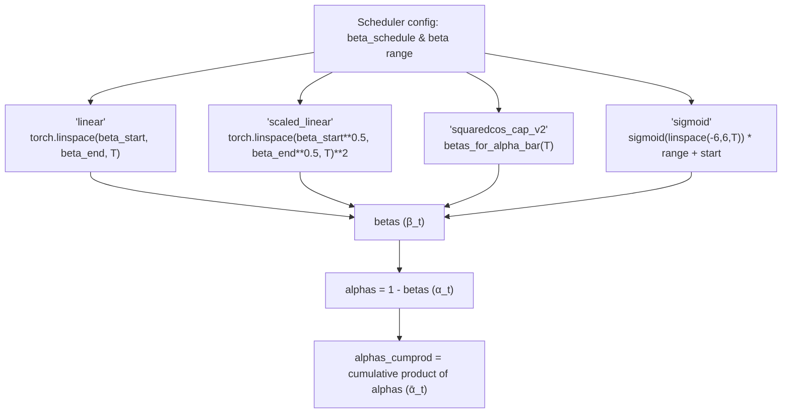
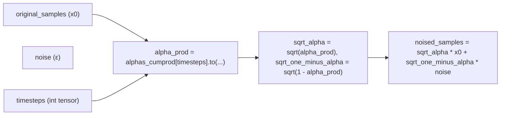

<!-- source: DeepWiki mcp.deepwiki.com · repo huggingface/diffusers · page 7.4 Noise Schedules and Timesteps · fetched 2026-10-21 -->

# Noise Schedules and Timesteps

<details>
<summary>Relevant source files</summary>

The following files were used as context for generating this wiki page:

- [src/diffusers/configuration_utils.py](src/diffusers/configuration_utils.py)
- [src/diffusers/schedulers/scheduling_ddim.py](src/diffusers/schedulers/scheduling_ddim.py)
- [src/diffusers/schedulers/scheduling_ddpm.py](src/diffusers/schedulers/scheduling_ddpm.py)
- [src/diffusers/schedulers/scheduling_deis_multistep.py](src/diffusers/schedulers/scheduling_deis_multistep.py)
- [src/diffusers/schedulers/scheduling_dpmsolver_multistep.py](src/diffusers/schedulers/scheduling_dpmsolver_multistep.py)
- [src/diffusers/schedulers/scheduling_dpmsolver_multistep_inverse.py](src/diffusers/schedulers/scheduling_dpmsolver_multistep_inverse.py)
- [src/diffusers/schedulers/scheduling_dpmsolver_sde.py](src/diffusers/schedulers/scheduling_dpmsolver_sde.py)
- [src/diffusers/schedulers/scheduling_dpmsolver_singlestep.py](src/diffusers/schedulers/scheduling_dpmsolver_singlestep.py)
- [src/diffusers/schedulers/scheduling_euler_ancestral_discrete.py](src/diffusers/schedulers/scheduling_euler_ancestral_discrete.py)
- [src/diffusers/schedulers/scheduling_euler_discrete.py](src/diffusers/schedulers/scheduling_euler_discrete.py)
- [src/diffusers/schedulers/scheduling_flow_match_euler_discrete.py](src/diffusers/schedulers/scheduling_flow_match_euler_discrete.py)
- [src/diffusers/schedulers/scheduling_flow_match_heun_discrete.py](src/diffusers/schedulers/scheduling_flow_match_heun_discrete.py)
- [src/diffusers/schedulers/scheduling_flow_match_lcm.py](src/diffusers/schedulers/scheduling_flow_match_lcm.py)
- [src/diffusers/schedulers/scheduling_heun_discrete.py](src/diffusers/schedulers/scheduling_heun_discrete.py)
- [src/diffusers/schedulers/scheduling_k_dpm_2_ancestral_discrete.py](src/diffusers/schedulers/scheduling_k_dpm_2_ancestral_discrete.py)
- [src/diffusers/schedulers/scheduling_k_dpm_2_discrete.py](src/diffusers/schedulers/scheduling_k_dpm_2_discrete.py)
- [src/diffusers/schedulers/scheduling_lms_discrete.py](src/diffusers/schedulers/scheduling_lms_discrete.py)
- [src/diffusers/schedulers/scheduling_pndm.py](src/diffusers/schedulers/scheduling_pndm.py)
- [src/diffusers/schedulers/scheduling_sasolver.py](src/diffusers/schedulers/scheduling_sasolver.py)
- [src/diffusers/schedulers/scheduling_sde_ve.py](src/diffusers/schedulers/scheduling_sde_ve.py)
- [src/diffusers/schedulers/scheduling_unipc_multistep.py](src/diffusers/schedulers/scheduling_unipc_multistep.py)
- [src/diffusers/schedulers/scheduling_utils.py](src/diffusers/schedulers/scheduling_utils.py)

</details>


This document provides a technical overview of noise schedules, timestep spacing strategies, sigma transformations, flow matching, and noise addition during training within the Diffusers library. These concepts are central to how diffusion models progressively add and remove noise, affecting training dynamics and sample quality.

For scheduler implementations and training loop integration, see the scheduler-specific classes and their `add_noise` methods.

---

## Core Concepts

Diffusion models add noise to data according to a noise schedule during training and denoise progressively during sampling. The core of this schedule is the **beta schedule** (`β_t`), defining per-timestep noise variances.

From betas, various noise-related parameters are computed to control the signal-to-noise ratio at each step.

---

## Beta Schedules

### Purpose

Beta schedules define the amount of noise introduced at each timestep during the diffusion process. Different functional forms result in distinct noise shapes, impacting model behavior and training stability.

### Supported Beta Schedule Types

The beta schedule is controlled in schedulers by the `beta_schedule` parameter. The main types are:

| Schedule Type       | Formula / Description                                                                              | Code Implementation Reference                                                |
|---------------------|--------------------------------------------------------------------------------------------------|------------------------------------------------------------------------------|
| `linear`            | Linearly spaced betas between `beta_start` and `beta_end`:                                       
`β_t = β_{start} + (β_{end} - β_{start}) * \frac{t}{T}`                            | `torch.linspace(beta_start, beta_end, num_train_timesteps)` <br/>[scheduling_ddpm.py:175-176]() |
| `scaled_linear`     | Linearly spaced squared betas (scaled linearly in sqrt space):                                      
`β_t = ( \sqrt{β_{start}} + (\sqrt{β_{end}} - \sqrt{β_{start}}) * \frac{t}{T} )^2`          | `torch.linspace(beta_start**0.5, beta_end**0.5, num_train_timesteps) ** 2` <br/>[scheduling_ddpm.py:177-180]() |
| `squaredcos_cap_v2` | Uses a cosine-based alpha bar schedule, calculated by `betas_for_alpha_bar` with cosine alpha_fn | `betas_for_alpha_bar(num_train_timesteps)` <br/>[scheduling_ddpm.py:181-182]()      |
| `sigmoid`           | Sigmoid-based schedule: smoothly transitions between `beta_start` and `beta_end`                  | `torch.sigmoid(torch.linspace(-6, 6, num_train_timesteps)) * (beta_end - beta_start) + beta_start` <br/>[scheduling_ddpm.py:183-189]() |

The `betas` tensor computed from the schedule is of shape `(num_train_timesteps,)` and stored in scheduler instances such as `DDPMScheduler` or related variants.

---

### Beta Schedule Initialization Flow



---

### The `betas_for_alpha_bar()` Utility Function

The `squaredcos_cap_v2` schedule relies on `betas_for_alpha_bar()`, which generates betas to discretize a smooth alpha-bar function (`ᾱ_t`), representing cumulative noise reduction.

The function `alpha_bar_fn(t):[0,1] -> [0,1]` maps a normalized time to the cumulative product of `1-beta`. It supports three types:

- **Cosine:**  
  \[
  \alpha_{bar}(t) = \cos\left(\frac{t + 0.008}{1.008} \frac{\pi}{2}\right)^2
  \]

- **Laplace (SNR-based):**  
  \[
  \lambda = -0.5 \times \text{sign}(0.5 - t) \times \log(1 - 2|0.5 - t|)
  \quad\Rightarrow\quad 
  \text{SNR} = e^\lambda
  \quad\Rightarrow\quad 
  \alpha_{bar}(t) = \sqrt{\frac{\text{SNR}}{1+\text{SNR}}}
  \]

- **Exponential:**  
  \[
  \alpha_{bar}(t) = e^{-12 t}
  \]

Betas are derived by discretizing differences:
\[
\beta_t = \min\left(1 - \frac{\alpha_{bar}(t_{i+1})}{\alpha_{bar}(t_i)}, \text{max_beta}\right)
\]

This function ensures a smooth noise schedule that avoids noise collapse near the end of the diffusion chain.

---

## Derived Noise Parameters

From betas, schedulers compute several parameters that convert between signal and noise domains at each timestep:

| Parameter          | Definition                                          | Purpose / Usage                              |
|--------------------|-----------------------------------------------------|---------------------------------------------|
| `alphas`           | \(\alpha_t = 1 - \beta_t\)                         | Signal retention per step [scheduling_ddpm.py:199]() |
| `alphas_cumprod`   | \(\bar{\alpha}_t = \prod_{i=1}^t \alpha_i\)        | Cumulative retention (signal fraction) [scheduling_ddpm.py:200]() |
| `sigmas`           | \(\sigma_t = \sqrt{\frac{1 - \bar{\alpha}_t}{\bar{\alpha}_t}}\) | Noise-to-signal ratio; used in discrete schedulers like LMSDiscreteScheduler [scheduling_lms_discrete.py]() |
| `init_noise_sigma` | `1.0` or scheduler dependent                        | Standard deviation of initial noise [scheduling_ddpm.py]() |

These parameters enable sampling steps to compute weighted combinations of clean and noisy samples correctly.

---

## Timestep Spacing Strategies

During inference, schedulers select a subset of timesteps for use, controlled by `timestep_spacing`. This determines how the discrete set of training timesteps are spaced for faster sampling while maintaining quality.

Common strategies:

| Strategy      | Description                                                              | Reference Implementation                       |
|---------------|--------------------------------------------------------------------------|------------------------------------------------|
| `leading`     | Evenly spaced timesteps starting from the earliest training step (start). Timesteps run forward from time 0. | `np.linspace(0, T-1, N).round()[::-1]` [scheduling_ddim.py]() |
| `linspace`    | Evenly spaced timesteps linearly from 0 to T-1, reversed for inference. | `np.linspace(0, T-1, N).round()[::-1]` [scheduling_lms_discrete.py]() |
| `trailing`    | Evenly spaced timesteps ending at time 0.                               | `np.linspace(T-1, 0, N).round()` [scheduling_ddim.py]()            |

These strategies impact how noisiness evolves during sampling, allowing trade-offs between speed and sample fidelity.

---

## Advanced Sigma Transformations and Scheduling

### Karras Sigmas (Power Law Noise Scaling)

Certain schedulers support Karras noise scheduling, which spaces sigmas (noise scales) according to a power law controlled by the parameter \(\rho\).

- **Usage:** controlled by `use_karras_sigmas` flag.  
- **Formula:**  
\[
\sigma_i = \left(\sigma_{\max}^{1/\rho} + u_i \times \left(\sigma_{\min}^{1/\rho} - \sigma_{\max}^{1/\rho}\right)\right)^\rho
\]
where \(u_i\) is a ramp from 0 to 1 over inference steps.

- **Impact:** concentrates noise levels nonlinearly, improving sample quality in some cases.

### Exponential Sigmas

- **Usage:** when `use_exponential_sigmas=True`.  
- **Formula:**  
\[
\sigma_i = \exp\left(\text{linspace}(\log \sigma_{\max}, \log \sigma_{\min}, N)\right)
\]

### Beta Sigmas

- **Usage:** when `use_beta_sigmas=True`, inspired by Beta noise schedules in recent publications for improved noise shaping.  
- Reference: "Beta Sampling is All You Need".  
- Implementations use Beta distributions to sample sigmas in the noise schedule.

---

## Zero Terminal SNR Rescaling

To achieve zero terminal signal-to-noise ratio (SNR) at the final timestep — important for some model types such as v-prediction models — the beta schedule is rescaled:

- **Process:**
  1. Compute \(\sqrt{\bar{\alpha}_t}\) from betas.
  2. Shift the sequence so \(\sqrt{\bar{\alpha}_T} = 0\).
  3. Scale the sequence back to match the original start value.
  4. Convert back to new beta values.

This is implemented in `rescale_zero_terminal_snr()` which returns a betas tensor adjusted accordingly.

---

## Flow Matching Schedulers

The library supports **flow matching** based schedulers, e.g., `FlowMatchEulerDiscreteScheduler`, which frame diffusion as flow ODEs:

- Noise and signal magnitudes vary linearly over \([0,1]\).
- Expression for sigma at step \(t\):
  \[
  \sigma_t = \frac{t}{\text{num_train_timesteps}}
  \]

- Implements resolution-dependent shifting for better sampling dynamics, either static or dynamic (exponential or linear) in `set_timesteps()`.

This approach differs from classical beta-based schedules, focusing on continuous-time flows for improved training and sampling.

---

## Noise Addition for Training

Schedulers expose an `add_noise` method that implements the forward noising process \(q(x_t \mid x_0)\):

```python
def add_noise(self, original_samples: torch.Tensor, noise: torch.Tensor, timesteps: torch.IntTensor) -> torch.Tensor:
    alpha_prod = self.alphas_cumprod[timesteps].to(original_samples.device).float()
    sqrt_alpha_prod = alpha_prod.sqrt().view(-1, 1, 1, 1)
    sqrt_one_minus_alpha_prod = (1 - alpha_prod).sqrt().view(-1, 1, 1, 1)
    return sqrt_alpha_prod * original_samples + sqrt_one_minus_alpha_prod * noise
```

- Inputs: clean samples `original_samples`, Gaussian noise `noise`, and timestep indices `timesteps`.
- Returns: the noised samples \(x_t\).

It uses precomputed cumulative alpha products to correctly scale clean vs. noise components.

---

## Configuration Parameters Overview

| Parameter                  | Type          | Default    | Description                                                       | References                                               |
|----------------------------|---------------|------------|-------------------------------------------------------------------|----------------------------------------------------------|
| `num_train_timesteps`       | `int`         | 1000       | Total diffusion steps during training                             | [scheduling_ddpm.py:145]()                               |
| `beta_start`                | `float`       | 0.0001     | Initial beta value (noise variance)                              | [scheduling_ddpm.py:147]()                               |
| `beta_end`                  | `float`       | 0.02       | Final beta value                                                 | [scheduling_ddpm.py:149]()                               |
| `beta_schedule`             | `str`         | "linear"   | Beta schedule type: linear, scaled_linear, squaredcos_cap_v2, sigmoid | [scheduling_ddpm.py:151-159]()                            |
| `prediction_type`           | `str`         | "epsilon"  | Model prediction target type: `epsilon`, `sample`, `v_prediction`, or `flow_prediction` | [scheduling_dpmsolver_multistep.py:144-147]()            |
| `rescale_betas_zero_snr`    | `bool`        | False      | Whether to rescale betas for zero terminal SNR                   | [scheduling_euler_discrete.py:168]()                     |
| `use_karras_sigmas`         | `bool`        | False      | Enables Karras noise scaling                                     | [scheduling_lms_discrete.py:127-128]()                    |
| `use_exponential_sigmas`    | `bool`        | False      | Enables exponential sigma spacing                               | [scheduling_lms_discrete.py:129-130]()                    |
| `use_beta_sigmas`           | `bool`        | False      | Enables beta-distributed sigmas                                 | [scheduling_lms_discrete.py:132-133]()                    |

---

## Integration with Codebase

### Beta Schedule Generation and Usage

```mermaid
flowchart TB
    subgraph BetaSchedule
        BetasFun[betas_for_alpha_bar(num_train_timesteps, max_beta, alpha_transform_type)]
        LinearBeta[torch.linspace(...) for linear/linear_scaled]
    end

    subgraph DT[Schedulers (e.g., DDPMScheduler)]
        Init["__init__(...) sets self.betas from schedule"]
        AlphasCalc["self.alphas = 1 - self.betas"]
        AlphasCumprodCalc["self.alphas_cumprod = torch.cumprod(self.alphas, dim=0)"]
    end

    BetasFun --> Init
    LinearBeta --> Init
    Init --> AlphasCalc --> AlphasCumprodCalc
```

Sources: [src/diffusers/schedulers/scheduling_ddpm.py:48-97, 137-171](), [src/diffusers/schedulers/scheduling_ddim.py:51-100](), [src/diffusers/schedulers/scheduling_lms_discrete.py:52-101]()

---

### Noise Addition for Training



Sources: [src/diffusers/schedulers/scheduling_ddpm.py:460-502](), [src/diffusers/schedulers/scheduling_ddim.py:534-573]()

---

# Summary

Noise schedules and timestep spacing are fundamental in the Diffusers schedulers to govern the diffusion (noise addition) and denoising (reverse) processes. The library supports multiple configurable beta schedules, timestep spacing strategies, and sigma transformations like Karras and exponential sigmas. Recent advancements such as flow matching are also integrated with novel timestep and noise parameter manipulations. 

The utility methods like `betas_for_alpha_bar()` produce smooth noise schedules and `add_noise()` implements the forward diffusion step used during training. Schedulers consolidate these parameters, providing a common interface for noise control pivotal to both training and inference.

---

# Sources

- `src/diffusers/schedulers/scheduling_ddpm.py:48-97, 137-171, 460-502`  
- `src/diffusers/schedulers/scheduling_ddim.py:51-100, 403-421, 534-573`  
- `src/diffusers/schedulers/scheduling_lms_discrete.py:52-101, 127-153, 327-344`  
- `src/diffusers/schedulers/scheduling_euler_discrete.py:54-104, 168-175`  
- `src/diffusers/schedulers/scheduling_dpmsolver_multistep.py:34-83, 144-147`  
- `src/diffusers/schedulers/scheduling_flow_match_euler_discrete.py:130-145, 207-241`  
- `src/diffusers/schedulers/scheduling_utils.py`

---

