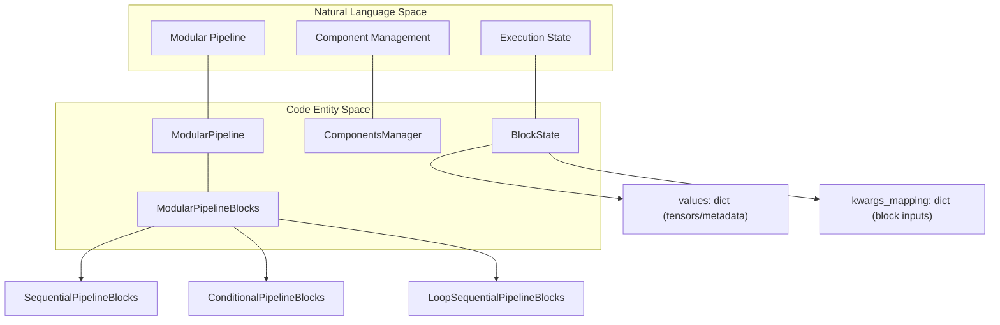
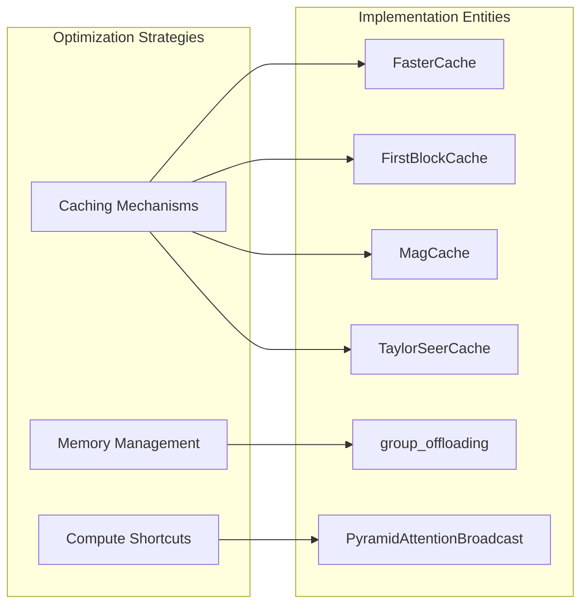

<!-- source: DeepWiki mcp.deepwiki.com · repo huggingface/diffusers · page 8 Advanced Pipeline Systems · fetched 2026-10-21 -->

# Advanced Pipeline Systems

Relevant source files

The following files were used as context for generating this wiki page:

- [docs/source/en/api/pipelines/cosmos.md](docs/source/en/api/pipelines/cosmos.md)
- [docs/source/en/api/pipelines/overview.md](docs/source/en/api/pipelines/overview.md)
- [scripts/convert_cosmos_to_diffusers.py](scripts/convert_cosmos_to_diffusers.py)
- [src/diffusers/models/controlnets/controlnet_cosmos.py](src/diffusers/models/controlnets/controlnet_cosmos.py)
- [src/diffusers/models/transformers/transformer_cosmos.py](src/diffusers/models/transformers/transformer_cosmos.py)
- [src/diffusers/pipelines/cosmos/__init__.py](src/diffusers/pipelines/cosmos/__init__.py)
- [src/diffusers/pipelines/cosmos/pipeline_cosmos2_5_predict.py](src/diffusers/pipelines/cosmos/pipeline_cosmos2_5_predict.py)
- [src/diffusers/pipelines/cosmos/pipeline_cosmos2_5_transfer.py](src/diffusers/pipelines/cosmos/pipeline_cosmos2_5_transfer.py)
- [tests/models/controlnets/test_models_controlnet_cosmos.py](tests/models/controlnets/test_models_controlnet_cosmos.py)
- [tests/pipelines/cosmos/cosmos_guardrail.py](tests/pipelines/cosmos/cosmos_guardrail.py)

The `diffusers` library continuously advances its suite of pipeline systems to incorporate cutting-edge model architectures and flexible inference workflows. This section provides a high-level overview of the newer, specialized, and modular pipeline systems in the codebase, highlighting video generation, transformer-based approaches, modular pipelines, guidance strategies, and inference optimizations.

Each sub-topic in this section is covered in depth on its dedicated child page.

---

## Flux Pipelines

The **Flux** pipelines leverage large-scale Rectified Flow Transformers, implementing the MMDiT (Multimodal Diffusion Transformer) architecture via the `FluxTransformer2DModel`. These pipelines support a rich variety of generation tasks including text-to-image, image-to-image, inpainting, conditional control, and special use cases:

- Core text-to-image pipeline employing dual text encoders (e.g., CLIP and T5).
- Variants for image modification such as `FluxImg2ImgPipeline`, `FluxInpaintPipeline`, and a focused `FluxFillPipeline`.
- Conditional generation through specialized control mechanisms: `FluxControlNetPipeline` for external spatial conditioning, integrated `FluxControlPipeline`, and combined control-inpainting/image-to-image pipelines.
- Contextual and prior-conditioning variants like `FluxKontextPipeline` and `FluxPriorReduxPipeline`, providing enhanced compositional control.

The Flux pipelines represent a cohesive approach that unifies transformer architectures with versatile conditioning and generation workflows.

For full details, see [Flux Pipelines](#8.1).

Sources: [src/diffusers/pipelines/flux/pipeline_flux.py:146-171](), [src/diffusers/pipelines/flux/pipeline_flux_img2img.py:169-172](), [src/diffusers/pipelines/flux/pipeline_flux_fill.py:168-174](), [src/diffusers/pipelines/flux/pipeline_flux_controlnet.py:180-182](), [src/diffusers/pipelines/flux/pipeline_flux_control.py:159-162](), [src/diffusers/pipelines/flux/pipeline_flux_kontext.py:188-190](), [src/diffusers/pipelines/flux/pipeline_flux_prior_redux.py:118-120]()

---

## Stable Diffusion 3 and DiT Pipelines

The Stable Diffusion 3 (SD3) pipelines incorporate a triple text encoder setup with the MMDiT architecture, enabling richer multimodal latent representations. This family includes the flagship SD3 pipelines plus a variety of Diffusion Transformer (DiT) based models such as AuraFlow, PixArt-alpha, Sana, Lumina, Qwen-Image, Z-Image, and others.

This collection focuses on transformer-based denoising backends with advanced cross-attention and conditioning mechanisms, unified under the SD3 and DiT architectural framework.

For comprehensive documentation, see [Stable Diffusion 3 and DiT Pipelines](#8.2).

Sources: [src/diffusers/models/transformers/transformer_cosmos.py:1-173](), [src/diffusers/pipelines/cosmos/__init__.py:25-59]()

---

## Video Generation Pipelines

Video generation models in the library deploy both spatio-temporal UNets and 3D causal transformers to enable text-to-video, image-to-video, and video-to-world synthesis. Supported frameworks include:

- **AnimateDiff** and **Stable Video Diffusion (SVD)**, targeting high-quality frame-coherent generation using spatio-temporal architectures.
- Transformer-based systems like **CogVideoX**, **HunyuanVideo**, and the **Wan** model family, exploiting 3D transformers for temporal reasoning and latent video modeling.
- Modularized pipelines such as `WanModularPipeline` and `Wan22ModularPipeline` exemplify the shift towards modular design in video pipelines.

These pipelines incorporate advanced schedulers, video processors, and safety checkers optimized for temporal coherence and video context understanding.

For a detailed walkthrough, see [Video Generation Pipelines](#8.3).

Sources: [src/diffusers/modular_pipelines/modular_pipeline.py:89-106](), [src/diffusers/pipelines/cosmos/pipeline_cosmos2_5_predict.py:1-138](), [src/diffusers/pipelines/cosmos/pipeline_cosmos2_5_transfer.py:1-130]()

---

## Modular Pipeline System

The **Modular Pipeline System** introduces an experimental architecture that breaks down pipelines into reusable and composable blocks (`PipelineBlocks`) rather than monolithic scripts. This system enables:

- Fine-grained component reuse and sharing handled by a `ComponentsManager`.
- Passing of intermediate tensor states and metadata using a `BlockState` abstraction.
- Orchestration of blocks via composite pipeline patterns like `SequentialPipelineBlocks` and conditional logic blocks.
- Integration with Mellon nodes for advanced runtime customization.

### Code Entity Mapping: Modular Pipeline System

This modular system encourages extensibility and easier pipeline customization for advanced use cases.

For full architectural details, see [Modular Pipeline System](#8.4).

Sources: [src/diffusers/modular_pipelines/modular_pipeline.py:129-164](), [tests/modular_pipelines/test_modular_pipelines_custom_blocks.py:26-35]()

---

## Guidance Techniques

Guidance in `diffusers` has evolved beyond classic Classifier-Free Guidance (CFG) and now includes several advanced algorithms implemented as modular "guider" objects. The guidance framework supports:

- Standard Classifier-Free Guidance as a base.
- Advanced guidance algorithms such as Perturbed Attention Guidance (PAG), Skip Layer Guidance (SLG), and pipelines that integrate these into Flux and Wan architectures.
- These guiders can be composed or swapped to fine-tune generation steering without rewriting pipeline logic.

This approach enables flexible and powerful control over model outputs and sampling dynamics.

For detailed information, see [Guidance Techniques](#8.5).

Sources: [src/diffusers/pipelines/flux/pipeline_flux.py:40-80](), [src/diffusers/pipelines/flux/pipeline_flux_controlnet.py:70-90](), [tests/modular_pipelines/test_modular_pipelines_common.py:10-30]()

---

## Inference Optimization Hooks

To enable efficient inference on large models, the library provides an extensible hooks system offering multiple caching and optimization strategies:

- **Caching hooks** such as `FasterCache`, `FirstBlockCache`, and `MagCache` reduce redundant computations.
- **Memory optimizations** including group offloading and layerwise mixed precision casting.
- **Compute shortcuts** like `PyramidAttentionBroadcast` improve attention mechanism efficiency.
- Advanced techniques like `TaylorSeerCache` facilitate progressive approximation of model blocks.

### Code Entity Mapping: Inference Optimization Hooks

These hooks transparently boost inference throughput and reduce VRAM footprint without modifying pipeline APIs.

For implementation details, see [Inference Optimization Hooks](#8.6).

Sources: [src/diffusers/modular_pipelines/modular_pipeline.py:1330-1340]() (hook system reference)

---

## Legacy and Multi-Stage Pipelines

A collection of legacy and multi-stage pipelines remains supported to facilitate transitions and cater to specialized domains:

- Kandinsky prior and decoder pipelines chain multiple stages for image synthesis.
- DeepFloyd IF cascades employ multi-model superresolution stages for ultra-high quality.
- Latent Consistency Models (LCM) enhance training and sampling consistency.
- Audio pipelines such as AudioLDM2 and Stable Audio handle diffusion for sound generation.
- Deprecated pipelines and backward-compatible features are documented here.

These pipelines preserve important research milestones and specialized utilities.

For details, see [Legacy and Multi-Stage Pipelines](#8.7).

---

## Summary Table of Advanced Systems

| System                         | Key Classes / Concepts                                  | Purpose / Highlights                                                |
|-------------------------------|--------------------------------------------------------|--------------------------------------------------------------------|
| **Flux Pipelines**             | `FluxTransformer2DModel`, `FluxPipeline`, variants    | Rectified flow transformers for multi-task, controlled generation |
| **Stable Diffusion 3 & DiT**  | SD3 pipelines, MMDiT architecture, triple encoders     | Multimodal transformer latent denoisers                            |
| **Video Generation Pipelines**| `WanModularPipeline`, `AnimateDiff`, `CogVideoX`      | Spatio-temporal UNets and 3D transformer video synthesis           |
| **Modular Pipeline System**   | `ModularPipeline`, `PipelineBlock`, `ComponentsManager`| Pipeline component reuse and composable execution                   |
| **Guidance Techniques**        | `ClassifierFreeGuidance`, PAG, SLG                      | Modular, advanced guidance algorithms for generation steering     |
| **Inference Optimization Hooks**| `FasterCache`, `FirstBlockCache`, `group_offloading` | Memory and speed optimizations during inference                     |
| **Legacy & Multi-Stage**       | Kandinsky, DeepFloyd IF cascades, Audio pipelines      | Specialized and legacy pipeline families                           |

---

This page outlines the landscape of advanced pipeline systems in `diffusers`, bridging state-of-the-art model architectures with flexible, reusable components and efficient optimized inference. Explore detailed child pages for comprehensive technical information.

# References

- `src/diffusers/pipelines/flux/pipeline_flux.py:146-171`  
- `src/diffusers/pipelines/flux/pipeline_flux_img2img.py:169-172`  
- `src/diffusers/pipelines/flux/pipeline_flux_controlnet.py:180-182`  
- `src/diffusers/pipelines/flux/pipeline_flux_fill.py:168-174`  
- `src/diffusers/pipelines/flux/pipeline_flux_controlnet_image_to_image.py:172-174`  
- `src/diffusers/pipelines/flux/pipeline_flux_kontext.py:188-190`  
- `src/diffusers/pipelines/flux/pipeline_flux_prior_redux.py:118-120`  
- `src/diffusers/models/transformers/transformer_cosmos.py:1-173`  
- `src/diffusers/pipelines/cosmos/__init__.py:25-59`  
- `src/diffusers/modular_pipelines/modular_pipeline.py:129-164`  
- `tests/modular_pipelines/test_modular_pipelines_custom_blocks.py:26-35`  
- `src/diffusers/pipelines/flux/pipeline_flux.py:40-80`  
- `src/diffusers/pipelines/flux/pipeline_flux_controlnet.py:70-90`  
- `tests/modular_pipelines/test_modular_pipelines_common.py:10-30`  
- `src/diffusers/modular_pipelines/modular_pipeline.py:1330-1340`  
- `src/diffusers/pipelines/cosmos/pipeline_cosmos2_5_predict.py:1-138`  
- `src/diffusers/pipelines/cosmos/pipeline_cosmos2_5_transfer.py:1-130`  
- `src/diffusers/modular_pipelines/modular_pipeline.py:89-106`()

---

