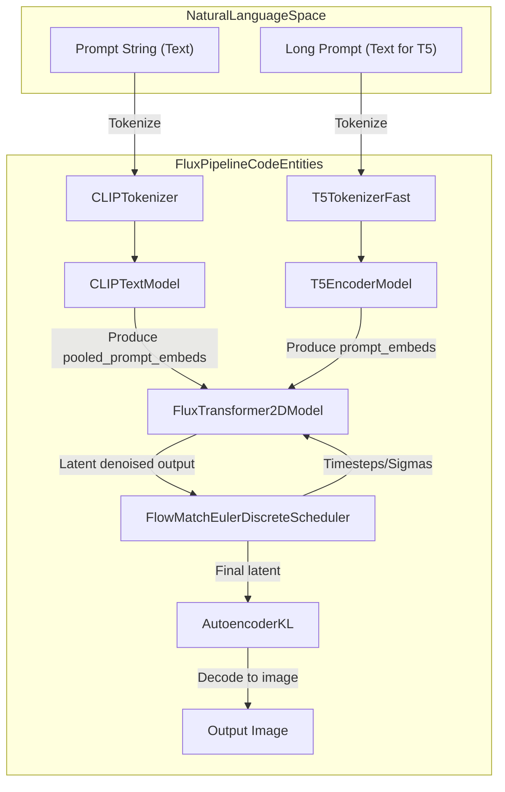
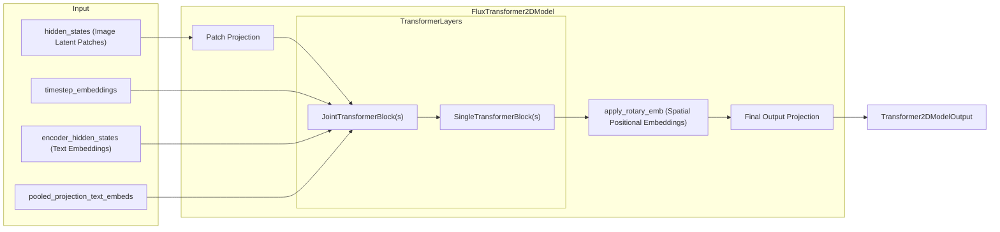

<!-- source: DeepWiki mcp.deepwiki.com · repo huggingface/diffusers · page 8.1 Flux Pipelines · fetched 2026-10-21 -->

# Flux Pipelines

<details>
<summary>Relevant source files</summary>

The following files were used as context for generating this wiki page:

- [LICENSE](LICENSE)
- [docs/source/en/api/models/flux2_transformer.md](docs/source/en/api/models/flux2_transformer.md)
- [docs/source/en/api/pipelines/flux.md](docs/source/en/api/pipelines/flux.md)
- [docs/source/en/api/pipelines/flux2.md](docs/source/en/api/pipelines/flux2.md)
- [docs/source/en/api/pipelines/stable_diffusion/stable_diffusion_3.md](docs/source/en/api/pipelines/stable_diffusion/stable_diffusion_3.md)
- [pyproject.toml](pyproject.toml)
- [scripts/convert_flux2_to_diffusers.py](scripts/convert_flux2_to_diffusers.py)
- [src/diffusers/loaders/transformer_flux.py](src/diffusers/loaders/transformer_flux.py)
- [src/diffusers/loaders/transformer_sd3.py](src/diffusers/loaders/transformer_sd3.py)
- [src/diffusers/models/transformers/transformer_flux.py](src/diffusers/models/transformers/transformer_flux.py)
- [src/diffusers/models/transformers/transformer_flux2.py](src/diffusers/models/transformers/transformer_flux2.py)
- [src/diffusers/pipelines/flux/__init__.py](src/diffusers/pipelines/flux/__init__.py)
- [src/diffusers/pipelines/flux/pipeline_flux.py](src/diffusers/pipelines/flux/pipeline_flux.py)
- [src/diffusers/pipelines/flux/pipeline_flux_control.py](src/diffusers/pipelines/flux/pipeline_flux_control.py)
- [src/diffusers/pipelines/flux/pipeline_flux_control_img2img.py](src/diffusers/pipelines/flux/pipeline_flux_control_img2img.py)
- [src/diffusers/pipelines/flux/pipeline_flux_control_inpaint.py](src/diffusers/pipelines/flux/pipeline_flux_control_inpaint.py)
- [src/diffusers/pipelines/flux/pipeline_flux_controlnet.py](src/diffusers/pipelines/flux/pipeline_flux_controlnet.py)
- [src/diffusers/pipelines/flux/pipeline_flux_controlnet_image_to_image.py](src/diffusers/pipelines/flux/pipeline_flux_controlnet_image_to_image.py)
- [src/diffusers/pipelines/flux/pipeline_flux_controlnet_inpainting.py](src/diffusers/pipelines/flux/pipeline_flux_controlnet_inpainting.py)
- [src/diffusers/pipelines/flux/pipeline_flux_fill.py](src/diffusers/pipelines/flux/pipeline_flux_fill.py)
- [src/diffusers/pipelines/flux/pipeline_flux_img2img.py](src/diffusers/pipelines/flux/pipeline_flux_img2img.py)
- [src/diffusers/pipelines/flux/pipeline_flux_inpaint.py](src/diffusers/pipelines/flux/pipeline_flux_inpaint.py)
- [src/diffusers/pipelines/flux/pipeline_flux_kontext.py](src/diffusers/pipelines/flux/pipeline_flux_kontext.py)
- [src/diffusers/pipelines/flux/pipeline_flux_kontext_inpaint.py](src/diffusers/pipelines/flux/pipeline_flux_kontext_inpaint.py)
- [src/diffusers/pipelines/flux/pipeline_flux_prior_redux.py](src/diffusers/pipelines/flux/pipeline_flux_prior_redux.py)
- [src/diffusers/pipelines/flux/pipeline_output.py](src/diffusers/pipelines/flux/pipeline_output.py)
- [src/diffusers/pipelines/flux2/__init__.py](src/diffusers/pipelines/flux2/__init__.py)
- [src/diffusers/pipelines/flux2/image_processor.py](src/diffusers/pipelines/flux2/image_processor.py)
- [src/diffusers/pipelines/flux2/pipeline_flux2.py](src/diffusers/pipelines/flux2/pipeline_flux2.py)
- [src/diffusers/pipelines/flux2/pipeline_flux2_klein.py](src/diffusers/pipelines/flux2/pipeline_flux2_klein.py)
- [src/diffusers/pipelines/flux2/pipeline_flux2_klein_inpaint.py](src/diffusers/pipelines/flux2/pipeline_flux2_klein_inpaint.py)
- [src/diffusers/pipelines/flux2/pipeline_flux2_klein_kv.py](src/diffusers/pipelines/flux2/pipeline_flux2_klein_kv.py)
- [src/diffusers/pipelines/flux2/system_messages.py](src/diffusers/pipelines/flux2/system_messages.py)
- [tests/pipelines/flux/test_pipeline_flux.py](tests/pipelines/flux/test_pipeline_flux.py)
- [tests/pipelines/flux/test_pipeline_flux_control.py](tests/pipelines/flux/test_pipeline_flux_control.py)
- [tests/pipelines/flux/test_pipeline_flux_control_img2img.py](tests/pipelines/flux/test_pipeline_flux_control_img2img.py)
- [tests/pipelines/flux/test_pipeline_flux_control_inpaint.py](tests/pipelines/flux/test_pipeline_flux_control_inpaint.py)
- [tests/pipelines/flux/test_pipeline_flux_fill.py](tests/pipelines/flux/test_pipeline_flux_fill.py)
- [tests/pipelines/flux/test_pipeline_flux_img2img.py](tests/pipelines/flux/test_pipeline_flux_img2img.py)
- [tests/pipelines/flux/test_pipeline_flux_inpaint.py](tests/pipelines/flux/test_pipeline_flux_inpaint.py)
- [tests/pipelines/flux/test_pipeline_flux_kontext.py](tests/pipelines/flux/test_pipeline_flux_kontext.py)
- [tests/pipelines/flux/test_pipeline_flux_kontext_inpaint.py](tests/pipelines/flux/test_pipeline_flux_kontext_inpaint.py)
- [tests/pipelines/flux/test_pipeline_flux_redux.py](tests/pipelines/flux/test_pipeline_flux_redux.py)
- [tests/pipelines/flux/testing_utils.py](tests/pipelines/flux/testing_utils.py)
- [tests/pipelines/flux2/test_pipeline_flux2_klein.py](tests/pipelines/flux2/test_pipeline_flux2_klein.py)
- [tests/pipelines/flux2/test_pipeline_flux2_klein_inpaint.py](tests/pipelines/flux2/test_pipeline_flux2_klein_inpaint.py)
- [tests/pipelines/flux2/test_pipeline_flux2_klein_kv.py](tests/pipelines/flux2/test_pipeline_flux2_klein_kv.py)

</details>


Flux is a family of text-to-image generation models that leverage a flow-matching transformer architecture developed by Black Forest Labs. The Flux system utilizes a Multimodal Diffusion Transformer (MMDiT) to jointly model text and image latent tokens in a unified transformer architecture. The `diffusers` library includes implementations for multiple versions of Flux, namely Flux.1 and Flux.2, with pipeline variants covering text-to-image, image-to-image, inpainting, ControlNet-based conditional generation, and Kontext models.

---

## Flux System Architecture

Unlike typical Stable Diffusion pipelines that use separate encoders and UNets, Flux pipelines employ a joint transformer architecture allowing tight interaction between text and image tokens throughout the diffusion denoising process.

### Core Components

A typical Flux pipeline comprises:

| Component          | Description & Code Entity                                            |
|--------------------|----------------------------------------------------------------------|
| Transformer        | `FluxTransformer2DModel`<br/>Conditional Multimodal Diffusion Transformer (MMDiT) architecture processing denoising steps [pipeline_flux.py:159-161]() |
| Scheduler          | `FlowMatchEulerDiscreteScheduler`<br/>Scheduler controlling timestep scheduling and noise scaling [pipeline_flux.py:161-163]() |
| Variational Autoencoder (VAE) | `AutoencoderKL`<br/>Encodes and decodes images to/from latent representations [pipeline_flux.py:163-165]() |
| Text Encoders      | Dual text encoders combining:<br/>- `CLIPTextModel` (clip-vit-large-patch14)<br/>- `T5EncoderModel` (T5-v1.1-XXL)<br/>These generate prompt embeddings used by the transformer [pipeline_flux.py:165-170]() |

---

### High-Level Data Flow and Code Entities

The image generation process from a prompt string to final image involves multiple modules working together. Below is a diagram bridging natural language concepts with their corresponding code entities for Flux pipelines.



This flow encapsulates the joint modeling approach of Flux transformers—both text and image embeddings are processed together in the transformer, enabling cross-modal conditioning [pipeline_flux.py:146-175]().

---

## FluxTransformer Architecture

The core denoising architecture in Flux pipelines is the `FluxTransformer2DModel`. It implements a Transformer that operates on 2D latent patch sequences rather than conventional UNet-based diffusion steps.

### Notable Architectural Features

- **Patchification**: Images and latents are divided into fixed-size patches forming sequential tokens as input to the transformer.
- **Rotary Positional Embeddings (RoPE)**: Spatial awareness is injected through multi-dimensional RoPE, accommodating 2D spatial layouts efficiently [transformer_flux.py:34,115-116]().
- **Joint and Single Transformer Blocks**:
  - *Joint Blocks* handle parallel processing of text and image tokens with separate projections but shared attention mechanisms [transformer_flux.py:91-112]().
  - *Single Blocks* process combined sequences in later stages for optimization.
- **Flux2 Klein KV Caching**: The newer Flux2 implementation introduces specialized key-value caching (`Flux2KVCache`) for enhanced interactive visual intelligence and latent token reuse [transformer_flux2.py:87-110]().

---

### Transformer Internal Data Flow



Here, the transformer processes the combination of image latent patches and condition embeddings through multiple layers applying rotary embeddings for spatial awareness. The pipeline retrieves the latent denoised predictions after this stage [transformer_flux.py:75-140](), [transformer_flux2.py:44-58]().

---

## Pipeline Variants

### 1. Text-to-Image Pipelines

- **`FluxPipeline` (Flux.1 variants)**  
  Supports text-to-image generation using the FluxTransformer2DModel with a dual-text-encoder setup.  
  Two model checkpoints distinguished by training style:  
  - *Timestep-distilled (`black-forest-labs/FLUX.1-schnell`)*: Optimized for fewer sampling steps with guidance scale fixed at 0.  
  - *Guidance-distilled (`black-forest-labs/FLUX.1-dev`)*: Allows guidance scale > 0 with more sampling steps needed.  
  Example usage:  
  ```python
  from diffusers import FluxPipeline
  pipe = FluxPipeline.from_pretrained("black-forest-labs/FLUX.1-dev", torch_dtype=torch.bfloat16)
  pipe.to("cuda")
  image = pipe("A tiny astronaut on the moon", guidance_scale=3.5, num_inference_steps=50).images[0]
  image.save("output.png")
  ```  
  [pipeline_flux.py:146-167](), [docs/source/en/api/pipelines/flux.md:45-90]()

- **`Flux2KleinPipeline` (Flux.2 Klein variant)**  
  An upgraded Flux.2 model using a new tokenizer and a Qwen-based text encoder designed for interactive generation with KV caching [pipeline_flux2_klein.py:155-170]().

---

### 2. Image-to-Image and Inpainting Pipelines

- **`FluxImg2ImgPipeline`**  
  Allows image modification conditioned on an input image, with a `strength` parameter controlling amount of diffusion noise added [pipeline_flux_img2img.py:157-168]().

- **`FluxInpaintPipeline`**  
  Supports masked inpainting with an input image and mask to fill regions while conditioning on prompts [pipeline_flux_inpaint.py:55-75]().

- **`FluxFillPipeline`**  
  Provides native fill and outpainting capabilities, distinct from classical masking pipelines, omitting the need for a strength parameter. It is trained to inpaint and extend the canvas [docs/source/en/api/pipelines/flux.md:93-97]().

- **`Flux2KleinInpaintPipeline`**  
  A Flux.2 variant tailored for inpainting tasks with enhanced architecture and KV caching [pipeline_flux2_klein_inpaint.py:157-160]().

---

### 3. Control and ControlNet Pipelines

Flux supports conditioning signals for spatial or structural guidance through several pipeline variants:

- **`FluxControlPipeline`**  
  Processes conditioning images concatenated channel-wise with latent inputs to steer generation (e.g., edges). Uses `FluxTransformer2DModel` and employs diffusion with conditioning channels [pipeline_flux_control.py:159-171](), [docs/source/en/api/pipelines/flux.md:121-124]().

- **`FluxControlNetPipeline`**  
  Employs an auxiliary ControlNet model (`FluxControlNetModel`) that adds residual features to the FluxTransformer to imbue conditional control [pipeline_flux_controlnet.py:170-180]().

- **`FluxControlNetImg2ImgPipeline` and `FluxControlNetInpaintPipeline`**  
  Combine ControlNet guidance with image-to-image or inpainting workflows for refined control [pipeline_flux_controlnet_inpainting.py:170-180](), [pipeline_flux_controlnet_image_to_image.py:170-180]().

---

## Technical Implementation Details

### Adjusting Timestep Shifts

Flux pipelines compute a timestep shift parameter that adjusts noise schedules depending on the image sequence length. This helps in dealing with various input resolutions while maintaining consistency in diffusion scheduling. The function `calculate_shift` interpolates a shift between base and max values:

```python
def calculate_shift(image_seq_len, base_seq_len=256, max_seq_len=4096, base_shift=0.5, max_shift=1.15):
    m = (max_shift - base_shift) / (max_seq_len - base_seq_len)
    b = base_shift - m * base_seq_len
    mu = image_seq_len * m + b
    return mu
```

Flux.2 pipelines introduce a similar function `compute_empirical_mu` for this purpose [pipeline_flux.py:73-83](), [pipeline_flux2_klein.py:63-78]().

---

### Attention Processing in Flux Transformer

The Flux Transformer implements a specialized attention mechanism via `FluxAttnProcessor`:

1. **Projections:** Separate query, key, and value matrices are projected from both hidden states and optional encoder hidden states (conditioning text).  
2. **Normalization:** Inputs to queries and keys are normalized using learned normalization layers (`norm_q` and `norm_k`).  
3. **Concatenation:** When encoder hidden states are present, their projections are concatenated with input projections to perform joint attention.  
4. **Scaled Dot-Product Attention:** The attention is computed using PyTorch 2.0's `scaled_dot_product_attention` backend or dispatched backends for performance.  
5. **Output:** The attention outputs are split back into image and encoder components, followed by output projection layers.

This processor supports parallelism configurations and rotary embeddings for spatial awareness [transformer_flux.py:76-143]().

---

### Flux.2 Klein: KV Causal Attention

Flux.2 Klein extends attention with a causal mechanism for KV caching:

- Reference tokens (from cached keys and values) attend only to themselves (diagonal mask).
- Text and image tokens attend to the entire extended sequence (text + reference + image), enabling context reuse from cached references without information leakage.
- This is implemented using masked attention to regulate token dependencies.

This architecture allows real-time interactive visual intelligence with accelerated computation [transformer_flux2.py:110-169]().

---

## Summary of Flux Pipeline Classes and File Locations

| Pipeline Type                           | Class Name                    | File Path                                       |
|----------------------------------------|-------------------------------|------------------------------------------------|
| Text-to-Image (Flux.1)                  | `FluxPipeline`                | `src/diffusers/pipelines/flux/pipeline_flux.py` |
| Image-to-Image                         | `FluxImg2ImgPipeline`         | `src/diffusers/pipelines/flux/pipeline_flux_img2img.py` |
| Inpainting                            | `FluxInpaintPipeline`          | `src/diffusers/pipelines/flux/pipeline_flux_inpaint.py` |
| Fill (inpainting/outpainting)          | `FluxFillPipeline`            | `src/diffusers/pipelines/flux/pipeline_flux_fill.py` |
| ControlNet-guided Text-to-Image        | `FluxControlNetPipeline`      | `src/diffusers/pipelines/flux/pipeline_flux_controlnet.py` |
| ControlNet-guided Image-to-Image       | `FluxControlNetImg2ImgPipeline` | `src/diffusers/pipelines/flux/pipeline_flux_controlnet_image_to_image.py` |
| ControlNet-guided Inpainting            | `FluxControlNetInpaintPipeline` | `src/diffusers/pipelines/flux/pipeline_flux_controlnet_inpainting.py` |
| Channel Concatenation Control           | `FluxControlPipeline`         | `src/diffusers/pipelines/flux/pipeline_flux_control.py` |
| Kontext Text-to-Image with large context | `FluxKontextPipeline`         | `src/diffusers/pipelines/flux/pipeline_flux_kontext.py` |
| Flux.2 Klein Text-to-Image              | `Flux2KleinPipeline`          | `src/diffusers/pipelines/flux2/pipeline_flux2_klein.py` |
| Flux.2 Klein Inpainting                  | `Flux2KleinInpaintPipeline`   | `src/diffusers/pipelines/flux2/pipeline_flux2_klein_inpaint.py` |

---

## References

- Flux pipeline main implementation: [src/diffusers/pipelines/flux/pipeline_flux.py:1-167]()
- Flux ControlNet pipelines: [src/diffusers/pipelines/flux/pipeline_flux_controlnet.py:1-180]()
- Flux.2 Klein pipeline: [src/diffusers/pipelines/flux2/pipeline_flux2_klein.py:40-160]()
- Transformer Flux architecture: [src/diffusers/models/transformers/transformer_flux.py:1-180]()
- Transformer Flux.2 (Klein) architecture and KV caching: [src/diffusers/models/transformers/transformer_flux2.py:60-180]()
- Pipeline tests covering Flux variants: [tests/pipelines/flux/test_pipeline_flux.py:50-160](), [tests/pipelines/flux2/test_pipeline_flux2_klein.py:1-150]()
- Flux technical overview: [docs/source/en/api/pipelines/flux.md:1-150]()

---

This page details the Flux pipeline family in `diffusers`. It explains the core multimodal transformer architecture, pipeline variants for various applications including ControlNet conditioning, and highlights critical engineering mechanisms such as timestep shifts and advanced attention processing.

---

