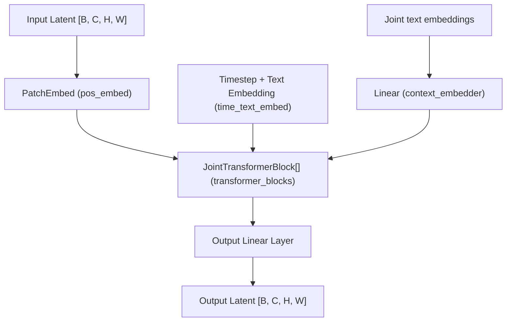
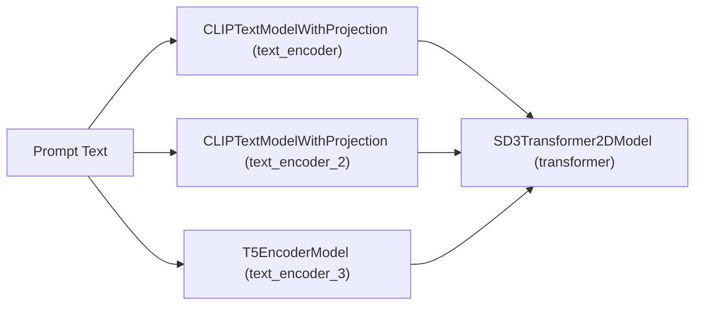
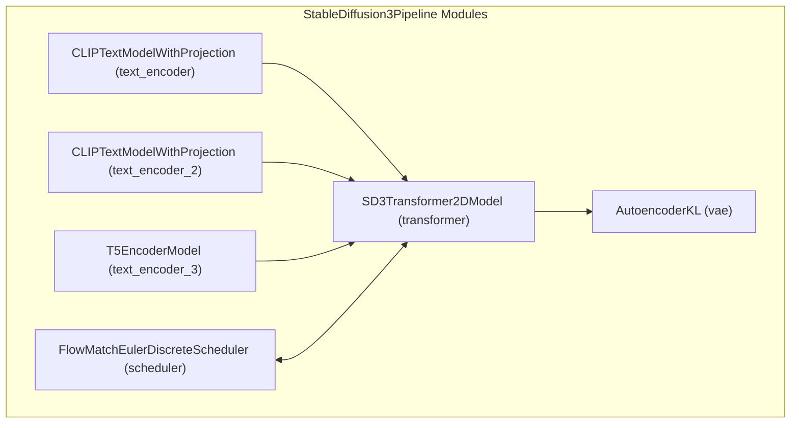
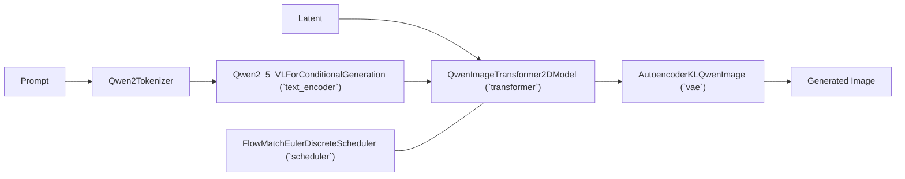

<!-- source: DeepWiki mcp.deepwiki.com · repo huggingface/diffusers · page 8.2 Stable Diffusion 3 and DiT Pipelines · fetched 2026-10-21 -->

# Stable Diffusion 3 and DiT Pipelines

<details>
<summary>Relevant source files</summary>

The following files were used as context for generating this wiki page:

- [docs/source/en/api/models/autoencoder_kl_hunyuan_video.md](docs/source/en/api/models/autoencoder_kl_hunyuan_video.md)
- [docs/source/en/api/models/chroma_transformer.md](docs/source/en/api/models/chroma_transformer.md)
- [docs/source/en/api/models/controlnet_hunyuandit.md](docs/source/en/api/models/controlnet_hunyuandit.md)
- [docs/source/en/api/models/hunyuan_transformer2d.md](docs/source/en/api/models/hunyuan_transformer2d.md)
- [docs/source/en/api/models/hunyuan_video_transformer_3d.md](docs/source/en/api/models/hunyuan_video_transformer_3d.md)
- [docs/source/en/api/models/sana_transformer2d.md](docs/source/en/api/models/sana_transformer2d.md)
- [docs/source/en/api/models/z_image_transformer2d.md](docs/source/en/api/models/z_image_transformer2d.md)
- [docs/source/en/api/pipelines/chroma.md](docs/source/en/api/pipelines/chroma.md)
- [docs/source/en/api/pipelines/controlnet_hunyuandit.md](docs/source/en/api/pipelines/controlnet_hunyuandit.md)
- [docs/source/en/api/pipelines/hunyuandit.md](docs/source/en/api/pipelines/hunyuandit.md)
- [docs/source/en/api/pipelines/pixart_sigma.md](docs/source/en/api/pipelines/pixart_sigma.md)
- [docs/source/en/api/pipelines/qwenimage.md](docs/source/en/api/pipelines/qwenimage.md)
- [docs/source/en/api/pipelines/sana_sprint.md](docs/source/en/api/pipelines/sana_sprint.md)
- [docs/source/en/api/pipelines/z_image.md](docs/source/en/api/pipelines/z_image.md)
- [examples/community/pipeline_hunyuandit_differential_img2img.py](examples/community/pipeline_hunyuandit_differential_img2img.py)
- [examples/dreambooth/requirements_sana.txt](examples/dreambooth/requirements_sana.txt)
- [scripts/convert_sana_to_diffusers.py](scripts/convert_sana_to_diffusers.py)
- [scripts/convert_sd3_controlnet_to_diffusers.py](scripts/convert_sd3_controlnet_to_diffusers.py)
- [src/diffusers/models/controlnets/controlnet_sd3.py](src/diffusers/models/controlnets/controlnet_sd3.py)
- [src/diffusers/models/controlnets/controlnet_z_image.py](src/diffusers/models/controlnets/controlnet_z_image.py)
- [src/diffusers/models/transformers/sana_transformer.py](src/diffusers/models/transformers/sana_transformer.py)
- [src/diffusers/models/transformers/transformer_chroma.py](src/diffusers/models/transformers/transformer_chroma.py)
- [src/diffusers/models/transformers/transformer_sd3.py](src/diffusers/models/transformers/transformer_sd3.py)
- [src/diffusers/models/transformers/transformer_z_image.py](src/diffusers/models/transformers/transformer_z_image.py)
- [src/diffusers/modular_pipelines/z_image/modular_blocks_z_image.py](src/diffusers/modular_pipelines/z_image/modular_blocks_z_image.py)
- [src/diffusers/pipelines/anyflow/pipeline_anyflow.py](src/diffusers/pipelines/anyflow/pipeline_anyflow.py)
- [src/diffusers/pipelines/anyflow/pipeline_anyflow_far.py](src/diffusers/pipelines/anyflow/pipeline_anyflow_far.py)
- [src/diffusers/pipelines/aura_flow/pipeline_aura_flow.py](src/diffusers/pipelines/aura_flow/pipeline_aura_flow.py)
- [src/diffusers/pipelines/chroma/__init__.py](src/diffusers/pipelines/chroma/__init__.py)
- [src/diffusers/pipelines/chroma/pipeline_chroma.py](src/diffusers/pipelines/chroma/pipeline_chroma.py)
- [src/diffusers/pipelines/chroma/pipeline_chroma_img2img.py](src/diffusers/pipelines/chroma/pipeline_chroma_img2img.py)
- [src/diffusers/pipelines/chroma/pipeline_chroma_inpainting.py](src/diffusers/pipelines/chroma/pipeline_chroma_inpainting.py)
- [src/diffusers/pipelines/chronoedit/pipeline_chronoedit.py](src/diffusers/pipelines/chronoedit/pipeline_chronoedit.py)
- [src/diffusers/pipelines/controlnet_hunyuandit/__init__.py](src/diffusers/pipelines/controlnet_hunyuandit/__init__.py)
- [src/diffusers/pipelines/controlnet_hunyuandit/pipeline_hunyuandit_controlnet.py](src/diffusers/pipelines/controlnet_hunyuandit/pipeline_hunyuandit_controlnet.py)
- [src/diffusers/pipelines/controlnet_sd3/pipeline_stable_diffusion_3_controlnet.py](src/diffusers/pipelines/controlnet_sd3/pipeline_stable_diffusion_3_controlnet.py)
- [src/diffusers/pipelines/controlnet_sd3/pipeline_stable_diffusion_3_controlnet_inpainting.py](src/diffusers/pipelines/controlnet_sd3/pipeline_stable_diffusion_3_controlnet_inpainting.py)
- [src/diffusers/pipelines/hunyuan_video/pipeline_hunyuan_video.py](src/diffusers/pipelines/hunyuan_video/pipeline_hunyuan_video.py)
- [src/diffusers/pipelines/hunyuandit/pipeline_hunyuandit.py](src/diffusers/pipelines/hunyuandit/pipeline_hunyuandit.py)
- [src/diffusers/pipelines/latte/pipeline_latte.py](src/diffusers/pipelines/latte/pipeline_latte.py)
- [src/diffusers/pipelines/lumina/pipeline_lumina.py](src/diffusers/pipelines/lumina/pipeline_lumina.py)
- [src/diffusers/pipelines/pag/pipeline_pag_hunyuandit.py](src/diffusers/pipelines/pag/pipeline_pag_hunyuandit.py)
- [src/diffusers/pipelines/pag/pipeline_pag_sana.py](src/diffusers/pipelines/pag/pipeline_pag_sana.py)
- [src/diffusers/pipelines/pag/pipeline_pag_sd_3.py](src/diffusers/pipelines/pag/pipeline_pag_sd_3.py)
- [src/diffusers/pipelines/pag/pipeline_pag_sd_3_img2img.py](src/diffusers/pipelines/pag/pipeline_pag_sd_3_img2img.py)
- [src/diffusers/pipelines/qwenimage/pipeline_qwenimage.py](src/diffusers/pipelines/qwenimage/pipeline_qwenimage.py)
- [src/diffusers/pipelines/qwenimage/pipeline_qwenimage_controlnet.py](src/diffusers/pipelines/qwenimage/pipeline_qwenimage_controlnet.py)
- [src/diffusers/pipelines/qwenimage/pipeline_qwenimage_controlnet_inpaint.py](src/diffusers/pipelines/qwenimage/pipeline_qwenimage_controlnet_inpaint.py)
- [src/diffusers/pipelines/qwenimage/pipeline_qwenimage_edit.py](src/diffusers/pipelines/qwenimage/pipeline_qwenimage_edit.py)
- [src/diffusers/pipelines/qwenimage/pipeline_qwenimage_edit_inpaint.py](src/diffusers/pipelines/qwenimage/pipeline_qwenimage_edit_inpaint.py)
- [src/diffusers/pipelines/qwenimage/pipeline_qwenimage_edit_plus.py](src/diffusers/pipelines/qwenimage/pipeline_qwenimage_edit_plus.py)
- [src/diffusers/pipelines/qwenimage/pipeline_qwenimage_img2img.py](src/diffusers/pipelines/qwenimage/pipeline_qwenimage_img2img.py)
- [src/diffusers/pipelines/qwenimage/pipeline_qwenimage_inpaint.py](src/diffusers/pipelines/qwenimage/pipeline_qwenimage_inpaint.py)
- [src/diffusers/pipelines/qwenimage/pipeline_qwenimage_layered.py](src/diffusers/pipelines/qwenimage/pipeline_qwenimage_layered.py)
- [src/diffusers/pipelines/sana/__init__.py](src/diffusers/pipelines/sana/__init__.py)
- [src/diffusers/pipelines/sana/pipeline_sana.py](src/diffusers/pipelines/sana/pipeline_sana.py)
- [src/diffusers/pipelines/sana/pipeline_sana_controlnet.py](src/diffusers/pipelines/sana/pipeline_sana_controlnet.py)
- [src/diffusers/pipelines/sana/pipeline_sana_sprint.py](src/diffusers/pipelines/sana/pipeline_sana_sprint.py)
- [src/diffusers/pipelines/sana/pipeline_sana_sprint_img2img.py](src/diffusers/pipelines/sana/pipeline_sana_sprint_img2img.py)
- [src/diffusers/pipelines/stable_diffusion_3/pipeline_stable_diffusion_3.py](src/diffusers/pipelines/stable_diffusion_3/pipeline_stable_diffusion_3.py)
- [src/diffusers/pipelines/stable_diffusion_3/pipeline_stable_diffusion_3_img2img.py](src/diffusers/pipelines/stable_diffusion_3/pipeline_stable_diffusion_3_img2img.py)
- [src/diffusers/pipelines/stable_diffusion_3/pipeline_stable_diffusion_3_inpaint.py](src/diffusers/pipelines/stable_diffusion_3/pipeline_stable_diffusion_3_inpaint.py)
- [src/diffusers/pipelines/z_image/__init__.py](src/diffusers/pipelines/z_image/__init__.py)
- [src/diffusers/pipelines/z_image/pipeline_z_image.py](src/diffusers/pipelines/z_image/pipeline_z_image.py)
- [src/diffusers/pipelines/z_image/pipeline_z_image_controlnet.py](src/diffusers/pipelines/z_image/pipeline_z_image_controlnet.py)
- [src/diffusers/pipelines/z_image/pipeline_z_image_controlnet_inpaint.py](src/diffusers/pipelines/z_image/pipeline_z_image_controlnet_inpaint.py)
- [src/diffusers/pipelines/z_image/pipeline_z_image_img2img.py](src/diffusers/pipelines/z_image/pipeline_z_image_img2img.py)
- [src/diffusers/pipelines/z_image/pipeline_z_image_inpaint.py](src/diffusers/pipelines/z_image/pipeline_z_image_inpaint.py)
- [src/diffusers/pipelines/z_image/pipeline_z_image_omni.py](src/diffusers/pipelines/z_image/pipeline_z_image_omni.py)
- [tests/pipelines/krea2/test_krea2.py](tests/pipelines/krea2/test_krea2.py)
- [tests/pipelines/latte/test_latte.py](tests/pipelines/latte/test_latte.py)
- [tests/pipelines/lumina/test_lumina_nextdit.py](tests/pipelines/lumina/test_lumina_nextdit.py)
- [tests/pipelines/pag/test_pag_hunyuan_dit.py](tests/pipelines/pag/test_pag_hunyuan_dit.py)
- [tests/pipelines/pag/test_pag_pixart_sigma.py](tests/pipelines/pag/test_pag_pixart_sigma.py)
- [tests/pipelines/pag/test_pag_sd3.py](tests/pipelines/pag/test_pag_sd3.py)
- [tests/pipelines/pixart_alpha/__init__.py](tests/pipelines/pixart_alpha/__init__.py)
- [tests/pipelines/pixart_alpha/test_pixart.py](tests/pipelines/pixart_alpha/test_pixart.py)
- [tests/pipelines/pixart_sigma/test_pixart.py](tests/pipelines/pixart_sigma/test_pixart.py)
- [tests/pipelines/z_image/test_z_image.py](tests/pipelines/z_image/test_z_image.py)
- [tests/pipelines/z_image/test_z_image_img2img.py](tests/pipelines/z_image/test_z_image_img2img.py)
- [tests/pipelines/z_image/test_z_image_inpaint.py](tests/pipelines/z_image/test_z_image_inpaint.py)

</details>


This section documents the implementation of **Stable Diffusion 3 (SD3)** and various **Diffusion Transformer (DiT)** based pipelines in the diffusers library. Unlike traditional U-Net based architectures, these pipelines utilize transformer backbones that process image latents as sequences of patches. SD3 introduces the **Multimodal Diffusion Transformer (MMDiT)** architecture, which employs multiple text encoders and joint attention blocks to enable rich cross-modal conditioning.

---

## Stable Diffusion 3 Architecture

Stable Diffusion 3 centers around the `SD3Transformer2DModel` implementing the MMDiT architecture, which applies joint multi-head attention between textual and visual latent embeddings to improve semantic alignment and generation quality.

### Core Transformer Model: `SD3Transformer2DModel`

- **Patch Embedding** (`pos_embed`): Converts the input latent tensor of shape `[B, C, H, W]` into a sequence of patch tokens with positional encodings.
- **Combined Timestep and Text Embedding** (`time_text_embed`): Creates an embedding that fuses timestep embedding with text projection embeddings.
- **Context Linear Layer** (`context_embedder`): Projects the joint attention embedding of dimension 4096 down to the caption projection dimension (default 1152).
- **Transformer Blocks** (`transformer_blocks`): A list of `JointTransformerBlock` modules, each performing joint attention and feed-forward operations over the combined text and image latent tokens.
- **Output Linear Layer** (`out`): Projects transformer outputs back to latent space channels.

The model supports gradient checkpointing and uses `AdaLayerNormZero` for normalization in transformer blocks.


**Sources:** [src/diffusers/models/transformers/transformer_sd3.py:79-167]()

---

### Triple Text Encoders

SD3 employs three separate text encoders to encode prompts for rich semantic and stylistic conditioning:

1. **CLIP Text Encoder (ViT-L/14):** Primary text encoder producing context embeddings and pooled projection.
2. **CLIP Text Encoder 2 (ViT-bigG/14):** Secondary CLIP encoder providing complementary textual features.
3. **T5-XXL Text Encoder:** A large T5 encoder providing deep semantic features and enabling flow matching training.

These three encoders feed their embeddings into the transformer joint attention blocks of `SD3Transformer2DModel`. This enables the model to leverage complementary linguistic features from multiple sources.


**Sources:** [src/diffusers/pipelines/stable_diffusion_3/pipeline_stable_diffusion_3.py:148-169]()

---

### Pipeline: `StableDiffusion3Pipeline`

The `StableDiffusion3Pipeline` orchestrates SD3 for text-to-image generation:

- Components:
  - `transformer`: The `SD3Transformer2DModel` that denoises latent representations.
  - `scheduler`: Typically a `FlowMatchEulerDiscreteScheduler` managing diffusion timesteps and noise schedules.
  - `vae`: An `AutoencoderKL` encoding and decoding between image and latent spaces.
  - `text_encoder`, `text_encoder_2`, `text_encoder_3`: The triple text encoders described above.
- Supports classifier-free guidance through empty or negative prompts.
- Implements `SD3LoraLoaderMixin`, `FromSingleFileMixin`, and `SD3IPAdapterMixin` for LoRA low-rank adaptation, checkpoint loading from single files, and image prompting (IP-Adapter) support.
- Image prompting via `SiglipVisionModel` as additional conditioning is optionally used.



**Sources:** [src/diffusers/pipelines/stable_diffusion_3/pipeline_stable_diffusion_3.py:148-170](), [src/diffusers/models/transformers/transformer_sd3.py:79-167]()

---

## Image-to-Image and Inpainting Variants

- **StableDiffusion3Img2ImgPipeline**: Extends the SD3 pipeline for image-to-image generation by encoding input images into latents (`vae.encode`), adding noise according to `strength` parameter, and then denoising with the transformer [src/diffusers/pipelines/stable_diffusion_3/pipeline_stable_diffusion_3_img2img.py:90-167]().

- **StableDiffusion3InpaintPipeline**: Supports inpainting by accepting an input image and mask image, processing masked latents and running diffusion steps using the SD3 transformer [src/diffusers/pipelines/stable_diffusion_3/pipeline_stable_diffusion_3_inpaint.py:60-160]().

Both pipelines use the same triple text encoding scheme and scheduler.

**Sources:** [src/diffusers/pipelines/stable_diffusion_3/pipeline_stable_diffusion_3_img2img.py](), [src/diffusers/pipelines/stable_diffusion_3/pipeline_stable_diffusion_3_inpaint.py]()

---

## ControlNet Integration for SD3

`StableDiffusion3ControlNetPipeline` extends SD3 pipelines by incorporating conditional ControlNet models (`SD3ControlNetModel` or multi-control-nets) for spatial guidance:

- ControlNet conditioning images are passed alongside prompts.
- The pipeline coordinates ControlNet outputs with the main transformer to modulate feature representations.
- Supports ControlNet conditioning scale and multi-controlnet functionality [src/diffusers/pipelines/controlnet_sd3/pipeline_stable_diffusion_3_controlnet.py:143-185](), [src/diffusers/models/controlnets/controlnet_sd3.py:31-40,452]().

**Sources:** [src/diffusers/pipelines/controlnet_sd3/pipeline_stable_diffusion_3_controlnet.py](), [src/diffusers/models/controlnets/controlnet_sd3.py]()

---

## Other DiT-Based Pipelines and Models

The diffusers library also includes several other DiT family models and pipelines. All use transformer-based architectures processing latent image patches with different conditioning mechanisms and often distinct text encoders.

| Pipeline / Model       | Primary Transformer Model    | Text Encoder(s)                      | Scheduler                        | Notes                                                        |
|-----------------------|-----------------------------|------------------------------------|---------------------------------|--------------------------------------------------------------|
| **AuraFlow**           | `AuraFlowTransformer2DModel`| UMT5EncoderModel (a variant of T5) | `FlowMatchEulerDiscreteScheduler` | Large-scale DiT with unique patch embedding                   |
| **PixArt-Alpha**       | `PixArtTransformer2DModel`  | T5EncoderModel                     | DPMSolverMultistepScheduler      | T5 text conditioning, efficient audio-visual transformer      |
| **PixArt-Sigma**       | `PixArtTransformer2DModel`  | T5EncoderModel                     | DPMSolverMultistepScheduler      | Higher resolution support with Karras scheduler               |
| **Sana**               | `SanaTransformer2DModel`    | Gemma2Tokenizer / Gemma2PreTrainedModel | DPMSolverMultistepScheduler      | Linear attention variant, efficient large scale               |
| **Lumina**             | (Likely DiT variant)        | (Not detailed here)                | (Scheduler not detailed)         | Other DiT-based community pipeline                            |
| **Qwen-Image**         | `QwenImageTransformer2DModel` | Qwen2.5-VL-7B-Instruct Model       | `FlowMatchEulerDiscreteScheduler` | Advanced text rendering and multi-modal interactions          |
| **Z-Image**            | `ZImageTransformerBlock`    | (Not explicitly stated, likely own tokenizer) | (Not detailed here)           | Special attention processor, RoPE embeddings                   |

---

### AuraFlow Pipeline Example

AuraFlow uses the `AuraFlowTransformer2DModel`, which applies linear patch embedding (no convolution) and SiLU-activated FFN. Its pipeline wraps: T5 tokenizer & encoder + VAE + FlowMatchEuler scheduler + transformer.


**Sources:** [src/diffusers/pipelines/aura_flow/pipeline_aura_flow.py](), [src/diffusers/models/transformers/auraflow_transformer_2d.py]()

---

## Implementation Notes on LoRA, IP-Adapter, and Checkpoint Loading

- Many SD3 and DiT pipelines integrate LoRA adapters via a mixin (`SD3LoraLoaderMixin`, `AuraFlowLoraLoaderMixin`, `QwenImageLoraLoaderMixin`, etc.) to enable parameter-efficient finetuning and checkpoint fusion.
- IP-Adapter (`SD3IPAdapterMixin`) is commonly used with SD3 pipelines to provide image prompting support, inserting features from a `SiglipVisionModel` into the transformer attention layers.
- Checkpoint loading is handled with `FromSingleFileMixin` or similar mixins for loading large, sharded, or single-file trained weights.

---

## Summary Table of Key Pipelines and Models

| Pipeline Class                     | Transformer Model              | Text Encoders                      | Scheduler                        | Image Processor                | Notable Features                  |
|----------------------------------|-------------------------------|----------------------------------|---------------------------------|-------------------------------|----------------------------------|
| `StableDiffusion3Pipeline`       | `SD3Transformer2DModel`       | 3 encoders: 2x CLIP + 1x T5      | `FlowMatchEulerDiscreteScheduler` | `VaeImageProcessor`            | MMDiT joint attention, triple text encoders, IP-Adapter |
| `StableDiffusion3Img2ImgPipeline`| `SD3Transformer2DModel`       | Same as above                    | Same as above                    | Same as above                 | Img2Img latent encoding, noise injection |
| `StableDiffusion3InpaintPipeline`| `SD3Transformer2DModel`       | Same as above                    | Same as above                    | Same as above                 | Inpainting with mask support      |
| `StableDiffusion3ControlNetPipeline` | `SD3Transformer2DModel`   | Same as above                    | Same as above                    | Same as above                 | ControlNet for spatial conditioning |
| `AuraFlowPipeline`               | `AuraFlowTransformer2DModel`  | UMT5EncoderModel                 | `FlowMatchEulerDiscreteScheduler` | `VaeImageProcessor`            | Large-scale DiT with T5 encoder   |
| `PixArtAlphaPipeline`            | `PixArtTransformer2DModel`    | T5EncoderModel                  | DPMSolverMultistepScheduler      | `PixArtImageProcessor`         | T5 only conditioning             |
| `PixArtSigmaPipeline`            | `PixArtTransformer2DModel`    | T5EncoderModel                  | DPMSolverMultistepScheduler      | `PixArtImageProcessor`         | High res and Karras schedulers   |
| `SanaPipeline`                   | `SanaTransformer2DModel`      | Gemma2PreTrainedModel            | DPMSolverMultistepScheduler      | `PixArtImageProcessor`         | Linear attention, efficient large model |
| `QwenImagePipeline`              | `QwenImageTransformer2DModel` | Qwen2.5-VL-7B-Instruct          | `FlowMatchEulerDiscreteScheduler` | `VaeImageProcessor`            | Multi-modal, advanced text rendering  |
| `ZImagePipeline`                 | `ZImageTransformerBlock`      | (Not explicitly named)           | (Not detailed)                   | (Not detailed)                 | RoPE and custom attention processor |

---

## Diagrams Bridging Natural Language Concepts to Code Entities

### SD3 Pipeline High-level Mapping

```mermaid
flowchart TD
    Prompt["Prompt"] --> |"Encode Prompt"| CLIPTextEnc1[CLIPTextModelWithProjection (`text_encoder`)]
    Prompt --> |"Encode Prompt"| CLIPTextEnc2[CLIPTextModelWithProjection (`text_encoder_2`)]
    Prompt --> |"Encode Prompt"| T5TextEnc[T5EncoderModel (`text_encoder_3`)]
    CLIPTextEnc1 --> Transformer["SD3Transformer2DModel (`transformer`)"]
    CLIPTextEnc2 --> Transformer
    T5TextEnc --> Transformer
    Transformer --> |"Denoises Latent"| VAE["AutoencoderKL (`vae`)"]
    VAE --> Image["Output Image"]
    Scheduler["FlowMatchEulerDiscreteScheduler (`scheduler`)"] --- Transformer
```

### Qwen-Image Pipeline Mapping



---

# References and Sources

This page is based primarily on the following key source files from the diffusers repository:

- SD3 Transformer model: `src/diffusers/models/transformers/transformer_sd3.py:39-167`  
- StableDiffusion3Pipeline: `src/diffusers/pipelines/stable_diffusion_3/pipeline_stable_diffusion_3.py:148-170`  
- SD3 Img2Img Pipeline: `src/diffusers/pipelines/stable_diffusion_3/pipeline_stable_diffusion_3_img2img.py:90-167`  
- SD3 Inpaint Pipeline: `src/diffusers/pipelines/stable_diffusion_3/pipeline_stable_diffusion_3_inpaint.py:60-160`  
- SD3 ControlNet Pipeline: `src/diffusers/pipelines/controlnet_sd3/pipeline_stable_diffusion_3_controlnet.py:140-185`  
- ControlNet Model: `src/diffusers/models/controlnets/controlnet_sd3.py:31-40,1218-1230`  
- AuraFlow Pipeline: `src/diffusers/pipelines/aura_flow/pipeline_aura_flow.py:123-162`  
- AuraFlow Transformer: `src/diffusers/models/transformers/auraflow_transformer_2d.py:50-143`  
- Sana Pipeline: `src/diffusers/pipelines/sana/pipeline_sana.py:23-50`  
- QwenImage Pipeline: `src/diffusers/pipelines/qwenimage/pipeline_qwenimage.py:130-158`  
- PixArt Alpha and Sigma Pipelines (summarized)  
- Z-Image Transformer: `src/diffusers/models/transformers/transformer_z_image.py`  

---

This documentation provides a detailed overview of SD3 and other DiT pipelines, focusing on architecture, data flow, and the core code implementation to guide contributors and advanced users working with transformer-based diffusion models.

---

