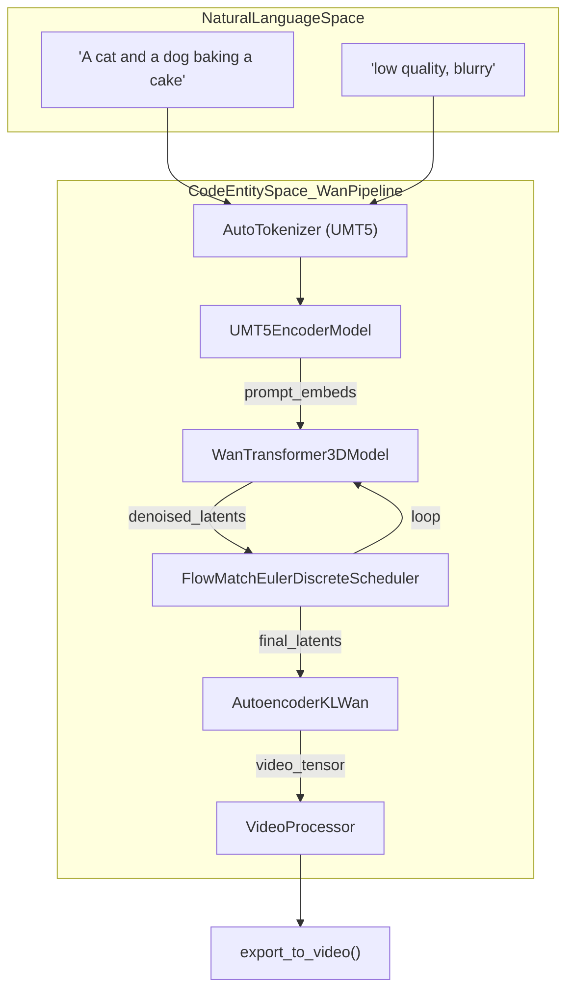
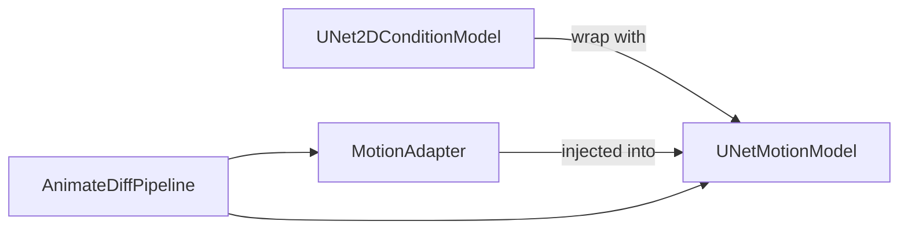
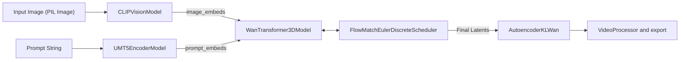
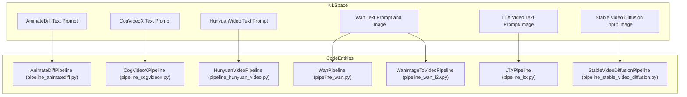

<!-- source: DeepWiki mcp.deepwiki.com · repo huggingface/diffusers · page 8.3 Video Generation Pipelines · fetched 2026-10-21 -->

# Video Generation Pipelines

Relevant source files

The following files were used as context for generating this wiki page:

- [docs/source/en/api/loaders/single_file.md](docs/source/en/api/loaders/single_file.md)
- [docs/source/en/api/models/skyreels_v2_transformer_3d.md](docs/source/en/api/models/skyreels_v2_transformer_3d.md)
- [docs/source/en/api/pipelines/cogvideox.md](docs/source/en/api/pipelines/cogvideox.md)
- [docs/source/en/api/pipelines/framepack.md](docs/source/en/api/pipelines/framepack.md)
- [docs/source/en/api/pipelines/hunyuan_video.md](docs/source/en/api/pipelines/hunyuan_video.md)
- [docs/source/en/api/pipelines/ltx2.md](docs/source/en/api/pipelines/ltx2.md)
- [docs/source/en/api/pipelines/ltx_video.md](docs/source/en/api/pipelines/ltx_video.md)
- [docs/source/en/api/pipelines/skyreels_v2.md](docs/source/en/api/pipelines/skyreels_v2.md)
- [docs/source/en/training/cogvideox.md](docs/source/en/training/cogvideox.md)
- [docs/source/en/using-diffusers/text-img2vid.md](docs/source/en/using-diffusers/text-img2vid.md)
- [examples/community/dps_pipeline.py](examples/community/dps_pipeline.py)
- [examples/community/lpw_stable_diffusion_xl.py](examples/community/lpw_stable_diffusion_xl.py)
- [examples/community/pipeline_demofusion_sdxl.py](examples/community/pipeline_demofusion_sdxl.py)
- [examples/community/pipeline_sdxl_style_aligned.py](examples/community/pipeline_sdxl_style_aligned.py)
- [examples/community/pipeline_stable_diffusion_xl_controlnet_adapter.py](examples/community/pipeline_stable_diffusion_xl_controlnet_adapter.py)
- [examples/community/pipeline_stable_diffusion_xl_controlnet_adapter_inpaint.py](examples/community/pipeline_stable_diffusion_xl_controlnet_adapter_inpaint.py)
- [examples/cosmos3/README.md](examples/cosmos3/README.md)
- [examples/cosmos3/cosmos_parallel.py](examples/cosmos3/cosmos_parallel.py)
- [examples/cosmos3/inference_cosmos3.py](examples/cosmos3/inference_cosmos3.py)
- [scripts/convert_cogvideox_to_diffusers.py](scripts/convert_cogvideox_to_diffusers.py)
- [scripts/convert_hunyuan_video_to_diffusers.py](scripts/convert_hunyuan_video_to_diffusers.py)
- [scripts/convert_ltx2_to_diffusers.py](scripts/convert_ltx2_to_diffusers.py)
- [scripts/convert_ltx_to_diffusers.py](scripts/convert_ltx_to_diffusers.py)
- [scripts/convert_skyreelsv2_to_diffusers.py](scripts/convert_skyreelsv2_to_diffusers.py)
- [src/diffusers/models/autoencoders/autoencoder_kl_cogvideox.py](src/diffusers/models/autoencoders/autoencoder_kl_cogvideox.py)
- [src/diffusers/models/transformers/cogvideox_transformer_3d.py](src/diffusers/models/transformers/cogvideox_transformer_3d.py)
- [src/diffusers/models/transformers/transformer_cosmos3.py](src/diffusers/models/transformers/transformer_cosmos3.py)
- [src/diffusers/models/transformers/transformer_hunyuan_video.py](src/diffusers/models/transformers/transformer_hunyuan_video.py)
- [src/diffusers/models/transformers/transformer_hunyuan_video_framepack.py](src/diffusers/models/transformers/transformer_hunyuan_video_framepack.py)
- [src/diffusers/models/transformers/transformer_ltx.py](src/diffusers/models/transformers/transformer_ltx.py)
- [src/diffusers/models/transformers/transformer_ltx2.py](src/diffusers/models/transformers/transformer_ltx2.py)
- [src/diffusers/models/transformers/transformer_mochi.py](src/diffusers/models/transformers/transformer_mochi.py)
- [src/diffusers/models/transformers/transformer_skyreels_v2.py](src/diffusers/models/transformers/transformer_skyreels_v2.py)
- [src/diffusers/models/transformers/transformer_wan.py](src/diffusers/models/transformers/transformer_wan.py)
- [src/diffusers/models/transformers/transformer_wan_vace.py](src/diffusers/models/transformers/transformer_wan_vace.py)
- [src/diffusers/pipelines/animatediff/pipeline_animatediff.py](src/diffusers/pipelines/animatediff/pipeline_animatediff.py)
- [src/diffusers/pipelines/animatediff/pipeline_animatediff_controlnet.py](src/diffusers/pipelines/animatediff/pipeline_animatediff_controlnet.py)
- [src/diffusers/pipelines/animatediff/pipeline_animatediff_sparsectrl.py](src/diffusers/pipelines/animatediff/pipeline_animatediff_sparsectrl.py)
- [src/diffusers/pipelines/animatediff/pipeline_animatediff_video2video.py](src/diffusers/pipelines/animatediff/pipeline_animatediff_video2video.py)
- [src/diffusers/pipelines/animatediff/pipeline_animatediff_video2video_controlnet.py](src/diffusers/pipelines/animatediff/pipeline_animatediff_video2video_controlnet.py)
- [src/diffusers/pipelines/cogvideo/__init__.py](src/diffusers/pipelines/cogvideo/__init__.py)
- [src/diffusers/pipelines/cogvideo/pipeline_cogvideox.py](src/diffusers/pipelines/cogvideo/pipeline_cogvideox.py)
- [src/diffusers/pipelines/cogvideo/pipeline_cogvideox_fun_control.py](src/diffusers/pipelines/cogvideo/pipeline_cogvideox_fun_control.py)
- [src/diffusers/pipelines/cogvideo/pipeline_cogvideox_image2video.py](src/diffusers/pipelines/cogvideo/pipeline_cogvideox_image2video.py)
- [src/diffusers/pipelines/cogvideo/pipeline_cogvideox_video2video.py](src/diffusers/pipelines/cogvideo/pipeline_cogvideox_video2video.py)
- [src/diffusers/pipelines/free_init_utils.py](src/diffusers/pipelines/free_init_utils.py)
- [src/diffusers/pipelines/free_noise_utils.py](src/diffusers/pipelines/free_noise_utils.py)
- [src/diffusers/pipelines/hunyuan_video/__init__.py](src/diffusers/pipelines/hunyuan_video/__init__.py)
- [src/diffusers/pipelines/hunyuan_video/pipeline_hunyuan_video_framepack.py](src/diffusers/pipelines/hunyuan_video/pipeline_hunyuan_video_framepack.py)
- [src/diffusers/pipelines/hunyuan_video/pipeline_output.py](src/diffusers/pipelines/hunyuan_video/pipeline_output.py)
- [src/diffusers/pipelines/ltx/__init__.py](src/diffusers/pipelines/ltx/__init__.py)
- [src/diffusers/pipelines/ltx/pipeline_ltx.py](src/diffusers/pipelines/ltx/pipeline_ltx.py)
- [src/diffusers/pipelines/ltx/pipeline_ltx_condition.py](src/diffusers/pipelines/ltx/pipeline_ltx_condition.py)
- [src/diffusers/pipelines/ltx/pipeline_ltx_image2video.py](src/diffusers/pipelines/ltx/pipeline_ltx_image2video.py)
- [src/diffusers/pipelines/ltx/pipeline_ltx_latent_upsample.py](src/diffusers/pipelines/ltx/pipeline_ltx_latent_upsample.py)
- [src/diffusers/pipelines/ltx2/__init__.py](src/diffusers/pipelines/ltx2/__init__.py)
- [src/diffusers/pipelines/ltx2/dfr_layout.py](src/diffusers/pipelines/ltx2/dfr_layout.py)
- [src/diffusers/pipelines/ltx2/pipeline_ltx2.py](src/diffusers/pipelines/ltx2/pipeline_ltx2.py)
- [src/diffusers/pipelines/ltx2/pipeline_ltx2_dfr.py](src/diffusers/pipelines/ltx2/pipeline_ltx2_dfr.py)
- [src/diffusers/pipelines/ltx2/pipeline_ltx2_dfr_temporal_refine.py](src/diffusers/pipelines/ltx2/pipeline_ltx2_dfr_temporal_refine.py)
- [src/diffusers/pipelines/ltx2/pipeline_ltx2_image2video.py](src/diffusers/pipelines/ltx2/pipeline_ltx2_image2video.py)
- [src/diffusers/pipelines/ltx2/pipeline_ltx2_latent_upsample.py](src/diffusers/pipelines/ltx2/pipeline_ltx2_latent_upsample.py)
- [src/diffusers/pipelines/ltx2/pipeline_output.py](src/diffusers/pipelines/ltx2/pipeline_output.py)
- [src/diffusers/pipelines/ltx2/utils.py](src/diffusers/pipelines/ltx2/utils.py)
- [src/diffusers/pipelines/mochi/pipeline_mochi.py](src/diffusers/pipelines/mochi/pipeline_mochi.py)
- [src/diffusers/pipelines/pag/pipeline_pag_sd_animatediff.py](src/diffusers/pipelines/pag/pipeline_pag_sd_animatediff.py)
- [src/diffusers/pipelines/stable_video_diffusion/pipeline_stable_video_diffusion.py](src/diffusers/pipelines/stable_video_diffusion/pipeline_stable_video_diffusion.py)
- [tests/models/testing_utils/memory.py](tests/models/testing_utils/memory.py)
- [tests/models/transformers/test_models_transformer_cosmos3.py](tests/models/transformers/test_models_transformer_cosmos3.py)
- [tests/models/transformers/test_models_transformer_hunyuan_1_5.py](tests/models/transformers/test_models_transformer_hunyuan_1_5.py)
- [tests/models/transformers/test_models_transformer_hunyuan_dit.py](tests/models/transformers/test_models_transformer_hunyuan_dit.py)
- [tests/models/transformers/test_models_transformer_hunyuan_video.py](tests/models/transformers/test_models_transformer_hunyuan_video.py)
- [tests/models/transformers/test_models_transformer_hunyuan_video_framepack.py](tests/models/transformers/test_models_transformer_hunyuan_video_framepack.py)
- [tests/models/transformers/test_models_transformer_ltx2.py](tests/models/transformers/test_models_transformer_ltx2.py)
- [tests/pipelines/animatediff/test_animatediff.py](tests/pipelines/animatediff/test_animatediff.py)
- [tests/pipelines/animatediff/test_animatediff_controlnet.py](tests/pipelines/animatediff/test_animatediff_controlnet.py)
- [tests/pipelines/animatediff/test_animatediff_sparsectrl.py](tests/pipelines/animatediff/test_animatediff_sparsectrl.py)
- [tests/pipelines/animatediff/test_animatediff_video2video.py](tests/pipelines/animatediff/test_animatediff_video2video.py)
- [tests/pipelines/animatediff/test_animatediff_video2video_controlnet.py](tests/pipelines/animatediff/test_animatediff_video2video_controlnet.py)
- [tests/pipelines/animatediff/testing_utils.py](tests/pipelines/animatediff/testing_utils.py)
- [tests/pipelines/cogvideo/test_cogvideox.py](tests/pipelines/cogvideo/test_cogvideox.py)
- [tests/pipelines/cogvideo/test_cogvideox_fun_control.py](tests/pipelines/cogvideo/test_cogvideox_fun_control.py)
- [tests/pipelines/cogvideo/test_cogvideox_image2video.py](tests/pipelines/cogvideo/test_cogvideox_image2video.py)
- [tests/pipelines/cogvideo/test_cogvideox_video2video.py](tests/pipelines/cogvideo/test_cogvideox_video2video.py)
- [tests/pipelines/ltx2/test_ltx2.py](tests/pipelines/ltx2/test_ltx2.py)
- [tests/pipelines/pag/test_pag_animatediff.py](tests/pipelines/pag/test_pag_animatediff.py)
- [tests/pipelines/qwenimage/test_qwenimage.py](tests/pipelines/qwenimage/test_qwenimage.py)
- [tests/pipelines/qwenimage/test_qwenimage_controlnet.py](tests/pipelines/qwenimage/test_qwenimage_controlnet.py)
- [tests/pipelines/qwenimage/test_qwenimage_edit.py](tests/pipelines/qwenimage/test_qwenimage_edit.py)
- [tests/pipelines/qwenimage/test_qwenimage_edit_plus.py](tests/pipelines/qwenimage/test_qwenimage_edit_plus.py)
- [tests/pipelines/qwenimage/test_qwenimage_img2img.py](tests/pipelines/qwenimage/test_qwenimage_img2img.py)
- [tests/pipelines/stable_video_diffusion/test_stable_video_diffusion.py](tests/pipelines/stable_video_diffusion/test_stable_video_diffusion.py)
- [tests/pipelines/wan/test_wan.py](tests/pipelines/wan/test_wan.py)
- [tests/pipelines/wan/test_wan_22.py](tests/pipelines/wan/test_wan_22.py)
- [tests/pipelines/wan/test_wan_22_image_to_video.py](tests/pipelines/wan/test_wan_22_image_to_video.py)
- [tests/pipelines/wan/test_wan_animate.py](tests/pipelines/wan/test_wan_animate.py)
- [tests/pipelines/wan/test_wan_image_to_video.py](tests/pipelines/wan/test_wan_image_to_video.py)
- [tests/pipelines/wan/test_wan_vace.py](tests/pipelines/wan/test_wan_vace.py)
- [tests/pipelines/wan/test_wan_video_to_video.py](tests/pipelines/wan/test_wan_video_to_video.py)

Video generation pipelines in `diffusers` extend the diffusion framework from 2D image synthesis to 3D spatio-temporal synthesis. These pipelines manage the complex orchestration of temporal autoencoders, text/image encoders, and 3D transformers or UNets to produce coherent video sequences.

## Architecture Overview

Video pipelines typically process data in a 5D format: `(batch, num_frames, channels, height, width)`. Unlike image pipelines, video pipelines often utilize specialized components such as:

- **Temporal VAEs**: Decoders that handle frame-to-frame consistency, for example, `AutoencoderKLTemporalDecoder` used in Stable Video Diffusion.
- **3D Transformers/UNets**: Models with temporal attention or causal 3D convolutions, as implemented in the Wan transformer family.
- **Video Processors**: Utilities tailored for scaling, resizing, and exporting video tensors.

The core data flow for text-to-video generation involves encoding text prompts into embeddings, conditioning a spatio-temporal transformer model to generate denoised latent video frames, decoding latents back to pixel space via a temporal VAE, and finally formatting outputs into videos.

### T2V System to Code Entity Mapping (Wan Pipeline Example)

Sources:  
[src/diffusers/pipelines/wan/pipeline_wan.py:96-156]()  
[src/diffusers/pipelines/wan/pipeline_wan_i2v.py:47-92]()

---

## AnimateDiff Pipeline

AnimateDiff enables text-to-video generation by inserting a `MotionAdapter` into a stable diffusion UNet architecture. This approach allows motion generation without needing per-model tuning, leveraging a motion-aware adapter to enhance the UNet.

### Implementation

- The core class is `AnimateDiffPipeline`, inheriting from `DiffusionPipeline` and multiple mixins such as `StableDiffusionMixin`, `TextualInversionLoaderMixin`, and `IPAdapterMixin` for extensible conditioning [src/diffusers/pipelines/animatediff/pipeline_animatediff.py:78-87]().
- The pipeline converts a standard `UNet2DConditionModel` into a `UNetMotionModel` by injecting the `MotionAdapter` [src/diffusers/pipelines/animatediff/pipeline_animatediff.py:137-138]().
- It employs the `AnimateDiffFreeNoiseMixin` to handle longer videos via free noise windowing attention mechanisms [src/diffusers/pipelines/animatediff/pipeline_animatediff.py:85]().
- Variants include:
  - `AnimateDiffVideoToVideoPipeline` for video-to-video generation.
  - `AnimateDiffControlNetPipeline` supports spatial conditioning with ControlNet.

**Pipeline Class Relation:**

Sources:  
[src/diffusers/pipelines/animatediff/pipeline_animatediff.py:78-151]()  
[src/diffusers/pipelines/animatediff/pipeline_animatediff_video2video.py:39-40]()

---

## CogVideoX

CogVideoX focuses on high-resolution video generation through a 3D causal VAE and an expert transformer:

### Key Components

- **Causal VAE**: `AutoencoderKLCogVideoX` enforces causal ordering in frames using `CogVideoXCausalConv3d`, preventing temporal flickering via masked convolutions [src/diffusers/models/autoencoders/autoencoder_kl_cogvideox.py:67-87]().
- **Memory Optimization**: Uses `CogVideoXSafeConv3d` that chunks the temporal dimension during 3D convolution to reduce VRAM footprint [src/diffusers/models/autoencoders/autoencoder_kl_cogvideox.py:36-64]().
- **Spatial Normalization**: Implements `CogVideoXSpatialNorm3D` to spatially condition normalization layers within the VAE [src/diffusers/models/autoencoders/autoencoder_kl_cogvideox.py:147-173]().

Sources:  
[src/diffusers/models/autoencoders/autoencoder_kl_cogvideox.py:1-144]()  
[src/diffusers/models/transformers/cogvideox_transformer_3d.py:28]()

---

## HunyuanVideo

HunyuanVideo is a large-scale diffusion transformer designed with a "dual-stream to single-stream" architecture, separately processing video and text tokens before fusion.

### Characteristics and Optimization

- **Dual Stream Fusion**: Video and text tokens are concatenated before transformer layers to mix modalities effectively [src/diffusers/models/transformers/transformer_hunyuan_video.py:63-64]().
- **Attention Processor**: Uses `HunyuanVideoAttnProcessor2_0` which handles both latent stream self-attention and encoder QKV projections, including rotary embeddings [src/diffusers/models/transformers/transformer_hunyuan_video.py:45-159]().
- **Patch Embedding**: Employs 3D convolutions in `HunyuanVideoPatchEmbed` to convert video volumes into transformer sequences [src/diffusers/models/transformers/transformer_hunyuan_video.py:162-178]().
- **Normalization**: Uses adaptive normalization layers such as `HunyuanVideoAdaNorm` variants (`AdaLayerNormZero`) to condition transformer activations.

Sources:  
[src/diffusers/models/transformers/transformer_hunyuan_video.py:45-159]()  
[src/diffusers/pipelines/hunyuan_video/pipeline_hunyuan_video.py:48]()

---

## LTX-Video

LTX-Video utilizes a highly compressed Video-VAE (1:192 latent-to-pixel compression ratio). Its VAE decoder handles both latent decoding and the final denoising step for fidelity.

### Pipeline Variants Overview

| Pipeline Class               | Purpose                   | Notable Feature                              |
|-----------------------------|---------------------------|----------------------------------------------|
| `LTXPipeline`               | Text-to-Video generation  | Standard text-to-video diffusion             |
| `LTXImageToVideoPipeline`   | Image-conditioned video   | Takes an input image as a conditioning source|
| `LTXConditionPipeline`      | Conditional generation    | Supports conditioning interpolation          |
| `LTXLatentUpsamplePipeline` | Spatial latent upscaling  | Part of two-stage refinement                  |

Detailed docs and demos are available at the official LTX-Video repository page.

Sources:  
[docs/source/en/api/pipelines/ltx_video.md:24-86]()  
[src/diffusers/pipelines/ltx/pipeline_ltx.py:143-160]()

---

## Wan Transformer Family (Wan2.1)

Wan pipelines include Text-to-Video, Image-to-Video (I2V), and Video-to-Video (V2V) support using a state-of-the-art 3D transformer.

### Image-to-Video Pipeline

The `WanImageToVideoPipeline` extends the T2V pipeline by introducing a CLIP vision encoder to process reference images. Image embeddings enrich the text-conditioned transformer to improve video quality and coherence.

**Image-to-Video Data Flow**

### Transformer and Attention Details

- `WanAttention` supports fused projection layers for combined QKV in self-attention, or fused KV in cross-attention, to optimize compute [src/diffusers/models/transformers/transformer_wan.py:44-51]().
- Positional information is injected using rotary embeddings (`apply_rotary_emb`) inside the `WanAttnProcessor` [src/diffusers/models/transformers/transformer_wan.py:104-118]().
- Optional two-stage denoising: the pipeline uses `transformer` for high noise steps and an optional `transformer_2` for low noise refinement. The switching is controlled by a `boundary_ratio` parameter [src/diffusers/pipelines/wan/pipeline_wan.py:116-124]().

Sources:  
[src/diffusers/pipelines/wan/pipeline_wan_i2v.py:127-155]()  
[src/diffusers/pipelines/wan/pipeline_wan.py:96-125]()  
[src/diffusers/models/transformers/transformer_wan.py:68-162]()

---

## Stable Video Diffusion (SVD)

Stable Video Diffusion is an image-to-video pipeline that uses a spatio-temporal UNet conditioned on an input image's features extracted by a frozen CLIP vision encoder.

### Key Details

- The pipeline uses a `CLIPVisionModelWithProjection` as image encoder to condition the UNet during sampling [src/diffusers/pipelines/stable_video_diffusion/pipeline_stable_video_diffusion.py:157-159]().
- The `AutoencoderKLTemporalDecoder` VAE decodes latents into video frames, maintaining temporal consistency with its temporal decoder [src/diffusers/pipelines/stable_video_diffusion/pipeline_stable_video_diffusion.py:155]().
- The `EulerDiscreteScheduler` is used, with custom timestep/sigma retrieval via `retrieve_timesteps` to handle scheduler flexibility [src/diffusers/pipelines/stable_video_diffusion/pipeline_stable_video_diffusion.py:74-130]().

Sources:  
[src/diffusers/pipelines/stable_video_diffusion/pipeline_stable_video_diffusion.py:147-178]()  
[src/diffusers/models/autoencoders/vae.py:30]()

---

# Summary Diagram Connecting Natural Language Pipelines to Key Code Entities

Sources: Aggregated as above from referenced pipeline and model files.

---

This page consolidates the technical core and flow of various advanced video generation pipelines provided in the Diffusers library, covering architectures from AnimateDiff, CogVideoX, HunyuanVideo, Wan, and the LTX series through to Stable Video Diffusion. Each pipeline brings unique modeling strategies to the challenge of coherent, high-quality video synthesis, from 3D transformers to motion adapters and high-compression video VAEs. Use this document as a reference map for understanding and developing video generation applications with the Diffusers framework.

---

