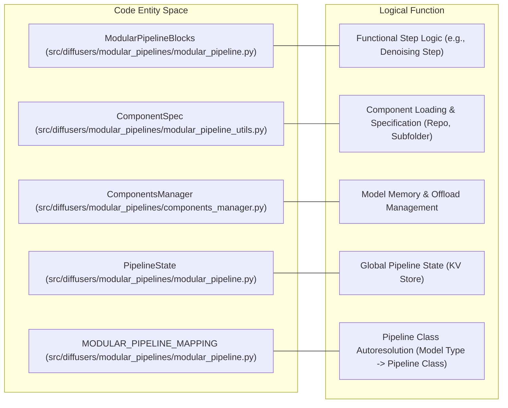

<!-- source: DeepWiki mcp.deepwiki.com · repo huggingface/diffusers · page 8.4 Modular Pipeline System · fetched 2026-10-21 -->

# Modular Pipeline System

<details>
<summary>Relevant source files</summary>

The following files were used as context for generating this wiki page:

- [docs/source/en/api/pipelines/cosmos3.md](docs/source/en/api/pipelines/cosmos3.md)
- [docs/source/en/api/pipelines/minimax_h3.md](docs/source/en/api/pipelines/minimax_h3.md)
- [docs/source/en/modular_diffusers/custom_blocks.md](docs/source/en/modular_diffusers/custom_blocks.md)
- [docs/source/en/modular_diffusers/mellon.md](docs/source/en/modular_diffusers/mellon.md)
- [docs/source/zh/modular_diffusers/components_manager.md](docs/source/zh/modular_diffusers/components_manager.md)
- [docs/source/zh/modular_diffusers/modular_pipeline.md](docs/source/zh/modular_diffusers/modular_pipeline.md)
- [docs/source/zh/modular_diffusers/quickstart.md](docs/source/zh/modular_diffusers/quickstart.md)
- [src/diffusers/models/auto_model.py](src/diffusers/models/auto_model.py)
- [src/diffusers/modular_pipelines/__init__.py](src/diffusers/modular_pipelines/__init__.py)
- [src/diffusers/modular_pipelines/components_manager.py](src/diffusers/modular_pipelines/components_manager.py)
- [src/diffusers/modular_pipelines/cosmos/__init__.py](src/diffusers/modular_pipelines/cosmos/__init__.py)
- [src/diffusers/modular_pipelines/cosmos/before_denoise.py](src/diffusers/modular_pipelines/cosmos/before_denoise.py)
- [src/diffusers/modular_pipelines/cosmos/denoise.py](src/diffusers/modular_pipelines/cosmos/denoise.py)
- [src/diffusers/modular_pipelines/cosmos/encoders.py](src/diffusers/modular_pipelines/cosmos/encoders.py)
- [src/diffusers/modular_pipelines/cosmos/modular_blocks_cosmos3.py](src/diffusers/modular_pipelines/cosmos/modular_blocks_cosmos3.py)
- [src/diffusers/modular_pipelines/cosmos/modular_blocks_cosmos3_distilled.py](src/diffusers/modular_pipelines/cosmos/modular_blocks_cosmos3_distilled.py)
- [src/diffusers/modular_pipelines/cosmos/modular_pipeline.py](src/diffusers/modular_pipelines/cosmos/modular_pipeline.py)
- [src/diffusers/modular_pipelines/flux/__init__.py](src/diffusers/modular_pipelines/flux/__init__.py)
- [src/diffusers/modular_pipelines/flux/before_denoise.py](src/diffusers/modular_pipelines/flux/before_denoise.py)
- [src/diffusers/modular_pipelines/flux/denoise.py](src/diffusers/modular_pipelines/flux/denoise.py)
- [src/diffusers/modular_pipelines/flux/encoders.py](src/diffusers/modular_pipelines/flux/encoders.py)
- [src/diffusers/modular_pipelines/flux/inputs.py](src/diffusers/modular_pipelines/flux/inputs.py)
- [src/diffusers/modular_pipelines/flux/modular_pipeline.py](src/diffusers/modular_pipelines/flux/modular_pipeline.py)
- [src/diffusers/modular_pipelines/flux2/__init__.py](src/diffusers/modular_pipelines/flux2/__init__.py)
- [src/diffusers/modular_pipelines/flux2/before_denoise.py](src/diffusers/modular_pipelines/flux2/before_denoise.py)
- [src/diffusers/modular_pipelines/flux2/decoders.py](src/diffusers/modular_pipelines/flux2/decoders.py)
- [src/diffusers/modular_pipelines/flux2/denoise.py](src/diffusers/modular_pipelines/flux2/denoise.py)
- [src/diffusers/modular_pipelines/flux2/encoders.py](src/diffusers/modular_pipelines/flux2/encoders.py)
- [src/diffusers/modular_pipelines/flux2/inputs.py](src/diffusers/modular_pipelines/flux2/inputs.py)
- [src/diffusers/modular_pipelines/flux2/modular_blocks_flux2.py](src/diffusers/modular_pipelines/flux2/modular_blocks_flux2.py)
- [src/diffusers/modular_pipelines/flux2/modular_pipeline.py](src/diffusers/modular_pipelines/flux2/modular_pipeline.py)
- [src/diffusers/modular_pipelines/mellon_node_utils.py](src/diffusers/modular_pipelines/mellon_node_utils.py)
- [src/diffusers/modular_pipelines/minimax_h3/modular_pipeline.py](src/diffusers/modular_pipelines/minimax_h3/modular_pipeline.py)
- [src/diffusers/modular_pipelines/modular_pipeline.py](src/diffusers/modular_pipelines/modular_pipeline.py)
- [src/diffusers/modular_pipelines/modular_pipeline_utils.py](src/diffusers/modular_pipelines/modular_pipeline_utils.py)
- [src/diffusers/modular_pipelines/wan/__init__.py](src/diffusers/modular_pipelines/wan/__init__.py)
- [src/diffusers/modular_pipelines/wan/before_denoise.py](src/diffusers/modular_pipelines/wan/before_denoise.py)
- [src/diffusers/modular_pipelines/wan/decoders.py](src/diffusers/modular_pipelines/wan/decoders.py)
- [src/diffusers/modular_pipelines/wan/denoise.py](src/diffusers/modular_pipelines/wan/denoise.py)
- [src/diffusers/modular_pipelines/wan/encoders.py](src/diffusers/modular_pipelines/wan/encoders.py)
- [src/diffusers/modular_pipelines/wan/modular_blocks_wan22.py](src/diffusers/modular_pipelines/wan/modular_blocks_wan22.py)
- [src/diffusers/modular_pipelines/wan/modular_blocks_wan22_i2v.py](src/diffusers/modular_pipelines/wan/modular_blocks_wan22_i2v.py)
- [src/diffusers/modular_pipelines/wan/modular_pipeline.py](src/diffusers/modular_pipelines/wan/modular_pipeline.py)
- [src/diffusers/pipelines/cosmos/mixed_precision.py](src/diffusers/pipelines/cosmos/mixed_precision.py)
- [src/diffusers/pipelines/cosmos/pipeline_cosmos3_omni.py](src/diffusers/pipelines/cosmos/pipeline_cosmos3_omni.py)
- [src/diffusers/utils/dynamic_modules_utils.py](src/diffusers/utils/dynamic_modules_utils.py)
- [tests/models/test_models_auto.py](tests/models/test_models_auto.py)
- [tests/modular_pipelines/cosmos/test_modular_pipeline_cosmos3.py](tests/modular_pipelines/cosmos/test_modular_pipeline_cosmos3.py)
- [tests/modular_pipelines/cosmos/test_modular_pipeline_cosmos3_distilled.py](tests/modular_pipelines/cosmos/test_modular_pipeline_cosmos3_distilled.py)
- [tests/modular_pipelines/flux/test_modular_pipeline_flux.py](tests/modular_pipelines/flux/test_modular_pipeline_flux.py)
- [tests/modular_pipelines/flux2/test_modular_pipeline_flux2_klein.py](tests/modular_pipelines/flux2/test_modular_pipeline_flux2_klein.py)
- [tests/modular_pipelines/flux2/test_modular_pipeline_flux2_klein_base.py](tests/modular_pipelines/flux2/test_modular_pipeline_flux2_klein_base.py)
- [tests/modular_pipelines/qwen/test_modular_pipeline_qwenimage.py](tests/modular_pipelines/qwen/test_modular_pipeline_qwenimage.py)
- [tests/modular_pipelines/stable_diffusion_xl/test_modular_pipeline_stable_diffusion_xl.py](tests/modular_pipelines/stable_diffusion_xl/test_modular_pipeline_stable_diffusion_xl.py)
- [tests/modular_pipelines/test_components_manager.py](tests/modular_pipelines/test_components_manager.py)
- [tests/modular_pipelines/test_conditional_pipeline_blocks.py](tests/modular_pipelines/test_conditional_pipeline_blocks.py)
- [tests/modular_pipelines/test_modular_pipelines_custom_blocks.py](tests/modular_pipelines/test_modular_pipelines_custom_blocks.py)
- [tests/pipelines/cosmos/test_cosmos3.py](tests/pipelines/cosmos/test_cosmos3.py)

</details>


The **Modular Pipeline System** in the `diffusers` library introduces a highly decomposable and reusable pipeline architecture. It departs from monolithic pipeline classes by structuring complex diffusion workflows as compositions of discrete, reusable "blocks." This system supports a wide variety of tasks including text-to-image, video generation, multi-modal editing, and advanced control flows by flexibly wiring modular components.

This page details the architecture and implementation of the modular pipelines, focusing on the core abstractions: the `ModularPipelineBlocks`, the `ComponentsManager`, and the pipeline state management via `PipelineState` and `BlockState`. It also covers how custom pipelines can be assembled from reusable blocks and explains the Mellon integration that exposes these blocks as computational nodes for graph-based workflows.

---

## Core Architecture Components

The modular pipeline system centers around three key concepts that together enable modular composition and efficient execution:

- **ModularPipelineBlocks:** The building blocks representing functional pipeline steps.
- **PipelineState and BlockState:** The data containers for managing pipeline inputs, outputs, and intermediate states.
- **ComponentsManager:** The orchestrator for model components' lifecycle and memory management.

---

### ModularPipelineBlocks

`ModularPipelineBlocks` is the abstract base class that encapsulates a functional unit in the pipeline. Each block defines:

- **Expected Components:** The model or scheduler submodules it requires, specified as a list of `ComponentSpec` objects.
- **Inputs and Intermediate Inputs:** Typed input parameters (`InputParam`) declaring what data the block consumes.
- **Intermediate Outputs:** Typed output parameters (`OutputParam`) declaring what data the block produces for downstream blocks.
- **Call Logic:** The computation implemented in the `__call__` method, transforming inputs via models or custom logic.

Specialized subclasses and containers extend `ModularPipelineBlocks` for common patterns:

- `SequentialPipelineBlocks`: Executes a sequence of blocks in order.
- `LoopSequentialPipelineBlocks`: Runs a sequence of blocks repeatedly in a denoising loop, managing timesteps and loop index.
- `ConditionalPipelineBlocks`: Dynamically selects blocks to execute based on input presence or conditions.
- `AutoPipelineBlocks`: Switches between block variants automatically according to input data (e.g., Cosmos 3 switches text encoders based on the inputs).

This block-based design supports flexible control flow and gradual composition of complex diffusion workflows. 

---

### PipelineState and BlockState

Data exchange in the modular pipeline leverages two distinct classes:

- **PipelineState:** A central, global container that holds all named data passed between blocks. It stores actual values keyed by string names and tracks the relationship between values and argument types using a `kwargs_mapping` dictionary. This supports flexible pipeline input/output management and runtime data querying.

- **BlockState:** A block-scoped view of `PipelineState`. It filters and exposes only the inputs/outputs relevant to the specific block as attributes, enabling typed and convenient access. This ensures blocks process only declared data, improving encapsulation and clarity of data flow.

Blocks read inputs from `BlockState`, write their outputs back to it, and then merge changes into the global `PipelineState`.

---

### ComponentsManager

The `ComponentsManager` is the lifecycle and memory manager for all model components (e.g., UNets, VAEs, Transformers) used in blocks. It provides:

- **Loading Models:** Loads components lazily or eagerly using specifications (`ComponentSpec`) that include paths, revision info, pretrained usage, etc.
- **Memory Management:** Automatically offloads model weights between CPU and GPU to balance VRAM usage and improve scalability. Implements an `AutoOffloadStrategy` that monitors VRAM and triggers offloading as needed.
- **Forward Hooks:** Wraps models with a `CustomOffloadHook` that triggers offloading just before the `forward` method, ensuring model weights are on the correct device before computation.

This centralized management abstracts device placement concerns and frees block authors from manual VRAM optimization.

---

## Data Flow and Execution

The modular pipeline operates by orchestrating the block execution and component access via the global pipeline state. When the pipeline's `__call__` is invoked:

1. A new `PipelineState` is initialized with the user-provided inputs.
2. The hierarchical `ModularPipelineBlocks` workflow executes, passing the current pipeline state and components:
    - Each block retrieves its filtered `BlockState`.
    - Blocks perform their logic, using components managed by `ComponentsManager`.
    - Outputs from blocks update the global `PipelineState`.
3. The final output is retrieved from `PipelineState` after all blocks complete.

This allows fine-grained control, stepwise processing, and easier debugging.

---

### Modular Pipeline Data Flow Diagram

```mermaid
graph TD
    subgraph "ModularPipeline [src/diffusers/modular_pipelines/modular_pipeline.py]"
        MP_CALL["ModularPipeline.__call__(**kwargs)"]
        PIPELINE_STATE["PipelineState (global key-value store)"]
        BLOCKS["ModularPipelineBlocks hierarchy"]
    end

    subgraph "Execution Logic [runtime]"
        B1["Block 1 (e.g., TextEncodingBlock)"]
        B2["Block 2 (e.g., DenoisingLoop via LoopSequentialPipelineBlocks)"]
        B3["Block 3 (e.g., DecodingBlock)"]
    end

    subgraph "Component Management [src/diffusers/modular_pipelines/components_manager.py]"
        CM["ComponentsManager"]
        MODELS["Model Components (Transformer, VAE, Scheduler, etc.)"]
    end

    MP_CALL -->|"1. Initialize PipelineState" PIPELINE_STATE
    MP_CALL -->|"2. Execute block sequence" BLOCKS
    BLOCKS --> B1
    B1 -->|Get BlockState from PipelineState| PIPELINE_STATE
    B1 -->|"Access components (models) via ComponentsManager"| CM
    CM -->|"AutoOffloadHook triggers offload/forward"| MODELS
    B1 -->|"Update BlockState outputs"| PIPELINE_STATE
    PIPELINE_STATE --> B2
    B2 --> B3
    B3 --> MP_CALL["Return final output"]
```

---

## Composition and Customization

### Component Specification (`ComponentSpec`)

`ComponentSpec` standardizes how individual subcomponents are declared and loaded inside blocks and pipelines. Key attributes include:

| Attribute                          | Description                                                    |
|----------------------------------|----------------------------------------------------------------|
| `name`                           | Identifier key for the component in `components` dict.         |
| `type_hint`                      | The expected class type for validation (e.g., `UNet2D`).       |
| `pretrained_model_name_or_path` | Repo or path to load weights/config from.                      |
| `subfolder`                     | Subdirectory inside repo for loading.                          |
| `default_creation_method`        | Preferred instantiation mode: `from_pretrained` or `from_config`. |

`ComponentSpec` can be instantiated from existing components or defined declaratively to enable automated loading and config generation.

---

### Building a Custom Block

To create a custom pipeline block, subclass `ModularPipelineBlocks` and provide:

- `expected_components`: List of `ComponentSpec` that declares model dependencies.
- `inputs`: List of `InputParam` describing expected inputs.
- `intermediate_outputs`: List of `OutputParam` describing produced outputs.
- Implementation of `__call__` to run the computational logic, using `BlockState` to read inputs and write outputs.

**Example: Simple Custom Block**

```python
class DummyCustomBlockSimple(ModularPipelineBlocks):
    @property
    def expected_components(self):
        # For example, depends on a transformer model component
        return [ComponentSpec("transformer", FluxTransformer2DModel)]

    @property
    def inputs(self) -> List[InputParam]:
        return [InputParam("prompt", type_hint=str, required=True)]

    @property
    def intermediate_outputs(self) -> List[OutputParam]:
        return [OutputParam("output_prompt", type_hint=str)]

    def __call__(self, components, state: PipelineState) -> PipelineState:
        block_state = self.get_block_state(state)
        # Modify the prompt and save to output_prompt
        block_state.output_prompt = "Modular diffusers + " + block_state.prompt
        self.set_block_state(state, block_state)
        return components, state
```

This example illustrates how to implement a block that adds a fixed string prefix to the input prompt and saves it as output, using the modular pipeline's state management system.

---

## System Mapping: Code to Logical Function

This diagram bridges key code entities with their conceptual roles in the modular pipeline system:



---

## Implementation Details

### Pipeline Class Loading and Mapping

The `MODULAR_PIPELINE_MAPPING` dictionary maps model repository types or tags (e.g., `"flux"`, `"wan"`, `"cosmos3-omni"`) to functions returning the appropriate modular pipeline class. This mechanism supports:

- Dynamic choosing of specialized pipeline classes based on model config flags.
- Loading modular pipelines from a `modular_model_index.json` which declares the block architecture and component specifications.

This framework facilitates model-agnostic pipeline instantiation.

---

### Mellon Node Integration

To enable integration with the graph-based execution environment Mellon, this modular framework exposes each `ModularPipelineBlocks` as a discrete node with typed inputs and outputs.

The `mellon_node_utils.py` module includes:

- Typed parameter wrappers and templates matching typical pipeline parameters (e.g., image, latents, prompt).
- Functions to convert modular pipeline inputs/outputs to Mellon node schema.
- Facilities to push modular pipelines to Hugging Face Hub with Mellon node metadata.

The granular atomicity of the modular blocks (such as `Cosmos3PrepareTextSegmentsStep` or `Cosmos3VisionPrepareLatentsStep`) allows Mellon clients to orchestrate pipelines flexibly by chaining or interleaving these nodes.

> **Note:** Mellon integration is under active development and APIs are subject to change.

---

### Memory Management via Hooks

The `ComponentsManager` implements memory-efficient execution via `UserCustomOffloadHook`, wrapping each loaded model:

- Before a model's `forward` call, `pre_forward` checks if it resides on the designated `execution_device`.
- If not, an `AutoOffloadStrategy` identifies what models to offload to free VRAM.
- The hook offloads and loads models automatically, enabling large models to share limited GPU memory without manual intervention.

This design optimizes VRAM usage transparently for any modular pipeline and its blocks.

---

# Summary

The Modular Pipeline System abstracts diffusion pipelines as reusable blocks coordinated via a global state and managed components. This enables:

- Flexible composition of new pipelines by wiring existing and custom modular blocks.
- Efficient model component loading with VRAM offloading.
- Fine-grained pipeline state management for orderly input/output flow.
- Direct Mellont node integration for interactive graph-based usage.

Together, these features make the modular pipeline system a powerful and extensible foundation for advanced diffusion modeling workflows.

---

# References and Sources

- Core modular pipeline implementation: [src/diffusers/modular_pipelines/modular_pipeline.py:1-187](), [src/diffusers/modular_pipelines/modular_pipeline.py:450-600]().
- Component Specification: [src/diffusers/modular_pipelines/modular_pipeline_utils.py:97-180]().
- Components management & memory offload: [src/diffusers/modular_pipelines/components_manager.py:40-110]().
- Custom block example: [tests/modular_pipelines/test_modular_pipelines_custom_blocks.py:75-165]().
- Pipeline mapping and loading: [src/diffusers/modular_pipelines/modular_pipeline.py:120-160](), [src/diffusers/modular_pipelines/modular_pipeline.py:1250-1280]().
- Mellon integration utilities: [src/diffusers/modular_pipelines/mellon_node_utils.py:1-220]().

For further modular blocks and pipeline examples, see specialized submodules such as Cosmos 3, WAN Animate2, Flux pipelines, etc.

---

