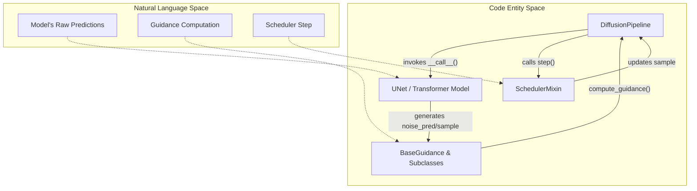
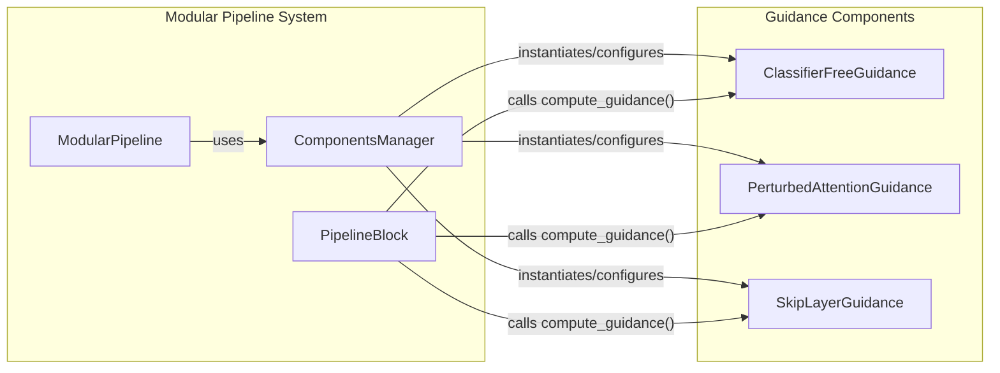

<!-- source: DeepWiki mcp.deepwiki.com · repo huggingface/diffusers · page 8.5 Guidance Techniques · fetched 2026-10-21 -->

# Guidance Techniques

<details>
<summary>Relevant source files</summary>

The following files were used as context for generating this wiki page:

- [docs/source/en/_toctree.yml](docs/source/en/_toctree.yml)
- [docs/source/en/api/pipelines/pag.md](docs/source/en/api/pipelines/pag.md)
- [scripts/convert_pixart_alpha_to_diffusers.py](scripts/convert_pixart_alpha_to_diffusers.py)
- [src/diffusers/__init__.py](src/diffusers/__init__.py)
- [src/diffusers/models/__init__.py](src/diffusers/models/__init__.py)
- [src/diffusers/models/autoencoders/__init__.py](src/diffusers/models/autoencoders/__init__.py)
- [src/diffusers/models/transformers/__init__.py](src/diffusers/models/transformers/__init__.py)
- [src/diffusers/pipelines/__init__.py](src/diffusers/pipelines/__init__.py)
- [src/diffusers/pipelines/allegro/pipeline_allegro.py](src/diffusers/pipelines/allegro/pipeline_allegro.py)
- [src/diffusers/pipelines/auto_pipeline.py](src/diffusers/pipelines/auto_pipeline.py)
- [src/diffusers/pipelines/pag/__init__.py](src/diffusers/pipelines/pag/__init__.py)
- [src/diffusers/pipelines/pag/pag_utils.py](src/diffusers/pipelines/pag/pag_utils.py)
- [src/diffusers/pipelines/pag/pipeline_pag_pixart_sigma.py](src/diffusers/pipelines/pag/pipeline_pag_pixart_sigma.py)
- [src/diffusers/pipelines/pixart_alpha/pipeline_pixart_alpha.py](src/diffusers/pipelines/pixart_alpha/pipeline_pixart_alpha.py)
- [src/diffusers/pipelines/pixart_alpha/pipeline_pixart_sigma.py](src/diffusers/pipelines/pixart_alpha/pipeline_pixart_sigma.py)
- [src/diffusers/pipelines/stable_diffusion/__init__.py](src/diffusers/pipelines/stable_diffusion/__init__.py)
- [src/diffusers/schedulers/__init__.py](src/diffusers/schedulers/__init__.py)
- [src/diffusers/utils/dummy_pt_objects.py](src/diffusers/utils/dummy_pt_objects.py)
- [src/diffusers/utils/dummy_torch_and_transformers_objects.py](src/diffusers/utils/dummy_torch_and_transformers_objects.py)
- [tests/pipelines/test_pipelines_auto.py](tests/pipelines/test_pipelines_auto.py)

</details>


Guidance techniques in `diffusers` are essential for steering the diffusion denoising process to improve sample quality, prompt adherence, and structural coherence. `diffusers` elevates guidance algorithms to first-class objects within the **Guiders System**, enabling modularity and composability beyond the traditional hard-coded approaches such as Classifier-Free Guidance (CFG).

This page provides an in-depth technical overview of the guiders system including ClassifierFreeGuidance, PerturbedAttentionGuidance (PAG), SkipLayerGuidance, PAG pipelines, and other guidance algorithms, tracing their implementation, data flow, and integration into modern pipeline designs.

---

## The Guiders System

The guiders system moves the guidance logic out of pipeline internals and encapsulates it within independent objects in the `diffusers.guiders` module, providing a uniform interface to implement, reuse, and extend different guidance algorithms.

### Core Guidance Classes

The following classes represent the major guiders implemented as first-class objects (all found in the `diffusers.guiders` module):

| Class Name                     | Description                                                                                         | Location                                   |
|-------------------------------|-------------------------------------------------------------------------------------------------|--------------------------------------------|
| `BaseGuidance`                | Abstract base class for all guiders, defines the core interface for guidance computation.         | [src/diffusers/__init__.py:175-189]()     |
| `ClassifierFreeGuidance`      | Classic CFG implementation blending conditional and unconditional noise predictions via a scale. | [src/diffusers/__init__.py:189-197]()     |
| `PerturbedAttentionGuidance` | Implements Perturbed Attention Guidance (PAG) by perturbing self-attention maps during denoising.| [src/diffusers/__init__.py:198-205]()     |
| `SkipLayerGuidance`           | Applies guidance by selectively skipping layers during denoising to influence generation results.| [src/diffusers/__init__.py:206-213]()     |
| `SmoothedEnergyGuidance`      | Employs energy-based smoothing for guiding sampling decisions.                                    | [src/diffusers/__init__.py:214-221]()     |
| `AutoGuidance`                | A unified interface that manages automatic selection or combination of guidance strategies.       | [src/diffusers/__init__.py:172-175]()     |

### Additional Guidance Variants

- `AdaptiveProjectedGuidance` / `AdaptiveProjectedMixGuidance`: Advanced guidance variants projecting guidance signals adaptively for better stability and control.
- `TangentialClassifierFreeGuidance`: A geometric variant of CFG.
- `ClassifierFreeZeroStarGuidance`: Specialized CFG variant for zero-shot tasks.
- `FrequencyDecoupledGuidance`: Applies guidance selectively on frequency components.

All classes maintain a standardized interface with key methods like `from_config()`, `from_pretrained()`, and a main guidance computation function that modifies or combines raw noise predictions from the model.

**Sources:** [src/diffusers/__init__.py:170-203](), [src/diffusers/utils/dummy_pt_objects.py:5-183]()

---

## Guidance Data Flow

Guidance is applied during the iterative denoising (inference) loop. The diffusion pipeline (`DiffusionPipeline`) invokes the model (usually a UNet or Transformer variant) to generate predictions for the next noise latent.

These raw predictions are then passed to a `Guider` object, which modifies or combines them based on the guidance algorithm (e.g., conditioning scale, perturbed attention maps, layer skipping). The refined prediction is subsequently used by the scheduler to compute the next latent in the reverse diffusion process.

### Code Entity Mapping: Guidance Execution Flow



This delineation cleanly separates:

- Model forward pass producing raw noise predictions,
- Guider objects applying guidance algorithms,
- Scheduler controlling the diffusion timestep progression.

**Sources:** [src/diffusers/pipelines/pipeline_utils.py:50-59](), [src/diffusers/__init__.py:170-203](), [src/diffusers/schedulers/__init__.py:39-84]().

---

## Perturbed-Attention Guidance (PAG)

PAG is an innovative guidance technique that improves sample quality across unconditional and conditional settings, without needing additional training or external modules. It works by perturbing self-attention maps in the diffusion U-Net model's internal layers, substituting them with identity matrices to generate intermediate degraded samples, and then guiding the solver to move away from those degraded intermediate states.

### Key Concepts and Usage

- **No Additional Training**: PAG operates purely during inference.
- **Layer Perturbation**: Selected transformer or UNet self-attention layers are perturbed to degrade structure temporarily.
- **Guidance Signal**: The denoising process is nudged away from these degraded samples to enhance structure progressively.
- **Integration**: PAG support is implemented via specialized pipeline variants that incorporate guidance layers.

### Implementation Details

Users specify which layers to apply PAG by passing `pag_applied_layers` during pipeline instantiation. This argument accepts:

- Exact string layer names,
- Regular expressions matching multiple layers,
- Lists of strings/regex for flexible targeting.

Example of specifying PAG applied layers:  
```python
pag_applied_layers=["mid"]  # Applies PAG on mid-block attention layers
```

Detailed layer identification strings or regex examples include:  
- Full identifier: `"down_blocks.2.attentions.0.transformer_blocks.0.attn1.processor"`  
- Regex example for multiple: `"down_blocks.2.(attentions|motion_modules).0.transformer_blocks.0.attn1.processor"`

### Supported PAG Pipelines

PAG is supported in multiple diffusion pipelines, especially:

| PAG Pipeline Class                 | Base Pipeline / Model Family             | Reference (AutoPipeline)                      |
|----------------------------------|-----------------------------------------|-----------------------------------------------|
| `StableDiffusionPAGPipeline`     | Stable Diffusion 1.x / 2.1               | [src/diffusers/pipelines/auto_pipeline.py:171-172]() |
| `StableDiffusionXLPAGPipeline`   | Stable Diffusion XL                      | [src/diffusers/pipelines/auto_pipeline.py:173-174]() |
| `StableDiffusion3PAGPipeline`    | Stable Diffusion 3                       | [src/diffusers/pipelines/auto_pipeline.py:92-94]()   |
| `HunyuanDiTPAGPipeline`          | Hunyuan DiT Transformer                  | [src/diffusers/pipelines/auto_pipeline.py:89-90]()   |
| `PixArtSigmaPAGPipeline`         | PixArt Sigma                            | [src/diffusers/pipelines/auto_pipeline.py:90-91]()   |
| `SanaPAGPipeline`                | Sana                                   | [src/diffusers/pipelines/auto_pipeline.py:91-92]()   |

Enabling PAG on a pipeline can be done via `AutoPipelineForText2Image` with flags:

```python
pipeline = AutoPipelineForText2Image.from_pretrained(
    "stabilityai/stable-diffusion-xl-base-1.0",
    enable_pag=True,
    pag_applied_layers=["mid"],
    dtype=torch.float16,
)
```

You must also specify a `pag_scale` parameter during generation to control PAG strength; zero disables PAG.

**Sources:** [docs/source/en/api/pipelines/pag.md:13-92](), [src/diffusers/pipelines/auto_pipeline.py:88-104](), [src/diffusers/pipelines/pag/__init__.py:12-35](), [src/diffusers/pipelines/pag/pag_utils.py:1-30]()

---

## Modular Integration of Guidance

The `diffusers` modular pipeline system treats guiders as modular, configurable components integrated via the `ComponentsManager` and invoked explicitly within pipeline blocks (`PipelineBlock`). This design enables swapping or stacking guiders with minimal pipeline class changes.

### Guidance Components in Modular Pipelines

Within the modular system, class associations are as follows:



**Parameter Control**: Most guiders accept parameters such as `guidance_scale` or `pag_scale`, which control guidance strength.

### Configuration and Memory Optimization

Guidance components can also be offloaded to CPU or quantized to save GPU memory, making them compatible with memory-constrained environments.

For example, `SmoothedEnergyGuidance` can be configured with `SmoothedEnergyGuidanceConfig` for fine-grained control of energy-based smoothing guidance [src/diffusers/__init__.py:193]().

**Sources:** [src/diffusers/pipelines/auto_pipeline.py:146-182](), [src/diffusers/utils/dummy_pt_objects.py:170-264](), [src/diffusers/__init__.py:170-202]()

---

# Summary Table of Key Classes and Pipelines

| Category          | Names / Classes                      | Location / Example Pipeline                  |
|-------------------|------------------------------------|----------------------------------------------|
| Base Guidance     | `BaseGuidance`                     | `diffusers.guiders`                          |
| Classic CFG       | `ClassifierFreeGuidance`           | `diffusers.guiders`                          |
| PAG Guidance      | `PerturbedAttentionGuidance`       | `diffusers.guiders`                          |
| Skip-Layer        | `SkipLayerGuidance`                 | `diffusers.guiders`                          |
| Automated Guidance| `AutoGuidance`                    | `diffusers.guiders`                          |
| PAG Pipelines     | `StableDiffusionPAGPipeline`, `StableDiffusionXLPAGPipeline`, ... | `diffusers.pipelines.auto_pipeline`         |

---

# Additional Notes

- Support for PAG and other advanced guidances continues to expand. While currently PAG is integrated mostly with SDXL and selected pipelines, the system is designed to enable easy addition of new guidance techniques and pipeline support.
- The guider abstraction allows pipeline developers to modify or swap guidance strategies without rewriting pipeline logic.
- PAG layers are highly configurable via string and regex matching for fine-grained control over which attention blocks are perturbed.

---

# References and Sources

- Core guider classes and factory: [src/diffusers/__init__.py:170-203]()
- Dummy wrappers for guidance (for conditional import): [src/diffusers/utils/dummy_pt_objects.py:5-183]()
- Guidance usage in pipeline auto loader mappings: [src/diffusers/pipelines/auto_pipeline.py:88-104]()
- PAG documentation and usage examples: [docs/source/en/api/pipelines/pag.md:13-92]()
- PAG utilities and layer matching: [src/diffusers/pipelines/pag/pag_utils.py:1-30]()
- Modular pipeline component management: [src/diffusers/pipelines/auto_pipeline.py:146-182]()
- Guidance invocation in pipeline utils: [src/diffusers/pipelines/pipeline_utils.py:50-59]()
- Scheduler interface: [src/diffusers/schedulers/__init__.py:39-84]()

---

This page documents guidance techniques as first-class citizens in Diffusers to enable flexible, efficient, and extendable sample guidance in diffusion models.

---

