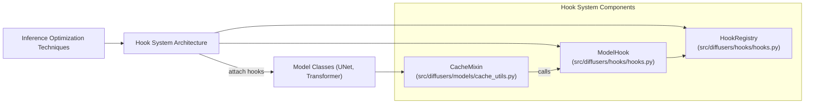
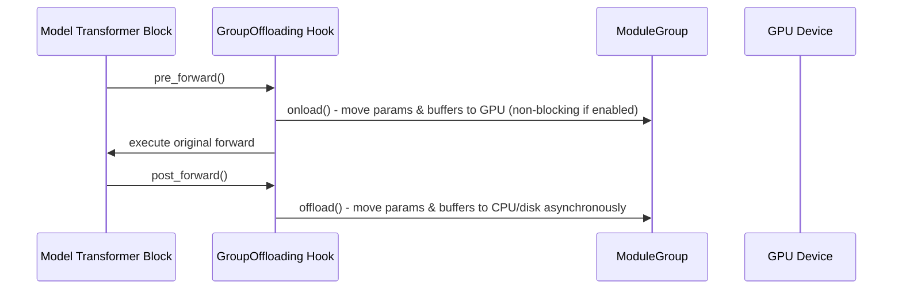
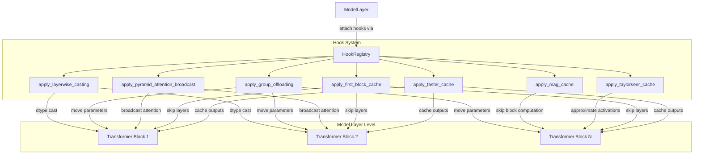

<!-- source: DeepWiki mcp.deepwiki.com · repo huggingface/diffusers · page 8.6 Inference Optimization Hooks · fetched 2026-10-21 -->

# Inference Optimization Hooks

Relevant source files

The following files were used as context for generating this wiki page:

- [docs/source/en/api/cache.md](docs/source/en/api/cache.md)
- [docs/source/en/api/models/wan_animate_transformer_3d.md](docs/source/en/api/models/wan_animate_transformer_3d.md)
- [docs/source/en/api/pipelines/bria_fibo.md](docs/source/en/api/pipelines/bria_fibo.md)
- [docs/source/en/api/pipelines/wan.md](docs/source/en/api/pipelines/wan.md)
- [docs/source/en/optimization/cache.md](docs/source/en/optimization/cache.md)
- [docs/source/en/optimization/memory.md](docs/source/en/optimization/memory.md)
- [scripts/convert_wan_to_diffusers.py](scripts/convert_wan_to_diffusers.py)
- [src/diffusers/guiders/magnitude_aware_guidance.py](src/diffusers/guiders/magnitude_aware_guidance.py)
- [src/diffusers/hooks/__init__.py](src/diffusers/hooks/__init__.py)
- [src/diffusers/hooks/_helpers.py](src/diffusers/hooks/_helpers.py)
- [src/diffusers/hooks/group_offloading.py](src/diffusers/hooks/group_offloading.py)
- [src/diffusers/hooks/hooks.py](src/diffusers/hooks/hooks.py)
- [src/diffusers/hooks/mag_cache.py](src/diffusers/hooks/mag_cache.py)
- [src/diffusers/models/cache_utils.py](src/diffusers/models/cache_utils.py)
- [src/diffusers/pipelines/deprecated/unidiffuser/modeling_uvit.py](src/diffusers/pipelines/deprecated/unidiffuser/modeling_uvit.py)
- [src/diffusers/pipelines/wan/__init__.py](src/diffusers/pipelines/wan/__init__.py)
- [tests/hooks/test_group_offloading.py](tests/hooks/test_group_offloading.py)
- [tests/hooks/test_hooks.py](tests/hooks/test_hooks.py)
- [tests/hooks/test_mag_cache.py](tests/hooks/test_mag_cache.py)
- [tests/models/testing_utils/cache.py](tests/models/testing_utils/cache.py)
- [tests/single_file/test_model_wan_autoencoder_single_file.py](tests/single_file/test_model_wan_autoencoder_single_file.py)
- [tests/single_file/test_model_wan_transformer3d_single_file.py](tests/single_file/test_model_wan_transformer3d_single_file.py)

The inference optimization hooks system in `diffusers` provides a modular and extensible framework for integrating advanced memory management and computational speedup techniques directly into the model execution lifecycle. This system operates primarily at the model-submodule granularity (e.g., transformer blocks), enabling optimizations such as caching intermediate activations, adaptive layer skipping, group offloading across devices, and dynamic precision casting.

These hooks allow efficient reuse of intermediate results during diffusion model inference, support large models to fit into limited GPU memory by offloading chunks to CPU/disk, and speed up inference by reducing redundant computation.

---

## Hook System Architecture

The core of the optimization hooks system relies on hooking into model forward passes at the submodule level and managing these hooks centrally.

### Core Components

| Code Entity | Description | Source |
|-------------|-------------|--------|
| `ModelHook` | Abstract base class defining the interface for hooks with lifecycle callbacks: `initialize_hook`, `pre_forward`, `post_forward`, `reset_state`, etc. | [src/diffusers/hooks/hooks.py:95-170]() |
| `HookRegistry` | Manages multiple `ModelHook` instances attached to a `torch.nn.Module`. Ensures execution order of hooks on forward calls. | [src/diffusers/hooks/hooks.py:160-345]() |
| `CacheMixin` | A mixin for models to enable/disable caching techniques cleanly. Calls caching application/removal utilities based on the provided config. | [src/diffusers/models/cache_utils.py:23-117]() |
| `apply_group_offloading` | Registers group offloading hooks on model groups (e.g., blocks or leaves) to manage device and memory transfers during inference. | [src/diffusers/hooks/group_offloading.py:22-175]() |

### Data Flow Overview

When an inference call happens, the forward passes of model submodules trigger the registered hooks in order:

- `pre_forward` hooks can modify input data or trigger loading of offloaded parameters to GPU memory.
- The original module forward is executed.
- `post_forward` hooks may cache outputs or offload parameters back to CPU/disk.

The progressive reuse or offloading reduces duplicate computation and memory pressure.

### Integration Diagram: Natural Language Ideas to Code Entities

---

## Caching Mechanisms

Caching techniques accelerate inference by storing intermediate outputs of transformer layers (e.g., attention maps, hidden states) and reusing them when possible, leveraging temporal redundancy over diffusion timesteps.

These techniques are exposed via the `CacheMixin.enable_cache(config)` method, which dispatches to the corresponding cache application function based on the config type.

### Summary of Supported Cache Techniques

| Cache Hook / Technique | Brief Description | Key Config Class | Application Function | Source |
|-----------------------|-------------------|------------------|----------------------|--------|
| **FasterCache** | Caches attention features to skip re-computation when outputs change slowly across timesteps. May skip unconditional branch in classifier-free guidance. | `FasterCacheConfig` | `apply_faster_cache` | [src/diffusers/models/cache_utils.py:40-117](), [src/diffusers/hooks/faster_cache.py]() |
| **FirstBlockCache** | Checks early layer differences and skips later layers in a block if change is below threshold. Optimized for transformer models. | `FirstBlockCacheConfig` | `apply_first_block_cache` | [src/diffusers/hooks/first_block_cache.py]() |
| **Pyramid Attention Broadcast (PAB)** | Broadcasts attention outputs across timesteps for video transformers (cross, temporal, spatial attention), reducing redundant attention computation. | `PyramidAttentionBroadcastConfig` | `apply_pyramid_attention_broadcast` | [src/diffusers/models/cache_utils.py:20-40](), [src/diffusers/hooks/pyramid_attention_broadcast.py]() |
| **TaylorSeerCache** | Uses Taylor series approximations to predict activations over steps, balancing speed and minimal memory overhead. | `TaylorSeerCacheConfig` | `apply_taylorseer_cache` | [src/diffusers/hooks/taylorseer_cache.py]() |
| **MagCache** | Employs magnitude-based residual checks to accumulate an error budget and selectively skip blocks with small residuals. | `MagCacheConfig` | `apply_mag_cache` | [src/diffusers/hooks/mag_cache.py]() |

---

## Memory Management Hooks

### Group Offloading

A key memory optimization, group offloading moves groups of modules (e.g., several transformer blocks) between devices (GPU/CPU/Disk) to maximize VRAM availability and manage PCIe overhead.

- Instead of offloading individual layers sequentially, group offloading divides model layers into groups for efficient batch transfers.
- Supports two offload granularities: `block_level` (by transformer block groups) and `leaf_level` (more fine-grained module leaves).
- Can offload parameters to CPU or disk using `safetensors` for persistent on-disk storage.
- Supports non-blocking transfers using CUDA streams.
- Integrates specialized handling for quantized tensors using `torchao` (torch accelerated optimizers) which require swapping internal tensor contents to preserve parameter identities.

#### Key Classes

| Class | Role | Source |
|-------|------|--------|
| `ModuleGroup` | Represents a group of modules with parameters and buffers managed as one offloadable unit. Handles device transfers and caching. | [src/diffusers/hooks/group_offloading.py:115-175]() |
| `GroupOffloadingConfig` | Configuration dataclass specifying onload/offload devices, granularity, streams, and other behavior. | [src/diffusers/hooks/group_offloading.py:100-112]() |

#### Execution Flow for Group Offloading

This flow balances memory by only keeping currently needed groups on fast memory and offloading inactive groups.

---

### Layerwise Casting

Layerwise casting dynamically adjusts numerical precision for specific layers during inference to reduce memory and computation cost while maintaining accuracy.

- Uses hooks to cast layer parameters and buffers to a target dtype (e.g., fp16, bf16, fp8) before forward and restore afterwards.
- Supports type conversion hooks applied per layer to enable fine-grained mixed precision.

---

## Summary Table of Inference Optimization Hooks

| Hook | Config/Support | Main Use Case | Description |
|-------|----------------|--------------|-------------|
| **FasterCache** | `FasterCacheConfig` | Cache intermediate attention | Skip computations on stable feature outputs |
| **FirstBlockCache** | `FirstBlockCacheConfig` | Monitor early layer changes | Skip costly later layers if stable |
| **PyramidAttentionBroadcast** | `PyramidAttentionBroadcastConfig` | Video attention caching | Broadcast attention maps across timesteps |
| **TaylorSeerCache** | `TaylorSeerCacheConfig` | Approximate block outputs | Use Taylor expansions for activation prediction |
| **MagCache** | `MagCacheConfig` | Residual magnitude checking | Error budget based skipping of blocks |
| **Group Offloading** | `GroupOffloadingConfig` | Memory management | Offload model groups between GPU/CPU/Disk asynchronously |
| **Layerwise Casting** | N/A | Mixed precision inference | Cast layers dynamically to low-precision types |

---

## Summary Diagram: System Components and Optimization Types

---

# References and Sources

- `ModelHook`, `HookRegistry`, `CacheContext`, `StateManager`: [src/diffusers/hooks/hooks.py:15-184]()
- `CacheMixin` and cache enabling/disabling: [src/diffusers/models/cache_utils.py:23-117]()
- Group offloading classes and logic: [src/diffusers/hooks/group_offloading.py:15-175]()
- Caching applications and configs: [src/diffusers/hooks/__init__.py:18-32](), [src/diffusers/models/cache_utils.py:16-117]()
- Documentation on caching techniques with usage examples: [docs/source/en/optimization/cache.md]()
- Testing of hooks and group offloading: [tests/hooks/test_hooks.py](), [tests/hooks/test_group_offloading.py]()

This completes the technical documentation for the Inference Optimization Hooks system in `diffusers`.

---

