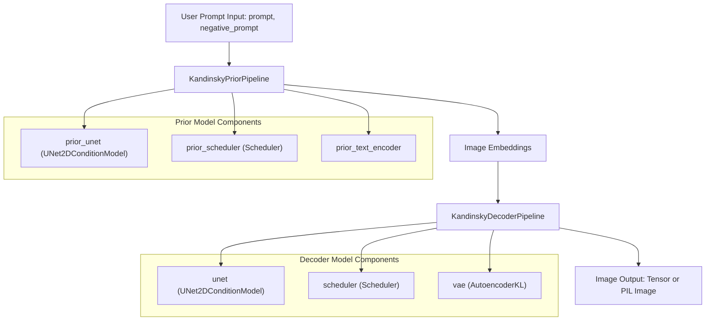
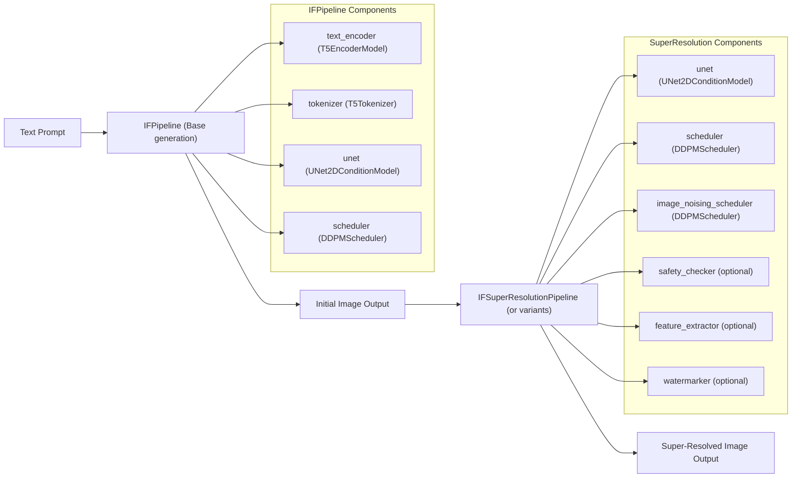
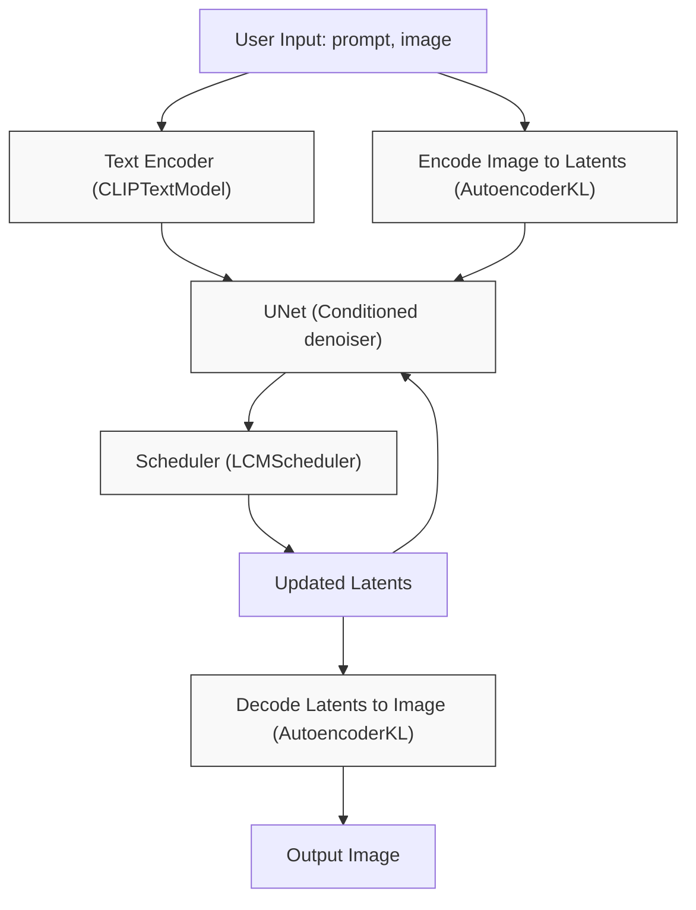
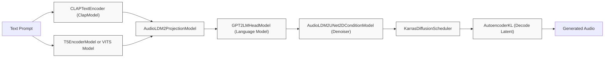
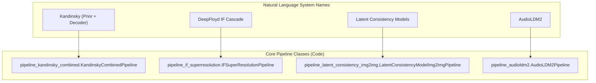

<!-- source: DeepWiki mcp.deepwiki.com · repo huggingface/diffusers · page 8.7 Legacy and Multi-Stage Pipelines · fetched 2026-10-21 -->

# Legacy and Multi-Stage Pipelines

Relevant source files

The following files were used as context for generating this wiki page:

- [docs/source/en/api/pipelines/audioldm2.md](docs/source/en/api/pipelines/audioldm2.md)
- [docs/source/en/api/pipelines/auto_pipeline.md](docs/source/en/api/pipelines/auto_pipeline.md)
- [docs/source/en/api/pipelines/controlnet.md](docs/source/en/api/pipelines/controlnet.md)
- [docs/source/en/api/pipelines/controlnet_sdxl.md](docs/source/en/api/pipelines/controlnet_sdxl.md)
- [docs/source/en/api/pipelines/ddpm.md](docs/source/en/api/pipelines/ddpm.md)
- [docs/source/en/api/pipelines/dit.md](docs/source/en/api/pipelines/dit.md)
- [docs/source/en/api/pipelines/kandinsky.md](docs/source/en/api/pipelines/kandinsky.md)
- [docs/source/en/api/pipelines/kandinsky_v22.md](docs/source/en/api/pipelines/kandinsky_v22.md)
- [docs/source/en/api/pipelines/latent_diffusion.md](docs/source/en/api/pipelines/latent_diffusion.md)
- [docs/source/en/api/pipelines/pix2pix.md](docs/source/en/api/pipelines/pix2pix.md)
- [docs/source/en/api/pipelines/shap_e.md](docs/source/en/api/pipelines/shap_e.md)
- [docs/source/en/api/pipelines/stable_unclip.md](docs/source/en/api/pipelines/stable_unclip.md)
- [src/diffusers/pipelines/audioldm2/modeling_audioldm2.py](src/diffusers/pipelines/audioldm2/modeling_audioldm2.py)
- [src/diffusers/pipelines/audioldm2/pipeline_audioldm2.py](src/diffusers/pipelines/audioldm2/pipeline_audioldm2.py)
- [src/diffusers/pipelines/deepfloyd_if/pipeline_if.py](src/diffusers/pipelines/deepfloyd_if/pipeline_if.py)
- [src/diffusers/pipelines/deepfloyd_if/pipeline_if_img2img.py](src/diffusers/pipelines/deepfloyd_if/pipeline_if_img2img.py)
- [src/diffusers/pipelines/deepfloyd_if/pipeline_if_img2img_superresolution.py](src/diffusers/pipelines/deepfloyd_if/pipeline_if_img2img_superresolution.py)
- [src/diffusers/pipelines/deepfloyd_if/pipeline_if_inpainting.py](src/diffusers/pipelines/deepfloyd_if/pipeline_if_inpainting.py)
- [src/diffusers/pipelines/deepfloyd_if/pipeline_if_inpainting_superresolution.py](src/diffusers/pipelines/deepfloyd_if/pipeline_if_inpainting_superresolution.py)
- [src/diffusers/pipelines/deepfloyd_if/pipeline_if_superresolution.py](src/diffusers/pipelines/deepfloyd_if/pipeline_if_superresolution.py)
- [src/diffusers/pipelines/kandinsky/pipeline_kandinsky.py](src/diffusers/pipelines/kandinsky/pipeline_kandinsky.py)
- [src/diffusers/pipelines/kandinsky/pipeline_kandinsky_combined.py](src/diffusers/pipelines/kandinsky/pipeline_kandinsky_combined.py)
- [src/diffusers/pipelines/kandinsky/pipeline_kandinsky_img2img.py](src/diffusers/pipelines/kandinsky/pipeline_kandinsky_img2img.py)
- [src/diffusers/pipelines/kandinsky/pipeline_kandinsky_inpaint.py](src/diffusers/pipelines/kandinsky/pipeline_kandinsky_inpaint.py)
- [src/diffusers/pipelines/kandinsky/pipeline_kandinsky_prior.py](src/diffusers/pipelines/kandinsky/pipeline_kandinsky_prior.py)
- [src/diffusers/pipelines/kandinsky2_2/pipeline_kandinsky2_2.py](src/diffusers/pipelines/kandinsky2_2/pipeline_kandinsky2_2.py)
- [src/diffusers/pipelines/kandinsky2_2/pipeline_kandinsky2_2_combined.py](src/diffusers/pipelines/kandinsky2_2/pipeline_kandinsky2_2_combined.py)
- [src/diffusers/pipelines/kandinsky2_2/pipeline_kandinsky2_2_controlnet.py](src/diffusers/pipelines/kandinsky2_2/pipeline_kandinsky2_2_controlnet.py)
- [src/diffusers/pipelines/kandinsky2_2/pipeline_kandinsky2_2_controlnet_img2img.py](src/diffusers/pipelines/kandinsky2_2/pipeline_kandinsky2_2_controlnet_img2img.py)
- [src/diffusers/pipelines/kandinsky2_2/pipeline_kandinsky2_2_img2img.py](src/diffusers/pipelines/kandinsky2_2/pipeline_kandinsky2_2_img2img.py)
- [src/diffusers/pipelines/kandinsky2_2/pipeline_kandinsky2_2_inpainting.py](src/diffusers/pipelines/kandinsky2_2/pipeline_kandinsky2_2_inpainting.py)
- [src/diffusers/pipelines/kandinsky2_2/pipeline_kandinsky2_2_prior.py](src/diffusers/pipelines/kandinsky2_2/pipeline_kandinsky2_2_prior.py)
- [src/diffusers/pipelines/kandinsky2_2/pipeline_kandinsky2_2_prior_emb2emb.py](src/diffusers/pipelines/kandinsky2_2/pipeline_kandinsky2_2_prior_emb2emb.py)
- [src/diffusers/pipelines/latent_consistency_models/pipeline_latent_consistency_img2img.py](src/diffusers/pipelines/latent_consistency_models/pipeline_latent_consistency_img2img.py)
- [src/diffusers/pipelines/latent_consistency_models/pipeline_latent_consistency_text2img.py](src/diffusers/pipelines/latent_consistency_models/pipeline_latent_consistency_text2img.py)
- [tests/pipelines/kandinsky/test_kandinsky.py](tests/pipelines/kandinsky/test_kandinsky.py)
- [tests/pipelines/kandinsky/test_kandinsky_combined.py](tests/pipelines/kandinsky/test_kandinsky_combined.py)
- [tests/pipelines/kandinsky/test_kandinsky_img2img.py](tests/pipelines/kandinsky/test_kandinsky_img2img.py)
- [tests/pipelines/kandinsky/test_kandinsky_inpaint.py](tests/pipelines/kandinsky/test_kandinsky_inpaint.py)
- [tests/pipelines/latent_consistency_models/test_latent_consistency_models.py](tests/pipelines/latent_consistency_models/test_latent_consistency_models.py)
- [tests/pipelines/latent_consistency_models/test_latent_consistency_models_img2img.py](tests/pipelines/latent_consistency_models/test_latent_consistency_models_img2img.py)
- [tests/pipelines/marigold/test_marigold_depth.py](tests/pipelines/marigold/test_marigold_depth.py)
- [tests/pipelines/marigold/test_marigold_intrinsics.py](tests/pipelines/marigold/test_marigold_intrinsics.py)
- [tests/pipelines/marigold/test_marigold_normals.py](tests/pipelines/marigold/test_marigold_normals.py)
- [tests/pipelines/mochi/test_mochi.py](tests/pipelines/mochi/test_mochi.py)
- [tests/pipelines/motif_video/test_motif_video.py](tests/pipelines/motif_video/test_motif_video.py)
- [tests/pipelines/nucleusmoe_image/test_nucleusmoe_image.py](tests/pipelines/nucleusmoe_image/test_nucleusmoe_image.py)

This page documents legacy and multi-stage pipelines in the Diffusers library. These pipelines integrate multiple model stages or specialized modules to achieve complex outputs beyond simple one-step diffusion. The focus is on:

- Kandinsky prior/decoder combined pipelines  
- DeepFloyd IF superresolution cascades  
- Latent consistency models (LCM)  
- Audio pipelines such as AudioLDM2 and Stable Audio  
- Deprecated pipelines and migration notes  

Each section provides an architectural overview, implementation details including main classes and data flow, key functions, and illustrative mermaid diagrams for clarity.

---

## 1. Kandinsky Prior/Decoder Pipelines

The Kandinsky pipelines implement a multi-stage generation approach combining a prior diffusion model that produces image embeddings from a text prompt, followed by a decoder model that converts these embeddings to images. This separation enables improved control and modularity.

### Architecture and Implementation

- The core combined pipeline class is `KandinskyCombinedPipeline`.
- It incorporates two sets of components:
  - Prior model components, prefixed with `prior_` (e.g., `prior_unet`, `prior_scheduler`).
  - Decoder model components (e.g., `unet`, `scheduler`, `vae`).
- The typical input is a text prompt; internally, the prior generates image embeddings which are then consumed by the decoder to produce images.
- Supports variants for image-to-image and inpainting with combined strategies (`KandinskyImg2ImgCombinedPipeline`, `KandinskyInpaintCombinedPipeline`).

These pipelines orchestrate sequential calls to the prior and decoder models, handle batching and prompts, and ensure proper latent dimensionality alignment between stages.

#### Key Classes and Files

- `KandinskyCombinedPipeline` (defined in `src/diffusers/pipelines/kandinsky/pipeline_kandinsky_combined.py`)
- `KandinskyImg2ImgCombinedPipeline` and `KandinskyInpaintCombinedPipeline` (defined alongside)
- Components and dummy configurations are tested thoroughly in `tests/pipelines/kandinsky/test_kandinsky_combined.py`.

#### Data Flow Diagram

#### Usage Notes

- Input parameters largely mirror the prior's API, hiding the decoder details from the end user.
- Supports batch processing with internal latent broadcasting.
- Memory management includes CPU offload and model component separation.

Sources:  
`src/diffusers/pipelines/kandinsky/pipeline_kandinsky_combined.py:40-153`  
`tests/pipelines/kandinsky/test_kandinsky_combined.py:19-153`  

---

## 2. DeepFloyd IF Superresolution Cascades

DeepFloyd IF pipelines consist of stages for image synthesis followed by cascaded superresolution modules to improve image fidelity.

### Architecture and Implementation

- The base image generation pipeline is `IFPipeline`.
- The superresolution pipeline is `IFSuperResolutionPipeline`.
- Additional specialized pipelines include inpainting super-resolution (`IFInpaintingSuperResolutionPipeline`) and img2img super-resolution (`IFImg2ImgSuperResolutionPipeline`).
- Each stage wraps a UNet with dedicated schedulers for denoising and noising.
- Text conditioning uses T5-based tokenizers and encoders.
- Safety checker and watermark modules are optionally integrated.

These pipelines are designed to be used in sequence, where output images from a base pipeline are fed into superresolution pipelines for enhanced resolution and quality.

#### Key Classes and Files

- `IFSuperResolutionPipeline` in `src/diffusers/pipelines/deepfloyd_if/pipeline_if_superresolution.py`
- `IFInpaintingSuperResolutionPipeline` in `src/diffusers/pipelines/deepfloyd_if/pipeline_if_inpainting_superresolution.py`
- `IFImg2ImgSuperResolutionPipeline` in `src/diffusers/pipelines/deepfloyd_if/pipeline_if_img2img_superresolution.py`

#### Data Flow Diagram

#### Usage Notes

- Superresolution pipelines expect images and optionally masks (for inpainting) as inputs.
- They apply noising and denoising steps governed by their schedulers.
- Designed to chain in a cascade for progressive refinement.
- Safety checker warnings are logged if disabled.
- Components support CPU offloading for memory optimization.

Sources:  
`src/diffusers/pipelines/deepfloyd_if/pipeline_if_superresolution.py:1-193`  
`src/diffusers/pipelines/deepfloyd_if/pipeline_if_inpainting_superresolution.py:1-193`  
`src/diffusers/pipelines/deepfloyd_if/pipeline_if_img2img_superresolution.py:1-196`  

---

## 3. Latent Consistency Models (LCM)

Latent Consistency Models provide multi-step image-to-image generation by starting from a given image and iteratively applying latent denoising conditioned on text or other modalities, ensuring consistency across latent representations.

### Architecture and Implementation

- The primary pipeline is `LatentConsistencyModelImg2ImgPipeline`.
- It inherits from various mixins supporting textual inversion, IP-adapter conditioning, and LoRA fine-tuning support.
- Components include:
  - UNet-based conditional denoiser.
  - Autoencoder for latent encoding/decoding (typically `AutoencoderKL`).
  - LCMScheduler controlling iterative diffusion timesteps.
  - Text Encoder to embed prompts.
  - Optional image encoder for conditioning.
- The pipeline supports custom timesteps and guidance scales.
- The generation starts from provided images encoded as latents, supporting consistency on modified images through latent space operations.

#### Key Classes and Files

- `LatentConsistencyModelImg2ImgPipeline` in `src/diffusers/pipelines/latent_consistency_models/pipeline_latent_consistency_img2img.py`
- Tested in `tests/pipelines/latent_consistency_models/test_latent_consistency_models_img2img.py`.

#### Data Flow Diagram

#### Usage Notes

- Supports config and safety checker disabling via params.
- Timesteps can be custom-provided or default set by the scheduler.
- Works best for guided image modifications while preserving latent consistency.
- Supports batched inference.
- Does not use negative prompts during guidance ("guidance_distilled").

Sources:  
`src/diffusers/pipelines/latent_consistency_models/pipeline_latent_consistency_img2img.py:1-162`  
`tests/pipelines/latent_consistency_models/test_latent_consistency_models_img2img.py:1-192`  

---

## 4. Audio Pipelines: AudioLDM2 and Stable Audio

Audio pipelines provide text-to-audio generation capabilities, supported by dedicated architectures and tokenizers designed for audio generation tasks.

### 4.1 AudioLDM2Pipeline

AudioLDM2 pipeline is a state-of-the-art text-to-audio diffusion pipeline implemented as a subclass of `DiffusionPipeline`.

#### Architecture and Implementation

- Key modules:
  - Variational Autoencoder (`AutoencoderKL`) that handles audio latent encoding and decoding.
  - Two frozen text encoders:
    - CLAP model (`ClapModel`) for joint audio-text embeddings.
    - A second text encoder: T5 encoder or VITS model, for text-to-speech conditioning.
  - A projection model (`AudioLDM2ProjectionModel`) that projects and merges hidden states from the two text encoders into a joint latent space.
  - Autoregressive language model (GPT-2; `GPT2LMHeadModel`) generates a sequence conditioned on the projection output.
  - U-Net model (`AudioLDM2UNet2DConditionModel`) acts as denoiser within the diffusion process.
- Scheduler for diffusion process uses Karras schedulers.
- Preparation utilities manage input embeddings for generation.

#### Key Class

- `AudioLDM2Pipeline` in `src/diffusers/pipelines/audioldm2/pipeline_audioldm2.py`
- Projection model `AudioLDM2ProjectionModel` in `src/diffusers/pipelines/audioldm2/modeling_audioldm2.py`.

#### Data Flow Diagram

#### Usage Notes

- Supports prompt conditioning, negative prompts, and TTS with transcription inputs.
- Seeded generators allow reproducible generation.
- Outputs multiple waveforms per prompt if requested.
- Integration with audio feature extractors and vocoders is embedded.

Sources:  
`src/diffusers/pipelines/audioldm2/pipeline_audioldm2.py:149-178`  
`src/diffusers/pipelines/audioldm2/modeling_audioldm2.py:40-161`  

---

## 5. Deprecated Pipelines and Migration Notes

Some pipelines have been deprecated in favor of modular or updated implementations. Users are recommended to migrate to newer pipelines when possible for better performance, modularity, and active support.

- The combined Kandinsky prior/decoder pipelines are considered legacy compared to newer modular approaches.
- DeepFloyd IF pipelines have evolved; though widely used, supervision with model CPU offload should be configured carefully.
- Deprecated pipelines often remain importable but may lack maintenance or new features.

Consult the Diffusers upgrade guides and changelogs for detailed migration steps.

---

# Summary Table of Legacy and Multi-stage Pipelines

| Pipeline Family        | Main Use Case                         | Key Classes/File                              | Notes                                                   |
|-----------------------|-------------------------------------|----------------------------------------------|---------------------------------------------------------|
| Kandinsky Combined     | Text to image via prior + decoder   | `KandinskyCombinedPipeline`                   | Multi-stage, uses separate prior and decoder components |
| DeepFloyd IF          | Image gen + cascaded superresolution| `IFSuperResolutionPipeline` and variants     | Cascade pipelines with multiple diffusion stages        |
| Latent Consistency Model| Image-to-image with latent consistency| `LatentConsistencyModelImg2ImgPipeline`      | Multi-step denoising starting from input image          |
| AudioLDM2             | Text to audio and TTS                | `AudioLDM2Pipeline`                          | Multi-encoder, autoregressive language model integrated |
| Deprecated             | Legacy pipelines no longer evolving | Various, check library changelogs             | Prefer updated modular pipeline replacements            |

---

# Additional Bridging Diagram: Natural Language Systems to Core Pipeline Classes

---

# Summary

This section serves as a technical resource for advanced users and developers working with multi-stage and legacy pipelines in the Diffusers codebase. Understanding these pipelines' architecture, component interactions, and data flows is essential for customizing, optimizing, or extending them.

For implementation details, consult the specific file references provided, which detail class definitions and key methods.

---

Sources:

- `src/diffusers/pipelines/kandinsky/pipeline_kandinsky_combined.py:19-153`  
- `tests/pipelines/kandinsky/test_kandinsky_combined.py:19-153`  
- `src/diffusers/pipelines/deepfloyd_if/pipeline_if_superresolution.py:1-193`  
- `src/diffusers/pipelines/deepfloyd_if/pipeline_if_inpainting_superresolution.py:1-193`  
- `src/diffusers/pipelines/deepfloyd_if/pipeline_if_img2img_superresolution.py:1-196`  
- `src/diffusers/pipelines/latent_consistency_models/pipeline_latent_consistency_img2img.py:1-162`  
- `tests/pipelines/latent_consistency_models/test_latent_consistency_models_img2img.py:1-192`  
- `src/diffusers/pipelines/audioldm2/pipeline_audioldm2.py:149-178`  
- `src/diffusers/pipelines/audioldm2/modeling_audioldm2.py:40-161`

---

