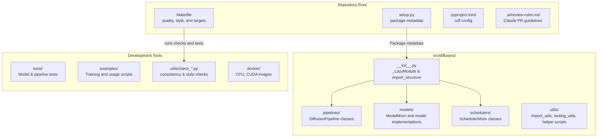
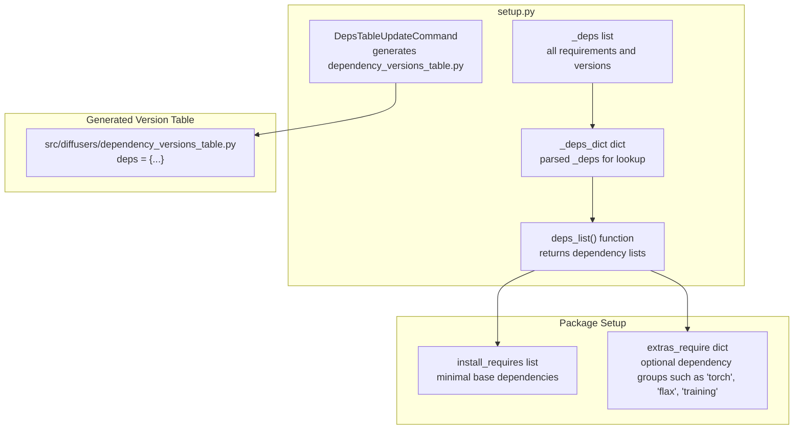
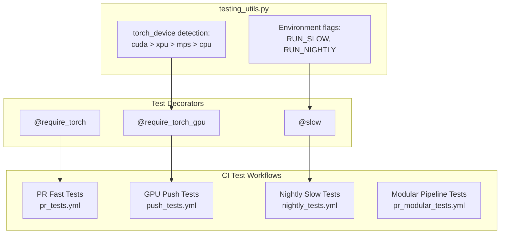

<!-- source: DeepWiki mcp.deepwiki.com · repo huggingface/diffusers · page 9 Development and Infrastructure · fetched 2026-10-21 -->

# Development and Infrastructure

Relevant source files

The following files were used as context for generating this wiki page:

- [.ai/AGENTS.md](.ai/AGENTS.md)
- [.ai/skills/model-integration/SKILL.md](.ai/skills/model-integration/SKILL.md)
- [.ai/skills/self-review/SKILL.md](.ai/skills/self-review/SKILL.md)
- [.github/ISSUE_TEMPLATE/bug-report.yml](.github/ISSUE_TEMPLATE/bug-report.yml)
- [.github/ISSUE_TEMPLATE/config.yml](.github/ISSUE_TEMPLATE/config.yml)
- [.github/ISSUE_TEMPLATE/feature_request.md](.github/ISSUE_TEMPLATE/feature_request.md)
- [.github/ISSUE_TEMPLATE/new-model-addition.yml](.github/ISSUE_TEMPLATE/new-model-addition.yml)
- [.github/ISSUE_TEMPLATE/translate.md](.github/ISSUE_TEMPLATE/translate.md)
- [.github/PULL_REQUEST_TEMPLATE.md](.github/PULL_REQUEST_TEMPLATE.md)
- [.github/actions/setup-miniconda/action.yml](.github/actions/setup-miniconda/action.yml)
- [.github/workflows/claude_review.yml](.github/workflows/claude_review.yml)
- [.github/workflows/new_model_request_reply.yml](.github/workflows/new_model_request_reply.yml)
- [.github/workflows/pr_link_issue_reminder.yml](.github/workflows/pr_link_issue_reminder.yml)
- [.gitignore](.gitignore)
- [CITATION.cff](CITATION.cff)
- [CODE_OF_CONDUCT.md](CODE_OF_CONDUCT.md)
- [CONTRIBUTING.md](CONTRIBUTING.md)
- [Makefile](Makefile)
- [PHILOSOPHY.md](PHILOSOPHY.md)
- [docs/source/en/conceptual/contribution.md](docs/source/en/conceptual/contribution.md)
- [docs/source/en/stable_diffusion.md](docs/source/en/stable_diffusion.md)
- [docs/source/en/using-diffusers/batched_inference.md](docs/source/en/using-diffusers/batched_inference.md)
- [utils/check_copies.py](utils/check_copies.py)
- [utils/check_dummies.py](utils/check_dummies.py)
- [utils/remind_link_issue.py](utils/remind_link_issue.py)

## Purpose and Scope

This page provides a high-level overview of the development workflow, infrastructure, and maintenance practices used in the Diffusers library repository. It outlines key components such as the package setup, testing framework, import system, code quality tools, and AI agent guidelines. The goal is to orient contributors with the architecture and practices that underpin the project while linking to more detailed child pages for each topic.

For detailed guidance, see the child pages:
- **[Package Setup and Distribution](#9.1)** — Setup scripts, dependencies, Docker images, and release process.
- **[Testing Framework](#9.2)** — Test types, utilities, test matrix creation, Docker environments, and CI workflows.
- **[Import and Backend Management](#9.3)** — Lazy module loading, backend detection, dummy object mechanism, import utilities.
- **[Code Quality and Maintenance](#9.4)** — Linters and checks, utility scripts, documentation workflows, AI contribution guidelines.
- **[Benchmarking](#9.5)** — Infrastructure for performance and memory benchmarking.
- **[Diffusers CLI](#9.6)** — CLI commands and their codebase implementation.

---

## Repository Structure Overview

The Diffusers repository employs a `src`-layout following modern Python best practices to isolate package code from development tools. The core source code lives under `src/diffusers/` with well-defined sub-packages and an import system relying on lazy loading.

**Key entities:**

- `setup.py` (top-level) defines package properties and dependency versions [setup.py:275-303]().
- `src/diffusers/__init__.py` defines the `_import_structure` dictionary used by the lazy loading `_LazyModule` to selectively import submodules on-demand [src/diffusers/__init__.py:1-65]().
- Utility scripts like `check_dummies.py`, `check_copies.py` ensure import consistency and code quality [utils/check_dummies.py:1-175](), [utils/check_copies.py]().
- The `Makefile` aggregates common commands (`make quality`, `make test`) to simplify developer workflows [Makefile:1-86]().

**Sources:** [setup.py:275-303](), [src/diffusers/__init__.py:1-65](), [Makefile:1-86](), [utils/check_dummies.py:1-175]()

---

## Dependency Management Architecture

Dependency management is centralized and version-locked to ensure compatibility and reproducibility. The cornerstone is the `_deps` list in `setup.py` which enumerates all package requirements with version constraints.

- The `_deps` list specifies dependencies such as `torch`, `transformers`, `flax`, and utility libraries with pinned versions [setup.py:97-150]().
- `install_requires` defines the minimal dependencies needed to use Diffusers, typically including `numpy` and basic image libraries [setup.py:218-265]().
- `extras_require` enumerates optional groups like `[torch]`, `[flax]`, and `[training]` that users can selectively install.
- `DepsTableUpdateCommand` generates `dependency_versions_table.py`, a version-locked dictionary utilized by training scripts and consistency checks [setup.py:180-217]().
- The `Makefile` enforces dependency version table consistency via `make deps_table_check_updated` [Makefile:23-27]().

**Sources:** [setup.py:97-271](), [Makefile:20-27]()

---

## Import and Backend Management

Diffusers supports multiple backends (PyTorch, Flax, JAX) and implements a lazy import system to optimize import time and memory usage.

### Lazy Loading

- The package uses `_LazyModule` (in `src/diffusers/__init__.py`) which overrides Python's import mechanism. Submodules are loaded only when accessed.
- Backend availability (`is_torch_available()`, etc.) is evaluated eagerly in `import_utils.py` [src/diffusers/utils/import_utils.py:50-126]().
- This mechanism speeds up startup and avoids import errors on missing optional dependencies.

### Dummy Objects and Backends

- When a requested class requires an unavailable backend, `DummyObject` instances are returned. Accessing one raises a clear `ImportError` instructing users how to install the missing backend [src/diffusers/utils/import_utils.py:592-668]().
- The backend mapping and dummy classes are centralized for maintainability.
- This system ensures graceful degradation and helpful error messages in partial install scenarios.

**Sources:** [src/diffusers/utils/import_utils.py:50-126](), [src/diffusers/utils/import_utils.py:592-668](), [src/diffusers/utils/import_utils.py:972-1023]()

---

## Testing Infrastructure

Testing is extensive and covers CPU/GPU compatibility, multiple backends, performance tiers, and modular pipeline components. The framework utilizes `pytest` with supporting utilities for rich environment detection and conditional skipping.

Key aspects:

- **Test Types:** Unit tests, integration tests, performance slow tests, and modular pipeline tests.
- **Decorators:** `@require_torch` and `@require_torch_gpu` guard tests based on hardware; `@slow` marks slow tests [tests/utils/testing_utils.py]().
- **Matrix Generation:** `utils/fetch_torch_cuda_pipeline_test_matrix.py` creates test batches for GPU/CPU combinations to optimize CI parallelism [push_tests.yml:51-56]().
- **CI Pipelines:** GitHub Actions define workflows for fast PR testing, push GPU testing, nightly comprehensive tests, and modular pipeline specific tests [pr_tests.yml:84-150](), [push_tests.yml:51-115](), [pr_modular_tests.yml:88-106]().
- **Docker Support:** Dockerfiles support CPU, CUDA, and minimum dependency environments, and images are automatically built and pushed via CI [build_docker_images.yml:87-123]().

**Sources:** [.github/workflows/pr_tests.yml:84-150](), [.github/workflows/push_tests.yml:51-115](), [.github/workflows/pr_modular_tests.yml:88-106](), [.github/workflows/build_docker_images.yml:87-123](), [utils/fetch_torch_cuda_pipeline_test_matrix.py]()

---

## Maintenance and AI-Assisted Development Guidelines

Maintaining code quality and facilitating contributions are supported through scripts, strict workflows, and AI agent guidelines.

- **Code Quality Checks:**
  - `utils/check_copies.py` verifies that copied code segments marked with `# Copied from` comments remain consistent across related files [pr_tests.yml:74]().
  - `utils/check_dummies.py` validates that dummy classes correctly mirror real classes to maintain backend import consistency [Makefile:35-39]().
- **AI Agent Guidelines:**
  - The `.ai/` directory contains detailed guides for AI agents used in code review and PR drafting, explaining coding conventions and review rules [.ai/AGENTS.md:1-84]().
  - Specific skills such as `model-integration`, `self-review`, and `diffusers-cli` are defined under `.ai/skills/` for automation and assistance.
- **Clause PR Reviews:**
  - A GitHub Actions workflow integrates the Claude AI reviewer bot that reads pull request diffs and comments, checking conformance against project rules maintained in `.ai/review-rules.md` [claude_review.yml:1-157]().
- **Contribution Workflow:**
  - The `CONTRIBUTING.md` document details how to engage with the project, including opening issues, writing PRs, and interacting in community channels.
  - AI-assisted contributions must follow strict human oversight requirements; final commit messages and PR submissions must be explicitly approved by humans [.github/PULL_REQUEST_TEMPLATE.md:19-24]().

**Sources:** [utils/check_copies.py](), [utils/check_dummies.py:1-175](), [.ai/AGENTS.md:1-84](), [.github/workflows/claude_review.yml:1-157](), [CONTRIBUTING.md:1-74](), [.github/PULL_REQUEST_TEMPLATE.md:19-24]()

---

## Mapping Development Concepts to Code Entities

### Diagram 1: From Development Concepts to Code Entities

```mermaid
graph TB
    subgraph "Development Concepts"
        PackageSetup["Package Setup and Distribution"]
        Testing["Testing Infrastructure"]
        ImportSystem["Import and Backend Management"]
        CodeQuality["Code Quality and Maintenance"]
        AIContrib["AI Agent Guidelines"]
    end
    
    subgraph "Code Entities"
        SetupPy["setup.py"]
        Makefile["Makefile"]
        LazyModule["src/diffusers/__init__.py (_LazyModule)"]
        ImportUtils["src/diffusers/utils/import_utils.py"]
        CheckCopies["utils/check_copies.py"]
        CheckDummies["utils/check_dummies.py"]
        TestingUtils["tests/utils/testing_utils.py"]
        PrTestsWorkflow[".github/workflows/pr_tests.yml"]
        ClaudeReview[".github/workflows/claude_review.yml"]
        AiDir[".ai/ directory"]
    end
    
    PackageSetup --> SetupPy
    PackageSetup --> Makefile
    
    Testing --> TestingUtils
    Testing --> PrTestsWorkflow
    
    ImportSystem --> LazyModule
    ImportSystem --> ImportUtils
    ImportSystem --> CheckDummies
    
    CodeQuality --> CheckCopies
    CodeQuality --> CheckDummies
    CodeQuality --> Makefile
    
    AIContrib --> AiDir
    AIContrib --> ClaudeReview
    AIContrib --> PrTestsWorkflow
```

---

### Diagram 2: Development Workflow Overview

- Developers write code and run local style and quality checks using commands provided in the Makefile.
- Once committed and pushed, automated Github workflows run tests in parallel environments, including GPU support.
- An AI assistant (Claude) reviews the PR applying formal rules.
- Human maintainers review and approve changes before merging.
- Upon merge, release tooling publishes the updated package.

---

## Summary

The Diffusers development infrastructure leverages:

1. A modular, lazy-loading package design with robust multi-backend support.
2. Centralized dependency versioning with a verification infrastructure to maintain consistency.
3. A complex, efficient testing framework spanning fast unit tests to nightly GPU tests using CI and Docker.
4. Code quality automation invoking linter fixes, copy consistency checks, and dummy object validations.
5. AI-assisted review agents with strict human-in-the-loop workflows for safer and faster PR reviews.
6. Extensive contributor documentation guiding participation in all phases of development.

This infrastructure supports the fast-paced, community-driven evolution of Diffusers while ensuring maintainability and quality.

---

For full details please consult the linked child pages:

- [Package Setup and Distribution](#9.1)
- [Testing Framework](#9.2)
- [Import and Backend Management](#9.3)
- [Code Quality and Maintenance](#9.4)
- [Benchmarking](#9.5)
- [Diffusers CLI](#9.6)

---

# References

- [setup.py:97-271]()
- [src/diffusers/__init__.py:1-65]()
- [Makefile:1-86]()
- [utils/check_dummies.py:1-175]()
- [utils/check_copies.py]()
- [src/diffusers/utils/import_utils.py:50-126]()
- [src/diffusers/utils/import_utils.py:592-668]()
- [.github/workflows/pr_tests.yml:84-150]()
- [.github/workflows/push_tests.yml:51-115]()
- [.github/workflows/pr_modular_tests.yml:88-106]()
- [.github/workflows/build_docker_images.yml:87-123]()
- [.github/workflows/claude_review.yml:1-157]()
- [CONTRIBUTING.md:1-74]()
- [.ai/AGENTS.md:1-84]()
- [.github/PULL_REQUEST_TEMPLATE.md:19-24]()

---

