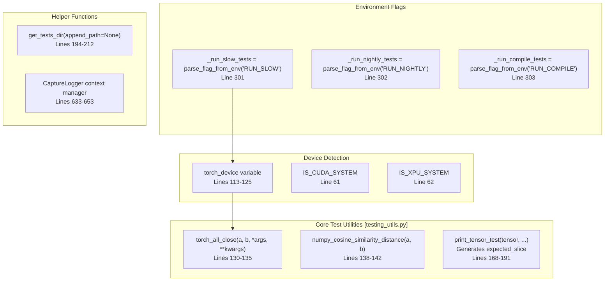
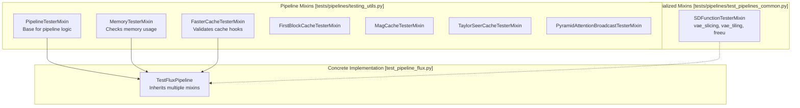
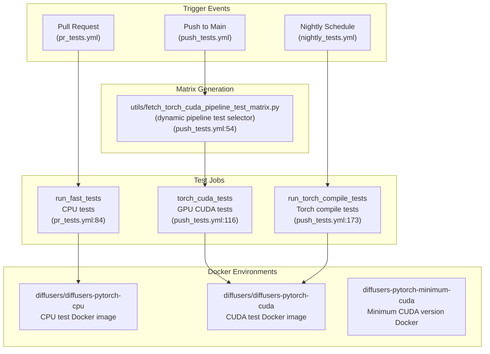
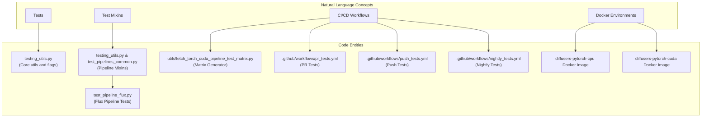
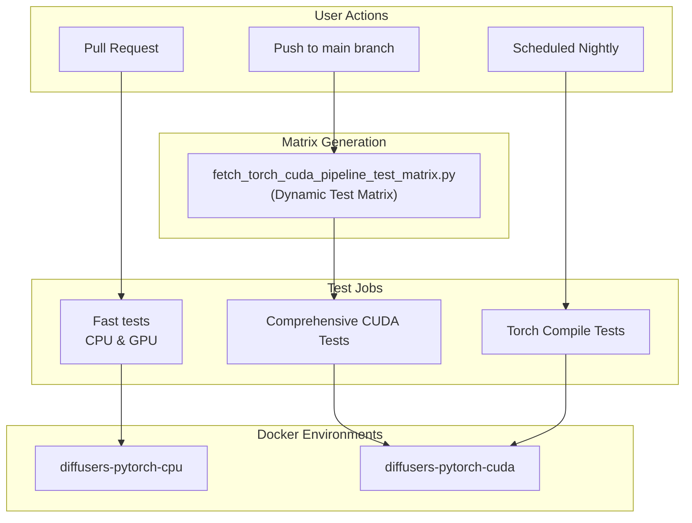

<!-- source: DeepWiki mcp.deepwiki.com · repo huggingface/diffusers · page 9.2 Testing Framework · fetched 2026-10-21 -->

# Testing Framework

<details>
<summary>Relevant source files</summary>

The following files were used as context for generating this wiki page:

- [.ai/references/testing.md](.ai/references/testing.md)
- [.github/workflows/benchmark.yml](.github/workflows/benchmark.yml)
- [.github/workflows/mirror_community_pipeline.yml](.github/workflows/mirror_community_pipeline.yml)
- [.github/workflows/nightly_tests.yml](.github/workflows/nightly_tests.yml)
- [.github/workflows/notify_slack_about_release.yml](.github/workflows/notify_slack_about_release.yml)
- [.github/workflows/pr_dependency_test.yml](.github/workflows/pr_dependency_test.yml)
- [.github/workflows/pr_modular_tests.yml](.github/workflows/pr_modular_tests.yml)
- [.github/workflows/pr_test_fetcher.yml](.github/workflows/pr_test_fetcher.yml)
- [.github/workflows/pr_tests.yml](.github/workflows/pr_tests.yml)
- [.github/workflows/pr_tests_gpu.yml](.github/workflows/pr_tests_gpu.yml)
- [.github/workflows/pr_torch_dependency_test.yml](.github/workflows/pr_torch_dependency_test.yml)
- [.github/workflows/push_tests.yml](.github/workflows/push_tests.yml)
- [.github/workflows/push_tests_fast.yml](.github/workflows/push_tests_fast.yml)
- [.github/workflows/push_tests_mps.yml](.github/workflows/push_tests_mps.yml)
- [.github/workflows/pypi_publish.yaml](.github/workflows/pypi_publish.yaml)
- [.github/workflows/release_tests_fast.yml](.github/workflows/release_tests_fast.yml)
- [.github/workflows/ssh-runner.yml](.github/workflows/ssh-runner.yml)
- [docs/source/en/api/pipelines/ideogram4.md](docs/source/en/api/pipelines/ideogram4.md)
- [src/diffusers/models/controlnets/controlnet_sparsectrl.py](src/diffusers/models/controlnets/controlnet_sparsectrl.py)
- [src/diffusers/models/transformers/prior_transformer.py](src/diffusers/models/transformers/prior_transformer.py)
- [src/diffusers/models/transformers/transformer_ernie_image.py](src/diffusers/models/transformers/transformer_ernie_image.py)
- [src/diffusers/models/transformers/transformer_helios.py](src/diffusers/models/transformers/transformer_helios.py)
- [src/diffusers/models/transformers/transformer_ideogram4.py](src/diffusers/models/transformers/transformer_ideogram4.py)
- [src/diffusers/models/transformers/transformer_wan_animate.py](src/diffusers/models/transformers/transformer_wan_animate.py)
- [src/diffusers/pipelines/helios/pipeline_helios_pyramid.py](src/diffusers/pipelines/helios/pipeline_helios_pyramid.py)
- [src/diffusers/pipelines/ideogram4/__init__.py](src/diffusers/pipelines/ideogram4/__init__.py)
- [src/diffusers/pipelines/ideogram4/pipeline_ideogram4.py](src/diffusers/pipelines/ideogram4/pipeline_ideogram4.py)
- [src/diffusers/pipelines/ideogram4/prompt_enhancer.py](src/diffusers/pipelines/ideogram4/prompt_enhancer.py)
- [src/diffusers/pipelines/stable_audio/pipeline_stable_audio.py](src/diffusers/pipelines/stable_audio/pipeline_stable_audio.py)
- [tests/models/testing_utils/common.py](tests/models/testing_utils/common.py)
- [tests/models/transformers/test_models_transformer_helios.py](tests/models/transformers/test_models_transformer_helios.py)
- [tests/models/transformers/test_models_transformer_ideogram4.py](tests/models/transformers/test_models_transformer_ideogram4.py)
- [tests/models/transformers/test_models_transformer_wan.py](tests/models/transformers/test_models_transformer_wan.py)
- [tests/models/transformers/test_models_transformer_wan_animate.py](tests/models/transformers/test_models_transformer_wan_animate.py)
- [tests/models/transformers/test_models_transformer_wan_vace.py](tests/models/transformers/test_models_transformer_wan_vace.py)
- [tests/pipelines/audioldm2/test_audioldm2.py](tests/pipelines/audioldm2/test_audioldm2.py)
- [tests/pipelines/chronoedit/test_chronoedit.py](tests/pipelines/chronoedit/test_chronoedit.py)
- [tests/pipelines/cogview3/test_cogview3plus.py](tests/pipelines/cogview3/test_cogview3plus.py)
- [tests/pipelines/consisid/test_consisid.py](tests/pipelines/consisid/test_consisid.py)
- [tests/pipelines/controlnet_flux/test_controlnet_flux.py](tests/pipelines/controlnet_flux/test_controlnet_flux.py)
- [tests/pipelines/controlnet_flux/test_controlnet_flux_img2img.py](tests/pipelines/controlnet_flux/test_controlnet_flux_img2img.py)
- [tests/pipelines/controlnet_flux/test_controlnet_flux_inpaint.py](tests/pipelines/controlnet_flux/test_controlnet_flux_inpaint.py)
- [tests/pipelines/controlnet_hunyuandit/test_controlnet_hunyuandit.py](tests/pipelines/controlnet_hunyuandit/test_controlnet_hunyuandit.py)
- [tests/pipelines/controlnet_sd3/test_controlnet_inpaint_sd3.py](tests/pipelines/controlnet_sd3/test_controlnet_inpaint_sd3.py)
- [tests/pipelines/controlnet_sd3/test_controlnet_sd3.py](tests/pipelines/controlnet_sd3/test_controlnet_sd3.py)
- [tests/pipelines/ideogram4/test_pipeline_ideogram4.py](tests/pipelines/ideogram4/test_pipeline_ideogram4.py)
- [tests/pipelines/kandinsky/test_kandinsky_prior.py](tests/pipelines/kandinsky/test_kandinsky_prior.py)
- [tests/pipelines/kandinsky2_2/test_kandinsky_prior.py](tests/pipelines/kandinsky2_2/test_kandinsky_prior.py)
- [tests/pipelines/kandinsky2_2/test_kandinsky_prior_emb2emb.py](tests/pipelines/kandinsky2_2/test_kandinsky_prior_emb2emb.py)
- [tests/pipelines/ltx2/test_ltx2_diffusion_decode.py](tests/pipelines/ltx2/test_ltx2_diffusion_decode.py)
- [tests/pipelines/ltx2/test_ltx2_image2video.py](tests/pipelines/ltx2/test_ltx2_image2video.py)
- [tests/pipelines/ltx2/test_pipeline_ltx2_dfr.py](tests/pipelines/ltx2/test_pipeline_ltx2_dfr.py)
- [tests/pipelines/ltx2/test_pipeline_ltx2_dfr_temporal_refine.py](tests/pipelines/ltx2/test_pipeline_ltx2_dfr_temporal_refine.py)
- [tests/pipelines/ltx2/testing_utils.py](tests/pipelines/ltx2/testing_utils.py)
- [tests/pipelines/motif_video/test_motif_video_image2video.py](tests/pipelines/motif_video/test_motif_video_image2video.py)
- [tests/pipelines/pndm/test_pndm.py](tests/pipelines/pndm/test_pndm.py)
- [tests/pipelines/stable_audio/test_stable_audio.py](tests/pipelines/stable_audio/test_stable_audio.py)
- [tests/pipelines/stable_diffusion_3/test_pipeline_stable_diffusion_3.py](tests/pipelines/stable_diffusion_3/test_pipeline_stable_diffusion_3.py)
- [tests/pipelines/stable_diffusion_3/test_pipeline_stable_diffusion_3_img2img.py](tests/pipelines/stable_diffusion_3/test_pipeline_stable_diffusion_3_img2img.py)
- [tests/pipelines/stable_diffusion_3/test_pipeline_stable_diffusion_3_inpaint.py](tests/pipelines/stable_diffusion_3/test_pipeline_stable_diffusion_3_inpaint.py)
- [tests/pipelines/testing_utils/__init__.py](tests/pipelines/testing_utils/__init__.py)
- [tests/pipelines/testing_utils/cache.py](tests/pipelines/testing_utils/cache.py)
- [tests/pipelines/testing_utils/common.py](tests/pipelines/testing_utils/common.py)
- [tests/pipelines/testing_utils/ip_adapter.py](tests/pipelines/testing_utils/ip_adapter.py)
- [tests/pipelines/testing_utils/memory.py](tests/pipelines/testing_utils/memory.py)
- [tests/pipelines/testing_utils/utils.py](tests/pipelines/testing_utils/utils.py)

</details>


The Diffusers testing framework provides a comprehensive infrastructure to ensure the correctness, performance, and reliability of the diffusers library. It integrates standardized reusable test mixins, dynamic test matrix generation, specialized Docker environments, and well-structured CI/CD workflows to automate testing at scale.

---

## Overview and Scope

This page documents the testing infrastructure of the Diffusers library, covering:

- Types of tests and their execution context
- Shared reusable mixins and utils driving test code reuse
- Dynamic test matrix generation mechanisms
- Docker-based testing environments for reproducibility and performance
- CI/CD workflows orchestrating tests and quality checks on GitHub Actions

---

## Test Organization and Core Infrastructure

The testing framework is architected around reusable components primarily defined in `tests/testing_utils.py`, `tests/pipelines/testing_utils.py`, and their counterparts in `src/diffusers/utils/testing_utils.py`. These provide essential utilities for device detection, environment flags, test decorators, assertions, and helper context managers.

### Core Testing Utilities

Key utilities include:

- `torch_all_close(a, b, ...)`: Robust floating-point tensor closeness check across CPU/GPU devices
- `numpy_cosine_similarity_distance(a, b)`: Measures similarity/distance between numpy arrays for deep comparisons
- `print_tensor_test(tensor)`: Debugging printer generating expected slice outputs for tests
- Device detection variables like `torch_device`, `IS_CUDA_SYSTEM`, `IS_XPU_SYSTEM`, auto-selecting CUDA/XPU/CPU environments
- Environment flag parsing for selectively enabling slow, nightly, or compile tests



Sources: `[src/diffusers/utils/testing_utils.py:61-63]()`, `[src/diffusers/utils/testing_utils.py:113-135]()`, `[src/diffusers/utils/testing_utils.py:138-142]()`, `[src/diffusers/utils/testing_utils.py:168-191]()`, `[src/diffusers/utils/testing_utils.py:194-212]()`, `[src/diffusers/utils/testing_utils.py:301-303]()`, `[src/diffusers/utils/testing_utils.py:633-653]()`

---

### Test Mixin Classes and Reuse

Diffusers employs a mixin-based testing architecture. This design allows for modular, reusable test logic that can be shared across model and pipeline tests. The test base classes enable coverage of common features such as memory checks, inference correctness, and caching behavior.

#### Pipeline Testing Mixins

Some central mixins specialized for pipelines:

- `PipelineTesterMixin`: Foundation for pipeline tests including loading, saving, CPU/GPU handling
- `MemoryTesterMixin`: Measures memory consumption during tests to detect leaks or regressions
- Cache-testing mixins like `FasterCacheTesterMixin`, `FirstBlockCacheTesterMixin`, `MagCacheTesterMixin`, `TaylorSeerCacheTesterMixin`, and `PyramidAttentionBroadcastTesterMixin` validate specific inference optimization hooks

#### Example: Mixins in Flux Pipeline Tests

The `TestFluxPipeline` class integrates many mixins to comprehensively test features of the Flux pipeline:



| Mixin Class                      | Responsibility                                | Source                                      |
|---------------------------------|----------------------------------------------|---------------------------------------------|
| `PipelineTesterMixin`            | Standard pipeline lifecycle validations      | `[tests/pipelines/flux/test_pipeline_flux.py:132]()` |
| `FasterCacheTesterMixin`         | Testing `FasterCache` optimization            | `[tests/pipelines/flux/test_pipeline_flux.py:33]()`  |
| `MemoryTesterMixin`              | Memory footprint measurement                   | `[tests/pipelines/flux/test_pipeline_flux.py:36]()`  |
| `SDFunctionTesterMixin`          | SD-specific features like `vae_slicing`       | `[tests/pipelines/test_pipelines_common.py:111]()`   |
| `PyramidAttentionBroadcastTesterMixin` | Validates pyramid attention broadcast hook  | `[tests/pipelines/flux/test_pipeline_flux.py:38]()`  |

Sources: `[tests/pipelines/flux/test_pipeline_flux.py:31-40]()`, `[tests/pipelines/flux/test_pipeline_flux.py:132]()`, `[tests/pipelines/test_pipelines_common.py:111-116]()`

---

## CI/CD Infrastructure and Workflow

The Diffusers project employs a set of well-organized GitHub Actions workflows to automate testing for PRs, pushes to main, nightly runs, and releases. These workflows utilize strategic matrix testing to optimize coverage without excessive runtime.

### Workflow Summary



Sources: `[.github/workflows/pr_tests.yml:84-93]()`, `[.github/workflows/push_tests.yml:54-75]()`, `[.github/workflows/push_tests.yml:116-173]()`, `[.github/workflows/nightly_tests.yml:1-128]()`

---

### Dynamic Test Matrix Generation

To efficiently test a large set of pipelines, Diffusers generates test matrices dynamically based on recent pipeline usage trends and coverage needs.

- The matrix list is generated by the Python script `utils/fetch_torch_cuda_pipeline_test_matrix.py`, which returns JSON list entries for pipelines to test.
- The matrix is configured per workflow with environment variables controlling which pipelines to include:
  - `PIPELINE_USAGE_CUTOFF` controls the minimal usage count for inclusion
  - Examples:
    - Push tests use cutoff of 50000, balancing coverage and runtime
    - PR fast GPU tests set it extremely high to limit to always-tested, small subset
    - Nightly tests run all pipelines with cutoff 0 for exhaustive coverage

**Matrix parallelization:**

- GPU tests use `max-parallel: 8` with 1 worker per pipeline module to avoid GPU resource contention.
- CPU tests for PRs and push tests often use pytest's parallelization options (`-n 4`, `-n 8`) for speed.

Sources: `[.github/workflows/push_tests.yml:22-56]()`, `[.github/workflows/pr_tests_gpu.yml:30-160]()`, `[.github/workflows/nightly_tests.yml:19]()`

---

### Docker-based Environments for Testing

The project relies on Docker images to ensure reproducible testing environments aligned with supported PyTorch versions and CUDA setups.

| Docker Image                     | Description                                      | Key Characteristics                                                 |
|---------------------------------|------------------------------------------------|--------------------------------------------------------------------|
| `diffusers/diffusers-pytorch-cpu`  | CPU-only environment for fast CI tests          | Pre-configured with torch+CPU deps for rapid CPU pipeline testing.[.github/workflows/pr_tests.yml:93]() |
| `diffusers/diffusers-pytorch-cuda` | Full CUDA environment supporting all CUDA tests | Base: `nvidia/cuda:12.9.1-runtime` with torch 2.10.0 and uv package manager for fast installs. [.github/workflows/push_tests.yml:75](), Dockerfile implied |
| `diffusers-pytorch-minimum-cuda`    | Minimal supported CUDA for version compatibility | Runs on PyTorch minimum supported CUDA version. Used in release tests. [.github/workflows/release_tests_fast.yml:178]() |

The CUDA Docker images use `uv` to pin versions and speed up dependency installation with baked-in overrides for `torch`, `torchvision`, and `torchaudio` to prevent ABI incompatibilities.

Sources: `[.github/workflows/push_tests.yml:22-60]()`, `[.github/workflows/pr_tests_gpu.yml:30-175]()`, `[.github/workflows/release_tests_fast.yml:178-191]()`

---

## Test Types and Execution Details

### Fast vs. Slow Tests

#### Fast Tests

- Executed on every pull request and push to main.
- Use minimal model and pipeline configurations via `get_dummy_components` and `get_dummy_inputs` to optimize test runtime.
- Parallelized across multiple CPU cores or GPU workers.

#### Slow Tests

- Marked explicitly with the `@slow` decorator.
- Generally excluded during PR runs to maintain CI speed.
- Run during nightly builds or when `RUN_SLOW` environment variable is set to `yes`.
- Include more exhaustive pipelines or configurations with larger weights.

This variable gating is implemented in `tests/testing_utils.py` via environment flags:

```python
_run_slow_tests = parse_flag_from_env("RUN_SLOW")
_run_nightly_tests = parse_flag_from_env("RUN_NIGHTLY")
```

Sources: `[src/diffusers/utils/testing_utils.py:300-305]()`, `[.github/workflows/nightly_tests.yml:15-17]()`

---

### Specialized Test Suites

1. **Torch Compile Tests**  
   - Exercise `torch.compile()` support for models and pipelines.
   - Run in dedicated workflows with selective strategy `[.github/workflows/push_tests.yml:173-200]()`.

2. **Modular Pipeline Tests**  
   - Target modular pipeline system codebases in `src/diffusers/modular_pipelines`.
   - Triggered on changes to modular pipeline core/modules `[.github/workflows/pr_modular_tests.yml:2-165]()`.

3. **Benchmarking Tests**  
   - Scheduled bi-monthly to measure latency and memory of core models on CUDA GPUs.
   - Publishes results and reports to dashboards `[.github/workflows/benchmark.yml:1-78]()`.

4. **Hub Staging Tests**  
   - Verify integration with the Hugging Face Hub model repository.
   - Run against staging environments to catch integration regressions `[.github/workflows/pr_tests.yml:170-211]()`.

---

### Repository Quality and Consistency Checks

Before running functional tests, the CI workflows execute a suite of static quality and consistency checks to ensure the codebase integrity:

- `check_copies.py`  
  Checks code duplication consistency between variants (e.g., SD and SDXL) and updates accordingly.

- `check_dummies.py`  
  Validates dummy object definitions to ensure no missing dependencies or broken dummies.

- `check_forward_call_docstrings.py`  
  Ensures `forward()` method docstrings fully document input parameters.

- `make quality`  
  Runs formatters, linters, and static code analysis tools.

Failures in these quality checks stop downstream tests and prompt contributors to fix issues before merging.  

Sources: `[.github/workflows/pr_tests.yml:74-81]()`, `[.github/workflows/pr_tests.yml:53-59]()`

---

## Test Implementation Guidelines

### Writing a New Pipeline Test

To add tests for a new pipeline (e.g., a Flux pipeline), one implements a tester config class with minimal components and inputs:

```python
class FluxPipelineTesterConfig(BasePipelineTesterConfig):
    pipeline_class = FluxPipeline
    
    def get_dummy_components(self, num_layers: int = 1):
        transformer = FluxTransformer2DModel(...)
        vae = AutoencoderKL(...)
        scheduler = FlowMatchEulerDiscreteScheduler()
        return {
            "transformer": transformer,
            "vae": vae,
            "scheduler": scheduler,
            # other components
        }

    def get_dummy_inputs(self):
        return {
            "prompt": "A painting of a squirrel",
            "num_inference_steps": 2,
            "guidance_scale": 5.0,
            # ...
        }
```

This minimal setup supports rapid automated checks validating core pipeline functionality, API consistency, and inference correctness.

Sources: `[tests/pipelines/flux/test_pipeline_flux.py:43-130]()`

---

### Numerical and Output Assertions

The testing framework provides utilities to facilitate reliable numerical comparisons between floating-point outputs across devices.

- `torch_all_close`: checks closeness with configurable tolerance, accounting for PyTorch/CUDA numeric variance.
- `numpy_cosine_similarity_distance`: measures cosine similarity for NumPy arrays providing robust numerical distance metrics.

Example usage in pipeline tests validating VAE outputs:

```python
assert np.abs(output_2[0].flatten() - output_1[0].flatten()).max() < 1e-2
```

These assertions ensure reproducibility and correctness of critical model components through continuous integration.

Sources: `[src/diffusers/utils/testing_utils.py:130-142]()`, `[tests/pipelines/test_pipelines_common.py:140]()`

---

# Summary

Diffusers testing leverages a modular mixin-based test design combined with dynamic matrix-driven CI workflows. The infrastructure uses dedicated Docker images for environment consistency and balances fast PR checks with exhaustive nightly regressions. Robust utilities and quality checks maintain code reliability and numerical correctness, enabling scalable development of new diffusion models and pipelines.

# Mermaid Diagram "Natural Language to Code Entities: Testing Components Mapping"



# Mermaid Diagram "Natural Language to Code Entities: CI/CD Test Matrix Flow"



---

Sources summary:  
`.github/workflows/pr_tests.yml`, `.github/workflows/push_tests.yml`, `.github/workflows/nightly_tests.yml`, `.github/workflows/pr_modular_tests.yml`, `.github/workflows/release_tests_fast.yml`, `src/diffusers/utils/testing_utils.py`, `tests/pipelines/testing_utils.py`, `tests/pipelines/test_pipelines_common.py`, `tests/pipelines/flux/test_pipeline_flux.py`, `utils/fetch_torch_cuda_pipeline_test_matrix.py`

---

