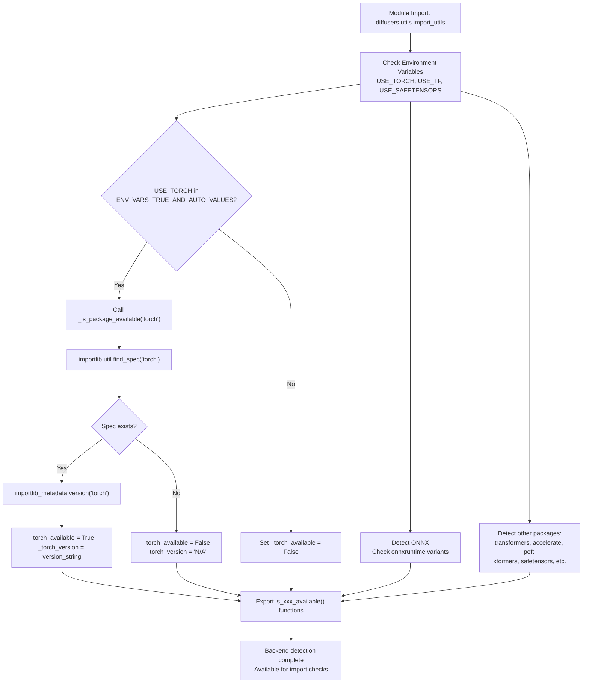
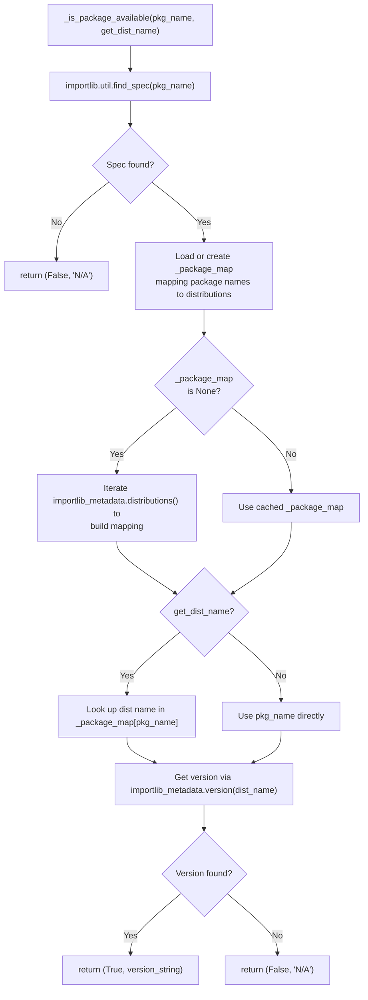
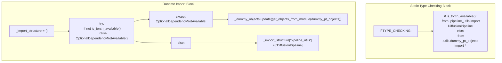
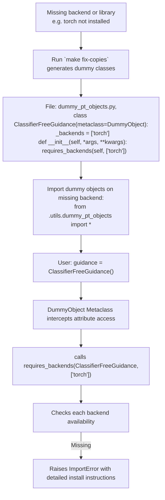
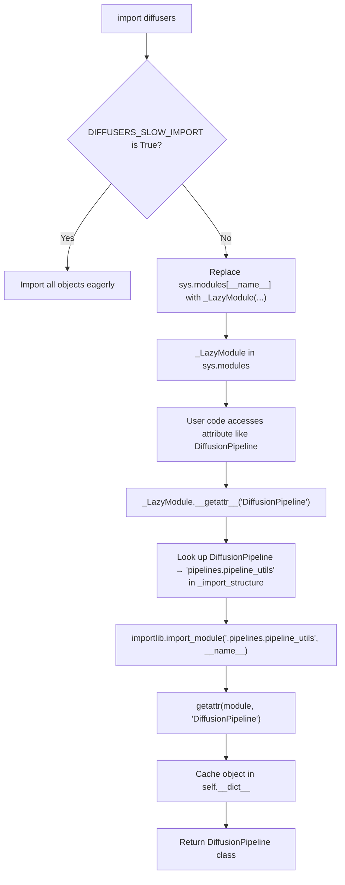
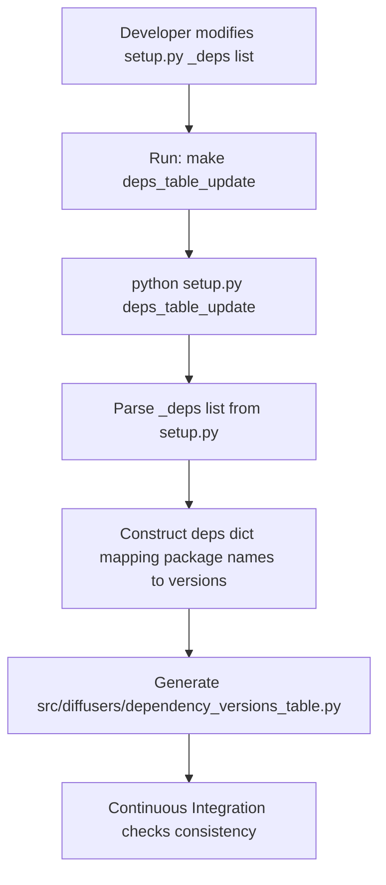
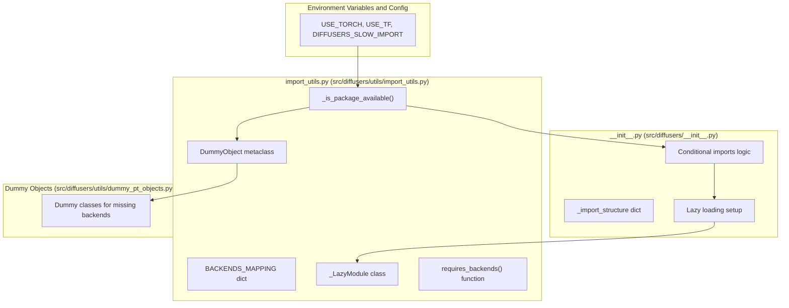

<!-- source: DeepWiki mcp.deepwiki.com · repo huggingface/diffusers · page 9.3 Import and Backend Management · fetched 2026-10-21 -->

# Import and Backend Management

<details>
<summary>Relevant source files</summary>

The following files were used as context for generating this wiki page:

- [docs/source/en/_toctree.yml](docs/source/en/_toctree.yml)
- [examples/dreambooth/train_dreambooth.py](examples/dreambooth/train_dreambooth.py)
- [examples/dreambooth/train_dreambooth_flax.py](examples/dreambooth/train_dreambooth_flax.py)
- [examples/dreambooth/train_dreambooth_lora.py](examples/dreambooth/train_dreambooth_lora.py)
- [examples/text_to_image/train_text_to_image.py](examples/text_to_image/train_text_to_image.py)
- [examples/text_to_image/train_text_to_image_flax.py](examples/text_to_image/train_text_to_image_flax.py)
- [examples/text_to_image/train_text_to_image_lora.py](examples/text_to_image/train_text_to_image_lora.py)
- [examples/textual_inversion/textual_inversion.py](examples/textual_inversion/textual_inversion.py)
- [examples/textual_inversion/textual_inversion_flax.py](examples/textual_inversion/textual_inversion_flax.py)
- [examples/unconditional_image_generation/train_unconditional.py](examples/unconditional_image_generation/train_unconditional.py)
- [setup.py](setup.py)
- [src/diffusers/__init__.py](src/diffusers/__init__.py)
- [src/diffusers/dependency_versions_table.py](src/diffusers/dependency_versions_table.py)
- [src/diffusers/models/__init__.py](src/diffusers/models/__init__.py)
- [src/diffusers/models/autoencoders/__init__.py](src/diffusers/models/autoencoders/__init__.py)
- [src/diffusers/models/transformers/__init__.py](src/diffusers/models/transformers/__init__.py)
- [src/diffusers/pipelines/__init__.py](src/diffusers/pipelines/__init__.py)
- [src/diffusers/pipelines/stable_diffusion/__init__.py](src/diffusers/pipelines/stable_diffusion/__init__.py)
- [src/diffusers/schedulers/__init__.py](src/diffusers/schedulers/__init__.py)
- [src/diffusers/utils/__init__.py](src/diffusers/utils/__init__.py)
- [src/diffusers/utils/constants.py](src/diffusers/utils/constants.py)
- [src/diffusers/utils/dummy_pt_objects.py](src/diffusers/utils/dummy_pt_objects.py)
- [src/diffusers/utils/dummy_torch_and_transformers_objects.py](src/diffusers/utils/dummy_torch_and_transformers_objects.py)
- [src/diffusers/utils/import_utils.py](src/diffusers/utils/import_utils.py)
- [src/diffusers/utils/testing_utils.py](src/diffusers/utils/testing_utils.py)

</details>


## Purpose and Scope

The Import and Backend Management system in Diffusers provides an infrastructure to support conditional dependency handling, lazy loading, backend detection, and graceful degradation for optional external libraries. It is designed to enable the seamless integration of multiple backend frameworks (e.g., PyTorch and ONNX) and optional features while minimizing import overhead and avoiding mandatory installation of all dependencies.

This system includes:

- **Backend detection**: Automatic runtime checks to determine which backends and optional libraries are installed and available.
- **Dummy objects**: Placeholder classes that raise informative errors when accessed, if required backends are missing.
- **Lazy loading**: Deferring actual imports until symbols are accessed, reducing initial import cost.
- **Import utilities**: Utility functions and classes in `import_utils.py` for all of the above.

This page explains their architecture, data flow, key classes/functions, and illustrates the mechanisms involved.

---

## Backend Detection Architecture

Diffusers performs backend detection early during import using the `import_utils` module. The system checks environment variables, tries to import packages, and fetches their versions to determine availability. This detection defines utility functions like `is_torch_available()`, `is_transformers_available()`, etc., which are consumed throughout the library for conditional imports and runtime feature gating.

### Detection Flow



### Notable Environment Variables

| Variable            | Values                                        | Purpose                                           |
|---------------------|-----------------------------------------------|--------------------------------------------------|
| `USE_TORCH`         | `AUTO` (default), `1`, `ON`, `YES`, `TRUE`   | Enables or disables PyTorch backend detection    |
| `USE_TF`            | Same as above                                 | Enables or disables TensorFlow backend detection |
| `USE_SAFETENSORS`   | Same as above                                 | Enables or disables safetensors support          |
| `DIFFUSERS_SLOW_IMPORT` | `FALSE` (default), `1`, `ON`, `YES`, `TRUE` | Disables lazy loading — imports all eagerly      |

These are handled in `src/diffusers/utils/import_utils.py` around lines 47-54 [src/diffusers/utils/import_utils.py:47-54]().

### Core Detection Function: `_is_package_available`

The core backend detection uses the function `_is_package_available(pkg_name, get_dist_name=False)`. This function performs:

- Checks if the package can be found using `importlib.util.find_spec`.
- Builds or uses a cached map between top-level package names and PyPI distributions for cases where import name ≠ distribution name (e.g., `bs4` → `beautifulsoup4`).
- Queries the package version from metadata.
- Returns a tuple `(is_available: bool, version: str)`.



The implementation also uses Python's memoization (`@cache`) decorators to avoid repeated expensive file system or metadata calls [src/diffusers/utils/import_utils.py:61-94]().

### Available Backend Detection Functions

The library exposes a rich set of detection functions, including but not limited to:

| Function                   | Backend                         | Description                             |
|----------------------------|--------------------------------|---------------------------------------|
| `is_torch_available()`     | PyTorch                        | Main deep learning backend             |
| `is_transformers_available()` | Huggingface Transformers       | Text encoder models                    |
| `is_accelerate_available()` | Accelerate                     | Distributed training and device mgmt. |
| `is_peft_available()`      | PEFT (LoRA support)            | Parameter-efficient fine-tuning       |
| `is_safetensors_available()` | Safetensors                   | Safe, fast checkpoint format           |
| `is_onnx_available()`      | ONNX runtime                  | ONNX inference backend                 |
| `is_gguf_available()`      | GGUF                           | Quantized model format                 |
| `is_torchao_available()`   | TorchAO                        | Advanced quantization and optimization|
| `is_bitsandbytes_available()` | BitsAndBytes (8-bit quant)    | Optimized quantization                 |
| `is_optimum_quanto_available()` | Optimum Quanto               | Alternative quantization               |

All are defined and exposed in `src/diffusers/utils/import_utils.py` [src/diffusers/utils/import_utils.py:236-453]().

---

## Conditional Import System

The Diffusers library employs a two-phase import strategy combining static type checking imports and runtime conditional imports guarded by backend availability checks.

### Import Resolution Process

```mermaid
flowchart TD
    UserImport["User: import diffusers"] --> InitFile["Load src/diffusers/__init__.py"]

    InitFile --> TypeCheck{"TYPE_CHECKING (static analysis)?"}

    TypeCheck -->|Yes| ImportAll["Import all objects for type checking and IDEs"]

    TypeCheck -->|No| RuntimeCheck["Runtime import control"]

    RuntimeCheck --> BackendCheck["Check backend availability<br/>is_torch_available()"]

    BackendCheck --> |Yes| ImportReal["Import actual PyTorch modules<br/>e.g. from .models import AutoencoderKL"]

    BackendCheck --> |No| ImportDummy["Import dummy placeholder objects"]

    ImportReal --> OptionalDeps["Check optional dependencies<br/>is_transformers_available(), etc."]

    ImportDummy --> OptionalDeps

    OptionalDeps --> OptAvailable{"Optional dependencies<br/>available?"}
    OptAvailable --> |Yes| ImportOptional["Import optional modules"]

    OptAvailable --> |No| ImportOptDummy["Import dummy objects for optional features"]

    # Lazy Loading configuration
    ImportOptional --> LazyCheck{"DIFFUSERS_SLOW_IMPORT == False?"}
    ImportOptDummy --> LazyCheck

    LazyCheck --> |True| UseLazy["Replace sys.modules[__name__]<br/>with _LazyModule for lazy loading"]

    LazyCheck --> |False| DirectImport["Import all objects eagerly"]

    UseLazy --> DoneLazy["Deferred imports until attribute access"]

    DirectImport --> DoneEager["All objects imported eagerly"]
```

This conditional logic ensures minimal imports happen eagerly; missing backends fall back on dummy objects raising errors on use.

### Example: Pipeline Import Pattern

The `__init__.py` files for modules like `pipelines` follow this pattern for conditional imports with dummy fallbacks:



This design pattern allows IDEs and lint checkers to see code correctly while runtime behaves correctly for absence or presence of dependencies [src/diffusers/pipelines/__init__.py:1-100]().

---

## Dummy Objects System

When a backend or optional library is not installed, Diffusers provides dummy objects to avoid immediate import errors but raise clear ImportErrors upon usage.

### Dummy Object Architecture



Dummy classes define common methods (`__init__`, `from_config`, `from_pretrained`) that invoke `requires_backends()` to produce informative errors [src/diffusers/utils/dummy_pt_objects.py:1-65](), [src/diffusers/utils/import_utils.py:658-668]().

### DummyObject Metaclass Details

The `DummyObject` metaclass intercepts all attribute access (except private) and enforces backend checking:

- On attribute or method access, it calls `requires_backends()` with the required backends list.
- `requires_backends()` iterates through the required backends, calling backend-specific availability functions (e.g., `is_torch_available()`).
- If any required backend is missing, it raises an ImportError with an error message template from `BACKENDS_MAPPING`.

This provides a fail-fast but informative user experience even if a user accidently imports a feature without the right dependencies [src/diffusers/utils/import_utils.py:627-668]().

### BACKENDS_MAPPING

This dictionary maps backend keys to:

| Backend Key  | Check Function           | Error Template Constant         |
|--------------|--------------------------|--------------------------------|
| `"torch"`    | `is_torch_available`     | `PYTORCH_IMPORT_ERROR`          |
| `"transformers"` | `is_transformers_available` | `TRANSFORMERS_IMPORT_ERROR`    |
| `"onnx"`     | `is_onnx_available`      | `ONNX_IMPORT_ERROR`             |

When dummy objects are accessed, the error message instructs users how to install missing backends.

---

## Lazy Module System

Diffusers speeds up imports by replacing modules with a lazy-loading proxy, `_LazyModule`, deferring import of submodules and symbols until needed.

### _LazyModule Resolution Flow



This design reduces initial import time and memory overhead by delaying actual heavy imports only when necessary [src/diffusers/utils/import_utils.py:972-1023](), [src/diffusers/__init__.py:30-63]()

### _LazyModule Features

- **Transparent API**: `_LazyModule` implements `__getattr__` for attribute forwarding, `__dir__` to list available attributes, and `__reduce__` for pickling support.
- **Autocomplete friendly**: IDEs and tools see the lazy module as a full module with all symbols.
- **Supports multiprocessing**: through custom state pickling.

---

## Dependency Management

The Diffusers library maintains dependency versions in a centralized manner to ensure consistent installs and builds.

### Dependency Workflow



The `setup.py` defines dependencies and extras groups for various use cases: core PyTorch (`torch`, `accelerate`), training (`datasets`, `peft`), testing (`pytest`, `transformers`), quality (`ruff`, `black`) [setup.py:96-158]().

### Extras Groups from setup.py Highlights

| Extras Group | Key Packages                                   | Purpose                    |
|--------------|-----------------------------------------------|----------------------------|
| `torch`      | `torch>=2.6`, `accelerate>=0.31.0`            | Core PyTorch dependencies  |
| `training`   | `datasets`, `tensorboard`, `peft>=0.17.0`     | Training infrastructure    |
| `test`       | `pytest`, `transformers>=4.41.2`, `safetensors` | Testing & validation tools |
| `quality`    | `ruff==0.9.10`, `isort>=5.5.4`, `black`       | Code formatting and lint   |

This process ensures the repository-wide dependency specifications remain synchronized with package metadata and docs [setup.py:96-149](), [src/diffusers/dependency_versions_table.py:1-56]().

---

# Summary Diagram: Relation between Backend Detection, Dummy, and Lazy Modules

```mermaid
graph LR
    A["Natural Language: Backend Availability"] -->|Check| B[is_torch_available()]
    B --> C{Torch Available?}
    C -->|Yes| D[Import Real Modules (e.g., AutoencoderKL, DiffusionPipeline)]
    C -->|No| E[Import Dummy Objects (from dummy_pt_objects.py)]

    D --> F[_LazyModule Enabled?]
    E --> F

    F -->|True| G[_LazyModule replaces diffusers namespace]
    F -->|False| H[Import all eagerly]

    G --> I[Deferred import until symbol access]

    H --> J[All symbols imported eagerly]

    E -.-> K["DummyObject raises ImportError when used"]

    style A fill:#ffffff,stroke:#000,stroke-width:1px
    style B fill:#ffffff,stroke:#000,stroke-width:1px
    style C fill:#ffffff,stroke:#000,stroke-width:1px
    style D fill:#ffffff,stroke:#000,stroke-width:1px
    style E fill:#ffffff,stroke:#000,stroke-width:1px
    style F fill:#ffffff,stroke:#000,stroke-width:1px
    style G fill:#ffffff,stroke:#000,stroke-width:1px
    style H fill:#ffffff,stroke:#000,stroke-width:1px
    style I fill:#ffffff,stroke:#000,stroke-width:1px
    style J fill:#ffffff,stroke:#000,stroke-width:1px
    style K fill:#ffffff,stroke:#000,stroke-width:1px,dasharray: 5 5
```

---

# Summary of Key Code Entities and Concepts



---

# References

- Backend detection and package availability: `src/diffusers/utils/import_utils.py` lines 18-233
- Conditional import, lazy loading, and dummy objects system: `src/diffusers/__init__.py` lines 3-190, `src/diffusers/utils/import_utils.py` lines 600-1063
- Pipeline example conditional imports: `src/diffusers/pipelines/__init__.py` lines 1-100
- Dummy pt objects example: `src/diffusers/utils/dummy_pt_objects.py` lines 1-65
- Dependency specification and update: `setup.py` lines 90-150, `src/diffusers/dependency_versions_table.py` lines 1-57
- Environment variables and constants: `src/diffusers/utils/import_utils.py` lines 47-54

---

This architecture allows Diffusers to be highly flexible with backend availability, optimize import performance through lazy loading, and maintain usability with dummy placeholders when dependencies are missing, thus providing a robust foundation for multi-backend support and extensible optional features.

---

