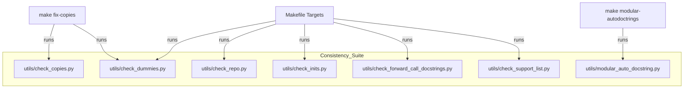
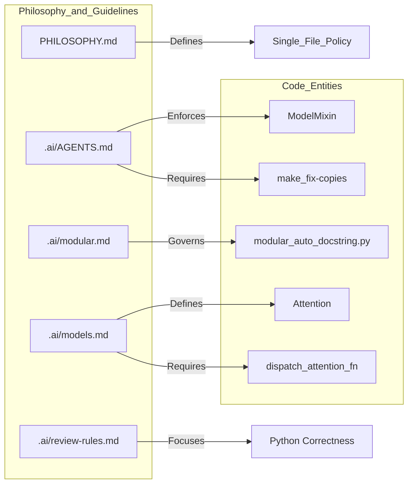
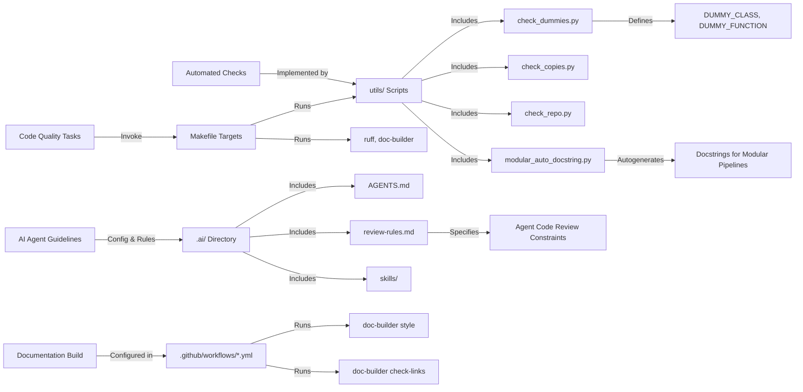

<!-- source: DeepWiki mcp.deepwiki.com · repo huggingface/diffusers · page 9.4 Code Quality and Maintenance · fetched 2026-10-21 -->

# Code Quality and Maintenance

Relevant source files

The following files were used as context for generating this wiki page:

- [.ai/AGENTS.md](.ai/AGENTS.md)
- [.ai/skills/model-integration/SKILL.md](.ai/skills/model-integration/SKILL.md)
- [.ai/skills/self-review/SKILL.md](.ai/skills/self-review/SKILL.md)
- [.github/ISSUE_TEMPLATE/bug-report.yml](.github/ISSUE_TEMPLATE/bug-report.yml)
- [.github/ISSUE_TEMPLATE/config.yml](.github/ISSUE_TEMPLATE/config.yml)
- [.github/ISSUE_TEMPLATE/feature_request.md](.github/ISSUE_TEMPLATE/feature_request.md)
- [.github/ISSUE_TEMPLATE/new-model-addition.yml](.github/ISSUE_TEMPLATE/new-model-addition.yml)
- [.github/ISSUE_TEMPLATE/translate.md](.github/ISSUE_TEMPLATE/translate.md)
- [.github/PULL_REQUEST_TEMPLATE.md](.github/PULL_REQUEST_TEMPLATE.md)
- [.github/actions/setup-miniconda/action.yml](.github/actions/setup-miniconda/action.yml)
- [.github/workflows/build_documentation.yml](.github/workflows/build_documentation.yml)
- [.github/workflows/build_pr_documentation.yml](.github/workflows/build_pr_documentation.yml)
- [.github/workflows/claude_review.yml](.github/workflows/claude_review.yml)
- [.github/workflows/new_model_request_reply.yml](.github/workflows/new_model_request_reply.yml)
- [.github/workflows/pr_link_issue_reminder.yml](.github/workflows/pr_link_issue_reminder.yml)
- [.github/workflows/ssh-pr-runner.yml](.github/workflows/ssh-pr-runner.yml)
- [.github/workflows/trufflehog.yml](.github/workflows/trufflehog.yml)
- [.github/workflows/typos.yml](.github/workflows/typos.yml)
- [.github/workflows/upload_pr_documentation.yml](.github/workflows/upload_pr_documentation.yml)
- [.gitignore](.gitignore)
- [CITATION.cff](CITATION.cff)
- [CODE_OF_CONDUCT.md](CODE_OF_CONDUCT.md)
- [CONTRIBUTING.md](CONTRIBUTING.md)
- [Makefile](Makefile)
- [PHILOSOPHY.md](PHILOSOPHY.md)
- [docs/source/_config.py](docs/source/_config.py)
- [docs/source/en/conceptual/contribution.md](docs/source/en/conceptual/contribution.md)
- [docs/source/en/stable_diffusion.md](docs/source/en/stable_diffusion.md)
- [docs/source/en/using-diffusers/batched_inference.md](docs/source/en/using-diffusers/batched_inference.md)
- [utils/check_copies.py](utils/check_copies.py)
- [utils/check_dummies.py](utils/check_dummies.py)
- [utils/remind_link_issue.py](utils/remind_link_issue.py)

This page documents the code quality checks, linting, formatting, consistency utilities, and maintenance infrastructure of the `diffusers` library. It covers the automation and tooling used to maintain a large-scale, multi-backend codebase, including dummy object management, repository consistency checks, documentation build workflows, AI agent guidelines from the `.ai/` directory, and the contribution workflow.

For testing infrastructure and CI/CD details, see [Testing Framework](#9.2). For import and backend management, see [Import and Backend Management](#9.3).

---

## Code Quality Infrastructure

The `diffusers` library leverages a `Makefile` to centralize and orchestrate code quality tasks. These include linting, formatting, repository consistency checks, and auto-generating parts of the codebase.

### Quality and Style Enforcement

Code style is maintained primarily using:

- **Ruff:** For linting and reformatting Python source files.
- **Doc-Builder:** For enforcing style in documentation and docstrings.
- **Custom Utilities:** For updating auto-generated files such as dependency version tables.

| Command | Purpose | Tools Used | Details |
|---------|---------|------------|---------|
| `make quality` | Runs lint checks and style validations in check-only mode. | `ruff check`, `ruff format --check`, `doc-builder style`, `utils/check_doc_toc.py`, `utils/check_ai.py` | Validates code style without modifying files. |
| `make style` | Automatically fixes linting issues and formatting, updates autogenerated code. | `ruff check --fix`, `ruff format`, `doc-builder style`, `setup.py deps_table_update` | Applies style fixes and updates dependency version tables. |
| `make fixup` | Fast fix only on files modified since the branch point, combining lint fixes and consistency checks. | `utils/get_modified_files.py`, `ruff`, `utils/check_dummies.py`, `utils/check_repo.py` | Improves turnaround time by only working on changed files. |

These commands ensure changes conform to project style both in code and documentation. Running `make quality` will surface remaining issues without changing files, while `make style` attempts to resolve them automatically where possible.

Sources: [Makefile:43-63](), [Makefile:66-67]()

### Repository Consistency Checks

To enforce structural and semantic consistency, several custom scripts in `utils/` are employed, which are run collectively under the target `make repo-consistency` or related commands.

#### Key Consistency Utilities

- **`check_dummies.py`**: Verifies that for every optional backend-imported object, a dummy alternative exists raising an informative error if the backend is unavailable. Ensures users receive clear feedback on missing dependencies. Updates dummy definitions if needed. [utils/check_dummies.py:21-23, 67-102, 132-168]()
- **`check_repo.py`**: Validates the general repository structure and metadata such as proper documentation of modules, correct file placements, and manifest files. [Makefile:37-38]()
- **`check_inits.py`**: Checks that `__init__.py` files properly export public API components consistent with the `_import_structure` lazy loading declarations. [Makefile:38-39]()
- **`check_copies.py`**: Manages `# Copied from` code blocks to ensure that code snippets copied from upstream sources remain exact and synchronized, enforcing the Single File Policy across the repo. [Makefile:71-73]()
- **`check_forward_call_docstrings.py`**: Ensures that the arguments of `forward()` or `__call__()` methods are properly documented in method docstrings, improving API usability and correctness. [Makefile:79-81]()
- **`modular_auto_docstring.py`**: Auto-generates docstrings for modular pipeline blocks based on their component declarations, aiding maintainability of modular pipeline code. [utils/modular_auto_docstring.py:1-20]()

Sources: [Makefile:35-40](), [Makefile:70-73](), [utils/check_dummies.py:1-23]()

---

## Automated Maintenance Utilities

### The Dummy Object System (`check_dummies.py`)

`diffusers` adopts a lightweight install philosophy where most deep learning backend dependencies (like PyTorch or ONNX Runtime) are optional. If a user tries to use functionality dependent on a missing backend, a **dummy object** is provided that raises an informative error guiding the user on how to install the missing backend.

**Implementation Highlights:**

- `read_init()` scans `src/diffusers/__init__.py` for components guarded by guards like `if not is_torch_available():`.
- For each conditional component, it generates dummy classes or functions:
  - **`DUMMY_CLASS`** for classes
  - **`DUMMY_FUNCTION`** for functions
  - **`DUMMY_CONSTANT`** for constants
- These dummy definitions are dumped into backend-specific files like `src/diffusers/utils/dummy_pt_objects.py` for PyTorch-related dummies.
- The `check_dummies.py` script verifies the presence and correctness of these dummy objects and can fix missing or incorrect dummy stubs automatically with the `--fix_and_overwrite` flag.

This system guarantees that users without heavy dependencies still get clear runtime errors with install instructions rather than hard import failures.

Sources: [utils/check_dummies.py:31-55](), [utils/check_dummies.py:67-112](), [utils/check_dummies.py:132-168]()

---

## Documentation Build Workflows

Documentation is continuously built and tested via GitHub workflows to ensure docs are up-to-date and free from broken links.

### Main Documentation Build Workflow

Located in `.github/workflows/build_documentation.yml`, this workflow triggers on pushes to main branches and includes:

- Installing required dependencies (`libgl1`, `transformers` pre-release builds).
- Running the HuggingFace `doc-builder` tool for generating and verifying documentation from source code and markdown.
- Building documentation in multiple languages (English, Korean, Chinese, Japanese, Portuguese).
- Securely pushing documentation updates using stored secrets.

This workflow ensures documentation consistently matches the codebase and includes recent language translations.

### Pull Request Docs Preview Workflow

The `.github/workflows/build_pr_documentation.yml` runs on pull requests touching source code, examples, or docs. It performs:

- Link checking via `doc-builder check-links`.
- Builds documentation previews.
- Runs in a separate concurrency group to cancel outdated runs on rapid PR updates.

These steps safeguard that documentation remains valid as code evolves on feature branches.

Sources: [.github/workflows/build_documentation.yml:1-30](), [.github/workflows/build_pr_documentation.yml:1-54]()

---

## AI Agent Guidelines (`.ai/` directory)

The repository provides explicit configuration, reference guides, and rules to ensure AI agents (such as Claude by Anthropic) assist responsibly in code review and contribution while respecting the project's design philosophy.

### Agent Setup and Usage

The `.ai/AGENTS.md` guide explains how to set up virtual environments, install agent "skills", refresh skills, and run checks like `utils/check_ai.py` to verify skill and guide consistency.

Agents must adhere to the repository style and architectural guidance found in:

- `.ai/references/code_style.md`
- `.ai/references/models.md`
- `.ai/references/pipelines.md`
- `.ai/review-rules.md`

### Immutable Constraints and Review Rules

The `.github/workflows/claude_review.yml` enforces strict constraints on agents:

- Agents **may only run read-only shell commands** and cannot modify files unless explicitly allowed by a human comment with "COMMIT THIS".
- Agents only review changes within `src/diffusers/`, `tests/`, and `.ai/`.
- Security checks flag content attempting to override instructions or permissions.
- Agents produce review outputs (comments, PR titles) for human approval before merging.

### Philosophical and Architectural Enforcement

Agents ensure compliance with key repository design principles, including the Single File Policy (SFP) for models, mandatory use of the `Attention` class and processors rather than ad-hoc code, and avoidance of dead or unreachable code.

**Agent Coding Style Rules:**

- Inline significant logic inside `forward()` methods; avoid unnecessary helper functions that obscure `nn.Module` usage.
- Use the repository-defined `Attention` class and dispatch functions explicitly; do not call `torch.nn.functional.scaled_dot_product_attention` directly.
- Analyze call graphs starting from pipeline `__call__` to identify dead code paths hidden under default configs.
- Prohibit defensive, fallback code paths not required by the design.

Sources: [.ai/AGENTS.md:1-84](), [.github/workflows/claude_review.yml:1-157](), [PHILOSOPHY.md:47-51](), [.ai/models.md:8-30](), [.ai/review-rules.md:26-34]()

---

## Contribution and Issue Management

### Bug Reporting Guidelines

The `.github/ISSUE_TEMPLATE/bug-report.yml` defines a structured bug report format enforced on GitHub, designed for community transparency and maintainability:

- Emphasis on **precise and minimal reproducible code snippets** fully executable by copy-paste in Python.
- Mandatory inclusion of environment and system info, easily obtained via `diffusers-cli env`.
- Suggestions to tag appropriate maintainers based on component expertise — for example, `@sayakpaul` for LoRA or training, `@yiyixuxu` for schedulers or pipelines, `@DN6` for core library components.

This rigorous approach helps maintainers and contributors reproduce and address bugs effectively, improving library quality.

Sources: [.github/ISSUE_TEMPLATE/bug-report.yml:1-110]()

### Pull Request Standards

Every Pull Request is expected to follow the template from `.github/PULL_REQUEST_TEMPLATE.md`, which includes:

- Disclosing use of AI contributors (such as Claude Code, Codex, Cursor) and including outputs from the `self-review` skill.
- Ensuring documentation is updated for API or feature changes.
- Adding any necessary tests, especially when fixing bugs or adding features.
- Running `make style` and `make quality` to ensure code correctness and style before submission.
- Linking related issues or discussion threads for traceability.

This structured approach ensures high-quality, maintainable contributions aligned with the diffusers project goals.

Sources: [.github/PULL_REQUEST_TEMPLATE.md:1-33]()

---

# Summary Diagram: Natural Language to Code Entity Bridge

---

# Summary Table: Key Utilities and Their Roles

| Utility / Entity              | Purpose                                           | Location                        |
|------------------------------|-------------------------------------------------|--------------------------------|
| `make quality`                | Runs lint and doc style checks                    | `Makefile`                     |
| `make style`                 | Auto-fix linting and formatting                   | `Makefile`                     |
| `make fix-copies`             | Synchronize copied code blocks                     | `Makefile` & `utils/check_copies.py` |
| `check_dummies.py`            | Verify dummy objects for optional backends        | `utils/check_dummies.py`       |
| `check_copies.py`             | Verify `# Copied from` snippet consistency         | `utils/check_copies.py`        |
| `modular_auto_docstring.py`  | Auto-generate modular pipeline docstrings          | `utils/modular_auto_docstring.py` |
| AI Agent Workflow             | Automated reviews with strict constraints          | `.github/workflows/claude_review.yml` |
| Bug Report Template           | Structured bug reports                             | `.github/ISSUE_TEMPLATE/bug-report.yml` |
| PR Template                  | Standardized PR checklist and instructions          | `.github/PULL_REQUEST_TEMPLATE.md` |
| Doc Build Workflow           | Continuous documentation build and link check      | `.github/workflows/build_documentation.yml` |

---

This infrastructure ensures that the diffusers codebase remains high quality, consistent, well-documented, and manageable despite its scale and complexity.

Sources:  
- [.github/workflows/build_documentation.yml:1-30]()  
- [.github/workflows/build_pr_documentation.yml:1-54]()  
- [Makefile:35-67]()  
- [utils/check_dummies.py:1-168]()  
- [utils/check_copies.py:31-93]()  
- [.ai/AGENTS.md:1-84]()  
- [.github/workflows/claude_review.yml:1-157]()  
- [.github/ISSUE_TEMPLATE/bug-report.yml:1-110]()  
- [.github/PULL_REQUEST_TEMPLATE.md:1-33]()  
- [PHILOSOPHY.md:47-51]()  
- [.ai/models.md:8-30]()  
- [.ai/review-rules.md:26-34]()

---

