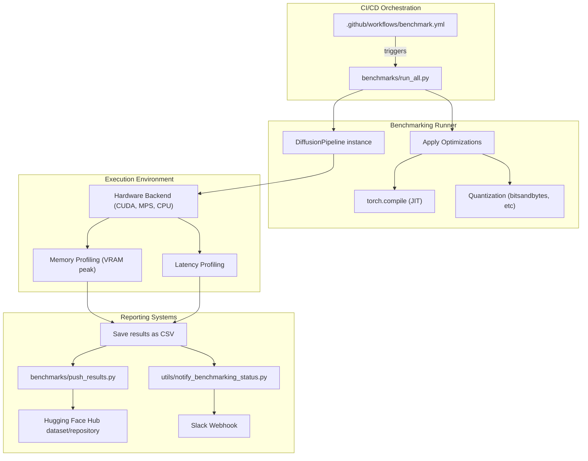
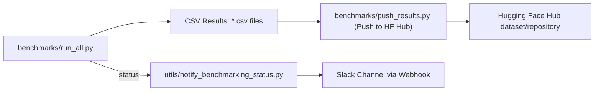

<!-- source: DeepWiki mcp.deepwiki.com · repo huggingface/diffusers · page 9.5 Benchmarking · fetched 2026-10-21 -->

# Benchmarking

Relevant source files

The following files were used as context for generating this wiki page:

- [.github/workflows/benchmark.yml](.github/workflows/benchmark.yml)
- [.github/workflows/mirror_community_pipeline.yml](.github/workflows/mirror_community_pipeline.yml)
- [.github/workflows/nightly_tests.yml](.github/workflows/nightly_tests.yml)
- [.github/workflows/notify_slack_about_release.yml](.github/workflows/notify_slack_about_release.yml)
- [.github/workflows/pr_dependency_test.yml](.github/workflows/pr_dependency_test.yml)
- [.github/workflows/pr_modular_tests.yml](.github/workflows/pr_modular_tests.yml)
- [.github/workflows/pr_test_fetcher.yml](.github/workflows/pr_test_fetcher.yml)
- [.github/workflows/pr_tests.yml](.github/workflows/pr_tests.yml)
- [.github/workflows/pr_tests_gpu.yml](.github/workflows/pr_tests_gpu.yml)
- [.github/workflows/pr_torch_dependency_test.yml](.github/workflows/pr_torch_dependency_test.yml)
- [.github/workflows/push_tests.yml](.github/workflows/push_tests.yml)
- [.github/workflows/push_tests_fast.yml](.github/workflows/push_tests_fast.yml)
- [.github/workflows/push_tests_mps.yml](.github/workflows/push_tests_mps.yml)
- [.github/workflows/pypi_publish.yaml](.github/workflows/pypi_publish.yaml)
- [.github/workflows/release_tests_fast.yml](.github/workflows/release_tests_fast.yml)
- [.github/workflows/ssh-runner.yml](.github/workflows/ssh-runner.yml)
- [docs/source/en/api/models/anyflow_far_transformer3d.md](docs/source/en/api/models/anyflow_far_transformer3d.md)
- [docs/source/en/api/models/anyflow_transformer3d.md](docs/source/en/api/models/anyflow_transformer3d.md)
- [docs/source/en/api/parallel.md](docs/source/en/api/parallel.md)
- [docs/source/en/api/pipelines/anyflow.md](docs/source/en/api/pipelines/anyflow.md)
- [docs/source/en/optimization/fp16.md](docs/source/en/optimization/fp16.md)
- [docs/source/en/training/distributed_inference.md](docs/source/en/training/distributed_inference.md)
- [docs/source/zh/using-diffusers/anyflow.md](docs/source/zh/using-diffusers/anyflow.md)
- [scripts/convert_anyflow_to_diffusers.py](scripts/convert_anyflow_to_diffusers.py)
- [src/diffusers/hooks/context_parallel.py](src/diffusers/hooks/context_parallel.py)
- [src/diffusers/models/_modeling_parallel.py](src/diffusers/models/_modeling_parallel.py)
- [src/diffusers/models/transformers/transformer_anyflow.py](src/diffusers/models/transformers/transformer_anyflow.py)
- [src/diffusers/models/transformers/transformer_anyflow_far.py](src/diffusers/models/transformers/transformer_anyflow_far.py)
- [tests/models/transformers/test_models_transformer_anyflow.py](tests/models/transformers/test_models_transformer_anyflow.py)
- [tests/models/transformers/test_models_transformer_anyflow_far.py](tests/models/transformers/test_models_transformer_anyflow_far.py)
- [tests/models/transformers/test_models_transformer_joyimage.py](tests/models/transformers/test_models_transformer_joyimage.py)
- [tests/pipelines/anyflow/test_anyflow_far.py](tests/pipelines/anyflow/test_anyflow_far.py)

The `diffusers` library equips developers with a comprehensive benchmarking infrastructure designed to measure and track the performance of diffusion models, specifically focusing on **latency** (inference speed) and **memory usage** (VRAM consumption). This infrastructure is integrated into both local testing and continuous integration (CI) workflows to validate performance improvements and detect regressions across various optimization configurations and hardware backends.

---

## Purpose and Scope

Benchmarking within the Diffusers repository serves three main objectives:

- **Quantify Latency**: Measure the time required for model forward passes or pipeline invocations.
- **Assess Memory Usage**: Track peak VRAM allocation during inference to evaluate memory efficiency.
- **Ensure Performance Consistency**: Integrate latency and memory benchmarks into CI pipelines to detect performance regressions immediately.

This page details the benchmarking infrastructure, including code organization, data flow, key components, and how benchmarking results are reported and utilized within the project.

---

## Infrastructure Overview

Benchmarking is orchestrated through dedicated scripts under the `benchmarks/` directory accompanied by automated workflows defined in GitHub Actions YAML files. The benchmarks exercise model forward passes under different optimization scenarios such as `torch.compile`, quantization, or memory-efficient attention, and support multiple devices including CUDA GPUs and Apple Silicon (MPS).

### Key Benchmark Metrics

| Metric   | Description                                                  | Measurement Tool                    |
|----------|--------------------------------------------------------------|-----------------------------------|
| Latency  | Time taken for pipeline or model `__call__`/`forward` pass   | Python timing utilities and pytest |
| Memory   | Peak VRAM (device memory) usage during execution             | Platform-specific memory tracking utilities (e.g., PyTorch CUDA memory stats) |

---

## Benchmarking Data Flow and System Architecture

The benchmarking process is initiated by CI/CD workflows that trigger a benchmarking runner script. The runner loads various pipelines/models, applies optimization scenarios, runs multiple iterations to measure time and memory usage, and saves results as CSV files. These results are then pushed to the Hugging Face Hub and optionally reported via Slack notifications.

### Benchmarking Infrastructure Flow

**Explanation:**

1. The GitHub Actions workflow `benchmark.yml` triggers the benchmarking runner script `benchmarks/run_all.py`.
2. The runner instantiates `DiffusionPipeline` models and applies selected optimizations like `torch.compile` or quantization.
3. The pipeline is executed on the target hardware backend (typically CUDA).
4. During execution, latency and memory usage are profiled.
5. Results are saved as CSV files.
6. Results are pushed to the Hugging Face Hub by `benchmarks/push_results.py`.
7. Status notifications (success/failure) are sent to a Slack channel by the utility script `utils/notify_benchmarking_status.py`.

Sources: [.github/workflows/benchmark.yml:1-79](), [benchmarks/run_all.py:1-50](), [benchmarks/push_results.py:1-30](), [utils/notify_benchmarking_status.py:1-20]()

---

## Benchmarking Execution Details

### Entry Point: `benchmarks/run_all.py`

This script serves as the central orchestrator to run benchmarks across multiple models, devices, and optimization configurations. It loads pipelines/models, applies requested optimizations, runs inference repeatedly to measure performance metrics, and writes out CSV reports.

- The script is invoked by `.github/workflows/benchmark.yml`.
- Supports arguments/configuration to select specific models, optimizations, and execution device.
- Implements timing and memory measurement hooks around forward passes.
- Measures both latency per call and peak VRAM allocated.
- Supports saving intermediate results and final aggregation in CSV format.

### Hardware Environments Used for Benchmarking

| Environment                | Purpose                                       | Location/Instance                    |
|---------------------------|-----------------------------------------------|------------------------------------|
| NVIDIA GPUs (CUDA)         | Primary target for benchmarking               | AWS `g6e.4xlarge` GPU instances    |
| Apple Silicon GPUs (MPS)   | Benchmarks on Apple Silicon hardware          | macOS `macos-13-xlarge`            |
| CPU-only                  | Baseline performance and testing memory       | AWS CPU instances `aws-general-8-plus` |

Each environment is orchestrated with standardized software environments and dependency versions to ensure reproducibility.

Sources: [.github/workflows/benchmark.yml:23-30](), [.github/workflows/push_tests_mps.yml:23-76](), [.github/workflows/push_tests_fast.yml:29-54]()

---

## Optimization Scenarios Benchmarked

The benchmarking suite evaluates models under several optimization configurations to identify speedups and memory savings:

| Optimization               | Description                                                  | CI Job / Setup                       |
|----------------------------|--------------------------------------------------------------|------------------------------------|
| `torch.compile`             | PyTorch JIT compilation of model code                        | `run_torch_compile_tests` job      |
| `xformers` attention backend| Memory-efficient and fast attention implementations          | Custom Docker image with xformers  |
| `bitsandbytes` quantization | 8-bit and 4-bit quantization to save memory                  | Installed via `training` extras    |
| Modular Pipeline System     | Modular blocks composition overhead                          | Fast PR tests in `pr_modular_tests` job |

Users can refer to these optimizations for tailoring their own code to achieve optimal performance.

Sources: [.github/workflows/pr_modular_tests.yml:2-55](), [.github/workflows/push_tests.yml:165-181](), [.github/workflows/benchmark.yml:40-50]()

---

## Result Persistence and Reporting

### Data Lifecycle for Benchmark Results

- Benchmark runs generate individual CSV files containing raw latency and memory data.
- Results are uploaded to a public dataset or repository on the Hugging Face Hub to enable historical tracking and visualization.
- A notification script reports the success or failure status of benchmarks to a Slack channel to alert maintainers.

### Artifacts

- Benchmark CSV files are saved as GitHub Action artifacts under the name `benchmark_test_reports` for offline analysis.
- Slack notifications ensure immediate visibility of performance regressions or improvements.

Sources: [.github/workflows/benchmark.yml:63-79](), [utils/notify_benchmarking_status.py:1-25]()

---

## Specialized Benchmarking in the Project

### Training Infrastructure Inclusion

The benchmarking tests also cover training-related infrastructure to measure how training optimizations impact inference latency and memory, ensured by installing packages through `benchmarks/requirements.txt` and the `training` extra dependencies.

### Modular Pipeline Overhead

Specialized benchmarks for modular pipeline components measure overhead introduced by the modularization layer. Such tests ensure new compositional capabilities do not reduce inference efficiency.

### Continuous Integration Integration

Benchmarking is embedded as part of multiple CI workflows:

- **Fast GPU Tests on PRs**: Quick checks on pull requests touching modeling code ensure no critical regressions.
- **Nightly Tests**: Comprehensive performance tests run daily on main branches detect long-term trends.
- **Scheduled Biweekly Benchmarks**: The benchmark workflow runs every two weeks to collect full data sets and update historical records.

This layered integration helps maintain a high-performance standard for all releases.

Sources: [.github/workflows/pr_tests_gpu.yml:9-52](), [.github/workflows/nightly_tests.yml:3-115](), [.github/workflows/benchmark.yml:1-79]()

---

## Summary

The Diffusers benchmarking infrastructure combines automated workflows, precise latency and memory profiling, and integration with reporting platforms to enable robust performance measurement for diffusion models. It supports various hardware backends and optimization strategies, fostering continuous performance improvement as the codebase evolves.

By understanding the benchmarking entry points, execution environment, and result handling process, contributors can extend or customize performance evaluations to meet emerging research and production needs.

---

# References to Key Files

| File / Code Entity                        | Role / Description                              |
|------------------------------------------|------------------------------------------------|
| `.github/workflows/benchmark.yml`        | GitHub Actions workflow that triggers benchmark runs regularly and stores results |
| `benchmarks/run_all.py`                   | Main benchmarking script that runs performance tests |
| `benchmarks/push_results.py`              | Script responsible for pushing benchmark CSV results to Hugging Face Hub |
| `utils/notify_benchmarking_status.py`   | Script that sends success/failure messages to Slack |
| `.github/workflows/pr_modular_tests.yml` | Workflow for fast benchmarks on modular pipelines |
| `.github/workflows/pr_tests_gpu.yml`     | Fast GPU test workflow with some benchmarking checks |

Sources: [.github/workflows/benchmark.yml:1-79](), [benchmarks/run_all.py:1-50](), [benchmarks/push_results.py:1-30](), [utils/notify_benchmarking_status.py:1-20](), [.github/workflows/pr_modular_tests.yml:1-158](), [.github/workflows/pr_tests_gpu.yml:1-179]()

---

# Conclusion

Benchmarking within Diffusers ensures that advances in model architectures, optimization techniques, and hardware utilizations translate into practical speed and memory improvements. The continuously integrated benchmarking system tracks these metrics, driving evidence-based performance enhancements across the codebase.

---

