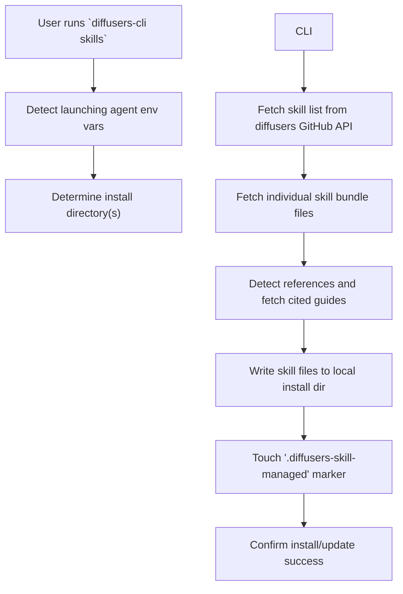

<!-- source: DeepWiki mcp.deepwiki.com · repo huggingface/diffusers · page 9.6 Diffusers CLI · fetched 2026-10-21 -->

# Diffusers CLI

<details>
<summary>Relevant source files</summary>

The following files were used as context for generating this wiki page:

- [.ai/skills/custom-blocks/SKILL.md](.ai/skills/custom-blocks/SKILL.md)
- [.ai/skills/diffusers-cli/SKILL.md](.ai/skills/diffusers-cli/SKILL.md)
- [docs/source/en/api/attnprocessor.md](docs/source/en/api/attnprocessor.md)
- [docs/source/en/api/pipelines/dreamlite.md](docs/source/en/api/pipelines/dreamlite.md)
- [src/diffusers/commands/custom_blocks.py](src/diffusers/commands/custom_blocks.py)
- [src/diffusers/commands/diffusers_cli.py](src/diffusers/commands/diffusers_cli.py)
- [src/diffusers/commands/env.py](src/diffusers/commands/env.py)
- [src/diffusers/commands/fp16_safetensors.py](src/diffusers/commands/fp16_safetensors.py)
- [src/diffusers/commands/schema.py](src/diffusers/commands/schema.py)
- [src/diffusers/commands/skills.py](src/diffusers/commands/skills.py)
- [src/diffusers/models/transformers/transformer_2d_dreamlite.py](src/diffusers/models/transformers/transformer_2d_dreamlite.py)
- [src/diffusers/models/unets/__init__.py](src/diffusers/models/unets/__init__.py)
- [src/diffusers/models/unets/unet_dreamlite.py](src/diffusers/models/unets/unet_dreamlite.py)
- [src/diffusers/pipelines/dreamlite/__init__.py](src/diffusers/pipelines/dreamlite/__init__.py)
- [tests/others/test_cli_commands.py](tests/others/test_cli_commands.py)
- [tests/others/test_cli_skills.py](tests/others/test_cli_skills.py)
- [tests/pipelines/dreamlite/test_pipeline_dreamlite.py](tests/pipelines/dreamlite/test_pipeline_dreamlite.py)
- [tests/pipelines/dreamlite/test_pipeline_dreamlite_mobile.py](tests/pipelines/dreamlite/test_pipeline_dreamlite_mobile.py)

</details>


This page documents the `diffusers-cli` command-line interface (CLI) provided by the Diffusers library. It covers the key commands (`env`, `fp16_safetensors`, `custom_blocks`, `run`, and `skills`) that enable environment inspection, model conversion, custom block packaging, pipeline execution, and installation of Agent Skill bundles. The documentation focuses on the implementation located in `src/diffusers/commands`, explaining data flow, main classes, and command registration.

---

## Overview

The `diffusers-cli` is an extensible CLI tool that exposes various commands for users and developers to interact with diffusers pipelines and components from the terminal. Each command encapsulates a self-contained feature implemented as a subclass of `BaseDiffusersCLICommand`. The CLI parses command-line arguments, dispatches control to the selected command class, and runs the appropriate action.

The main CLI entrypoint is `diffusers_cli.py`, which registers all supported commands and initializes the command parser. Each subcommand registers itself to the parser and implements a `run()` method for its functionality.

---

## 1. CLI Entrypoint and Command Registration

File: `src/diffusers/commands/diffusers_cli.py` [src/diffusers/commands/diffusers_cli.py:1-69]()

- The CLI is initialized using Python's `argparse.ArgumentParser`.
- Global options include `--format` for output style.
- The subcommand parser is created to manage all commands.
- Six commands are registered:
  - `EnvironmentCommand` (`env`): Inspects environment.
  - `FP16SafetensorsCommand` (`fp16_safetensors`): Converts checkpoints to FP16/safetensors format.
  - `CustomBlocksCommand` (`custom_blocks`): Packages local modular pipeline blocks for Hub upload.
  - `RunCommand` (`run`): Runs pipelines from the CLI.
  - `SchemaCommand` (`schema`): Introspects pipeline schema (not detailed here).
  - `SkillsCommand` (`skills`): Installs Agent Skills bundles.
- The CLI parses arguments, sets output format mode via `huggingface_hub.cli._output.out`, and dispatches to the appropriate command instance based on the selected subcommand (`args.func`).

```mermaid
flowchart TD
  A[diffusers-cli main()] --> B[argparse.ArgumentParser]
  B --> C[subparsers = parser.add_subparsers()]
  C --> D[EnvironmentCommand.register_subcommand]
  C --> E[FP16SafetensorsCommand.register_subcommand]
  C --> F[CustomBlocksCommand.register_subcommand]
  C --> G[RunCommand.register_subcommand]
  C --> H[SchemaCommand.register_subcommand]
  C --> I[SkillsCommand.register_subcommand]
  B --> J[args = parser.parse_args()]
  J --> K[service = args.func(args)]
  K --> L[service.run()]
```

Sources: `src/diffusers/commands/diffusers_cli.py:16-70`


---

## 2. `env` Command — Environment Inspection

Implements the `diffusers-cli env` command, which prints detailed version and system information for debugging and bug reporting.

Location: `src/diffusers/commands/env.py` [src/diffusers/commands/env.py:54-185]()

### Implementation Details

- The class `EnvironmentCommand` inherits from `BaseDiffusersCLICommand`.
- Subcommand registration through `register_subcommand` adds the `env` command help and usage.
- The `run()` method collects versions and availability info for Diffusers and key dependencies:
  - e.g., `torch`, `transformers`, `accelerate`, `peft`, `safetensors`, `xformers`, and quantization backends (`bitsandbytes`, `gguf`, `optimum-quanto`, etc.).
- Detects platform information and tries to identify GPU accelerator information through platform-specific system calls:
  - On Linux/Windows, runs `nvidia-smi` to query GPU name and memory.
  - On MacOS, runs `system_profiler SPDisplaysDataType`.
- Prints a formatted report for easy copy-pasting in bug reports.
- The info includes placeholders for runtime usage context (e.g., "Using GPU in script?") which encourages users to fill in manual details.

### Key Functions and Data Flow

- Uses utility functions like `is_torch_available()` to conditionally import modules.
- Uses `importlib.metadata.version` to query versions of quantization backends.
- Runs system subprocesses to gather GPU info.
- Outputs human-readable version summary.

This command thus serves as an environment snapshot diagnostic tool for users.

Sources: `src/diffusers/commands/env.py:54-186`


---

## 3. `fp16_safetensors` Command — Checkpoint Conversion

**Note:** This command is deprecated and scheduled for removal in future versions.

Location: `src/diffusers/commands/fp16_safetensors.py` [src/diffusers/commands/fp16_safetensors.py:35-144]()

### Purpose

Converts a checkpoint downloaded from the Hugging Face Hub into FP16 precision and/or serialized using the `safetensors` format, then prepares and creates a pull request back on the repo with those modified weights.

### Implementation Outline

- Registered as `fp16_safetensors` subcommand.
- Flags:
  - `--ckpt_id`: Model repo ID on Hub.
  - `--fp16`: Enable FP16 conversion.
  - `--use_safetensors`: Use safetensors format.
  - `--use_auth_token`: Deprecated; for private repos.
- Loads the model pipeline class from the checkpoint's `model_index.json`.
- Instantiates the pipeline in either FP16 or FP32.
- Saves pretrained locally using `safe_serialization=True` if safetensors requested, with variant `fp16` if converting.
- Collects converted files and prepares a commit via huggingface_hub's `create_commit` with files as additions.
- Creates a PR on the Hub with the conversion commit.

### Data Flow Diagram

```mermaid
flowchart TD
  User["User runs `diffusers-cli fp16_safetensors`"] --> CLI[FP16SafetensorsCommand.run()]
  CLI --> HF_HUB["Download model_index.json from Hub"]
  HF_HUB --> LoadClass["Import pipeline class"]
  LoadClass --> LoadPipeline["Load pipeline from Hub with dtype (FP16 or FP32)"]
  LoadPipeline --> SaveLocal["Save locally with .save_pretrained()"]
  SaveLocal --> FindFiles["Glob converted weight files"]
  FindFiles --> CommitPR["Prepare commit with converted files"]
  CommitPR --> CreatePR["Create PR on Hugging Face Hub"]
  CreatePR --> CLI_Output["Print PR URL"]
```

### Notes

- The command uses `huggingface_hub` internal APIs for PR creation.
- It warns about its deprecation status and invites use of direct `safetensors.torch.save_file` or pipeline `save_pretrained` variants instead.

Sources: `src/diffusers/commands/fp16_safetensors.py:35-145`


---

## 4. `custom_blocks` Command — Package ModularPipelineBlocks Subclasses

Location: `src/diffusers/commands/custom_blocks.py` [src/diffusers/commands/custom_blocks.py:38-145]()

### Purpose

Automates packaging a local `ModularPipelineBlocks` subclass into a Hub-uploadable directory. This enables users who have written custom modular pipeline blocks (e.g., for modular Diffusers pipelines) to prepare their code for Hub deployment and consumption.

### Usage

```bash
diffusers-cli custom_blocks [--block_module_name <file.py>] [--block_class_name <ClassName>]
```

- Defaults to `block.py` in the current directory.
- If `--block_class_name` is omitted, inspects the module via static AST parsing to pick the first subclass of `ModularPipelineBlocks`.

### Implementation

- `CustomBlocksCommand` class registers the `custom_blocks` subcommand with helpful epilog docs.
- When run:
  1. Parses the specified Python file with `ast` module to find candidates that inherit from `ModularPipelineBlocks`.
  2. If no class explicitly specified, picks the first subclass found.
  3. Dynamically imports the specified module (using `importlib.util`), instantiates the class without arguments.
  4. Calls the block's `.save_pretrained()` method writing to the current directory.
  5. Calls `.init_pipeline().save_pretrained()` to also export the modular pipeline setup with `modular_model_index.json`.

### Data Flow

```mermaid
graph TD
  UserCLI["User runs `diffusers-cli custom_blocks`] --> Parser["AST parse `block.py`"]
  Parser --> FindSubclasses["Find subclasses of `ModularPipelineBlocks`"]
  FindSubclasses --> DetermineClass["Choose class (arg or first found)"]
  DetermineClass --> ImportModule["Import the Python module dynamically"]
  ImportModule --> InstantiateClass["Instantiate chosen class without arguments"]
  InstantiateClass --> SaveBlock["Call `.save_pretrained()` on block"]
  SaveBlock --> InitPipeline["Call `.init_pipeline()` and `.save_pretrained()`"]
  InitPipeline --> Disk["Output ready-to-upload directory on disk"]
```

### Key Notes

- The command relies on static AST parsing to avoid executing untrusted code prematurely.
- It requires no constructor arguments for the block class.
- Produces a directory containing the block source, `modular_config.json` with `auto_map`, and any checkpoint data.
- Enables usage of custom modular pipelines in diffusers with `trust_remote_code=True`.

Sources: `src/diffusers/commands/custom_blocks.py:38-146`, `.ai/skills/custom-blocks/SKILL.md[1-158]`


---

## 5. `run` Command — Execute Pipelines from CLI

**Note:** The full files and details about `run` command implementation are only partially listed in the test references and imports shown. However, from the provided test suite `test_cli_commands.py` and imports, we can understand core elements.

Located in: `src/diffusers/commands/run.py` (not fully shown here)

### Purpose

Allows running any diffusers pipeline from the CLI interface, leveraging JSON-formatted input arguments and returning pipeline outputs, while handling media inputs (images, videos, audio) and output saving.

### Implementation Highlights

- The main class `RunCommand` (in `run.py`) inherits from `BaseDiffusersCLICommand`.
- Provides an interface to parse pipeline arguments via JSON strings.
- Handles:
    - Media input loading optimized for batch and single inputs (images, videos, audio).
    - Model/pipeline loading via `from_pretrained`.
    - Resolving data types (float16, float32, bfloat16).
    - Support for uploading inputs to a remote "sandbox" environment.
    - Saving outputs with flexible formats.
- Pipeline keywords can be passed via command-line argument JSON; parsed using `_parse_pipeline_kwargs`.
- Supports LoRA and other adapters loading.
- Includes remote execution support and sandbox resource handling.

### Data Flow (Simplified)

```mermaid
flowchart TD
  CLI["User runs `diffusers-cli run`] --> ParseArgs["Parse CLI args: --pipeline-kwargs JSON"]
  ParseArgs --> ResolveMedia["Load local image/video/audio inputs"]
  ResolveMedia --> LoadPipeline["Load pipeline via `from_pretrained`"]
  LoadPipeline --> ConfigurePipeline["Apply LoRA, adapters etc."]
  ConfigurePipeline --> PipelineCall["Call pipeline with kwargs"]
  PipelineCall --> ProcessOutput["Process and unwrap pipeline output"]
  ProcessOutput --> SaveOutput["Save images/videos/audio to disk"]
  SaveOutput --> Return["Return or upload outputs"]
```

Sources: `tests/others/test_cli_commands.py:32-47`, scattered functions in imports


---

## 6. `skills` Command — Install Agent Skills Bundles

Location: `src/diffusers/commands/skills.py` [src/diffusers/commands/skills.py:1-170+]()

### Purpose

The `skills` command installs Agent Skills bundles conforming to the Agent Skills standard used by AI coding agents such as Claude Code, Codex, and Cursor. Skill bundles are directory-based repositories including a `SKILL.md` guide and optional resource files.

### Key Implementation Details

- `SkillsCommand` inherits from `BaseDiffusersCLICommand`.
- This command interacts with the Diffusers GitHub repository's `.ai/skills` directory via GitHub API (GitHub Content API).
- Fetches skill bundle metadata and contents by recursively walking directories and downloading files.
- Supports detecting which agent is running the CLI (`CLAUDECODE`, `CURSOR_AI`, etc.) via environment variables.
- Installs skills to proper directories accordingly:
  - `.claude/skills/` for Claude Code
  - `.agents/skills/` for Codex and Cursor
- Adds markers `.diffusers-skill-managed` to recognized managed installs, distinguishing them from user-added skills.
- Handles citation of references inside skills (`references/*.md`) using regex pattern.
- Provides functionality for listing skills, installing single skill bundles, updating, and cleaning installed skills to keep in sync with registry.

### Data Flow (Simplified)



Sources: `src/diffusers/commands/skills.py:1-170` (partial, on registry fetch and install)


---

## 7. Base CLI Command Class

All subcommands inherit from a base class `BaseDiffusersCLICommand` (imported in every command file). This class provides a uniform interface with the following contract:

- Static method `register_subcommand(parser)` to add the subparser and set defaults.
- Instance method `run()` which implements the command behavior.
- It's a lightweight abstraction to organize CLI commands coherently.

---

## Summary Table

| Command            | Purpose                                                        | Key Class                  | Register Method                          | Main File                         |
|--------------------|----------------------------------------------------------------|----------------------------|-----------------------------------------|----------------------------------|
| `env`              | Display detailed environment info for debugging                | `EnvironmentCommand`        | `register_subcommand`                    | `commands/env.py`                 |
| `fp16_safetensors` | Convert checkpoint weights to FP16 and/or safetensors format   | `FP16SafetensorsCommand`    | `register_subcommand`                    | `commands/fp16_safetensors.py`   |
| `custom_blocks`    | Package a local `ModularPipelineBlocks` subclass for the Hub | `CustomBlocksCommand`       | `register_subcommand`                    | `commands/custom_blocks.py`       |
| `run`               | Run a diffusers pipeline with specified inputs and options     | `RunCommand`                | `register_subcommand`                    | `commands/run.py` (implied)       |
| `skills`            | Install Agent Skill bundles for AI Agents                      | `SkillsCommand`             | `register_subcommand`                    | `commands/skills.py`              |

---

## Summary Diagram: Natural Language Command to Code Entity Mapping

```mermaid
graph TD
  UI["diffusers-cli <command>"] -->|"env"| EC[EnvironmentCommand]
  UI -->|"fp16_safetensors"| FC[FP16SafetensorsCommand]
  UI -->|"custom_blocks"| CC[CustomBlocksCommand]
  UI -->|"run"| RC[RunCommand]
  UI -->|"skills"| SC[SkillsCommand]

  subgraph Commands
    EC
    FC
    CC
    RC
    SC
  end

  EC -.->|src/diffusers/commands/env.py| EnvFile
  FC -.->|src/diffusers/commands/fp16_safetensors.py| Fp16File
  CC -.->|src/diffusers/commands/custom_blocks.py| CustomBlocksFile
  RC -.->|src/diffusers/commands/run.py (partial)| RunFile
  SC -.->|src/diffusers/commands/skills.py| SkillsFile
```

---

# Appendix: Command Registration Flow in `diffusers_cli.py`

All commands are registered in the entrypoint's main parser here:

```python
EnvironmentCommand.register_subcommand(commands_parser)
FP16SafetensorsCommand.register_subcommand(commands_parser)
CustomBlocksCommand.register_subcommand(commands_parser)
RunCommand.register_subcommand(commands_parser)
SchemaCommand.register_subcommand(commands_parser)
SkillsCommand.register_subcommand(commands_parser)
```

Upon parsing the CLI arguments, the `func` attribute refers to the factory method that returns an instance of the command class, and the subsequent `run()` is called:

```python
args = parser.parse_args()
service = args.func(args)
service.run()
```

---

# Conclusion

The `diffusers-cli` is a modular CLI framework in the Diffusers library implemented via independent command classes under `src/diffusers/commands`. It supports:

- Rich environment inspection (`env`)
- Legacy checkpoint conversion (`fp16_safetensors`)
- Packaging and publishing custom modular pipeline blocks (`custom_blocks`)
- Running pipelines directly from the shell (`run`)
- Installing curated agent skills (`skills`)

Each command registers itself with the main CLI parser, implements argument parsing and logic in a dedicated class, and integrates into a seamless user experience. This structure facilitates maintainability and extensibility for future CLI commands.

---

# Sources

- `src/diffusers/commands/diffusers_cli.py:1-70`
- `src/diffusers/commands/env.py:54-186`
- `src/diffusers/commands/fp16_safetensors.py:35-145`
- `src/diffusers/commands/custom_blocks.py:38-146`
- `src/diffusers/commands/skills.py:1-170`
- `tests/others/test_cli_commands.py:32-47` (for `run` usage context)

---

