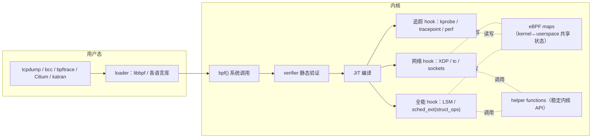
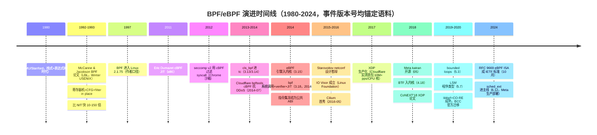

# 第1章 eBPF 历史与总论

> 本章导读：任何想认真使用 eBPF 的工程师与 AI agent 都应从本章开始，无前置章节。读完你能：讲清 BPF 从 1992 年包过滤器到 2024 年 IETF 标准 ISA（RFC 9669）与 sched_ext 调度器的完整演进链；回答"为什么是寄存器机、为什么在内核里验证执行"这两个第一性问题；避开十余处流传甚广的史实口径坑（如 BPF 进入 Linux 的版本号、寄存器个数、"无循环"等过时说法）。本章全部事实锚定本地语料（awesome-ebpf 288 条资源库），断言后标注 [id=N] 或本地路径。

## 1.1 直觉层

**比喻一：把海关请到码头上（1992 年的诞生动机）。** Lawrence Berkeley Laboratory 的 McCanne 和 Van Jacobson 要在忙碌的校园网上做网络监测：监控程序是用户态进程，包必须跨内核/用户态保护边界拷贝。当时 SunOS 的 NIT 做法是先把每个包从内核搬进 STREAMS 消息缓冲、再送上游过滤器决定去留——像快递员把全城包裹先搬进你家客厅、再由你挑一件。BPF 的做法是把"海关安检员"直接派到码头（网卡驱动 DMA 落包处），当场原位判定收不收、收多少，被拒绝的包零拷贝 [web/pdf-txt/86.txt]。论文实测（SPARCstation 2 / SunOS 4.1.1）：reject-all 场景 BPF 固定开销 4.6-5μs/包且与包长无关，NIT 却要随包长线性增长，大包时 450μs vs 5μs，"几乎两个数量级" [86]。

**比喻二：内核的 JavaScript（eBPF 的泛化动机）。** ebpf.io 官方类比：GeoCities 时代网页是静态 HTML，JavaScript 出现后浏览器演化成准操作系统——因为 JS 同时解决了安全（沙箱）、持续交付（不升级浏览器就能上新逻辑）、性能（JIT）三件事；eBPF 在内核里给出的一一对应物是 verifier/JIT、运行时热加载、helper+maps [web/md/3.md]。IO Visor 联合创始人 Brenden Blanco 2016 年的版本是 Node.js 类比：不想当 kernel developer 的基础设施工程师，需要 v8 式"不牺牲性能的 JIT + npm 式分发" [web/pdf-txt/34.txt]。

**为什么需要这个机制——三条传统路线的对立面：**
- 改内核源码：要说服内核社区 + 等几年新内核才变成商品化默认配置 [web/md/3.md]
- 内核模块：每个内核版本都可能 break 你的模块，且没有安全边界，一个野指针就 panic [3]
- kernel bypass（DPDK/VPP/PF_RING/Snabb）：把包处理搬去用户态换取速度，代价是用户态自带驱动、重造内核网络栈、丢失内核安全层与 OS 集成、程序成沙盒孤岛 [web/md/24.md]

eBPF 是第四条路：在内核里运行"经验证的安全程序"——运行时加载、JIT 后近原生速度、verifier 证明不会崩溃且必定终止 [3]。

**它在整条 eBPF 栈里的位置：**



一台事件驱动机：程序挂在预定义 hook（syscall/函数出入口/tracepoint/网络事件），不够用可自建 kprobe/uprobe 挂几乎任意位置；数据经 maps 流回用户态 [web/md/3.md]。1993 年的 BPF 只有图中最右下一角（socket filter + 拷贝缓冲），2024 年的 eBPF 覆盖整张图——这条扩张线就是本章主线。

## 1.2 原理层：五段演进史与两条第一性因果链

### 1.2.1 cBPF（1992-1993）：一次针对栈机的性能复仇

**起点语境。** Unix 早就有内核级抓包设施：CMU/Stanford 1980 年把 Xerox Alto 的 packet filter 搬进 Unix 内核，即 CSPF——栈式求值 + 布尔表达式树，为 64KB 内存的 PDP-11 设计，后代包括 SunOS NIT、Ultrix Packet Filter、SGI Snoop [web/pdf-txt/86.txt]。到 16MB 内存的 SPARCstation 2 时代，论文开篇即判词："一个对 64KB PDP-11 完全合适的设计，简单地不是 16MB Sparcstation 2 的好匹配" [86]。BPF 在论文完稿时（1992-12）已约两岁，1993-01 在 Winter USENIX（San Diego）宣读 [86]。

**两大架构革新**（摘要原文归纳）[86]：
1. **寄存器式过滤机取代 memory-stack 表达式树**。CSPF 的操作数栈要在寄存器机上被模拟——为维护虚拟栈指针生成加减指令、为栈元素做真实访存，而"内存是现代工作站的主要瓶颈"；寄存器机模型让抽象寄存器直接落物理寄存器。
2. **filter in place（原位过滤）+ 非共享缓冲模型**。在驱动 DMA 落包处直接过滤，拒绝的包零拷贝；NIT 则先拷贝（mbuf→STREAMS 消息缓冲两级拷贝）再过滤，拷贝成本随包长增长、即使包最终被丢弃。以太网头 14 字节还导致 IP 头非 longword 对齐，NIT 的对齐拷贝在内核和用户态各付一次错位代价 [86]。

**硬数据**（全部出自论文实测，SPARCstation 2，busy 校园网 trace）[86]：
- tap 开销 accept-all：BPF ~6μs/包（增量 148ns/byte）vs NIT 89μs/包（216ns/byte），固定开销差 15 倍——NIT 慢在 STREAMS 的 mblk/dblk 分配与初始化；
- reject-all：BPF 4.6-5μs 恒定（增量 0 ns/byte）vs NIT 大包 450μs——"filtering packets early and in place pays off"；
- 过滤器本身 vs CSPF（iprof 指令计数）：摘要口径 1.5-20 倍；图表四组典型过滤器实测 BPF 62/96/160/222 条指令 vs CSPF 129/549/971/2330 条。Filter 3（TCP 端口解析类）的差距来源最典型：BPF 解析一次包头进累加器后做比较级联，CSPF 每测一个端口都要重新定位 TCP 头；
- CFG 相对树的本质优势："解析状态被记住"——CFG 里一旦走了 ether.type=IP 那条边，就不必再测是否 ARP；树模型即使加 short-circuit 算子也留有内禀冗余（"host foo" 过滤器：树要 7 次比较 + 6 次布尔运算，CFG 最长路径 5 次比较、平均 3 次）[86]。

**伪机定义**（eBPF 的直系祖先）[86]：accumulator A + index register X + scratch memory M[] + 隐式 PC；定长指令 `opcode:16 jt:8 jf:8 k:32`；条件跳转 8 位偏移（最长 256 条指令），长跳转靠 BPF_JA 用 32 位 k；`4*([k]&0xf)` 寻址模式专为变长 IP 头 IHL 计算 hack 进指令集；越界访问 = 终止过滤返回 0（fail-closed 安全默认拒绝）；除零终止；**return 值 = 保留字节数**（0 即丢包）——Mike Karels 的建议，"过滤器不仅决定收不收，还决定收多少"。

**五条设计约束**（读懂 eBPF 前值得背下来，原文逐条）[86]：①协议无关（内核不为新协议改动，包就是字节数组）；②指令集通用（rich enough for unforeseen uses）；③最小化包数据引用（一个包字最多碰一次）；④解码 = 单个 C switch 语句（单地址指令格式，避免正交寻址的组合爆炸）；⑤抽象寄存器落在物理寄存器里（寄存器组要小）。

**血统花絮**：字节码仿 Motorola 6502 ISA——McCanne 在 Sharkfest'11 keynote 回忆初中在 Apple II 上写 6502 汇编的经历影响了指令集设计 [web/md/24.md 转引]。论文应用清单里 tcpdump 只是其一，还有 arpwatch、rarpd（为彻底替换 NIT 而写）、Icon 语言扩展、netload/histo 可视化 [86]——从第一天起 BPF 就不止服务 tcpdump。

### 1.2.2 进入 Linux 与 JIT 时代（1997-2013）

- **1997 年，BPF 进入 Linux 2.1.75**（作者口径 [web/pdf-txt/36.txt]；市面上常见的"v2.5 引入"说法有版本口径问题，勘误见 1.4）。最初角色就是 socket filter，消费者 tcpdump（经 libpcap），后续 wireshark/nmap/dhcp/arpd 都用 [36]。
- **多年静止，2011 年 Eric Dumazet 把 cBPF 解释器变成 JIT**（x86，LWN《A JIT for packet filters》）[web/md/24.md 转引]——为 2014 年 eBPF"性能等同原生"的野心铺了第一块砖。
- **2012 年 seccomp v2 用 cBPF 过滤 syscall 参数**（Chrome 沙箱）[36]——BPF 第一次离开"包"的语境，变成"系统调用参数上的布尔函数"，泛化的种子在此埋下。
- **2013-2014 年 cls_bpf 进入 tc**（traffic control，3.13/3.14 合入）：把 packet filter 的返回值复用为 qdisc classid（ret #0 = drop，ret #N = classid），一个 BPF 程序多个退出点即可做多类分类；JIT 后 best 26 cycles（miss）/ worst 45 cycles（hit）vs cls_u32 的 64/113，快约 2.5 倍 [digest 06 id=89 → web/pdf-txt/89.txt]。配套工具 bpf_asm（汇编器）/bpf_dbg（用户态单步调试，带断点与寄存器 dump）/bpf_jit_disasm 全部进内核 tools/net [89]。
- 2013 年时点的 cBPF 形态：net/core/filter.c 的 sk_run_filter 解释器 + x86_64/SPARC/PPC/ARM/s390 五架构 JIT [digest 06 id=88]；安全模型 = cBPF 自带 verifier（检查全部指令、仅前向跳转、栈槽 load/store、动态包边界检查）[36]；经典扩展不靠新指令，而是 LD_ABS 负偏移黑魔法（LD_ABS -0x1000 读 skb->protocol、-0x1000+56 读 get_random()）[36]。
- **安全暗面（这段历史解释了今天一半的加固设计）**：Linux 3.0 时代 BPF JIT off-by-one 漏洞（Markus Kötter 披露）——x86_64 JIT 条件跳转目标差一字节，可跳进指令中间；攻击者用精心构造的 BPF 程序在 JIT 镜像里"拼出"x86 机器码（`add r8,0x2a; call r8`），把 skb->data 指针当代码执行，拿到内核任意代码执行 [digest 06 id=88 → web/pdf-txt/88.txt]。这是后来 constant blinding 与 bpf_jit_harden 的存在理由（见 1.4 坑 11）。
- **cBPF 的生产级绝唱**：Cloudflare 2014-07-03 开源 bpftools——tcpdump 抓 pcap → parsedns 找攻击指纹 → bpfgen 生成字节码 → 离线验证（匹配 99.97% flood + --negate 查漏杀）→ iptables xt_bpf 在内核丢随机子域 NXDOMAIN flood [digest 06 id=90]。次年起的 eBPF/XDP 时代，这套 Python 生成器被彻底取代——但"分析→生成→验证→灰度部署"的过滤器工程闭环范式留了下来。

### 1.2.3 eBPF 转型（2013-2014）：两个失败原型与一个正解

Starovoitov 2015 年 netconf 演讲是这场转型唯一的第一手答辩材料 [web/pdf-txt/36.txt]：

- **失败原型 #1（从零设计一个 VM）**：性能太慢，且用户态工具链要全部从零造。
- **失败原型 #2（让内核直接反汇编并验证 x86 指令）**：指令组合爆炸，且每种 CPU 架构都要重写一个 verifier。
- **正解："真 CPU 指令的混合物"**：幻灯片口径 10% cBPF + 70% x86 + 25% arm64 + 5% risc（加总 110%，幻灯笔误，见 1.4 坑 5）；x86 指令改名 `mov rax,rbx` → `mov r1,r2`；分析 x86/arm64/risc 三家调用约定后为"改名指令集"定义统一调用约定；**定长编码**（解释器速度）；**复用 cBPF 指令编码**（经典→扩展的平凡转换，老用户零成本迁移）。
- **寄存器与调用约定**：R0 返回值 / R1-R5 函数参数（程序入口 R1=context）/ R6-R9 callee-saved / R10 栈帧指针——与 amd64 ABI 一对一（R0=rax，R1-R5=rdi,rsi,rdx,rcx,r8，R6-R9=rbx,r13,r14,r15，R10=rbp），"用户态编译器以为自己在生成简化版 x86"，JIT 时全部一对一映射、call 指令直接映射 x86 call、调用零 FFI 开销 [36]。指令编码 `struct bpf_insn`：opcode/dst:4/src:4/off:16/imm:32 [digest 02 id=26]。
- **与 cBPF 的三大差异**（36 原文）：ten 64-bit registers vs two 32-bit；arbitrary load/store vs 仅栈槽 load/store；新增 call 指令。配套设计目标还包括：parse/lookup/update/modify 包、按需当模块加载于活流量、生产系统上安全、解释器也要快 [36]。
- **落地节奏**：**3.15** 内核内部出现 eBPF 引擎，cls/xt/team/ppp 等老 cBPF 用户加载时被自动 classic→extended 转换；**3.18（2014-12）** bpf() 系统调用暴露给用户态 + verifier + x64/arm64 JIT，指令集从此冻结为公共 ABI [36][digest 02 id=28][id=25]。LLVM BPF backend 进 trunk（LLVM 3.7），clang 成为 C 前端 [36]。
- **LWN 2014-07-02 现场报道**（Jonathan Corbet）记录了 patch set 的原始形态 [web/md/37.md]：①BPF 解释器搬出 networking 子系统到独立的 kernel/bpf；②bpf() 作为 multiplexor 系统调用——当时原型用 netlink nlattr 传程序体、全局 int prog_id 命名空间、仅 CAP_SYS_ADMIN 可用；③maps KV 存储，只能由用户态建删。verifier 早期形态：模拟执行、寄存器未初始化读即拒、类型追踪、禁循环保证终止。GPL license 参数比内核模块更严（非 GPL 兼容直接拒载）当场引发 reviewer 质疑，Starovoitov 承诺未来按 module 式分级——后来兑现为 GPL-only helper 门控 [37][digest 01 id=19]。文末评论区是著名的"预言墙"：josh 说 eBPF 可当组合/批量 syscall 用、wichert 问 map 为什么不做文件系统（后来 BPF FS/pin 实现）、MrWim 提议用 fd 而非 int id（正是后来采用的方案）、elanthis 吐槽新 syscall 忘留 flags 字段——四条十年内全部应验 [37]。
- **verifier 三层机制**（2015 口径，思想沿用至今）[36]：①CFG 环检测——程序所有跳转构成 CFG，非递归 DFS 找 back-edge，有环即拒；②逐指令模拟——从第一条到 exit 模拟每条指令的寄存器/栈状态机（R1 初始为 PTR_TO_CTX、R10 为 FRAME_PTR、其余不可读；`R2=R1` 传播类型、`R3=123` 变 CONST_IMM、条件跳转 fork 出 true/false 两份状态）；③state pruning——旧状态比当前状态更严格则不再探索该分支，抗路径爆炸。
- **用例蓝图**（2015 年作者自己划的五类，事后看是路线图）[36]：networking（socket filter/OVS 四用法/tc cls+act/bpf as net_device）、tracing（kprobe/tracepoint/syscall 分析、TCP 栈仪表、磁盘延迟、live debugging）、in-kernel optimization（tracing 过滤谓词树、nft）、HW modeling（P4 编译到 bpf、rocker 设备）、crazy stuff（reverse BPF、NPU 直接翻译）。

### 1.2.4 第一性原理：为什么是寄存器机、为什么在内核里验证执行

**为什么是寄存器机——两条相隔 22 年的因果链：**

1. **1993 链（A/X 累加器机）**：约束③"最小化包数据引用"直接推出累加器模型——过滤器常对一个字段做一组比较（缓存进寄存器重复使用），而不是反复访存；约束⑤"抽象寄存器落物理寄存器"推出小寄存器组；约束④"单 C switch 解码"推出单地址指令格式；CSPF 的教训是栈机在寄存器 CPU 上制造额外访存流量 [86]。此外 CFG 模型天然映射寄存器机代码，树模型天然映射栈机代码——"现代机器大多基于寄存器，所以 CFG 路线实现更高效" [86]。
2. **2014 链（R0-R10 十一寄存器）**：eBPF 的目标之一是"performance equal to native x86 code"。寄存器与 x86_64/arm64 ABI 一对一、指令大多一对一、call 直映 call，JIT 就退化为"改名翻译"，无寄存器分配、无指令选择，零 FFI 开销 [36]；定长编码同时保住了解释器（无 JIT 架构的兜底）的译码速度 [36]。反过来，verifier 能做逐指令抽象解释，也依赖寄存器数量小且类型可追踪——r1-r5 "只能存数字或栈指针、永不能存任意内存直接指针"的限制刻意简化了 verifier 内存模型 [digest 02 id=26]。

**为什么在内核里验证执行——四个独立理由：**

1. **性能 = 把计算搬到数据旁边。** Ferris Ellis 对 1993 论文数据的转述：SPARCstation 2（40MHz）上拒绝一个包最少只需 184 条 CPU 指令（≈4.6μs），理论吞吐 2.6Gbps；而一次上下文切换要 2840-16000+ 条指令——在内核过滤消灭的不是过滤成本，而是上下文切换本身 [digest 02 id=28 → web/md/28.md]。内核内聚合同理：write() 直方图 kern 侧十行代码（ARRAY map + log2 分桶 + __sync_fetch_and_add 原子自增），只传 count 列不传原始事件 [36]。
2. **隔离是有价格的。** Microsoft《Deconstructing Process Isolation》研究：硬件进程隔离代价 25-33%，内核态 VM 执行最高可快 50% [28]——"为什么不用进程/容器做"的正面回答。
3. **安全 = 与内核模块的对立。** 模块无安全边界、随版本 break；eBPF 的安全是分层的：Required Privileges（root/CAP_BPF）→ Verifier（特权检查/必终止/无未初始化与越界访问/有限复杂度；官方明言"verifier 是安全工具，不是审查程序在干什么的安全审计工具"）→ Hardening（程序内存只读、Spectre 缓解、constant blinding）→ Abstracted Runtime Context（不能直接访问任意内核内存）[web/md/3.md]。verifier 的哲学是把一切能静态查的都在加载时查掉，最小化运行时开销 [36]。
4. **演进性 = JS 类比的第三条腿。** helper 是内核提供的稳定 API——不允许 eBPF 直接调任意内核函数，正是为了不绑定内核版本 [3]；程序运行时加载、原地升级（IO Visor 时代的基础设施四需求：高性能数据访问/永不崩溃/原地升级/可调试，对应四限制：无自定义内核/无模块/无 debug 符号/不能重启 [34]）。

### 1.2.5 产业化与全能化（2015-2024）：从 IO Visor 到 RFC 9669 与 sched_ext



**组织化（2015-2016）。** IO Visor 以 Linux Foundation 项目身份登场（2016 起），定位"通过可编程数据平面推进内核内 IO 虚拟化"；它是伞组织——eBPF 是内核技术，BCC/XDP 是其上的工具层，三者常被混为一谈 [digest 02 id=35]。联合创始人 Brenden Blanco 的 SCaLE 14x 演讲披露了 BCC 的核心机制：内存中跑 clang，pass 1 用 clang::Rewriter 做源码重写——bpf_trace_printk 展开成 helper 调用、`prev->pid` 这类内核指针解引用重写成 bpf_probe_read+offsetof、map 访问替换成 bpf_pseudo_fd 占位符——再由 LLVM MCJIT 出 BPF 字节码 [digest 02 id=34 → web/pdf-txt/34.txt]。这解释了 bcc"为什么能直接写似 C 代码"，也预示了它后来被"libbpf+CO-RE 预编译"路线替代的原因（目标机不再需要 clang）。

**产业化编年（一手史料链）。** Cilium：2016-05 Thomas Graf（时在 Cisco）在 OvS Orbit 播客 ep4 首次公开（当时还叫实验）→ 2016-10 ipspace 访谈 → 2016-11 Google 开源博客官宣 → 2017-02 FOSDEM 演讲 → 今日 CNCF 毕业项目 [digest 14 → web/md/180.md~183.md 等]。XDP：Cloudflare 从 iptables 1Mpps 瓶颈出发走向 XDP，实测丢包 10M+ pps/CPU core [digest 04 → web/md/78.md]；CoNEXT'18 论文给出系统基准 [digest 04 id=63]。Meta：katran L4 LB 2018-05 开源，处理数据中心每个入站包 [digest 14][digest 00 id=2]。ebpf.io 官方 case study 名单：Google（安全审计+包处理+性能监控）、Netflix（大规模网络 flow log）、Android（网络用量/功耗/内存 profiling）、S&P Global（Cilium 多云）、Meta（katran）、Cloudflare（DDoS 缓解）[digest 00 id=2 → web/md/2.md]。生态规模：ebpf.io/applications 收录 Major 10 个 + Emerging 约 42 个，收录门槛（Emerging：开源+eBPF 为核心+活跃+>6 个月+>50 stars）是判断主流与否的最客观标尺 [digest 00 id=4]。

**可移植性成熟（2018-2020）。** BPF 程序跨内核版本不可移植的根因是内核头文件 struct 布局漂移（"5.3 编译可能 5.4 跑不起来"）；解法 = CO-RE 三要素分工：BTF（4.18 入内核，描述类型信息）+ Clang（按 BTF 生成重定位信息——记字段名而非硬编码 offset）+ libbpf（加载时与目标内核 BTF 匹配、改写 offset）[digest 05 id=84 → web/md/84.md]。vmlinux.h 由 `bpftool btf dump file /sys/kernel/btf/vmlinux format c` 生成，取代手抄内核头；无 BTF 的内核靠 BTFhub 随程序分发 [84]。BCC 官方自己也把 130+ 工具向 libbpf-tools CO-RE 版迁移 [digest 13]。同期能力补全：bounded loops 5.3（取代"禁循环"）、1M 指令上限 5.2、trampoline 5.5、LSM 程序类型 5.7、iterator/ringbuf 5.8、sleepable 5.10、BPF_PROG_TYPE_SYSCALL 5.15、USER_RINGBUF 6.1 [digest 01 id=22 → web/md/22.md]。

**标准化与全能化（2020s）。** 2024-10 RFC 9669（IETF Standards Track，D. Thaler 编）把 eBPF ISA 升格为互联网标准 [digest 01 id=16 → web/md/16.md]：64 位 basic + 128 位 wide（ldimm64）双编码、8 个指令类；**conformance groups**（base32 ⊂ base64、atomic32 ⊂ atomic64、divmul32 ⊂ divmul64、packet 为 Historical）让运行时与编译器（LLVM -mcpu=v1/v2/v3）互操作；历史注记钉死"eBPF 不再是缩写"；Security Considerations 把解释器判为不安全源（推测执行侧信道 gadget），推荐只用 JIT——呼应内核 CONFIG_BPF_JIT_ALWAYS_ON 的 Spectre 动机 [16]。治理侧：eBPF Foundation 维护 ebpf.io，PREVAIL 用户态 verifier 是基金会参考实现之一（RFC 9669 点名）[16][digest 00]。LSM 程序类型让 eBPF 从"观测"跨入"强制阻断"——如 bpflock 挂 bprm_creds_from_file 阻断 memfd fileless 执行（返回 -EPERM），这是 Sysmon/Falco 等纯检测工具做不到的 [digest 00 id=255 → web/md/255.md]。**sched_ext 于 6.12 进主线**：用 BPF struct_ops（sched_ext_ops）实现内核线程调度器、运行时加载，Meta/Google 双巨头投入，Meta 生产部署 scx_layered；安全论证 = watchdog + sysrq-S 双保险，最坏情况只是线程饿到 watchdog 触发、Ctrl-C 即回退内核默认调度器 [digest 18 id=232 → repos/sched-ext/scx]。至此 eBPF 覆盖网络、追踪、安全（LSM）、调度（sched_ext）四大内核支柱，struct_ops 钩子清单还包括 tcp_congestion_ops/Qdisc_ops/hid_bpf_ops/io_uring_bpf_ops [digest 01 id=8 → web/md/8.md]。

## 1.3 实践层：从 tcpdump 反汇编到第一个 eBPF 程序

**第 0 步：十五分钟看懂 cBPF（不需要任何内核知识）。** 任何机器上跑：

```
$ sudo tcpdump -d "tcp dst port 80"
(000) ldh      [12]
(001) jeq      #0x86dd          jt 2    jf 6
(002) ldb      [20]
(003) jeq      #0x6             jt 4    jf 15
(004) ldh      [56]
(005) jeq      #0x50            jt 14   jf 15
(006) jeq      #0x800           jt 7    jf 15
(007) ldb      [23]
(008) jeq      #0x6             jt 9    jf 15
(009) ldh      [20]
(010) jset     #0x1fff          jt 15   jf 11
(011) ldxb     4*([14]&0xf)
(012) ldh      [x + 16]
(013) jeq      #0x50            jt 14   jf 15
(014) ret      #262144
(015) ret      #0
```

（输出取自 [web/md/24.md]）。读法：`(000) ldh [12]` 把包内偏移 12 的 16 位字（ethertype）读进累加器；`(001) jeq #0x86dd jt 2 jf 6` 是 cBPF 的双出口条件跳转——IPv6 走 2，否则跳 6 测 IPv4（0x800）；`(010) jset #0x1fff` 位测试排掉 IP 分片（非首片没有 TCP 头）；`(011) ldxb 4*([14]&0xf)` 就是 1993 论文 hack 进指令集的 IHL 变长头寻址（1.2.1）；`(014) ret #262144` 非零=接受并截断，`(015) ret #0`=丢弃。对照 Starovoitov 2015 幻灯片的 `ip and tcp port 22` 版本（无 IPv6 分支、ret #65535）[36] 可以看出：同一类表达式，不同年代的 libpcap 编译产物不同——过滤器的"语言"是 tcpdump 表达式，"目标码"始终是 cBPF [91]。

**第 1 步：手写 cBPF 字节码（最硬核的入门练习）。** 内核自带的工具有三件 [digest 06 id=89]：`bpf_asm`（汇编→字节码，输出 `4,40 0 0 12,...` 格式或 C 初始化器）、`bpf_dbg`（用户态单步调试 BPF 程序，带断点与寄存器 dump）、`bpf_jit_disasm`（反汇编内核 JIT 镜像）。FreeBSD 侧的等价物是手写 `BPF_STMT/BPF_JUMP` 指令数组（bpf(4) man page 给了 RARP/双主机 IP/finger 端口三个完整示例，含分片检查 jset 0x1fff）[digest 06 id=87]。做过一遍才知道 verifier 后来在验证什么。

**第 2 步：第一个 eBPF 程序——内核自带 samples/bpf 的 kern/user 双文件范式。** `make samples/bpf/` 编译（v4.19 时代路径 [web/md/24.md]）；以 tracex4 为例：`tracex4_kern.c` 定义 `BPF_MAP_TYPE_HASH` map（`SEC("maps")`）+ 两个挂载函数（`SEC("kprobe/kmem_cache_free")` 删 map 项、`SEC("kretprobe/kmem_cache_alloc_node")` 记录 slab 对象分配时刻与调用者 IP）；`tracex4_user.c` 用 `load_bpf_file()` 加载 .o、循环轮询 map 打印"obj ... is 23sec old was allocated at ip ..."。`objdump -h tracex4_kern.o` 能看到 kprobe/... 与 maps 两个自定义 ELF section——"section 名即挂载点约定"这个心智模型从 bcc 时代一直沿用到 libbpf [24][digest 01 id=19]。

**第 3 步：现代路径（2020 年后推荐）。** clang 编译 + libbpf 加载 + CO-RE：`clang -O2 -g -target bpf` 编译内核侧（`-g` 不可省，BTF/CO-RE 重定位信息在 debug 段里），`bpftool btf dump file /sys/kernel/btf/vmlinux format c > vmlinux.h` 生成当前内核全量类型头，直接引用 `trace_event_raw_*` 这类真实类型，`__attribute__((preserve_access_index))` 让 Clang 把字段级重定位嵌进 ELF [digest 05 id=84]。目标机不再需要 clang/内核头——这正是 bcc 路线被 libbpf-tools 全面替代的原因 [digest 13]。快速起步两条捷径：bpftrace 一行式（AWK 风格高级语言，LLVM 后端，适合即时观测 [web/md/3.md]）；bcc 官方 reference guide（"为 Ctrl-F 而设"，12 种事件源写法 + 18 种 map 宏 + verifier 两大经典报错解释 [digest 02 id=30 → web/md/30.md]）。Rust 侧 aya/libbpf-rs、Go 侧 cilium/ebpf（bpf2go + go:embed 是标准工作流）、Java 侧 hello-ebpf [3][digest 13]。

**第 4 步：部署前查版本兼容。** bcc 维护的 kernel-versions 矩阵（特性 × 引入内核版本 + 引入 commit 哈希）是社区标准底册：eBPF 3.18 起、XDP 4.8、BTF 4.18、bounded loop 5.3、LSM 5.7、ringbuf 5.8、SYSCALL 程序类型 5.15、USER_RINGBUF 6.1……6.1 之后的新特性（arena 等）不在表内，需回 docs.ebpf.io 补 [digest 01 id=22 → web/md/22.md]。本地成品工具库：`repos/iovisor/bcc/tools/`（约 130+ 个 .py 观测工具，每个配 *_example.txt 示例输出）与 `libbpf-tools/`（CO-RE 版 213 文件）[digest 13]。

## 1.4 深水区与坑（语料交叉勘误集中地）

1. **BPF 进 Linux 的版本口径勘误（最常被转错的史实）**：igalia 博客写"v2.5、主要由 Jay Schullist 引入" [web/md/24.md]，Starovoitov 本人在 netconf 幻灯片写"introduced in linux in 1997 in version 2.1.75" [web/pdf-txt/36.txt]。采信作者口径 2.1.75（2.1.x 是 2.2 的开发线，1997-12 前后）；Schullist 的贡献是真实的，但"v2.5"作为引入点疑为后续 2.5 系列内的维护/演化时点。引用时写"1997 年 2.1.75（作者口径）"最稳。
2. **"eBPF 无循环"已过时**：2019 年的 Collabora 文章说 no loops（当时 WIP）[digest 02 id=25]，5.3（2019）起支持 bounded loops——verifier 必须能证明循环出口条件必然为真 [digest 01 id=22][web/md/3.md]。老文章这句不能当代际事实引用。
3. **数量口径全部是快照，引用必须带年代**：2017 年 12 种 program type / 10 个 bpf 命令 / 11 种 map [digest 02 id=28/29]；当代约 30 种 program type / 30 种 map / 约 200 个 helper [digest 01 id=8/22]。2014 LWN 报道里的 API 更是合入前草稿（nlattr 传程序体、`struct sock_filter_int`、`bpf_delete_map`、全局 int prog_id），与 3.18 定稿（union bpf_attr、fd 引用、BPF_MAP_CREATE 等）不同，只能当演化史不能当代码参考 [web/md/37.md]。
4. **寄存器个数的两种说法都对**：作者原文"ten 64-bit registers"（指 R0-R9 通用寄存器）[36]；计上只读栈帧指针 R10 则是 11 个 [digest 02 id=26]。说"10 个通用 + 1 个栈指针"最准确。
5. **指令混合比例加总 110%**：幻灯片原文"10% classic BPF + 70% x86 + 25% arm64 + 5% risc" [36]——本身是笔误（digest 02 批内勘误交叉已指出），转述时注明"幻灯片口径，加总超 100%，表意为'以真实 CPU 指令为主体的混合'"。
6. **命名三层混乱**：Linux 内核源码里只有 BPF，社区语境"BPF 即 eBPF"通用；cBPF 指经典版；RFC 9669 历史注记正式钉死"eBPF 不再是缩写、BPF 是独立术语" [web/md/3.md][digest 01 id=16]。蜜蜂 logo 名叫 eBee（2020 首届 eBPF Summit 投票命名）[3]。
7. **"Ferris Ellis 三部曲"实为两部**：part 3（program types）从未发布，标签页实证只有 part 1/2 [digest 02 id=27]。引用"三部长篇系列"须修正。
8. **Smart NIC 预测只部分兑现**：2017 年 Ferris Ellis 转述的 Netronome Agilio CX 卸载理论 4.3Tbps 路线，随 Netronome 淡出市场成为历史；P4/硬件卸载走了别的路，NFP 驱动与 offload 框架仍在主线 [digest 02 id=28 坑][digest 06 id=92/93]。
9. **GPL 分级承诺的兑现路径**：2014 年草稿"非 GPL 拒载"比内核模块更严，Starovoitov 当时承诺按 module 式分级 [37]；最终落地为 GPL-only helper 门控（license section 六种可接受写法，GPL-only helper 仅对 GPL 兼容程序开放）[digest 01 id=19]。
10. **JIT spraying 是理解现代加固的钥匙**：2011-2013 多起 BPF JIT 漏洞提权（off-by-one 在 JIT 镜像里拼 x86 指令）[digest 06 id=88] → constant blinding（常量混淆防 JIT spraying）+ bpf_jit_harden [web/md/3.md] → RFC 9669 干脆把解释器判为不安全源、推荐只用 JIT（CONFIG_BPF_JIT_ALWAYS_ON 的 Spectre 动机）[digest 01 id=16]。
11. **"IO Visor/CFQ"口径缺口（待核实）**：本章任务来源提及 2014-2015 年 eBPF 用于 CFQ 块调度器的用例，但本语料库 288 条资源中无一手出处（grep cfq/axboe 仅命中无关内容）。语料中有据可查的"eBPF 进入非网络子系统"最早用例是 tracing 过滤谓词树与 nft（netfilter tables）[36]。CFQ 一说待补 LWN 599755《BPF: the universal in-kernel virtual machine》等外部源核实。
12. **xt_bpf 与 tcpdump 的字节码不可互换**：xt_bpf 的包从 IP 头开始（无 L2 头），tcpdump 假设有 14 字节 Ethernet 头——bpfgen 用 --offset=0（xt_bpf）/--offset=14（tcpdump）切换，这是 cBPF 工程最常踩的坑 [digest 06 id=90]。
13. **verifier 的边界**：官方明言 verifier 是"安全工具不是安全审计工具"——它保证程序不会崩溃/越界/死循环，不保证程序不恶意（拿到 root/CAP_BPF 的攻击者可用 eBPF 做 rootkit：凭据窃取/流量嗅探/容器逃逸，DEF CON 29 "eBPF, I thought we were friends!"）[web/md/3.md][digest 00 id=257]。把 eBPF 当防御武器的同时必须把它当攻击面管理（限制 bpf() syscall 本身，如 bpflock 的 bpfrestrict 模块 [digest 00 id=255]）。

## 1.5 与其他章的关系

本章是全库第一章（总论），无前驱。后继章节各承接本章一条线：**XDP 专题章**展开 1.2.5 的 2017-2018 生产化（XDP actions/driver vs generic/DDoS 与 LB 实战）；**BPF 内部机制与 BTF 章**深挖 1.2.3 的 verifier/JIT 与 1.2.5 的 CO-RE/BTF；**cBPF 与硬件卸载章**逐条展开 1.2.1 的指令集并延伸 SmartNIC/FPGA/计算存储卸载线；**内核追踪章**承接 kprobe/tracepoint/perf 线；**工具链章**承接 1.3 的 bcc/libbpf/bpftrace/各语言库；**项目生态章**按网络/观测/安全/调度四类展开 Cilium/katran/Tetragon/scx 等生产版图。只读一章时，本章给出全图与全部史实锚点。

## 1.6 语料索引

| id | 名称 | 本地路径 | 本章用了什么 |
|---|---|---|---|
| 86 | McCanne & Jacobson 1993《The BSD Packet Filter》 | web/pdf-txt/86.txt | 全文精读：CSPF/NIT 对比全部数据、伪机定义、五条设计约束、CFG vs 树、应用清单 |
| 36 | Starovoitov《BPF — in-kernel virtual machine》netconf 2015 | web/pdf-txt/36.txt | 全文精读：两个失败原型、指令混合与改名策略、寄存器映射表、verifier 三层、2.1.75 口径、3.15/3.18 落地节奏、五类用例蓝图 |
| 37 | LWN《Extending extended BPF》2014-07-02 | web/md/37.md | 全文精读：patch 三动作、合入前 ABI 草稿形态、GPL 争议、评论区四预言 |
| 3 | ebpf.io《what-is-ebpf》 | web/md/3.md | 全文精读：机制链、安全四层、JS/GeoCities 类比、命名勘误、工具链与书单 |
| 24 | igalia《A brief introduction to XDP and eBPF》2019 | web/md/24.md | 全文精读：bypass 四代价、tcpdump -d 全量输出、tracex4 双文件范式、6502 血统、v2.5 口径（勘误源） |
| 25/26 | Collabora《An eBPF overview》Part 1/2 | web/md/25.md、web/md/26.md | digest 02 转引：非图灵完备设计、11 寄存器约定、struct bpf_insn 位域 |
| 28/29 | Ferris Ellis eBPF part 1/2（2017） | web/md/28.md、29.md | digest 02 转引：184 指令 vs 上下文切换 2840-16000+、隔离代价 25-33%、SCO 事件、Netronome 预测、4.11 快照 |
| 34/35 | IO Visor SCaLE 14x 演讲 / iovisor.org | web/pdf-txt/34.txt、web/md/35.md | digest 02 转引：BCC clang::Rewriter 机制、Node.js 类比、伞组织层级 |
| 88/89/90 | Borkmann DevConf 2013/2014 + Cloudflare bpftools | web/pdf-txt/88.txt、89.txt、web/md/90.md | digest 06 转引：JIT off-by-one 提权实录、cls_bpf 周期数与三件套工具、cBPF 抗 DDoS 工作流 |
| 16 | RFC 9669 BPF ISA | web/md/16.md | digest 01 转引：conformance groups、解释器不安全判定、"eBPF 不再是缩写"、2024-10 发布 |
| 22 | bcc kernel-versions 特性矩阵 | web/md/22.md | digest 01 转引：BTF 4.18 / bounded loop 5.3 / LSM 5.7 / SYSCALL 5.15 / USER_RINGBUF 6.1 |
| 8 | docs.ebpf.io API 全索引 | web/md/8.md | digest 01 转引：struct_ops 钩子清单（sched_ext_ops 等）、30 程序类型口径 |
| 2/4 | ebpf.io 首页 / 项目全景 | web/md/2.md、4.md | digest 00 转引：六大生产案例（Google/Netflix/Android/S&P/Meta katran/Cloudflare）、生态收录门槛 |
| 255/257 | BPF LSM 防 fileless / DEF CON 29 eBPF rootkit | web/md/255.md、257.md | digest 00 转引：LSM 从检测到阻断的分界、eBPF 攻击面与 verifier 边界 |
| — | 批次 digest（04 XDP / 05 BTF / 14 项目网络 / 18 安全与调度） | digests/04-XDP专题.md 等 | 转引：Cloudflare 10M+ pps 核、CO-RE 三要素、Cilium/katran 编年、scx 6.12 |

## 1.7 AI agent 用法（检索配方）

1. **史实口径问题**（"BPF 哪年进 Linux""版本号是多少"）→ `grep -n "2.1.75" web/pdf-txt/36.txt`（作者口径优先）；对照勘误 `grep -n "v2.5\|Jay Schullist" web/md/24.md`。判定规则：作者本人口径 > 二手博客。
2. **设计动机问题**（"为什么 eBPF 有 11 个寄存器/为什么像 x86/为什么不验证原生指令"）→ `grep -n "Failed approach\|mov r1, r2\|callee saved" web/pdf-txt/36.txt`；寄存器约定表 `grep -n "struct bpf_insn\|r10" web/md/26.md`。
3. **verifier/安全机制问题** → 2015 原理 `grep -n "PTR_TO_CTX\|state pruning\|back-edge" web/pdf-txt/36.txt`；现代四层安全 `grep -n "constant blinding\|bounded loop\|CAP_BPF" web/md/3.md`；五步流水线 `grep -n "BPF_PSEUDO_MAP_FD\|state pruning" web/md/21.md`。
4. **1993 论文性能数据问题**（"快多少倍/多少指令"）→ `grep -n "reject all\|Incremental Overhead\|Filter 3" web/pdf-txt/86.txt`；图表数字在文件后段（BPF 62/96/160/222 vs CSPF 129/549/971/2330）。
5. **版本兼容问题**（"特性 X 要内核几"）→ `grep -n "<特性名>" web/md/22.md`（kernel-versions 矩阵，含 commit 哈希可深挖）；6.1 之后的新特性改查 web/md/8.md。
6. **时间线定位** → 本文件 `grep -n "timeline" docs/01-历史与总论.md` 直达 1.2.5 的 mermaid 时间线区（每个事件均带版本号与语料锚）。
