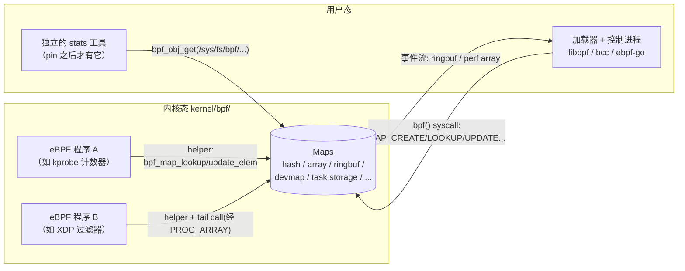

# 第4章 Maps：内核态键值存储

> 本章导读：谁该读、前置章节、读完能做什么。
> - 谁该读：写过第一个 eBPF 程序、想搞懂"数据怎么在内核态与用户态之间流动"的工程师；需要在 30+ 种 map 类型里做选型、排查 verifier 报错、或维护老代码 `SEC("maps")` 写法的人。
> - 前置：VM 与 verifier 相关章节（map fd 重写与 key/value 边界检查都发生在加载期）。
> - 读完能做什么：按场景选对 map 类型（含版本兼容判断）；用 libbpf/bcc/裸 syscall 三条路读写 map；掌握 per-CPU 与 bpf_spin_lock 两套并发解法的边界；掌握 pin 生命周期与跨进程共享 map 的姿势；分清 legacy 与 BTF 两代声明。

## 4.1 直觉层

**比喻：map 是挂在内核里的"共享白板"。** eBPF 程序是一群"一次性事件处理员"——每来一个包、每次 syscall 触发，处理员上场跑完几十条指令就退场，verifier 甚至强制它单函数、512 字节栈、（历史上）4096 条指令上限（[id=25] digest 02）。处理员自己没有记性，唯一的记忆手段就是往白板上写：这次事件的计数、时间戳、五元组，写完退场；下一个处理员（可能是另一个程序）上场时先看白板。用户态的控制进程也盯着同一块白板——既能读结果，也能提前写好配置让处理员照办。

**为什么必须有这么个机制。** bpf(2) man page 的原话：maps "are used to exchange data between eBPF programs and between eBPF programs and user-space programs"——两个方向：eBPF 程序处理事件（kprobe、包）把数据存进 map，用户态再取走；反过来，用户态把 map 当配置机制灌值，eBPF 程序读后即时改变行为（web/md/13.md）。libbpf 维护者 Nakryiko 说得更直接："BPF maps are the means to share the state between (potentially many) BPF programs **and** user-space"（web/md/100.md）。注意他还补了一句：更现代的全局变量（global variables）"under the hood are still using BPF maps"——所以连"全局变量"这个看似绕过 map 的特性，底层仍然是一张 map（.bss/.data/.rodata 段对应的内部 map，5.5+ 支持用户态 mmap 直读写）。广义地说，map 是 eBPF 世界的统一状态交换机制；非数据的控制类通道（如 `bpf_send_signal` 发信号）只是少数例外。

**它在整条 eBPF 栈里的位置。** 三方共建一块白板：



三个数据方向值得记住（本章 4.2 逐一展开）：
1. **内核→用户态（结果）**：聚合统计（hash/array + 轮询）或事件流（ringbuf/perf event array）；
2. **用户态→内核（配置）**：策略表热更新、不重载程序——tc-bpf(8) 列为 tc 视角核心卖点（web/md/14.md）；
3. **内核→内核（程序协作）**：多程序共享同一张 map 各写各读（libbpf-bootstrap 的 `exec_start` 被 `handle_exec`/`handle_exit` 两程序共用，web/md/100.md）；连"程序跳转"也走 map——tail call 的跳转表就是 PROG_ARRAY（web/md/13.md、19.md）。

架构上还有一个常被低估的意义：XDP 核心开发者 Jesper Brouer 在 XDP REDIRECT 演讲里总结过，hook 只定义 action 集与受限 helper、用户策略全部走 map，**终结了"每来一个新策略就造一个内核 ABI（sysctl/procfs/ioctl）"的循环**（[id=75] digest 04，web/pdf-txt/75.txt）。map 不只是数据通道，它还是 eBPF"安全可编程"承诺的接口层。

## 4.2 原理层

### 4.2.1 本质与访问模型

**map 是一个由 bpf() syscall 创建的内核对象，用户态拿到的是文件描述符。** `BPF_MAP_CREATE` 命令的核心字段只有五个：`map_type`、`key_size`、`value_size`、`max_entries`、`map_flags`（web/md/29.md 引 4.11 版 `include/uapi/linux/bpf.h`；man page 里可编译的 `bpf_create_map()` 包装函数见 web/md/13.md）。`max_entries` 是 u32，理论上限 2^32 条——但 Ferris Ellis 算过账：2^32 条 64 位 key + 64 位 value 就是 64 GiB，所以它是"理论富余"，不是工程额度；内核 samples 里最大的例子也就 100 万条（web/md/29.md）。`map_flags` 里的 prealloc 位（4.6 引入，commit 6c9059817432）决定哈希表是否预分配，kprobe 场景需要它（web/md/29.md）。

**verifier 在加载期用 key_size/value_size 做静态拦截。** 这是 map 与 verifier 的第一处咬合：map 建了 8 字节 key，程序却传 `fp - 4` 当 key 指针——栈越界，拒载；value_size 建了 1 字节，程序却往 value 指针写 u32——越界写，拒载。两个例子都写在 bpf(2) man page 里（web/md/13.md）。所以"map 参数填错"往往不是运行时 bug，而是加载时的 verifier 报错。

**内核侧访问一律走 helper，map 引用走伪指令。** eBPF 程序不能直接解引用 map 对象，而是调用三个基础 helper：
- `void *bpf_map_lookup_elem(map, key)`——命中返回 value 指针，**未命中返回 NULL**（返回值语义见 web/md/15.md）；返回值必须先判空才能解引用，这是 bcc 官方教程第 4 课点名的 verifier 铁律（[id=99] digest 08）；
- `long bpf_map_update_elem(map, key, value, flags)`——flags 三态：`BPF_NOEXIST`（key 必须不存在）/`BPF_EXIST`（必须已存在）/`BPF_ANY`（无条件）；**ARRAY/PERCPU_ARRAY 上禁用 `BPF_NOEXIST`**，因为数组元素"恒存在"，用了直接报错（web/md/15.md）；
- `long bpf_map_delete_elem(map, key)`——ARRAY 上恒失败 EINVAL（元素不可删，见 web/md/13.md）。

map 是怎么进程序的？编译时 map fd 占位在 `ldimm64` 伪指令里（`BPF_PSEUDO_MAP_FD`，src_reg=1），verifier 在加载时查 fd 把它**重写成真实内核 map 指针**，验证通过后清掉 src_reg（xdp-newbies verifier 五步机制的第①步，web/md/21.md；bcc 侧等价机制是把 map 访问改写成 helper 调用 + `bpf_pseudo_fd` 内联，见 [id=34] digest 02 与 web/md/101.md）。这也解释了为什么 map 通常要先于程序创建（libbpf 会自动处理顺序）。

**类型即语义。** "map"这个名字有误导性：前半家族（hash/array/percpu/lru/queue/stack/lpm）确实是通用容器，但后半家族是**内核子系统的句柄表**——DEVMAP 的 value 是网卡设备引用、PROG_ARRAY 的 value 是程序 fd、STRUCT_OPS 的"map"实则是内核结构体的函数指针覆盖表。理解一张 map 先问一句：它的 key/value 在内核里到底指向什么。

### 4.2.2 类型全表（按用途七分类）

分类框架取自 docs.ebpf.io 快照的 Map types 目录（web/md/8.md），版本与 commit 取自 bcc kernel-versions 矩阵（web/md/22.md）；两处都没覆盖的新条目以 libbpf 1.9 的 UAPI 头（repos/libbpf/libbpf/include/uapi/linux/bpf.h，快照 2026-11-02）为准。

**① 通用容器（Generic）**

| 类型 | 版本 | 一句话语义与选型 |
|---|---|---|
| HASH | 3.19 | 任意字节串 key→value 哈希表，查找优化；update 原子替换；会满（E2BIG），适合有界状态（连接表、进程表） |
| ARRAY | 3.19 | 4 字节索引数组，最快查找（verifier/JIT 可内联成常量指针）；元素预分配零初始化、不可删；单元素 ARRAY 是"全局变量"的经典前身（web/md/13.md） |
| PERCPU_HASH / PERCPU_ARRAY | 4.6 | 每核一份 value，**无锁**；高频计数/直方图首选，代价是读侧要按核求和（web/md/29.md） |
| LRU_HASH / LRU_PERCPU_HASH | 4.10 | 满了自动逐出"最近最少使用"项——跟踪 top-N 热点连接/进程；注意命名陷阱见 4.4 |
| LPM_TRIE | 4.11 | 最长前缀匹配 trie，前缀 1–256 字节；路由表/ACL 网段匹配专用（web/md/29.md） |
| QUEUE / STACK | 4.20 | FIFO/LIFO，无 key 只有 value，配 `bpf_map_push/pop/peek_elem`（web/md/15.md）；内核态生产、用户态消费的轻量任务队列 |
| BLOOM_FILTER | 5.16 | 概率型成员判定，允许假阳性换内存；重复数据抑制 |
| ARENA | 6.x | eBPF 程序的"自有动态内存区"（大块可读写内存，不是 KV 接口）；docs.ebpf.io 已收录（web/md/8.md）、eunomia 教程有专课（[id=111] digest 09），**引入版本本批语料未给出，待核实** |

**② map-in-map**：ARRAY_OF_MAPS / HASH_OF_MAPS（4.12）——value 是另一张 map 的 fd，用于运行时按 key 换子表（如 per-namespace 各一张表）；外层表确定内层表模板（`bpf_map__set_inner_map_fd`，repos/libbpf/libbpf/src/libbpf.h）。注意 `bpf_spin_lock` 禁止出现在 inner map（web/md/15.md）。

**③ 流式输出（Streaming）**：PERF_EVENT_ARRAY（4.3）与 RINGBUF（5.8）+ USER_RINGBUF（6.1）。逐事件送用户态的通道，详见 4.2.5。USER_RINGBUF 方向反过来：用户态生产、内核消费（libbpf 侧 `user_ring_buffer__reserve/submit`，repos/libbpf/libbpf/src/libbpf.h）。

**④ 包重定向（Packet redirection）**——XDP/tc 的转发面：

| 类型 | 版本 | 语义 |
|---|---|---|
| DEVMAP | 4.14 | ifindex→网卡引用，`bpf_redirect_map` 把包从另一网卡发出 |
| DEVMAP_HASH | 5.4 | 同上但哈希 key（任意网段/掩码维度） |
| CPUMAP | 4.15 | CPU id→远端 CPU，raw XDP frame 直送目标核、到那边才建 SKB 进协议栈（MPSC 队列 + ptr_ring + 钉核 kthread）；用于把 XDP 层与协议栈隔离、修 HW RSS 对隧道流量的 CPU 分布失明（[id=75] digest 04） |
| XSKMAP | 4.18 | redirect 进 AF_XDP 用户态 socket |
| SOCKMAP | 4.14 / SOCKHASH | 4.18 | socket 引用表（数组/哈希两种 key）；配合 sockops + sk_msg 做 socket splicing，同主机通信跳过本地 TCP/IP 栈（[id=119] digest 09） |
| REUSEPORT_SOCKARRAY | 4.19 | SO_REUSEPORT 组的 socket 分流决策表 |

关键性能事实：单核 `bpf_redirect` 仅 7.5Mpps，`bpf_redirect_map` 达 13.0Mpps——map 版把 RX 批处理藏进 XDP core（NAPI poll 末尾统一 flush，批量 ≤64），且新增 redirect 目标类型零 driver 改动（[id=75] digest 04，web/pdf-txt/75.txt）。

**⑤ 流重定向（Flow redirection）**：PROG_ARRAY（4.2）——value 是程序 fd，`bpf_tail_call(ctx, &jmp_table, index)` 按 ethertype/协议号跳转子程序（web/md/19.md 的 sockex3 四子程序范例）。

**⑥ 对象附属存储（Object attached storage）**——把状态挂在内核对象本身的生命周期上，对象消失状态自动回收：

| 类型 | 版本 | 语义 |
|---|---|---|
| SK_STORAGE | 5.2 | per-socket 本地存储，`bpf_sk_storage_get/map_delete_elem` |
| INODE_STORAGE | 5.10 | per-inode（文件）存储 |
| TASK_STORAGE | 5.11 | per-task（进程/线程）存储；LSM/安全类程序主力（如 bpfjailer 用它跟踪进程角色，[id≈bpfjailer] digest 18），推荐 6.1+ 配 BTF |
| CGRP_STORAGE | 6.x 后 | 新一代 cgroup 存储，程序类型不受限（老 CGROUP_STORAGE 仅限 cgroup 挂载程序，UAPI 头已标 `_DEPRECATED` 别名，repos/libbpf/libbpf/include/uapi/linux/bpf.h；**版本号本批语料未覆盖，待核实**） |
| CGROUP_STORAGE / PERCPU_CGROUP_STORAGE | 4.19 / 4.20 | 旧式 per-cgroup 存储，仅 cgroup 挂载程序可用，官方已标注由 CGRP_STORAGE 取代 |

**⑦ 杂项**：STACK_TRACE（4.6，配 `bpf_get_stackid`，value 为 PERF_MAX_STACK_DEPTH×u64 栈帧数组——持续 profiler 标配，web/md/15.md、[id=120] digest 09）；CGROUP_ARRAY（4.8，配 `bpf_skb_in_cgroup` 判 skb 归属，web/md/29.md）；STRUCT_OPS（5.6，以 map 形式注册内核 ops 结构体——TCP 拥塞控制与 sched_ext 调度器都走它，digest 18）；INSN_ARRAY/RHASH（libbpf 1.9 UAPI 快照可见枚举条目，**语义与版本本批语料未覆盖，待核实**）。

版本底线速查：3.18 有 eBPF 但 map 从 3.19 才有；4.x 补齐网络转发家族；5.x 补齐流式（ringbuf 5.8）与对象存储；6.1 后进入 arena/user ringbuf 时代（web/md/22.md）。

### 4.2.3 并发语义：per-CPU、原子操作与 bpf_spin_lock

eBPF 程序会在多个 CPU 上同时触发（NAPI 收包、软中断、不同进程上下文），共享 map 天然存在数据竞争。内核提供三档解法，按成本递增：

**第一档：per-CPU 变体（空间换锁）。** PERCPU_HASH/ARRAY 给每个 CPU 一份独立 value，写入互不相见、天然无锁（web/md/29.md 明说这是 4.6 引入它们的动机："allows for lock free uses"）。这是高频计数器的默认答案——`__sync_fetch_and_add` 都可以省。代价：①读侧要拿到所有核的值求和（bcc Python 的 `b["map"]` 访问自动展开为按核数组，[id=99] digest 08）；②内存×核数；③**核数必须按 `/sys/devices/system/cpu/possible` 计，不能按 `get_nprocs_conf()`**——VMware vcpu.hotadd 会让后者虚报 128，直接建错 map（Trail of Bits 实测坑，web/md/108.md）。

**第二档：原子原语（操作换锁）。** HASH 的 `map_update_elem` 是**原子替换**整个 entry（web/md/13.md）；ARRAY 的 update 非原子，但 32/64 位计数器字段可以用 C 原子内建 `__sync_fetch_and_add()`——"aggregation and accounting of events" 的标准套路，一个 ARRAY + log2 分桶就是内核态直方图（web/md/13.md；Starovoitov 2015 演讲的 write() 延迟直方图就是这个十行范式，[id=36] digest 02）。注意 ARRAY 整体替换的撕裂读风险：大 value 结构的非原子 update 会让并发读者看到半新半旧（由 web/md/13.md "replaces elements in a nonatomic fashion" 直接推出）——要么字段级原子，要么升级第三档。

**第三档：bpf_spin_lock（真互斥）。** value 结构里嵌 `struct bpf_spin_lock` 字段，用 `bpf_spin_lock()/bpf_spin_unlock()` 两个 helper 保护"同一 entry 的其余字段"的多步更新（web/md/15.md）。约束极多（全部出自 bpf-helpers(7)）：只能放 HASH/ARRAY 的 value 里；**BTF 描述强制**；一次只能持一把锁；持锁期间禁止任何调用（helper 与 BPF-to-BPF）；所有执行路径必须显式 unlock 后才能返回；锁字段必须 4 字节对齐、必须在结构体顶层；syscall 的 LOOKUP 不拷贝锁字段、UPDATE 不更新锁字段；仅 root 可用；tracing 与 socket filter 程序**不可用**（preemption 检查不足）；map-in-map 的 inner map 禁用。内核 Design Q&A 还钉了一条 ABI 边界：map value 里的 `bpf_spin_lock`/`bpf_timer` 字段保持向后兼容（web/md/11.md）——所以它们是可依赖的稳定结构。

另有面向遍历的第四件套：`bpf_for_each_map_elem`（5.13，[id=113] digest 09）以回调方式在内核态遍历 map，回调返回 0 继续、1 提前终止；支持 HASH/PERCPU/LRU/ARRAY 六类（web/md/15.md）。

### 4.2.4 用户态访问：syscall 命令族与 libbpf 两层 API

**裸 syscall 层（bpf(2) 命令族）。** 围绕 map 的命令演进（web/md/22.md）：基础五件套（3.18–3.19：`BPF_MAP_CREATE/LOOKUP_ELEM/UPDATE_ELEM/DELETE_ELEM/GET_NEXT_KEY`）；持久化（4.4：`BPF_OBJ_PIN/OBJ_GET`，见 4.2.6）；用户态 API 增强——`BPF_MAP_FREEZE`（5.2，冻结防篡改，常用于只读配置表）、ARRAY mmap（5.5，用户态直接映射读数组）、BATCH 三连（5.6，`lookup/update/delete_batch` 一次 syscall 批量搬运）。UPDATE 的 flags 三态与 errno：E2BIG=表满、EEXIST/ENOENT=条件不满足（web/md/13.md）。`GET_NEXT_KEY` 的四象限行为反直觉，单列 4.4。

**libbpf 低层 API（`<bpf/bpf.h>`，syscall 薄包装）。** `bpf_map_create/lookup_elem/update_elem/delete_elem`（含 `_flags`、`lookup_and_delete` 变体）、`get_next_key`、`freeze`、四个 `_batch`、`bpf_obj_pin/obj_get`、`bpf_map_get_fd_by_id/get_info_by_fd`（repos/libbpf/libbpf/src/bpf.h，libbpf 1.9）。xdp-tutorial basic04 特意让 stats 工具只用这层、不链完整 libbpf 以缩小二进制（basic04 README.org）。

**libbpf 高层 API（`<bpf/libbpf.h>`，bpf_object 生命周期内）。** 程序里声明的 map 由 libbpf 在 `load()` 时自动创建；`bpf_object__find_map_by_name()` 拿 `struct bpf_map *`，`bpf_map__fd()` 取 fd；加载前可改参数（`set_max_entries/set_key_size/set_value_size/set_type`）、灌初值（`set_initial_value`）、复用已有 map（`reuse_fd`）、pin 管理（`pin/unpin/is_pinned/set_pin_path`）、map-in-map 模板（`set_inner_map_fd`）、自动创建开关（`set_autocreate`）——全表见 repos/libbpf/libbpf/src/libbpf.h。skeleton 生成后每个 map 直接是 `skel->maps.<name>` 字段（web/md/100.md）。

**全局变量 = 免 syscall 的 map。** 5.5+ 的 .bss/.data/.rodata 段映射为内部 map，skeleton 暴露 `skel->bss/data/rodata`，用户态 **mmap 直读直写、零 syscall**；`const volatile` 只读变量在 verify 时值已知，verifier 可剪枝死代码——必须在 `open()` 与 `load()` 之间赋值（web/md/100.md）。

**bcc Python 侧**把 map 包装成 dict：`b["stats"][key]` 直通内核 map，per-CPU map 自动展开数组，`print_log2_hist()` 一键打印内核态聚合直方图（[id=99] digest 08、web/md/98.md）。

### 4.2.5 事件流：ringbuf 相对 perf event array

**PERF_EVENT_ARRAY（4.3）**是第一代事件通道：每 CPU 一个 perf ring buffer，用户态必须先 `perf_event_open()`（`PERF_TYPE_SOFTWARE` + `PERF_COUNT_SW_BPF_OUTPUT` + `PERF_SAMPLE_RAW`）把 fd **逐 CPU 塞进 map 的对应槽位**，程序才能 `bpf_perf_event_output(ctx, map, flags, data, size)`——flags 指定槽位（`BPF_F_CURRENT_CPU` 取当前核），且必须传 ctx（web/md/15.md helper Description 原文；挂载全流程见 web/md/108.md：mmap 读 + 数据在 perf ring 里二次落地）。

**RINGBUF（5.8）**的设计修正（优势清单逐条出自 bcc reference guide web/md/98.md，语义细节出自 web/md/15.md）：
1. **全 CPU 共享一个环形缓冲**——不再每核一份，内存占用直接除以核数，也免了"逐核 perf_event_open + 塞 fd"的启动仪式；
2. **两套 API**：`bpf_ringbuf_output()` 一步提交（类似 perf_submit）；`bpf_ringbuf_reserve()/submit()/discard()` 两段式——先在 ring 里**预留**一段内存拿到指针、直接在 ring 里填充、再提交，**省掉一次拷贝**，填一半发现条件不满足还能 `discard`；
3. **不需要 ctx 参数**——perf 版必须带程序上下文，ringbuf 版与程序类型解耦；
4. **用户态性能与延迟更优**——libbpf 的共享 ring buffer manager（`ring_buffer__new/add` 可聚合多个 map 到一个 epoll fd：`ring_buffer__poll/consume/epoll_fd`，repos/libbpf/libbpf/src/libbpf.h）；
5. **通知自适应**：flags 传 0 是 adaptive notification——只有当用户态消费者已把存量数据全部消化完时才发通知，消费者还在忙就不再打扰；也可显式 `BPF_RB_NO_WAKEUP`/`BPF_RB_FORCE_WAKEUP`（web/md/15.md）；
6. 官方结论："Starting in Linux 5.8, this should be the preferred method for pushing per-event data to user space"（web/md/98.md）。libbpf-bootstrap 专门留了 `bootstrap_legacy` 用 perf array 兼容 <5.8 内核（[id≈libbpf-bootstrap] digest 12）；Inspektor Gadget 的 GADGET_TRACER_MAP 宏也是"内核支持则 ringbuf、否则 perf array"的运行时降级（[id=121] digest 09）。

**USER_RINGBUF（6.1）**把方向反过来：用户态 reserve/submit、内核侧消费，配 `user_ring_buffer__reserve()`（可阻塞版 `reserve_blocking(timeout_ms)`，E2BIG=超整环大小、ENOSPC=暂时放不下，repos/libbpf/libbpf/src/libbpf.h）。

### 4.2.6 生命周期与 pin：让 map 活过创建它的进程

**默认生命周期 = fd 引用计数。** map 随 `BPF_MAP_CREATE` 出生、随最后一个 fd 关闭而销毁。早期（<4.4）这导致"工具退出，map 和程序即被销毁"——想常驻就得让加载进程永生（web/md/29.md）。

**pin（4.4）把它变成文件系统对象。** `BPF_OBJ_PIN` 把 map（或程序）钉到 bpffs 路径 `/sys/fs/bpf/`，`BPF_OBJ_GET` 按路径拿回 fd（web/md/29.md、13.md）。bpffs 不存在时需 `mount -t bpf bpf /sys/fs/bpf/`（ip/tc/测试环境一般自动挂，basic04 README.org）。pin 之后创建进程退出、加载器换代，map 仍在——独立 stats 工具、重启的服务都能 `bpf_obj_get()` 接上同一份状态。libbpf 全套：`bpf_object__pin_maps(obj, dir)`（自动建子目录）/`unpin_maps`/`bpf_map__pin/unpin`。

**复用已有 pinned map 的正规姿势**：open 之后、load 之前调 `bpf_map__reuse_fd(map, bpf_obj_get("/sys/fs/bpf/veth0/xdp_stats_map"))`（basic04 README 六步最小例）。iproute2 的 ip/tc 加载器**默认复用**同名 pinned map，libbpf 默认**新建**——两条工具链的真实语义差，计数器"重启清零还是延续"取决于谁加载（basic04）。

**fd 移交的第三条路（无 pin）**：tc 的 `tc exec bpf imp/exp` 把 map fd 经 Unix domain socket 移交给 agent 进程、塞进环境变量 `BPF_MAP<X>`，进程重启不丢 map（web/md/14.md）。bcc 生态多程序共享则用 `BPF_TABLE_PUBLIC` + `BPF_TABLE("extern")` 声明同一张表（[id=110] digest 09 的 DNS 双程序协作）。

**清理责任**：pin 出去的 map 不会自杀。basic04 的 corner case：重载前 `unpin` 不存在的 map 会失败；程序升级新增 map 后旧 unpin 清单对不上；stats 工具不重启会抱着旧 fd 看孤儿 map（按 map id 检测换代，basic04 Assignment 1）。另注意"程序可能比进程活得久"：部分程序类型在 owner 死后仍 attach（web/md/100.md），配套 pinned map 清理要显式做。

### 4.2.7 声明演进：从 SEC("maps") 到 BTF 风格 SEC(".maps")

**第一代（2016–2017，samples/bpf 时代）**：全局 `struct bpf_map_def SEC("maps")` 变量，loader 靠扫 ELF 里名为 `maps` 的 section 找到定义（web/md/19.md，xdp-newbies David Miller 原文）：

```c
struct bpf_map_def SEC("maps") my_map = {
    .type = BPF_MAP_TYPE_PERCPU_ARRAY,
    .key_size = sizeof(__u32),
    .value_size = sizeof(__u64),
    .max_entries = 256,
};
```

**iproute2 并行线**：tc/ip 用自己的 `struct bpf_elf_map`（多了 `.pinning = PIN_GLOBAL_NS` 等字段）——Ferris Ellis 文中引用的内核样例恰好就是这种写法（web/md/29.md）；tc-bpf(8) 至今仍与新写法并存，"读代码需分辨时代"（web/md/14.md digest 注记）。

**第二代（libbpf + BTF，2020 起）**：匿名 struct + `SEC(".maps")` + `__uint/__type` 宏（web/md/100.md）：

```c
struct {
    __uint(type, BPF_MAP_TYPE_HASH);
    __uint(max_entries, 8192);
    __type(key, pid_t);
    __type(value, u64);
} exec_start SEC(".maps");
```

差别不只是语法：BTF 定义把 key/value 的**真实类型信息**（BTF 类型 id）一并交给内核与 libbpf（`bpf_map__btf_key_type_id` 可查），这是 `bpf_spin_lock`/`bpf_timer` 等"value 内嵌特殊字段"特性的**硬前提**——"BTF description of the map is mandatory"（web/md/15.md）；也让 CO-RE 重定位、libbpf 的类型检查成为可能。老式 `bpf_map_def` 只有尺寸没有类型，新特性一概用不了。三代的识别特征：`SEC("maps")` + `struct bpf_map_def` = 最老；`struct bpf_elf_map` + `.pinning` 字段 = iproute2 路线；`SEC(".maps")` + `__uint/__type` = 现代。

## 4.3 实践层

上手推荐按"三条路线"选一条，都需要 root（或对应 capability；`bpf_spin_lock` 仅 root）。

**路线 A：libbpf-bootstrap（现代 CO-RE 标准姿势）。** 仓在本地 repos/libbpf/libbpf-bootstrap/（examples/c/），配套讲义 web/md/100.md。最小闭环三步：
1. 内核侧 `bootstrap.bpf.c`：BTF 定义 map（4.2.7 的 `exec_start` 原例），程序里 `bpf_map_update_elem(&exec_start, &pid, &ts, BPF_ANY)` 写、`lookup` 读、`delete` 删——两个 tracepoint 程序共享一张表（web/md/100.md 全文代码）。
2. Makefile 四步：libbpf 静态库 → `clang -g -O2 -target bpf` 编 `.bpf.o`（-g 出 BTF）→ `bpftool gen skeleton` → 链接成 ~200KB 自包含二进制（web/md/100.md）。
3. 用户态：`bootstrap_bpf__open_and_load()`；全局变量走 `skel->bss->`（mmap 直达）；ringbuf 消费 `ring_buffer__new(map_fd, handle_event, NULL, NULL)` + `ring_buffer__poll(rb, -1)`（web/md/100.md；API 见 repos/libbpf/libbpf/src/libbpf.h）。起步前 bump `RLIMIT_MEMLOCK`（5.11 前的配额，[id≈cilium/ebpf] digest 13）。

**路线 B：xdp-tutorial（理解加载器内幕 + pin）。** 本地 repos/xdp-project/xdp-tutorial/：basic03-map-counter（XDP 计数器：PERCPU_ARRAY 存 rx_packets/rx_bytes）→ basic04-pinning-maps（加载器与 stats 拆两进程，练 pin/reuse_fd）→ packet03-redirecting（DEVMAP 转发）。教会你 map 从创建到跨进程共享的完整生命周期。

**路线 C：bcc（最快出活）。** web/md/98.md 按 Ctrl-F 查表：`BPF_HASH/BPF_ARRAY/BPF_HISTOGRAM` 等 18 个 map 宏；`map.lookup()/update()/lookup_or_try_init()/increment()` 等 34 个方法；事件输出 `BPF_PERF_OUTPUT + perf_submit()` 或 `BPF_RINGBUF_OUTPUT + ringbuf_reserve/submit`。Python 侧 `b["map"][key]` 像 dict 一样读写，GET_NEXT_KEY 的迭代细节全被藏掉。

**裸 syscall 参考**：bpf(2) man page 的 EXAMPLES 节有可编译的 `bpf_map_create/bpf_lookup_elem/bpf_update_elem` C 包装（web/md/13.md）；Bolin 纯 C opensnoop 复刻记是"踩遍裸加载之坑"的实战记录（kprobe 必须设 `kern_version` 否则 EINVAL 等，web/md/101.md）。

**工具三件套**：`bpftool gen skeleton`（web/md/100.md）；`bpftool feature probe`（探测本机可用 map/helper/prog 类型，web/md/15.md KNOWN ISSUES 官方推荐）；查内核真源 `git grep -W 'bpf_map_type {' include/uapi/linux/bpf.h`（web/md/22.md）。内核侧实现落点在 kernel/bpf/ 的 hashtab.c/arraymap.c/queue_stack_maps.c/ringbuf.c/devmap.c/cpumap.c/map_in_map.c/bpf_lru_list.c 与 local storage 系列（digest 11 目录地图）。

**第一个练习**（30 分钟）：把 libbpf-bootstrap 的 minimal 改成"用一个 ARRAY map 统计每个 PID 的 write 次数"，用户态每秒轮询打印 top3——覆盖 BTF 定义、update/lookup、skeleton 读 map；第二步换成 ringbuf 逐事件上报（对照 web/md/100.md 的 bootstrap 事件结构体）。

## 4.4 深水区与坑

语料消化中实证过的坑，按"踩中概率"排序：

1. **`BPF_MAP_GET_NEXT_KEY` 的四象限反直觉**（web/md/29.md 逐条引 man page）：①key 找到且非末尾→返回 next_key 正常；②**key 找不到→不报错，next_key 给第一个元素**（把"查找失败"静默当成"从头开始"）；③key 是末尾→-1 + ENOENT；④其余 errno 还有 ENOMEM/EFAULT/EPERM/EINVAL 无解释。后果：迭代中删除元素的常规写法（lookup→处理→delete→get_next）会**跳元素或死循环**；bcc 把这些细节藏掉了，裸 syscall 用户必须自己拿"起始 key=NULL"与"ENOENT 终止"配对。
2. **flags 与类型不匹配**：ARRAY/PERCPU_ARRAY 上用 `BPF_NOEXIST` 直接报错（元素恒存在，web/md/15.md）；ARRAY 上 `delete_elem` 恒 EINVAL（web/md/13.md）；QUEUE/STACK 满时 push 传 `BPF_EXIST` 才会挤掉最老元素，否则失败（web/md/15.md）。
3. **per-CPU map 的核数口径**：按 `/sys/devices/system/cpu/possible` 而非 `get_nprocs_conf()`，否则 VMware vcpu.hotadd 场景直接按 128 核建错（web/md/108.md Trail of Bits 实测）。
4. **LRU_PERCPU_HASH 命名陷阱**：不是"每核一张表"，而是**全核共享一张哈希表 + 每核独立 LRU 淘汰结构**——保留的是"某核局部热点"而非全局热点（web/md/29.md 作者明说这是名字误导，细节连当时都无文档）。
5. **perf event array 双坑**：①版本口径——map 类型本身 4.3 引入（web/md/22.md，commit ea317b26），与 perf 体系的集成叙事在 Ferris Ellis 处系于 4.4（web/md/29.md），写兼容矩阵以 22.md 为准；②启动仪式——用户态必须先 perf_event_open 逐核建 fd 塞进 map，顺序错了发事件直接失败（web/md/15.md 原文 "This must be done before the eBPF program can send data into it"）。ringbuf 两坑皆无（web/md/98.md）。
6. **ringbuf 的 reserve 失败处理**：reserve 返回 NULL（放不下）时只能丢弃/降级，不能自旋重试——eBPF 程序必须及时让出 CPU（指令上限的存在理由，[id=113] digest 09）；实践配一个丢弃计数器。通知 flags 默认 0=adaptive，语义见 web/md/15.md。
7. **`bpf_spin_lock` 的可用面**：tracing 与 socket filter 程序不可用、仅 root、一次一把、锁内禁一切调用、syscall 读写都跳过锁字段——**用户态经 LOOKUP_ELEM 看到的 value 与内核态并不逐字节相同**（web/md/15.md）；map-in-map inner map 禁用。
8. **tail call 的边界语义**：PROG_ARRAY 跳转"不返回"（复用栈、程序被整体替换）；索引无效/超 32 层嵌套时**静默 fall-through 继续执行当前程序**——既是 feature（默认分支）也是坑（你以为跳走了其实没跳）（web/md/13.md、19.md）。
9. **ARRAY 大 value 撕裂读**：ARRAY update 非原子整体替换（web/md/13.md），并发读者可能读到混合状态；HASH 才是原子替换。结构性对策：per-CPU、字段级原子、spin_lock 三选一。
10. **判空铁律**：`bpf_map_lookup_elem` 返回必须判 NULL 才能解引用——bcc 教程 L4 钉的 verifier 规则（[id=99] digest 08），新手第一个 verifier 报错多源于此。
11. **内存与配额**：map 受 `RLIMIT_MEMLOCK` 约束（5.11 前必须 bump，web/md/100.md、[id≈cilium/ebpf] digest 13）；max_entries×(key+value) 的账要自己算（2^32×128bit=64GiB 极端例，web/md/29.md）；HASH 会满（E2BIG），满前先想 LRU。
12. **pin 的清理与换代**：unpin 不存在的 map 会失败；程序升级新增 map 后旧清理清单对不上（basic04 README）；ip/tc 默认复用 pinned map、libbpf 默认新建——"计数器重启清零"不是 bug 是工具链语义；stats 工具不重启会抱着旧 fd 看孤儿 map，按 map id 检测换代（basic04 Assignment 1）。
13. **文档措辞的时间胶囊与版本表边界**：bcc reference guide 的 `BPF_PERF_OUTPUT` 段仍写 "This is the preferred method"，而 `BPF_RINGBUF_OUTPUT` 段说 5.8+ 应优先——同页两段属于不同年代，以后者为准（web/md/98.md 两处对照）；2017–2019 文章的类型数量（11 种/4.11 时点）都是快照，当代以 UAPI 头 39 条枚举为准（repos/libbpf/libbpf/include/uapi/linux/bpf.h）。bcc kernel-versions 表只维护到 6.1，ARENA/CGRP_STORAGE/INSN_ARRAY/RHASH 更新的条目只有名录无版本——部署前 `bpftool feature probe` 实测（web/md/15.md）。

## 4.5 与其他章的关系

**承上**：verifier 章是理解 map 的前置——map fd 的伪指令重写（BPF_PSEUDO_MAP_FD）与 key/value_size 的静态边界检查都发生在验证期（web/md/21.md、13.md），本章 4.4 的判空、越界类报错都要回到 verifier 的检查逻辑里找根因；VM/指令集章则解释了为什么程序侧访问 map 只能是 helper 调用（R1–R5 传参约定，web/md/11.md）。
**启下**：program types 与挂载点章将展开"map 类型 × 程序类型 × helper"的三方兼容矩阵（内核侧由 `check_map_func_compatibility` 与 `bpf_func_proto` 的 switch-case 决定，web/md/15.md KNOWN ISSUES）——例如 spin_lock 对 tracing 程序关门、storage 族要求对应程序类型；XDP/网络章深挖 devmap/cpumap/xskmap/sockmap 的数据面；工具链章展开 libbpf/bpftool/bcc 的完整 API 面；可观测章的所有采集器（profiler/trace 工具）都建立在本章的 ringbuf/perf event array + STACK_TRACE 组合上（[id=120] digest 09 的三 map 分工：直方图+栈表+符号信息）。

## 4.6 语料索引

| id | 名称 | 本地路径 | 本章用了什么 |
|---|---|---|---|
| 15 | bpf-helpers(7) man page | web/md/15.md | lookup/update/delete 语义与 flags 限制；spin_lock 全部约束；ringbuf 五 helper 与 adaptive 通知；perf_event_output 仪式；push/pop/peek；for_each_map_elem；feature probe 自查法 |
| 13 | bpf(2) man page | web/md/13.md | MAP_CREATE 字段；verifier 按 key/value_size 静态拒绝两例；HASH 原子替换/ARRAY 非原子+原子计数；PROG_ARRAY tail call（32 层/fall-through）；架构定位原文 |
| 29 | Ferris Ellis: eBPF part 2 | web/md/29.md | 10 命令考古；11 类型逐个版本+commit；GET_NEXT_KEY 四象限；OBJ_PIN 4.4 历史；LRU_PERCPU 命名陷阱；64GiB 内存账 |
| 22 | bcc kernel-versions.md | web/md/22.md | 类型×版本×commit 全表（3.19–6.1）；BATCH 5.6/FREEZE 5.2/mmap array 5.5 |
| 100 | Nakryiko: libbpf-bootstrap 博客 | web/md/100.md | BTF map 定义；全局变量=map+mmap 直读写；ringbuf reserve/submit；skeleton；RLIMIT_MEMLOCK；两程序共享 map |
| 19 | David Miller: bpf.h and you | web/md/19.md | legacy `struct bpf_map_def SEC("maps")`；tail call jmp_table 范例 |
| 98 | bcc reference guide（master 克隆） | web/md/98.md | 18 map 宏+34 方法；RINGBUF 对 PERF_OUTPUT 六条优势；"5.8+ 首选"；PERF_OUTPUT 段过时措辞 |
| 8 | docs.ebpf.io 快照 | web/md/8.md | 现代 map 类型七分类目录（含 ARENA/INSN_ARRAY 名录） |
| 108 | Trail of Bits 教程 | web/md/108.md | per-CPU map 核数口径坑；PERF_EVENT_ARRAY 逐核 fd+mmap 消费全流程 |
| 101 | Bolin: opensnoop 纯 C 复刻 | web/md/101.md | 裸 syscall 加载参考；bcc 改写 map 访问为 helper+bpf_pseudo_fd |
| 14 | tc-bpf(8) | web/md/14.md | struct bpf_elf_map 老写法并存；`tc exec bpf imp/exp` fd 移交；map 热更新卖点 |
| 75 | Brouer: XDP now with REDIRECT | web/pdf-txt/75.txt | redirect 7.5 vs 13.0Mpps；DEVMAP/CPUMAP/XSKMAP 语义与 cpumap 内部结构；"终结造内核 ABI 循环"论 |
| — | libbpf 仓（1.9，commit 872299d，2026-11-02） | repos/libbpf/libbpf/src/{bpf.h,libbpf.h}；include/uapi/linux/bpf.h | 当代 39 条枚举（含 deprecation 注记）；低层/高层 map API 全集；ring_buffer 与 user_ring_buffer 用户态 API |
| — | xdp-tutorial basic04-pinning-maps | repos/xdp-project/xdp-tutorial/basic04-pinning-maps/README.org | mount bpffs；pin/unpin corner case；bpf_map__reuse_fd 六步例；ip/tc 与 libbpf 复用语义差 |
| — | digests/01、02、08、09（及 04/11/12/13/18 摘引） | digests/*.md | verifier 五步（21）/bcc 教程铁律（99）/eunomia 专课（111）/bpfjailer task_storage（18）/cilium-ebpf rlimit（13）/kernel/bpf 文件地图（11） |

## 4.7 AI agent 用法

本章作为检索工具的典型配方（问题 → grep 词 → 命中位置）：

1. **"map 类型 X 是什么/哪个内核版本引入/对应哪个 commit"** → `grep "BPF_MAP_TYPE_X" web/md/22.md`（版本+commit）→ 再 `grep "BPF_MAP_TYPE_X" repos/libbpf/libbpf/include/uapi/linux/bpf.h`（确认当代仍在枚举、有无 deprecation 别名）。6.1 之后的类型改查 web/md/8.md（名录）并标注"版本待核实"。
2. **"helper 的签名/flags/返回值语义"**（lookup/update/delete/ringbuf 五件套/spin_lock/for_each_map_elem）→ `grep -n "bpf_map_\|bpf_ringbuf_\|bpf_spin_lock" web/md/15.md`，按行号取 Description+Return 段。
3. **"看到老代码的 map 声明看不懂"** → `grep "bpf_map_def" web/md/19.md`（第一代）、`grep "bpf_elf_map" web/md/14.md`（iproute2 线）、`grep "SEC(\".maps\")" web/md/100.md`（BTF 现代版）——三代特征各取一例对照。
4. **"map pin 之后另一个进程怎么读/复用"** → 读 repos/xdp-project/xdp-tutorial/basic04-pinning-maps/README.org（bpf_obj_get/bpf_map__reuse_fd 时序：open→reuse→load）；libbpf API 名录 `grep "bpf_map__pin\|bpf_map__reuse_fd" repos/libbpf/libbpf/src/libbpf.h`。
5. **"选 ringbuf 还是 perf event array / ringbuf 优势"** → web/md/98.md 搜 `BPF_RINGBUF_OUTPUT`（六条优势+5.8+ 结论）；消费端 API `grep "ring_buffer__" repos/libbpf/libbpf/src/libbpf.h`；flags 语义 web/md/15.md 搜 `adaptive`。（多程序共享一张 map 的三方案：同 .bpf.c 共享=web/md/100.md；跨目标文件=digest 09 id=110 的 `BPF_TABLE_PUBLIC/extern`；跨进程=配方 4 的 pin。）

**断言可靠性分级**：类型版本表（22.md）与 helper 语义（15.md）为一手权威；29.md 的历史叙事带 4.11 快照局限（作者自注）；98.md 是 bcc 视角（宏名仅 bcc 有效，内核侧以 15.md 为准）；libbpf API 以仓内头文件为准（1.9 快照）。
