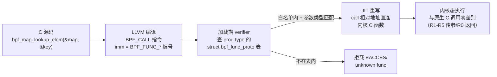

# 第6章 Helper 函数体系

> 本章导读：写给所有要写 eBPF 程序的人（C/libbpf/bcc/bpftrace 用户都会直接或间接消费 helper）。前置：已理解 program type 与 context（第 20 条语料的 xdp-newbies 系列）、verifier 的存在（后续 verifier 章互为表里）。读完你能：按功能族快速定位"这个 attach 点能调哪些 helper"、读懂 helper×map×prog type 三重兼容规则、避开 trace_printk/改包指针失效/GPL 门控这些高频坑，并手握 top 20 高频 helper 速查表。

## 6.1 直觉层

**比喻**：eBPF 程序像被关进无菌舱的外科医生——舱内（程序本身）可以做任意精细的计算，但它不能自己伸手去拿器械柜里的任何东西；所有器械都必须通过墙上的一排**传递窗**递进来。每个传递窗口是一句 `bpf_xxx()` 调用，窗口清单（helper 白名单）由内核定义、按手术类型（program type）分级开放，并且每个窗口的开口尺寸固定（最多 5 个参数）。verifier 负责在手术开始前检查你只用了允许的窗口、伸手姿势合规；JIT 则保证递器械的动作零额外开销。

**为什么需要这个机制**：eBPF 允许任意开发者把代码动态注入内核运行，这在安全上等价于"允许陌生人在你的内核态执行指令"。内核的安全模型因此立起两根支柱：
1. **verifier 静态验证**——证明程序"怎么用寄存器和内存"是安全的（无越界、无死循环、指针先检查后解引用）；
2. **helper 白名单**——划定程序"能碰到的世界边界"：**程序不能调用任意内核函数，只能调用白名单内的 helper**（[id=15] DESCRIPTION：helpers "are restricted to a white-list of helpers defined in the kernel"）。

没有 helper，eBPF 程序只能做纯计算（对包过滤器都远远不够——连读包、记数、打日志都做不了）；有了 helper，程序才能读写 map、安全读取内核/用户内存、修改网络包、向用户态输出、查询当前进程身份。可以说 **helper 体系 = eBPF 的系统调用层**，只是方向反过来：普通进程用 syscall 请内核替自己干活，eBPF 程序用 helper 在内核现场替观测/网络逻辑干活。

**它在整条 eBPF 栈里的位置**：



三个关键事实钉在图里（均出自 [id=15] 与 [id=11]）：
- helper 调用**没有 FFI 开销**：eBPF 指令集刻意采用与内核 C calling convention 兼容的寄存器约定（R1-R5 传参、R0 返回值），"internally, eBPF programs call directly into the compiled helper functions without requiring any foreign-function interface"（[id=15]）。
- helper **最多 5 个参数**（"Due to eBPF conventions, a helper can not have more than five arguments"，[id=15]）——这就是为什么 `bpf_trace_printk` 的可变参数最多 3 个（fmt 与 fmt_size 占掉 2 个名额）。
- 每个 program type 只能调用 helper 全集的一个**子集**（[id=15]），子集怎么裁出来的见 6.2。

## 6.2 原理层

### 6.2.1 白名单的实现：struct bpf_func_proto 三回调

每个 program type 在内核里注册一组 verifier 回调，Oracle 内核开发者 Alan Maguire 的 helpers 专讲给出了权威锚点（web/md/39.md，指向 `net/core/filter.c`）：

```c
const struct bpf_verifier_ops sk_filter_prog_ops = {
        .get_func_proto      = sk_filter_func_proto,   // 该 prog type 能调哪些 helper
        .is_valid_access     = sk_filter_is_valid_access, // context 字段读写合法性
        .convert_ctx_access  = bpf_convert_ctx_access,   // __sk_buff 偏移 -> 真实 sk_buff 偏移
};
```

- **get_func_proto**：一个 switch-case，输入 helper 编号，返回该 helper 的 `struct bpf_func_proto`（参数/返回值类型描述 + gpl_only 标志），不在表内即拒载。注意 [id=15] IMPLEMENTATION 节的提醒：`default:` 标签还会再委托一层函数（如 `bpf_base_func_proto` 基础集），所以读源码时要顺着 default 链追完才是该 prog type 的真实可用集。
- **is_valid_access / convert_ctx_access**：与 helper 间接相关——context（如 `struct __sk_buff`）是内核真实结构的固定偏移抽象，对外 ABI 永不变（[id=21] 第⑤步），这两回调保证程序读 `skb->data` 这类字段时被改写到真实内存位置。

**helper×map 兼容矩阵**：同一 helper 只接受特定 map 类型（如 `bpf_msg_redirect_map` 只吃 SOCKMAP）。verifier 在 `check_map_func_compatibility()`（`kernel/bpf/verifier.c`）里逐对检查（[id=15] IMPLEMENTATION 节）。

**会使包指针失效的 helper 清单**：改包类 helper（`bpf_skb_store_bytes`/`bpf_xdp_adjust_head` 等）会使 verifier 先前对 `data`/`data_end` 的边界检查全部作废，这份清单编在 `bpf_helper_changes_pkt_data()`（`net/core/filter.c`，[id=15]）——这是 6.4 坑 2 的根源。

### 6.2.2 helper 编号与调用约定

- 每个 helper 有一个 UAPI 编号（`enum bpf_func_id`，`BPF_FUNC_map_lookup_elem = 1` 起），全表在 `include/uapi/linux/bpf.h`（[id=15]/[id=22]）。编译器把调用编成 `BPF_CALL` 指令，立即数即编号；verifier 验证通过后，JIT 把它改写成对真实内核 C 函数的直接调用（[id=21] 第⑤步 "helper 调用转换"）。
- 寄存器约定与内核 C 一致：R1-R5 依次传参、R0 返回、R6-R9 callee-saved、R10 只读栈帧指针（[id=11]/[id=42]）。5 参数上限即源于此（R1-R5 只有 5 个传参寄存器）。

### 6.2.3 稳定性承诺：helper 是 UAPI，kprobe 侧不是

内核官方 Design Q&A（[id=11]）钉死了 ABI 边界，这是理解 helper 体系地位的钥匙：

| 对象 | 是否稳定 ABI |
|---|---|
| eBPF 指令集 | 是 |
| **helper 集合与其参数/返回值语义** | **是（UAPI，不许 breaking change）** |
| 程序返回码语义 | 是 |
| tracepoint、kprobe 挂载点 | 否 |
| 被直接调用的内核函数/BTF_ID 标记函数/kfunc | 否（kfunc 有自己的 lifecycle） |

含义：helper 的**接口**（编号、签名、返回值语义）跨内核版本稳定，`bpf_map_lookup_elem` 在 4.x 和 6.x 上行为一致；但 helper **背后的数据**不保证稳定——比如 `bpf_probe_read` 去读一个内核结构体，结构体的字段布局每个版本都可能变。前者使"编译一次到处加载"在 helper 层面可行，后者的不稳定正是 CO-RE/BTF 要解决的问题（详见第 8 章）。**记住这个分工：稳定接口（helper）+ 不稳定数据（内核结构）→ 可移植性 = helper + CO-RE 两件套**。

### 6.2.4 helper 可用性：谁决定、去哪查

三个权威层次（[id=15] IMPLEMENTATION 节 + [id=22]）：
1. **内核源码五处**：`include/uapi/linux/bpf.h`（全表）、`net/core/filter.c`（网络类+可用性）、`kernel/trace/bpf_trace.c`（tracing 类）、`kernel/bpf/verifier.c`（helper×map 矩阵）、`kernel/bpf/` 其余（cgroup/sockmap 等）。
2. **bcc kernel-versions 矩阵**（web/md/22.md）：每个 helper 的引入内核版本 + 引入 commit + GPL 标注（如 `get_current_task` 4.8/GPL、`fib_lookup` 4.18/GPL、`cgrp_storage_get` 6.2），文末还有 program type × helper 全清单大表——与 bpf-helpers(7) 互补成"helper 可用性双源"。
3. **本机探测**：`bpftool feature probe`（可加 `unprivileged`）一键列出本机内核实际可用的 helper/program/map 类型（[id=15]）。

非特权的收紧：Linux 4.4 起非特权用户可加载受限 SOCKET_FILTER 程序，但 helper 白名单进一步收窄到 4 个——`get_random`/`get_smp_processor_id`/`tail_call`/`ktime_get_ns`，且不许往 map 里存内核指针（[id=13]）；总开关 `/proc/sys/kernel/unprivileged_bpf_disabled`。

GPL 门控：部分 helper 标记 gpl_only（编在 `bpf_func_proto` 里），程序 license 字符串不 GPL 兼容就调不了（[id=15] LICENSE 节、[id=13]）。经验规律：会读内核内部结构的 helper（`get_current_task`、`probe_read_kernel`、`get_stack`、`fib_lookup`、`override_return` 等）几乎都是 GPL-only；网络数据面的普通改包 helper 多数不限。

### 6.2.5 按功能族分类全表（v7.0 man 页 211 条的族谱）

bpf-helpers(7)（web/md/15.md，man-pages 6.19/内核 v7.0 快照）按时间顺序文档化了 211 个 helper；按功能重新归类后是 12 个族（括号内为主要成员）：

| 族 | 代表 helper | 一句话职责 |
|---|---|---|
| F1 map 操作 | lookup/update/delete_elem；push/pop/peek_elem（队列/栈）；for_each_map_elem；lookup_percpu_elem；per_cpu_ptr/this_cpu_ptr | 程序的全部持久化与程序间通信 |
| F2 local storage | sk_storage/inode_storage/task_storage/cgrp_storage 的 get/delete | 按 socket/inode/task/cgroup 维度的键值存储（map 的特化变体） |
| F3 内存与字符串读取 | probe_read{_user,_kernel}{,_str}；copy_from_user{_task}；strncmp；d_path；snprintf{_btf} | 安全拷贝"不安全"内存到栈上再处理 |
| F4 输出到用户态 | trace_printk/trace_vprintk；perf_event_output；ringbuf_{output,reserve,submit,discard,query}（+dynptr 变体）；user_ringbuf_drain；skb_output/xdp_output | 内核→用户态的三代通道（见 6.4 坑 11） |
| F5 包读写与改写 | skb_load/store_bytes(_relative)；skb_pull_data；skb_change_{proto,type,head,tail}；skb_adjust_room；xdp_adjust_{head,tail,meta}；xdp_load/store_bytes；vlan_push/pop；csum_diff/l3/l4_csum_replace/csum_update/csum_level；tunnel_key/opt 四件套；lwt_seg6_*；check_mtu | tc/XDP 数据面的改包流水线 |
| F6 重定向与转发 | redirect(_map/_neigh/_peer)；clone_redirect；sk/msg_redirect_{map,hash}；fib_lookup；sk_lookup_tcp/udp、skc_lookup_tcp；sk_assign；sk_release | 包的出路与 socket 的定位/选择 |
| F7 socket/TCP 治理 | setsockopt/getsockopt；tcp_send_ack；tcp_(raw_)gen/check_syncookie 四件套；load/store/reserve_hdr_opt；sk_fullsock/tcp_sock/get_listener_sock/skc_to_* 系 | 在 SOCK_OPS/SK_SKB 钩子上调 TCP 旋钮 |
| F8 当前进程上下文 | get_current_pid_tgid/uid_gid/comm/task/task_btf/cgroup_id(_ancestor)；get_ns_current_pid_tgid；get_socket_cookie/uid/netns_cookie；skb/sk_cgroup_id | 追踪程序回答"谁在跑" |
| F9 函数参数与栈 | get_func_ip/arg/ret/arg_cnt；get_attach_cookie；get_branch_snapshot；get_stackid/get_stack/get_task_stack；override_return；send_signal(_thread) | kprobe/fentry 现场取证与干预 |
| F10 程序流控制 | tail_call；loop | 换程序续跑 / 受控循环（5.3 bounded loop 的 helper 补充） |
| F11 锁 | spin_lock/spin_unlock | map value 内的互斥（约束清单见 6.4 坑 5） |
| F12 时间与定时器 | ktime_get_ns/boot_ns/coarse_ns/tai_ns；jiffies64；timer_{init,set_callback,start,cancel} | 四种时钟语义 + map 内异步回调 |
| F13 杂项系统交互 | strtol/strtoul；sysctl_{get_name,get/set_current/new_value}；bind；bprm_opts_set；ima_inode/file_hash；find_vma；kallsyms_lookup_name；sys_bpf/btf_find_by_name_kind/sys_close；get/set_retval | cgroup/sysctl/LSM/迭代器等专项接口 |

两处代际注记：F3 的 `bpf_probe_read`（2014 初代）在现代内核上已建议换成显式的 `bpf_probe_read_user/kernel`（5.5 拆分，man 页原话 "Generally, use bpf_probe_read_user() or bpf_probe_read_kernel() instead"，[id=15]）；F4 的三代通道（trace_pipe→perf event→ringbuf）演进逻辑见 6.4。

### 6.2.6 tail call vs pseudo call：两种"调用另一个程序"

- **`bpf_tail_call(ctx, prog_array, index)`**：不是函数调用——"This is not a function call, and it never returns to the previous program"（[id=15]）。复用同一栈帧（调用者的栈/寄存器值对新程序不可见），跳进 PROG_ARRAY map 里的另一个程序。用途：①突破单程序指令数上限；②按协议类型等条件做跳转表分发（sockex3 按 ethertype 分发到 PARSE_VLAN/MPLS/IP/IPV6，[id=19]）。跳转失败（index 越界/达到上限）则**静默继续执行原程序**——这是一个特性（fallback 逻辑），也是坑（忘了它不会报错）。上限 `MAX_TAIL_CALL_CNT`，现代 man 页写 33（[id=15]）；2019 年 Oracle 文章与 4.14 内核时代为 32（[id=39]），代差详见 6.4 坑 4。
- **BPF-to-BPF pseudo call**：普通的函数调用语义（有独立栈帧、可返回），编译器对 static 函数自动生成。与 tail call 的本质区别：pseudo call 受"调用链合计栈深 ≤ 512B（大栈架构 2KiB）"约束（[id=11]）；tail call 受跳转层数约束。两者**混用**在 x86_64 上 5.10 才允许，s390 6.3、loongarch 6.4（[id=22]）。

## 6.3 实践层

### 6.3.1 Top 20 高频 helper 速查表

按"写程序时最先碰到"的频率挑 20 个（签名取自 web/md/15.md；★=GPL-only，据 [id=22] License 列）：

| # | helper（签名要点） | 语义 | 典型用法一行 |
|---|---|---|---|
| 1 | `void *bpf_map_lookup_elem(map, const void *key)` | 查 map，返回 value 指针 | `struct event *e = bpf_map_lookup_elem(&events, &key); if (!e) return 0;` |
| 2 | `long bpf_map_update_elem(map, key, value, u64 flags)` | 写 map；flags=BPF_ANY/NOEXIST/EXIST | 计数器回写 `bpf_map_update_elem(&counter, &uid, &new, BPF_ANY);` |
| 3 | `long bpf_map_delete_elem(map, key)` | 删条目 | 会话结束清理 |
| 4 | `long bpf_probe_read_kernel(void *dst, u32 size, const void *unsafe_ptr)` ★ | 安全读内核内存到栈 | kprobe 里读 `ctx->di` 指向的参数结构体 |
| 5 | `long bpf_probe_read_user(void *dst, u32 size, const void *unsafe_ptr)` | 安全读用户内存 | 读 syscall 的用户态 buffer（如 open 的路径） |
| 6 | `long bpf_probe_read_user_str(dst, size, unsafe_ptr)` | 读 NUL 结尾字符串，返回含 NUL 的长度 | 抓 execve 的 filename，长度直接当事件 size |
| 7 | `u64 bpf_ktime_get_ns(void)` | 单调时钟纳秒（不含挂起时间，≈CLOCK_MONOTONIC） | 两次事件差值算延迟 |
| 8 | `long bpf_trace_printk(const char *fmt, u32 fmt_size, ...)` | 调试打印到 trace_pipe（仅 3 个附加 u64 参数） | 开发期 printf 调试，生产换 ringbuf |
| 9 | `long bpf_perf_event_output(ctx, map, flags, data, size)` | 向 PERF_EVENT_ARRAY 推事件（老流式通道） | bcc/旧工具的 per-event 上报 |
| 10 | `void *bpf_ringbuf_reserve(map, size, flags)` | ringbuf 预留，返回可直接写的指针 | `e = bpf_ringbuf_reserve(&rb, sizeof(*e), 0); e->pid = pid; bpf_ringbuf_submit(e, 0);` |
| 11 | `long bpf_ringbuf_submit(void *data, u64 flags)` | 提交预留样本（flags 控制唤醒策略） | 同上，配对使用 |
| 12 | `u64 bpf_get_current_pid_tgid(void)` | `tgid << 32 \| pid`（用户态 PID 与 TID 一次拿全） | 事件关联进程：`u32 pid = id >> 32; u32 tid = (u32)id;` |
| 13 | `long bpf_get_current_comm(void *buf, u32 size)` | 拿当前进程名（≤16B，保证 NUL 结尾） | execsnoop 类工具的进程名列 |
| 14 | `u64 bpf_get_current_cgroup_id(void)` | 当前 task 所在 cgroup v2 的 ID | 容器场景按 cgroup 聚合 |
| 15 | `long bpf_tail_call(void *ctx, map, u32 index)` | 跳转到 PROG_ARRAY 里的程序，不返回 | 协议解析器逐层分发 |
| 16 | `long bpf_skb_load_bytes(skb, offset, to, len)` | 从包拷 len 字节到栈（4.7 前的主通道） | 读包头字段；direct packet access 之外的大块读取 |
| 17 | `long bpf_redirect(u32 ifindex, u64 flags)` | 程序返回后把包转到指定网卡 | tc/XDP 简单转发 |
| 18 | `long bpf_redirect_map(map, key, flags)` | 经 DEVMAP/CPU_MAP 等查表转发（更快、可热更新） | XDP LB 的转发面 |
| 19 | `long bpf_xdp_adjust_head(struct xdp_md *xdp_md, int delta)` | 移动 XDP 包头指针（负值=扩头部空间） | 加/剥 VLAN、封装前留 headroom |
| 20 | `long bpf_loop(u32 nr, callback_fn, ctx, flags)` | 受控循环（≤1<<23 次），回调返回 1 提前退出 | 5.17+ 替代手工展开的批量遍历 |

### 6.3.2 helper 怎么"声明"：三个时代的写法

- **手写函数指针（2015-2017）**：tc-bpf(8) 示例里的老式写法，把 helper 编号强转成函数指针：`static int (*bpf_skb_store_bytes)(...) = (void *) BPF_FUNC_skb_store_bytes;`（[id=14]）。
- **`bpf_helpers.h` 宏时代（2017-）**：`BPF_FUNC(name)` 宏生成声明，David Miller 教程的标配（[id=19]，两个必备头 `linux/bpf.h` + `bpf_helpers.h`）。
- **现代 libbpf（2020-）**：直接 `#include <bpf/bpf_helpers.h>`，常用 helper 全部预声明，无需任何手工声明；vmlinux.h 取代手抄内核头（[id=41] 的 2019 工作流是历史参照，[id=48]/libbpf-bootstrap 是现代样板）。

### 6.3.3 最小上手路径

三条主干线各给一个本地可跑的样本（repos/lizrice/ebpf-beginners/，BCC Python 路线，最短路径）：
- **tracing + map 计数**：`ebpf.py`——kprobe 挂 clone，`BPF_HASH` 按 UID 计数（38 行，正是"helper 三件套 probe_read + map_update + ktime"的最小组合）。
- **XDP 包处理**：`packet.py` + `packet.h`——XDP 挂 eth0 按协议号计数（direct packet access + map_update）。
- **第一个 hello**：`hello.py`——15 行 kprobe 打印（trace_printk 通道的正确打开方式：仅调试）。

现代 C 路线的对应物是 `repos/libbpf/libbpf-bootstrap/`（skeleton + ringbuf 范式，README + examples/ 直接编译）。改包流水线的非玩具样本见 [id=43]（Maguire 的 IPv4↔IPv6 翻译五步：load_bytes 抄头→构造新头→增量 checksum→change_proto→store_bytes×3 + l4_csum_replace(BPF_F_PSEUDO_HDR)）。

### 6.3.4 上机探测：我的内核/这个挂载点能用什么

```bash
# 全量探测本机可用 helper（按 program type 分组）
bpftool feature probe | grep bpf_
# 非特权视角
bpftool feature probe unprivileged | grep bpf_
# 已加载程序实际用了哪些 helper
bpftool prog show
```

版本判断离线做：web/md/22.md 的 helper 表给每个 helper 的引入版本 + commit（如 ringbuf 系 5.8、timer 5.15、user_ringbuf_drain 6.1、cgrp_storage 6.2）；内核源码侧 `git grep '	FN(' include/uapi/linux/bpf.h` 直接数全表（[id=22]）。

## 6.4 深水区与坑

**坑 1：`bpf_trace_printk` 不是日志系统。** man 页原话："bpf_trace_printk() is slow, and should only be used for debugging purposes"，首次调用还会往内核日志刷多行告警（[id=15]）。三个硬限制：格式串必须是预定义常量（verifier 要求，临时拼串直接拒载）；只支持有限转换符（%d/%u/%x/%ld/%lld/%p/%s 等，无宽度/精度修饰，遇未知说明符返回 -EINVAL 且什么都不打）；附加参数最多 3 个 u64。此外它是**全局共享**的 trace_pipe——多程序并发写会互相踩，读端 `cat /sys/kernel/debug/tracing/trace_pipe` 又是轮询模型。替代品排序：聚合统计→map（直方图在内核聚合，[id=47] 编程五诫）；流式事件→ringbuf（5.8+）或 perf_event_output（旧内核）；格式化字符串→`bpf_snprintf`（5.13+，格式串放只读 map 里，支持完整 data 数组）。多参数打印用 `bpf_trace_vprintk`（5.16+）。

**坑 2：改包 helper 使包指针验证全失效。** 任何在 `bpf_helper_changes_pkt_data()` 清单上的 helper（store_bytes/pull_data/change_{proto,tail,head}/adjust_room/xdp_adjust_* 等）调用后，verifier 之前对 `data`/`data_end` 的边界检查记忆全部作废，**必须重新 pull 两个指针并重做边界检查**再解引用，否则拒载（[id=15] 每个改包 helper 的描述都重复这段警告；[id=42] 的 non-linear skb 一节给出机制解释）。非线性 skb 是隐藏触发器：`bpf_skb_pull_data` 负责把非线性区拉平，verifier 检测到写访问时还会自动在序言里插 pull 调用做 unclone（[id=39]）。

**坑 3：probe_read 家族选错域读不到数。** 初代 `bpf_probe_read` 不区分 user/kernel 地址空间，在开了严格内存隔离的内核上会读失败；5.5 起拆成 `bpf_probe_read_user/_kernel`（[id=15] 建议原话）。经验法则：syscall 参数里的指针几乎都是用户态地址（用 _user）；`current->...` 深入内核结构用 _kernel。`_str` 变体专为字符串设计，返回值即长度（含 NUL），可直接当 perf/ringbuf 事件的 size 用，避免按最大长度拷贝（[id=15] 的 kprobe/sys_open 示范代码）。

**坑 4：tail call 的三个数字陷阱。** ①上限代差：现代 man 页 `MAX_TAIL_CALL_CNT=33`（[id=15]），4.14 时代文献写 32（[id=39]）——写文章引用要带内核版本；②与 bpf2bpf 混用需 5.10+（x86_64），其他架构更晚（[id=22]）；③PROG_ARRAY 不允许作为 map-in-map 的 inner map（会加大验证难度，[id=40]）。另外 tail call 失败是**静默继续原程序**，把 fallback 逻辑写清楚，别让"跳转没发生"变成幽灵 bug。

**坑 5：`bpf_spin_lock` 是限制最多的 helper。** man 页列了 16 条约束（[id=15]），实操最容易撞的四条：只能在 HASH/ARRAY map value 顶层（须 BTF 描述、4 字节对齐）；同时只能持有一把（防死锁）；**持锁期间禁止任何 helper 调用与 BPF-to-BPF 调用**；所有路径必须在返回前显式 unlock（verifier 强制）。另：root only；tracing/socket filter 程序类型不可用；map-in-map inner 不允许。

**坑 6：`bpf_timer_*` 的生命周期挂在 map 上。** timer 必须放在 map value 里；用户态对 map 的引用（fd 或 bpffs pin）归零时，map 内所有 timer 立即取消并释放（这是防 Ctrl-C 留野定时器的设计，[id=15]）。回调运行在 softirq 上下文（不能睡眠）；`set_callback` 会给回调程序加引用计数；单次触发语义，周期任务要回调里自我 re-arm（pin 住的 map 可以无限 re-arm）。时钟源 init 时限定 MONOTONIC/REALTIME/BOOTTIME 三种。

**坑 7：GPL-only 与 license 字符串。** 程序加载时 license 字符串不 GPL 兼容（"GPL"/"Dual BSD/GPL" 等六种写法，[id=19]）却调了 gpl_only helper → 加载失败。tracing 类程序基本必然踩线（probe_read_kernel/get_current_task/get_stackid 等全是 GPL-only，[id=22] License 列）。商业闭源 eBPF 程序因此几乎只能做网络数据面。

**坑 8：可用性是"prog type × map type × helper"三重矩阵，不是全集。** "我的内核有这个 helper"≠"这个 attach 点能用"：`bpf_get_cgroup_classid` 只在 TC egress 可用（ingress 不行）、`bpf_csum_level` 只对 CHECKSUM_UNNECESSARY 的 skb 有意义、XDP 的 redirect 不接受任何 flag 只能 egress（[id=15]）。写程序前先查 [id=22] 尾表或 `bpftool feature probe`，别靠猜。`bpf_get_socket_uid` 对非 full socket（time-wait/request）返回的是 overflowuid（65534），不是错误码——按 UID 过滤时注意误伤。

**坑 9：`bpf_probe_write_user` 是危险品。** 官方警告因 TOC-TOU 风险**禁止用于实现任何安全机制**，只用于"半协作进程"的调试/干预实验；attach 时内核日志会打含 PID 与进程名的警告（[id=39]/[id=15]）。

**坑 10：man 页永远滞后于内核。** bpf-helpers(7) 自认 "this page might not be up-to-date"（[id=15] IMPLEMENTATION 节）——新 helper、既有 helper 扩展到新 prog type 都可能没跟上。真源五处内核文件 + `bpftool feature probe` 是最终裁判；[id=8]（docs.ebpf.io 快照）是唯一把 ~200 helper 按 14 大类全点名的本地网页快照，可作交叉验证。

**坑 11：输出通道的三代演进别用错代。** trace_pipe（全局轮询、仅调试）→ perf event（PERF_EVENT_ARRAY，需用户态先 perf_event_open 塞 fd 进 map，变长流式，[id=40]）→ ringbuf（5.8+，BPF_MAP_TYPE_RINGBUF，reserve/submit 两段式避免二次拷贝，自适应唤醒 flags：BPF_RB_NO_WAKEUP/FORCE_WAKEUP/0=adaptive，[id=15]）。ringbuf 是单生产者多消费者共享内存，比 per-CPU 的 perf array 省内存且天然保序；但 map 只能有一个 ringbuf 实例。6.1 内核反向通道 `bpf_user_ringbuf_drain`（用户态生产、BPF 消费）补齐了双向。

**勘误（语料消化发现）**：本仓任务描述曾称 web/md/83.md（BTF 内核文档）含"helper 可用性按 prog type 的描述段"——实测该文件全文**零次**出现 "helper"，可用性的权威描述实际在 bpf-helpers(7) 的 IMPLEMENTATION 节 + [id=39] 的 verifier ops 三回调 + [id=22] 双表。83.md 对本章的真实价值在 CO-RE 侧（BTF_KIND_FUNC/FUNC_PROTO 编码函数签名，vmlinux BTF 使 kfunc/CO-RE 成为可能——衔接第 8 章）。另一个代差：Oracle 六部曲基于 4.14，其 base 集/可用性清单是 2019 快照，现代内核每个 prog type 的可用集都已显著扩容（[id=39] vs [id=15] 对照即七年演进）。

## 6.5 与其他章的关系

**前驱**：程序类型与 context 章是本章的入口——prog type 决定 context 类型、helper 子集、返回码三件事（[id=20]），不先懂 attach 点就没法谈"能用什么 helper"；verifier 章与本章互为表里——helper 检查是 verifier 流水线的第五步（BPF_CALL 立即数→真实函数地址的改写，[id=21]），helper×map 矩阵与改包指针失效规则都是 verifier 的执法依据；map 章是 F1/F2 族的展开（map 类型选型与 helper 调用互相约束）。
**后继**：第 8 章（CO-RE）承接 6.2.3 的稳定性命题——helper UAPI 稳定但内核数据结构不稳定，BTF/CO-RE 重定位补上后半块；XDP/tc 数据面章消化 F5-F7 族的实战流水线（改包+checksum+redirect 的完整组合）；观测章展开 F4/F8/F9 族（ringbuf 通道 + 进程上下文取证是 bcc/bpftrace 工具的地基）。kfunc 是 helper 的"下一代扩展机制"（不经 UAPI 编号、按 BTF 签名解析），在工具链与内核源码章还有专门讨论。

## 6.6 语料索引

| id | 名称 | 本地路径 | 本章用了什么 |
|---|---|---|---|
| 15 | bpf-helpers(7) man page（man-pages 6.19，内核 v7.0，2025-10-27） | web/md/15.md | 核心素材：211 helper 全表、白名单/5 参数/零 FFI 三机制、IMPLEMENTATION 节五处真源、tail_call=33、spin_lock 16 约束、timer 生命周期、ringbuf flags、snprintf/loop 语义 |
| 39 | Oracle Maguire: BPF Helper Functions（2019，4.14 基线） | web/md/39.md | bpf_verifier_ops 三回调、base 集与分族讲解、tail call=32（代差证据）、probe_write_user 警告、get_stackid sysctl、非线性 skb 机制 |
| 83 | kernel.org BTF 文档（7.4.0-rc1） | web/md/83.md | 勘误：全文无 helper 可用性内容；BTF_KIND_FUNC/FUNC_PROTO 衔接 CO-RE 与 kfunc |
| 13 | bpf(2) man page | web/md/13.md | 非特权 4-helper 子集、license/GPL 门控、map update flags、EACCES 语义 |
| 11 | BPF Design Q&A | web/md/11.md | ABI 稳定性边界表（helper 稳/kprobe 不稳）、栈上限、调用约定 |
| 22 | bcc kernel-versions 矩阵 | web/md/22.md | helper×版本×commit×License 四列表、program type×helper 大表、混用 tailcall+bpf2bpf 的架构版本 |
| 20 | xdp-newbies: Contextually speaking | web/md/20.md | prog type 决定三件事、direct packet access 边界检查范式 |
| 21 | xdp-newbies: BPF Verifier Overview | web/md/21.md | verifier 五步之⑤ helper 调用转换、context 偏移改写 |
| 42 | Maguire: Bytecode & Verifier | web/md/42.md | 寄存器映射、改包后指针重验机制、verifier 报错解读 |
| 19 | xdp-newbies: bpf.h and you | web/md/19.md | license 六种写法、tail call 分发示例（sockex3） |
| 14 | tc-bpf(8) | web/md/14.md | 老式函数指针声明 helper 的历史写法 |
| 43 | Maguire: Packet Transformation | web/md/43.md | 改包+checksum helper 流水线完整样本 |
| 40 | Maguire: Communicating with Userspace | web/md/40.md | perf event 通道搭建、PROG_ARRAY 禁 map-in-map |
| 47 | Brendan Gregg Tracing Tools | web/md/47.md | 输出方式优先级五诫、内核聚合直方图 |
| 48 | lizrice/ebpf-beginners | repos/lizrice/ebpf-beginners/ | 最小可跑三样本（hello/计数/XDP） |
| 8 | docs.ebpf.io 快照 | web/md/8.md | ~200 helper 按 14 大类的交叉验证索引 |

## 6.7 AI agent 用法

**配方 1：查某 helper 的签名/返回值/版本语义**
`grep -n "bpf_probe_read_user_str(" /usr-data/data2/kylin/network/awesome-ebpf/web/md/15.md`——命中处向下读 Description/Return；返回值语义（-ENOENT/-EINVAL/NULL 约定）只有此文件最全。

**配方 2：判断"内核 X 能不能用 helper Y / prog type Z 能调哪些 helper"**
先 `grep "BPF_FUNC_your_helper" web/md/22.md` 拿引入版本与 GPL 标注；再查文尾 `|Program Type| Helper Functions|` 大表（行 507 起）拿 prog type 可用清单；拿不准就给用户 `bpftool feature probe` 命令自查。

**配方 3：verifier 报错定位**
`invalid mem access`/`R1 invalid mem` → grep `data_end` web/md/20.md（边界检查范式）；改包后报指针错 → grep `changes_pkt_data` web/md/15.md（哪些 helper 清空了验证状态）+ web/md/42.md（机制解释）；`unknown func`/EACCES → 命中配方 2（白名单或 GPL 门控，grep `GPL` web/md/13.md）。

**配方 4：给事件输出选通道**
grep `ringbuf_reserve`、`adaptive notification` web/md/15.md（ringbuf 两段式+唤醒策略）；grep `PERF_COUNT_SW_BPF_OUTPUT` web/md/40.md（perf 通道搭建步骤）；性能敏感的聚合统计直接建议 map 直方图（web/md/47.md 五诫）。

**配方 5：写代码时找现成模板**
`grep -rn "bpf_ringbuf_reserve\|bpf_map_update_elem" repos/libbpf/libbpf-bootstrap/examples/`（现代 C 范式，该仓无 src/ 目录、样例在 examples/）；`grep -n "probe_read" repos/lizrice/ebpf-beginners/*.py`（BCC 最短路径）；改包场景模板在 web/md/43.md（IPv4↔IPv6 五步代码）。


