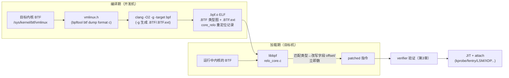

# 第8章 CO-RE 与 BTF：一次编译到处运行

> 本章导读：写给要把自己 eBPF 程序分发到"别人机器、别人的内核"上的工程师与 AI agent——观测 Agent、安全探针、容器网络组件的作者都绕不开这一章。前置：第2章指令集与 bpf(2) 加载路径、第3章 verifier、第6章 helper（`bpf_probe_read` 一族）。读完你能：讲清"5.3 编译 5.4 跑不起来"背后的结构体布局漂移与 BCC 现场重编译的历史代价；说清 BTF 的二进制模型（类型图+行号）、dedup 五 pass 与 124MB→1.5MB 的压缩账本；独立完成 vmlinux.h 生成、`BPF_CORE_READ` 链式读取、`bpf_core_field_exists` 存在性分支的完整 CO-RE 工程链路；并掌握 `bpftool btf dump` 的三类实操用途。所有断言锚定本地语料，标注 [id=N] 或本地路径；语料未证实的特性名一律标"待核实"。

## 8.1 直觉层

**一个比喻**。你的 eBPF 程序要在目标机上读 `task_struct->pid`，相当于给几千栋装修格局各不相同的房子发同一封信，信里要指示"去拿客厅的遥控器"。写死"进门走 3 米左手边 2.1 米处"（=编译期硬编码字段 offset），换一栋房子（=换一个内核版本/配置）就摸空。三条出路对应三个时代：

1. **cBPF/kprobe 裸奔时代**：offset 写死，换内核就崩。更早的 kprobe 程序甚至有 `kern_version` 硬门槛——`BPF_PROG_TYPE_KPROBE` 程序若 `kern_version != LINUX_VERSION_CODE`，加载直接 `EINVAL`，而 man page 示例根本没写这个字段，Michael Bolin 是靠读 `kernel/bpf/syscall.c` 源码才定位到这个坑 [id=101]。
2. **BCC 现场重编译时代**：不在家里写死位置，而是把装修队（clang/LLVM + 一整套内核头文件）随信寄过去，在收件人家里按现场户型重新画图纸再施工——BCC 在**目标机上运行时编译** BPF C 代码，靠 rewriter 把隐式内存访问改写成 helper 调用 [id=98]，并提供 `/virtual/include` 虚拟头文件机制 [id=101]。代价：目标机要装编译器全家桶、编译有秒级延迟、资源占用大，Andrii Nakryiko 明确把这套称为"a bunch of downsides"并给出 bcc→libbpf 迁移指南 [id=100]。
3. **CO-RE 时代（本章）**：信封上只写"客厅的遥控器"（字段名+类型名），每栋房子自带一张**折叠户型图**（内核 BTF），快递员（libbpf loader）在投递前现场把"客厅的遥控器"翻译成"进门 3 米左手边"。这就是 Compile Once – Run Everywhere：编译一次，到处运行。

**BTF 为什么必须小**。户型图要塞进每栋房子的门框里（内核镜像默认携带）。通用格式 DWARF 是全尺寸建筑图纸：一个 Linux 4.11 内核的 `.debug_info` 就 121.31MB、`.debug_str` 再加 2.68MB [id=84]——塞不进内核镜像，解析也复杂。BTF（BPF Type Format）借鉴 Sun 的 CTF（Solaris 9 起的内核调试格式），走极简紧凑路线，dedup 后 **1.5MB** [id=84]，小到可以随内核默认发行（`CONFIG_DEBUG_INFO_BTF=y`）。

**在整条 eBPF 栈里的位置**：



三个角色记住就行：**内核 BTF**（每台目标机的户型图）、**编译期 BTF**（程序自己的类型描述+重定位需求清单，藏在 `.BTF.ext` 的 core_relo 子区 [id=83]）、**libbpf**（现场翻译官）。三者缺一，CO-RE 不成立。

## 8.2 原理层

### 8.2.1 问题定义：结构体布局为什么会漂移

同一个 `struct`，内核每个版本甚至每个 `.config` 都可能不一样。cloudchirp 科普文给出的断裂三情形（以 5.3→5.4 为例）[id=85]：

- 字段被挪进新的子 struct（布局重组）；
- 字段改名（如 `seq`→`seque`）；
- 字段位置上移/下移（offset 变化）。

你的程序若在编译期把 `offsetof()` 烧进指令立即数，目标内核布局一变就读到错误内存。这不是理论风险——"在 5.3 上编译的程序可能 5.4 就跑不起来"是生产级 eBPF 的日常 [id=85]。而且漂移不只跨版本：内核配置（`CONFIG_*` 开关会增删字段/改变条件编译）、发行版补丁、架构（`ARCH_HAS_NON_OVERLAPPING_ADDRESS_SPACE` 这类架构差异甚至决定 bcc 隐式访问默认映射到哪个 helper [id=98]）都在制造布局差异。

更深一层：kprobe 类程序挂的是**内核内部函数**，而内部 API 本身不稳定、大量函数 `inline`/`static` 根本不可探测——yadutaf 在追踪包路径时先版用 kprobe 失败、复盘后改用 tracepoint 的教训就是实证 [id=103]。CO-RE 解决的是"读结构体"这一半（类型/字段层面），挂载点稳定性那一半要靠 tracepoint/fentry 等（见 8.2.5）。

### 8.2.2 BTF 是什么：DWARF 的精简子集 + 类型图 + 行号

kernel.org 官方规范的定义：BTF 是编码"BPF 程序/map 相关 debug info"的元数据格式——名字虽叫 Type Format，但早已扩展到**函数信息**（defined subroutines）与**行号信息**（source/line），规范明言"the type section encodes debug info, not just pure types"（`BTF_KIND_FUNC` 是 subprogram 不是类型）[id=83]。出身是 Sun CTF 的极简主义仿制品 [id=84]。

**二进制骨架**（实现 BTF 解析器的 checklist，全部来自 [id=83]）：

- blob 以 `struct btf_header` 开头：`magic=0xeB9F`（大小端编码不同，可探测端序）、`hdr_len` 支持向后扩展、后跟 type 区与 string 区的偏移/长度。
- 字符串区首条必须是 null 串，其余为 `\0` 结尾串拼接；类型描述符通过 `name_off` 引用字符串——这让"比较字符串相等"退化为"比较 offset 相等"（dedup 的第一个关键设计 [id=84]）。
- type id 0 恒为 `void`，类型从 id=1 顺序编号；类型间用 type id 互相引用，形成**类型图**（`int*` 就是两个节点：`PTR→INT`）[id=84]。
- 每个类型一条公共头 `struct btf_type`：`name_off` + `info` 位域（bit 0-23=vlen 如成员数；bit 24-30=kind；bit 31=kind_flag）+ `size/type` 共用体，随后按 kind 追加变长数据 [id=83]。
- 行号编码：`line_col = 行号<<10 | 列号` [id=83]。

**kind 全表**：现行规范列出 22 种——1-19 为 INT/PTR/ARRAY/STRUCT/UNION/ENUM/FWD/TYPEDEF/VOLATILE/CONST/RESTRICT/FUNC/FUNC_PROTO/VAR/DATASEC/FLOAT/DECL_TAG/TYPE_TAG/ENUM64；20-22 是最新的 LOC_PARAM/LOC_PROTO/LOCSEC，用 flags 组合（CONST/ADDR/REG/OFFSET/DEREF/SIGNED）为 inline 站点的函数参数提供 DWARF 式 location description [id=83]。对照 2018 年 Facebook 博客只有 11 种 kind 的快照 [id=84]，六年间 FUNC/VAR/DATASEC（BTF 全局变量与 BTF-defined map 的地基）、FLOAT、DECL_TAG/TYPE_TAG、ENUM64、LOC 系列逐代加入——**读二手教程时务必核对其 kind 清单的年代**。

### 8.2.3 BTF dedup：124MB DWARF → 1.5MB 的压缩账本

BTF 直接从 DWARF 1:1 转换（pahole）并不够小，因为 DWARF 按 compilation unit 独立生成，链接后同一类型在不同 CU 里重复出现且完整度不一（一个 CU 里是 `BTF_KIND_FWD` 前向声明，另一个 CU 里才是完整定义）[id=84]。BPF 用途要求"每个唯一类型一份且完整"，于是有了 dedup 算法 [id=84]：

**五个 pass**：①字符串去重（字符串比较降级为 offset 比较）→②非引用类型去重（INT/ENUM/STRUCT/UNION/FWD；struct 等价判定=DFS 遍历整个连通类型图+维护"假设映射"处理环与矛盾——candidate 图内两个不同类型映射到同一 canonical 类型即矛盾，方向反过来不要求，这是正确性核心）→③引用类型去重（PTR/CONST/VOLATILE/RESTRICT/TYPEDEF/ARRAY，等价性归结为被引用类型的 canonical id）→④类型压缩→⑤type id 修正。其中 FWD→STRUCT 的等价映射"一次更新、全局生效"：任何等价 FWD 经两跳解析都会落到 canonical STRUCT 上，实现跨 CU 类型重建 [id=84]。

**账本（Linux 4.11，Nakryiko 机器，2018 实测）** [id=84]：

| 项 | dedup 前 | dedup 后 | 倍数 |
|---|---|---|---|
| 类型描述符 | 101.7MB | 0.97MB | 104x |
| 描述符条数 | 3,148,394 | 22,898 | 137x |
| 字符串 | 3.03MB | 0.63MB | 4.8x |
| 总量参照 | DWARF 121.31MB+2.68MB | BTF 合计 ~1.5MB | — |

耗时 2.6s。消融实验最关键：**关掉类型合并/FWD 解析只做朴素去重，只能压到 12.71MB（9.5x）**——紧凑性的大头是类型重建/合并，不是去重 [id=84]。

### 8.2.4 BTF 的三用

语料实证的三大消费面：

1. **CO-RE 重定位的类型基准**（8.2.6 详述）：目标内核 BTF 是 libbpf 解析"客厅的遥控器在哪"的依据。
2. **人机界面美化（bpftool 三用例）** [id=83]：①map pretty print——按字段而非裸字节打印 key/value，bitfield 能精确解码（规范给出含 6 个 bitfield 成员的 struct 被 bpftool 逐字段打印的完整示例）；②prog dump 源码交叠——`bpftool prog dump jited` 输出里函数签名、C 源码行与 JIT 指令交错；③verifier log 行号定位——验证失败时直接标出是哪行 C 代码触发的 `invalid access to packet`。没有 BTF，这三处全退化为裸字节/裸指令 [id=85]。
3. **内核自用**：内核加载 BTF blob 前"verify the BTF info before using it"（自检）；map 创建时携带 key/value type id（`BPF_MAP_CREATE` 的 `btf_fd/btf_key_type_id/btf_value_type_id`）；`BPF_PROG_LOAD` 携带 func_info/line_info；内核自身代码用 `.BTF_ids` section（`BTF_ID_LIST`/`BTF_SET_START` 宏在编译期占位 `.zero 4`，由 `resolve_btfids` 在内核链接期解析成真实 BTF ID），供内核按类型/函数 ID 做检查表 [id=83]。内核源码树 `kernel/bpf/` 下 BTF 系自成一线：`btf.c/btf_iter.c/btf_relocate.c/check_btf.c/sysfs_btf.c`（digests/11 目录地图）。

### 8.2.5 CO-RE 与 fentry/BPF LSM 的依存

fentry/fexit 是比 kprobe 更现代的函数级挂载（直接跳板/trampoline 路径，低开销——pwru 用它测全系统每包延迟 [id=23]；内核侧落点是 `kernel/bpf/trampoline.c`，fexit 重入防护用 `rqspinlock`，digests/11）。语料对依存关系的实证链：

- fentry 程序按**内核函数签名**取参数——libbpf-bootstrap 官方示例 `fentry.bpf.c` 开头即 `#include "vmlinux.h"`，用 `BPF_PROG(do_unlinkat, int dfd, struct filename *name)` 按类型声明参数，fexit 版还追加 `long ret` 返回值参数（本地仓 `repos/libbpf/libbpf-bootstrap/examples/c/fentry.bpf.c`，一手亲证）。也就是说 fentry 的编程模型**从第一行就建立在 vmlinux.h/BTF 类型之上**。
- BPF LSM 同理：libbpf-bootstrap 提供 `lsm.bpf.c` 示例（repos/libbpf/libbpf-bootstrap/examples/c/），eunomia 教程把"LSM 安全检测"列为 libbpf 进阶课（19-lsm-connect）[id=111]；bcc Reference Guide 的 12 类挂载点清单同时收录 LSM probes 与 kfuncs [id=98]。
- 机制层的准确表述（谨慎版）：fentry/trampoline 需要按目标内核的类型/函数信息完成 attach（docs.ebpf.io 的 Concepts 单列 Trampolines 主题 [id=8]）；trampoline 如何精确消费 BTF 的内部细节本语料未展开——**待核实**（缺口：kernel 文档 Trampolines 子页未本地化）。

### 8.2.6 CO-RE 三件套与重定位机制

Nakryiko 体系里 CO-RE 的三要素分工 [id=85]：

1. **BTF**：描述内核与 eBPF 程序双方的类型信息；
2. **Clang**：基于 BTF 生成 CO-RE 重定位信息——访问 `tcphdr->seq` 时记录的是**字段名+类型+所属 struct**，而非硬编码 offset（即 field offset relocation）；
3. **BPF loader（libbpf）**：把程序 BTF/CO-RE 信息与目标内核 BTF 匹配，解析类型、更新 offset、调整可重定位数据。

落点到 ELF 与 syscall [id=83]：

- 程序侧重定位记录存于 `.BTF.ext` section 的 **core_relo 子区**（与 func_info/line_info 并列；规范注明细节见 llvm_reloc.rst 的 BTF CO-RE relocations 节——该文档未本地化，重定位 kind 的枚举名清单**待核实**）。
- libbpf 侧的实现在 `relo_core.c`（与 `btf.c`/`btf_dump.c` 并列的 CO-RE 重定位专责文件，本地仓 repos/libbpf/libbpf/src/，digests/12 条目 144）。
- vmlinux.h 的所有内核类型统一携带 `__attribute__((preserve_access_index))`，正是它让 Clang 对这些类型的每次字段访问都生成 CO-RE 重定位 [id=100]。

**ELF 侧 BTF 四 section 全景**（[id=83]，工具链开发者必背）：`.BTF`（类型+字符串，同内核 blob 格式）、`.BTF.ext`（func_info/line_info/core_relo 三子区，加载前需 loader 加工）、`.BTF_ids`（内核自用，见 8.2.4）、`.BTF.base`（split BTF 的韧性机制：模块 BTF 只编模块特有类型+一份"蒸馏"最小基类型描述，模块加载时按新 base BTF 重定位 type id，需 pahole v1.28+ 的 distilled_base；libbpf 提供 `btf__relocate()` API）——`.BTF.base` 是较新机制，多数二手教程尚未覆盖 [id=83]。

## 8.3 实践层

### 8.3.1 第零步：确认目标内核有 BTF

CO-RE 程序（libbpf-bootstrap 的 `bootstrap` 示例一脉）要求内核以 `CONFIG_DEBUG_INFO_BTF=y` 构建 [id=100]。检查方式：看 `/sys/kernel/btf/vmlinux` 是否存在 [id=85]。若内核不带 BTF，两条出路 [id=85]：

1. 重编内核开 `CONFIG_DEBUG_INFO_BTF=y` 或升级内核——生产机上通常不现实；
2. **随程序分发该内核的 BTF**——BTFhub 项目（aquasecurity/btfhub）专门收集各发行版各版本的 BTF 文件。

libbpf-bootstrap 的示例梯度就是兼容性教材：`minimal`（不用 CO-RE，老内核可跑，直接 include 系统内核头）→ `minimal_legacy`（更老内核，无全局变量支持）→ `bootstrap`（现代 CO-RE 范式）→ `bootstrap_legacy`（ringbuf 换 perf event array 兼容 <5.8 内核）（repos/libbpf/libbpf-bootstrap/examples/c/，digests/12 条目 145）。

### 8.3.2 生成 vmlinux.h（bpftool btf dump）

标准命令 [id=85]：

```bash
bpftool btf dump file /sys/kernel/btf/vmlinux format c > vmlinux.h
```

一手验证：libbpf-bootstrap 仓的 `tools/gen_vmlinux_h.sh` 全文就一行——`$(dirname "$0")/bpftool btf dump file ${1:-/sys/kernel/btf/vmlinux} format c`（本地仓亲证）。多数情况不必自己生成：libbpf-bootstrap 经 vmlinux.h 子模块提供 x86_64/aarch64 等架构的预生成版（基于 6.6 内核）——得益于 CO-RE，**vmlinux.h 不必与目标内核版本/配置精确匹配** [id=100]。

vmlinux.h 里两类东西要认识：全量内核类型定义；文件顶部让 Clang 嵌入 CO-RE 重定位的声明行（`#define BPF_PSEUDO_MAP_*` 一族与 `preserve_access_index` 相关行）[id=85]。所有类型统一带 `__attribute__((preserve_access_index))` [id=100]。

### 8.3.3 编译：`-g` 是 CO-RE 的命门

```bash
clang -O2 -g -target bpf -D__TARGET_ARCH_$(ARCH) -c app.bpf.c -o app.bpf.o
llvm-strip -g app.bpf.o   # 只剥 DWARF，BTF 保留
```

三要点 [id=100]：`-g` 强制 Clang 产出 `.BTF`/`.BTF.ext`（LLVM 8.0+ 支持，bpf target 专属 [id=83]）；strip 时 DWARF 可安全剥掉——"BTF is the only info necessary for BPF functionality"，剥它能缩小 `.bpf.o`（它将被 skeleton 嵌进最终二进制）；`-D__TARGET_ARCH_$(ARCH)` 供 `bpf_tracing.h` 的 `pt_regs` 宏用（kprobe 相关）。Clang 版本：10+ 覆盖多数特性，部分高级 CO-RE 重定位 builtin 需要 11 甚至 12 [id=100]；老发行版装新 clang 走 apt.llvm.org（`llvm.sh` 脚本）[id=141]。工具链全景：libbpf 本体 `src/` 约 35 文件——`relo_core.c` 管 CO-RE 重定位、`btf.c`/`btf_dump.c` 管 BTF 解析与 C 类型重排、`gen_loader.c` 是 BTF-gen/light skeleton（digests/12 条目 144）。

### 8.3.4 编程界面：从 BPF_CORE_READ 到存在性分支

BPF 侧标准 include 结构（`bootstrap.bpf.c`）[id=100]：

```c
#include "vmlinux.h"
#include <bpf/bpf_helpers.h>    /* SEC()/map 宏 */
#include <bpf/bpf_tracing.h>    /* BPF_PROG 等 */
#include <bpf/bpf_core_read.h>  /* BPF_CORE_READ 族 */
#include "app.h"                /* 应用自定义共享类型 */
```

**链式读取**。普通 C 的 `task->real_parent->tgid` 在 BPF 里必须防任意内核内存读取，CO-RE 写法 [id=100]：

```c
e->ppid = BPF_CORE_READ(task, real_parent, tgid);
```

一个宏完成"沿指针链逐跳安全读取+逐跳记录 CO-RE 重定位"。变体家族（docs.ebpf.io 的 libbpf 宏全表 [id=8]）：`BPF_CORE_READ` / `BPF_CORE_READ_INTO`（读进既有变量）/ `BPF_CORE_READ_STR_INTO`（字符串）/ `BPF_CORE_READ_USER*`（用户态内存三件套）/ `BPF_CORE_READ_BITFIELD`（`_PROBED` 变体）与 `BPF_CORE_WRITE_BITFIELD`（bitfield 读写）。非 CO-RE 的旧对应物是 `BPF_PROBE_READ` 族（不生成重定位，offset 编译期写死）[id=8]。

**底层机制**（本地 libbpf 源码一手锚，`repos/libbpf/libbpf/src/bpf_core_read.h`）：整套宏建立在 Clang builtin 之上——`__builtin_preserve_field_info()` 取字段某属性（L9-L10）、`__builtin_preserve_type_info()` 取类型信息（L30，第二参数枚举 `BPF_TYPE_ID_LOCAL=0/BPF_TYPE_ID_TARGET=1/BPF_TYPE_MATCHES=2`，L26-L34）、`__builtin_preserve_enum_value()` 取枚举值（L37）；`bpf_core_field_exists` 展开 `__builtin_preserve_field_info(___bpf_field_ref(field), BPF_FIELD_EXISTS)`（L44/L166-L172/L187），`field_size`/`field_offset` 对应 `BPF_FIELD_BYTE_SIZE`/`BPF_FIELD_BYTE_OFFSET`（L201/L213），`BPF_CORE_READ(src, a, ...)` 主宏在 L525。

**存在性分支（类型/字段/枚举三类重定位的编程面）**。CO-RE queries 族全名单（[id=8] 索引+bpf_core_read.h 锚）：`bpf_core_field_exists` / `bpf_core_field_size` / `bpf_core_field_offset`（字段级）；`bpf_core_type_exists` / `bpf_core_type_matches` / `bpf_core_type_size` / `bpf_core_type_id_local` / `bpf_core_type_id_kernel`（类型级，`type_matches` 实现= `__builtin_preserve_type_info(type, BPF_TYPE_MATCHES)`，L250-L251）；`bpf_core_enum_value_exists` / `bpf_core_enum_value`（枚举级，L272-L275）。典型用法是"字段在就读，不在就置默认值"的兼容分支——配合 `const volatile` 只读变量还可让 verifier 做死代码剪枝 [id=100]。注意：**"may_exist" 这个名字在全部语料（含 libbpf 源码）零命中，待核实**；语料支撑的语义就是上述 `*_exists` 存在性查询（编译期被 libbpf patch 成 0/1 常量，分支随之死代码化）。

**BTF-defined map**（CO-RE 时代的 map 声明式，libbpf 自动提取 key/value type id 塞进 `BPF_MAP_CREATE` [id=83]）：

```c
struct {
    __uint(type, BPF_MAP_TYPE_HASH);
    __uint(max_entries, 8192);
    __type(key, pid_t);
    __type(value, u64);
} exec_start SEC(".maps");
```

（示例来自 `bootstrap.bpf.c` [id=100]。）

**fentry/BPF LSM 程序**：`SEC("fentry/do_unlinkat")` + `BPF_PROG(函数名, 按内核签名的参数类型...)`，fexit 在参数表尾追加 `long ret`（repos/libbpf/libbpf-bootstrap/examples/c/fentry.bpf.c 一手亲证）；LSM 见同目录 `lsm.bpf.c`。`BPF_PROG`/`BPF_KPROBE`/`BPF_KSYSCALL` 宏族全表见 docs.ebpf.io [id=8]。

### 8.3.5 bpftool 的 BTF 消费命令速查

- `bpftool btf dump file /sys/kernel/btf/vmlinux format c` → 生成 vmlinux.h（8.3.2）；
- map pretty print：BTF 在场时按字段名打印，bitfield 精确解码 [id=83]；
- `bpftool prog dump jited ...` → 函数签名+C 源码行与 JIT 指令交叠（示例输出见 [id=83] §5.2）；
- verifier 失败时 log 直接标注 C 源码行（示例：`invalid access to packet, off=0 size=4` 上方标出 `; *(u32 *)data = dst->dst;`，[id=83] §5.3）。

## 8.4 深水区与坑

1. **insn_off 双单位陷阱**（BTF 工具/自研 loader 必踩）：`bpf_func_info->insn_off` 与 `bpf_line_info->insn_off` 在 kernel API 里的单位是 `struct bpf_insn` 条数，在 ELF API 里却是 section 内字节偏移——规范原文特别强调这一差异 [id=83]。另有配套约束：`func_info[0].insn_off` 必须为 0、严格递增、与函数边界对齐；line_info 首条必须指向每个函数的第一条指令 [id=83]。
2. **vmlinux.h 不能与系统内核头混用**：必然撞类型重定义冲突。正确姿势=vmlinux.h + libbpf 头 + 应用自有头，三选一组合 [id=100]。
3. **`const volatile` 只读变量的时序**：值必须在 skeleton `open()` 之后、`load()` 之前写入（`skel->rodata->xxx = ...`），load 后用户态/BPF 侧都只读，BPF 侧写会被 verifier 拒绝；少了 `volatile`，Clang 可能假设 0 并把变量整个优化掉 [id=100]。
4. **CO-RE 不是万能移植**：它解决"结构体布局漂移"，不解决"目标内核根本没有这个字段/函数/挂载点"。跨版本分发要用 `bpf_core_field_exists` 一族做运行时分支（8.3.4）；kprobe 挂载点本身不稳定的问题要靠 tracepoint/fentry 缓解 [id=103]。
5. **名词甄别（勘误）**：`___execute_bpf` 这一符号名在全部本地语料（含 libbpf 全量源码）**零命中**——任何二手材料以该名描述 CO-RE 机制都不可信，勿引用。语料中唯一带 "hashtab" 的相关事物是内核 `kernel/bpf/hashtab.c`（HASH map 的实现文件，digests/11 目录地图），与 CO-RE 重定位无关。
6. **"may_exist" 待核实**：该名在语料零命中（含 libbpf 源码）。语料能证实的只有 `bpf_core_field_exists`/`bpf_core_type_exists`/`bpf_core_type_matches`/`bpf_core_enum_value_exists` 这族存在性查询 [id=8][bpf_core_read.h L187/L240/L250/L272]。若在别处见到 "may_exist 语义"，按存在性探针+死代码剪枝理解，名字本身勿写死。
7. **重定位 kind 枚举名待核实**：kernel 文档只把 core_relo 定义为 `.BTF.ext` 子区并指向 llvm_reloc.rst（未本地化）[id=83]；`BPF_CORE_FIELD_*`/`BPF_CORE_TYPE_*`/`BPF_CORE_ENUMVAL_*` 这类枚举名在语料中未成表出现。同样，`bpftool gen min_core_btf`（按需裁剪 BTF 的子命令）语料零命中——**待核实**，勿凭记忆写。
8. **kind 清单有年代**：84 的 11 种 kind 是 2018 快照（FUNC/VAR/DATASECT/FLOAT/ENUM64/TYPE_TAG/LOC 系列都是后来加入）[id=84][id=83]；读旧教程/旧源码时先对表。84 文中 canonical index 哈希碰撞时候选列表变长属预期、struct 等价判定的方向性（candidate→canonical 必须单射，反向不要求）是 dedup 正确性核心 [id=84]。
9. **bitfield 双编码模式**：`btf_member.offset` 在 kind_flag=0 时只存 bit offset；kind_flag=1 时高 8 位存 bitfield size、低 24 位存 bit offset（`BTF_MEMBER_BITFIELD_SIZE`/`BTF_MEMBER_BIT_OFFSET` 宏），commit 9d5f9b701b18 引入并解释了双模式共存原因 [id=83]。写 BTF 解析器/pretty printer 的人必须两种都处理。
10. **生成器差异**：pahole 走 DWARF→BTF 转换，但不支持 `.BTF.ext` 与 `BTF_KIND_FUNC` [id=83]；LLVM（8.0+，bpf target + `-g`）直接产出 `.BTF`+`.BTF.ext` [id=83]。多维数组两者目前都折叠成一维（`a[5][6]` 记 `nelems=30`）[id=83]。
11. **语料形态坑（引用纪律）**：85（cloudchirp 科普）正文的技术展示全是 heic 截图，本地 md 只有图片占位符——命令细节不可 grep，引用其命令时以 [id=83]/[id=100]/仓源码为准（digests/05 已标注）。
12. **BPF 全局变量与 CO-RE 的关系别混淆**：全局变量（bss/data/rodata 段）要 5.5+ 内核、ringbuf 要 5.8+ [id=100]——它们是 libbpf-bootstrap 范式的组成部分但独立于 CO-RE 演进；`minimal` 不用 CO-RE 也能用全局变量过滤自身 PID [id=100]。
13. **老内核上编不了新 BTF 相关特性**：老发行版 clang 太旧时，标准解法是 apt.llvm.org 装新版（digests/12 条目 141），而不是降级程序。

## 8.5 与其他章的关系

**承上**：第2章（VM 与指令集）解释了 CO-RE patch 的最终落点——重定位改写的就是 `bpf_insn` 的立即数/偏移字段；第3章（Verifier）是 CO-RE 的下游闸门——libbpf patch 完 offset 的指令仍要过完整验证，且 `const volatile` 只读变量能让 verifier 做死代码剪枝（本章 8.3.4）；第4章（Maps）的 BTF-defined map 声明式依赖本章的 `.maps`+type id 机制；第6章（Helpers）的 `bpf_probe_read` 一族是 `BPF_CORE_READ` 的非重定位前身（`BPF_PROBE_READ` 族 [id=8]），两者关系=“写死 offset”vs“现场重定位”。程序加载与 ELF 主题（若已有对应章节）承接 `.BTF`/`.BTF.ext` 在 bpf(2) 加载流程中的位置；追踪主题章节（kprobe/tracepoint）是本章问题定义的另一半——挂载点稳定性与数据布局可移植性共同构成“可分发 eBPF 工具”的完整命题。

**启下**：libbpf 工程实战（skeleton 生命周期、ringbuf 消费、bcc→libbpf 迁移）在教程/示例章节展开——本章只定了 vmlinux.h/BPF_CORE_READ 这层“语言面”；XDP/tc 网络程序章节里 CO-RE 同样是前提（网络结构体 `xdp_md`/`__sk_buff` 的读取也走同一套重定位）；BPF LSM 与 sched_ext 等进阶挂载章节会反复回到 8.2.5 的依存关系。

## 8.6 语料索引

| id | 名称 | 本地路径 | 本章用了什么 |
|---|---|---|---|
| 83 | BPF Type Format (BTF)（kernel.org 规范 7.4.0-rc1 快照） | web/md/83.md | 二进制格式全规格：btf_header/0xeB9F/info 位域/22 kind/bitfield 双模式/内核 API 五命令/func_info 约束/line_col 编码/.BTF.ext 三子区/insn_off 双单位/.BTF_ids/.BTF.base/pahole 与 LLVM 生成/bpftool 三用例 |
| 84 | Enhancing the Linux kernel with BTF type information（Facebook 博客 2018） | web/md/84.md | dedup 动机与算法：DWARF 尺寸、CU 隔离问题、五 pass、canonical type/index、FWD 解析、104x/137x/12.71MB 消融数字、11 kind 历史快照 |
| 85 | What is BTF（cloudchirp 2024） | web/md/85.md | 问题定义三情形、CO-RE 三要素、无 BTF 两出路/BTFhub、vmlinux.h 生成命令、-g 必要性、bpftool pretty print；图载文章局限（坑 11） |
| 100 | Building BPF applications with libbpf-bootstrap（Nakryiko 2020） | web/md/100.md | minimal vs bootstrap 梯度、-g+llvm-strip、vmlinux.h/preserve_access_index/不混系统头、BPF_CORE_READ(task, real_parent, tgid)、const volatile rodata 时序、BTF-defined map、CONFIG_DEBUG_INFO_BTF 前提、Clang 版本 |
| 8 | docs.ebpf.io（eBPF Docs 全量 API 索引） | web/md/8.md | CO-RE 读写宏族与 queries 族全名单、BPF_PROG/BPF_KPROBE 宏、Trampolines 概念条目、tracing 五类/LSM program types（digests/01 条目 8） |
| 101 | How I ended up writing opensnoop in pure C | web/md/101.md | kern_version EINVAL 坑（前 CO-RE 可移植性困境实证）、BCC /virtual/include 与 DEBUG_PREPROCESSOR |
| 103 | Tracing a packet journey（yadutaf 2017） | web/md/103.md | kprobe 内部 API 不稳定/inline 不可探测的失败复盘（问题定义第二半） |
| 98 | bcc Reference Guide | web/md/98.md | bcc rewriter 改写机制、ARCH_HAS_NON_OVERLAPPING_ADDRESS_SPACE、LSM probes/kfuncs 挂载点（digests/08 条目） |
| 23 | pwru（packet walkthrough） | web/md/23.md | fentry/fexit 低开销挂载用例 |
| 111 | eunomia bpf-developer-tutorial 索引 | web/md/111.md | 3-fentry-unlink/19-lsm-connect/38-btf-uprobe（CO-RE 扩展到用户态）课目 |
| 141 | apt.llvm.org | web/md/141.md | 老发行版装新 clang 的标准通道（digests/12 条目 141） |
| — | libbpf 源码仓 | repos/libbpf/libbpf/src/ | bpf_core_read.h 行号锚（builtin 族 L9/L30/L37、枚举 L26-34、宏 L166-187/L201/L213/L250/L272/L525）；btf.c/relo_core.c/btf_dump.c 分工（digests/12 条目 144） |
| — | libbpf-bootstrap 仓 | repos/libbpf/libbpf-bootstrap/ | tools/gen_vmlinux_h.sh 一行实现、examples/c 示例梯度（fentry.bpf.c/lsm.bpf.c/bootstrap*.bpf.c）（digests/12 条目 145） |
| — | digests/05、08、11、12 | digests/ | 批次总评与目录地图（kernel/bpf BTF 系文件、hashtab.c 正身、trampoline/rqspinlock） |

## 8.7 AI agent 用法

本章可被检索复用的典型配方（问题 → grep 词 → 命中位置）：

1. **"BTF 为什么能塞进内核镜像/压缩数字是多少"** → `grep -n "104x\|137x\|101.7\|12.71" web/md/84.md` → Results 表与消融表；答案骨架=五 pass+类型重建才是大头（9.5x vs 104x）。
2. **"vmlinux.h 怎么生成/`bpftool btf dump` 用法"** → `cat repos/libbpf/libbpf-bootstrap/tools/gen_vmlinux_h.sh`（一行完整命令）+ `grep -n "btf dump" web/md/85.md` → 命令与前置条件（CONFIG_DEBUG_INFO_BTF、-g）。
3. **"BPF_CORE_READ 有哪些变体/有没有 bpf_core_xxx 这个 API"** → `grep -n "BPF_CORE_READ\|bpf_core_" web/md/8.md`（宏族全名单做枚举校验）+ `grep -n "#define bpf_core_\|__builtin_preserve" repos/libbpf/libbpf/src/bpf_core_read.h`（一手实现与行号锚）。
4. **"insn_off 单位/func_info 约束/BTF 某个 kind 的编码"** → `grep -n "insn_off" web/md/83.md`（双单位差异在 §4.2）+ `grep -n "BTF_KIND_" web/md/83.md`（22 kind 逐个跳转）；写 BTF 解析器时 83 的每个 §2.2.x 就是 encoding checklist。
5. **"目标内核没有 BTF 怎么办"** → `grep -n "BTFhub\|CONFIG_DEBUG_INFO_BTF" web/md/85.md` → 重编内核 vs BTFhub 随程序分发两条路。
6. **名词可信度甄别（防幻觉）**：见到 `___execute_bpf`、`may_exist`、`bpftool gen min_core_btf` 等名 → `grep -rn "<名字>" web/ repos/ digests/` 零命中即按本章 8.4 坑 5/6/7 处理：语义可类比（存在性探针），名字勿写死。


