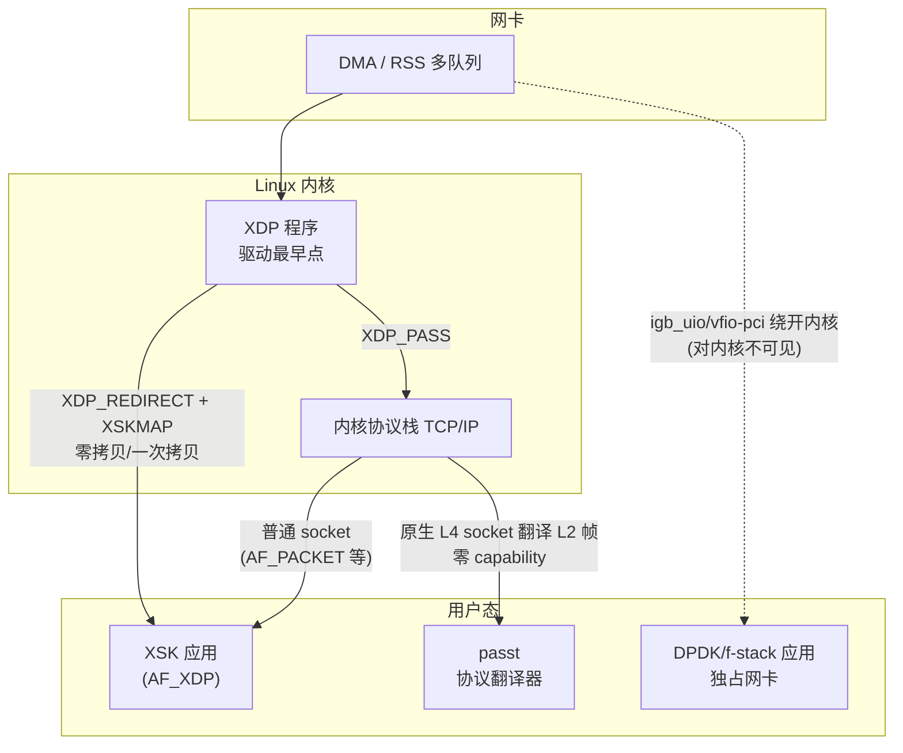
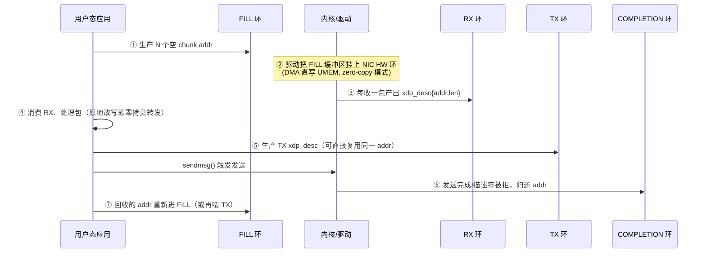

# 第10章 AF_XDP 与用户态网络

> 本章导读：写给要把包高速搬进/搬出用户态的人——DPI/IDS/LB/用户态协议栈的 C/C++ 工程师，以及在"内核 XDP、AF_XDP、DPDK/f-stack、passt"之间做架构选型的人。前置：XDP 挂载点与程序类型（XDP 专题章）、Maps（第 4 章）、Helpers（第 6 章，`bpf_redirect_map`）。读完你能：讲清 UMEM+四环的所有权转移模型；正确选 copy/zero-copy/SHARED_UMEM 模式；用 libbpf 跑起第一个 XSK 收发程序；拿着带出处的实测数字完成三路线选型决策。

## 10.1 直觉层

**比喻：共享堆场与提单**。把包数据想象成集装箱，内核态与用户态是两个隔着一道海关的国家。传统路径（AF_PACKET raw socket）是"每个集装箱都要在海关两侧各卸一次车、重新装一次车"；AF_XDP 则是两国**共用一个保税堆场（UMEM）**——集装箱从网卡卸下后直接停在场内，两个国家从来不去搬集装箱本身，传递的只是**提单**（描述符，4 类环上的条目）：谁持有提单，谁有权动这个集装箱。整条 AF_XDP 的性能故事就是"只递提单，不搬箱子"。

**为什么需要这个机制**：XDP 程序在驱动收包最早点已经能 drop/pass/redirect，但三类工作它做不了——TCP 终结（verifier 不许循环/复杂逻辑）、DPI 与规则引擎（代码体量与迭代速度）、复用存量用户态框架（DPDK 应用、抓包库）。这些必须回用户态。而旧通道 AF_PACKET 每包至少一次数据拷贝加系统调用，在以太网 40→100→200 Gbit/s 的演进下成为瓶颈——这正是 Intel 的 Karlsson/Töpel 在 FOSDEM 2018 给出的立项动机：DPI 类负载长期跑在用户态，"高速原始以太网帧直达 Linux 用户态"是刚需（web/md/80.md）。AF_XDP 的设计四支柱：true zero-copy、lock-less 数据结构、消除 syscall，同时**仍然遵守 Linux 的隔离与安全规则**（对比 DPDK 直接接管网卡的方式，web/md/80.md）。

**它在整条 eBPF 栈里的位置**——本章同时覆盖"半旁路"（AF_XDP）与它的两个对手路线（全旁路 DPDK/f-stack、纯用户态翻译层 passt）：



一句话定位（源自 knowledge/f-stack.md §5 判词）：**XDP 是内核内的快速岔路口，AF_XDP 是岔路口通向用户态的匝道，f-stack 是搬出去整台协议栈，passt 是协议翻译器**。

## 10.2 原理层

### 10.2.1 UMEM 与四个环：所有权转移模型

UMEM 是**用户态分配**的一块虚拟连续内存，切成等大 chunk（`XDP_UMEM_REG` setsockopt 注册，参数含起始地址、大小、chunk_size、headroom；malloc/mmap/huge pages 均可）。当前 chunk_size **只能是 2K 或 4K**（web/md/79.md XDP_UMEM_REG 节）。描述符里的 `addr` 就是帧在整个 UMEM 区域内的偏移。RX 与 TX 可共享同一 UMEM——包从 RX 收下要转发出去时**只换描述符不搬数据**；要暂存待重传的包，也只需让描述符改指别处（web/md/79.md Overview）。

四个环全部是**单生产者/单消费者（SPSC）的 head/tail 环**，size 必须是 2 的幂（web/md/79.md Rings 节）：

| 环 | 归属 | 生产者→消费者 | 载荷 | 语义 |
|---|---|---|---|---|
| FILL | UMEM | 用户态→内核 | UMEM addr | "这些空缓冲区交给你收包用" |
| COMPLETION | UMEM | 内核→用户态 | UMEM addr | "这些缓冲区我用完了，收回"（含被拒的非法 TX 描述符） |
| RX | socket | 内核→用户态 | `struct xdp_desc{addr,len}` | "收到一个包，在这个 addr、这个长度" |
| TX | socket | 用户态→内核 | `struct xdp_desc` | "请把这个包发出去"（需 `sendmsg()` 触发） |

一个 UMEM 只有一对 FILL/COMPLETION 环；每个 socket 必须有 RX、TX 至少其一。四 socket 全双工场景 = 1 FILL + 1 COMPLETION + 4 RX + 4 TX（web/md/79.md Rings 节）。FILL 环没交缓冲区上去，RX 环就不可能有描述符出现——**收包的上游是 FILL 不是 RX**，这是初学者最常搞反的因果。

所有权全程时序：



两条语义红线（web/md/79.md）：**completion 只归还所有权，不保证包发送成功**（含被内核拒绝的非法描述符）；**同一缓冲区绝不能同时出现在两个环里**（见 10.4 坑 2）。

### 10.2.2 XSKMAP：XDP 程序怎么把包递给 socket

`BPF_MAP_TYPE_XSKMAP` + `bpf_redirect_map()` 是分发机制。用户态把 XSK 插进 map，XDP 程序按索引重定向；内核在重定向时校验该 XSK 确实绑定在当前 netdev+queue 上，不匹配或槽位为空则**丢包**。因此官方明文：**必须加载 XDP 程序且 XSKMAP 里至少放一个 socket，XSK 才可能收到流量**（web/md/79.md Overview/XSKMAP 节）。标准写法（kernel.org 官方示例）：

```c
SEC("xdp_sock") int xdp_sock_prog(struct xdp_md *ctx)
{
    int index = ctx->rx_queue_index;
    // 该 queue 上有已绑定的 XSK 才重定向
    if (bpf_map_lookup_elem(&xsks_map, &index))
        return bpf_redirect_map(&xsks_map, index, 0);
    return XDP_PASS;
}
```

socket 最终由 `bind()` 绑定到设备与 queue id，bind 完成前流量不流动（web/md/79.md Overview）。特权进程建好 socket 后可用 `SO_BINDTODEVICE` 锁定接口再移交非特权进程使用（web/md/79.md）。

### 10.2.3 copy vs zero-copy：三种执行模式

| 模式 | 触发条件 | 路径 | 拷贝次数 | 可用性 |
|---|---|---|---|---|
| XDP_SKB（generic） | 驱动不支持 XDP，或显式选择 | SKB + 通用 XDP 支持后 copy 到用户态 | 1 次拷贝 | 任意网卡 |
| XDP_DRV（驱动原生） | 驱动支持 XDP | 驱动 XDP 点处理，仍有一次到用户态的 copy | 1 次拷贝 | 需驱动支持 |
| zero-copy | bind flag `XDP_ZEROCOPY` 且驱动支持 | NIC DMA 直写 UMEM | 0 次 | 仅零拷贝驱动 |

默认行为：内核 bind 时先尝试 zero-copy，失败回退 copy；`XDP_COPY`/`XDP_ZEROCOPY` bind flag 可强制模式、不支持则 bind 失败报错（web/md/79.md Configuration Flags 节）。应用可用 `XDP_OPTIONS` getsockopt 的 `XDP_OPTIONS_ZEROCOPY` 位**查询实际跑在哪种模式**——生产代码该查就查，不要假设。copy 模式下 `XDP_MAX_TX_SKB_BUDGET`（范围 [32, tx 环长度]）控制一次 send syscall 最多送多少描述符给驱动，是吞吐/系统调用频率的调优旋钮（web/md/79.md）。

### 10.2.4 XDP_SHARED_UMEM 与多队列：两种用法

UMEM 可跨 socket/跨 queue/跨网卡共享，`XDP_SHARED_UMEM` bind flag + `sxdp_shared_umem_fd`（首 socket 的 fd）实现，两种形态（web/md/79.md XDP_SHARED_UMEM 节）：

1. **同 netdev+queue 的多 socket**：全组只有一对 FILL/COMPLETION 环；包到哪个 socket 由 XDP 程序查 XSKMAP 决定（官方给的 round-robin 示例即此用法）。libbpf 多 socket 同 UMEM 时自动走此模式，但必须带 `XSK_LIBBPF_FLAGS__INHIBIT_PROG_LOAD` 自带 XDP 程序。
2. **跨 queue/跨 netdev**：每个 unique (netdev, queue_id) 元组要自建一对 FILL/COMPLETION 环（libbpf 用 `xsk_socket__create_shared()`）；**不需要专门的分发 XDP 程序**——用 NIC 自身的包导流（RSS/ntuple）把流量送到对应 queue 即可，因为"NIC 只能在 queue 之间导流"。

环是 SPSC 的，多进程/多线程并发碰同一 FILL/COMPLETION 环没有任何内核同步原语保护，须应用自行保证单写者（web/md/79.md，两处警告）。

### 10.2.5 need_wakeup 与批量收发：syscall 的省法

`XDP_USE_NEED_WAKEUP` bind flag 在 FILL 与 TX 环（用户态是生产者的两个环）上启用 `need_wakeup` 标志：置位才需要 syscall 唤醒内核，为零就省掉。FILL 环置位 → 调 `poll()`；TX 环置位 → `poll()` 或 `sendto()` 均可。典型 TX 路径：

```c
if (xsk_ring_prod__needs_wakeup(&my_tx_ring))
    sendto(xsk_socket__fd(xsk_handle), NULL, 0, MSG_DONTWAIT, NULL, 0);
```

官方建议**总是开启**该模式——同核或异核（应用与驱动在不同核）场景通常都能减少 TX 路径 syscall 数（web/md/79.md XDP_USE_NEED_WAKEUP 节）。FILL 置位的一个具体成因：FILL 环与 NIC HW 环都没缓冲区了，内核干脆关中断，等用户态补货后再 poll（web/md/79.md）。批量收发是另一根支柱：RX 用 `xsk_ring_cons__peek()` 一次取一批，TX 攒一批一次 `sendmsg()` 提交——"elimination of syscalls"正是 FOSDEM 演讲的四支柱之一（web/md/80.md）。

### 10.2.6 multi-buffer：大于 chunk 的包

`XDP_USE_SG` bind flag 开启后可收发多帧包（如三个 4K chunk 拼 9K jumbo）；XDP 程序须用 **`xdp.frags`** section 名进入多缓冲模式。描述符 `options` 字段的 `XDP_PKT_CONTD` 标记"包在下一个描述符继续"——**故意与常见 NIC 的 EOP（end-of-packet）反向**，为的是与非多缓冲老应用兼容（它们该位恒 0，行为不变，web/md/79.md Multi-Buffer 节）。上限：copy 模式 = `CONFIG_MAX_SKB_FRAGS + 1`，**可移植代码限 18 帧**（最小内核配置 17）；zero-copy 不设硬限，查 netlink `NETDEV_A_DEV_XDP_ZC_MAX_SEGS`（1 = 不支持多缓冲，≥2 = 支持且为最大帧数），探测走 `XDP_FEATURES` 的 `NETDEV_XDP_ACT_RX_SG`/`NETDEV_XDP_ACT_XSK_ZEROCOPY`（web/md/79.md）。RX 侧保证只交付**完整包**：RX 环放不下整个包则全包丢弃；但一批描述符可能停在包中间，下一批才续完（web/md/79.md）。

### 10.2.7 用户态网络三路线全景对比

同一个问题（"内核收包路径太慢/太重"）的三种解法，假设完全不同（对比框架取自 knowledge/f-stack.md §5，数字各自带出处）：

| 维度 | AF_XDP（半旁路） | DPDK/f-stack（全旁路） | passt（用户态翻译层） |
|---|---|---|---|
| 核心假设 | 包在内核 XDP 点被挑出，经共享 UMEM 直达用户态；**复用内核驱动与安全模型** | NIC 彻底脱离内核（igb_uio/vfio-pci），用户态 PMD 轮询独占 | 包留在宿主内核，用户态只做 L2↔L4 协议翻译（TCP_INFO 镜像动力学） |
| TCP 终结 | 不做（应用自带或配 f-stack 类栈） | **完整 FreeBSD 栈**（f-stack：RACK/BBR） | 不实现栈，委托两端内核 |
| 特权/资源 | 加载 XDP 需权限；不独占网卡、不独占核 | 需 root 绑卡+hugepage+**独占 CPU 核**（每 lcore 100% 轮询） | **零 capability**、零配置 |
| 代表数字 | 微基准最高 **40x**、tcpdump **20x** vs 旧 AF_PACKET（Intel，2018 RFC 期，web/md/80.md）；DPDK 侧宣称 **10 倍+** vs AF_PACKET（Intel DPDK PMD 讲，2018-09，web/md/186.md） | RPS 5M vs 调优内核 ~200K（**25×**）、P99 10μs vs 100μs、CPS 1M vs 100K（f-stack README 厂商口径，XL710 40GbE+E5-2670 v3+CentOS 7.2/kernel 3.10，knowledge/f-stack.md §4.2） | IPv4 TCP 吞吐为 slirp 系 **4-50 倍**（随 MTU 变化；passt README 口径，knowledge/passt.md §4） |
| 生态位 | DPDK `net_af_xdp` PMD（18.05 起主线）、PcapPlusPlus（`-DPCAPPP_USE_XDP=ON`）、Suricata 20.7 章 | 腾讯 DNSPod/HttpDNS/CDN 生产（f-stack）；nginx/redis 移植版 | QEMU/libvirt/Podman rootless 默认后端 |
| 主要代价 | 零拷贝依赖驱动清单；每队列一 XSK 的工程复杂度 | 网卡对内核不可见（管理流量要走 KNI/virtio_user 旁路）、778 issue 级的运维复杂度（knowledge/f-stack.md §6） | 单线程、128k-1 连接上限、16 MiB 窗口顶（长肥管道受限） |

第四条对照路线是**全内核**：包根本不出内核——如 5G UPF 的 upf-bpf（repos/navarrothiago/upf-bpf，GTP/UDP parse→PDR 检测→FAR 转发全在 XDP 程序内 tail call 管线完成，全仓 grep 无任何 AF_XDP 引用；README 明言可与 DPDK 方案 co-locate）。它代表"复杂逻辑能塞进 verifier 约束时，连匝道都不需要"的极限路线——选型时先问：逻辑真的必须回用户态吗？

**选型决策树**：① 逻辑可Verifier 化（解析/查表/改写/转发）→ 全内核 XDP（upf-bpf 型）；② 必须回用户态但网卡还要跑正常流量/云环境不让绑卡 → AF_XDP；③ 追极限 pps/CPS、独占资源可接受、有独立管理面 → DPDK 系（f-stack 给现成 FreeBSD 全栈）；④ 目标是 rootless 容器/VM 联网、对 pps 不敏感 → passt（vhost-user 模式补时延）。

## 10.3 实践层

**最小上手路径（libbpf/libxdp）**：官方推荐直接用 libbpf 的 xsk 辅助层（`tools/testing/selftests/bpf/xsk.h`），"除非你成了 power user"（web/md/79.md Libbpf 节）。完整示例在 xdp-project/bpf-examples 的 AF_XDP-example；内核树自带基准工具 `samples/bpf/xdpsock`。跑通 rxdrop 基准的三步（web/md/79.md Sample application 节）：

```bash
# 1. 把目标流量导到指定 queue（ntuple 规则 → queue 16）
sudo ethtool -N p3p2 rx-flow-hash udp4 fn
sudo ethtool -N p3p2 flow-type udp4 src-port 4242 dst-port 4242 action 16
# 2. 驱动原生模式跑 rxdrop（-N=XDP_DRV；-S=XDP_SKB）
samples/bpf/xdpsock -i p3p2 -q 16 -r -N
```

编程模型骨架（libbpf 接口，官方文档 Usage 节）：`xsk_umem__create()` 注册 UMEM 与 FILL/COMPLETION 环 → `xsk_socket__create()` 建 XSK 绑 netdev+queue（RX/TX 传 NULL 可做单收/单发 socket）→ 数据面 `xsk_ring_prod__reserve`/`xsk_ring_cons__peek` 批量操作环 → 收完把 addr 回填 FILL（`xsk_ring_prod__fill_addr` + submit）。

**生态接入三条现成通道**：
- DPDK 应用：`net_af_xdp` PMD（DPDK 18.05 起主线）。设计要点是把 AF_XDP 概念翻译成 DPDK 概念——XDP socket/eBPF redirect map → ethdev/queue，`rte_mempool` 与 XDP UMEM 之间零拷贝（web/md/186.md，Intel Xiaoyun Li 2018-09 讲题摘要）。这让 DPDK 应用不吃独占网卡的代价就能吃到 XDP 生态——2018 FOSDEM 演讲"DPDK 可借 AF_XDP 获得鲁棒性/易用性/硬件无关性"的预言兑现（web/md/80.md + digest 15）。
- C++ 通用库：PcapPlusPlus 把 AF_XDP 与 libpcap/DPDK/PF_RING 并列为收包引擎，统一 wrapper API；构建 `-DPCAPPP_USE_XDP=ON`（需 libbpf，仅 Linux）；当前为 beta 级支持（建 XSK、收发包、socket 统计），定位是"借助内核机制建 in-kernel fast path"而非完全 bypass（web/md/197.md #af_xdp-support-beta 节）。
- IDS：Suricata 文档树有专门 20.7 AF_XDP 章（本地未抓取正文，标题可证存在；待核实细节），20.5 章的 XDP bypass 线则配 AF_PACKET 收包（见下）。

**Suricata capture bypass 案例（数字带出处）**：Eric Leblond（Stamus/OISF/Netfilter core team）2016-09 博客给出 bypass 家族最常被引用的数字——iperf localhost、MTU 1500 下：标准 IPS **669Mbps** → local bypass **899Mbps** → **NFQ bypass 39 Gbps**（58 倍，web/md/190.md）。注意口径：39Gbps 是 **Netfilter 队列 mark 通道**的成绩，不是 XDP；AF_PACKET 通道的 bypass 当时是"内核里一张 eBPF hash table"（capture bypass 调用采集方法的旁路：NFQ 用 mark、AF_PACKET 用 eBPF hash table，失败自动降级 local bypass，web/md/190.md）。XDP 版 bypass 2017-2018 年落地（SEPTun Mark II）：在 **SKB 构建之前**丢弃/直通不再检测的 elephant flow，"decide early, drop early"（repos/pevma/SEPTun-Mark-II/SEPTun-Mark-II.rst L88-131）。生产配置要点（web/md/188.md + SEPTun）：`xdp-mode: soft|driver|hw` 三档；`cluster_qm`+对称 RSS 必须；pinned maps（`/sys/fs/bpf/suricata-<iface>-<map>`）配合 `USE_GLOBAL_BYPASS` 保 IPS 模式下 Suricata 重启不断流（写 1 全局 bypass，web/md/188.md L545-549）；XDP bypass 与 AF_PACKET IPS 模式兼容，被 bypass 的包从一块卡直通另一块卡不进内核栈（web/md/188.md L374）。

**排障**：`XDP_STATISTICS` getsockopt 拿 `rx_dropped`/`rx_invalid_descs`/`tx_invalid_descs` 三计数（web/md/79.md）——invalid desc 非零说明应用在产非法描述符，是 bug 不是负载问题。

## 10.4 深水区与坑

1. **绑 queue 0 却收不到包**：物理 NIC 初始化时通常每核一对 RX/TX 队列，8 核机器 queue 0-7，流量大概率落在你没绑的队列上。官方两解：`ethtool -L <iface> combined 1` 收成单队列；或 `ethtool -N` ntuple 规则把目标流量导到绑定的 queue（web/md/79.md FAQ）。
2. **同一 UMEM 缓冲区同时喂两个环 → 包损坏**：比如同一 buffer 同时在 FILL 和 TX 环，NIC 可能一边收包写入一边在发送它。跨 queue/netdev 共享 UMEM 时同理（web/md/79.md FAQ"My packets are sometimes corrupted"）。这是数据竞争，静默出错、难复现。
3. **TX-only socket 不要往 FILL 环放包**：驱动会误以为你要收包而预留资源，损害性能（web/md/79.md）。
4. **史料勘误（官方盖章）**：**不要参考 2017 年的 "AF_PACKET v4" 论文**——那是 AF_XDP 的第一次尝试，"几乎所有东西都改了"；正确文献是 LPC 2018 论文（vger.kernel.org/lpc_net2018_talks/lpc18_paper_af_xdp_perf-v2.pdf）与 LWN 750845《Accelerating networking with AF_XDP》（web/md/79.md Concepts 节）。
5. **对齐模式的 addr 掩码**：aligned chunk 模式下内核会把 FILL 环 addr 的低 log2(chunk_size) 位掩掉——2K chunk 时 2048/2050/3000 指同一 chunk；unaligned 模式才原样保留（web/md/79.md Fill Ring 节）。chunk_size 目前只支持 2K/4K（web/md/79.md XDP_UMEM_REG）。
6. **XSKMAP 不是跨队列交换机（copy 模式）**：XSKMAP 只能把 queue X 的流量给绑在 queue X 的 socket；跨 queue 分流要么靠 NIC steering（zero-copy 官方建议），要么 XDP 程序在 SHARED_UMEM 同 queue 场景内 RR（web/md/79.md FAQ）。
7. **completion ≠ 发送成功**：COMPLETION 归还的帧包含发送完成与**被拒的非法描述符**两类，错误只体现在 `tx_invalid_descs` 统计里（web/md/79.md）。
8. **Suricata 线实战坑群**（SEPTun Mark II + web/md/188.md + digest 15 [191]）：①对称 RSS 是 XDP bypass 正确性的前提——span/tap 双向流量哈希不对称会拆散流；血泪史是 kernel 4.2 引入非对称 flow hash 致 TCP 重组乱序、4.6 修复，Intel XL710 硬件能对称但驱动当年不放行；Intel 网卡不支持对称哈希时用低熵 hkey `6D:5A:...`（重复 40 字节）模拟（web/md/188.md L403）。②**Bingo bug**：kernel 4.13.10/4.14.x + Intel NIC 组合，Suricata 注入 eBPF 后所有中断被钉到 CPU0，4.15.2 修复；例行 `grep eth2 /proc/interrupts` 检查、必要时 set_irq_affinity 重映射或改用 cpumap redirect（SEPTun L649-669）。③必须关 irqbalance 与 NIC offload，cpumap 要 kernel 4.15+（digest 15 [188]）。④当年 XDP bypass 仅支持 TCP flow（SEPTun/digest 15 [189]）。
9. **性能数字要带语境读**：40x/20x 是 2018 年 RFC 期 Intel 微基准与 tcpdump 场景、对照物是旧 AF_PACKET（web/md/80.md）；f-stack 25× 是厂商 README 口径（且 F-Stack 的 100% CPU 是轮询模型固有属性，比较须看同吞吐下每核效率，knowledge/f-stack.md §4.2）；passt 4-50× 的对照物是 slirp 系而非内核栈（knowledge/passt.md §4）。跨路线直接比倍数是选型大忌——分母各不相同。

## 10.5 与其他章的关系

**前驱**：XDP 专题章（挂载点/程序类型）给出 `XDP_REDIRECT` 语义与 `xdp.frags` 的驱动侧背景，本章只讲"redirect 到用户态"这一条出口；第 4 章 Maps 的 map 类型学里，XSKMAP 是"值是内核对象引用而非数据"的特殊成员（与 SOCKMAP/DEVMAP 同族）；第 6 章 Helpers 的 `bpf_redirect_map` 是本章分发机制的另一半；第 1 章的历史线里 AF_PACKET v4→AF_XDP（4.18 进主线，PcapPlusPlus 文档锚定 kernel 4.18+，web/md/197.md）是 eBPF 从观测扩展为数据面枢纽的一环。**后继**：项目实战章（Suricata/Calico/merbridge 等 digest 15 语料）大量复用本章的 bypass 与收包通道结论；若深入 f-stack/passt 两条支线，本地 knowledge/f-stack.md 与 knowledge/passt.md 是现成的深潜入口。

## 10.6 语料索引

| id | 名称 | 本地路径 | 用了什么 |
|---|---|---|---|
| 79 | AF_XDP — kernel.org 官方文档（7.4.0-rc1 快照） | awesome-ebpf/web/md/79.md | 全章机制主源：UMEM/四环/XSKMAP/三模式/SHARED_UMEM/need_wakeup/multi-buffer/FAQ/AF_PACKET v4 勘误/xdpsock 示例 |
| 80 | Fast Packet Processing in Linux with AF_XDP（FOSDEM 2018, Intel） | awesome-ebpf/web/md/80.md | 动机（40/100/200G、DPI 用户态）、设计四支柱、40x/20x 数字、RFC 期状态、DPDK 受益预言 |
| 186 | DPDK PMD for AF_XDP（DPDK Userspace 2018, Intel） | awesome-ebpf/web/md/186.md | net_af_xdp PMD 设计叙述（XDP socket→ethdev 翻译、rte_mempool↔UMEM 零拷贝）、10 倍+口径 |
| 188 | Suricata 20.5 eBPF and XDP 官方文档 | awesome-ebpf/web/md/188.md | XDP bypass 配置、xdp-mode 三档、hkey 6D:5A 对称哈希、IPS 跨卡直通语义、pinned maps/global_bypass、20.7 AF_XDP 章存在性 |
| 190 | Suricata bypass feature（Stamus 博客 2016-09-28） | awesome-ebpf/web/md/190.md | 669Mbps/899Mbps/39Gbps 三级数字与 NFQ 口径、local vs capture bypass 语义 |
| 191 | The adventures of a Suricate in eBPF land（netdev 1.2 幻灯） | awesome-ebpf/web/pdf-txt/191.txt | 对称哈希血泪史（4.2 引入/4.6 修复）、eBPF cluster（4.3 起）、libbpf 早期形态 |
| 189 | SEPTun Mark II（repo） | awesome-ebpf/repos/pevma/SEPTun-Mark-II/ | SKB 前丢包原理、Bingo bug 实录、symmetric RSS 配方、cpumap 救援 |
| 197 | PcapPlusPlus Feature Overview（AF_XDP beta 节） | awesome-ebpf/web/md/197.md | 生态接入、"in-kernel fast path 而非完全 bypass"定位、kernel 4.18+ 锚点、构建开关 |
| — | upf-bpf（5G UPF BPF/XDP 库） | awesome-ebpf/repos/navarrothiago/upf-bpf/ | 全内核路线对照（XDP 管线无 AF_XDP，grep 实证）、co-locate DPDK 设计目标 |
| — | f-stack 深度消化（本地知识库） | /usr-data/data2/kylin/network/knowledge/f-stack.md | 全旁路路线架构与实测数字（25×/P99/CPS）、§5 三路线对比框架、独占代价与 778 issue |
| — | passt 深度消化（本地知识库） | /usr-data/data2/kylin/network/knowledge/passt.md | 翻译层路线架构、4-50× slirp 口径、拷贝次数账、局限清单 |

## 10.7 AI agent 用法

- **"AF_XDP 的环怎么协作/包收不到"类问题** → `grep -n "FILL\|COMPLETION\|RX ring\|TX ring" awesome-ebpf/web/md/79.md`，命中 Rings 节（L137-175）与 FAQ（L534-575）；"收不到流量"直接引 Overview 的 XSKMAP 强制条件（L119）。
- **"copy 还是 zero-copy/驱动支持吗"类问题** → `grep -n "XDP_ZEROCOPY\|XDP_OPTIONS\|XDP_DRV\|XDP_SKB" awesome-ebpf/web/md/79.md`（L121/195-197/295-297）；multi-buffer 支持探测引 Probing 节（L492-508）。
- **三路线选型对比** → 直接引本章 10.2.7 表；深挖某条路线路由到 knowledge/f-stack.md（§5 对比表+§4 数字）或 knowledge/passt.md（§4 拷贝账+§6 局限）；全内核第四路线引 repos/navarrothiago/upf-bpf/。
- **Suricata/IDS bypass 配置与数字** → 数字与口径 `grep -n "39 Gbps\|669Mbps\|capture bypass" awesome-ebpf/web/md/190.md`；生产坑 `grep -n "Bingo\|symmetric" awesome-ebpf/repos/pevma/SEPTun-Mark-II/SEPTun-Mark-II.rst`；可抄配置 `grep -n "xdp-mode\|cluster_qm\|global_bypass" awesome-ebpf/web/md/188.md`。
- **写第一个 XSK 应用** → 官方代码锚：XDP 程序骨架 web/md/79.md L342-352，环操作伪码 L376-403，multi-buffer Rx/Tx 模板 L413-489，libbpf 建议 L179-182；示例仓名 xdp-project/bpf-examples（AF_XDP-example）与 samples/bpf/xdpsock（L516-532）。
