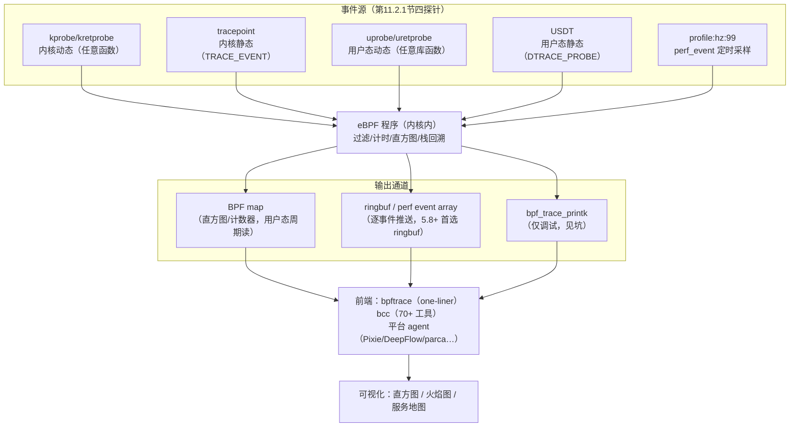

# 第11章 可观测性：eBPF 追踪与监控

> 本章导读：写给要用 eBPF 看"系统正在发生什么"的工程师——排障、性能分析、L7 流量观测、持续 profiling 都算。前置：第 2 章 VM 与指令集、第 3 章 Verifier（为什么探针安全）、第 4 章 Maps（数据怎么出来）、第 6 章 Helpers。读完你能：按"稳定性×上下文×开销"三维选对探针类型（kprobe/tracepoint/uprobe/USDT/fentry）、用 bpftrace one-liner 在生产机 5 分钟出第一张直方图、看懂 SSL 明文还原与连续 profiling 的机制链，并握有一份"何时不该用 eBPF"的定量反例。

## 11.1 直觉层

**比喻**：传统监控像"查病历"——事后翻 /proc、翻应用日志，看到的是采样快照；eBPF 追踪像给整栋大楼装"驻场医护"——在每层楼的门（函数入口）、电话（syscall）、电梯（上下文切换）旁边站一个哨兵，事件一发生就当场测量、当场汇总，病历（直方图/火焰图）在事件现场就写完了，不搬病人去检查室（不在用户态做重计算）。哨兵由中央安保室（verifier）先审查过：手脚被绑（不能任意访问内存）、有下班时间（无死循环、有界执行），所以可以放心放进大楼。

**为什么需要这个机制**：Hongli Lai 的教程开篇即点出旧工具的天花板——strace 只能看 syscall、ltrace 只能看库调用，而你想知道的是"syscall 内部发生了什么"、想"对行为做统计而非只打日志"、想"跨多进程关联数据"，这三件事它们都做不到（web/md/58.md，"What is tracing?"节）。更早的替代品各有死穴：DTrace 因 CDDL 许可与 GPL 不兼容错过 Linux，Oracle 2018 年重授 GPL 为时已晚；SystemTap 把脚本编译成内核模块，内核一升级就碎，早期还动辄 panic（58.md，"DTrace: the father of tracing"与"The dark days before eBPF"节）。eBPF 的解法是把"事件发生时执行什么"交给一个内核内受限 VM（只能经 map 与用户态交互、保证停机），追踪从此具备三个生产级性质：**不重编译、不重启、低开销**（58.md "eBPF"节）。

**它在整条 eBPF 栈里的位置**：



一句话定位：**可观测性是 eBPF "出圈"的主舞台**——Brendan Gregg 2016 年在 Facebook Performance@Scale 把它从包过滤器推上 observability 主场（web/md/61.md），到 2026 年 DeepFlow/Coroot/parca-agent/Hubble 全部仍在高频提交，这条线已从论文走成产业标配（digests/17-项目·可观测.md 总评）。

## 11.2 原理层

### 11.2.1 探针全景：动态插桩 vs 静态插桩，以及 fentry 的第三条路

机制上，所有事件源都按同一模型工作（58.md "Frontends"节）：①内核暴露注册接口（多为 /sys 或 bpf() syscall）；②注册后内核找到目标函数/tracepoint 在内存中的位置，**改写其入口代码**使它先跳去执行你的 eBPF 程序；③结果经 map/环形缓冲收集。差别只在"改谁、稳不稳、给你什么上下文"：

| 探针 | 层 | 稳定性 | 能拿到什么 | 语料锚点 |
|---|---|---|---|---|
| kprobe/kretprobe | 内核动态（任意函数） | **不稳定**：函数可被增删改名，跨版本随意变 | pt_regs，需按 ABI 手工映射参数；kretprobe 拿 retval | 58.md "Event sources" |
| tracepoint | 内核静态（`TRACE_EVENT` 宏手埋） | **稳定**，且开发者标注了丰富上下文字段 | 强类型 `args->xxx`（如 `args->filename`） | 58.md；bcc 参考指南（digests/08 L19） |
| uprobe/uretprobe | 用户态动态（任意库函数） | 随二进制符号走，strip 后需 debuginfo | 函数入参/返回值，如 `SSL_write` 的明文 buffer | web/md/114.md |
| USDT | 用户态静态（开发者 `DTRACE_PROBE` 注释） | 稳定；**与 DTrace 宏源码级兼容** | 开发者预定义的语义参数 | 58.md "USDT probe example" |
| fentry/fexit | 内核静态化动态（BPF trampoline） | BTF 保证的函数签名级稳定 | 类型化参数（vmlinux.h 直读），开销近似函数调用 | eunomia 教程第 3 课（web/md/111.md）；JIT poke descriptor 见 digests/11 L95 |

三条设计权衡值得钉死：

- **"自动"与"稳定"不可兼得**：kprobe 免内核开发者手工埋点所以什么函数都能挂，但"事件可随版本任意变化"；tracepoint 由开发者手埋所以稳定且能提供 kprobe 拿不到的标注上下文（58.md 原文对比）。Brendan Gregg 的工程铁律因此是："尽可能用静态 tracepoint/USDT 替代动态 kprobe/uprobe……动态追踪是不稳定 API"（web/md/47.md，bcc "5 Things To Know" 第 4 条）。他自己 2015 年写的 biolatency.py 挂 `blk_start_request`/`blk_mq_start_request` kprobe，同一页就注明"应当重写为 tracepoint"（47.md L1038）——预写 kprobe 的工具要按内核版本维护挂点清单。
- **kprobe 还有一类硬失效**：内核内层函数大量 `inline`/`static`，根本不存在可探测符号。digests/08 记录的容器网络追踪一文，作者第一版用 kprobe 失败后才收敛到 4 个 tracepoint（net_dev_queue、netif_receive_skb_entry、netif_rx、napi_gro_receive_entry）——这是"kprobe 转 tracepoint"的实战复盘样本。
- **fentry/fexit 是 BTF 时代的答案**：它仍是"挂任意内核函数"，但依赖内核 BTF 里的函数签名做 trampoline 式挂载，程序直接拿到类型化参数而非裸 pt_regs，且 fexit 在函数出口统一触发（不需要再挂一个 kretprobe）。eunomia 教程用同一目标（unlink 监控）并列出第 2 课 kprobe 版与第 3 课 fentry 版作对照（web/md/111.md）。fentry 的性能与实现细节（JIT poke descriptor、live-patch 式打补丁）在第 5 章 BTF 与内核 JIT 线展开（digests/11-内核源码入口.md L95）。libbpf 侧的标准骨架在 libbpf-bootstrap 的 fentry 示例（digests/12-工具链 L44）。

**USDT 的隐藏福利**：Linux 生态决定与 DTrace 的 C API 源码兼容，`DTRACE_PROBE` 宏自动变成 USDT 探针（58.md 原文："any DTRACE_PROBE macros are automatically converted to USDT probes"）——这意味着为 Solaris DTrace 写过埋点的老应用（如 glibc 的 `LIBC_PROBE`）在 Linux 上零改动可用。

### 11.2.2 栈回溯：帧指针、DWARF 与运行时结构读取三条路

排障到"哪条代码路径"粒度必须有调用栈。采样类探针（`profile:hz:99`）触发时，内核侧拿栈的标准姿势是 `bpf_get_stackid()`：遍历内核栈或用户栈（`BPF_F_USER_STACK`），把 instruction pointer 数组存进 `BPF_MAP_TYPE_STACK_TRACE` map 并返回栈 ID，直方图 map 以 {pid, kernel_stack_id, user_stack_id} 为键计数（web/md/120.md L113-176，手写 profiler 全文实现了这套三 map 分工）。触发器用 perf 软件事件 `PERF_COUNT_SW_CPU_CLOCK` 按 CPU 各开一个 fd 定时触发，`sample_period` 建议取质数以避免与其他周期任务共振（120.md，digests/09 [120] 条）。

栈从哪来，分三条路线：

1. **帧指针（frame pointer）展开**：最快，但要求二进制编译时保留 rbp。120.md 明确其局限——strip 二进制与无帧指针构建是遗留问题；Brendan Gregg 2024-03-17 博文标题即《The Return of the Frame Pointers》（web/md/47.md 博客列表收录），发行版正在把帧指针请回来。
2. **DWARF 展栈**：读调试信息按 CFI 规则回溯，无帧指针二进制也能工作。这是 parca-agent 的招牌——"靠 DWARF-based 栈回溯"支撑 C/C++/Go/Rust 之外还覆盖 .NET/Deno/Erlang/Java/Julia/Node.js/Wasmtime/PHP8+/Ruby/Python（repos/parca-dev/parca-agent/README.md "Language Support"节）；DWARF×eBPF 的另一个深潜样本是用户态运行时追踪器 ghostscope（digests/16-项目·工具.md，函数/源码行/指令粒度挂探针并读取真实局部变量）。
3. **运行时 VM 结构读取**：解释型语言没有常规意义的帧，直接读 VM 内部数据结构。rbperf 是最小可读实现——读 CRuby VM 结构回溯栈，配 `ruby_versions/` 偏移表支持 Ruby 2.6.0~3.2.1，挂 `perf_event` 采样（repos/javierhonduco/rbperf，digests/17 [206]）。Go 生态的对应物是 kyanos 的 `gotls.bpf.c` 与 eunomia 第 31 课 goroutine 追踪（web/md/111.md）。

### 11.2.3 输出通道：printk 调试、perf array 过渡、ringbuf 生产

数据从内核回用户态有三条通道，bcc 官方参考指南与 Gregg 页都给出同一排序（digests/08 L19；web/md/47.md "5 Things To Know" 第 3 条）：

- **`bpf_trace_printk()`**：写 /sys/kernel/debug/tracing/trace_pipe，全局共享、会与其他 tracer 抢管道，**仅限调试**——Gregg 原话"Debugging only...you should use the following instead"。cat trace_pipe 看两眼可以，生产必换。
- **perf event array（`BPF_PERF_OUTPUT`）**：自定义 struct 逐事件推送，每 CPU 一个环形缓冲，mmap 读取；eunomia 第 7 课 execsnoop 与 eBPFChirp Redis 方案的出口都是它（web/md/111.md；web/md/115.md）。
- **ring buffer（`BPF_RINGBUF_OUTPUT`）**：5.8+ 的现代首选，单环、高效唤醒、libbpf 的 `bpf_ringbuf_reserve/submit/discard` 全套 API（digests/08 L19 收录于 bcc 参考指南）。代际证据：libbpf-bootstrap 的 `bootstrap` 用 ringbuf，`bootstrap_legacy` 则"ringbuf 换 perf event array 兼容 <5.8 内核"（digests/12 L44）——老内核是唯一降级理由。
- **纯 map 汇总**（第四条隐性通道）：直方图/计数器留在内核 map 里，用户态周期性批量读，事件不出内核，最省——biolatency 的整张 log2 直方图在内核内算完（web/md/47.md L161 "The summarization is all done in kernel context, for efficiency"）。

选型直觉：**要分布不要样本→map 直方图；要逐事件明细→ringbuf；要看两眼→printk**。

### 11.2.4 延迟测量的通用范式：enter/exit 双探针 + 时间戳 map

测"一段内核/用户操作耗时"的标准结构在语料里反复出现（同构三次，说明是范式）：

```
kprobe:vfs_read  { @start[tid] = nsecs; }                     # 入口记时刻，tid 为键
kretprobe:vfs_read /@start[tid]/ {                            # 出口算差值
    @ns[comm] = hist(nsecs - @start[tid]);
    delete(@start[tid]);
}
```
（web/md/58.md "Script syntax & I/O timing example"，逐段拆解见原文）

三个关键点：①键用 `tid`（线程 ID）而非 pid——并发下同进程多线程会互相覆盖；②出口探针必须带 `/@start[tid]/` 过滤，否则**只捕获到半程的调用会算出 `nsecs - 0` 的天文数字**（58.md 对该过滤器的解释）；③算完 `delete()` 防泄漏。eBPFChirp 的 Redis 方案把同一范式搬到 syscall tracepoint 上：`sys_enter_write` 存参数进 `active_writes` map，`sys_exit_write` 取出算延迟经 Perf Buffer 出口（web/md/115.md）——enter/exit 双程序 + map 传参 + 缓冲区出口，就是 L7 协议观测的通用骨架（digests/09 [115] 称其为"L7 协议观测的通用范式"）。

## 11.3 实践层

### 11.3.1 bpftrace：5 分钟上手路径

安装：现代发行版 `apt-get install bpftrace` / `snap install bpftrace` 通常可用（web/md/47.md 6.1 节）；Ubuntu 18.04 老路线要 llvm.org 的 clang-7 + iovisor 源的 libbpfcc-dev + 源码编译（58.md "Installing bpftrace"全流程）。验证：`sudo bpftrace -e 'BEGIN { printf("hello world\n"); }'`。

语料里最有教学价值的 one-liner（全部出自 58.md/47.md 引用的官方 One-Liners Tutorial，二者条目一致）：

```bash
# 列探针（先看有什么可挂）
bpftrace -l 'tracepoint:syscalls:sys_enter_*'
# 谁在开文件（静态 tracepoint，强类型 args->）
bpftrace -e 'tracepoint:syscalls:sys_enter_open { printf("%s %s\n", comm, str(args->filename)); }'
# 每进程 syscall 计数（map 聚合，退出自动打印）
bpftrace -e 'tracepoint:raw_syscalls:sys_enter { @[comm] = count(); }'
# read() 字节数分布（log2 直方图）
bpftrace -e 'tracepoint:syscalls:sys_exit_read /pid == 18644/ { @bytes = hist(args->retval); }'
# 内核动态追踪同一指标（kretprobe 对照组）
bpftrace -e 'kretprobe:vfs_read { @bytes = lhist(retval, 0, 2000, 200); }'
# 采样 on-CPU 内核栈 → 火焰图原料
bpftrace -e 'profile:hz:99 { @[stack] = count(); }'
# 块 I/O 完成尺寸分布
bpftrace -e 'tracepoint:block:block_rq_complete { @ = hist(args->nr_sector * 512); }'
```

**不知道挂哪、参数叫什么？** 58.md 的收官套路值得照抄：①`bpftrace -l | grep madvise` 找到 `tracepoint:syscalls:sys_enter_madvise`；②`cat /sys/kernel/debug/tracing/events/syscalls/sys_enter_madvise/format` 看 tracepoint 结构体的字段布局（每个 syscall 有 sys_enter/sys_exit 两个 tracepoint，digests/08 [98]）；③`grep MADV_DONTNEED /usr/include` 查常量值 4；④写出 `/args->behavior == 4/` 过滤的最终命令。**"tracepoint format 文件 + 头文件 grep"是零文档猜探针参数的标准解法**。

**USDT 实战案例（glibc ptmalloc）**——58.md 最精彩的原创实验：作者想验证"glibc 是否每建一个线程就新开 malloc arena（不管锁竞争）"，`_int_new_arena` 符号不可 uprobes（Ubuntu 18.04 glibc 无该符号，装 debuginfo 也没用），但函数内有 `LIBC_PROBE(memory_arena_new, 2, arena, size)` USDT 探针。挂上后跑 `ruby -e '3.times { Thread.new { } }; sleep 1'`，输出 3 条 arena 创建记录——实验证实"每线程必开新 arena"，解开了 Ruby 内存偏高的谜。注意探针写法：`usdt:/tmp/libc:memory_arena_new`（libc 路径有坑，见 11.4）。

### 11.3.2 bcc 工具箱：70+ 现成工具按清单巡礼

"想跑工具用 bcc，想编程用 bpftrace"（web/md/47.md 开篇定位；两仓合计 100+ 工具，Gregg 的书又补了 100+）。Gregg 的 **bcc General Performance Checklist** 是无头绪时的巡检路线（47.md 5.2 节，12 站）：

| 站点 | 工具 | 回答的问题 |
|---|---|---|
| 进程 | `execsnoop` | 什么新进程在短命地跑（cron/脚本风暴） |
| 文件 | `opensnoop` | 谁在开哪些文件（含失败 open，ERR 列） |
| 文件系统 | `ext4slower 1` | 超 1ms 的 ext4 操作（btrfs/xfs/zfs 版同款） |
| 块 I/O | `biolatency -D` / `biosnoop` | 磁盘延迟分布（按盘分列）/ 逐事件明细 |
| 页缓存 | `cachestat` | 缓存命中率（READ_HIT%/WRITE_HIT%） |
| TCP | `tcpconnect` / `tcpaccept` / `tcpretrans` | 主动/被动建连、重传与 TLP |
| DNS | `gethostlatency` | 系统 DNS 解析延迟（uprobe 挂 gethostbyname，无需重启任何进程——61.md 的招牌演示） |
| 调度 | `runqlat` | 运行队列延迟直方图（CPU 饥饿证据） |
| 采样 | `profile -F 49` | 49Hz 栈采样，折叠输出画火焰图 |

工具分两类（47.md 5.3 节）：**单用途**（execsnoop/opensnoop/ext4slower…一个工具一件事，Unix 哲学）与**多用途**（`trace`/`argdist`/`funccount`/`funclatency`/`stackcount`，懂参数就能干任何事，如 `funccount -i 1 'tcp_send*'`、`stackcount submit_bio` 数出谁在提交磁盘 I/O）。每个工具配三件套：源码（libbpf-tools/*.c 新版 / tools/*.py 旧版）、示例输出（tools/*_example.txt）、man page（man/man8）——学输出解读直接读 example.txt。

### 11.3.3 SSL/TLS 明文观测：uprobe 挂加密边界

三方案对比（web/md/114.md）：①MiTM 代理——要管证书、解密再加密计算昂贵；②应用内埋点——要改代码、要合并、要重启；③**uprobe 挂 OpenSSL 边界函数**——独立于应用、动态挂载免重启、不需要证书（不解密，只是站在加密前/解密后的位置）。挂点就两个：`uprobe/SSL_write()` 拿客户端加密前的出站明文；`uprobe + uretprobe/SSL_read()` 拿服务端解密后明文及返回码（HTTP 200 在这里）。实测开销（1000 请求均值）：**额外延迟约 ~0.2µs/请求**；各 hook CPU 占用 SSL_write 0.1%、SSL_read 0.007%、uretprobe/SSL_read 0.3%（114.md "Performance Evaluation"）。同主题进阶读物：eunomia 第 30 课 sslsniff（web/md/111.md，完整源码仓）。

**工程化天花板在库与版本的矩阵管理**：换了 BoringSSL/GnuTLS 要换挂点（114.md 明示）；OpenSSL 各版本 `SSL_read/SSL_write` 的参数与内部结构不同。kyanos 把这件事做到了目录级——`bpf/openssl_1_0_2a.bpf.c`、`1_1_0a`、`1_1_1a/b/d/j`、`3_0_0`、`3_1_0`、`3_2_0`、`3_2_3`、`3_3_0`、`3_4_0`、`3_5_0` 共十余个逐版本独立 .bpf.c，另加 Go TLS 的 `gotls.bpf.c` 与内核 3.10 legacy 变体（repos/hengyoush/kyanos/bpf/ 目录清单），README 卖点即"Automatic SSL Traffic Decryption：所有捕获的请求响应均以明文呈现"。同路线的平台级实现：Pixie uprobe 88 处、DeepFlow uprobe 289 处、SkyWalking Rover uprobe/uretprobe 17 处均以 SSL/TLS hook 为主（digests/17 各条"采集点"）。

### 11.3.4 L7 流量与内核级延迟拆解：kyanos

kyanos 的定位是替代"tcpdump 抓包→scp 下载→Wireshark 分析"三步流：一条命令抓 HTTP/Redis/MySQL/Kafka/MongoDB/RocketMQ/DNS 请求（README）。三个能力阶梯：①过滤远超 tcpdump——`--pids`/`--container-id`/Redis `--keys my-key1`/`--resp-size`/延迟/L7 字段；②聚合分析——`kyanos stat http --bigresp` 直接定位哪个 IP 哪个请求吃掉带宽；③招牌的**内核级延迟拆解**——从网卡到 socket buffer 每个内核阶段的时间可视化，Redis 慢查询能定位到具体慢在哪一段（README "In-Depth Kernel-Level Latency Details"）。采集点：syscall tracepoint 全家族 + `kprobe/__ip_queue_xmit` + XDP + 上述 uprobe 矩阵；核心学习对象 `pktlatency.bpf.c` 与 `protocol_inference.h`（协议自动推断，digests/17 [215]）。内核要求 3.10.0-957+ 或 4.14+，对国产旧内核环境友好（README "Requirements"）。

### 11.3.5 连续 profiling：parca 线与手写 YAP 线

**parca-agent**（repos/parca-dev/parca-agent/README.md）：always-on 采样 profiler，eBPF 捕获用户态+内核态栈**19 次/秒**，产出 pprof 格式发 Parca 服务端；要求内核 5.3+ with BTF。架构信号看 go.mod：`replace go.opentelemetry.io/ebpf-profiler => github.com/parca-dev/opentelemetry-ebpf-profiler`——CPU profiler 核心已切换为 OTel ebpf-profiler（Grafana Pyroscope 捐赠系）的自有 fork，是 2026 年连续 profiling 生态与 OTel 汇流的直接证据（go.mod L208；digests/17 [205]）。Profile 类型 On-CPU 在产，Network/Allocations 在 roadmap。

**想吃透内部机制就手写一个**：Maxgio 的 YAP（github.com/maxgio92/yap）从零实现最小采样 profiler（web/md/120.md）——`SEC("perf_event")` 程序 + `bpf_get_stackid` 双栈 ID + HASH 直方图 + STACK_TRACE 栈表 + `BPF_CORE_READ(task, mm, exe_file, f_path)` 取进程路径，用户态 libbpfgo 消费，符号化用 Go 标准库 debug/elf 读未 strip 的 .symtab 按 st_value 匹配。这是理解 Parca/Pixie/Pyroscope 这类产品内部机制的最好起点（digests/09 [120]）。

### 11.3.6 零侵扰 auto-instrumentation 的产品化形态（一段带过）

平台级玩家的共同卖点是把本章全部机制打包成"零代码全家桶"：**DeepFlow**（Agent Rust + 独立 eBPF C 树；Universal Map 零代码拓扑、每 Span 自动附带全栈网络指标、Wasm 插件解析私有协议、SmartEncoding 存储省 10x；采集点 uprobe 289/tracepoint 174/kprobe 119，digests/17 [213]）；**Coroot**（eBPF 零插桩收 metrics/logs/traces/profiles + "inspections 即代码"自动诊断 + Deployment Tracking 新旧版本自动对比，[214]）；**Pixie**（eBPF auto-telemetry 抓 full-body 请求，数据全留集群内宣称 <5% CPU，[202]）；**Hubble**（Cilium 之上 L4/L7 flow log 与服务依赖图，eBPF 采集点在 Cilium 主仓，[208]）；**Caretta** 反其道行之——只用 `kprobe/tcp_data_queue` + `tracepoint/sock/inet_sock_set_state` 两个 hook 就画出全集群服务地图（极简主义范本，[210]）；**SkyWalking Rover** 把 eBPF 数据挂进传统 APM trace 体系（OS 级事件作为附加 span，[203]）；**Inspektor Gadget** 把观测工具做成 OCI 镜像分发（gadget 容器化编译+容器富化+过滤参数全框架化，digests/09 [121]）。选型视角：粒度/复杂度交换——Caretta 两钩子 vs Pixie/DeepFlow 数百 hook，中间是 kyanos（单点排障）与 parca（单一纵深）。

## 11.4 深水区与坑

**① 半程捕获与时间戳错乱**：kretprobe/exit 探针在程序中途才挂上时，`nsecs - @start[tid]` 会拿不到入口时间算出巨大假值——必须用 `/@start[tid]/` 过滤 + 事后 `delete()`（web/md/58.md #7 逐字拆解）。这是新手 bpftrace 延迟脚本的第一大坑。

**② USDT provider name 必须等于二进制文件名**（bpftrace issue 328）：glibc 的 provider 是 `libc`，但文件名是 `libc-2.27.so`，bpftrace 找不到探针——解法 `ln -s /lib/x86_64-linux-gnu/libc-2.27.so /tmp/libc` 后挂 `usdt:/tmp/libc:memory_arena_new`（58.md 实录）。自埋 USDT 时 provider 参数记得写成目标二进制名。

**③ 挂点选错，开销差 85 倍**：eBPFChirp 两组实测对照出一条经济学规律——uprobe 挂库函数（SSL_write/SSL_read）每请求 ~0.2µs、CPU 最高 0.3%（web/md/114.md）；syscall tracepoint 挂高频系统调用（Redis 方案）平均 ~17µs，`sys_exit_read` hook CPU 高达 **11.69%**、`sys_enter_write` 4.26%（web/md/115.md，万次请求，4 核 4GB Docker）。教训：**能用库边界 uprobe 就别挂 syscall 全家桶**；解码逻辑的重头在 read 退出路径，生产高频 Redis 上要慎重（digests/09 [115] 坑栏）。同时记住 uprobe 方案只对同节点加解密流量有效、不能部署在网络边缘（114.md 限制条款）。

**④ "何时不该用 eBPF"的定量反例（rstat）**——全语料最珍贵的批判样本（repos/overyonder/rstat/README.md "Version 1: the eBPF experiment"节，v2 已弃 eBPF）：v1 在 `sched_switch` tracepoint 挂 probe 维护 per-task 计数器，刷新路径 0.13-0.16ms，比 procfs 遍历快约两个数量级——看起来完胜。但**代价没有消失而是转移**：

```
poller:  CPU/s ≈ 刷新成本 × 刷新频率
probe:   CPU/s ≈ handler 成本 × 每秒上下文切换数（+ 刷新成本）
```

Ryzen 5 3600 实测：常规负载 12,454 switches/s 时 handler 花 8ms/s；人为切换风暴（240 万/s）时**吃掉 1.8 个 CPU 核**。"always-on probe 在机器最忙时收费最贵——恰恰是监控最该便宜的时候"；外加 root/`CAP_BPF`+`CAP_PERFMON` 权限与启动时 Clang 编译。v2 改回持久 fd + `pread` 读 /proc、/sys + PSI，五模块全开 ~1.5% 单核。结论钉版：**eBPF 仍是内核计数器回答不了的问题（per-task 延迟归因）的正确工具，但应只在调查期间运行而非持续运行**。对照 DeepFlow 宣称 profiling <1% 开销（digests/17 [213]）——"低开销"永远是特定挂点×特定事件频率的函数，不是 eBPF 的固有属性。

**⑤ kprobe 的版本脆弱性是工程债**：biolatency.py 为 -Q 选项挂 `blk_account_io_start`，否则挂 `blk_start_request`+`blk_mq_start_request` 两个备胎（47.md L112-115）——内层函数一改名/移除，所有预编译 kprobe 工具集体失效。升级路径：优先 tracepoint（47.md 第 4 条铁律）、其次 fentry（BTF 签名级稳定，11.2.1）。CO-RE（compile once, run everywhere）解决的是结构体布局漂移，函数存亡还得靠挂点选择。

**⑥ 帧指针缺失与符号化断链**：帧指针展开对 strip 二进制/无帧指针构建失效（web/md/120.md 明示）；YAP 的符号化靠读未 strip 的 ELF .symtab，strip 后只剩地址。parca 用 DWARF 展栈 + debuginfo 服务器链路绕开（digests/17 [205]）；Gregg 2024 年《The Return of the Frame Pointers》代表社区正推动发行版恢复帧指针（47.md 博客列表）。写自己的 profiler 前先确认目标二进制的编译选项。

**⑦ 权限与部署摩擦**：BPF 追踪工具一律 root 起步（47.md biolatency man page："Since this uses BPF, only the root user can use this tool"）；rstat 补充了能力位的准确清单 `CAP_BPF`+`CAP_PERFMON`。容器化产品（Inspektor Gadget/parca DaemonSet）把这层打包掉了，但内核版本门槛仍在：parca 要 5.3+ with BTF，libbpf-bootstrap ringbuf 要 5.8+（digests/12），kyanos 反向支持到 3.10 是特例（自维护 legacy 变体）。

**⑧ 语料本身的坑（引用前必查）**：本主题相关资源里有四条不可用——59/60（SlideShare 反爬壳页，无幻灯片正文）、81（Cilium "Why is the kernel community replacing iptables with BPF?"正文抓空，主题可由 82 号 FRnOG PDF 覆盖）、201（DEEP-mon 壳页）、117（eBPFChirp SO_REUSEPORT 篇在 Substack 付费墙后，仅开头段，机制细节未经正文核实，引用须标注"paywall 未读"）（digests/07/17/09 各条）。另注意 61.md 正文区在 L96-155、47.md 主体即页面本身。

## 11.5 与其他章的关系

**前驱**：第 2 章（VM 与指令集）解释了为什么探针程序"保证停机"（无循环/有界执行，58.md "eBPF"节的两大性质）；第 3 章 Verifier 是探针能进生产内核的安全前提；第 4 章 Maps 是 11.2.3/11.2.4 全部数据通道的载体（HASH 时间戳表、log2 直方图、STACK_TRACE 栈表）；第 5 章（BTF 与内核内部机制）展开 fentry/fexit 的 trampoline 与类型化上下文，以及 CO-RE 如何让追踪程序跨内核发行版分发；第 6 章 Helpers 给出 `bpf_probe_read`/`bpf_get_stackid`/`bpf_trace_printk` 的白名单与参数契约（本章只用了结论）；第 8 章（教程线）的 bcc 参考指南（12 类挂载点+输出 API 全清单）与 libbpf-bootstrap 是本章实践层的骨架出处。

**后继**：安全类应用（第 12 章，进程隐藏/bpf_send_signal/文件篡改检测）复用同一批探针，只是把"观测"换成"干预"；网络数据面章节（XDP/tc）里 Caretta/InKeV 式"观测×转发混合挂载"把本章 tracepoint/uprobe 与包处理 hook 组合；调度器线（runqlat → sched_ext）是本章调度类探针的延伸——runqlat 在 eunomia 第 9 课，scx 在第 44/45 课（web/md/111.md）。

## 11.6 语料索引

| id | 名称 | 本地路径 | 用了什么 |
|---|---|---|---|
| 58 | Hongli Lai bpftrace 全系统追踪教程 | web/md/58.md | 探针四件套辨析、one-liner、I/O 计时拆解、USDT/ptmalloc 案例、issue 328 坑、tracepoint format 套路 |
| 61 | Linux BPF Superpowers（Gregg 2016） | web/md/61.md | eBPF 出圈史料、off-CPU/gethostlatency 演示、bcc 2016 全景、内核 4.1 门槛 |
| 47 | Brendan Gregg eBPF Tracing Tools 全景页 | web/md/47.md | 前端对比表、bcc 12 站 checklist、5 Things To Know、biolatency 源码级拆解、输出三通道排序 |
| 111 | eunomia eBPF Developer Tutorial 索引 | web/md/111.md | 54+ 课课号（2 kprobe/3 fentry/5 uprobe/7 perf array/8 ringbuf/9 runqlat/30 sslsniff/31 goroutine） |
| 114 | eBPFChirp：SSL/TLS 明文观测 | web/md/114.md | SSL_write/SSL_read 挂点、~0.2µs/0.1%/0.007%/0.3% 实测、三方案对比与限制 |
| 115 | eBPFChirp：Redis 消息模式检测 | web/md/115.md | 4 tracepoint 设计、active_writes/reads map、RESP 解码、~17µs/11.69% 实测 |
| 120 | Writing a basic continuous profiler | web/md/120.md | bpf_get_stackid/STACK_TRACE map/PERF_COUNT_SW_CPU_CLOCK/质数 sample_period/ELF 符号化 |
| 205 | parca-agent | repos/parca-dev/parca-agent | 19Hz/pprof/5.3+BTF/DWARF 语言矩阵/go.mod otel ebpf-profiler fork（L208） |
| 206 | rbperf | repos/javierhonduco/rbperf | VM 结构读取展栈路线、Ruby 版本偏移表 |
| 207 | rstat | repos/overyonder/rstat | sched_switch 常驻 probe 1.8 核定量、"何时不该用 eBPF" |
| 215 | kyanos | repos/hengyoush/kyanos | watch/stat 用法、内核级延迟拆解、openssl 逐版本矩阵+gotls、3.10 legacy |
| 202/203/208/210/213/214 | Pixie/Rover/Hubble/Caretta/DeepFlow/Coroot | repos/ 下各仓 | 采集点统计、平台化形态一节（经 digests/17） |
| 121/122 | Inspektor Gadget gadget 开发 | digests/09（[121][122]） | OCI 镜像分发/容器富化/Wasm 分工 |
| — | 批次 digest | digests/07、09、17 | 全批总评、采集点横切面、壳页/付费墙清单 |

## 11.7 AI agent 用法

本章可被检索复用的典型配方（问题 → grep 词 → 命中位置）：

1. **"怎么在不重启服务的情况下看 HTTPS 明文/开销多大"** → `grep -n 'SSL_write\|SSL_read\|0.2µs' web/md/114.md`（挂点+实测数字）；`ls repos/hengyoush/kyanos/bpf/ | grep openssl`（逐版本矩阵）；`grep -n 'sslsniff' web/md/111.md`（完整课号 30 与源码仓）。
2. **"kretprobe 测延迟出现巨大假值/负值"** → `grep -n '@start\[tid\]' web/md/58.md`（半程捕获过滤器写法与逐行解释）。
3. **"某观测主题在 eunomia 教程第几课/上游仓是什么"** → `grep -n '<主题词>' web/md/111.md`（如 runqlat→第 9 课、goroutine→31、cuda→47）；命中后 md 内有 /tutorials/N-slug/ 相对路径可直接拼 URL。
4. **"常驻 eBPF 监控会不会把 CPU 吃爆/该不该用 eBPF 做仪表盘"** → `grep -n '1.8 CPU cores\|Version 1' repos/overyonder/rstat/README.md`（定量反例+成本公式+替代方案 PSI/pread）；对照 `grep -n 'uprobe 289' digests/17-项目·可观测.md`（大规模生产采集点的选型差异）。
5. **"parca 支持哪些语言/采样频率/内核要求/profiler 核心是谁的 fork"** → `grep -n '19 times per second\|5.3' repos/parca-dev/parca-agent/README.md`；`grep -n 'ebpf-profiler' repos/parca-dev/parca-agent/go.mod`（L46 依赖 + L208 replace 钉死 fork 事实）。
6. **"bcc 有没有现成工具测 X"** → `grep -n 'X' web/md/47.md`（12 站 checklist+多用途工具 one-liner 区）；单用途/多用途分类在 5.3 节。

