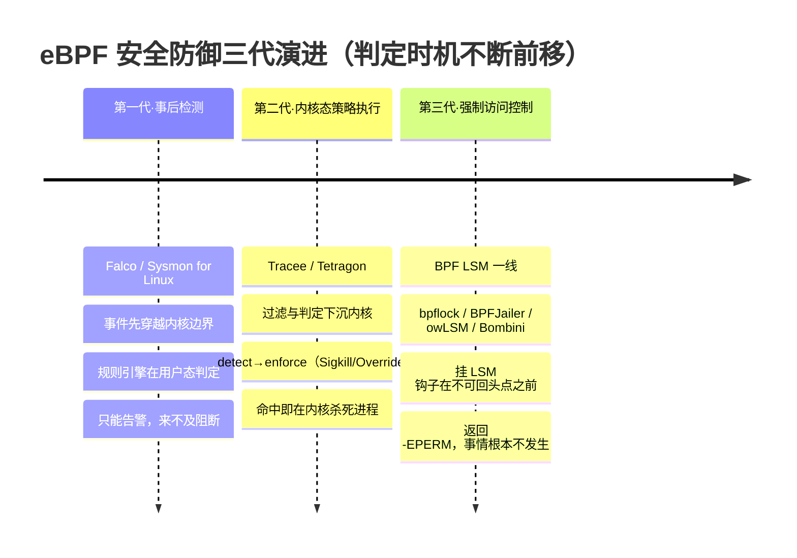

# 第12章 eBPF 安全：防御、LSM 与攻防

> 本章导读：写给三类人——①要为 Linux 主机/K8s 选型运行时安全方案的防御工程师；②想理解"攻击者拿到 BPF 权限后能做什么"的红队与蓝队；③研究 eBPF 自身攻击面的安全研究者。前置：第 3 章 Verifier、第 5 章 程序类型与挂载点、第 6 章 Helper 函数。读完你能：讲清 eBPF 安全的防御世代演进（Falco 事后检测 → Tracee/Tetragon 内核态策略执行 → BPF LSM 强制访问控制）与攻击面标本谱系（bad-bpf/ebpfkit/TripleCross）；独立用 bpflock 阻断 memfd fileless 执行、用 Tetragon TracingPolicy 做 enforce、用 ebpfkit-monitor 思路审计可疑 BPF ELF；并对 detect→enforce 的误杀与绕过面保持批判。本章事实全部锚定本地语料（断言后标 [id=N] 或本地路径），攻击工具均为公开研究/教育项目，仅在隔离测试环境复现。

## 12.1 直觉层

**比喻：同一台 X 光机，医院和海关各取所需。** eBPF 给了 Linux 前所未有的两个东西：①**内核可见性**——任意 syscall/kprobe/tracepoint 处的进程上下文（pid/cgroup/容器身份/文件路径），比 AuditD 更快更全；②**内核控制力**——在事件发生的中途改写数据、返回错误、发送信号，甚至通过 LSM 钩子在动作发生前说"不"。这两样东西本身不分善恶：Falco 用它看清进程，bad-bpf 用同样的 `bpf_probe_write_user` helper 篡改 sudo 读到的 /etc/sudoers（repos/pathtofile/bad-bpf/README.md）。**eBPF 安全问题的本质：能力对称性——检测原语和攻击原语是同一批。**

为什么这门技术让防御者兴奋又让审查者警惕？eBPF 官方入门文的措辞很精确：verifier 是"安全工具（safety tool），不是安全审计工具（security tool）"——它保证程序不会崩溃内核，不保证程序没有恶意（web/md/3.md，eBPF Safety 四层）。而 DEF CON 29 上 Datadog 三人组的演讲标题就是这份两面性的注脚："eBPF, I thought we were friends!"——威胁建模直指"大量公司在生产环境跑有 eBPF 权限的服务，其中一个被攻陷会糟到什么程度"，答案是全功能 rootkit，"rogue kernel modules 终于遇到了对手"（web/md/257.md）。

把本地语料里的安全生态放进一张图，就是一部"判定时机不断前移"的演进史：



与之对称的是攻击标本的三级台阶（本仓全部收录）：**bad-bpf** 是教学级——每个程序只演示一种"在用户态与内核之间读写用户数据"的原语滥用；**ebpfkit** 是工程级——混淆/容器逃逸/C2/数据外传的完整 rootkit；**TripleCross** 是集大成——把 GOT 注入、仿 NSA Bvp47/CIA Hive 的 C2 触发器、持久化、隐身做成一个学士论文级的完整系统（repos/h3xduck/TripleCross/README.md）。

本章的位置：前面章节讲"eBPF 怎么工作"（VM/verifier/maps/helpers/挂载点），本章讲"这套机器在安全战场怎么被两头使用"。它同时是第 5 章（程序类型）里 LSM/tracepoint 两种 prog type 的最大应用场景。

## 12.2 原理层

### 12.2.1 权限模型：攻击面的入口在哪

- **特权门槛**：加载 eBPF 程序需要 root 或 CAP_BPF（web/md/3.md，Required Privileges 层）。这是理解全部攻防叙事的前提：**eBPF 攻击不是无门槛的远程漏洞，而是"已有 root/BPF 权限的攻击者能把它用得多隐蔽"**。
- 非特权例外：Linux 4.4 起非特权用户可加载受限的 SOCKET_FILTER 程序（helper 白名单仅 4 个），可用 `sysctl kernel.unprivileged_bpf_disabled=1` 关闭（web/md/13.md，digest 01）。
- **verifier bug = 内核提权漏洞**：CVE-2017-16995 曾绕过 verifier 直接读写内核内存（web/md/45.md）——这是攻击面的第二条路径：不需要有人给你 BPF 权限，verifier 自身的缺陷就可能放行恶意程序。第 3 章已展开，此处只钉结论：verifier 的形式化强度直接是安全属性。
- 威胁模型一句话（DEF CON 29 的问法）：不是"eBPF 有没有漏洞"，而是**"跑着 Cilium/Calico/监控 agent 的生产主机，agent 被打穿后，攻击者借 BPF 之手能干什么"**（web/md/257.md）。

### 12.2.2 攻击原语：helper 层的三件套

**① 写用户态内存：`bpf_probe_write_user`。** UAPI 文档原文："This helper should not be used to implement any kind of security mechanism because of TOC-TOU attacks"（web/md/39.md 引 uapi 注释；257.md 参考文献第 4 条同样直指该 helper）。它本意是"调试、转移、操纵半协作进程的执行"，但 hook 住 syscall 入口 tracepoint 后就变成数据面篡改的万能钥匙。TripleCross 源码注释留下了最好的实战记录（repos/h3xduck/TripleCross/src/ebpf/include/bpf/exec.h L136-160）：该 helper "**not reliable enough**"——1* 随机返回 EFAULT(-14)，某些路径必败；2* filename 与 argv[0] 指针相距恰好 196 字节，单次写会同时污染两者；从 bash 终端发起的 execve 常改写失败（作者引 iovisor-dev 2017 邮件链定位）。**攻击工具自己承认原语不可靠**，这是评估"eBPF rootkit 实战威力"时最容易被演讲标题掩盖的事实。

**② 读一切 + hook 一切：`bpf_probe_read` 系 × tracepoint/kprobe。** 凭据窃取（读 PAM 密码）、流量嗅探、行为画像都靠它（Embrace The Red Offensive BPF 系列八篇目录：web/md/254.md）。

**③ 信号与返回值改写：`bpf_send_signal` / `bpf_override_return`。** 前者让 bad-bpf 的 bpfdos 对调 ptrace 的 strace 直接 SIGKILL（反调试）；后者改写 syscall 返回值——注意 ebpfkit-monitor 的 Future work 明确写着要用 LSM 程序**替代** `bpf_override_return` 做访问控制（digest 20 [259]），说明 2021 年时这条路径的局限已被同行确认。

### 12.2.3 攻击标本谱系（三个仓的递进）

**bad-bpf（DEF CON 29 "Warping Reality" 配套，教育集）**：六个程序各是一种攻击原型（repos/pathtofile/bad-bpf/README.md）——`bpfdos` 反调试 DoS、`exechijack` 篡改 execve 参数改跑 /a（恶意程序再补跑原程序避免察觉）、`pidhide` hook getdents64 把 PID 从 /proc 列表 unlink（ps 失明）、`sudoadd` 只对 sudo 进程的读取覆写 /etc/sudoers 首行为 `NOPASSWD:ALL #`（cat/sudoedit 看到的文件不变——**精准单进程提权**）、`writeblocker` 对 fd>2 假装写入成功（rsyslogd 静默丢 auth.log）、`textreplace` read 路径文本替换（藏 lsmod 模块/伪造 MAC 反沙箱）。进阶 `textreplace2` 两招值得记住：配置进 eBPF map（bpftool 运行时改目标文件），`--detach` 后 loader 退出、程序经 **bpffs pin 持驻内核**（`rm -r /sys/fs/bpf/textreplace` 才能卸载）——无进程存留的常驻形态。全部程序带 `--target-ppid` 限定作用范围，演示选择性攻击。

**ebpfkit（BlackHat USA 2021 + DEF CON 29，Datadog 员工独立研究）**：完整 rootkit，功能面覆盖 obfuscation（**对 bpf syscall 隐藏自身**，`--disable-bpf-obfuscation` 可关）、container breakout、持久访问、C2、pivoting、网络扫描、RASP bypass（README 从本地 pack 恢复：repos/Gui774ume/ebpfkit/，Ubuntu Focal/5.4 开发）。三个可复现攻击示例展示了"内核态数据面拦截"的三种姿势：被动网络嗅探（进出流量 TCP/UDP 字节统计→Graphviz 拓扑图）；**eBPF 层主动发 ARP+SYN 做端口扫描**（trace_pipe 可见 "OPEN PORT 8000"——rootkit 自身能发起侦察）；fs_watch 窃取 /etc/passwd（hook 内核向进程回传文件内容的过程，原样复制数据）。C2 隧道走 HTTP **User-Agent 字段**伪装（client 子命令 docker/fs_watch/network_discovery/pipe_prog/postgres）。

**TripleCross（UC3M 学士论文，GPLv3）**：前人技术集大成 + 学术系统化，致谢 Dileo（DC27）、Hogan（DC29，即 bad-bpf 作者 Pat Hogan）、Fournier & Afchain（DC29，即 ebpfkit）、Kris Nóva 的 Boopkit。六大模块：库注入/执行劫持/本地提权/backdoor+C2/持久化/隐身。两个独门技术：

- **GOT 劫持库注入五阶段**（README "Library injection via GOT hijacking"节）：tracepoint hook syscall 后**从栈上回溯定位 PLT 返回地址**→找到 GOT→动态生成 shellcode 绕 ASLR/PIE（dlopen 地址每次运行都变）→借 /proc 文件系统向 .text code cave 写 shellcode→覆写 GOT，下次 PLT 调用即跳恶意库（fork 出 reverse shell 后恢复原执行流）。绕过清单：ASLR/Stack canaries/DEP/PIE/Full RELRO，兼容 Intel CET。README 对 `.text→.plt→glibc→syscall` 三段跳转中 rip 的保存位置分析（call 压栈/jump 不保存/syscall 存 rcx）是 eBPF 栈扫描的难得教材。
- **C2 触发器复刻国家级植入物**：pattern-based trigger 仿 NSA Equation Group 的 **Bvp47**（Pangu Lab 报告）；multi-packet trigger 仿 CIA **Hive**（Vault 7 泄露文档）——payload 经 rolling XOR 分片藏进 TCP seq number 或 source port，对网络监管呈现随机流量。**phantom shell** 用 XDP/TC 改写既有包 payload 承载 C2 数据，绕开"eBPF 不能自发包"的限制——原始流量靠 TCP 重传恢复，不丢。
- 持久化的两个真问题：重启后 eBPF 程序卸载 + 重载需要 root——用 cron.d + sudoers.d 两个隐藏文件一并解决；隐身 hook sys_getdents 篡改目录项（与 bad-bpf pidhide 同款原语，藏目录 SECRETDIR 与文件 ebpfbackdoor）。

### 12.2.4 BPF LSM：第三代防御的机制内核

LSM（Linux Security Modules）是内核里 AppArmor/SELinux 挂钩子的框架；**BPF LSM**（Kernel Runtime Security Instrumentation，Google 贡献）让 BPF 程序成为又一个 LSM——`BPF_PROG_TYPE_LSM` 程序类型 5.7 入内核（digest 01 id=22 特性表），加载后挂到 `include/linux/lsm_hook_defs.h` 声明的任意钩子上，**返回非 0（如 -EPERM）即否决该安全操作**。启用要求（bpflock README，repos/linux-lock/bpflock/）：`CONFIG_BPF_LSM=y` + `CONFIG_LSM="...,bpf"` 启动参数 + BTF，实际可用版本 5.13+；sleepable 变体（`lsm.s` section，5.10 起 sleepable 支持，见第 5 章 5.2.1）允许在可睡眠上下文调用——`bprm_*` 这类 exec 路径钩子即属可睡眠上下文（内核 BPF LSM 文档 prog_lsm.html，web/md/255.md 结论节引用）。

与 tracepoint 的本质区别：tracepoint 是**观察点**（看完只能记录），LSM hook 是**决策点**（可以否决）。fileless 检测是最好的对照案例（web/md/255.md）：

- 攻击：`memfd_create()` 建 RAM 驻留匿名文件→写 ELF→经 `/proc/self/fd/N` execve，全程不落盘；还能伪造 argv[0]（Go loader 实测 `ps` 只显示 "from_loader AAAA"）。
- 传统检测全被绕过：`/proc/pid/comm` 可被 prctl 任意改、`/proc/pid/exe` 可用 `PR_SET_MM_EXE_FILE` 指向别的二进制、`/proc/pid/maps` 有 TOCTOU 竞态（读完进程已 execv 换身）。
- **正确挂点**：binfmt 匹配后、进程执行 point of no return 前——此时 ELF header 已可访问且不可伪造（控制权尚未移交），`mm_struct` 还挂在 `linux_binprm` 上。SysmonForLinux/Tracee/Falco 只能在这个位置"检测" `memfd:` 前缀；BPF LSM 能"阻断"。
- bpflock 的 `filelesslock.bpf.c` 挂 `lsm/bprm_creds_from_file`，判据极其干净：`BPF_CORE_READ(file, f_path.dentry, d_inode, __i_nlink)`——**被执行文件的 inode 链接数为 0 即匿名文件**，log + 返回 -EPERM（repos/linux-lock/bpflock/bpf/filelesslock.bpf.c L61-110）。实测 Silvio Cesare 1998 ELF parasite 注入器同样被拦。

BPF LSM 一线的四个本地标本（同为第三代，取向不同）：

| 项目 | 定位 | 独门机制 | 状态（digest 18） |
|---|---|---|---|
| bpflock | 主机加固锁 | 六类小锁：kimglock 挂 `lsm/locked_down`（kernel lockdown）、bpfrestrict 挂 `lsm/bpf`（限制 bpf() syscall 自身）、kmodlock 挂 `lsm/kernel_read_file` 等；声明式三档 profile（allow/baseline/restricted） | experimental，2022-02 后停滞 4 年 |
| BPFJailer | MAC 进程监禁 | `task_storage` map 跟踪进程，jail 随子进程继承；dentry 路径匹配带缓存失效；Rust 全家桶；LPC 2025 演讲背书；README 大字 "NOT ready for production" | 活跃（2026-10） |
| owLSM | Sigma 规则引擎上 LSM | **有状态** eBPF——多钩子点数据关联（如"发起该文件写的 shell 命令"定规则）；直陈 Falco/Tetragon/KubeArmor 预防能力弱；Cybereason/LevelBlue 客户生产使用 | 非常活跃（2026-11） |
| Bombini | Rust(Aya)+LSM 沙箱 | 同一套 scope/event 规则语言既做检测（report）又做强制（deny→内核态 EPERM）；**IOUringMon 盯 io_uring**（syscall 追踪盲区）、**KernelMon 报告 BPF 程序与 map 活动**（BPF 自身的可观测性） | 非常活跃（2026-11），要求 6.2+ |

### 12.2.5 防御三代详解：判定时机与判定位置

**第一代：syscall 事后检测。** Falco（CNCF 毕业级，Sysdig 创建）用 eBPF 采内核事件流，声明式 YAML 规则在**用户态**引擎里匹配，告警走 50+ SIEM/数据湖集成（digest 18 [217]）；Sysmon for Linux 把 Windows Sysinternals 移植过来，XML 事件写 syslog（digest 18 [218]）。共同架构：事件必须先穿越内核边界，判定在外面——所以**只能事后告警**。这一代的价值是把 eBPF 遥测的成本论证做完了：Red Canary 实测 execve 追踪场景 eBPF 探针比 auditd 满配高约 19% 吞吐（14254 vs 11989 execl/s，基线 19421.4；四核 2GB VM，宿主 3950X/64GB，byte-unixbench，2022-01，web/md/220.md），且 AuditD 在容器场景返回子进程 PID namespace 的 PID 导致进程谱系断裂，eBPF 可在 fork 返回路径读 task_struct 拿 root namespace PID。

**第二代：内核态策略执行（detect→enforce）。** Tracee（Aqua，CNCF 沙箱）三档消费——原始事件/过滤事件/签名检测（Go 行为签名），事件管线支持抓包导出（pcaps）与 webhook，配套 **btfhub** 解决老发行版 CO-RE（digest 18 [221]）。Tetragon（Cilium）把"策略"做成 K8s CRD：TracingPolicy 声明 kprobe/tracepoint/uprobe + selectors + **actions**，传感器默认开 process_exec/process_exit，事件自动富化 namespace/pod/容器身份（repos/cilium/tetragon/README.md）。enforce 的硬证据在其 proto 里：`KPROBE_ACTION_SIGKILL=3`、`KPROBE_ACTION_OVERRIDE=5`（改写返回值）、`KPROBE_ACTION_SIGNAL=10`、`KPROBE_ACTION_NOTIFYENFORCER=13`（api/v1/tetragon/tetragon.proto L502-537；ActionSelector 枚举 pkg/k8s/apis/cilium.io/v1alpha1/types.go L385）——命中策略即**在内核里杀死进程**，这就是 Tetragon 自我定位里 "Runtime Enforcement" 的落点。

**第三代：BPF LSM 强制访问控制（见 12.2.4）。** 判定时机从"事件发生后"推到"动作发生前"，与 SELinux/AppArmor 平级但策略是 eBPF 程序（bpflock 明确自我定位：不做 MAC 标签、不替代 AppArmor/SELinux、**不防 evil root**）。

### 12.2.6 检测侧：怎么发现恶意 eBPF

ebpfkit-monitor（与 ebpfkit 同作者配套，能力通用）给出"以 eBPF 之道还治 eBPF 之身"的两模（digest 20 [259]；本地克隆损坏，README 从上游恢复）：

1. **静态分析 BPF ELF**：解析 object 文件列出 program sections/maps/字节码，可按特征查询——"列出所有使用 `bpf_probe_write_user` 的程序"（write 类 rootkit 的核心指标）、"列出所有交互 `piped_progs` map 的程序"（ebpfkit 的特征 map）。子命令 graph/map/prog/report。
2. **运行时监控 bpf syscall**：`start` 子命令 trace 程序加载事件，`--allowed-processes` 白名单（如只允许 bpftool 用 bpf syscall，越界即异常信号）。

其 Future work 自记两个目标——迁移 BTF/CO-RE、用 `lsm` 程序替代 `bpf_override_return`——恰好是 2021 年这一代工具的技术边界（老内核 CO-RE 难 + override 局限），也预告了后来 bpflock 这条 LSM 线。更新的补充面：Bombini 的 KernelMon 把"BPF 程序与 map 活动"做成常规监控事件（digest 18 [228]）——BPF 自身的可观测性正是 ebpfkit"对 bpf syscall 隐藏自身"这类混淆的直接对手。

### 12.2.7 老内核 CO-RE 难题：三套解法对照

安全 sensor 必须跑在客户的老内核上，而 CO-RE 依赖 BTF（4.18+ 才有）——这是所有 EDR 厂的共同难题（第 8 章展开机制，此处列安全线解法）：

| 方案 | 出品 | 思路 | 语料 |
|---|---|---|---|
| BTFhub | Tracee | 随程序分发各发行版 BTF 文件 | digest 18 [221] |
| LKCCB + oxidebpf | Red Canary | "内核 GPS"云构建器——自动算每个内核版本/发行版的结构 offset，运行时经 oxidebpf 的 hashmap 动态注入探针；sensor 侧多探针单 ELF 按内核选载（Compile-Once, Run-Most-Places） | web/md/220.md |
| offset autodiscovery | 微软 Sysinternals | BTF 优先→discoverOffsets 探测→getOffsets 手工生成覆盖，`offsetsNeeded.json` 声明所需成员；全部 C 实现，无 CO-RE 依赖 | digest 18 [218][219] |

### 12.2.8 seccomp-BPF：一笔带过的经典线

seccomp（syscall 过滤）是 BPF "不再只是网络"的最早证明——2012 年起 Chrome sandbox 用 cBPF 写 syscall 白名单（web/pdf-txt/56.txt，Borkmann FOSDEM 2016 slides 内嵌 bpf_asm 完整实例：`ld [4]` 校验 `seccomp_data.arch==AUDIT_ARCH_X86_64`，逐个 `jeq __NR_*` 放行，`ret SECCOMP_RET_KILL/ALLOW`）。它是**经典 BPF** 的直系应用（cBPF 载入时被内核透明翻译成 eBPF 表示），上下文是 `seccomp_data` 而非 skb；程序类型谱系与 cBPF→eBPF 演进见第 2/5 章。与现代安全线的关系：seccomp 管"进程能不能调这个 syscall"（进程自愿戴上的镣铐），Tetragon/BPF LSM 管"内核视角下这个操作该不该放行"（系统强加的裁判）——容器运行时至今两者都用。

## 12.3 实践层

**防御路径一：用 bpflock 阻断 fileless 执行**（web/md/255.md 全程可复现）：

```bash
docker run --name bpflock -it --rm --cgroupns=host --pid=host --privileged \
    -e "BPFLOCK_EXEC_SNOOP=all" -e "BPFLOCK_FILELESSLOCK_PROFILE=restricted" \
    -v /sys/kernel/:/sys/kernel/ -v /sys/fs/bpf:/sys/fs/bpf linuxlock/bpflock
# 攻击模拟（pathtofile/commandline_cloaking 的 loader）：
./loader /bin/sleep 10   # → Failed to execute: operation not permitted
```

bpflock 日志三行就是完整证据链：`syscall_execve`（execsnoop 观察）→ `lsm_bprm_creds_from_file filename=memfd:memfd-test retval=-1 reason=denied (restricted)`（**LSM 钩子阻断**）→ `syscall_execve filename=/proc/self/fd/3 retval=-1`。前置条件：kernel 5.13+，`CONFIG_BPF_LSM=y`、`CONFIG_LSM="...,bpf"`（bpflock README；BPFJailer 仓还附带 `ENABLE_BPF_LSM.sh`/`check_kernel_support.sh` 自检脚本，digest 18 [227]）。

**防御路径二：Tetragon TracingPolicy（观察+强制）**。quickstart 见 tetragon.io；本地仓自带策略库可直接读：`repos/cilium/tetragon/examples/policylibrary/bpf.yaml` 是一份"监控 BPF 自身使用"的现成策略——kprobe `bpf_check`/`security_bpf_map_alloc`（<6.9）/`security_bpf_map_create`（6.9+，`ignore: callNotFound: true` 处理版本漂移），再对 `/sys/fs/bpf` 的读写作 `matchArgs` 过滤。把 action 换成 `Sigkill` 即从观察转强制（action 枚举见 12.2.5）。

**防御路径三：Tracee 一行起步**：`docker run --name tracee -it --rm --pid=host --cgroupns=host --privileged -v /etc/os-release:/etc/os-release-host:ro aquasec/tracee:latest`（repos/aquasecurity/tracee/Readme.md）。读代码学架构：`pkg/ebpf/` 探针与内嵌产物、`signatures/golang/` 行为签名、`cmd/tracee/` 入口。

**检测审计：ebpfkit-monitor 式静态分析**。拿到可疑 BPF ELF 时按特征查：是否用 `bpf_probe_write_user`、是否引用异常命名 map（如 piped_progs）；再对生产机 bpf syscall 做 `--allowed-processes` 白名单监控（digest 20 [259]）。轻量替代：`bpftool prog show`/`bpftool map show` 盘点现存程序，对照部署清单。

**攻击侧学习（仅限隔离 VM）**：bad-bpf——`git clone --recursive` 后 `cd src && make`，每个程序 `--help` 自带用法；Ubuntu 22.04/内核 4.7+/clang-14，CO-RE 需 Ubuntu 20.10+ 的 BTF（repos/pathtofile/bad-bpf/README.md）。TripleCross——`make kit && make tckit`，`tc filter add dev <iface> egress bpf direct-action obj bin/tc.o sec classifier/egress` + `sudo ./bin/kit -t <iface>`；配套 packager.sh/deployer.sh 模拟真实攻击者一键部署；论文 PDF 在 docs/ebpf_offensive_rootkit_tfg.pdf（Ubuntu 21.04/5.11/clang 12）。读 `src/ebpf/include/bpf/` 下 exec.h/injection.h 的注释本身就是安全工程课。

**主机加固清单**（语料支持的最低配置）：`kernel.unprivileged_bpf_disabled=1` 关非特权加载（web/md/13.md）；考虑 bpflock 的 bpfrestrict（`lsm/bpf` 限制谁能调 bpf()）与 kmodlock/kimglock 收窄 root 的内核修改面；容器场景明确"eBPF 权限=内核权限"，收敛 CAP_BPF 的授予面（257.md 威胁模型的自然推论）。

## 12.4 深水区与坑

1. **`bpf_probe_write_user` 天生不适合当安全地基**：UAPI 明文警告 TOC-TOU，attach 时内核日志打警告（web/md/39.md）；TripleCross 实测三条不可靠性（随机 EFAULT/196 字节相邻缓冲联动/bash 路径必败，exec.h 注释）。攻击者用它要碰运气，防御者若想用同款 helper"纠正"数据则更是踩在文档明令禁止的坑上。
2. **detect→enforce 的误杀风险**：Tetragon 的 `Sigkill`/`Override` 是内核态杀进程/改返回值——策略写错的代价是生产事故而非漏报；bpflock 的 `restricted` profile 会拒绝**所有**进程（包括特权容器），README 自己写明 "it does not protect against evil root"，且 baseline 档依赖 host namespace 判定，命名空间语义理解错就放行/误杀。合理路径是先 `allow` 档全量日志观察，再逐条收紧（bpflock profile 语义，README §2.2）。
3. **绕过面：防御程序自己也是 eBPF**。攻击者拿到 root 后可先卸载/覆盖防御探针再作案——textreplace2 的 bpffs pin 反向提示防御者：**自己的 LSM 程序也要 pin 且限制 bpf() syscall**（bpflock 的 bpfrestrict 正是为此与 filelesslock 并列存在）。eBPF"重启即卸载"的易失性对攻击者是持久化难题（TripleCross 要靠 cron.d+sudoers.d 解决），对防御者则是"重启丢防线"——持久化方案必须纳入部署设计。
4. **版本与启动参数门槛**：BPF LSM 需 5.7+（特性表 digest 01 id=22），实战 5.13+（bpflock）；Bombini 要 6.2+；BPFJailer 推荐 6.1+（task_storage 5.11+）。更麻烦的是 `CONFIG_LSM` 是**启动参数**——云厂商托管内核/不可改 kernel cmdline 的环境里第三代方案直接出局，只能退回第二代。
5. **项目生命周期坑**：bpflock experimental 且 2022-02 后实质停滞 4 年（选型慎重，同类活项目看 owLSM/Bombini）；ebpfkit/ebpfkit-monitor 2023 年初即冻结（研究完成即停更，演讲配套仓常态）；Inner Warden 已改名转型 AI agent 护栏且 **eBPF sensor 闭源化**（digest 18 [231]）。安全工具自身依赖的生态会死，选型时要看活跃度而不是演讲名气。
6. **遥测链路的截断坑**：Sysmon for Linux 的 XML 事件经 syslog 默认 1-8KB 截断，>64KB 大事件直接残缺（digest 18 [218]）；检测规则若依赖被截断字段即静默失效。
7. **盲区一：io_uring**。经典 syscall 追踪看不到 io_uring 异步提交的操作（Bombini 专门做 IOUringMon 的原因，digest 18 [228]）——第二代引擎的规则面没有覆盖 io_uring 时存在绕过空间。
8. **盲区二：BPF 自身活动**。默认情况下"内核里有哪些 BPF 程序在跑"缺少一等公民级的可观测性——ebpfkit 的 obfuscation（对 bpf syscall 隐藏自身）正是利用这一点；对策见 12.2.6（bpf syscall 白名单 + KernelMon）。
9. **性能数字要带语境引用**："+19% vs auditd"是 2022-01、四核 VM、execve 追踪单一场景的 byte-unixbench 结果（web/md/220.md），不是普适结论；换负载（网络密集/高频 fork）比例完全不同，且 eBPF 探针自身写得差（无内核态过滤）会把优势吃光——这正是 Red Canary 强调"内核内过滤分析"的原因。
10. **勘误式提醒**：三代演进是叙事工具不是严格时间线——Falco 至今仍是 CNCF 毕业项目且持续维护（v0.45，digest 18 [217]），Tracee/Tetragon 也在补 LSM 能力（Tracee 仓有 embedded-lsmsupport.go）；选型看的是"判定位置 + 判定时机"是否匹配你的威胁模型，不是"第几代"。

## 12.5 与其他章的关系

前驱：第 3 章 Verifier 是本章攻击面论证的地基（CVE-2017-16995——verifier bug 即提权漏洞）；第 5 章 程序类型与挂载点 给出 tracepoint/LSM/seccomp 三条线的 prog type 谱系与 `lsm.s` sleepable 细节；第 6 章 Helper 是攻防共用的原语清单（`bpf_probe_write_user`/`bpf_send_signal`/`bpf_override_return` 的兼容矩阵与 GPL 门控）；第 8 章 CO-RE 与 BTF 展开 12.2.7 老内核三解法的机制；第 9 章 XDP 与 tc 解释 TripleCross backdoor 为什么选 XDP/TC 做 C2 通道；第 11 章 可观测性 与本章共享同一条 perf buffer/ringbuf 遥测管线（redcanary-ebpf-sensor 的 Gotchas 即跨章素材）。后继：本章是把 eBPF 当"安全引擎"用的纵深；若继续走"eBPF 当内核可编程地基"的方向（sched_ext 调度器 scx/Gthulhu，digest 18 [232][233]），安全章的权限模型与 LSM 机制同样适用。

## 12.6 语料索引

| id | 名称 | 本地路径 | 用了什么 |
|---|---|---|---|
| 3 | what-is-ebpf | web/md/3.md | eBPF Safety 四层、"verifier 是安全工具非安全审计工具"、CAP_BPF |
| 13 | bpf(2) man page | web/md/13.md | 非特权 SOCKET_FILTER(4.4+)、unprivileged_bpf_disabled |
| 22 | List of BPF features per kernel version（bcc kernel-versions） | web/md/22.md | LSM 5.7/sleepable 5.10 入主线版本 |
| 39 | BPF In Depth: Helper Functions | web/md/39.md | bpf_probe_write_user 的 TOC-TOU 警告原文 |
| 45 | eBPF from a Programmer's Perspective | web/md/45.md | CVE-2017-16995 verifier 绕过 |
| 56 | Borkmann FOSDEM 2016 slides | web/pdf-txt/56.txt | seccomp bpf_asm 完整实例（Chrome sandbox） |
| 217 | Falco | web/md/217.md | CNCF 毕业级、YAML 规则范式、SIEM 集成 |
| 218/219 | Sysmon for Linux / SysinternalsEBPF | repos/Sysinternals/ | offset 三级策略、syslog 截断坑 |
| 220 | Red Canary eBPF for security | web/md/220.md | auditd 三宗罪、execl/s 基准（14254 vs 11989）、LKCCB/oxidebpf |
| 221 | Tracee | repos/aquasecurity/tracee/ | 三档消费、btfhub、签名引擎、Docker/Helm 起步 |
| 222 | redcanary-ebpf-sensor | repos/redcanaryco/redcanary-ebpf-sensor/ | Compile-Once-Run-Mostly-Places、栈上 dummy event 模式 |
| 223 | bpflock | repos/linux-lock/bpflock/ | LSM BPF 主机加固：filelesslock/kimglock/bpfrestrict/kmodlock 源码与 profile 语义 |
| 224 | Tetragon | repos/cilium/tetragon/ | TracingPolicy CRD、KPROBE_ACTION_* enforce 枚举、bpf.yaml 策略例 |
| 227 | BPFJailer | repos/gen0sec/bpfjailer/ | task_storage 进程监禁、LPC 2025、内核要求 |
| 228 | Bombini | repos/bombinisecurity/bombini/ | Aya 生产级 LSM、IOUringMon/KernelMon、检测+沙箱同语言 |
| 230 | owLSM | repos/Cybereason-Public/owLSM/ | Sigma 规则上 LSM、有状态跨钩子关联 |
| 231 | Inner Warden | repos/InnerWarden/innerwarden/ | eBPF sensor 闭源化转型案例（生命周期坑） |
| 254 | Embrace The Red: Offensive BPF | web/md/254.md | 红队视角八篇目录（嗅探/后门/篡改原语谱系） |
| 255 | BPF LSM 阻断 fileless | web/md/255.md | memfd 攻击链、bprm_creds_from_file 挂点论证、复现命令与日志 |
| 257 | DEF CON 29 eBPF, I thought we were friends | web/md/257.md | 威胁模型、rootkit 全家桶清单、参考文献链（Drovorub/Dileo/SSTIC） |
| 258 | ebpfkit | repos/Gui774ume/ebpfkit/（README 从 pack 恢复） | obfuscation/C2(User-Agent)/端口扫描/fs_watch 三示例 |
| 259 | ebpfkit-monitor | repos/Gui774ume/ebpfkit-monitor/（README 上游恢复） | 静态 ELF 特征查询、bpf syscall 白名单、Future work 边界 |
| 260 | bad-bpf | repos/pathtofile/bad-bpf/ | 六攻击原型+textreplace2 的 map 配置与 bpffs pin 驻留 |
| 261 | TripleCross | repos/h3xduck/TripleCross/ | GOT 注入五阶段、Bvp47/Hive 触发器、phantom shell、持久化/隐身；src/ebpf 源码注释 |

## 12.7 AI agent 用法

1. 问"eBPF rootkit 都用什么手法"→ grep `bpf_probe_write_user\|pidhide\|GOT` 本章 12.2.2-12.2.3；一手细节去 repos/h3xduck/TripleCross/src/ebpf/include/bpf/exec.h（probe_write 不可靠性注释）与 repos/pathtofile/bad-bpf/README.md（六程序）。
2. 问"怎么阻断 memfd fileless 执行"→ grep `bprm_creds_from_file\|__i_nlink\|memfd` 本章 12.2.4/12.3；复现命令与日志样例在 web/md/255.md，判据源码在 repos/linux-lock/bpflock/bpf/filelesslock.bpf.c。
3. 问"Tetragon 和 Falco 有什么区别/detect→enforce 怎么落地"→ 本章 12.2.5；enforce 枚举一手证据 grep `KPROBE_ACTION` repos/cilium/tetragon/api/v1/tetragon/tetragon.proto，策略样例 examples/policylibrary/bpf.yaml。
4. 问"老内核没有 BTF 怎么跑安全 sensor"→ 本章 12.2.7 表格；三方案一手源 web/md/220.md（LKCCB）、repos/Sysinternals/SysinternalsEBPF/（offsetsNeeded.json）、repos/aquasecurity/tracee/（btfhub）。
5. 问"怎么检测可疑的 eBPF 程序"→ 本章 12.2.6；特征查询思路（bpf_probe_write_user 使用者/异常 map 名）源自 digest 20 [259] ebpfkit-monitor。
