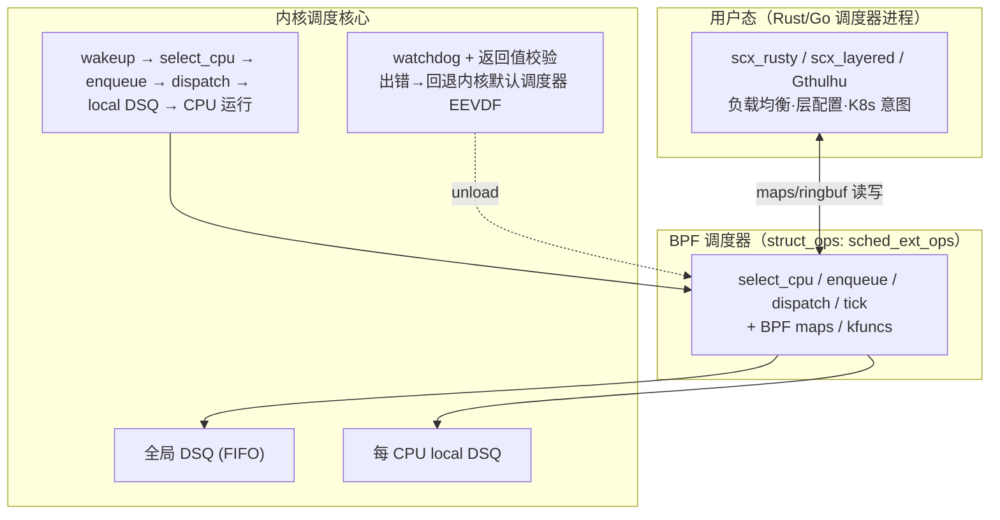

# 第13章 sched_ext：可编程 CPU 调度器

> 本章导读：读完第 3 章（Verifier）与第 5 章（程序类型）后想看 eBPF"改内核行为"最深水区的工程师应该读这一章。sched_ext 是 6.12 起进入 Linux 主线的可编程 CPU 调度器框架——用 BPF 实现内核线程调度器、动态加载、Ctrl-C 即回退。读完你能：理解 BPF struct_ops 如何安全接管 sched_class、看懂 DSQ/调度周期这套执行模型、用 scx 仓的 14 个现成调度器（游戏延迟、K8s 桥接、生产分层）选型，并知道写一个最小调度器的两条入口路径。前置：第 3 章 Verifier、第 5 章程序类型（struct_ops）、第 4 章 Maps。

## 13.1 直觉层

把内核调度器想象成心脏起搏器：它决定每个 CPU 下一个泵给谁。传统上换起搏器要"开胸"——改内核源码、重编译、重装、重启，生产集群滚动升级以月计；Meta 给 memcache 实例预热就要数小时（[id=232] OVERVIEW.md "Motivation"）。sched_ext 做到的是：**换调度器 = 跑一个普通程序，退出 = 换回内核默认调度器**（[id=232] README.md "Getting Started" 演示会话）。

为什么值得"换"？因为现代硬件和负载已经把"一个通用调度器讨好所有人"逼到极限：

- **硬件侧**：总功耗预算远超插座预算、动态调频、chiplet 化、AMD CCX 让单 socket 内有多个 L3 域——"类 NUMA 而无 NUMA 粘性"的拓扑（[id=232] OVERVIEW.md）；
- **负载侧**：游戏/VR 有硬延迟期限，服务器堆叠负载要求 isolation，LLM 推理集群的 decode worker 和 NCCL/RDMA progress 线程各有调度偏好（[id=233] Gthulhu README）。

而直接改 CFS/EEVDF 的门槛极高：内核新手要数年才能有效贡献；每次实验都要重装内核重启机器；Shenango/Shinjuku 这类学术调度策略当年只能用 sched affinity 在外面"模仿"语义（[id=232] OVERVIEW.md）。

**BPF 的"良构承诺"如何适配调度器这种最苛刻的"任意内核态回调"场景？** eBPF 的原始承诺是：任何 BPF 程序在加载时被 verifier 静态分析证明不会损坏或崩溃系统。调度器回调正处在最坏位置——热路径、可能关中断、可能持锁。sched_ext 的安全论证是三层兜底：①verifier 加载时把关；②内核在运行时校验每个回调的返回值（`.select_cpu()` 返回非法 CPU 号就报错并卸载调度器）；③watchdog 检测"任务 runnable 太久没被调度"并强制出错退出。三层的净效果是官方原话："Ignoring kernel bugs, the worst damage a `sched_ext` scheduler can do to a system is starving some threads until the watchdog timer triggers"（[id=232] README.md）——**最坏情况是饿线程，不是 panic**。任务被迁移回可信的内核默认调度器（6.12 时代的 fair class 即 EEVDF，见 13.2）。

在整条 eBPF 栈里，sched_ext 站在"观测 → 策略 → 接管"这条链的终点：XDP/tc 改网络路径（第 9 章），LSM BPF 改安全裁决（安全章），而 sched_ext 是唯一把内核**核心调度循环本身**外包给 BPF 程序的子系统。这也是它成为 eBPF 走出安全/网络进入 CPU 调度的旗舰案例的原因（[id=232] digest 总评）。



## 13.2 原理层

### 13.2.1 sched_class 的 BPF 化：struct_ops

`sched_ext` 是一个新的 `sched_class`（调度类），但它不实现具体策略，而是通过 BPF 的 **struct_ops** 机制把一组回调导出给 BPF 程序：导出的结构体是 `struct sched_ext_ops`，概念上等价于 `struct sched_class` 的 BPF 镜像；sched_ext 内核层的职责就是把复杂的 sched_class 回调翻译成更简单、更人体工学的 sched_ext_ops 回调（[id=232] OVERVIEW.md "How"）。struct_ops 已在 TCP 拥塞控制等子系统成熟使用；与其他要导出 UAPI 的 BPF 程序类型不同，**struct_ops 没有任何 ABI 要求**——这正是 sched_ext API 能快速演进的自由度来源（代价见 13.4）。verifier 在加载时强制 BPF 程序 GPL2（[id=232] OVERVIEW.md）。

唯一必须实现的字段是 `name`；其余回调全部有合理缺省——例如不实现 `.select_cpu()` 时内核自动在唤醒路径挑 idle CPU（[id=232] OVERVIEW.md）。实际代码长这样（scx_rusty 内核侧，`SCX_OPS_DEFINE` 宏展开为 struct_ops 注册）：

```c
SCX_OPS_DEFINE(rusty,
	       .select_cpu = (void *)rusty_select_cpu,
	       .enqueue    = (void *)rusty_enqueue,
	       .dispatch   = (void *)rusty_dispatch,
	       .running    = (void *)rusty_running,
	       .stopping   = (void *)rusty_stopping,
	       .init_task  = (void *)rusty_init_task,
	       .init       = (void *)rusty_init,
	       .timeout_ms = 10000,          /* watchdog 超时 */
	       .name       = "rusty");
```
（repos/sched-ext/scx/scheds/rust/scx_rusty/src/bpf/main.bpf.c L2008-2024）

### 13.2.2 DSQ：内核调度核心与 BPF 调度器之间的阻抗匹配

调度决策发生在 BPF 里，但"下一个跑谁"最终由内核调度核心执行，中间的缓冲结构就是 **DSQ（dispatch queue）**。每个 DSQ 既可当 FIFO 也可当优先级队列（vtime）。默认两个内置 DSQ：一个全局 FIFO（`SCX_DSQ_GLOBAL`）+ 每 CPU 一个 local DSQ（`SCX_DSQ_LOCAL`）；BPF 侧可用 `scx_bpf_create_dsq()`/`scx_bpf_destroy_dsq()` 建任意数量的自定义 DSQ（[id=232] OVERVIEW.md）。

术语约定：任务被"insert"进某个 DSQ；非 local DSQ 里的任务被"move"到目标 CPU 的 local DSQ。**CPU 永远只从自己的 local DSQ 取任务执行**。

### 13.2.3 调度周期（wakeup 到上 CPU）

[来源：[id=232] OVERVIEW.md "Scheduling cycle"]

1. **`ops.select_cpu()`**——唤醒后第一个回调。作用有二：CPU 选择优化提示（非绑定约束，最终决定在最后一步）；顺带把选中的 idle CPU 唤醒。可直接 `scx_bpf_dsq_insert()` 插队（若插入 `SCX_DSQ_LOCAL` 则落到返回的 CPU 的 local DSQ），且会跳过后续 `ops.enqueue()`。内核会忽略非法选择（如超出任务 allowed cpumask）。
2. **`ops.enqueue()`**——三选一：插全局/local DSQ；插自定义 DSQ（DSQ ID < 2^63）；或把任务留在 BPF 侧队列。
3. **`ops.dispatch()`**——当 CPU 的 local DSQ 与全局 DSQ 都空时触发，用两个 kfunc 填充 local DSQ：`scx_bpf_dsq_insert()`（目标可以是任意 DSQ，包括 `SCX_DSQ_LOCAL_ON | cpu`，调度插入而非立即执行，pending 上限由 `ops.dispatch_max_batch` 控制）与 `scx_bpf_dsq_move_to_local()`（从指定非 local DSQ 搬运，会先 flush 掉 pending 插入）。注意：FIFO 用 `scx_bpf_dsq_insert()`，优先级队列用 `scx_bpf_dsq_insert_vtime()`；**内置 DSQ（LOCAL/GLOBAL）不支持优先级语义**。
4. **收尾链**——dispatch 返回后 local DSQ 有任务就跑第一个；否则依次：试全局 DSQ → 若 dispatch 派发过则重试第 3 步 → 若前任务是 SCX 任务且仍 runnable 则继续执行（`SCX_OPS_ENQ_LAST` 语义）→ idle。

只用内置 DSQ 时根本不用实现 `ops.dispatch()`——这就是 scx_simple 类调度器几十行能跑的原因。

### 13.2.4 安全模型：三层兜底与三种退出

- **加载时**：verifier 静态证明（第 3 章）；GPL2 强制。
- **运行时回调校验**：任何回调返回值非法（invalid CPU、非法 enqueue flags）→ 报错并卸载调度器；任务 runnable 过久未获调度 → 内核检测并 error-out（[id=232] OVERVIEW.md "Verifying callback behavior"）。
- **三种退出通道**：①终止调度器进程（Ctrl-C）→ 内核默认调度器接管；②`sysrq-S` 强制禁用；③watchdog 超时（见上节 `timeout_ms`）自动禁用。双保险语义：最坏=饿线程直到 watchdog 触发（[id=232] README.md "Getting Started"）。

### 13.2.5 CPU ownership 与 tick 交互

- **central 模式**：Google 实践的"中央调度"——单个 CPU 替全系统做调度决策，其余核可全身心跑负载；对 VM 场景可避免昂贵的 vmexit 与 cache flush（把抢占检查从各 CPU 的 tick 委托给一个 CPU）。参考实现 `scx_central.bpf.c` 在内核 `tools/sched_ext`（[id=232] OVERVIEW.md "Customization"）。
- **tick 强制与 tickless 的缝隙**：sched_ext 的 slice 由 `task_tick_scx()` 在时钟中断里强制——slice 到期若落在两个 tick 之间，任务会多跑到下一个 tick（最多晚一整个 tick）。scx_eevdf 用每 CPU 一个 `bpf_timer` 复刻 fair.c 的 hrtick 来补这个洞：两个 hog 共享 CPU、700us slice 下从实测各跑 1000us 降到 701us，饱和 schbench 的 median wakeup 从 ~900us 降到 6us（[来源：repos/sched-ext/scx/scheds/rust/scx_eevdf/README.md "Deadlines on time"，注明为该 README 自报实测）。这也是 13.4 坑清单的一项。

### 13.2.6 6.12 主线化与 Meta/Google 背景

sched_ext 于 **Linux 6.12 完整进入主线**（[id=232] README.md "Kernel Feature Status"）。推手阵容写在其 OVERVIEW.md 署名：David Vernet（Meta）、Tejun Heo、Josh Don 与 Barret Rhoden（Google），支持者含 Paul Turner、Neel Natu 等 Google 调度老将——**Meta+Google 双巨头联合推动、Meta 大规模生产部署**（[id=232] digest；README "Meta is in the process of mass production deployment"）。谱系上，Google 先做了用户态调度框架 ghOSt（SOSP 论文），LPC 演讲讨论过用 BPF 加速调度；AMD 发过 userspace hinting patch、华为也表达过可编程调度兴趣（均引于 OVERVIEW.md "Motivation"）。动机段的三个杀手锏案例：①L1TF 漏洞迫使各公司在"自研调度器/关超线程/祈祷"之间选择，core scheduling 上游化拖了数年——若有 sched_ext，scx_pair 这类配对调度器可作为 stop-gap 快速部署；②Meta 用 ML 预测任务是否即将 yield CPU（单隐层 16 单元网络 + 64 个 syscall 衰减计数特征），Nginx 基准 **+15% 吞吐、87% 推理准确率**；③scx_flatcg 扁平化 cgroup vtree 在 wrk/apache CGI 基准上超 CFS ~3%（关 CPU controller）/ ~10%（2:1 权重嵌套四层）。

### 13.2.7 EEVDF 与 sched_ext 的关系（语料有明确线索）

- 6.12 时代内核默认 fair 调度器已是 EEVDF（`fair.c`）。本仓 **scx_eevdf 是"内核自己的 EEVDF 调度器到 sched_ext 的移植"**，逐条规则标注对应 fair.c 函数（`update_deadline()`、`avg_vruntime()`、`place_entity()`、`reweight_eevdf()` 等），且每条规则可用命令行开关关闭，专用于**与内核调度器对照实验**（repos/sched-ext/scx/scheds/rust/scx_eevdf/README.md）。它明确自述"不是完整的 fair.c"，缺 NUMA balancing、EAS、uclamp 放置侧。
- **scx_bpfland 是 EEVDF-like 变体**：每 CPU 一个 deadline 序列的队列，在 EEVDF 模型上加了两点——任务请求大小按其实际运行时长自适应、唤醒任务可"借"虚拟时间（repos/sched-ext/scx/scheds/rust/scx_bpfland/README.md）。
- 因此"出错回退 CFS/EEVDF"的准确表述是：回退**内核默认 fair 调度器**——scx README 原话 "switch back to the kernel default scheduler"；digest 232 的"回退内核默认调度器"同义。OVERVIEW.md 成文于 CFS 语境（多处以 CFS 指代通用调度器），引用其文字时注意年代差。

### 13.2.8 混合架构：BPF 决策面 + 用户态策略面

sched_ext 不强迫全部逻辑进内核。BPF 侧做简单加权 vtime/FIFO，用户态（Rust/Go）做复杂计算再经 maps/ringbuf 回写，是 scx_rusty（BPF 域内轮转 + Rust 用户态负载均衡）、scx_layered（分层分类 + 用户态层管理）与 Gthulhu（见 13.3.4）的共同范式；Meta 还开源过封装这类通信复杂度的用户态调度框架 rhone（[id=232] OVERVIEW.md）。

## 13.3 实践层

### 13.3.1 前置条件与安装

内核必须打开（[id=232] README.md "Build & Install"；`scx/kernel.config` 是官方推荐全集）：

```
CONFIG_BPF=y  CONFIG_BPF_SYSCALL=y  CONFIG_BPF_JIT=y
CONFIG_DEBUG_INFO_BTF=y  CONFIG_BPF_JIT_ALWAYS_ON=y  CONFIG_BPF_JIT_DEFAULT_ON=y
CONFIG_SCHED_CLASS_EXT=y   # sched_ext 本体
CONFIG_KALLSYMS_ALL=y      # 读 sd_llc_id/runqueues 等内核变量的调度器需要
```

发行版最短路径：Arch 一行 `sudo pacman -S scx-scheds`；Ubuntu 仅支持 26.04+（INSTALL.md）；Rust 调度器已上 crates.io（`cargo install scx_rusty`）。自建依赖：clang ≥18（cid-form 调度器 ≥22）、libbpf ≥1.2.2（推荐 ≥1.3）、Rust ≥1.91。

### 13.3.2 运行即切换：五分钟上手

[来源：[id=232] README.md "Getting Started"，原样可复现]

```bash
root@test ~# cat /sys/kernel/sched_ext/state /sys/kernel/sched_ext/*/ops 2>/dev/null
disabled
root@test ~# scx_simple          # 跑一个全局 vtime 调度器
local=1 global=0 ...
^Z                               # 挂起验证：state 已变 enabled / ops=simple
root@test ~# fg
^C                               # 退出即回退内核默认调度器
EXIT: BPF scheduler unregistered
```

观测面：`/sys/kernel/sched_ext/state` 与 `/sys/kernel/sched_ext/*/ops` 是内核态真相；用户态统计需显式要——`scx_bpfland --monitor 0.5`（scx_stats 改版后默认不再打印）；配套工具 scxtop（top 式 perf+sched_ext 事件聚合）、scxtui（管理 scx.service 的终端 UI）、systing（perfetto trace 生成）、`perf sched` 与 `scripts/sched_ftrace.py`（[id=232] DEVELOPER_GUIDE.md "Useful Tools"）。

### 13.3.3 调度器选型表（scx_ 前缀生态）

本仓 `scheds/rust/` 现存 14 个 Rust 用户态调度器（2026-11 快照；C 教学调度器已迁至内核 `tools/sched_ext` 与 scx-c-examples 仓）。按用途选（各条均出自对应 scheds/rust/scx_*/README.md）：

| 调度器 | 定位 | 生产就绪 |
|---|---|---|
| scx_layered | 多层分类策略（如 user.slice 一层保底 80% CPU）；Meta 生产主力，附官方 case study | 是（需调优） |
| scx_rusty | 多域 BPF+用户态混合，BPF 域内轮转+Rust 负载均衡，默认按 LLC 分域 | 是 |
| scx_lavd | LAVD（延迟临界度感知虚拟 deadline），为游戏/交互而生，降游戏卡顿 | 是 |
| scx_bpfland | EEVDF-like+请求自适应+虚拟时间借贷，桌面（需 6.16+） | 是 |
| scx_flash / scx_p2dq / scx_cosmos | 桌面性能 / 低开销 / 通用（digest 18 语料） | 部分标注待核实 |
| scx_eevdf | 内核 EEVDF 移植，规则可开关的对照实验台（需 cid-form 内核） | 否（实验） |
| scx_mitosis | cell 分域调度（digest 18） | 待核实 |
| scx_chaos | 故障注入测试调度器 | 测试工具 |
| scx_beerland / scx_pandemonium / scx_forge / scx_cake | 实验性 | 否 |

生态外围还有 scx_horoscope——按实时行星位置与星座做调度决策的"教育娱乐"调度器（[id=232] README.md "Other sched_ext Schedulers"），它反而证明了框架的表达自由度。注意：README 提及的 scx_rustland（用户态 Rust 决策、terraria 边编译内核边玩游戏 FPS 反超的演示）不在当前 scheds/rust/ 目录中，本地快照内以 Gthulhu 子模块构建引用为准（`cargo build --release -p scx_rustland`，[id=233]）——其现状待核实。

**典型用例锚点**：游戏延迟→scx_lavd（README 自述"initially motivated by gaming workloads"）；GPU/AI 推理集群→Gthulhu（点名 LLM engine/decode worker、NCCL/RDMA progress 线程）；生产分层→scx_layered。

### 13.3.4 Gthulhu：K8s 分配 → sched_ext 执行面的桥接

[来源：[id=233] repos/Gthulhu/Gthulhu/README.md]

一句话定位：**"DRA chooses what and where; Gthulhu controls how it actually runs"**——K8s（kube-scheduler/DRA/Kueue）决定"能不能跑、跑哪个节点、分哪个 GPU/NUMA"，但分配决策本身不保证关键线程拿到所需的 CPU 服务与隔离，Gthulhu 补的就是这个执行缺口。四层架构：

1. **调度可观测**：eBPF 采集进程/任务级调度行为（runtime、调度等待、自愿/非自愿上下文切换、CPU 迁移、调度压力）→ K8s 感知指标 → Prometheus/Grafana/KEDA 自动扩缩；
2. **分布式意图**：中央 Manager 下发策略到每节点 Decision Maker；
3. **sched_ext 执行**：优先级、自定义时间片、CPU 亲和、抢占原语（内核 6.12+，`CONFIG_SCHED_CLASS_EXT`；monitor 部分不依赖 sched_ext）；
4. **TID 级节点策略**：扫 `/proc/<tgid>/task/<tid>` 按 `comm` 匹配非 leader 工作线程（LLM engine/decode、NCCL/RDMA progress、DPDK poller），策略落到 Linux 真正调度的实体（TID）上。优先级语义：`Priority > 0` 为 boost；kernel 模式下非 boost 策略不进优先 BPF map——避免把 priority 0 误读成最高抢占级。

长期路线 **Claim2Core**（issue #141）：ResourceClaim 分配 → NUMA/PCIe 拓扑 → Pod cgroup → TGID/TID/starttime → sched_ext DSQ/BPF map → SLO 的完整血缘。硬边界（README 明示）：**不是 GPU 调度器**——sched_ext 调度 Linux CPU 任务，不碰 CUDA kernel/SM/MIG；只能在 cgroup/kubelet 圈定的资源 envelope **之内**优化。底层框架 qumun（Go + libbpfgo + sched_ext，布农语"心"）独立开源。

### 13.3.5 写一个最小调度器：两条入口路径

**路径 A：C 教学线**（最快理解机制）
- 内核树 `tools/sched_ext/`：scx_simple（几十行全局 vtime）、scx_central（中央调度）、scx_pair（配对调度/L1TF 语义）、scx_flatcg（扁平 cgroup）——每个示例演示一种技术（[id=232] OVERVIEW/scheds/README.md）；镜像在 scx-c-examples 仓；
- eunomia 教程第 **44 课 scx_simple**（"Introduction to the BPF Scheduler"，BPF 调度器入门）与第 **45 课 scx_nest**（实现 scx_nest 调度器），另有 struct_ops 特性专课（BPF struct_ops 扩展内核子系统）——[id=111] web/md/111.md 教程索引（L88-89、L177-180、features/struct_ops）。

**路径 B：Rust 生产线**（现代 sched_ext 代码基的标准形态）
- 模板=仓内任一 `scheds/rust/scx_*`：`src/bpf/main.bpf.c`（内核侧，`SCX_OPS_DEFINE` 注册回调表）+ `src/main.rs`（用户侧加载/统计）+ README（[id=232] digest 用法段）；
- 起步顺序建议照 OVERVIEW.md：先实现全局加权 vtime（几十行），再逐步学 idle CPU 管理、任意 CPU 派发、抢占处理等 API；
- 开发调试参考 DEVELOPER_GUIDE.md：virtme-ng 复现 CI 内核（.github/workflows/ci.yml 的 kernel 矩阵 + kernel.config）、cargo fmt 强制、负载均衡权重计算可直接用 `rust/scx_utils` 的 infeasible crate。

### 13.3.6 常驻运行：scx.service 与 catalog

生产常驻不靠手跑进程：services/ 提供 scx.service（systemd 单元）+ catalog.json 调度器目录（recommended/featured/hidden 三档，管理员可用 /etc/scx/catalog.json 整体覆盖不合并），客户端 scxtui/桌面组件/scxcli 全部通过 `scx_catalog` 库消费同一契约——**无守护进程、无 D-Bus，配置是单元的 EnvironmentFile（/etc/default/scx），运行真相以 /sys/kernel/sched_ext 为准**（[id=232] services/CATALOG.md）。

## 13.4 深水区与坑

### 13.4.1 版本代差矩阵（最大坑源）

- **scx_bpfland 要求 Linux 6.16+**：在 6.13 上 verifier 直接失败——EDQ 使用了不支持的 atomic release stores，且 CPU 选择路径超出 verifier 复杂度上限（scx_bpfland/README.md 开头自述）。这是"同一框架、不同内核代际能力不同"的标本案例；
- **scx_eevdf 要求 cid-form sched_ext（Linux v7.2+）**，且硬依赖 `SCX_OPS_TID_TO_TASK`、`scx_bpf_tid_to_task()`、`scx.tid`、`SCX_DEQ_SCHED_CHANGE`——老内核无 DSQ 队列回退路径，直接加载失败（scx_eevdf/README.md "Requirements"）；
- **工具链**：clang ≥18 才能构建、cid-form 调度器 ≥22（可 `SCX_ALLOW_OLD_CLANG=1` 强试）；libbpf ≥1.2.2；Rust ≥1.91（[id=232] README.md）；
- **CONFIG_KALLSYMS_ALL 缺失**：读内核变量（`sd_llc_id`、`runqueues`）的调度器加载报 `ldimm64 failed to find the address for kernel symbol`——排障先查内核配置再查代码。

### 13.4.2 BPF 表达力税（官方自认）

OVERVIEW.md 难得地自我批评：`scx_pair.bpf.c` 为了在 BPF 里模拟 cgroup local storage，需要在多个 map 之间倒数据 + 大量样板 + 不优雅的 `bpf_loop()` 与原子操作，且代码里散布"为安抚 verifier 的多余 sanity check"。缓解路径：cgroup local storage map type 已由 Yonghong Song 上游化，静态验证锁、减少不必要检查在计划中——选型时把"目标策略用 BPF 现有原语能否自然表达"当第一道评估。

### 13.4.3 infeasible weights

scx_layered 与 scx_rusty 共同的坑：权重极高的任务会让调度器误判"需要整颗核伺候它"而**错误地留核 idle**；README 注明 CFS 同病、修复在途（两个 README 的 "Production Ready?" 段）。负载不均排查时先想它。scx_utils 的 infeasible crate 就是给调度器作者做权重计算用的（DEVELOPER_GUIDE.md）。

### 13.4.4 slice 强制的 tick 粒度问题

sched_ext 的 slice 只能从 `task_tick_scx()` 强制，slice 到期落在两个 tick 之间时任务最多多跑一整个 tick；scx_eevdf 用每 CPU `bpf_timer` 补齐（700us slice 双 hog 从 1000us→701us；饱和 schbench median wakeup ~900us→6us，p99 707us；对照 fair.c 1.6ms slice 为 2/1618us）——该组数字为 scx_eevdf README 自报、特定硬件。写延迟敏感调度器时评估是否需要同等机制。

### 13.4.5 挂起/退出语义因调度器而异

Ctrl-Z 挂起 scx_simple 只是停了统计打印（调度全在 BPF 侧），但**对用户态参与决策的调度器（layered/rusty/Gthulhu 用户态模式）挂起=策略面失速**，README 明确"This doesn't hold for all schedulers"。运维脚本里对 scx 进程做 SIGSTOP 前必须确认其架构。

### 13.4.6 API 无稳定承诺

BPF struct_ops 无 ABI 要求 → sched_ext 对 BPF 调度器**不提供任何 API 稳定性保证**（OVERVIEW.md "Won't this increase fragmentation?"）；破坏性变更记录在 BREAKING_CHANGES.md。out-of-tree 调度器的维护成本≈背 out-of-tree 内核 patch。发行版打包（如 Arch scx-scheds）是回避该成本的现实路径。

### 13.4.7 scx_layered 调优反模式

- 非 general purpose：默认 layer 可跨 NUMA 节点增长（`-t` 可关拓扑感知；NUMA 机上可能反而要显式配 `nodes`）；
- `util_range` 下限过高→层过度收缩（省核心但硬件利用率差）；上限过激进→层疯长挤压其他层；
- `perf` 字段（0-1024）必须搭配 schedutil governor 才有效；
- irq/softirq/stolen 集中在特定 CPU 时层会"看起来用得少"而少要核——util compensation（`--util-compensation`，scale 因子 clamp [1.0,20.0]）为此而设，默认关闭。（均出自 scx_layered/README.md "Tuning"）

### 13.4.8 Gthulhu 使用注意

- kernel 模式与用户态模式能力不对等（kernel 模式尚无 slice-only 完整对等；非 boost 策略不入优先 map）；
- 其 adaptive wakeup 数字（final nonzero ratio 0.22/0.19/0.21，fairness 0.98）为 host-specific 实测，README 原话"not a latency guarantee"——引用必须带语境；
- 部署需 `--privileged --pid host`（Docker 一行命令），eBPF monitor 与 sched_ext 执行面可拆开部署（monitor 不要求 6.12）。

### 13.4.9 甄别提示

scx 生态混有实验/娱乐件（scx_horoscope 占星调度、beerland/pandemonium/forge/cake 实验标签）：选型看每个 README 的 "Production Ready?" 直答字段与 services/catalog.json 的 hidden 分档，别按 star 数或名字感觉走。

## 13.5 与其他章的关系

- **前驱**：第 3 章 Verifier 是 sched_ext 安全模型的加载时地基（调度器代码同样全程过 verifier）；第 5 章程序类型的 struct_ops 一节是 `struct sched_ext_ops` 的机制出处；第 4 章 Maps 支撑 BPF 侧状态（自定义 DSQ 之外，Gthulhu 的 TID 优先级 map 是活例）；第 7/8 章（libbpf/CO-RE）覆盖调度器的加载与 vmlinux.h 依赖。
- **平行**：安全章的 LSM BPF 与 sched_ext 同属"任意内核态回调"场景族——前者验证"裁决是否安全"，后者验证"回调返回值+饥饿"，是同一承诺在两个子系统的不同兑现；第 11 章可观测性的 perf 事件面正是 scxtop/systing 的数据来源。
- **后继**：若后续章节覆盖 BPF timer/arena/cid-form 等新特性（eunomia 教程 features 系列对应），sched_ext 是它们最重的消费者（scx_eevdf 的 hrtick=bpf_timer、arena 化 cid 空间）。

## 13.6 语料索引

| id | 名称 | 本地路径 | 用了什么 |
|---|---|---|---|
| 232 | scx — sched_ext Schedulers and Tools | /usr-data/data2/kylin/network/awesome-ebpf/repos/sched-ext/scx/ | OVERVIEW.md（动机/How/安全论证/ML+flatcg 数字）、README.md（6.12/运行会话/依赖/工具链）、scheds/README.md（C 调度器迁出）、scheds/rust/README.md 与各 scx_*/README.md（选型表+坑）、DEVELOPER_GUIDE.md（工具/infeasible）、INSTALL.md、services/CATALOG.md（scx.service 契约）、scx_rusty/src/bpf/main.bpf.c（SCX_OPS_DEFINE 实例） |
| 233 | Gthulhu | /usr-data/data2/kylin/network/awesome-ebpf/repos/Gthulhu/Gthulhu/ | README.md（定位语/K8s 桥接四层/TID 策略/Claim2Core/硬边界/实测数字与免责） |
| 111 | eunomia eBPF Developer Tutorial | /usr-data/data2/kylin/network/awesome-ebpf/web/md/111.md | 教程索引：44 课 scx-simple、45 课 scx-nest、features/struct_ops 专课（L88-89/L177-180） |
| — | digest 批 18 | /usr-data/data2/kylin/network/awesome-ebpf/digests/18-项目·安全与调度器.md | scx/Gthulhu 条目总评与调度器清单定位 |
| — | digest 批 09 | /usr-data/data2/kylin/network/awesome-ebpf/digests/09-教程·下.md | eunomia 教程光谱中 scx 课程位置 |

## 13.7 AI agent 用法

1. **问"sched_ext 安全吗/出错会怎样"** → grep 词 `watchdog|sysrq-S|worst damage` → repos/sched-ext/scx/README.md 与 OVERVIEW.md "Verifying callback behavior" → 答：三层兜底+三种退出，最坏饿线程不 panic。
2. **问"游戏/桌面/服务器选哪个 scx 调度器"** → 逐个读 scheds/rust/scx_*/README.md 的 `Typical Use Case` 与 `Production Ready?` 段（游戏→lavd，桌面→bpfland/flash/p2dq，生产分层→layered，对照实验→eevdf）。
3. **问"怎么写第一个 sched_ext 调度器"** → 指路 eunomia 44 课（web/md/111.md 索引 L88）+ SCX_OPS_DEFINE 实例（scheds/rust/scx_rusty/src/bpf/main.bpf.c L2008）+ 内核 tools/sched_ext 的 scx_simple；内核配置清单 grep `CONFIG_SCHED_CLASS_EXT`。
4. **问"K8s 与 CPU 调度如何打通/GPU 集群线程优先"** → repos/Gthulhu/Gthulhu/README.md，grep `TID|Claim2Core|not a GPU scheduler`；注意硬边界与 privileged 部署要求。
5. **问"EEVDF 与 sched_ext 什么关系"** → repos/sched-ext/scx/scheds/rust/scx_eevdf/README.md 前两段（内核 EEVDF 的移植+对照开关）与 scx_bpfland/README.md（EEVDF-like 变体）。
6. **问"调度器加载失败 ldimm64"** → repos/sched-ext/scx/README.md grep `KALLSYMS` → 缺 CONFIG_KALLSYMS_ALL。
