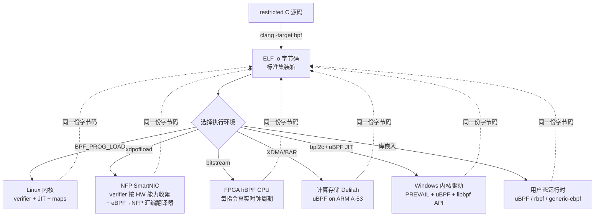
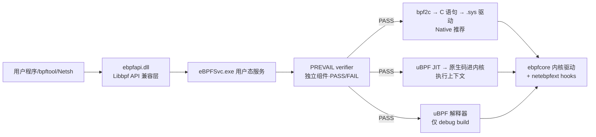

# 第14章 硬件卸载与非 Linux 平台

> 本章导读：写给两类人——①想理解"eBPF 程序离开 Linux 内核还能不能跑"的工程师（SmartNIC/FPGA/SSD/Windows 各条路线的真实能力与死活）；②要做架构选型、需要一份"哪些卸载路线活着哪些死了"冷静判断的人。前置：第 2 章（VM 与指令集——ISA 与执行环境解耦是本章一切的前提）、第 3 章（Verifier——offload 的能力集一致性问题）、第 4 章（Maps——map 跨内存域）、第 9 章（XDP 与 tc——xdpdrv/xdpoffload 的挂载点背景）。读完你能：说出硬件 offload 的三份一致性契约与 Netronome 路线兴衰的时间线；解释 Windows 移植如何证明 verifier/执行引擎可解耦；用 uBPF/rbpf/PREVAIL 在用户态或非 Linux 环境跑通并验证 eBPF 程序；引用活跃度数据判断一条卸载路线是否值得投入。

## 14.1 直觉层

**比喻：标准集装箱与多个码头。** 第 2 章讲过，eBPF 本质上是一份独立 ISA（RFC 9669），编译产物是一段定长 64 位编码的字节码。把这段字节码想成一只**标准集装箱**：Linux 内核只是最早建成、设施最全的那个码头；NFP SmartNIC 的微引擎、FPGA 上的 eBPF CPU、SSD 控制器里的 ARM 核、Windows 内核驱动，都是理论上能吊装同一只箱子的**其他码头**。"硬件卸载"与"跨平台移植"是同一件事的两个名字：**箱子不动，换吊机**。

**为什么需要卸载？** 因为主机 CPU 不是所有数据的第一站。网卡先于主机看到每一个包（DDoS 攻击流量到达 CPU 之前就已在 NIC 上可判别）；SSD 先于主机看到每一页数据（过滤/按摩一列数据本可不搬过 PCIe）。XDP 的核心思想是"在包最早出现的地方处理"（第 9 章），而硬件 offload 把这一思想推到极限——连主机内存都不进。Delilah 论文对计算存储的动机表述可直接套用到全部卸载场景：computational storage 的收益只有两条路——"显著降低 host 的核与内存占用，或通过硬件加速关键函数获得应用提速"（[id=96] §2.2）。2016 年 XDP 原始 workshop 上 Tom Herbert 就把这条愿景写进了路线图："XDP 程序可移植到多个 XDP 平台——不止 Linux 内核，还有 NIC offload、switch、DPDK、其它 OS"（[id=76]）。

**它在整条 eBPF 栈里的位置**——offload 改变的不是程序，而是"verifier → JIT → 执行"这串流水线的**末端**：



关键观察：无论末端换成什么，**箱子（字节码）和报关流程（验证）都必须存在**。区别只在于"海关"是谁——内核 verifier、PREVAIL，还是干脆留空（Delilah 把验证留作 future work，见 14.2.4）。这一章讲的就是六个"码头"各自的吊装能力、收费方式与经营状况。

## 14.2 原理层

### 14.2.1 硬件卸载的本质约束：三份一致性契约

把"程序在内核里能跑"变成"程序在设备上能跑"，表面看只是换执行器，实际要同时维护**三份一致性契约**。这是 Netronome 两代 netdev 演讲沉淀下来的通用约束清单，至今适用：

**契约一：verifier 能力集与 NIC 能力集的一致性。** 内核 verifier 验证的是"这个程序在内核运行时里安全"；卸载后真正的执行者是 NIC 固件里的翻译产物。所以验证目标变成了全新的一类——"程序将跑在设备上"，verifier 需要**按 offload 设备的能力收紧检查**，驱动侧再做二次校验（digest 11 [id=273] 对 `drivers/net/ethernet/netronome/nfp/bpf/jit.c` 的定位："理解 verifier 如何按 offload 设备能力收紧（verifier + driver 双重校验）"）。内核侧的通用接口在 `kernel/bpf/offload.c`（digest 11 [id=266] 目录地图），这是 verifier 与卸载设备之间的协议层。能力集差异不是理论问题：NFP 的硬件 JIT 对**硬件 map、原子操作、尾调用只提供受限支持**（digest 11 [id=273]）；Suricata 文档实证了同一件事——`xdp-mode: hw` 硬件 offload 模式要求**关掉 BUILD_CPUMAP 与 USE_PERCPU_HASH（percpu hash map）**才能工作（digest 15 [id=190]）。换言之，"能在内核加载"是卸载的必要条件而非充分条件。

**契约二：map 跨两个内存域的一致性。** 卸载程序的 map 不在内核内存里，而在设备的**独立内存域**——内核与固件（FW）两侧要各自维护一份架构并保持同步（[id=92] 议题 f："offloading maps to a device with separate memory domain"；[id=93] 议题 1 "Architecture-kernel / Architecture-FW overview / Limitations"）。这直接影响编程：map 类型选择要按 NIC 支持的最小集来写（bpf-samples 的 l4lb 只用一张普通 HASH map；xdpdump 用 per-CPU perf event array，两者都是 NFP 固件验证过的形态，repos/Netronome/bpf-samples/）。

**契约三：原子性与并发语义的差异。** 多线程是 NFP 的家常便饭——netdev 1.2 的议题 g 是"透明地施加时分复用多线程来加速 eBPF 程序"（[id=92]）：同一段单线程语义的 eBPF 字节码，被固件透明地跑在多个微引擎线程上。内核 verifier 按单核语义验证的原子性（atomic fetch-add 等），在设备上要由硬件 map 与受限原子指令重新兑现——这正是契约一中"原子操作受限支持"的另一面（digest 11 [id=273]）。

在这三份契约之外，[id=93] 还点名了两个工程真痛点，其一是**可调试性**：offload 后程序脱离内核可视域，`bpftool` 如何查看已卸载程序成了专门议题（"how to inspect offloaded programs"）；其二是 **partial offload 决策**——"最大挑战之一：以透明高效的方式决定卸载谁"（[id=93]）。程序员模型上 Netronome 坚持的是**透明卸载**——"不需要程序员做任何特殊的事"（[id=92] 议题 a），同一份 .o 用 `xdpdrv`（内核执行）或 `xdpoffload`（硬件执行）加载，见 14.3。

XDP 在卸载对象里有结构性优势：它位于协议栈最底层、上下文就是裸包（`xdp_md`），不依赖 sk_buff 等内核复杂结构——[id=93] 开篇即讲"XDP 比其他内核功能更不复杂可卸载，因为它坐在协议栈最底部"。

### 14.2.2 NFP SmartNIC 路线：兴衰时间线与教训

这是"通用 eBPF 硬件卸载"的开山线，也是一条已经死亡的商用线。用时间线钉版：

- **2016**：cls_bpf 时代 Netronome SmartNIC offload 已是 tc 社区议题（[id=52]；同年 tc workshop 35 分钟硬件 offload 专题，Intel/Chelsio/Mellanox/Spectrum 四家 NIC 厂商各讲一摊，digest 05 [id=53]——可见当年是全行业热点）。
- **2017-10（netdev 1.2）**：Kicinski & Viljoen 系统性方案发布（[id=92]）：NFP（Network Flow Processor）架构（packet path/chip layout/**microengines**/内存架构）→ 内核基础设施改造（TC/XDP hook、verifier 扩展、map hooks）→ **eBPF 字节码→NFP 汇编的翻译器**（处理非线性映射）→ 32 位架构上的 eBPF JIT 与 **A/B 寄存器分配** → map 卸载到独立内存域 → 透明时分复用多线程。这一年 Ferris Ellis 的著名长文把它写进 eBPF 未来叙事：Agilio CX"每 FPC 3Mpps×72-120 FPC 理论 4.3Tbps"（[id=28]）——注意这是厂商理论推算，非实测。
- **2018（netdev 2.2 + bpf-samples）**：产品化阶段。[id=93] 转向边角案例（map 卸载限制/调试/32 位实现/tail call/partial offload）；Netronome 开源三个双模 demo——L4 负载均衡（内核要求 4.17）、可编程 RSS 与 xdpdump（均要求 4.18，RSS 能力"在 Linux 内核 4.18 引入通过 eBPF 编程 RX RSS"；且 programmable_rss **只能 offload 模式跑，driver 模式不可用**——这是"NIC 独有能力只能经卸载获得"的实例，repos/Netronome/bpf-samples/programmable_rss/README.rst）。offload 实测：l4lb 32 目的地 **33,026,761 pps / 38 Gbps**（l4lb/README.rst，配套高性能流量发生器）。
- **2018-11 之后**：bpf-samples 停更（最后提交 2018-11-09，git log）。
- **2020 年代**：Netronome 被 **Corigine 收购，NFP 新硬件线基本停更**（digest 11 [id=273] 坑注）。
- **今天**：`nfp` 驱动（drivers/net/ethernet/netronome）与 `kernel/bpf/offload.c` 通用卸载框架**仍在主线**（digest 06 总评、digest 11 [id=266]）——硬件死了，框架活着。

**教训有两条。** 其一：**厂商绑定的生态会随厂商死，进主线的框架不会**——offload.c 这套 verifier↔驱动接口是所有后来者（包括未来的 DPU 卸载）可复用的公共品。其二：[id=28] 的坑注一针见血——2017 年的 SmartNIC 预测只"部分兑现，P4/offload 走了别的路"：可编程网卡的主流终局是 P4/PNA 语言系与固定功能 DPU offload，"跑通用 eBPF 字节码的 NIC"没有成为品类。买硬件做 eBPF 卸载前，先问这条品类还活不活着。

### 14.2.3 FPGA 路线：hBPF——把 eBPF 指令集直接做成 CPU

**设计。** hBPF（rprinz08/hBPF，2021 年起，BSD-3）是一个**纯 Python3 写的 eBPF CPU**：用 LiteX/Migen 框架描述硬件，同一套代码可仿真、可综合到 FPGA。它回答了一个内核永远回答不了的问题——"eBPF 每条指令到底值多少个时钟周期"：多数指令 1 cycle、跳转 2 cycles、div/mod 最贵（doc/opcodes.md 实测 **68 cycles**）[id=94]。CPU 核约 **8000 LUT、100MHz 验证**，含 Wishbone 桥与 LiteScope 调试器约 10500 LUT；三块 Xilinx 板（Arty-S7/Arty-A7/Zybo-Z7）可跑真硬件（README "FPGA Implementations" 节）。

**架构选择值得逐条看**（README "Overview" 与 "Deviations from eBPF" 节）：

- **Harvard 架构**：程序存储（64-bit 宽）与数据存储（8-bit，默认 2048 字节装网络包）物理分离——这其实是把 cBPF 论文里"程序与包数据分域"的思想做成了硬件（第 1 章 [id=86] 的 M[]/P[] 分域）。
- **直接跑 LLVM 产物**：LLVM 编译的 C 或汇编字节码无需修改即可执行——证明 ISA 层的干净解耦在硬件上成立。
- **call 不再调 helper，而是触发 call-handler**：`call` 的 imm 选择 call-handler 里的功能，R1-R5 作输入、R0 收结果，寄存器在调用期间保留——这是 FPGA 的**硬件扩展点**（doc/call_handler.md 给了 LFSR 随机数发生器、LED I/O 两个例子，类比 RISC-V 的 CFU 自定义功能单元）。
- **三处方言偏差**：R1 不再是 context 指针而是普通参数；**无栈**（stack 不支持）；call-handler 取代 helper。引用 hBPF 数字时必须注明这是方言而非标准 eBPF（digest 06 [id=94] 同款提醒）。
- 测试体系三层共享（Python 模拟器/FPGA 仿真/真硬件），`.test` 文件直接断言时钟数（Fibonacci r1=9 → 324 cycles，digest 06 [id=94]）。

**学术价值与边界。** hBPF 的价值是"教学与实验"而非产品：README 自明"不与 Alveo 类多核加速卡竞争，用于获取洞察与做实验"；且截至最后提交（2023-01-27），三块板**尚未连接以太网 PHY/MAC**——"smart NIC"只是 README 里的构想图。同路线还有两个坐标：**Sephirot**（专有设计，面向包处理的 eBPF 硬件）与 **hXDP**（CACM 2022，把 eBPF 当中间表示在 FPGA NIC 上做高效包处理）——后两者见 Delilah 论文的生态综述（[id=96] §2.1.3 与文献 [6]）。一个引用勘误：Delilah 论文称 hBPF 为 "a project of the eBPF foundation"（[id=96]），而 hBPF README 自述为个人实验项目——以 README 为准。

### 14.2.4 计算存储 offload：OpenCSD 与 Delilah（NVMe TP4091 时代）

**标准化背景。** NVMe TP4091（Computational Programs）把设备端程序分两类：**downloadable functions**（运行时从 host 卸载、eBPF 是其示例执行环境）与 **device-defined functions**（预装 OS 镜像/FPGA bitstream）[id=96] §1。SNIA 标准给出三分类（computational storage processor/drive/array）与三种架构（**on-path PCIe**——处理器是 host 的 PCIe 设备兼 SSD 的 PCIe root；**off-path**——同 PCIe 域经 p2pDMA 通信；**SmartNIC**——处理器长在 NIC 里）[id=96] §2.2。Delilah（哥本哈根大学/弗里堡大学，**DaMoN'23**——注意 venue 勘误：不是 HotStorage，digest 06 已钉版）是**首个公开描述的在真实计算存储设备上支持 eBPF 卸载的系统**。

**Delilah 的三个选型决定**（[id=96] §3）：

1. **运行时选 uBPF 而非内核运行时或纯硬件**：论文逐一分析——Linux 内核运行时最成熟但更适合 SmartNIC 场景（数据经内核网络/存储栈流动）；硬件 eBPF（hBPF/Sephirot）适合 off-path FPGA 卡；**uBPF 跑在 PS 侧 ARM Cortex-A53 嵌入式 Linux 上，探索自由度最大**。这一段是"按架构选运行时"的教科书论述。
2. **平台选 OpenSSD Daisy**（汉阳大学设计、CRZ 商售）：Zynq Ultrascale+ MPSoC（FPGA PL + ARM PS）+ PCIe Gen3x16 + 2x M.2——PL 放硬件加速函数，PS 放 Delilah controller + uBPF VM + 注册函数。
3. **协议扩展 Eid-Hermes**：程序与数据走 XDMA（DMA），执行命令走 BAR aperture；host 驱动用 **io_uring 的 uring 命令**（异步，比 ioctl 先进）。

**两条最有普适价值的实测发现**（[id=96] §4）：

- **嵌入式 offload 的隐形大头是 cache 一致性，不是执行**。端到端延迟有 ~15ms 的不可接受地板，分解后主凶是**全量 cache flush/invalidate**：A-53 没有 DDIO/cache stashing，DMA 一致性只能靠刷整片 cache，代价正比 cache 大小而非数据量。引入 **selective cache flushing**（host 在执行命令里声明需失效的字节数）后，延迟终于正比于数据量。"卸载到弱核嵌入式平台时先算一致性成本"这一教训适用于一切 offload 设计。
- **BAR 与 DMA 有传输交叉点**：<1KB 用 BAR 快，>10KB 用 DMA 快——结论是程序走 BAR、数据走 DMA（[id=96] §4）。

**verifier 缺口是这条路线最深的张力**：Delilah 诚实声明把验证留作 future work——"Linux verifier 禁无界循环不适合数据按摩场景，backward jump 又是必需的，这使终止分析难得多；同时终止性又重要，否则设备可被死循环锁死"（[id=96] §3.1）。这是卸载场景与内核安全模型的真实错位：第 3 章的 verifier 假设"程序 5μs 内跑完"，存储函数天然是循环密集的。

**姊妹项目 OpenCSD**（Dantali0n/qemu-csd，VU 阿姆斯特丹系）：用 **QEMU + uBPF + SPDK 仿真**一台 eBPF 可编程 CSD，把用户态 FUSE 实现的 LFS（FluffleFS）卸载到"SSD"上跑，含完整硕士论文与可复现测量数据；代价是研究原型的脆弱构建链（QEMU 7.2/SPDK 22.09/Meson<0.60 精确锁版），2023-11 后停更 [id=95]。两者对照读：OpenCSD 教"怎么仿真验证设计"，Delilah 教"真硬件上哪里会疼"。

### 14.2.5 Windows 移植：verifier 与执行引擎可解耦的工程证明

eBPF for Windows（微软官方，2026-11-05 仍在活跃提交）是本章最重要的当代样本，因为它用工业级体量证明了一件事：**验证器、执行引擎、宿主环境三者本来就是可解耦的组件**。README FAQ 第一问的回答很直白——"这不是 eBPF 的 fork"，而是"拿现有 eBPF 项目（uBPF、PREVAIL）当子模块，补一层 Windows 宿主环境"[id=168]。

**组件分层**（README + docs/）：

- **验证器 = PREVAIL**（vbpf/ebpf-verifier）：与执行引擎完全独立的用户态验证器（第 3 章讲过其 PLDI'19 血统与 zone 抽象域）。这里体现解耦：PREVAIL 验证通过的字节码，可以交给任何后端。
- **执行引擎 = uBPF**：被移植进 Windows 内核执行上下文（libs/ 含 uBPF 移植层）。
- **API 兼容层 = ebpfapi.dll**：暴露 **Libbpf API**——bpftool 与 Netsh 命令行都走它，Linux 侧 libbpf 程序的加载代码可以源码级复用。
- **hook 提供者 = netebpfext** 等扩展驱动：把 XDP/bind/connect/listen/sock_ops 等 hook 映射到 Windows 网络栈（docs/ 里 BindHook.md、FlowClassifyHook.md、sock_ops_hook.md 等逐 hook 设计文档）。tutorial.md 里能看到与 Linux 同名的 `SEC("xdp")`、`xdp_md`/`xdp_action`——同一程序骨架跨 OS 成立。



**三种执行模式不是并列选项，而是被安全模型筛选的**（README "Architectural Overview" + FAQ 3）：

1. **Native（推荐）**：`bpf2c` 把过检字节码**逐条翻译成等价 C 语句**（寄存器映射为局部变量），再用 MSVC/GCC/Clang 编成标准 .sys 驱动、走 Windows 签名体系（docs/NativeCodeGeneration.md）。对 HVCI（Hypervisor 强制代码完整性）最安全——这是唯一在 HVCI 生产系统上可用的模式。
2. **JIT**：用户态服务 eBPFSvc.exe 用 uBPF JIT 编出原生码送内核执行上下文。**HVCI 开启时不可用**——JIT 没有 hypervisor 信任的签名密钥。
3. **解释器**：仅 debug build 提供，release 一律不给（"被认为欠安全"）——与 RFC 9669 "解释器被视为不安全源（侧信道 gadget）"的倾向一致（[id=16] §6，第 2 章 2.2.8 已引）。

这个筛选过程本身就是一课：**宿主平台的安全模型（HVCI 信任链）反过来决定了执行引擎的选型**。内核 Linux 用"verifier 证明 + JIT 无签名"路线，Windows 用"verifier 证明 + 编译进签名驱动"路线——同一个证明器（PREVAIL），两种落地方式。

**兼容的边界**：目标是**源码级兼容**而非二进制兼容——hooks/helpers 是"跨 OS 通用的那部分"的子集，Linux 特有结构（sk_buff 系）不适用；Linux 程序不能假定直接跑 [id=168]。逐指令的支持面被明文档化在 docs/isa-support.rst：一张 opcode×src_reg×off×imm 的表，逐条标注 PREVAIL/uBPF/bpf2c 是否支持、对应的 bpf_conformance 测试名——跨平台工程把"ISA 一致性"做成可审计表格的范例。

### 14.2.6 "eBPF everywhere"：用户态运行时谱系与生态意义

第 2 章从 ISA 可移植角度介绍过用户态运行时；这里补齐**生态意义**——谁在用、为了什么、谁还活着（活跃度按本地仓 git log 钉版，2026-11 视察）：

- **uBPF**（iovisor，Apache-2.0，2026-10-16 活跃）：存在的理由是**许可证**——内核 eBPF 是 GPL，闭源项目不能复用；uBPF 提供汇编器/反汇编器/全平台解释器 + x86-64/Arm64 JIT，README 直接把 RFC 9669 列为规范基准 [id=160]。新一代 **Safe Execution Profile** 把内核 verifier 的指针追踪思想压进解释器本身（寄存器来源追踪、集中式检查解引用、类型化 helper 元数据、descriptor 外部内存区，歧义指针算术直接拒绝），面向"不依赖外部 verifier 也要安全"的嵌入场景——首版故意不开 JIT [id=160]。uBPF 的消费端正是本章两条线：eBPF for Windows 的执行引擎 [id=168]、Delilah 的设备端运行时 [id=96]。
- **rbpf**（qmonnet，Rust，2026-06-03 温和维护）：uBPF 的 Rust 移植（基于 Rich Lane 版本），解释器 + x86_64 JIT + 反汇编，Linux/macOS/Windows 可编译（JIT 暂不支持 Windows），crate `rbpf = "0.4.1"` [id=164]。读一个完整 eBPF VM 的最低成本入口。
- **PREVAIL**（vbpf，2026-11-06 极活跃）：用户态验证器标准件——Windows eBPF 与 uBPF 生态共用；CLI `bin/prevail <elf> <section> <function>` 输出 PASS/FAIL，`--termination` 验证终止性、`--failure-slice` 输出致错最小指令切片、conformance groups 对齐 RFC 9669 [id=165]。
- **generic-ebpf**（YutaroHayakawa，2021-05-28 停更）：一套代码同时跑 FreeBSD/Linux 内核态与用户态、macOS 用户态的可移植运行时——FreeBSD eBPF 移植的前身实验田（作者随后转投 FreeBSD 主线）[id=161]。其应用 **vale-bpf**（2019-11-06 归档）给 FreeBSD VALE 软件交换机（netmap 系，小包 ~20 Mpps/核）加 eBPF 转发面 [id=162][id=163]。这条线证明的是"eBPF 抽象层可以跨内核设计"，最终以进 FreeBSD 主线告终——仓死了，路线活着。

生态意义一言以蔽之：**用户态谱系把 eBPF 从"Linux 内核机制"升格为"通用沙箱 ISA"**。许可（uBPF）、语言生态（rbpf）、验证（PREVAIL）、操作系统（FreeBSD/Windows）、设备（CSD）各自独立地需要"安全的受限执行"，而它们殊途同归都选了 eBPF 字节码当载体——因为它是唯一自带工业级静态验证器的轻量 ISA。XDP workshop 2016 年"XDP 到 NIC/switch/DPDK/其它 OS"的愿景（[id=76]），在用户态与非 Linux 平台这条侧线上兑现得比硬件主线好得多。

### 14.2.7 跨平台标准化：RFC 9669 的边界与贡献

RFC 9669（2024-10，Standards Track）把这套 ISA 升格为 IETF 标准（第 2 章 2.2.9 详述编码），本章关心的是它对**非 Linux 实现**的意义：

- **标准化成立的部分**：指令编码与语义、conformance groups（base32 ⊂ base64、atomic32 ⊂ atomic64、divmul32 ⊂ divmul64、packet 历史组）——运行时与编译器靠组名互操作 [id=16]。PREVAIL 的 conformance groups CLI 参数、uBPF README 的规范引用、isa-support.rst 的逐指令表、bpf_conformance 测试工具（Alan-Jowett，Delilah 论文 §2.1.3 提及）——四个独立项目用同一套组名对齐，这是标准真正落地的样子。
- **标准化不覆盖的部分**：helper 集合、map 语义、verifier 行为都"留给平台文档/未来工作"（[id=16] §4.3.1 只定义 CALL 编码）。所以"BPF 程序跨平台可移植"目前成立的**只有指令层**——一个 PREVAIL+uBPF 环境能跑的"指令合法"的程序，未必能用任何 helper 或 map。Windows 的做法（hooks/helpers 取 Linux 子集 + 源码级兼容）正是对这条边界的诚实回应 [id=168]。
- RFC 的 Security Considerations 还点名 Linux verifier 与 PREVAIL 为两个参考实现，并预告 verifier 规范的后续工作 [id=16]——跨平台的安全验证本身正在标准化路上。

### 14.2.8 冷静判断：哪些卸载路线活着、哪些死了（语料活跃度实证）

按本地仓 `git log -1` 的最后提交日期钉版（视察时点 2026-11-06）：

| 路线 | 代表载体 | 最后活动 | 判定 |
|---|---|---|---|
| NFP SmartNIC 硬件线 | Netronome 商用线 / bpf-samples | 2018-11-09（仓）；NFP 硬件线被 Corigine 收购后基本停更（digest 11 [id=273]） | **死**（历史价值） |
| 内核 offload 框架 | kernel/bpf/offload.c + nfp 驱动 | 随主线演进 | **活**（公共品长存） |
| FPGA eBPF CPU | hBPF | 2023-01-27 | **停更**（教学标本，doc/opcodes.md 周期表仍是孤本数据） |
| 计算存储（仿真） | OpenCSD qemu-csd | 2023-11-01 | **停更**（研究原型） |
| 计算存储（真硬件） | Delilah（delilah-csp） | 论文 2023-06；本地未克隆，活跃度未验证（标注待核实） | 学术前沿 |
| Windows 移植 | microsoft/ebpf-for-windows | 2026-11-05 | **活**（工业级，周更以上） |
| 用户态 VM（C） | iovisor/ubpf | 2026-10-16 | **活** |
| 用户态 VM（Rust） | qmonnet/rbpf | 2026-06-03 | **活**（温和维护） |
| 用户态验证器 | vbpf/ebpf-verifier (PREVAIL) | 2026-11-06 | **活**（极活跃） |
| FreeBSD 泛型运行时 | generic-ebpf / vale-bpf | 2021-05-28 / 2019-11-06 | **仓死**（精神进 FreeBSD 主线） |

结论的形状很清晰：**"离开 Linux 内核跑 eBPF"这件事整体是活的，但重心从硬件搬进了软件**——2016-2018 年那波"通用 eBPF SmartNIC"的品类消亡后，跨平台的生命力集中在用户态运行时（uBPF/rbpf/PREVAIL）与整 OS 移植（Windows）；硬件侧只剩学术标本（hBPF、Delilah）与等待标准跟进的计算存储（TP4091）。

## 14.3 实践层

四条上手路径，按"无硬件→有旧 SmartNIC→有 FPGA→有 Windows"排列：

**路径一（推荐起点）：用户态跑通 + 验证一条龙，零特殊硬件。**

1. 用 clang 照常编译一个 .bpf.o（第 7 章 libbpf-bootstrap 的 minimal 即可）。
2. PREVAIL 验证：克隆 vbpf/ebpf-verifier，C++23 构建（GCC 13+/Clang 17+），跑 `bin/prevail your.o <section> <function>`——输出 PASS/FAIL；加 `--failure-slice` 看致错最小指令切片，加 `--termination` 看终止性证明（[id=165]）。ebpf-samples/ 目录内置 cilium 等真实测试程序集可直接当输入。
3. uBPF 执行：clone iovisor/ubpf，API 四步——`ubpf_create()` 建 VM → `ubpf_register()` 注册 helper → `ubpf_load()`/JIT 编译 → `ubpf_exec()` 执行（README；注意 uBPF 约定 r1=mem、r2=mem_len 的双参数 ctx 约定，与内核只传 r1 不同，docs/VerifiedPrograms.md 专讲这个差异 [id=160]）。Rust 用户直接 `rbpf = "0.4.1"` 依赖，同样的四步 API（[id=164]）。

**路径二：Netronome 双模 demo——同一份 .o 的 xdpdrv/xdpoffload 对照（需 Agilio CX + 2018-07 固件）。**

```bash
cd repos/Netronome/bpf-samples/l4lb && make
# 内核执行（driver mode）：
ip link set dev $DEV xdpdrv obj l4lb_xdp.o sec xdp
# 硬件执行（offload mode）：
ip link set dev $DEV xdpoffload obj l4lb_xdp.o sec xdp
./l4lb_map.py -i $DEV -f destination_samples/32_destinations.csv
./l4lb_stats.py -i $DEV        # offload 实测 ~33 Mpps / 38 Gbps
ip link set dev $DEV xdpoffload off
```

读 README.rst 注意两处：加载时打印的 "12 bytes struct bpf_elf_map fixup performed due to size mismatch!"（旧 ELF map 定义与内核 ABI 的尺寸修补警告）；以及"prototypes are not suitable for production use"——2018 年代码用的是旧 libbpf API，学结构别照抄 API（digest 10 同款提醒）。

**路径三：hBPF——亲眼看每条指令的时钟周期。** clone rprinz08/hBPF，`tests/test_vm.py`（模拟器，快）/`test_fpga_sim.py`（仿真，慢）/`test_fpga_hw.py`（需板子）；`.test` 文件四段式（asm/args/result/expected），expected 直接写 cycle 数断言。对着 `doc/opcodes.md` 的周期表读 `source/fpga/cpu.py`——"div 为什么要 68 个周期"这类问题只有这里能回答（[id=94]）。

**路径四：eBPF for Windows。** Win11/Server 2022+，按 docs/GettingStarted.md 装；`powershell scripts\Convert-BpfToNative.ps1 -FileName my_program` 一条命令走完 PREVAIL 验证→bpf2c 翻译→.sys 生成（docs/NativeCodeGeneration.md）；bpftool 与 Netsh 两个前端都经 ebpfapi.dll 走 Libbpf API [id=168]。排 verifier 失败先读 docs/debugging.md。

**研究复现入口**：计算存储方向从 repos/Dantali0n/qemu-csd 的 `opencsd/bpf_programs/`（卸载程序样例）与 `thesis/`（完整硕士论文 LaTeX）入手，真硬件路线读 web/pdf-txt/96.txt（Delilah 全文 7 页，标准/架构/实现/实测一次讲完）。

## 14.4 深水区与坑

1. **"内核里能跑"≠"能卸载"——能力集是陷阱正门**。NFP 对硬件 map/原子操作/尾调用只有受限支持（digest 11 [id=273]）；Suricata 的 `xdp-mode: hw` 必须关 BUILD_CPUMAP 与 USE_PERCPU_HASH（digest 15 [id=190]）。给可能卸载的程序按**最小公共能力集**写：普通 HASH/ARRAY map、无 tail call、无 percpu、原子操作只做简单 fetch-add。
2. **map 双域一致性是隐形运维负担**：offload map 的内核侧与 FW 侧各有一份架构，写路径与同步限制是专门议题（[id=93] 议题 1）；程序换模式（drv↔offload）重载时 map 状态不保证延续，bpf-samples 的用法是 map 装载后由用户态脚本重填（l4lb_map.py）。
3. **调试可见性黑洞**：程序 offload 后脱离内核域，`bpftool prog` 怎么显示卸载程序是 netdev 2.2 的专门议程（[id=93] 议题 2）——排障前先确认你的 bpftool 版本对 offloaded prog 的支持，别按内核程序的习惯预期 introspection。
4. **HVCI 改写执行引擎选型**：Windows 上 JIT 因无 hypervisor 信任密钥而不可用、解释器 release 不给——生产只剩 bpf2c native 一条路 [id=168]。同理，任何带强制代码完整性的宿主（签名链、SELinux 类加载限制）都会筛掉部分执行模式，选型时先问宿主信任模型。
5. **嵌入式 offload 先算 cache 一致性账**：Delilah 的 15ms 地板、cache 大小而非数据量决定 flush 成本、selective cache flushing 才救回来（[id=96] §4）；DMA vs BAR 的 1KB/10KB 交叉点决定传输通道选型。这些成本与"eBPF 程序本身跑多快"毫无关系——offload 性能瓶颈通常在搬运与一致性，不在执行。
6. **计算存储的 verifier 空窗**：TP4091 场景需要 backward jump 做数据按摩，Linux verifier 的终止性模型不适配，Delilah 干脆不做验证（[id=96] §3.1）。引用"eBPF 进 SSD"叙事时要带上这个未闭合的安全缺口——目前它只适合可信 host 卸载给自己的程序。
7. **hBPF 是方言不是标准**：无栈、R1 普通参数、call-handler 取代 helper（[id=94] README "Deviations" 节）——拿 hBPF 的周期数或语义去推内核 eBPF 行为是张冠李戴。另注意 Delilah 论文称其为 "a project of the eBPF foundation" 与 README 自述（个人实验）有出入，引用以 README 为准。
8. **版本与硬件代差**：bpf-samples 的 l4lb 要内核 4.17、RSS/xdpdump 要 4.18（可编程 RSS 本身 4.18 引入）；NFP 商用线已停（Corigine 收购），新买的 DPU 上没有这套固件（digest 11 [id=273] 坑注）。拿 2018 demo 验证 2026 内核需自担兼容风险。
9. **性能数字要带语境引用**：33 Mpps/38 Gbps 来自 Agilio CX + 高性能流量发生器 + 32 目的地（l4lb/README.rst）；"4.3Tbps 理论值"是 2017 年厂商推算（[id=28]）；Delilah 的延迟数字是 A-53@Zynq + 1KB-100MB 文件区间（[id=96]）。剥离语境引用都是事故。
10. **语料坑三条**：`web/md/96.md` 是损坏文件（PDF 二进制误存为 md），用 `web/pdf-txt/96.txt`（digest 06 附注）；[id=92]/[93] 本地只是 session 元数据页，深挖要追 slides/paper 外链（eBPF_HW_OFFLOAD.pdf 在 netdevconf.org）；kernel.org cgit 系壳页（Anubis 盾）对 offload 相关源码入口同样成立——offload.c/nfp jit.c 直接读 GitHub torvalds/linux 镜像（digest 11 总评）。

## 14.5 与其他章的关系

- **前驱**：第 2 章（VM 与指令集）给了"ISA 独立于执行环境"的前提——本章是那个前提的六个落地证明；第 3 章（Verifier）的 PREVAIL 一节是 Windows 移植的验证器半场，offload 的"verifier 按 device 能力收紧 + driver 二次校验"是白名单裁剪思想在硬件侧的延伸；第 4 章（Maps）的 map 语义在卸载后要跨内存域重新兑现；第 9 章（XDP 与 tc）的 `xdpdrv` 与本章 `xdpoffload` 是同一挂载点的两种执行位置，XDP"位于协议栈最底部"正是它最适合卸载的原因（[id=93]）。
- **后继**：安全章会用本章的 HVCI/签名执行模式做"宿主信任模型"案例（JIT 不可信时 verifier+预编译如何补救）；教程与示例章（digests/08-10）的 Netronome offload 用户指南条目是本章实践层的延伸阅读；项目章（digests/14-15）里 Suricata 的 `xdp-mode: hw` 是能力集约束的生产级实例。

## 14.6 语料索引

| id | 名称 | 本地路径 | 本章用了什么 |
|---|---|---|---|
| 92 | eBPF/XDP hardware offload to SmartNICs（netdev 1.2, 2017） | web/md/92.md | 议题 a-j 大纲：透明卸载模型、NFP microengine 架构、verifier 扩展、字节码→NFP 翻译、32 位 JIT/A-B 寄存器分配、map 独立内存域、时分复用多线程 |
| 93 | Comprehensive XDP offload（netdev 2.2, 2018） | web/md/93.md | XDP 位于栈底最宜卸载、map 双侧架构、bpftool 可见性、tail call、partial offload 挑战表述 |
| 94 | hBPF - eBPF in hardware | repos/rprinz08/hBPF/ | Harvard 架构、LLVM 产物直跑、call-handler 扩展点、三处方言偏差、LUT/主频、doc/opcodes.md 周期表（div/mod=68）、"未接 PHY/MAC"、README 自述定位 |
| 95 | OpenCSD eBPF SSD offloading | repos/Dantali0n/qemu-csd/ | QEMU+uBPF+SPDK 仿真 CSD、FluffleFS LFS、九模块构成、锁版依赖、2023-11 停更 |
| 96 | Delilah（DaMoN'23） | web/pdf-txt/96.txt（注意 web/md/96.md 损坏） | TP4091 两类函数、SNIA 三分类三架构、uBPF-on-A53 选型论证、XDMA/BAR/io_uring、15ms cache 地板与 selective flushing、BAR-DMA 交叉点、verifier 留白的张力、hXDP/Sephirot/bpf_conformance 提及、uBPF 默认 512B 栈/64K 指令 |
| 160 | uBPF | repos/iovisor/ubpf/ | Apache-2.0 许可动机、RFC 9669 基准声明、Safe Execution Profile 四机制、VerifiedPrograms 的 ctx 约定 |
| 161 | generic-ebpf | repos/YutaroHayakawa/generic-ebpf/ | 三组件跨平台设计、FreeBSD 前身、停更时点 |
| 162 | vale(4) man page | web/md/162.md | VALE 交换机 ~20 Mpps/核背景数字 |
| 163 | vale-bpf | repos/YutaroHayakawa/vale-bpf/ | eBPF 交换机转发面、归档状态 |
| 164 | rbpf | repos/qmonnet/rbpf/ | Rust 移植自 uBPF、API 四步、平台矩阵（JIT 不支持 Windows）、crate 版本 |
| 165/166 | PREVAIL 仓/PLDI'19 论文 | repos/vbpf/ebpf-verifier/、web/pdf-txt/166.txt | CLI/--termination/--failure-slice/conformance groups、与 uBPF/Windows 的组合关系、zone 域与循环支持（第 3 章详述） |
| 168 | eBPF for Windows | repos/microsoft/ebpf-for-windows/ | README 三执行模式+HVCI FAQ+非 fork 声明、ebpfapi.dll Libbpf API、netebpfext hooks、NativeCodeGeneration.md bpf2c 流水线、isa-support.rst 指令矩阵、tutorial.md SEC("xdp") |
| 16 | RFC 9669 BPF ISA | web/md/16.md | 标准化边界（只管指令层）、conformance groups、解释器不安全论、PREVAIL 列为参考实现 |
| 76 | XDP workshop（netdev 1.2, 2016） | web/md/76.md | "XDP 可移植到 NIC offload/switch/DPDK/其它 OS"愿景原话 |
| 28 | eBPF, part 1（Ferris Ellis, 2017） | web/md/28.md | Agilio CX 每 FPC 3Mpps×72-120 理论 4.3Tbps、"部分兑现"坑注 |
| 52/53 | cls_bpf updates / tc workshop（2016） | web/pdf-txt/52.txt、web/md/53.md | Netronome offload 起点、四 NIC 厂商 offload 专题议程 |
| 190 | Suricata XDP bypass | digests/15（web/md/190.md） | xdp-mode: hw 需关 BUILD_CPUMAP/USE_PERCPU_HASH |
| 266/273 | kernel/bpf/ 目录、nfp/bpf/jit.c | digests/11-内核源码入口.md | offload.c 通向硬件卸载接口、verifier+driver 双重校验、硬件 map/原子/尾调用受限、Corigine 收购停更 |
| — | Netronome bpf-samples | repos/Netronome/bpf-samples/ | xdpdrv/xdpoffload 命令、4.17/4.18 内核要求、RSS 仅 offload 可跑、bpf_elf_map fixup 警告、33 Mpps/38 Gbps 实测、生产免责声明 |
| — | digests/06/10/12/13 | digests/*.md | 批次总评定位（早期探索标本/活跃度口径）、bpf-samples 双模卖点、用户态三角谱系 |

## 14.7 AI agent 用法

本章知识被 agent 检索复用的配方（问题 → grep 词 → 命中位置）：

1. **"eBPF 程序怎么卸载到 SmartNIC/有哪些命令？"** → grep `xdpoffload` → `repos/Netronome/bpf-samples/l4lb/README.rst`（driver/offload 双命令+实测数字）；配套 grep `xdp-mode: hw` → `digests/15-项目·网络下.md`（生产约束：关 cpumap/percpu）。
2. **"硬件 offload 的限制清单/为什么我的程序卸载失败？"** → grep `partial offload`、`separate memory domain` → `web/md/93.md`；grep `双重校验`、`尾调用受限` → `digests/11-内核源码入口.md` [id=273] 条目；内核侧接口 grep `offload.c` → 同 digest [id=266]。
3. **"Windows 上怎么跑 eBPF/HVCI 下能用 JIT 吗？"** → grep `bpf2c`、`HVCI` → `repos/microsoft/ebpf-for-windows/README.md`（FAQ 3 权威口径）；生成流程 grep `Convert-BpfToNative` → `docs/NativeCodeGeneration.md`；某条指令三后端支持面 grep opcode 十六进制 → `docs/isa-support.rst`。
4. **"在用户态/嵌入式设备上执行 eBPF 用什么？"** → `repos/iovisor/ubpf/README.md`（Safe Execution Profile 与 `ubpf_register_safe_helper`）+ `repos/qmonnet/rbpf/README.md`（API 四步）；先验证再执行 → `digests/12` [id=165]（bin/prevail 用法）。
5. **"计算存储/NVMe TP4091 的 eBPF 是什么？"** → grep `TP4091`、`selective cache`、`io_uring` → `web/pdf-txt/96.txt`；仿真复现 → `repos/Dantali0n/qemu-csd/opencsd/`。
6. **"hBPF 每条指令几个周期？"** → `repos/rprinz08/hBPF/doc/opcodes.md`（周期表）；方言边界 grep `Deviations` → 同仓 README.md。
7. **勘误提示**：`web/md/96.md` 损坏勿引（用 pdf-txt/96.txt）；Delilah venue 写 DaMoN'23 勿写 HotStorage；hBPF 归属以 README 自述为准（个人实验项目）。

