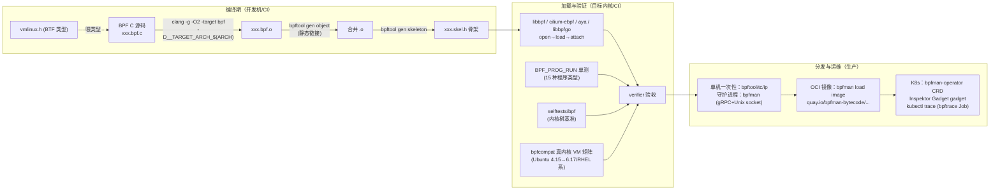

# 第15章 工具链与工程实践：从源码到生产

> 本章导读：写给要把 eBPF 从"能跑的 demo"推进到"可在几百台异构内核机器上运维的产品"的工程师，以及需要快速选型工具/库的 AI agent。前置：第7章（libbpf 加载与生命周期）、第8章（CO-RE 与 BTF）。读完你能：画出"clang 编译 → libbpf 加载 → 测试矩阵 → 性能回归 → OCI 分发 → K8s 运维"的完整工具链地图、在 cilium/ebpf / libbpfgo / aya 三条语言库路线里做出有依据的选型、用 bpftool/bpf_jit_disasm/trace_pipe 三板斧排障，并抄走一张按场景查表的选型决策表。

## 15.1 直觉层

**比喻**：eBPF 工具链与容器镜像供应链是同构的——BPF 字节码 `.bpf.o` 之于内核，就像 OCI 镜像之于容器运行时。一条现代软件供应链的所有环节都有对应物：

| 容器世界 | eBPF 世界 | 载体 |
|---|---|---|
| `docker build`（Dockerfile → 镜像） | `clang -target bpf`（BPF C → `.bpf.o`） | LLVM BPF 后端 [id=142] |
| 镜像扫描/单测 | selftests、`BPF_PROG_RUN` 单测、bpfcompat 内核矩阵 | [id=125][id=118][id=170] |
| Registry（Docker Hub/Quay） | OCI 镜像分发 eBPF 字节码 | bpfman、Inspektor Gadget、eunomia [id=248][id=238][id=152] |
| kubelet/containerd 拉取运行 | libbpf / cilium/ebpf / aya / bpfman daemonset 加载 attach | 第7章 + 本章 15.2.3 |
| `kubectl` 声明式管理 | bpfman-operator CRD / kubectl trace | [id=248][id=237] |

**为什么 eBPF 的工具链长成这样**：三个普通软件没有的约束塑造了它——①**验收不可模拟**：程序必须在目标内核上真实通过 verifier（第3章），任何静态分析都只是"原则上可移植"；②**内核碎片化**：生产环境从 4.15（Ubuntu 18.04）到 6.17 跨越十年特性面，ringbuf 要 5.8、bounded loop 要 5.3、fentry 要 5.10；③**特权门槛**：加载需要 CAP_BPF/CAP_PERFMON（5.8 前是 RLIMIT_MEMLOCK，第7章），决定了"谁来加载、怎么收敛特权"是工具链的一等公民问题（bpfman 的核心卖点之一就是"无额外特权即可部署 eBPF 应用"）。

**全景图**（从源码到生产的完整链路）：



三层分工一句话：**编译期解决"生成正确的字节码"，加载与测试层解决"在这个内核上真能通过"，分发与运维层解决"几百台机器怎么一致地跑起来"**。

## 15.2 原理层

### 15.2.1 编译侧：LLVM BPF 后端与标准构建流水

**唯一的正统编译器**：C 源码进、BPF 字节码出，走的是 LLVM 的 BPF 后端。它的"创世文档"是 Alexei Starovoitov 2014-12-02 提交、2015-01-24 合入（rL227008）的 LLVM review D6494——初版后端只有约 2000 行，且**刻意不支持**全局变量、任意函数调用、varargs、间接跳转、alloca（[id=142] `web/md/142.md`）。这份限制清单是理解"为什么 BPF C 是受限 C"的第一手出处：这些能力后来（全局变量 5.2、bounded loop 5.3 等）被逐项解除，但"kernel rejects all programs that it cannot prove safe"的设计哲学贯穿至今。

**标准构建命令**（libbpf-bootstrap 的 Makefile 实证，全生态照抄的写法）：

```make
# repos/libbpf/libbpf-bootstrap/examples/c/Makefile L106-113 实测
$(CLANG) -g -O2 -target bpf -D__TARGET_ARCH_$(ARCH) \
         $(INCLUDES) $(CLANG_BPF_SYS_INCLUDES) \
         -c xxx.bpf.c -o xxx.tmp.bpf.o
$(BPFTOOL) gen object xxx.bpf.o xxx.tmp.bpf.o   # 轻量静态链接（多 .o 合一）
$(BPFTOOL) gen skeleton xxx.bpf.o > xxx.skel.h  # 生成加载器骨架头
```

三个细节值得抠：①`-g` 生成 DWARF 调试信息是 **BTF/CO-RE 的硬前提**（第8章），不是可选项；②`-D__TARGET_ARCH_$(ARCH)` 宏让 `bpf_tracing.h` 里的 PT_REGS 封装能展开出正确架构的寄存器映射；③`CLANG_BPF_SYS_INCLUDES` 是个著名的坑——`-target bpf` 下 clang 会"丢"架构相关头文件目录（asm/types.h 等），必须显式补回（Makefile L40-47 注释原文实证）。**装新版 clang 的标准通道**是 apt.llvm.org 的 llvm.sh 脚本（`bash -c "$(wget -O - https://apt.llvm.org/llvm.sh)"` 或 `sudo ./llvm.sh 18`，[id=141]）——老 distro 编不了新特性（BTF、atomics、循环）时的解法就是挂它。

**内核树自带的四件小工具**（`tools/bpf/` 下，语料源被 kernel.org Anubis 反爬盾拦截，定位为公知+GitHub torvalds/linux 镜像可读）：`bpftool`（BPF 万能管理 CLI，prog/map/link/cgroup/perf/net/struct_ops/iter/btf/gen 子命令体系，`gen skeleton` 是上述流水的关键一环）；`bpf_asm`（把人类可读 cBPF 汇编汇编成字节码，遗留）；`bpf_dbg`（基于 readline 的 cBPF 交互调试器，可喂 pcap 包单步执行）；`bpf_jit_disasm`（把 `/proc/sys/net/core/bpf_jit_enable=2` 时导出的 JIT 镜像反汇编成本机机器码，[id=153][id=157][id=158][id=159]）。

### 15.2.2 加载形态三代演进：一次性命令 → 守护进程化 → OCI 分发

这条演进线是"eBPF 从黑客工具变成平台基础设施"的主叙事，其中还埋着一段三个项目撞名 "bpfd" 的考古。

**第一代：一次性命令（2014-2018）**。工程师手动加载：XDP 用 `ip link set dev eth0 xdp obj x.o`，tc 用 `tc filter add ... bpf da obj x.o`（iproute2 作为加载器，[id=138]）；观测用 BCC——C 内核侧程序在**目标机上现场用 LLVM 编译**（重运行时依赖 clang + 内核头文件），Python/Lua 前端拼 C 字符串插值（[id=136]）。灵活到极致，也重到极致：每台目标机都是一台编译机。

**第二代：守护进程化（2019 前后，两个同名 bpfd 的考古层）**。两个独立项目都叫 bpfd：①genuinetools/bpfd（最后提交 2019-05-25，已死）——以 daemon 常驻、按**规则**动态增删 tracer 的 Go 框架，三层模型 Tracers（取数）→ Rules（过滤）→ Actions（动作），CLI create/remove/list/trace（本地仓 `repos/genuinetools/bpfd/` 的 daemon.go/trace.go 实证），卖点包括"热补丁内核函数阻断已知漏洞"（[id=239]）；②joelagnel/bpfd（Berkeley Packet Filter Daemon，最后提交 2019-06-22，README 顶部自挂 Deprecated）——为 Android 跨机调试设计的 stdio 协议加载守护进程，核心思想是把 BCC 的"编译"与"运行"分区：内核源码留在开发机，字节码经 stdio 送进手机（[id=240]；其弃用公告指出社区转向 adeb——用 debootstrap 在 Android 上造 Debian chroot 直接跑 BCC，[id=241]）。**这一代证明了需求（长驻管理、规则化、跨边界加载）但都没活下来**——死于 BCC 路线本身的部署重量。

**第三代：OCI 分发（2022-，现代正统）**。bpfman（CNCF Sandbox，**原名就叫 bpfd**，是第一代的直系继任者；最后提交 2026-11-02 仍极活跃，[id=248]）把 eBPF 程序当**容器镜像**管理，三大能力：①System Overview（系统内 eBPF 使用洞察）；②程序加载器——内置 XDP/TC 程序协作（**dispatcher 多程序链式挂载**，多个 XDP/TC 程序协作共存于同一挂载点）+ 从 OCI 镜像分发字节码；③eBPF 文件系统管理（部署 eBPF 应用**无需额外特权**）。实测 quick-start 流水（`repos/bpfman/bpfman/docs/quick-start.md` L83-95）：

```console
sudo bpfman load image --image-url quay.io/bpfman-bytecode/tracepoint:latest \
     --application my_tracepoint --programs tracepoint:enter_openat
sudo bpfman attach 63433 tracepoint --tracepoint syscalls/sys_enter_openat
```

架构上它是 Rust 主 crate + bpfman-api（gRPC over Unix socket）+ bpfman-ns（命名空间特权收敛）+ bpf-metrics-exporter/bpf-log-exporter（可观测性配套）+ **csi（K8s CSI 驱动）**+ operator（CRD 声明式管理）+ 多语言 clients（仓根目录实测）。同代同路线的还有 Inspektor Gadget（gadget 即 OCI 镜像，[id=238]）与 eunomia-bpf（`ecli run ghcr.io/eunomia-bpf/execve:latest` 一行从 registry 跑预编译工具，[id=152]）。**三条分发路线一个方向**：eBPF 字节码正在变成"有版本、有签名、可 pull 的一等制品"——bpfman 每次发布带 cosign 签名，bpfcompat 的 Action 会对 checksum 硬校验（[id=170]）。

### 15.2.3 语言库三路线：纯 Go、薄封装、纯 Rust

用户态加载器（把 `.bpf.o` 送进内核并消费数据的胶水层）已经分化成三条清晰路线，API 风格与取舍截然不同：

| 维度 | cilium/ebpf（纯 Go） | libbpfgo（薄封装） | aya（纯 Rust） |
|---|---|---|---|
| 实现策略 | Go 从零实现 bpf(2) 全家，**零 CGO** | CGO 直接包 C 库 libbpf，行为与上游 1:1 | Rust 从零实现，只用 libc crate 发 syscall |
| 代表用户 | Cilium、Datadog agent、Pixie、Hubble | Tracee（Aqua，submodule 静态链 libbpf） | 新一代 Rust 工具（oryx、GhostScope 等） |
| 核心抽象 | `NewCollectionFromFile` + `link.NewKprobe` + `ringbuf.NewReader` 三件套 | `Module`→`BPFProg`→`BPFMap/RingBuffer/PerfBuffer` 层级 + Go channel 回调 | `Ebpf::load_file`→`program_mut`→`load`→`attach`；内核侧 `#[kprobe]`/`#[map]` 过程宏 |
| 构建工作流 | **bpf2go**：编译 C 并自动生成 Go 加载骨架，配 `go:embed` 嵌进单二进制 | 与 C 一起编，静态/动态链接两种模式 | bpf-linker 链出 .o；`aya-build`/xtask 编排；`aya-tool` 包 bpftool 生成类型 bindings |
| 新内核特性延迟 | 等库自己实现（syscall 层自己跟） | **零延迟**（上游 libbpf 当天能用） | 等 aya 实现 |
| 交叉编译/分发 | 静态单二进制，跨平台最顺 | CGO 是交叉编译之痛，绑定 libc | musl 链接即"compile once, run everywhere" |
| 独特资产 | `features` 包（运行时能力探测，等价 bpftool feature probe）、`asm` 包（Go 内直接写 eBPF 汇编） | selftest/ 50 个特性目录=用法大全 | aya-log 双端日志、aya-template 19 种程序类型脚手架 |
| 出处 | [id=146] | [id=147] | [id=148][id=149] |

**选型的第一性判断**：宿主语言决定候选集（Go agent → cilium/ebpf vs libbpfgo 二选一；Rust → aya），剩下的取舍是"要不要追新内核特性"（要 → libbpfgo）与"要不要单二进制分发"（要 → cilium/ebpf）。三个都在 2026-11 时点极活跃，且都有 AI 协作政策文件（cilium/ebpf 的 AGENTS.md 明确违规直接拒收 PR，[id=146]）。

**两条小众路线**一句话定位：zbpf 用 Zig comptime + BTF 把类型系统直通内核函数签名（`ctx.arg0()` 类型与内核原型一一对应，访问不存在的参数直接编译报错，[id=151]）——思路的极致展示但单人维护不进生产；redbpf 是 Rust 先驱（声明式宏影响了 aya）但 2023 起停更，只作考古对照（[id=245]）。

### 15.2.4 高层语言 bpftrace/ply：观测前端的两个极端

**bpftrace** 是"一行代码级"观测的事实标准，DTrace 的现代继任者（[id=235]）。它的全部语法浓缩在 Brendan Gregg 的一页速查表里（[id=236] `web/md/236.md`，2021 更新）：语法 `probe[,probe,...] /filter/ { action }`；15 种 probe 类型（t=tracepoint/U=usdt/k=kprobe/f=kfunc/u=uprobe/w=watchpoint/p=profile/i=interval/iter…）；四类变量（`@name` 全局、`@name[key]` hash、`@name[tid]` thread-local、`$name` scratch）；16 个 builtin 变量（pid/comm/curtask/arg0…args/retval/kstack/cgroup）+ 30 余个 builtin 函数（printf/str/buf/ksym/usym/ntop/override 与 hist/lhist/stats 聚合族）。速查表里最重要的一句话是工程铁律：**"动态插桩不是稳定 API，版本间会碎，尽量用静态 probe 类型"**——这与第11章 Brendan Gregg 五原则同源。

**ply** 走相反的极端：零依赖（纯 C、只要 libc + 支持 BPF 的内核，无 LLVM 无 Python），为嵌入式而生，聚合影射与 JIT 在内核态完成（[id=234]）。它证明了"DSL→BPF 字节码"最小编译器可以多小，语法是 bpftrace 的直系先辈；代价是语言能力远弱于 awk/dtrace，且维护缓慢。

**两者与 BCC 的关系**按 Brendan Gregg 的分工口径（`web/md/47.md` L108）：**BCC 写复杂工具和守护进程，bpftrace 写 one-liner 和短脚本；想自己编程，先 bpftrace，不够再上 BCC**。

### 15.2.5 测试体系：功能单测、真内核矩阵与 CI 集成

eBPF 测试是四层金字塔，每层回答不同的问题：

**第一层：内核树 selftests/bpf**——公认的"eBPF 功能百科全书"，`progs/` 下每个 .c 演示一种 verifier 特性或 helper 用法，是学 CO-RE/map 类型/attach 方式的第一手材料（[id=125]；语料源被 Anubis 盾拦，替代路径=clone torvalds/linux 看 `tools/testing/selftests/bpf/progs/`）。做工具链级研究时还有 vbpf/ebpf-samples 语料库：340 个文件，含 17 个真实项目抽取的 ELF（cilium/falco/ovs/katran/suricata…）+ `src/*.c` 单特性样例（exposeptr/infinite_loop/map_in_map 全家族）+ **11 个 invalid/ 反面教材** + 25 个手写 .asm 汇编级用例（[id=132]）——做验证器/静态分析工具的标准回归集。

**第二层：BPF_PROG_RUN 单元测试**——不经真实事件源，从用户态直接注入上下文执行程序并取回结果。机制是 `bpf()` 的 `BPF_PROG_RUN` 命令（旧名 `BPF_PROG_TEST_RUN`，可互换），支持 15 种程序类型（SOCKET_FILTER/SCHED_CLS/SCHED_ACT/XDP/SK_LOOKUP/CGROUP_SKB/LWT_*/FLOW_DISSECTOR/STRUCT_OPS/RAW_TRACEPOINT/SYSCALL）；裸调繁琐，libbpf 提供 `bpf_prog_test_run_opts` 封装。关键字段：`data_in`/`data_size_in`（喂 mock 数据——XDP 场景即手工构造的 IPv4 包）、`repeat`（重复次数，**顺带就是性能测量**——单测与压测同一套 API，[id=118]）。

**第三层：bpfcompat 真内核矩阵**——回答 CO-RE 回答不了的问题："这个 `.bpf.o` 在我关心的内核上**实际**能不能 load/attach？"它不做静态猜测：对矩阵里每个目标内核 boot 一个真发行版 cloud image 的 QEMU/KVM 一次性 VM（可选 virtme-ng/firecracker/host runner）→ 把 C/libbpf validator 连同 `.bpf.o` 经 per-run SSH key 送进 guest → 在真内核里跑真 `bpf()` load（load_attach 模式还做 attach）→ 回收结构化 JSON/Markdown 结果弃 VM，留 serial.log/qemu.log/validator-result.json 三件证据（[id=170]，README 实证）。`matrices/` 内置 30+ 内核矩阵（实测 31 个 YAML：Ubuntu 4.15/5.4/5.15/6.8/6.17 全代 + AlmaLinux/CentOS-Stream/Rocky/Oracle UEK RHEL 系 + RHCOS + arm64 + minimal 变体），配 **quirk-library**（"版本号≠特性支持"的坑内核库：ringbuf 5.8 边界、无 BTF 内核、厂商 backport）。两种进阶模式：`command` 模式把你项目的**真实 loader**（libbpf 或 ebpf-go）送进每个内核 VM，退出码即判；`--quick` 免矩阵快速跑，适合 agent 自动化回归。**这不是玩具**：Falco modern_bpf（falcosecurity/libs#3024/#3061）与 Inspektor Gadget 周更 lane（#5708）已把它收进上游 CI；供应链姿势完整（cosign 签名 + CycloneDX SBOM + SLSA provenance + GitHub Action 门禁，[id=170]）。

**第四层：CI 集成形态**。容器化测试环境的最小挂载配方来自 bcc-docker：`docker run -it --rm --privileged -v /lib/modules:/lib/modules:ro -v /usr/src:/usr/src:ro ...`——**privileged + 只读挂 /lib/modules 与 /usr/src** 至今仍是 BCC/bpftrace 容器化的通用姿势（[id=169]；注意该镜像本身停在 2018 只可作教材）。eunomia 的 ecli、aya 的 VM 集成测试（test/integration-test 靠 cargo xtask 构建 ebpf target，[id=148]）、bpfcompat 的 GitHub Action 是三种 CI 形态样本。

### 15.2.6 调试排障工具箱

排障按"程序没加载成功 → 加载了但行为不对 → 对但慢"三段选工具（工作流实证来自 MPLS 教学仓 README，[id=131]）：

**① 加载失败/Verifier 拒绝**：先拿 verifier log（libbpf 的 libbpf_print_fn 回调 / BCC 直接抛异常），拒绝原因分类见第3章；bpftool prog load 手动重放可剥离加载器因素。

**② 行为不对——四板斧**：
- `cat /sys/kernel/debug/tracing/trace_pipe`——看 `bpf_printk` 的调试输出（[id=131] L90 实证；生产禁用，见第11章）；
- `bpftool prog` 列出已加载程序拿 id → `bpftool prog dump xlated id <ID>` 看翻译后的 BPF 指令、`bpftool prog dump jited id <ID>` 看 JIT 后本机机器码（[id=131] L108/L119 实证 `bpftool prog dump jited id 42`）；
- `llvm-objdump -S -g xxx.bpf.o`——带源码行号的反汇编，把指令对回 C 源（[id=131] L136 实证）；
- `bpftool map show id <ID> -f` + `bpftool map dump`——检查 map 内容是否符合预期（[id=131] L151 实证；BTF 化的 map 在 dump 里直接显示结构体字段，`repos/niclashedam/ebpf-kill-example/src/kern.c` 注释实证）。

**③ 性能/底层正确性**：`bpf_jit_disasm` 反汇编 JIT 镜像（需 `bpf_jit_enable=2`，[id=159]）；用户态性能问题用 wachy（uprobe 动态插桩任意已编译二进制，每次被跟踪调用 ~3μs 开销、需 Linux ≥4.6、只支持编译型语言，[id=167]）或 GhostScope（DWARF 源码级用户态追踪，能读局部变量但要求模块带调试信息，[id=251]）。

**④ 监控别人加载的程序**：`bpftool prog/map/list` 是底座；ebpfmon 在其上包一层 TUI 实时监控（"以 bpftool 为唯一数据源、不自行调 syscall"的薄封装设计——跨内核兼容性由 bpftool 扛，[id=247]）；eBPF explorer 再进一步做 Web UI 与 program↔map 互联图，但注意它要 `CAP_SYS_ADMIN`（CAP_BPF 尚不够，[id=246]）。

### 15.2.7 性能回归：把 eBPF 基准挂进 CI

eBPF 程序改一行 verifier 行为或寄存器分配都可能掉 20% 吞吐，而功能测试全绿——这是 Bencher 系列教程立论的场景（LinuxCon 2023 "Run Fast! Catch Performance Regressions in eBPF with Rust"，[id=112]）。完整文字链是 The New Stack 五篇：Intro → XDP Programs → Evolving eBPF Program → Benchmark eBPF Program → Continuous Benchmarking with Bencher（`web/md/112.md` grep `thenewstack.io` 取 URL）。工程要点：基准用 15.2.5 的 `BPF_PROG_RUN` `repeat` 字段即可实现（单测与压测同 API）；CI 侧用 `bencher run` 挂 thresholds（阈值告警），把"每 PR 跑一次基准"变成门禁。这层与 15.2.5 的关系正好构成金字塔：**单测保正确（底座）、内核矩阵保可加载（中段）、持续基准保不劣化（塔尖）**。

### 15.2.8 K8s/集群形态：三种把 eBPF 带进集群的方式

①**kubectl-trace**（iovisor，Krew 安装 `kubectl krew install trace`）：把 bpftrace 程序包装成 K8s Job 调度到目标 Node/Pod 执行，支持字符串字面量/文件/Pod/Node 四种目标——"eBPF 即 K8s 资源"的最早实践；注意 Pod 与 Node 追踪语义不同（Pod 需要容器运行时上下文，README 有专节对比，[id=237]）。②**Inspektor Gadget**（CNCF）：完整的产品化框架——gadget 封装成可独立分发单元（OCI 镜像）、自动把底层系统事件映射回 K8s/容器资源（container aware）、采集/过滤/格式化/导出全链路内置（[id=238]）。③**bpfman**：daemonset + operator + CSI 的重装备路线，用 CRD 在集群节点声明式部署（[id=248]）。分工直觉：**临时排障用 kubectl-trace，长期可观测平台用 IG，作为平台底座管理任意 eBPF 程序生命周期用 bpfman**。

## 15.3 实践层：六条上手路径与选型决策表

**路径 0：10 分钟跑通第一个程序（零基础）**。两个最小样板对照着用：
- `repos/lizrice/ebpf-beginners/`——Liz Rice eBPF Summit 2020 演讲的现场代码：`hello.py` 全部 16 行（BCC Python 前端，C 程序体只有一句 `bpf_trace_printk`，kprobe 挂 execve，`b.trace_print()` 收尾）是全生态最短可运行示例；`ebpf.py` 是进阶（BPF_HASH map 按 uid 计数，展示 map 双端读写）。价值：看清"前端胶水其实很薄"。
- `repos/niclashedam/ebpf-kill-example/`——纯 libbpf 路线的最小工程样板：`src/kern.c` 仅 73 行（`sys_enter_kill` tracepoint + BTF 化 hash map）+ `src/user.c` 92 行（加载/attach/读 map），配 `make deps / make / make test` 三步与 `test/test.sh` 端到端自测（起循环进程→kill -9→验证程序触发，输出 `[ OK ]`）；macOS/Windows 用户走 Docker `--privileged` 借 VM 内核也能跑（[id=133]）。**这是"生成其他 tracepoint 样例"的最佳模板仓——结构即模板**。

**路径 1：C + libbpf 正统路线**。从 libbpf-bootstrap 起步（[id=145]，仓内 `examples/c/` 实测 15 个样例对）：minimal（无 CO-RE 要求的最小 tracepoint）→ minimal_ns（容器/WSL2 命名空间环境）→ minimal_legacy（更老内核、无全局变量）→ bootstrap（**真实应用骨架全套**：exec/exit 双程序协作 + map 状态 + ringbuf 传数据 + CO-RE + vmlinux.h + Ctrl-C 优雅退出）→ fentry/lsm/sockfilter/uprobe/usdt/task_iter/tc 等按挂载点选。仓根自带 vmlinux.h 与 bpftool 子模块，Makefile 即 15.2.1 的标准流水。

**路径 2：观测工具即取即用**。生产排障不必写代码：BCC `tools/` 实测 105 个 .py 工具、每个配 `*_example.txt` 示例输出（不用跑就能学会读输出），`libbpf-tools/` 124 个 .c 是官方 CO-RE 迁移版（**新项目一律选这版**，目标机免 LLVM 免内核头）——按需找同名工具当参考：块 I/O 用 biolatency/biosnoop、调度用 runqlat/offcputime、syscall 用 opensnoop/execsnoop、TCP 用 tcpretrans/tcplife（[id=136]，`repos/iovisor/bcc/` 本地可 grep）。临时问题用 bpftrace one-liner（`bpftrace -e 'kretprobe:vfs_read /pid == 181/ { @bytes = hist(retval); }'` 即出读大小直方图，[id=236]）。

**路径 3：Go 项目（Datadog/Cilium 式 agent）**。cilium/ebpf 的标准工作流是 bpf2go 三步（[id=146]）：①C 程序放 `bpf/` 目录；②加 `//go:generate go run github.com/cilium/ebpf/cmd/bpf2go -type MyEvent myprog ./bpf/xxx.bpf.c -- -I...`；③`go generate` 后自动产出 `myprog_bpfel.o` + Go 加载骨架，`go:embed` 嵌进单二进制。运行时三件套 `NewCollectionFromFile` → `link.NewKprobe(...)` → `ringbuf.NewReader(...)`；写可移植 agent 的关键是 `features.HaveProgramType(...)` 先探能力再降级（仓内 `examples/` 实测 17 个示例目录，含纯 Go 无 C 的 tracepoint_in_go 与 sched_ext/tcx 新挂载点）。

**路径 4：Rust 项目**。一条命令起步：`cargo install cargo-generate && cargo generate aya-rs/aya-template`，交互式选程序类型后生成三 crate workspace（用户态/common 共享类型/ebpf 内核侧，[id=149][id=150]）。模板按 **19 种程序类型**（kprobe/kretprobe/fentry/fexit/uprobe/uretprobe/sock_ops/sk_msg/xdp/classifier/cgroup_skb/tracepoint/lsm/tp_btf/socket_filter/cgroup_sysctl/cgroup_sockopt/raw_tracepoint/perf_event）生成对应宏+Context+返回值骨架——这个模板源码本身就是"各挂载点程序签名长什么样"的速查表。学构建编排读仓内 xtask/，学 API 演进读 `aya/BREAKING-CHANGES.md`（[id=148]）。

**路径 5：CI 门禁**。最小组合三件：`BPF_PROG_RUN` 单测（libbpf `bpf_prog_test_run_opts`）+ bpfcompat `--quick`（免矩阵快速验证，正式发布前跑全矩阵 YAML）+ Bencher 持续基准（`bencher run` + thresholds）。用 bpfcompat 官方 GitHub Action（action.yml）可 ~10 分钟接入，报告 JSON/MD 直接 fail CI（[id=170]）。

**给 AI agent 的选型决策表**（按场景查表，再按"出处"列去本地语料核实）：

| 场景 | 首选 | 理由与备选 | 出处 |
|---|---|---|---|
| 临时回答"系统在干什么" | bpftrace one-liner | 学习成本最低；复杂逻辑转 bpftrace 脚本 | [id=236] |
| 现成观测工具（不想写代码） | BCC libbpf-tools（CO-RE 版） | 免编译分发；老 BCC tools/ 仅作参考实现库 | [id=136] |
| 第一个学习程序 | ebpf-kill-example（libbpf 路线）/ ebpf-beginners hello.py（BCC 路线） | 30-160 行、带自测；结构即模板 | [id=133] + 本地仓 |
| C 生产应用骨架 | libbpf-bootstrap bootstrap 样例 | ringbuf+CO-RE+优雅退出的全套范式 | [id=145] |
| Go 长驻 agent | cilium/ebpf | 零 CGO 单二进制；需追最新内核特性则 libbpfgo | [id=146][id=147] |
| Rust 项目 | aya + aya-template | 事实标准；redbpf 已停更勿选 | [id=148][id=149][id=245] |
| 嵌入式/无 LLVM 设备 | ply；或交叉编译 CO-RE 字节码 | 零依赖；BPFd 的跨机编译/运行分区思路已被 CO-RE 取代 | [id=234][id=240] |
| 单机 XDP/tc 部署 | bpftool / tc / ip（一次性）；bpfman（要常驻管理） | bpfman dispatcher 解决多程序链 | [id=248] |
| 集群分发 eBPF | bpfman（平台底座）/ IG（可观测产品）/ ecli（轻量工具分发） | 按运维深度选 | [id=248][id=238][id=152] |
| 验证"我的 .o 在客户内核上能加载" | bpfcompat | CO-RE 只保"原则上可移植"，它给经验答案 | [id=170] |
| 单测 XDP/包处理逻辑 | BPF_PROG_RUN + 手工构造包 | 不发包不占网卡；repeat 顺带压测 | [id=118] |
| verifier 行为研究/静态分析工具回归 | vbpf/ebpf-samples（含 invalid/ 反面教材） | 340 文件跨项目语料 | [id=132] |
| 调试已加载程序 | bpftool prog/map dump + trace_pipe + llvm-objdump -S -g | 见 15.2.6 四板斧 | [id=131] |
| 用户态进程延迟分析 | wachy（uprobe ~3μs/调用）/ GhostScope（DWARF 源码级） | 注意各自边界（编译型语言/需调试信息） | [id=167][id=251] |
| 防 CI 性能回归 | BPF_PROG_RUN repeat + Bencher | 单测与基准同 API | [id=112][id=118] |
| 类型系统直通内核签名（研究向） | zbpf（Zig comptime+BTF） | 单人维护勿进生产 | [id=151] |
| 跑 eBPF 字节码但不在 Linux 内核 | uBPF（C 运行时）/ rbpf（Rust）/ PREVAIL（验证器） | 配合 RFC 9669 ISA；Windows 用 eBPF for Windows | [id=160][id=164][id=165][id=168] |

## 15.4 深水区与坑

**选型层的坑**：
- **同名项目考古警告**："bpfd" 这个名字在语料里指向**三个不同项目**——genuinetools/bpfd（2019 规则守护进程，死）、joelagnel/bpfd（BPFd，Android stdio 加载，Deprecated）、bpfman（原名 bpfd，活）。引用时必须带 org 全名，否则 agent 检索必然张冠李戴。同类坑：BCC "两代工具集"（tools/ Python 动态编译版 vs libbpf-tools/ CO-RE 预编译版），新项目误用前者会把 LLVM 装上每台目标机。
- **死项目清单**（引用须标注年代）：genuinetools/bpfd 与 BPFd（2019）、adeb（2023 停更，README 自述不再适配新 Android）、redbpf（2023 起无提交）、bcc-docker（2018 镜像，内核远跟不上现代系统）、generic-ebpf/vale-bpf（作者转投 FreeBSD 主线，README 自言"stable 前不再更新"）、wachy（仅存文档站快照，活跃度未验证）。规律：**加载器层的创新向 bpfman 收敛，死掉的是中间形态**。
- **ply 主页示例还在用 `SyS_*` 时代符号**——新内核已改 `__x64_sys_*`，照抄必挂（[id=234]）。

**构建与语言库的坑**：
- **`-target bpf` 丢系统头**：clang 换 target 后架构相关 include 目录（asm/types.h 等）"消失"，必须显式补 `CLANG_BPF_SYS_INCLUDES`（libbpf-bootstrap Makefile L40-47 注释原话）；`-g` 不是调试可选项而是 BTF 硬前提（第8章）。
- **aya 的双许可陷阱**：eBPF 内核侧代码必须 GPL-2.0 兼容，aya-template 生成时自带 `Dual MIT/GPL` license 声明——**手工搭项目漏掉这一节，程序会被内核以非 GPL 拒载**（[id=149]）。同类：内核侧 target 是特殊的 `bpfel-unknown-none`，RUSTFLAGS 还要 `--cfg bpf_target_arch=x86_64` 按架构设置，默认 workspace members 不含 ebpf crate，必须走 xtask/aya-build（[id=148]）。
- **cargo-generate 模板变量拼错静默留空**（`{{project-name}}` vs `{{ project-name }}` 都认，但拼错变量名不报错，[id=150]）——生成后编译失败先查模板变量。
- **libbpfgo 的 CGO 代价**：交叉编译麻烦、二进制绑定 libc；Tracee 的解法是 submodule 静态链 libbpf（[id=147]）。

**测试与运维的坑**：
- **CO-RE 的虚假安全感**：CO-RE/BTFHub 保证"原则上可移植"，但 BTF 缺失、CO-RE 重定位对不上分叉内核、map/attach 类型不支持、内核配置差异都是**真失败源**——bpfcompat 的存在本身就是因为这些坑（quirk-library 就是一部"版本号≠特性支持"的坑百科，[id=170]）。
- **bpfcompat 要 KVM**：GitHub-hosted runner 可用，本地跑需要嵌套虚拟化；全矩阵扫描耗时，CI 里用 `--quick` + 定期全扫的组合（[id=170]）。
- **容器跑 eBPF 的权限配方**：`--privileged` + 只读挂 `/lib/modules`、`/usr/src` 是最小姿势（[id=169]）；可视化工具的权限要更高——eBPF explorer 要 `CAP_SYS_ADMIN`（CAP_BPF 不够）+ `--pid=host` + 挂 `/sys/fs/bpf`（[id=246]）；ebpfmon 因依赖 bpftool 实际运行嵌套 sudo（[id=247]）。
- **kubectl-trace 的 Pod/Node 语义差**：对 Pod 与对 Node 追踪是两套上下文（Pod 需要容器运行时信息），README 有专节，混用会拿不到预期事件（[id=237]）。
- **eunomia 的形态在收缩**：老的 ecli HTTP 远程模式已从主分支删除（归档分支保留）——引用其架构时注意别拿旧 README 说事（[id=152]）。

**语料层勘误（agent 必读）**：kernel.org cgit 系的十余条（libbpf [143]、bpftool [153][156]、tools/net [154]、tools/bpf [155]、bpf_asm/bpf_dbg/bpf_jit_disasm [157-159]、iproute2 [138][139]、samples/bpf [124]、selftests [125]）本地 md 全是 **Anubis 反爬盾壳页**，无事实可引——替代路径统一是 GitHub torvalds/linux / iproute2 镜像树，或本地克隆仓（bpftool 实仓在 libbpf-bootstrap 的子模块里）。BCC tools 的 [130] 索引截断于 softirqs（缺 t~z 段约 60 个工具），完整清单直接 `ls repos/iovisor/bcc/tools/`。

## 15.5 与其他章的关系

**承上**：第7章（加载与 libbpf）是本章 15.2.2/15.2.3 的地基——open/load/attach 管线、skeleton、pinning 的语义都在那里定义，本章只把它们放进"三代形态演进"与"三语言库"的工程坐标系；第8章（CO-RE 与 BTF）解释了 vmlinux.h、relocation 与 clang `-g` 的机制层，本章的 bpfcompat 则是 CO-RE 之后的"经验验证层"——两章合读才是完整的可移植性答案；第3章（Verifier）是 15.2.6 排障的拒绝原因字典；第5章（程序类型）对应 aya-template 的 19 种骨架；第9章（XDP 与 tc）是 bpfman dispatcher 管理的对象本体；第11章（可观测性）定义了探针语义与输出通道的选型原理，本章只把 bpftrace/BCC 当工具链组件定位。**启下**：第12章（安全）与第13章（sched_ext 调度器）里出现的每一个真实项目（Falco 的 modern_bpf、scx 调度器的加载形态），都可以回本章决策表反推"它为什么选这条工具链路线"——工具链章是项目章的坐标系；第16章（生态与社区）则解释本章这些工具背后的组织格局（iovisor/CNCF/厂商阵营）。

## 15.6 语料索引

| id | 名称 | 本地路径 | 用了什么 |
|---|---|---|---|
| 142 | LLVM D6494 BPF backend review | web/md/142.md | 后端诞生史、rL227008、初版 ~2000 行与刻意限制清单 |
| 141 | apt.llvm.org | web/md/141.md | llvm.sh 装新 clang、版本分支 |
| 144 | libbpf GitHub 镜像 | repos/libbpf/libbpf/ | src/ 结构、bpf_helper_defs.h 定位（联动第7章） |
| 145 | libbpf-bootstrap | repos/libbpf/libbpf-bootstrap/ | examples/c 15 样例对梯度实测、Makefile 标准编译流水 L106-113、CLANG_BPF_SYS_INCLUDES 坑 |
| 153/156-159 | bpftool/bpf_asm/bpf_dbg/bpf_jit_disasm | web/md/*.md（壳页） | 子命令体系公知定位+Anubis 壳页勘误 |
| 136/137 | BCC（+Lua 前端） | repos/iovisor/bcc/ | tools/ 105 .py + libbpf-tools 124 .c 实测计数、重运行时依赖、*_example.txt 教学资产 |
| 138/139 | iproute2 / iproute2-next | web/md/138.md、139.md（壳页） | 第一代 tc/ip 加载器公知定位 |
| 239 | bpfd（genuinetools） | repos/genuinetools/bpfd/ | 2019 守护进程化、Tracers/Rules/Actions、daemon.go 文件清单实测 |
| 240 | BPFd（joelagnel/bpfd） | repos/joelagnel/bpfd/ | stdio 协议、编译/运行分区、弃用史与 PR#1675/#2298 |
| 241 | adeb | repos/joelagnel/adeb/ | Android chroot 配方、ARM64 userdebug 前提 |
| 248 | bpfman | repos/bpfman/bpfman/ | README 三大能力、docs/quick-start.md L83 实测 load image/attach 命令、crate 布局实测 |
| 146 | cilium/ebpf | repos/cilium/ebpf/ | bpf2go 工作流、features/asm 子包、examples/ 17 个示例目录实测、AGENTS.md |
| 147 | libbpfgo | repos/aquasecurity/libbpfgo/ | Module 三层抽象、selftest/ 50 目录实测清单、Tracee 静态链模式 |
| 148/149/150 | aya + aya-template + cargo-generate | repos/aya-rs/aya、repos/aya-rs/aya-template、repos/cargo-generate/cargo-generate | 20 crate 结构、bpfel-unknown-none 坑、19 程序类型、license 双许可坑 |
| 151/152 | zbpf / eunomia-bpf | repos/tw4452852/zbpf、repos/eunomia-bpf/eunomia-bpf | 类型化 ctx 路线、ecli OCI 分发、HTTP 模式删除勘误 |
| 234/235/236 | ply / bpftrace / Cheat Sheet | web/md/234.md、235.md、236.md | 零依赖哲学、15 probe 类型表、16 builtin 变量、稳定 API 铁律 |
| 237/238 | kubectl-trace / Inspektor Gadget | repos/iovisor/kubectl-trace、web/md/238.md | Krew 安装、Pod/Node 语义差、gadget OCI 化 |
| 170 | bpfcompat | repos/Kernel-Guard/bpfcompat/ | README 全流程（VM/validator/quirk-library/供应链）、matrices/ 31 个 YAML 实测、Falco#3024/#3061、IG#5708 |
| 125/132 | selftests/bpf / ebpf-samples | digest 10 + repos/vbpf/ebpf-samples/ | selftests 地位、340 文件语料与 invalid/ 反面教材 |
| 118/112 | Unit Testing / Bencher Talks | web/md/118.md、112.md | BPF_PROG_RUN 15 程序类型与字段、五篇持续基准系列链 |
| 131 | eBPF-mpls-encap-decap | repos/fzakaria/eBPF-mpls-encap-decap/ | README 调试工作流四板斧原文行号 |
| 133 | ebpf-kill-example | repos/niclashedam/ebpf-kill-example/ | 73+92 行最小样板实测、make test 自测 |
| — | ebpf-beginners（Liz Rice） | repos/lizrice/ebpf-beginners/ | hello.py/ebpf.py 全文实测 |
| 169/246/247 | bcc-docker / eBPF explorer / ebpfmon | repos/zlim/bcc-docker、repos/ebpfdev/explorer、repos/redcanaryco/ebpfmon | 容器挂载配方、CAP_SYS_ADMIN 口径、bpftool 薄封装设计 |
| 245 | redbpf | repos/foniod/redbpf/ | Rust 先驱停更警告 |
| 160/164/165/166/168 | uBPF / rbpf / PREVAIL / PLDI'19 论文 / eBPF for Windows | repos/iovisor/ubpf、repos/qmonnet/rbpf、repos/vbpf/ebpf-verifier、web/pdf-txt/166.txt、repos/microsoft/ebpf-for-windows | 用户态运行时三角、bpf2c 三执行路径 |
| 167/251 | wachy / GhostScope | web/md/167.md、repos/swananan/ghostscope | 用户态调试边界（~3μs 线/DWARF 依赖） |
| 47 | Linux eBPF Tracing Tools（Gregg） | web/md/47.md | "BCC 复杂工具、bpftrace one-liner"分工口径 |
| 126 | prototype-kernel | digest 10 | bpf_load 时代老式工具链定位（对照） |

## 15.7 AI agent 用法

1. **"我要写一个 eBPF 程序，选什么工具链？"** → 先读本章 15.3 决策表定位行，再按出处列去本地仓核实：C 路线 grep `minimal\|bootstrap` repos/libbpf/libbpf-bootstrap/examples/c/；Go 路线 grep `go:generate.*bpf2go` repos/cilium/ebpf/examples/；Rust 路线读 repos/aya-rs/aya-template/ 的 `case program_type`。
2. **"加载/attach 在客户内核上失败（verifier 之外的原因）"** → 本章 15.4 "CO-RE 虚假安全感"条 + `ls repos/Kernel-Guard/bpfcompat/matrices/` 找目标发行版 YAML；grep `quirk-library` 看是否命中已知坑内核；给用户的处方是 bpfcompat `--quick` 先复现。
3. **"帮我写 XDP 程序的单元测试"** → grep `BPF_PROG_RUN\|bpf_prog_test_run_opts\|data_in` web/md/118.md 拿 15 种支持类型与字段语义；`repeat` 字段同时是压测入口；持续基准处方 grep `thenewstack.io` web/md/112.md。
4. **"程序已加载但行为不对，怎么查"** → 15.2.6 四板斧顺序执行；具体命令行原文 grep `bpftool prog dump jited\|llvm-objdump -S` repos/fzakaria/eBPF-mpls-encap-decap/README.md（L108-136 带真实输出）。
5. **"bpftrace 一行命令怎么写/这个 builtin 存在吗"** → grep `retval\|lhist\|watchpoint\|usdt` web/md/236.md 对照四张表；生成脚本前先过"动态插桩不稳定 API"铁律（优先 tracepoint/usdt）。
6. **"bpfd 是什么"（高危撞名问题）** → 必须反问上下文再答：2019 规则守护进程（repos/genuinetools/bpfd，死）/ Android stdio 守护进程（repos/joelagnel/bpfd，弃用）/ bpfman 原名（repos/bpfman/bpfman，活，OCI 分发）——本章 15.2.2 三代演进是判别依据。
