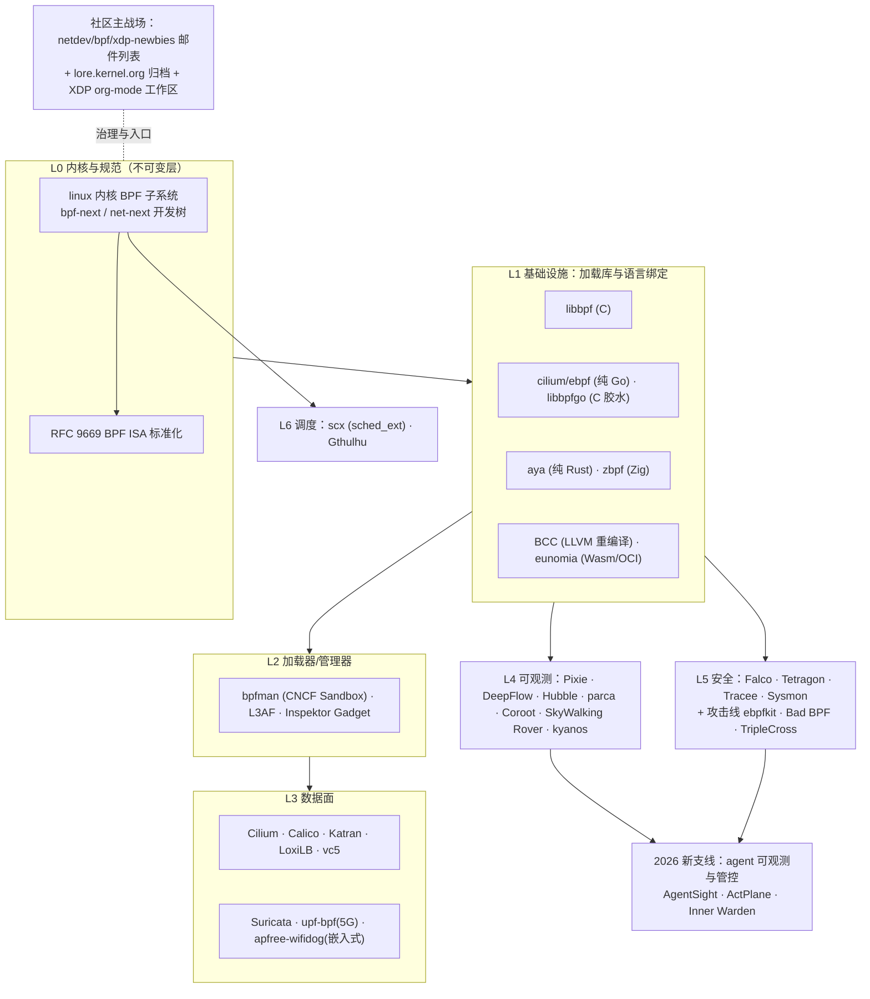

# 第16章 生态地图与社区

> 本章导读：写给三类人——想入行 eBPF 但不知道从哪个列表/哪个仓下手的工程师、要为产品选型找生态位的架构师、准备给上游（内核或某个项目）提第一个 patch 的贡献者。前置：全书均可，尤其第 7 章（加载与 libbpf）、第 9 章（XDP 与 tc）、第 11 章（可观测性）。读完你能：拿一张六层生态地图定位任何项目（含官方 10 Major + 46 Emerging 全景）；知道"问问题去 xdp-newbies、发 patch 去 netdev/bpf、查历史去 lore"的社区地图；用本库 INVENTORY 的克隆时点数据把 82 个本地仓分成"活仓 vs 史料"并避开死仓选型；理解治理谱系（IO Visor 兴衰 → eBPF Foundation/CNCF）与 GPL 授权边界的争议史；看清 agent 时代（AgentSight/ActPlane/Inner Warden）这条 2026 年最新的生态支线。

## 16.1 直觉层

**比喻**：eBPF 生态像一座"围绕内核港口长出来的城市"。内核是天然良港（hook 点与 verifier 是不可动摇的河床与闸门），每一代定居者（项目）在不同街区分层开店——码头装卸（libbpf/cilium-ebpf/aya）、货运代理（Cilium/Katran 数据面）、城市监控中心（Pixie/DeepFlow 可观测）、警局（Falco/Tetragon 安全）、交通调度所（scx 调度器）。这座城市有两套治理痕迹：老市政厅 IO Visor（2015-2016 年代 Linux Foundation 项目）门楣还在、大院里只剩 bcc 等一两家还开张；新商业区 ebpf.io + eBPF Foundation + CNCF 负责招商引资与门户景观。但真正决定城市命运的**中央菜市场 20 年没搬过家**——netdev 邮件列表从 2006 年 11 月开市，累计 1,248,768 封邮件（web/md/280.md），2026 年 9 月单月 15,937 封创历史新高：所有内核侧的工程决定仍在纯文本邮件里拍板，GitHub 在这条线上只是镜像仓库。

**为什么需要这张地图**：三个真实痛点。①**选型没有地图寸步难行**——官方全景页收录 56 个项目（10 Major + 46 Emerging，见 16.2.1），awesome-ebpf 清单 288 条资源，逐个试用不可能；②**入行第一步最容易走错门**——新手在 GitHub issue 区提内核问题没人理，因为 BPF/networking 内核开发的主战场是 netdev 与 bpf 两个邮件列表，XDP 新手有专门的 xdp-newbies 列（digests/19-社区与其他清单.md）；③**清单会挂化石**——awesome-ebpf 2026-09 快照里仍挂着 2019 年就死掉的两个同名 bpfd、2025 年已归档的 merbridge、上游 404 的 Ingero/Synapse，把"史料"当"活仓"选型是真实的工程事故（见 16.4 活跃度分层表）。

**它在整条 eBPF 栈里的位置**：本章是全书收官章，不再向下钻机制，而是把前 15 章的技术散点放回产业与社区的坐标系：

一句话定位：**技术层决定你能做什么，生态层决定你该站在哪里做**——本章给出的是"该站在哪里"的完整坐标系，数据全部来自本语料库 2026-11-06 的一致快照（INVENTORY.md 基准 repo@dc0c2065）。

## 16.2 原理层

### 16.2.1 官方地图：ebpf.io 项目全景与收录规则

ebpf.io 的 Applications 页（本地快照 web/md/4.md）是社区承认的正式生态地图，2026-11-06 快照共收录 **56 个项目 = 10 个 Major + 46 个 Emerging**（逐项清点）：

- **Major 10 席**（字母序）：bcc、bpftrace、Calico、Cilium、Falco、Katran、Parca、Pixie、Tetragon、OpenTelemetry eBPF Profiler。注意三个信号：①Cilium 系占 2 席（Cilium + Tetragon）；②OTel eBPF Profiler 上位 Major，印证连续 profiling 生态与 OpenTelemetry 汇流（第 11 章 11.3.5 节讲过 parca-agent 已切 otel ebpf-profiler fork，digests/17 [205]）；③Katran 一个 2018 年的 Facebook L4LB 至今仍是 Major——XDP 生产化的活标本。
- **Emerging 46 席**按主题清点：可观测类最多占 20 席（Hubble、DeepFlow、Apache SkyWalking、kyanos、Coroot、Retina、Caretta、eCapture、Beyla、Odigos、KubeSkoop、Kindling、Alaz、qtap、wachy、Trayce、Oryx、HUATUO、netobserv、Podtrace）、安全 5（Tracee/Sysmon for Linux/KubeArmor/Pulsar/Kubescape）、网络数据面 7（dae/LoxiLB/vc5/BPFire/ingress-node-firewall/bpfilter/Merbridge）、加载与分发 6（bpfman/BumbleBee/eunomia-bpf/L3AF/Inspektor Gadget/kubectl trace）、profiling 2（Pyroscope/bpftop）、其他 6（Gthulhu 调度、Kepler 能效、ply 嵌入式追踪、Keploy API 测试、pwru 包追踪、kflow 端点监控）——**可观测一条线占了 Emerging 的 43%，印证它是 eBPF 最大的产业化出口**。

**收录规则本身就是治理机制**（web/md/4.md "Requirements" 节原文要点）：Emerging 门槛 = 开源许可 + eBPF 为核心技术（"去掉 eBPF 项目就失去存在意义"）+ 活跃维护 + 开放治理 + **成立超 6 个月且 star > 50**；Major 在此之上加 **> 50 contributors + 生产环境规模使用**。排序按 GitHub star 数**季度更新**。想上地图走 PR（ebpf-io/ebpf.io-website 仓），社区评审后 maintainer 合并。

**关键澄清（FAQ 原文）**：这些项目**不归 eBPF Foundation 托管**——"The eBPF Foundation is involved in a number of initiatives to help promote eBPF and enhance its security and reliability, but it does not currently host third-party projects"（web/md/4.md）。即：基金会管标准与布道（如 RFC 9669 BPF ISA 标准化，见第 2 章），项目治理各自归 Apache/CNCF/公司/个人。这个"基金会不收编项目"的设计与 CNCF 形成互补——CNCF 负责项目孵化毕业，eBPF Foundation 负责内核接口的跨厂商中立性。

### 16.2.2 六层生态地图逐层展开

**L0 内核与规范层**。内核 BPF 子系统的开发树是 bpf-next（maintainer Alexei Starovoitov / Daniel Borkmann，digests/19 [277]），网络侧是 net-next（David Miller 一系，现由 Jakub Kicinski 执 pull，web/md/280.md 2026-11-05 可见其 `[GIT PULL] Networking for v7.4-rc2`）。bpf-next 定期批量 merge 进 net-next 再入 mainline——**BPF patch 的上游路径天然穿过网络子系统的官僚体系**，这是"eBPF 社区"与"netdev 社区"高度重叠的制度原因。规范侧：RFC 9669 把 BPF 指令集定为 IETF 标准（digests/01 [16]），内核文档另有 BPF licensing / BPF signing / standardization 专节（digests/01 [9]）。

**L1 基础设施层：加载库与语言绑定的三条路线**（digests/13-工具链·语言库与测试.md 总评）：

| 路线 | 代表 | 特征 | 本地仓活跃度@2026-11 |
|---|---|---|---|
| 纯语言重实现 | cilium/ebpf (Go)、aya (Rust)、zbpf (Zig) | 无 CGO、单二进制分发 | cilium/ebpf 与 aya 均 2026-11-05 提交（INVENTORY） |
| C 库薄封装 | libbpfgo (Go)、libbpf (C 本体) | 跟上游 libbpf 新特性零延迟，代价是交叉编译与 libc 绑定 | libbpf 2026-11-02、libbpfgo 2026-09-29 |
| 配置/Wasm 化分发 | eunomia-bpf（JSON/Wasm/OCI 镜像）、BCC（LLVM 重编译） | eunomia `ecli run ghcr.io/...` 一行跑预编译工具；BCC 是 70+ 现成工具的工具箱 | eunomia 2026-08-09、bcc 2026-10-02 |

Go 生态事实标准是 cilium/ebpf，Rust 事实标准是 aya（digests/13 L3）——两者都是日更级活仓。**用户态 VM** 这一支（uBPF/rbpf/generic-ebpf/PREVAIL verifier）多为 Apache 系许可，动机直白：内核 eBPF 是 GPL，闭源项目复用不了，于是用户态自建（digests/12 [160]）。

**L2 加载器/管理器层：从一次性命令到守护进程化**。这条线有一部"三代史"：2019 年 genuinetools/bpfd（Tracers→Rules→Actions 三层，最后提交 2019-05-25，已死）与 joelagnel 的 BPFd（stdio 协议远程加载，为 Android 调试而生，2019-06-22 弃用）是概念前身；现代正统是 **bpfman**（CNCF Sandbox，Rust，2026-11-02 仍活跃）：系统级 eBPF 管理器 + XDP/TC 多程序链式 dispatcher + **eBPF 程序按 OCI 镜像分发** + K8s CSI 驱动（digests/16 [248]）。同路线还有 L3AF（分布式 eBPF 生命周期平台）与 Inspektor Gadget（gadget 打包成 OCI 镜像，CNCF Sandbox，web/md/4.md）——"eBPF 程序当容器镜像分发"已是这一层的行业共识方向。

**L3 数据面层：eBPF 最早的生产级战果**。按场景分五簇：①**K8s CNI**——Cilium（CNCF 毕业项目，三种数据面全占：`bpf/bpf_lxc.c` TC clsact 主力 + `bpf/bpf_xdp.c` XDP 早丢弃 + socket/cgroup 层，`bpf/lib/` 60+ 头文件库；v1.20.4 稳定版 2026-10-23 发布，2026-11-05 仍日更，digests/14 [174]）与 Calico（eBPF 是其五种数据面之一，3.33 时代已 GA，tc/tcx/netkit 挂载，digests/15 [193][194]）；②**L4 负载均衡**——Katran（Facebook，XDP+Maglev 哈希，2018-05-22 开源公告 digests/14 [183]）、LoxiLB（5G/edge）、vc5（DSR+RHI）；③**抗 DDoS**——Cloudflare XDP 管线（netdev 2.1，digests/14 [184]）与 Facebook Droplet 通用 policer 框架（策略即配置、程序链，digests/14 [185]）；④**IDS/协议栈**——Suricata 的 eBPF filter/LB/XDP bypass 三件套（39Gbps vs 669Mbps 经典数据，digests/15 [188][190]）、upf-bpf（5G UPF，已并入 OAI 官方，digests/16 [244]）；⑤**长尾场景**——嵌入式 OpenWrt 限速（apfree-wifidog 用 tc pinned map，2026-11-03 仍活跃，digests/15 [198]）、复古协议网关（ipx_wrap 用 tc 改写把 IPX 封进 IPv6，2026-04 还在跟新内核 vmlinux.h，digests/15 [199]）、service mesh 加速（merbridge——**已归档**，2025-02-19 最后提交，digests/15 [195]）。

**L4 可观测层：从论文走成产业标配**（digests/17 总评）。三种路线并存：全栈 APM 平台（DeepFlow——uprobe 289 + tracepoint 174 + kprobe 119，本层采集点规模之最；Coroot——"inspections 即代码"自动诊断；Pixie——CNCF 项目，stirling socket tracer 抓 full-body L7；SkyWalking 全家桶的 Rover 是其中唯一 eBPF 组件）；单点做深（kyanos 内核级延迟拆解、parca 连续 profiling、Hubble 网络流可见性——注意其 server 已并入 Cilium 主仓、本仓只剩纯 Go CLI，digests/17 [208]）；实验级（Caretta 双钩子极简服务地图、eTraceGen 事件遥测引擎）。这一层的共同采集模式（uprobe 解 TLS + tracepoint 拿稳定事件 + kprobe 补盲区）在第 11 章已拆解，此处只强调生态事实：**2026-11 初，DeepFlow/Coroot/parca-agent/Hubble 全部仍在高频提交**——这条线已完全商业化成熟。

**L5 安全层：检测世代与强制世代的分水岭**（digests/18 总评）。防御侧谱系：Falco（CNCF 毕业级，Sysdig 创建，声明式 YAML 规则×内核事件范式，v0.45.2 2026-10-30）→ Tracee（Aqua，CNCF 沙箱，eBPF 采集 + Go 签名引擎，配套 btfhub 解决老发行版 CO-RE）→ Tetragon（Cilium 系，**TracingPolicy CRD + 实时 kill/阻断 enforcement**，2026-11-05 活跃）→ LSM BPF 强制访问控制一线（owLSM 有状态关联 + Sigma 规则、Bombini 检测/沙箱同语言、BPFJailer task_storage 监禁——这一线 2026-11 全部活跃，是当前最拥挤的战场）。**"检测后强制"（detect→enforce in kernel）正成为新一代项目对 Falco 世代的核心差异化**（digests/18 总评）。进攻侧同样成谱系：ebpfkit（Datadog 员工研究，BlackHat USA 2021/Defcon 29，rootkit 全家桶）+ ebpfkit-monitor（同作者检测工具，攻防成对教材）、Bad BPF（DEF CON 29 "Warping Reality"，六类 helper 滥用原型：pidhide/sudoadd/writeblocker 等）、TripleCross（UC3M 学士论文，GOT 劫持 + 仿 NSA Bvp47/CIA Hive 的 C2 触发器，2023-03 论文交付后冻结）——**eBPF 的攻击面研究本身已是这个社区的一等公民**（digests/20-未归类条目.md）。

**L6 调度层：eBPF 走出网络/安全的新大陆**。scx（sched_ext 调度器集合）：6.12 起进主线内核、Meta/Google 双巨头投入、Meta 大规模生产部署 scx_layered，14 个 Rust 用户态调度器，"换调度器 = 跑个程序，Ctrl-C 回退"（digests/18 [232]，2026-11-05 提交）。Gthulhu 把 K8s 分配决策（DRA）与 sched_ext 执行面打通，TID 级策略点名 LLM engine/decode worker 与 NCCL/RDMA 线程（digests/18 [233]）。bpfilter（iptables 规则编译成 BPF 程序，web/md/4.md Emerging）也可视作广义"内核行为可编程化"的一支。

### 16.2.3 治理谱系：IO Visor 的兴衰与三基金会并立

**第一代（2015-2016）：IO Visor 伞组织**。IO Visor 是 Linux Foundation 项目，定位"通过可编程数据平面推进内核内 IO 虚拟化"，官网 iovisor.org 带 governance/bylaws 的基金会式治理，GitHub org iovisor 是 bcc/bpftrace/libbpf 等仓的伞组织（digests/02 [35]）。它的历史价值在厘清概念层级：**IO Visor 是组织伞，eBPF 是内核技术，BCC/XDP 是其上的工具/层**——三者常被混为一谈。它的衰落有本库的直接证据：①iovisor.org 首页"2016 年后更新缓慢，作为当前状态来源不可靠，作为组织与历史来源有效"（digests/02 [35] 坑注）；②org 内旗舰史料仓 bpf-docs（"Presentations and docs"一行 README）最后提交 2019-07-08 冻结，内容是 eBPF 早期史的一手幻灯片库——2016 年 netdev conf 的 BPF 场、XDP 原始提出稿《Express_Data_Path.pdf》、2015 年 TSC 会议纪要、Brendan Gregg 的 bpf-internals（digests/19 [284]）；③org 内活的只剩 bcc（2026-10-02）与 ubpf（2026-10-16），ply 维护缓慢、kubectl-trace 低频（2025-12-08）、BPFd/adeb 已死（digests/16 [234][240][241]）。**结论：IO Visor 是"项目代管"模式的化石，其职能已被 ebpf.io（门户）、CNCF（项目治理）与各公司开源办公室瓜分。**

**第二代（2021 至今）：eBPF Foundation + ebpf.io 门户**。ebpf.io 自称 "Maintained by the eBPF community"，内容 CC BY 4.0，提供 11 种语言本地化（含简体中文，web/md/4.md 页脚）。它承担四件事：项目全景页（16.2.1）、学习入口（What is eBPF/Get Started/Labs/儿童科普 PDF）、活动矩阵（eBPF Summit / eBPF Meetup / eBPF Track@LPC / bpfconf@LSF-MM-BPF / FOSDEM eBPF Devroom / eBPF Workshop）、社区渠道（Slack / Stack Overflow 标签 / r/eBPF / eCHO 视频节目 / Newsletter / eBPF Research 论文索引）。**eBPF Summit 2027 已预告为 Security Edition**（web/md/4.md 顶部 banner）——官方会议主题转向安全，与 16.2.2 观察到的"enforcement 世代崛起"互为印证。基金会本体（ebpf.foundation）按 FAQ 不收编项目，重心在规范（RFC 9669）与安全可靠性倡议。

**并行的项目治理轨道：CNCF 谱系**。本库覆盖的 CNCF 项目按成熟度排：**毕业（graduated）**：Cilium（digests/14 [174]）、Falco（digests/18 [217]）；**Sandbox/项目级**：Pixie（digests/17 [202]）、Tracee（digests/18 [221]）、Inspektor Gadget（digests/16 [238]）、bpfman（digests/16 [248]）；**Landscape 收录**：merbridge（已归档，digests/15 [195]）、Gthulhu（digests/18 [233]）。值得注意：**eBPF 项目在 CNCF 里跨越了 networking（Cilium）、observability（Pixie/parca 系）、security（Falco/Tracee）三个 SIG 域**——按技术而非"eBPF"归类，这正是 eBPF 作为"横向技术"在治理结构上的投影。

**内核侧治理：树、maintainer 与 QA 文档**。BPF patch 走 bpf-next 树（Starovoitov/Borkmann），网络相关走 net-next，礼仪与规范写在内核树 Documentation/bpf/bpf_devel_QA.rst（Subject 前缀 [PATCH bpf/bpf-next/net-next]、commit log 规范、selftests/bpf 测试要求，digests/19 [279]）。本库抓取该文档时被 git.kernel.org 的 Anubis（v1.28.2）Proof-of-Work 反爬拦截成壳页——**kernel.org 对爬虫的态度本身也是社区文化的注脚：这里为人/为 git 协议服务，不为机器人服务**；替代访问 = `git clone` 同 URL 或读内核树本地文件。

### 16.2.4 开发者主战场：邮件列表的硬数据

BPF/networking 内核开发的主战场是三个邮件列表（digests/19 [280][281]，订阅数为 vger 总表 2026-11 快照）：

| 列表 | 订阅数 | 定位 | 权威归档 |
|---|---|---|---|
| netdev | 1085 | 网络子系统总战场（含大量 BPF/XDP 改动），**高流量** | lore.kernel.org/netdev/（带 Patchwork 集成）；openwall 按月归档 |
| bpf | 502 | BPF List，BPF 子系统专题 | lore.kernel.org/bpf/ |
| xdp-newbies | 305 | XDP 新手提问专属，避开 netdev 高流量 | lore.kernel.org/xdp-newbies/ |

**netdev 的规模与趋势（openwall 归档实测，web/md/280.md）**：总计 **1,248,768 封邮件**，月度索引从 2006-11 连续覆盖到 2026-11；月流量从 2007-2012 年代的 2000-4000 封，涨到 2019 后的 6000-10000 封，2026 年常态化破万——**2026-09 达 15,937 封（历史峰值月），2026-10 为 14,837 封，2026-11 前 6 天已 3,591 封（日均约 600 封），流量仍在攀升**。抓取日（2026-11-06）当天的实时贴就是典型生态切片：af_unix fix 系列、vsock/virtio credit、RDS 连接生命周期 v11、Nebulamatrix 新 NIC 驱动 v33，以及 **Alexei Starovoitov 本人的 `[PATCH bpf] bpf: lwt: Don't let bpf_lwt_push_encap() wrap gso_size`——BPF patch 直接走 netdev 的实证**；同页还有 Jakub Kicinski 的 GIT PULL、patchwork-bot 自动回执、多位投稿者经 **B4 Relay** 发帖（web/md/280.md Recent messages 节）——B4 工具链已成为列表工作流标配。

**订阅方式已换代**：vger 列表已迁至 subspace.kernel.org 新架构，majordomo 命令废弃，订阅走 subspace.kernel.org/subscribing.html（web/md/281.md 页面附注）。查历史优先 lore.kernel.org（权威 + Patchwork 集成），openwall 适合按月翻阅（digests/19 [280] 消费建议）。

**XDP 协作工作区：org-mode 会议纪要传统**（深潜 repos/xdp-project/xdp-project/）。这个 org 的顶层仓 xdp-project/xdp-project **不是代码仓而是 Emacs org-mode 工作区**——README.org 明言 "work-in-progress workspace"，用 git 可 diff 追踪的方式共享笔记/benchmark/半成品（README.org 第 1-5 行）。三个机制值得玩味：

1. **任务管理走 org-mode 而非 GitHub issues**：Bernt Hansen 风格的 org-agenda 工作流 + 自创 **OWNER 属性认领制**（"Set the OWNER property on a task or project to claim ownership, which will filter the task from other's agenda"）——用文本文件的属性过滤替代 issue 的 assignee，因为它可 git-diff。
2. **GitHub 只保留最小职能**："Open issues for tasks that require discussion between several people / you wish to assign to others"，PR 仅用于"要明确反馈"或"改动别人主要负责的区域"；**WIP 笔记可以直接 commit master**（README.org "Interaction with Github issues and pull requests" 节）。工具链是 magit + forge + stgit（管内核 patch 系列）+ helm-org-rifle——纯 Emacs 全家桶。
3. **内容即 XDP 上游讨论的一手过程档案**：`areas/` 下按子系统分目录（core/drivers/cpumap/devmap/arm64/dma/latency/mem/tsn + ovs.org/xdp_flowcache.org/xdp-tutorial.org 等）；`conference.org` 是会议项目管理（LinuxPlumbers 2018 两场 talk、FOSDEM 2019、Netdev 0x13 的 XDP tutorial，均带 DONE 时间戳与 LOGBOOK）；另有 people.org / student-projects.org / brainstorm.org。最新 commit 2026-08-12（`9e714d1` merge cpumap02_eval_AMD_cross_NUMA）——**"跨 NUMA 的 AMD cpumap 评测"这类硬核 benchmark 笔记仍在进这个仓**，它与 xdp-tools/xdp-tutorial 等代码仓互补（digests/19 [282]）。

**会议矩阵**（web/md/4.md Events 节 + 语料散见）：netdevconf（XDP tutorial 传统发源地，digests/14 [184][185]、xdp-project conference.org）、Linux Plumbers Conference eBPF Track、bpfconf（LSF/MM/BPF，内核开发者闭门工作会）、FOSDEM eBPF Devroom、eBPF Summit（免费线上）、eBPF Workshop。**谱系观察：内核向会议（netdevconf/LPC/bpfconf）管"技术怎么进内核"，社区向会议（Summit/FOSDEM devroom）管"生态怎么长大"——一个 eBPF 工程师两边的会都要跟。**

### 16.2.5 授权与专利：GPL 边界的争议史

**起源争议（2014，第一手材料）**：eBPF 最初的 patch 系列里，**GPL license 参数比内核模块更严**，当场引发 reviewer 质疑，Starovoitov 承诺"未来按 module 式分级"（digests/02 [37]，web/md/37.md）。这条承诺后来演化为今天的实际规则：**GPL 兼容性取决于 program type 与所用 helper**——tracing 类须 GPL，网络类可加载专有许可程序，但调用 GPL-only helper 会当场被拒（错误文案 "Cannot call GPL only function from proprietary program"，digests/02 [98]；规则编码在 bpf_func_proto，digests/01 [15]）。

**当代实践：多许可证分层切片**。生产项目用三重许可精确切内核边界与用户态：bpfman 的 Apache-2.0/BSD-2/GPL-2.0（"内核边界与用户态的合规切分"，digests/16 [248]）、Tetragon 的 Apache/BSD/GPL 分层（digests/18 [224]）。写程序时的硬约束：ELF 必须带 license section，aya-template 生成 GPL-2.0/MIT 双许可并提示"漏这个程序加载会被内核拒"——经典新手坑（digests/13 [149]）。绕开 GPL 的合法途径 = 用户态 VM：uBPF 以 Apache-2.0 实现用户态 eBPF 运行时，动机就是"内核 eBPF 是 GPL 无法被闭源项目复用"（digests/12 [160]）。前车之鉴是 DTrace：CDDL 与 GPL 不兼容让 Linux 错过它十年，Oracle 2018 重授 GPL 为时已晚（digests/07，web/md/58.md）——**许可选择曾真实地改写了追踪工具史**。

**清单层的授权**：awesome-ebpf 清单本体 CC0 公有领域（digests/19 [288]）；ebpf.io 网站内容 CC BY 4.0（web/md/4.md 页脚）；内核文档侧另有 BPF licensing / BPF signing 专节（digests/01 [9]）。

**专利：语料缺口，标注待核实**。本语料库 288 条资源中**未检索到任何 eBPF 专利诉讼或专利授权争议的记录**（对 digests/ 全文 grep "专利|patent" 零命中）。社区讨论中与此最接近的是 RFC 9669 标准化（IETF 路线，digests/01 [16]）与内核文档的 BPF standardization 节。若读者需要专利态势（如 Meta/Google 的 BPF 相关专利布局），本库无法提供依据，需另行检索专利数据库——此处按写作纪律明确标注缺口而非凭记忆补写。

## 16.3 实践层：想入行的人从哪里下手

一条被语料反复验证的参与路径，六步递进（建地图→问对地方→跑通代码→发 patch→上地图/上会→持续跟踪）：

**第 0 阶·建立地图（半天）**。读 ebpf.io 的 What is eBPF/Get Started（web/md/4.md 导航）+ 本库第 1 章历史与总论；把 16.2.2 的六层表当目录，确认自己想去的层。**先看活跃度再定目标仓**——用 INVENTORY.md 的"@日期"列过滤，只把 2026 年仍提交的仓当候选（16.4 有全量分层表）。

**第 1 阶·问对地方（第一周）**。新手提问的优先级：**xdp-newbies@vger.kernel.org（305 订阅，专为准新手设）> bpf 列（502）> netdev（1085，日均约 600 封，别在这里问入门题）**（digests/19 [280][281]）。订阅走 subspace.kernel.org/subscribing.html（majordomo 已废弃）。同步加入 ebpf.io Slack 与 r/eBPF；中文使用者可读本库 + ptcpdump/kyanos/apfree-wifidog 等中文社区项目的 README-zh（digests/16 [249]、digests/15 [198]）。

**第 2 阶·跑通第一个程序（第一月）**。按语言选入口，全部本地有仓：C 路线 = libbpf-bootstrap（2026-10-22 活跃，digests/12 [145]）→ xdp-tutorial（xdp-project 官方 hands-on，2026-05-08 仍有提交，digests/09/INVENTORY [107]）；观测路线 = bpftrace one-liner（第 11 章已给配方）+ BCC 的 70+ 现成工具（digests/13 [136]）；Rust 路线 = `cargo generate aya-rs/aya-template`（一条命令生成 19 种程序类型骨架，digests/13 [149]）；K8s 路线 = Inspektor Gadget / kubectl-trace（digests/16 [237][238]）。**读工业级代码**：Cilium `bpf/lib/common.h` + `bpf_lxc.c`（digests/14 [174]）；**读上游过程**：xdp-project/xdp-project 的 areas/ 笔记与 conference.org（16.2.4）。

**第 3 阶·发第一个 patch**。规范文档 = 内核树 Documentation/bpf/bpf_devel_QA.rst（digests/19 [279]；kernel.org 网页被 Anubis 拦时 `git clone` 或读本地内核树）。检查单：

- **Subject 前缀选对树**：`[PATCH bpf]`（fix 走 bpf）/`[PATCH bpf-next]`（新特性）/`[PATCH net-next]`（网络子系统）——2026-11-06 netdev 实时贴里三种前缀同框可对照（web/md/280.md）。
- **commit log 按内核规范**：what/why/how 分段，fix 要 `Fixes:` 标签。
- **测试先行**：selftests/bpf 是硬要求（bpf_devel_QA.rst）；工具链细节见第 12-13 章。
- **工作流**：`git send-email` 或 **b4**（列表里 B4 Relay 发帖已是主流，web/md/280.md）；patch 状态在 Patchwork（lore 集成）可查。
- **从哪类 patch 入手最容易**：清理类（scripts/kmods/文档）、selftests 补充、驱动 fix——netdev 当天的 af_unix 泄漏 fix 系列与 bonding XDP error path fix 就是典型入门尺寸的 patch（web/md/280.md）。

**第 4 阶·让项目上地图**。自建项目走 ebpf.io applications PR：开源许可 + eBPF 核心技术 + 活跃维护 + 开放治理 + **>6 个月 & >50 stars**（Major 再加 >50 contributors + 生产使用），PR 模板照抄已收录项目（web/md/4.md FAQ）。**上会演讲**：netdevconf 有 tutorial 传统（XDP tutorial 连续多年，xdp-project conference.org）；LPC eBPF Track 与 bpfconf 是内核向提案主渠道；eBPF Summit 免费线上、对新人最友好。

**第 5 阶·持续跟踪**。ebpf.io Newsletter + eCHO 节目（web/md/4.md）；本库活体仓跟踪机制（manifest/_bin/track_alive.sh 每日 06:17，PROGRESS.md 追加任务 1）可作为自建监控的参考实现。

## 16.4 深水区与坑

### 16.4.1 "活仓 vs 史料"：82 个本地仓的活跃度分层（INVENTORY @2026-11-06 克隆时点）

awesome 清单不标注存活状态，选型前必须自查。全量分层结论（日期 = 浅克隆时 HEAD 提交日，INVENTORY.md）：

**A 档·活仓（2026-09-29 以来仍有提交，38 仓 ≈ 46%）**——选型与学习的主战场：

| 仓 | 最后提交 | 生态位 |
|---|---|---|
| cilium/cilium · cilium/ebpf · cilium/hubble · cilium/tetragon | 11-05 / 11-05 / 11-03 / 11-05 | Cilium 系四仓全活 |
| aya-rs/aya · aya-template · cargo-generate | 11-05 / 11-03 / 11-05 | Rust 全家桶 |
| libbpf/libbpf · libbpf-bootstrap | 11-02 / 10-22 | C 基础设施 |
| sched-ext/scx · Gthulhu | 11-05 / 10-31 | 调度线 |
| parca-agent · Coroot · Pixie · DeepFlow · SkyWalking Rover | 11-05 / 11-05 / 10-26 / 10-30 / 11-03 | 可观测五强全活 |
| owLSM · Bombini · BPFJailer · SysmonForLinux · SysinternalsEBPF · tracee | 11-05 / 11-05 / 10-09 / 11-04 / 10-28 / 09-29 | 安全线（最拥挤） |
| bpfman · bcc · ubpf · libbpfgo · ebpf-for-windows | 11-02 / 10-02 / 10-16 / 09-29 / 11-05 | 加载器/工具箱/用户态 VM/跨平台 |
| vbpf/ebpf-verifier(PREVAIL) · GhostScope · rstat · bpfcompat | 11-06 / 11-06 / 11-04 / 10-28 | 研究与单点工具 |
| AgentSight · ActPlane · InnerWarden(新版) | 10-23 / 10-16 / 10-25 | agent 支线（注意 InnerWarden 形态已转型，见 E 档） |
| apfree-wifidog · ptcpdump · oryx · eTraceGen | 11-03 / 11-01 / 10-18 / 10-24 | 长尾但活着 |

**B 档·温仓（2026 年内有提交但早于 2026-09 下旬，12 仓）**：xdp-project/xdp-project（2026-08-12）、eunomia-bpf（2026-08-09）、ebpf-kill-example（2026-07-12）、vbpf/ebpf-samples（2026-07-03）、redcanary-ebpf-sensor（2026-06-26）、kyanos（2026-06-16）、rbpf（2026-06-03）、xdp-tutorial（2026-05-08）、zbpf 与 kpod-metrics（均 2026-04-19）、ipx_wrap（2026-04-03）、kotlin-ebpf-dsl（2026-03-09）——**xdp-tutorial 五个月没动不影响其"最佳 XDP 教程"地位，温仓≠不能学，只是别指望 issue 秒回**。

**C 档·半停滞（2025 年，5 仓）**：kubectl-trace（2025-12-08，README 仍称维护）、harpoon（2025-11-12）、zfw（2025-08-05）、Caretta（2025-03-17，groundcover 重心在商业产品）、**merbridge（2025-02-19，已归档不再维护）**——merbridge 是典型"清单仍列、上游已死"，选它做 service mesh 加速前必须知道（digests/15 [195]）。

**D 档·冻结史料（≤2024，23 仓 + 攻击线 2 仓）**——按用途分两类。**仍有学习价值的史料**：SEPTun-Mark-II（2018-04，Suricata 调优经典）、bpf-docs（2019-07，早期幻灯片库）、linux-tracing-workshop（2020-06）、Netronome/bpf-samples（2018-11，硬件 offload 时代）、ebpf-beginners（2023-05）、bad-bpf（2024-07，攻击教学）、upf-bpf（2024-09，已并入 OAI 官方）、greggd（2024-12）、rbperf（2024-04，Ruby VM 栈回溯教材）、TripleCross（2023-03，论文交付冻结）、adeb（2023-02，Android 环境）、ebpfmon/ebpf-explorer/hBPF/qemu-csd/ebpf-beginners/generic-ebpf/vale-bpf/mpls-encap-decap/bcc-docker 等。**死仓（勿选型）**：genuinetools/bpfd（2019-05）、joelagnel/BPFd（2019-06）——两个同名 bpfd 都是"eBPF 守护进程化"的先驱尸体，继任者是 bpfman（digests/16 [239][240][248]）；redbpf（2022-12，Rust 前朝，继任 aya，digests/16 [245]）；bpflock（2022-02，停滞 4 年，digests/18 [223]）。另有攻击线 ebpfkit/ebpfkit-monitor（本地克隆受损、上游活动止于 2023 年初，digests/20 [258][259]）。

**E 档·消亡与转型（3 例）**：Ingero 与 Synapse **上游已删（GitHub 404）**——开源观测初创关停与安全研究清理的两个样本（digests/17 [209]、digests/18 [226]）；**Inner Warden 改名转型**：从 eBPF LSM 沙箱逃逸守卫转成"AI agent 运行时护栏"，**eBPF sensor + Execution Gate 移入 innerwarden-active-defence 收费版，社区版纯用户态**——awesome-ebpf 原链接 404（digests/18 [231]）。这是"清单收录→项目转型→eBPF 部分闭源化"的完整链标本（按活跃度它在 A 档 10-25 仍提交，按形态归此档）。

**分层纪律**：A 档可直接选型；B/C 档先读 release notes 判断"低频维护"还是"事实死亡"；D 档只当教材；E 档引用时必须标注现状。五档合计 38+12+5+25+2（Ingero/Synapse）= 82，与本库本地仓总数对账一致。

### 16.4.2 清单与门户的系统性偏向

- **star 季度排序 = 营销竞争**：ebpf.io 全景页按 GitHub star 排序、季度更新（web/md/4.md FAQ），">50 stars 才可收录 Emerging"把学术原型与冷启动项目挡在官方地图外（TripleCross 这类论文仓、多数 BSP 教学仓都不在图上）。**官方地图 ≠ 生态全集**，awesome-ebpf 288 条 + 本库 digests 才是更全的样本。
- **化石挂架**：awesome-ebpf 的 Development and Community 节仍列着 2019 年死掉的 bpfd（via bpfman 词条）与 IO Visor bpf-docs；Observability 节列着已 404 的 Ingero。清单没有"存活审计"机制——**任何 awesome 清单都是快照而非数据库，引用前必须验活**（本库 INVENTORY 即为此而生）。
- **重复与占位条目**：285/286 是同一 URL 在 Other Lists 与 Acknowledgement 两节各存一份；287（@zoidyzoidzoid）只是贡献者 GitHub 主页壳页；288 是 CC0 徽章图片（digests/19 [285][286][287][288]）——**清单尾部约 3% 是结构性噪音**。

### 16.4.3 资料可达性坑（本库实测）

- **git.kernel.org 启用 Anubis（v1.28.2）Proof-of-Work 反爬**：bpf-next/net-next/bpf_devel_QA.rst 三条全被拦成挑战页壳页（digests/19 [277][278][279]）；对策 = `git clone` 该 URL 或读本地内核树。
- **slideshare/speakerdeck 的 JS 挑战页**：Cilium 三张早期幻灯（digests/14 [175][176][178]）、CETH（digests/15 [187]）、Kernel Recipes meerkat 场（digests/15 [192]）本地零正文——2016-2018 史料的最大损失面；FOSDEM/netdevconf 官网与 wayback 是替代通道。
- **JS 渲染官网**：cilium.io、bpftrace.org、falco.org 首页均为壳页，实质信息要去本地仓 README（digests/14 [173]、digests/16 [235]、digests/18 [217]）。
- **邮件列表抓取**：openwall 归档可直抓且有 20 年月度索引（web/md/280.md）；vger 总表页面结构是纯文本表（web/md/281.md）——两者都是稳定的文本源，适合程序化跟踪。

### 16.4.4 社区介质的时代张力

邮件列表是 1990 年代介质，但 netdev 流量 2026 年创历史新高（月 15,937 封，web/md/280.md）——**"旧介质承载最高科技含量的协作"在 eBPF 社区是现实而非悖论**，原因是内核治理与 patch 工作流（git send-email/b4/Patchwork/lore）深度绑定纯文本邮件。张力已经显形：自动化机器人（patchwork-bot、netdev-bot、syzbot 月报）在列表里的占比肉眼可见；投稿侧 B4 Relay 普及。新人的实际策略：**不必全文订阅 netdev**（1085 人订阅但日均 600 封没人全读），用 lore 的主题过滤 + Patchwork 状态跟踪自己关心的系列；xdp-newbies 才是为"人类阅读带宽"设计的列表。

### 16.4.5 新趋势：agent 时代的三条支线（2026 语料实证）

1. **用 eBPF 观测 AI agent**：AgentSight（eunomia-bpf，arXiv:2508.02736）给 Claude Code/Codex/Gemini CLI/OpenCode 做 top/strace 式观测——零 SDK 零代理，eBPF+TLS 追踪让闭源 CLI 也可观测；`agentsight top`/语义火焰图/Agent Nebula 回放（digests/16 [252]，2026-10-23 活跃）。
2. **用 eBPF 强制管控 agent**：ActPlane（同族，arXiv:2606.25189）把 IFC 信息流控制策略编译成 eBPF 内核态强制——口号直指现状软肋："prompt 约束与模型 guardrail 是概率性的，ActPlane 是确定性的"；bash/python 绕不过进程血缘策略，命中即 kill 并把 reason 回喂 agent 让其改道（digests/16 [253]）。Inner Warden 商业化转型（16.4.1 E 档）走的是同一条路：用户态裁决免费、内核态 Execution Gate 收费。
3. **生态自身的 agent 化**：本库 82 仓中至少 8 个带 CLAUDE.md/AGENTS.md 或明示 AI 协作开发（DeepFlow、aya、kpod-metrics——其 CLAUDE.md 规定"所有 eBPF 程序必须用 kotlin-ebpf-dsl 生成"、AgentSight/ActPlane、GhostScope、owLSM 自称 AI-Agent Friendly，digests/17 [211]、digests/18 [229][230]）；SkyWalking 的 AI Sessionizer 已能直接读 Claude Code 对话回放与 tool call 时间线（digests/17 [204]）；Gthulhu 专门为 LLM 推理/NCCL 通信线程做 TID 级调度（digests/18 [233]）。**"eBPF 观测 agent"与"agent 开发 eBPF"双向奔赴，是 2026 年生态地图上最新的一块拼图。**

## 16.5 与其他章的关系

本章是全书 16 章的收官，不引入新机制，只做坐标化：**前驱**——第 7 章（加载与 libbpf）与第 8 章（CORE 与 BTF）解释了 L1 基础设施层为什么长成 libbpf、cilium/ebpf、aya 三条路线（CO-RE 把"分发"变成工程问题，才有 eunomia/bpfman 的 OCI 化）；第 9 章（XDP 与 tc）是 L3 数据面层的挂载基础，Katran/Droplet/Cloudflare 的战果都建立其上；第 11 章（可观测性）是 L4 层的机制内篇，本章是其"产业外篇"；第 12 章（安全）、第 13 章（sched_ext 调度器）、第 14 章（硬件卸载与跨平台）、第 15 章（工具链与工程实践）各自深潜一个专题层，本章给出它们在地图上的相对位置与活跃度底账。**后继**——无：读完本章，读者应带着地图回到 16.3 的参与路径，选一个 A 档活仓开始动手。

## 16.6 语料索引

| id | 名称 | 本地路径 | 本章用了什么 |
|---|---|---|---|
| 4 | ebpf.io Applications 全景页 | web/md/4.md | 10 Major + 46 Emerging 全清单、收录门槛/FAQ/事件矩阵/社区渠道、Summit 2027 预告 |
| — | INVENTORY.md（全库清单） | INVENTORY.md | 82 仓克隆时点提交日（16.4.1 活跃度分层全量依据）、288 条资源统计 |
| — | digests/14-项目·网络上.md | digests/ | Cilium 谱系与数据面、Katran/Droplet/Cloudflare 战果 |
| — | digests/15-项目·网络下.md | digests/ | Calico/Suricata/AF_XDP 生态、merbridge 归档、apfree-wifidog/ipx_wrap |
| — | digests/16-项目·工具.md | digests/ | bpfman/bpfd 三代史、AgentSight/ActPlane、eunomia/OCI 分发 |
| — | digests/17-项目·可观测.md | digests/ | L4 层三路线、采集点统计、Ingero 消亡 |
| — | digests/18-项目·安全与调度器.md | digests/ | L5/L6 层、enforcement 世代、Inner Warden 转型、scx/Gthulhu |
| — | digests/19-社区与其他清单.md | digests/ | 邮件列表/lore/subspace、XDP 工作区、bpf-docs、CC0、清单噪音 |
| — | digests/20-未归类条目.md | digests/ | 攻击线 ebpfkit/Bad BPF/TripleCross |
| 280 | netdev 邮件列表（openwall 归档） | web/md/280.md | 1,248,768 封/月度流量 2006-2026/2026-09 峰值 15,937/实时贴切片（Starovoitov patch、B4、GIT PULL） |
| 281 | vger 邮件列表总表 | web/md/281.md | bpf 502/netdev 1085/xdp-newbies 305 订阅数、subspace 迁移、majordomo 废弃 |
| 282 | XDP Collaboration Project | repos/xdp-project/xdp-project/ | README.org 全文、areas/ 清单、conference.org（LPC 2018/FOSDEM 2019/Netdev 0x13）、2026-08-12 提交 |
| 277-279 | bpf-next / net-next / bpf_devel_QA | web/md/277.md~279.md（三文件） | 开发树定位（Anubis 壳页，替代访问方式）、patch 礼仪 |
| 35 | IO Visor 项目官网 | web/md/35.md | 第一代治理：LF 项目/governance/伞组织定位与停滞 |
| 284 | iovisor/bpf-docs | repos/iovisor/bpf-docs/ | 早期史料库、2019-07-08 冻结、TSC 纪要 |
| 285/286 | Dive into BPF 阅读清单 | web/md/285.md | awesome-ebpf 的前身/姊妹篇、重复条目勘误 |
| 174 | cilium/cilium | repos/cilium/cilium/ | L3 旗舰数据面结构、版本与活跃度 |
| 288 | CC0 徽章 | —（图片跳过） | 清单本体授权 |

## 16.7 AI agent 用法

本章是 agent 做"生态定位/选型/验活"类问题的入口，典型配方：

1. **"X 项目还活着吗？该不该选型？"** → `grep -n "X" /usr-data/data2/kylin/network/awesome-ebpf/INVENTORY.md` 拿 @日期 → 对照 16.4.1 五档分层（2026-09 后提交 = A 档可直接选；≤2024 只当教材；404 = 标注上游已删）。进阶：读 `repos/<org>/<name>/README.md` 头部与最近 release 确认。
2. **"我想观测 K8s 集群的 L7 流量，生态里有哪些选择？"** → 先查官方地图 `grep -n "###" web/md/4.md`（56 项目全名+定位一句话）→ 按层缩小到 L4（16.2.2）→ 深挖时读 digests/17 对应条目的"采集点"与"坑"两栏，再进本地仓 grep（如 `repos/deepflowio/deepflow` 查 uprobe 布点）。
3. **"给内核提 BPF patch 该发到哪、什么格式？"** → digests/19 [277-281] + web/md/280.md 实时贴（拿 Subject 前缀活例）→ 规范细节读内核树 Documentation/bpf/bpf_devel_QA.rst（web 版被 Anubis 拦，用 git clone）。
4. **"查 XDP 某特性（如 cpumap）的上游讨论过程"** → `ls repos/xdp-project/xdp-project/areas/` 定位子系统目录 → 读该目录 .org 笔记（benchmark 数据/踩坑过程，纯文本可直接消费）→ 需要邮件级细节转 lore.kernel.org 按主题检索。
5. **"2026 年 eBPF×AI agent 有什么可用的？"** → digests/16 [252][253]（AgentSight/ActPlane，含 arXiv 号与 CLI 用法）+ digests/18 [231]（Inner Warden 商业分层现状）→ 本地仓 `repos/eunomia-bpf/AgentSight` 与 `repos/eunomia-bpf/ActPlane` 可直接 grep 架构。
6. **"某工具的许可/合规边界？"** → 16.2.5 的 GPL 规则（GPL-only helper/program type）+ 项目多许可证事实（bpfman/Tetragon 条目）→ 用户态 VM（repos/iovisor/ubpf，Apache-2.0）是闭源场景的合法出口。

