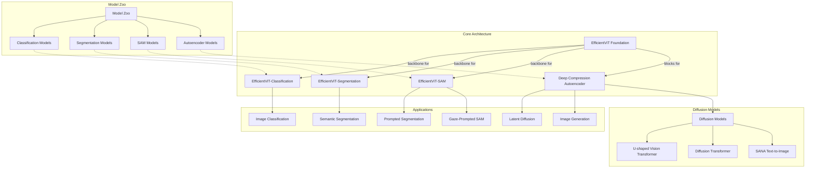
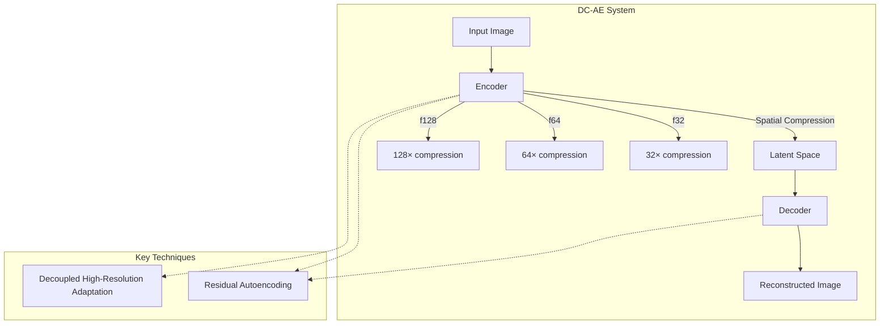
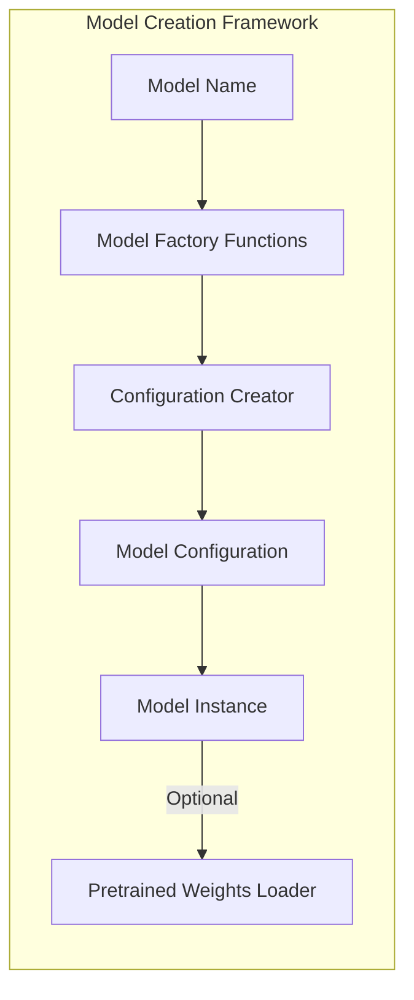
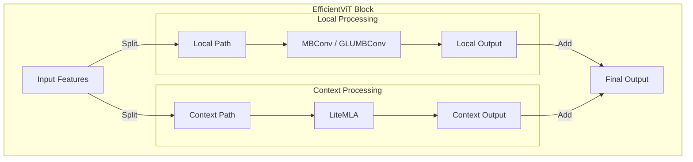

<!-- source: DeepWiki mcp.deepwiki.com · repo mit-han-lab/efficientvit · page 1 Overview · fetched 2026-10-30 -->

# Overview

<details>
<summary>Relevant source files</summary>

The following files were used as context for generating this wiki page:

- [README.md](README.md)
- [applications/dc_ae/README.md](applications/dc_ae/README.md)

</details>


The EfficientViT repository provides a comprehensive ecosystem of efficient vision foundation models designed for high-resolution image generation and perception tasks. This document gives an overview of the architecture, components, and capabilities of the EfficientViT framework, serving as a gateway to more detailed documentation on specific subsystems.

## Core Components and Architecture

EfficientViT is built around a modular architecture that enables efficient vision models for various tasks. The framework consists of several key components:



Sources: [README.md:1-157]()

### EfficientViT Foundation

The foundation of the ecosystem is the EfficientViT architecture, which implements lightweight multi-scale attention mechanisms designed for efficient processing of visual data. This serves as the backbone for various task-specific models and provides building blocks for the Deep Compression Autoencoder.

For more detailed information about the EfficientViT architecture, see [EfficientViT Architecture](#1.1).

Sources: [README.md:22](), [README.md:74-87]()

### Deep Compression Autoencoder (DC-AE)

The Deep Compression Autoencoder is a key innovation that enables efficient high-resolution image generation. It provides high spatial compression ratios (up to 128×) while maintaining reconstruction quality, accelerating latent diffusion models regardless of their architecture.



For more detailed information about the Deep Compression Autoencoder, see [DC-AE](#1.2).

Sources: [README.md:26-56](), [applications/dc_ae/README.md:1-31]()

### Diffusion Models

The repository includes implementations of diffusion models that operate in the latent space provided by DC-AE, enabling efficient image generation. These include:

1. **UViT (U-shaped Vision Transformer)**: A U-Net-style vision transformer for diffusion
2. **DiT (Diffusion Transformer)**: A transformer-based diffusion model
3. **SANA**: A text-to-image diffusion model that uses DC-AE and EfficientViT blocks

For more detailed information about the diffusion models, see [Diffusion Models](#1.3).

Sources: [README.md:39-48](), [applications/dc_ae/README.md:120-134]()

### Model Zoo

The EfficientViT framework includes a comprehensive model zoo with pre-trained models for various tasks, sizes, and computational constraints:

| Model Family | Variants | Application |
|--------------|----------|-------------|
| EfficientViT-Classification | B0, B1, B2, B3, L1, L2, L3 | Image classification |
| EfficientViT-Segmentation | B0-B3, L1-L2 (Cityscapes/ADE20K) | Semantic segmentation |
| EfficientViT-SAM | L0, L1, L2, XL0, XL1 | Prompted segmentation |
| DC-AE | f32c32, f64c128, f128c512 | Latent diffusion |

Sources: [README.md:60-102](), [applications/dc_ae/README.md:70-80]()

## Code Organization and Model Creation

The codebase is organized in a modular fashion, with a factory-based approach for creating models from configurations. The following diagram illustrates the model creation workflow:



This architecture allows for flexible creation of models with different sizes and capabilities, facilitating usage across different computational constraints.

Sources: [README.md:108-114]()

## Performance and Efficiency Characteristics

A key focus of the EfficientViT ecosystem is the balance between performance and computational efficiency. The various models offer different trade-offs:

1. **EfficientViT-Classification**: Provides efficient image classification with state-of-the-art accuracy-efficiency trade-offs.
2. **EfficientViT-Segmentation**: Enables real-time semantic segmentation with high accuracy.
3. **EfficientViT-SAM**: Delivers up to 48.9× speedup over SAM-ViT-H without sacrificing accuracy.
4. **DC-AE**: Accelerates latent diffusion models significantly (up to 19.1× inference speedup and 17.9× training speedup on H100 GPU for UViT-H).

Sources: [README.md:58-70](), [README.md:26-29]()

## Diffusion Model Pipeline

The diffusion models in the repository follow a standard latent diffusion approach, leveraging the DC-AE for efficient processing:

```mermaid
graph TD
    subgraph "Diffusion Model Training"
        Input["Training Images"] --> Encoder["DC-AE Encoder"]
        Encoder --> Latents["Latent Representations"]
        Latents --> LatentDataset["Latent Dataset"]
        LatentDataset --> DiffusionTrainer["Diffusion Trainer"]
        DiffusionTrainer --> |"UViT/DiT"| TrainedModel["Trained Diffusion Model"]
    end
    
    subgraph "Inference Pipeline"
        RandomNoise["Random Noise"] --> |"Input"| TrainedDiffusion["Diffusion Model"]
        TrainedDiffusion --> |"Forward Diffusion Steps"| DenoisedLatent["Denoised Latent"]
        DenoisedLatent --> DCDecoder["DC-AE Decoder"]
        DCDecoder --> GeneratedImage["Generated Image"]
    end
```



This pipeline enables efficient high-resolution image generation by operating in a compressed latent space.

Sources: [applications/dc_ae/README.md:136-169](), [applications/dc_ae/README.md:255-331]()

## EfficientViT Block Architecture

At the heart of the EfficientViT models is the EfficientViT block architecture, which efficiently processes visual information through parallel local and context paths:



The block combines local processing for spatial features with lightweight multi-scale attention (LiteMLA) for capturing long-range dependencies, creating an efficient foundation for vision tasks.

For more detailed information about the EfficientViT blocks, see [EfficientViT Backbone](#2.1).

Sources: [README.md:74-87]()

## Applications and Use Cases

The EfficientViT ecosystem supports a wide range of vision applications:

1. **Image Classification**: Using EfficientViT-Classification models
2. **Semantic Segmentation**: Using EfficientViT-Segmentation models
3. **Prompted Segmentation**: Using EfficientViT-SAM models
4. **Gaze-Prompted Segmentation**: Using EfficientViT-GazeSAM
5. **High-Resolution Image Generation**: Using DC-AE with diffusion models
6. **Text-to-Image Generation**: Using DC-AE with SANA

For detailed guides on each application, see [Applications](#6).

Sources: [README.md:102-106](), [README.md:30-48]()

## Getting Started

To get started with the EfficientViT ecosystem, you can set up the environment using:

```
conda create -n efficientvit python=3.10
conda activate efficientvit
pip install -U -r requirements.txt
```

For specific usage instructions for each component, refer to the corresponding sections in this wiki.

Sources: [README.md:108-114]()

## Next Steps

For more detailed information about specific components of the EfficientViT ecosystem, refer to:

- [EfficientViT Architecture](#1.1) - Detailed overview of the core architecture
- [DC-AE (Deep Compression Autoencoder)](#1.2) - In-depth explanation of the compression autoencoder
- [Diffusion Models](#1.3) - Details about the UViT and DiT models
- [Core Components](#2) - Comprehensive documentation of the framework's building blocks
- [Applications](#6) - Guides for specific use cases and applications

---

