<!-- source: DeepWiki mcp.deepwiki.com · repo mit-han-lab/efficientvit · page 1.1 EfficientViT Architecture · fetched 2026-10-30 -->

# EfficientViT Architecture

<details>
<summary>Relevant source files</summary>

The following files were used as context for generating this wiki page:

- [.gitignore](.gitignore)
- [README.md](README.md)
- [applications/dc_ae/README.md](applications/dc_ae/README.md)
- [efficientvit/apps/data_provider/base.py](efficientvit/apps/data_provider/base.py)
- [efficientvit/models/efficientvit/backbone.py](efficientvit/models/efficientvit/backbone.py)
- [efficientvit/models/efficientvit/cls.py](efficientvit/models/efficientvit/cls.py)
- [efficientvit/models/nn/act.py](efficientvit/models/nn/act.py)
- [efficientvit/models/nn/norm.py](efficientvit/models/nn/norm.py)
- [efficientvit/models/nn/ops.py](efficientvit/models/nn/ops.py)

</details>


This document provides a technical overview of the EfficientViT architecture, which serves as the foundation for various vision models in the efficientvit repository. This page focuses on the core architectural components and design principles of EfficientViT. For information about specific applications of EfficientViT, see [EfficientViT-Classification](#6.1), [EfficientViT-Segmentation](#6.2), [EfficientViT-SAM](#6.3), or [Deep Compression Autoencoder](#1.2).

## 1. Architecture Overview

EfficientViT is a family of vision models designed for efficient high-resolution dense prediction tasks. It combines the efficiency of convolutional neural networks with the expressiveness of vision transformers through a lightweight multi-scale attention mechanism.

The key architectural innovation is the combination of local processing (using variants of MBConv) with global context modeling (using lightweight multi-scale attention) in a modular design that can be scaled to different model sizes.

### EfficientViT High-Level Architecture

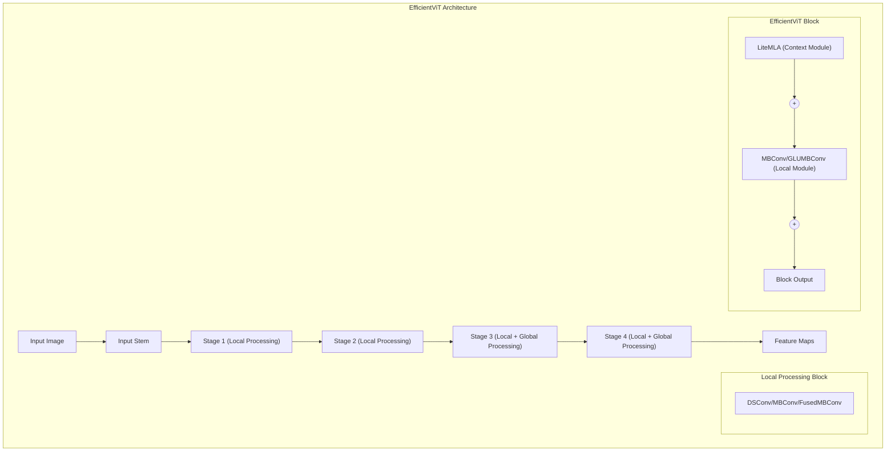

Sources: [efficientvit/models/efficientvit/backbone.py:33-375](), [efficientvit/models/nn/ops.py:671-729]()

## 2. Core Components

### 2.1 Backbone Architecture

EfficientViT provides two main backbone architectures:

1. **EfficientViTBackbone**: The standard backbone used in the B-series models (B0-B3)
2. **EfficientViTLargeBackbone**: An enhanced backbone with more configuration options used in L-series models (L0-L3)

Both backbones organize the network into a series of stages with progressively increasing feature dimensions and reduced spatial resolutions.

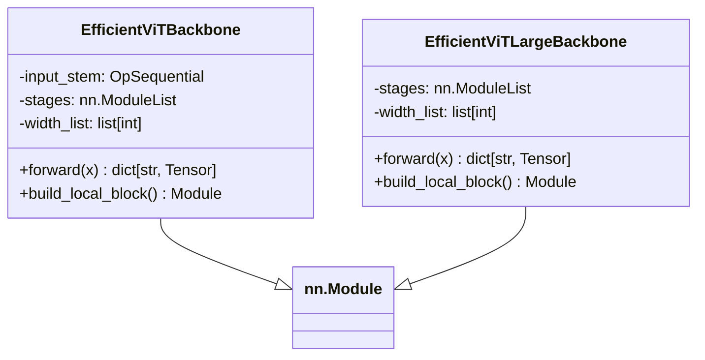

Sources: [efficientvit/models/efficientvit/backbone.py:33-156](), [efficientvit/models/efficientvit/backbone.py:199-338]()

#### Backbone Stage Structure

The backbone consists of several stages:
1. **Input Stem**: Initial processing using convolution followed by local blocks
2. **Early Stages**: Primarily using local processing (DSConv/MBConv)
3. **Later Stages**: Combining local processing with global context modeling through EfficientViT blocks

This progressive structure allows the network to efficiently capture both local details and global context.

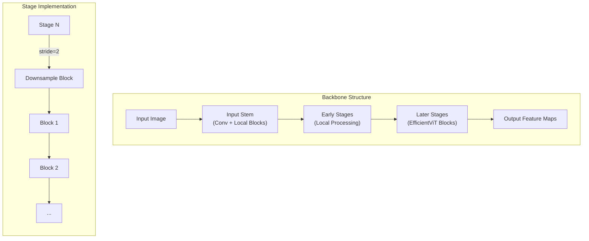

Sources: [efficientvit/models/efficientvit/backbone.py:72-117](), [efficientvit/models/efficientvit/backbone.py:245-287]()

### 2.2 EfficientViT Block

The EfficientViT Block is a key component that combines local processing with global context modeling. It consists of two main modules:

1. **Context Module**: Implements the LiteMLA (Lightweight Multi-scale Linear Attention)
2. **Local Module**: Uses MBConv or GLUMBConv for local feature processing

Each module is wrapped in a residual connection to facilitate gradient flow during training.

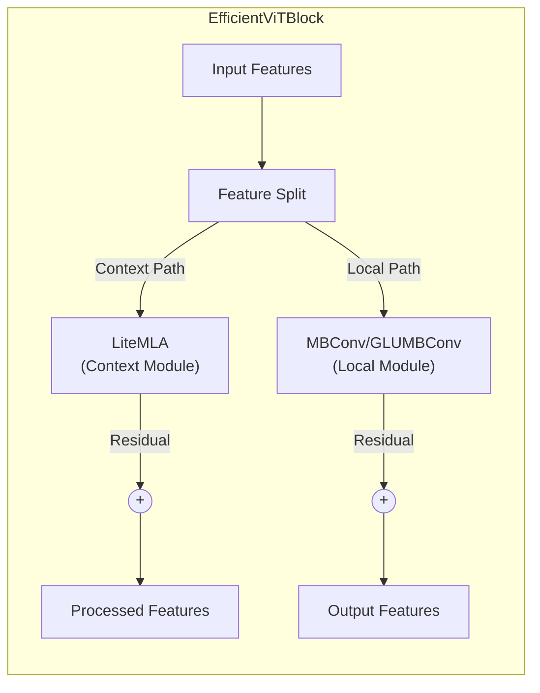

Sources: [efficientvit/models/nn/ops.py:671-729]()

### 2.3 Lightweight Multi-scale Linear Attention (LiteMLA)

The LiteMLA module is a crucial component that enables efficient attention computation. It uses a combination of multi-scale processing and linear attention to capture global context with reduced computational complexity.

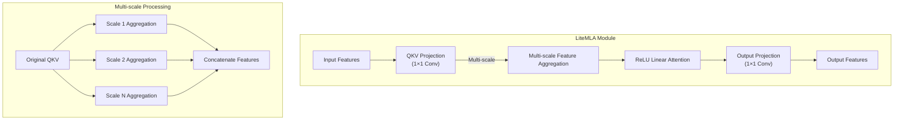

Sources: [efficientvit/models/nn/ops.py:518-568]()

Key aspects of LiteMLA:
- Projects input to query, key, and value tensors
- Applies multi-scale aggregation to capture features at different scales
- Uses efficient attention computation with ReLU kernel function
- Adaptively switches between linear attention and quadratic attention based on feature map size

```python
def relu_linear_att(self, qkv: torch.Tensor) -> torch.Tensor:
    # Linear attention implementation (see source code for details)
    # Used for larger feature maps (H*W > dim)

def relu_quadratic_att(self, qkv: torch.Tensor) -> torch.Tensor:
    # Quadratic attention implementation (see source code for details)
    # Used for smaller feature maps (H*W <= dim)
```

Sources: [efficientvit/models/nn/ops.py:581-667]()

### 2.4 Local Processing Modules

EfficientViT uses several variants of local processing modules:

#### MBConv (Mobile Inverted Bottleneck Conv)

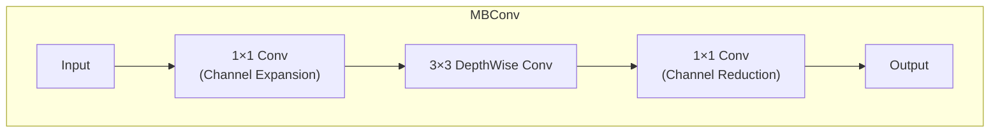

Sources: [efficientvit/models/nn/ops.py:312-364]()

#### GLUMBConv (Gated Linear Unit MBConv)

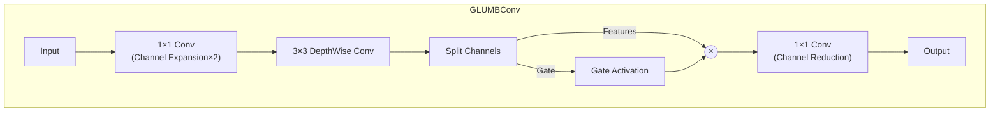

Sources: [efficientvit/models/nn/ops.py:413-470]()

#### DSConv (Depthwise Separable Conv)

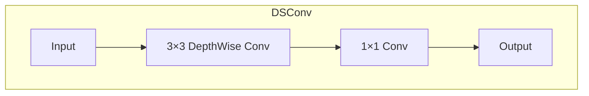

Sources: [efficientvit/models/nn/ops.py:270-309]()

#### FusedMBConv

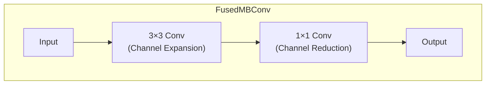

Sources: [efficientvit/models/nn/ops.py:367-410]()

## 3. Model Variants

EfficientViT comes in two main series, each with different model sizes:

1. **B-Series Models** (B0, B1, B2, B3): Basic variants using the EfficientViTBackbone
2. **L-Series Models** (L0, L1, L2, L3): Large variants using the EfficientViTLargeBackbone

### 3.1 B-Series Models

The B-series models scale in width (channel dimension) and depth (number of blocks) from B0 (smallest) to B3 (largest).

| Model | Width List | Depth List | Dimension | Primary Use Cases |
|-------|------------|------------|-----------|-------------------|
| B0    | [8, 16, 32, 64, 128] | [1, 2, 2, 2, 2] | 16 | Resource-constrained environments |
| B1    | [16, 32, 64, 128, 256] | [1, 2, 3, 3, 4] | 16 | Mobile devices |
| B2    | [24, 48, 96, 192, 384] | [1, 3, 4, 4, 6] | 32 | Edge devices |
| B3    | [32, 64, 128, 256, 512] | [1, 4, 6, 6, 9] | 32 | Standard deployment |

Sources: [efficientvit/models/efficientvit/backbone.py:159-196]()

### 3.2 L-Series Models

The L-series models use more sophisticated block combinations and generally have higher capacity than B-series.

| Model | Width List | Depth List | Primary Use Cases |
|-------|------------|------------|-------------------|
| L0    | [32, 64, 128, 256, 512] | [1, 1, 1, 4, 4] | High-performance with moderate size |
| L1    | [32, 64, 128, 256, 512] | [1, 1, 1, 6, 6] | High-performance tasks |
| L2    | [32, 64, 128, 256, 512] | [1, 2, 2, 8, 8] | Accuracy-critical applications |
| L3    | [64, 128, 256, 512, 1024] | [1, 2, 2, 8, 8] | Maximum accuracy scenarios |

The L-series models also use different block types at different stages, including residual blocks, fused mobile inverted bottleneck convolutions, and attention blocks.

Sources: [efficientvit/models/efficientvit/backbone.py:341-374]()

## 4. Architecture Flow and Feature Maps

### 4.1 Forward Pass Flow

During a forward pass, the input image flows through the backbone, producing feature maps at each stage. These feature maps are collected in a dictionary for use in task-specific heads.

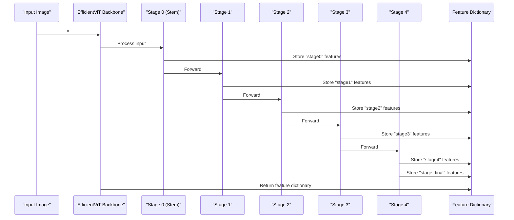

Sources: [efficientvit/models/efficientvit/backbone.py:150-156](), [efficientvit/models/efficientvit/backbone.py:333-338]()

### 4.2 Feature Resolution Characteristics

The EfficientViT architecture progressively reduces spatial resolution while increasing channel dimension:

- **Input**: Original image resolution (H×W×3)
- **Stage 0**: H/2×W/2×C₀ (after initial downsampling)
- **Stage 1**: H/4×W/4×C₁ (after downsampling)
- **Stage 2**: H/8×W/8×C₂ (after downsampling)
- **Stage 3**: H/16×W/16×C₃ (after downsampling)
- **Stage 4**: H/32×W/32×C₄ (after downsampling)

Where C₀, C₁, C₂, C₃, and C₄ correspond to the channel dimensions specified in the width_list parameter for each model variant.

Sources: [efficientvit/models/efficientvit/backbone.py:72-117]()

## 5. Integration with Task-Specific Models

The EfficientViT backbone is designed to be modular and can be integrated with various task-specific heads:

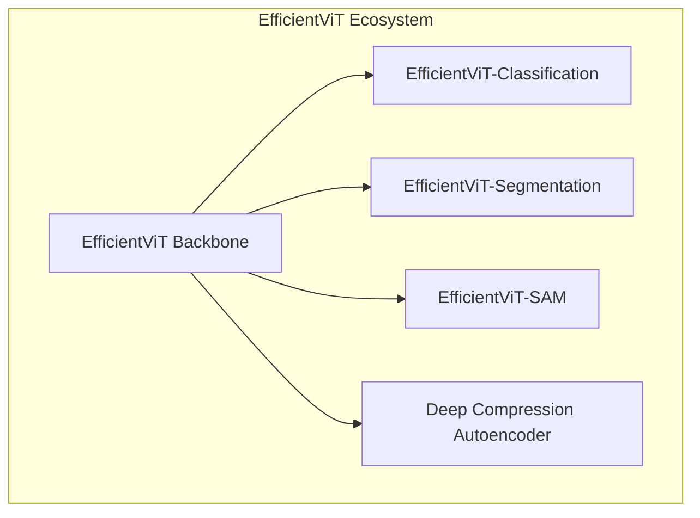

Sources: [efficientvit/models/efficientvit/cls.py:48-57](), [README.md:24-156]()

### 5.1 Classification Model Structure

For image classification, the EfficientViT backbone is combined with a classification head:

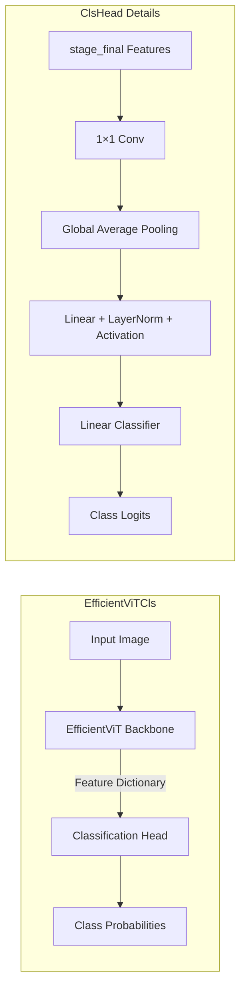

Sources: [efficientvit/models/efficientvit/cls.py:22-45](), [efficientvit/models/efficientvit/cls.py:48-57]()

## 6. Conclusion

The EfficientViT architecture provides a flexible foundation for efficient vision models. Its key strengths include:

1. **Efficiency**: The architecture is designed for computational efficiency while maintaining high accuracy
2. **Scalability**: Multiple model variants allow deployment across different computational budgets
3. **Versatility**: The backbone can be used for various vision tasks including classification, segmentation, and prompted segmentation
4. **Lightweight Attention**: The LiteMLA module captures global context with reduced computational requirements

For more information about specific applications of EfficientViT, refer to the related pages on [EfficientViT-Classification](#6.1), [EfficientViT-Segmentation](#6.2), [EfficientViT-SAM](#6.3), and [Deep Compression Autoencoder](#1.2).

Sources: [README.md:1-157]()

---

