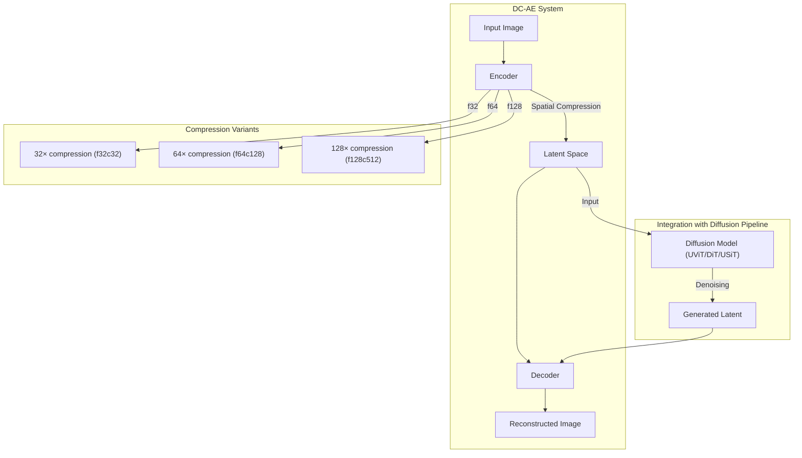
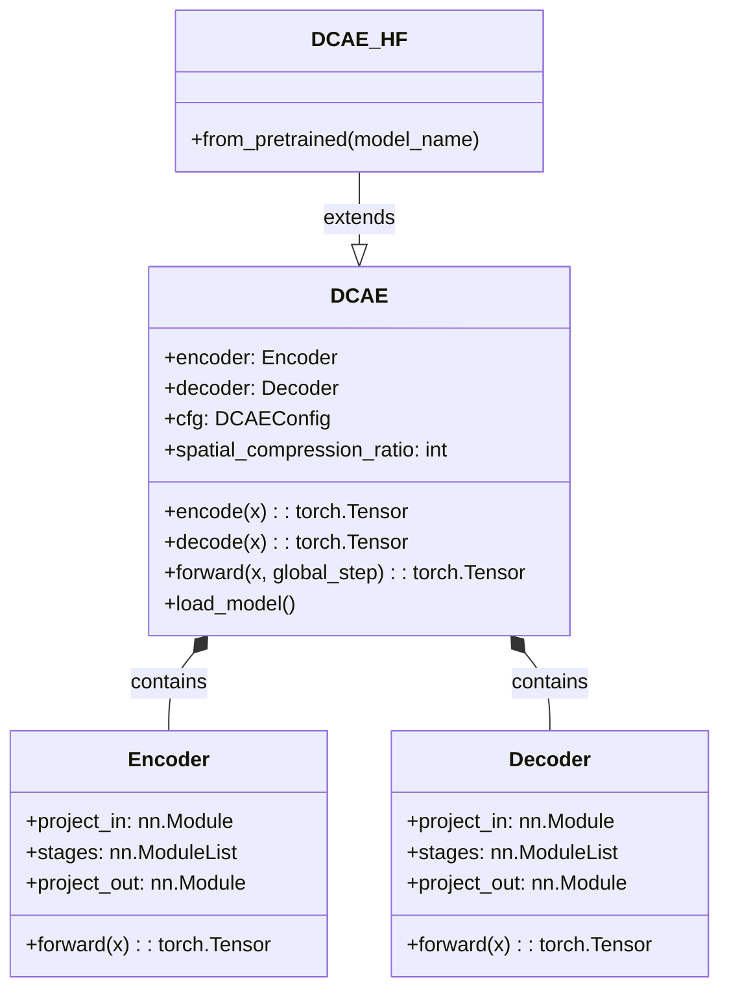
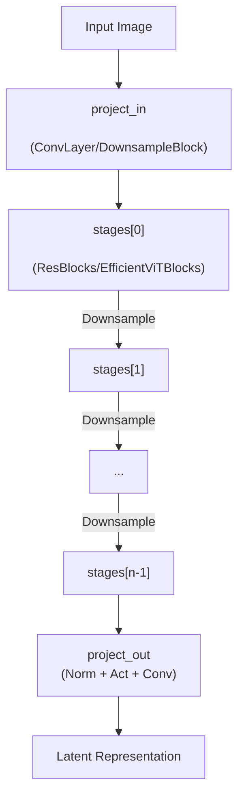
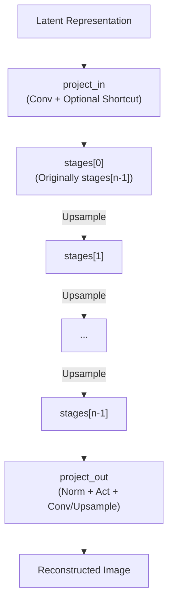

<!-- source: DeepWiki mcp.deepwiki.com · repo mit-han-lab/efficientvit · page 1.2 DC-AE (Deep Compression Autoencoder) · fetched 2026-10-30 -->

# DC-AE (Deep Compression Autoencoder)

<details>
<summary>Relevant source files</summary>

The following files were used as context for generating this wiki page:

- [README.md](README.md)
- [applications/dc_ae/README.md](applications/dc_ae/README.md)
- [applications/dc_ae/dc_ae_generate_latent.py](applications/dc_ae/dc_ae_generate_latent.py)
- [assets/cityscapes_l1.gif](assets/cityscapes_l1.gif)
- [assets/dc_ae_diffusion_demo.gif](assets/dc_ae_diffusion_demo.gif)
- [efficientvit/ae_model_zoo.py](efficientvit/ae_model_zoo.py)
- [efficientvit/models/efficientvit/dc_ae.py](efficientvit/models/efficientvit/dc_ae.py)
- [pyproject.toml](pyproject.toml)

</details>


This page provides a technical overview of the Deep Compression Autoencoder (DC-AE) system, a high-spatial compression autoencoder designed to efficiently compress images for latent diffusion models. For information about diffusion models that use DC-AE, see [Diffusion Models](#1.3).

## Purpose and Overview

DC-AE addresses the challenge of compressing high-resolution images into compact latent representations while maintaining reconstruction quality. It enables:

- Spatial compression ratios of 32×, 64×, and 128×
- Significant acceleration of both training and inference of diffusion models
- High-quality image generation at reduced computational cost

DC-AE incorporates two key innovations:

1. **Residual Autoencoding**: Learning residuals based on space-to-channel transformed features to alleviate optimization difficulties at high compression ratios
2. **Decoupled High-Resolution Adaptation**: A three-phase training strategy that mitigates generalization penalties

Sources: [README.md:24-56](), [applications/dc_ae/README.md:29-31]()

## System Architecture



DC-AE functions as both a standalone autoencoder for image compression and a component in latent diffusion models. In the latter case, the diffusion model operates in the compressed latent space, significantly reducing computational requirements.

Sources: [efficientvit/models/efficientvit/dc_ae.py:401-434](), [applications/dc_ae/README.md:69-112]()

## Implementation Details

### Core Classes

The DC-AE implementation is based on three primary classes:



The `DCAE` class is the main implementation, containing an encoder and decoder. `DCAE_HF` extends it with HuggingFace integration for loading pretrained models.

Sources: [efficientvit/models/efficientvit/dc_ae.py:278-399](), [efficientvit/models/efficientvit/dc_ae.py:402-434](), [efficientvit/ae_model_zoo.py:34-37]()

### Configuration System

DC-AE uses a nested configuration system with three main dataclasses:

```mermaid
graph TD
    subgraph "Configuration Hierarchy"
        DCAEConfig["DCAEConfig
        - in_channels
        - latent_channels
        - use_quant_conv
        - pretrained_path
        - scaling_factor"]
        
        EncoderConfig["EncoderConfig
        - width_list
        - depth_list
        - block_type
        - norm/act
        - downsample settings"]
        
        DecoderConfig["DecoderConfig
        - width_list
        - depth_list
        - block_type
        - norm/act
        - upsample settings"]
        
        DCAEConfig --> EncoderConfig: contains
        DCAEConfig --> DecoderConfig: contains
    end
```

These configurations control all aspects of the model including network width, depth, block types, and compression ratio.

Sources: [efficientvit/models/efficientvit/dc_ae.py:27-77]()

### Encoder Architecture



The encoder processes the input through multiple stages with progressive downsampling, reducing spatial dimensions while increasing channel count.

Sources: [efficientvit/models/efficientvit/dc_ae.py:278-331]()

### Decoder Architecture



The decoder mirrors the encoder structure in reverse, with upsampling operations restoring spatial dimensions and reducing channel count.

Sources: [efficientvit/models/efficientvit/dc_ae.py:333-399]()

## Model Variants

DC-AE comes in three main variants, differing in compression ratio and latent channel count:

| Model | Latent Shape | Compression Ratio | Configuration Function |
|-------|--------------|-------------------|------------------------|
| dc-ae-f32c32 | 32×(H/32)×(W/32) | 32× | `dc_ae_f32c32()` |
| dc-ae-f64c128 | 128×(H/64)×(W/64) | 64× | `dc_ae_f64c128()` |
| dc-ae-f128c512 | 512×(H/128)×(W/128) | 128× | `dc_ae_f128c512()` |

These variants represent different trade-offs between compression ratio, reconstruction quality, and computational efficiency when used with diffusion models.

Sources: [efficientvit/models/efficientvit/dc_ae.py:24](), [applications/dc_ae/README.md:71-80]()

## Key Building Blocks

DC-AE uses several neural network building blocks:

1. **ResBlock**: Residual blocks with convolutions, normalization, and activation
2. **EfficientViTBlock**: Blocks from the EfficientViT architecture that incorporate efficient attention
3. **ConvPixelUnshuffleDownSampleLayer**: Downsampling using pixel unshuffle followed by convolution
4. **ConvPixelShuffleUpSampleLayer**: Upsampling using convolution followed by pixel shuffle

These building blocks are combined to create the encoder and decoder networks, with specific configurations determining the network's behavior.

Sources: [efficientvit/models/efficientvit/dc_ae.py:80-104](), [efficientvit/models/efficientvit/dc_ae.py:8-22]()

## Usage Examples

### Basic Encoding and Decoding

```python
from efficientvit.ae_model_zoo import DCAE_HF
import torch
import torchvision.transforms as transforms
from PIL import Image

# Load pretrained model
device = torch.device("cuda")
dc_ae = DCAE_HF.from_pretrained("mit-han-lab/dc-ae-f64c128-in-1.0").to(device).eval()

# Prepare input image
transform = transforms.Compose([
    transforms.ToTensor(),
    transforms.Normalize(0.5, 0.5),
])
image = Image.open("image.png")
x = transform(image)[None].to(device)

# Encode to latent space
latent = dc_ae.encode(x)
print(f"Latent shape: {latent.shape}")  # Shows compression effect

# Decode back to image
y = dc_ae.decode(latent)
```

Sources: [applications/dc_ae/README.md:82-112]()

### Integration with Diffusion Models

```python
from efficientvit.diffusion_model_zoo import DCAE_Diffusion_HF
import torch

# Load pretrained DC-AE-Diffusion model
device = torch.device("cuda")
dc_ae_diffusion = DCAE_Diffusion_HF.from_pretrained(
    "mit-han-lab/dc-ae-f64c128-in-1.0-uvit-h-in-512px"
).to(device).eval()

# Set up for inference
torch.manual_seed(0)
eval_generator = torch.Generator(device=device).manual_seed(0)

# Class prompts for ImageNet classes (example)
prompts = torch.tensor([279, 333, 979], dtype=torch.int, device=device)
prompts_null = 1000 * torch.ones_like(prompts)

# Generate latent samples
latent_samples = dc_ae_diffusion.diffusion_model.generate(
    prompts, prompts_null, 6.0, eval_generator
)
latent_samples = latent_samples / dc_ae_diffusion.scaling_factor

# Decode to images
image_samples = dc_ae_diffusion.autoencoder.decode(latent_samples)
```

Sources: [applications/dc_ae/README.md:119-169]()

### Generating Latent Datasets

For training diffusion models, DC-AE can precompute latent representations for large datasets:

```python
# Example command using dc_ae_generate_latent.py
# torchrun --nnodes=1 --nproc_per_node=8 -m applications.dc_ae.dc_ae_generate_latent \
#     image_root_path=~/dataset/imagenet/train batch_size=64 \
#     model_name=dc-ae-f64c128-in-1.0 scaling_factor=0.2889 \
#     latent_root_path=assets/data/latent/dc_ae_f64c128_in_1.0/imagenet_512
```

This generates latent codes for each image and stores them for efficient training of diffusion models in the latent space.

Sources: [applications/dc_ae/dc_ae_generate_latent.py:57-142](), [applications/dc_ae/README.md:258-269]()

## Performance and Impact

### Reconstruction Quality

Despite high compression ratios, DC-AE maintains strong reconstruction quality:

| Model | FID | PSNR | SSIM | LPIPS |
|-------|-----|------|------|-------|
| dc-ae-f64c128-in-1.0 | 0.217 | 26.15 | 0.710 | 0.080 |

Sources: [applications/dc_ae/README.md:187-194]()

### Acceleration of Diffusion Models

When used with diffusion models, DC-AE significantly reduces computational requirements:

| Autoencoder | Diffusion Model | MACs (G) | FID (w/o cfg) | FID (with cfg) |
|-------------|-----------------|----------|---------------|----------------|
| DC-AE-f32 | UViT-H | 133.25 | 9.83 | 2.53 |
| DC-AE-f64 | UViT-H | 33.25 | 13.96 | 3.01 |
| DC-AE-f64 (train 2000k steps) | UViT-H | 33.25 | 12.26 | 2.66 |
| DC-AE-f32 | UViT-2B | 414.91 | 8.13 | 2.30 |
| DC-AE-f64 | UViT-2B | 104.65 | 7.78 | 2.47 |

At a 64× compression ratio, DC-AE provides up to 19× inference speedup and 18× training speedup compared to standard 8× compression autoencoders, while maintaining or improving generation quality.

Sources: [applications/dc_ae/README.md:122-134](), [README.md:24-56]()

## Summary

DC-AE represents a significant advancement in autoencoder technology for latent diffusion models. Through its innovations in residual autoencoding and decoupled training, it achieves much higher compression ratios than previous approaches while maintaining high reconstruction quality. This enables faster training and inference of diffusion models, particularly for high-resolution image generation.

DC-AE is also a core component of other systems in the EfficientViT ecosystem, including SANA for text-to-image generation.

Sources: [README.md:11-56](), [applications/dc_ae/README.md:29-31]()

---

