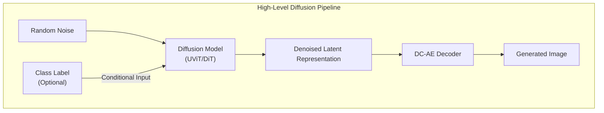
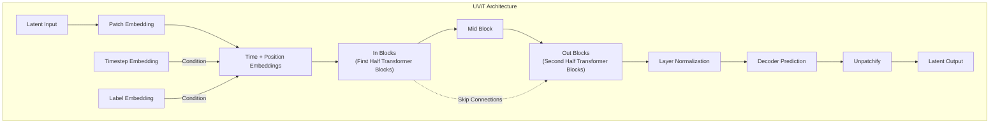
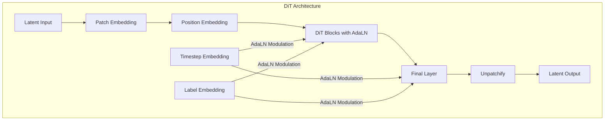
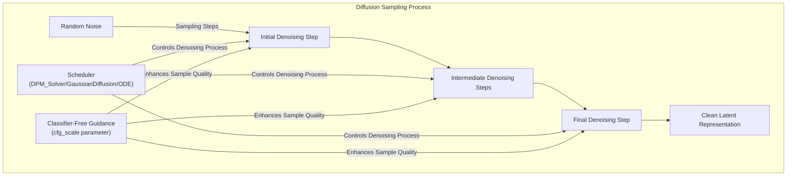
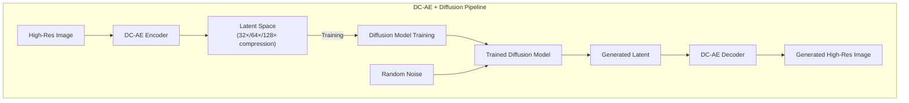
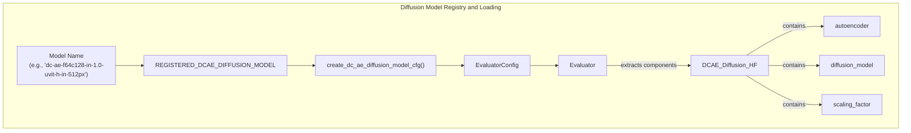
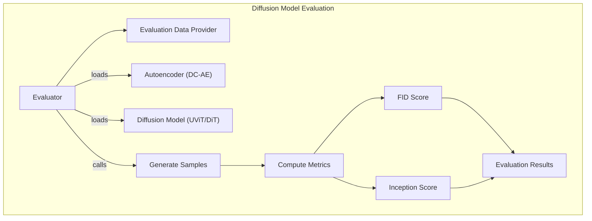
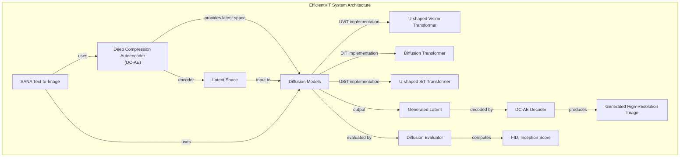

<!-- source: DeepWiki mcp.deepwiki.com · repo mit-han-lab/efficientvit · page 1.3 Diffusion Models · fetched 2026-10-30 -->

# Diffusion Models

<details>
<summary>Relevant source files</summary>

The following files were used as context for generating this wiki page:

- [README.md](README.md)
- [applications/dc_ae/README.md](applications/dc_ae/README.md)
- [applications/dc_ae/demo_dc_ae_model.py](applications/dc_ae/demo_dc_ae_model.py)
- [applications/dc_ae/demo_dc_ae_model_diffusers.py](applications/dc_ae/demo_dc_ae_model_diffusers.py)
- [efficientvit/diffusion_model_zoo.py](efficientvit/diffusion_model_zoo.py)
- [efficientvit/diffusioncore/evaluator.py](efficientvit/diffusioncore/evaluator.py)
- [efficientvit/diffusioncore/models/dit.py](efficientvit/diffusioncore/models/dit.py)
- [efficientvit/diffusioncore/models/uvit.py](efficientvit/diffusioncore/models/uvit.py)
- [efficientvit/diffusioncore/trainer.py](efficientvit/diffusioncore/trainer.py)

</details>


This document provides a technical overview of the diffusion models implemented in the EfficientViT repository. These models serve as the generative component of the system, working in conjunction with the Deep Compression Autoencoder (DC-AE) for efficient high-resolution image generation. For details about the autoencoder architecture itself, see [DC-AE (Deep Compression Autoencoder)](#1.2).

## Overview of Diffusion Models in EfficientViT

Diffusion models in the EfficientViT ecosystem operate in the latent space provided by the Deep Compression Autoencoder (DC-AE). This architecture allows for significantly faster image generation compared to pixel-space diffusion models, while maintaining high image quality.



Sources: [efficientvit/diffusioncore/models/uvit.py:490-527](), [efficientvit/diffusioncore/models/dit.py:402-462]()

The repository implements two main types of diffusion models:

1. **UViT (U-shaped Vision Transformer)**: A U-Net-like architecture with Vision Transformer blocks, featuring skip connections between encoder and decoder
2. **DiT (Diffusion Transformer)**: A more straightforward transformer-based diffusion model with AdaLN (adaptive layer normalization)

Both models are designed to work efficiently with the latent representations produced by DC-AE autoencoders.

## Architecture Details

### UViT Architecture

UViT (U-shaped Vision Transformer) follows a U-Net-like structure but uses transformer blocks instead of convolutional layers. It features skip connections that connect encoder blocks to corresponding decoder blocks.



Sources: [efficientvit/diffusioncore/models/uvit.py:265-380](), [efficientvit/diffusioncore/models/uvit.py:430-459]()

Key components of UViT:

- **Patch Embedding**: Splits the input latent into patches
- **Timestep Embedding**: Encodes the diffusion timestep
- **Label Embedding**: Encodes the class label for conditional generation
- **In Blocks**: Transformer blocks for the encoder path
- **Mid Block**: Central transformer block
- **Out Blocks**: Transformer blocks for the decoder path with skip connections
- **Final Layer**: Unpatchifies the output back to the latent space format

### DiT Architecture

DiT (Diffusion Transformer) is an adaptation of the Vision Transformer for diffusion models, using adaptive layer normalization (AdaLN) for conditioning.



Sources: [efficientvit/diffusioncore/models/dit.py:229-383](), [efficientvit/diffusioncore/models/dit.py:358-383]()

Key components of DiT:

- **Patch Embedding**: Splits the input latent into patches
- **Timestep Embedder**: Encodes the diffusion timestep
- **Label Embedder**: Encodes the class label for conditional generation
- **DiT Blocks**: Transformer blocks with AdaLN conditioning
- **Final Layer**: Produces the output latent representation

## Sampling and Training Schedulers

The models support different sampling and training schedulers to balance speed and quality:

### Training Schedulers
- **DPM Solver**: Default scheduler for UViT training
- **GaussianDiffusion**: Default scheduler for DiT training
- **SiTSampler**: Stochastic Interpolant Transport sampler for SiT models

### Evaluation/Inference Schedulers
- **DPM Solver**: Efficient ODE solver for UViT models
- **GaussianDiffusion**: Standard diffusion scheduler for DiT models
- **ODE_dopri5/ODE_heun2**: Advanced ODE solvers for SiT models 
- **UniPC**: UniPC multistep scheduler for DiT models

The choice of scheduler significantly impacts both training time and inference speed.



Sources: [efficientvit/diffusioncore/models/uvit.py:490-527](), [efficientvit/diffusioncore/models/dit.py:402-462]()

## Model Variants and Performance

The repository provides multiple pre-trained diffusion models with varying parameter counts and performance characteristics:

| Model | DC-AE Variant | Parameters (M) | MACs (G) | ImageNet 512×512 FID (w/o CFG) | ImageNet 512×512 FID (w/ CFG) |
|-------|---------------|---------------|----------|--------------------------------|-------------------------------|
| UViT-S | f32c32 | 44.79 | 12.27 | 46.12 | 18.08 |
| DiT-XL | f32c32 | 674.89 | 118.68 | 9.56 | 2.84 |
| DiT-XL (bs=1024) | f32c32 | 674.89 | 118.68 | 6.88 | 2.41 |
| UViT-H | f32c32 | 500.87 | 133.25 | 9.83 | 2.53 |
| UViT-H | f64c128 | 500.87 | 33.25 | 13.96 | 3.01 |
| UViT-H (2000k steps) | f64c128 | 500.87 | 33.25 | 12.26 | 2.66 |
| UViT-2B | f32c32 | 1580.40 | 414.91 | 8.13 | 2.30 |
| UViT-2B | f64c128 | 1580.40 | 104.65 | 7.78 | 2.47 |
| UViT-2B (2000k steps) | f64c128 | 1580.40 | 104.65 | 6.50 | 2.25 |
| USiT-H | f32c32 | 500.87 | 33.25 | 3.80 | 1.89 |
| USiT-2B | f32c32 | 1580.40 | 414.91 | 2.90 | 1.72 |

Sources: [applications/dc_ae/README.md:122-134]()

Notes:
- "f32c32" refers to DC-AE with 32× spatial compression and 32 channels
- "f64c128" refers to DC-AE with 64× spatial compression and 128 channels
- FID (Fréchet Inception Distance) measures image quality (lower is better)
- CFG (Classifier-Free Guidance) uses a guidance scale to improve sample quality

## Integration with Deep Compression Autoencoder

The diffusion models are designed to work seamlessly with DC-AE to enable efficient high-resolution image generation:



Sources: [applications/dc_ae/README.md:136-169](), [efficientvit/diffusion_model_zoo.py:1-123]()

## Model Zoo and Registration

The EfficientViT repository maintains a registry of pre-configured diffusion models that work with DC-AE. These models can be loaded using the `DCAE_Diffusion_HF` class:



Sources: [efficientvit/diffusion_model_zoo.py:17-123]()

## Evaluation System

The repository includes a comprehensive evaluation system for diffusion models:



Sources: [efficientvit/diffusioncore/evaluator.py:68-232]()

## Usage Examples

### Loading and Using a Pre-trained Diffusion Model

```python
from efficientvit.diffusion_model_zoo import DCAE_Diffusion_HF

# Load a pre-trained DC-AE + Diffusion model
dc_ae_diffusion = DCAE_Diffusion_HF.from_pretrained("mit-han-lab/dc-ae-f64c128-in-1.0-uvit-h-in-512px-train2000k")

# Setup for generation
device = torch.device("cuda")
dc_ae_diffusion = dc_ae_diffusion.to(device).eval()

# Configure seed for reproducibility
seed = 0
torch.manual_seed(seed)
torch.cuda.manual_seed_all(seed)
eval_generator = torch.Generator(device=device)
eval_generator.manual_seed(seed)

# Generate samples with class conditioning
prompts = torch.tensor([279, 333, 979, 936], dtype=torch.int, device=device)
num_samples = prompts.shape[0]
# 1000 is the unconditional class ID for classifier-free guidance
prompts_null = 1000 * torch.ones((num_samples,), dtype=torch.int, device=device)

# Generate latent samples with classifier-free guidance (scale 6.0)
latent_samples = dc_ae_diffusion.diffusion_model.generate(prompts, prompts_null, 6.0, eval_generator)
latent_samples = latent_samples / dc_ae_diffusion.scaling_factor

# Decode latents to images
image_samples = dc_ae_diffusion.autoencoder.decode(latent_samples)
```

Sources: [applications/dc_ae/README.md:136-169]()

### Training a Diffusion Model

To train a diffusion model on the latent space of DC-AE, you first need to generate the latent representations of your training data:

```bash
# Generate latent representations using DC-AE-f64
torchrun --nnodes=1 --nproc_per_node=8 -m applications.dc_ae.dc_ae_generate_latent resolution=512 \
    image_root_path=~/dataset/imagenet/train batch_size=64 \
    model_name=dc-ae-f64c128-in-1.0 scaling_factor=0.2889 \
    latent_root_path=assets/data/latent/dc_ae_f64c128_in_1.0/imagenet_512
```

Then train a diffusion model on these latents:

```bash
# Train DC-AE-f64 + UViT-H on ImageNet 512x512
torchrun --nnodes=1 --nproc_per_node=8 -m applications.dc_ae.train_dc_ae_diffusion_model resolution=512 \
    train_dataset=latent_imagenet latent_imagenet.batch_size=128 latent_imagenet.data_dir=assets/data/latent/dc_ae_f64c128_in_1.0/imagenet_512 \
    evaluate_dataset=sample_class sample_class.num_samples=50000 \
    autoencoder=dc-ae-f64c128-in-1.0 scaling_factor=0.2889 \
    model=uvit uvit.depth=28 uvit.hidden_size=1152 uvit.num_heads=16 uvit.in_channels=128 uvit.patch_size=1 \
    uvit.train_scheduler=DPM_Solver uvit.eval_scheduler=DPM_Solver \
    optimizer.name=adamw optimizer.lr=2e-4 optimizer.weight_decay=0.03 optimizer.betas=[0.99,0.99] \
    lr_scheduler.name=constant_with_warmup lr_scheduler.warmup_steps=5000 amp=bf16 \
    max_steps=500000 ema_decay=0.9999 \
    fid.ref_path=assets/data/fid/imagenet_512_train.npz \
    run_dir=.exp/diffusion/imagenet_512/dc_ae_f64c128_in_1.0/uvit_h_1/bs_1024_lr_2e-4_bf16
```

Sources: [applications/dc_ae/README.md:255-303]()

### Evaluating Diffusion Models

```bash
# Evaluate a diffusion model without classifier-free guidance
torchrun --nnodes=1 --nproc_per_node=8 -m applications.dc_ae.eval_dc_ae_diffusion_model \
    dataset=imagenet_512 model=dc-ae-f64c128-in-1.0-uvit-h-in-512px cfg_scale=1.0 run_dir=tmp

# Evaluate with classifier-free guidance
torchrun --nnodes=1 --nproc_per_node=8 -m applications.dc_ae.eval_dc_ae_diffusion_model \
    dataset=imagenet_512 model=dc-ae-f64c128-in-1.0-uvit-h-in-512px cfg_scale=1.5 run_dir=tmp
```

Sources: [applications/dc_ae/README.md:220-251]()

## System Architecture Context

The diffusion models component plays a critical role in the broader EfficientViT ecosystem, particularly in generative applications:



Sources: [README.md:1-157](), [applications/dc_ae/README.md:1-344]()

## Conclusion

The diffusion models in EfficientViT, particularly UViT and DiT, are designed to operate efficiently in the latent space provided by DC-AE. This architecture enables high-quality, high-resolution image generation while significantly reducing computational requirements compared to pixel-space diffusion models. The system supports classifier-free guidance for improved sample quality and provides comprehensive evaluation metrics.

The combination of Deep Compression Autoencoder with specialized diffusion models represents a significant advancement in efficient high-resolution image generation, enabling applications like SANA text-to-image generation to run efficiently even on laptop-grade hardware.

---

