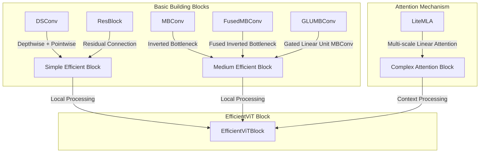
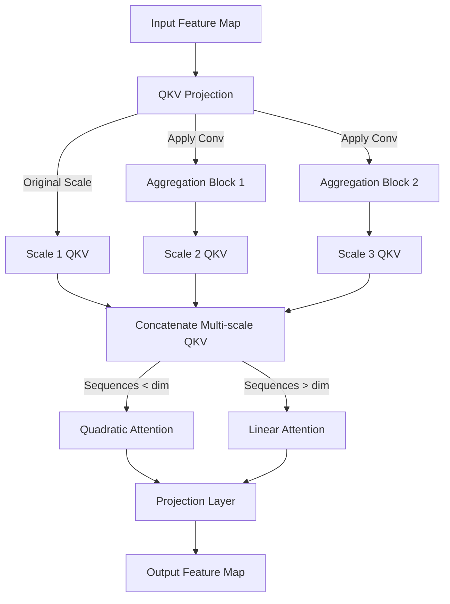
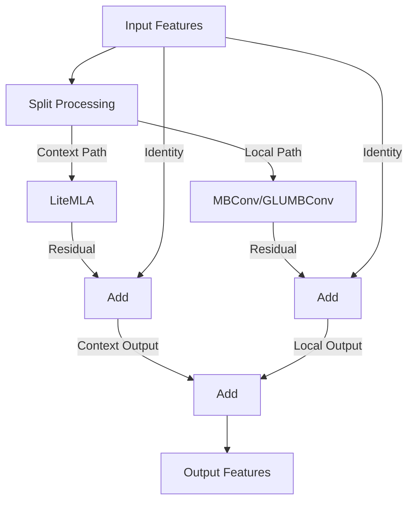
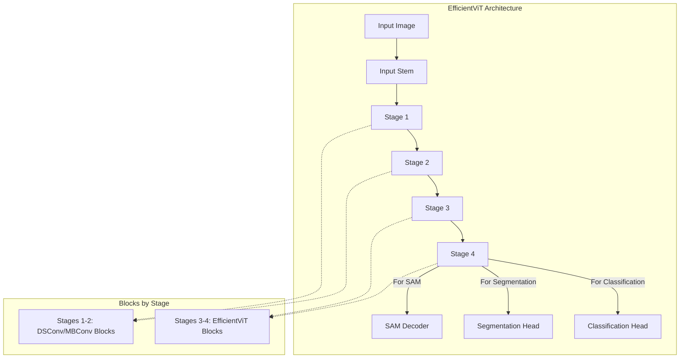

<!-- source: DeepWiki mcp.deepwiki.com · repo mit-han-lab/efficientvit · page 2 Core Components · fetched 2026-10-30 -->

# Core Components

<details>
<summary>Relevant source files</summary>

The following files were used as context for generating this wiki page:

- [.gitignore](.gitignore)
- [efficientvit/apps/data_provider/base.py](efficientvit/apps/data_provider/base.py)
- [efficientvit/models/efficientvit/backbone.py](efficientvit/models/efficientvit/backbone.py)
- [efficientvit/models/efficientvit/cls.py](efficientvit/models/efficientvit/cls.py)
- [efficientvit/models/nn/act.py](efficientvit/models/nn/act.py)
- [efficientvit/models/nn/norm.py](efficientvit/models/nn/norm.py)
- [efficientvit/models/nn/ops.py](efficientvit/models/nn/ops.py)

</details>


This document provides a detailed overview of the fundamental building blocks and neural network operations that make up the EfficientViT architecture. It covers the core components used across all EfficientViT variants, including the basic layers, attention mechanisms, and specialized blocks that enable efficient vision transformer functionality.

For information about specific model implementations built on these components, see [EfficientViT Backbone](#2.1) and [Neural Network Operations](#2.2).

## Basic Layers

The EfficientViT architecture relies on a set of fundamental layer implementations that serve as building blocks for more complex modules.

### ConvLayer

`ConvLayer` is a flexible convolutional layer that combines convolution, normalization, and activation in a single module. It provides a standardized interface for creating convolution layers with optional dropout, normalization, and activation functions.

```python
ConvLayer(
    in_channels: int,          # Number of input channels
    out_channels: int,         # Number of output channels
    kernel_size=3,             # Kernel size for the convolution
    stride=1,                  # Stride for the convolution
    dilation=1,                # Dilation rate for the convolution
    groups=1,                  # Number of groups for grouped convolution
    use_bias=False,            # Whether to use bias in the convolution
    dropout=0,                 # Dropout probability
    norm="bn2d",               # Normalization type
    act_func="relu",           # Activation function
)
```

Sources: [efficientvit/models/nn/ops.py:37-78]()

### LinearLayer

Similar to `ConvLayer`, `LinearLayer` provides a standardized interface for fully connected layers, combining linear transformation, normalization, and activation.

```python
LinearLayer(
    in_features: int,          # Number of input features
    out_features: int,         # Number of output features
    use_bias=True,             # Whether to use bias
    dropout=0,                 # Dropout probability
    norm=None,                 # Normalization type
    act_func=None,             # Activation function
)
```

Sources: [efficientvit/models/nn/ops.py:226-257]()

### Utility Layers

Additional utility layers provide specialized functionality:

- `UpSampleLayer`: Resizes feature maps to larger spatial dimensions
- `IdentityLayer`: Passes input through unchanged
- Various pixel shuffle up/downsampling layers for resolution changes

Sources: [efficientvit/models/nn/ops.py:81-262]()

## Building Blocks

Building on the basic layers, EfficientViT defines several higher-level building blocks that implement common neural network patterns.



### DSConv (Depthwise Separable Convolution)

`DSConv` implements depthwise separable convolution, which factorizes a standard convolution into a depthwise convolution (applying a single filter per input channel) followed by a pointwise convolution (1×1 convolution). This significantly reduces computation while maintaining representational power.

Sources: [efficientvit/models/nn/ops.py:270-309]()

### MBConv (Mobile Inverted Bottleneck Convolution)

`MBConv` implements the inverted bottleneck pattern from MobileNetV2. It expands the input channels, applies depthwise convolution, and then projects back to the output channels. This provides an efficient way to capture spatial information while maintaining a reasonable parameter count.

```python
MBConv(
    in_channels: int,          # Number of input channels
    out_channels: int,         # Number of output channels
    kernel_size=3,             # Kernel size for the convolution
    stride=1,                  # Stride for the convolution
    mid_channels=None,         # Number of channels in the expanded representation
    expand_ratio=6,            # Factor by which to expand input channels
    use_bias=False,            # Whether to use bias
    norm=("bn2d", "bn2d", "bn2d"),  # Normalization types
    act_func=("relu6", "relu6", None),  # Activation functions
)
```

Sources: [efficientvit/models/nn/ops.py:312-364]()

### FusedMBConv

`FusedMBConv` is a variant of `MBConv` that fuses the depthwise and expansion operations into a single convolution, reducing memory access costs in some hardware architectures.

Sources: [efficientvit/models/nn/ops.py:367-410]()

### GLUMBConv

`GLUMBConv` enhances the standard `MBConv` with a Gated Linear Unit, improving the expressiveness of the block by using a gating mechanism.

Sources: [efficientvit/models/nn/ops.py:413-470]()

## Attention Mechanism

### LiteMLA (Lightweight Multi-scale Linear Attention)

The `LiteMLA` module is a key innovation in EfficientViT, providing an efficient multi-scale attention mechanism. It processes inputs at multiple scales and uses a linear attention formulation to reduce computational complexity compared to standard self-attention.



Key features of `LiteMLA`:

1. Projects input features to query, key, and value representations
2. Applies multiple scales of processing through aggregation blocks
3. Uses a kernel-based linear attention mechanism for efficiency
4. Automatically switches between linear and quadratic attention based on sequence length
5. Projects the attended features back to the output space

The linear attention formulation is particularly important for efficiency:
- Traditional attention: O(n²) complexity with sequence length
- Linear attention: O(n) complexity with sequence length

Sources: [efficientvit/models/nn/ops.py:518-668]()

## EfficientViT Block

The `EfficientViTBlock` is the cornerstone of the EfficientViT architecture. It combines context processing (via `LiteMLA`) with local processing (via `MBConv` or `GLUMBConv`) in a parallel structure, followed by residual connections.



This dual-path design enables the block to efficiently capture both local patterns (through convolutions) and long-range dependencies (through attention), making it well-suited for vision tasks that require understanding both local details and global context.

Sources: [efficientvit/models/nn/ops.py:671-729]()

## Functional Blocks

### ResidualBlock

`ResidualBlock` implements a flexible residual connection pattern that can be applied to various modules. It supports optional pre-normalization, main path processing, shortcut path processing, and post-activation.

Sources: [efficientvit/models/nn/ops.py:737-767]()

### DAGBlock

`DAGBlock` implements a directed acyclic graph pattern for complex module connections. It allows for multiple inputs, different merging strategies, and multiple outputs, enabling complex network topologies.

Sources: [efficientvit/models/nn/ops.py:770-804]()

### OpSequential

`OpSequential` is a simple sequential processing module similar to `nn.Sequential` but with additional validation to filter out `None` modules.

Sources: [efficientvit/models/nn/ops.py:807-819]()

## Supporting Components

### Normalization Layers

EfficientViT supports multiple normalization strategies:

- `BatchNorm2d`: Standard batch normalization
- `LayerNorm`: Standard layer normalization
- `LayerNorm2d`: 2D variant of layer normalization
- `TritonRMSNorm2d`: Triton-optimized RMS normalization

Sources: [efficientvit/models/nn/norm.py:1-46]()

### Activation Functions

Various activation functions are supported:

- `ReLU`, `ReLU6`: Standard rectified linear units
- `Hardswish`: Memory-efficient alternative to Swish
- `SiLU`: Sigmoid linear unit (also known as Swish)
- `GELU`: Gaussian error linear unit

Sources: [efficientvit/models/nn/act.py:1-27]()

## Architecture Organization

EfficientViT organizes these components into a hierarchical structure with progressive stages of processing.



The backbone implementations (`EfficientViTBackbone` and `EfficientViTLargeBackbone`) organize these components into a coherent architecture with multiple stages:

1. **Input Stem**: Initial convolution and processing
2. **Early Stages**: Primarily convolutional blocks (`DSConv`, `MBConv`)
3. **Later Stages**: `EfficientViTBlock` combining attention and convolution

This progressive structure enables efficient feature extraction while maintaining a reasonable parameter count.

Sources: [efficientvit/models/efficientvit/backbone.py:33-374]()

## Model Variants

EfficientViT provides multiple model variants with different capacity and complexity:

| Variant | Width List | Depth List | Parameters | Notes |
|---------|------------|------------|------------|-------|
| B0 | [8, 16, 32, 64, 128] | [1, 2, 2, 2, 2] | Small | Mobile-friendly |
| B1 | [16, 32, 64, 128, 256] | [1, 2, 3, 3, 4] | Medium | Balanced |
| B2 | [24, 48, 96, 192, 384] | [1, 3, 4, 4, 6] | Medium-large | Performance |
| B3 | [32, 64, 128, 256, 512] | [1, 4, 6, 6, 9] | Large | High accuracy |
| L0-L3 | Varied | Varied | Larger | Enhanced variants |

The width list controls the number of channels in each stage, while the depth list controls the number of blocks in each stage.

Sources: [efficientvit/models/efficientvit/backbone.py:159-374]()

## Summary

The core components of EfficientViT work together to create an efficient and effective vision model:

1. **Basic Layers** provide the fundamental operations
2. **Building Blocks** combine these layers into functional units
3. **Attention Mechanisms** (particularly `LiteMLA`) enable efficient global context processing
4. **EfficientViT Blocks** combine attention and convolution for comprehensive feature capture
5. **Functional Blocks** enable complex network topologies
6. **Supporting Components** provide normalization and activation functionality
7. **Backbone Architectures** organize these components into a coherent whole

These components are designed with efficiency in mind, enabling EfficientViT to achieve strong performance with reasonable computational requirements.

---

