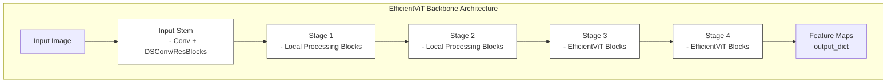
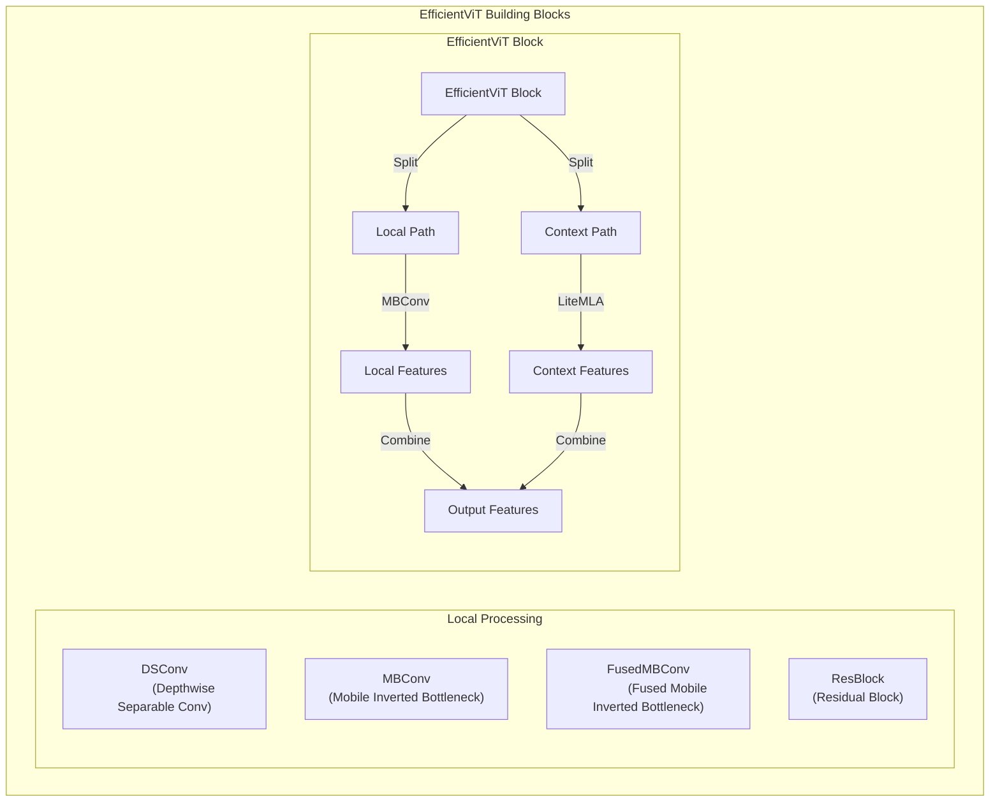
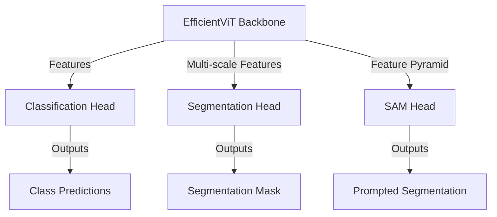

<!-- source: DeepWiki mcp.deepwiki.com · repo mit-han-lab/efficientvit · page 2.1 EfficientViT Backbone · fetched 2026-10-30 -->

# EfficientViT Backbone

<details>
<summary>Relevant source files</summary>

The following files were used as context for generating this wiki page:

- [.gitignore](.gitignore)
- [efficientvit/apps/data_provider/base.py](efficientvit/apps/data_provider/base.py)
- [efficientvit/models/efficientvit/backbone.py](efficientvit/models/efficientvit/backbone.py)
- [efficientvit/models/efficientvit/cls.py](efficientvit/models/efficientvit/cls.py)
- [efficientvit/models/nn/act.py](efficientvit/models/nn/act.py)
- [efficientvit/models/nn/norm.py](efficientvit/models/nn/norm.py)

</details>


## Purpose and Scope

This document describes the EfficientViT backbone architecture, which serves as the foundation for various EfficientViT models in the repository. The backbone extracts hierarchical features from input images and can be configured in different sizes (B0-B3 and L0-L3 variants) to balance performance and computational efficiency. For information about task-specific models that use this backbone, see [Classification Models](#5.1), [Segmentation Models](#5.2), and [SAM Models](#5.3).

## Architecture Overview

The EfficientViT backbone consists of multiple stages that progressively process and downsample input images to extract features at different spatial resolutions. There are two main backbone variants:

1. **EfficientViTBackbone** (B0-B3 variants): The standard backbone implementation
2. **EfficientViTLargeBackbone** (L0-L3 variants): A more powerful variant with expanded capabilities



Sources: [efficientvit/models/efficientvit/backbone.py:33-156]()

### Feature Extraction Process

1. **Input Stem**: Initial processing using ConvLayer followed by depth-wise separable convolutions
2. **Early Stages**: Primarily local processing using MBConv or DSConv blocks
3. **Later Stages**: Incorporate EfficientViT blocks that combine local and context processing

The backbone extracts multi-scale features and returns them in a dictionary where each key represents a different stage.

## Standard Backbone (B0-B3)

The `EfficientViTBackbone` class implements the standard backbone with configurable widths and depths:

```mermaid
classDiagram
    class EfficientViTBackbone {
        +width_list: list[int]
        +input_stem: OpSequential
        +stages: nn.ModuleList
        
        +__init__(width_list, depth_list, in_channels, dim, expand_ratio, norm, act_func)
        +build_local_block(in_channels, out_channels, stride, expand_ratio, norm, act_func)
        +forward(x): Dict[str, Tensor]
    }
    
    EfficientViTBackbone --> "Multiple Stages"
    EfficientViTBackbone --> "Local Blocks"
    EfficientViTBackbone --> "EfficientViT Blocks"
```

Sources: [efficientvit/models/efficientvit/backbone.py:33-156]()

### Backbone Configuration Variants

The B0-B3 variants differ in their width (number of channels) and depth (number of blocks), with larger variants providing better accuracy at the cost of more computation:

| Variant | Width List           | Depth List      | Dimension | Description               |
|---------|----------------------|-----------------|-----------|---------------------------|
| B0      | [8, 16, 32, 64, 128] | [1, 2, 2, 2, 2] | 16        | Smallest, most efficient  |
| B1      | [16, 32, 64, 128, 256] | [1, 2, 3, 3, 4] | 16      | Small but more capable    |
| B2      | [24, 48, 96, 192, 384] | [1, 3, 4, 4, 6] | 32      | Medium size and capacity  |
| B3      | [32, 64, 128, 256, 512] | [1, 4, 6, 6, 9] | 32     | Largest standard variant  |

Sources: [efficientvit/models/efficientvit/backbone.py:159-196]()

## Large Backbone (L0-L3)

The `EfficientViTLargeBackbone` class extends the capabilities of the standard backbone with more flexibility in block types:

```mermaid
classDiagram
    class EfficientViTLargeBackbone {
        +width_list: list[int]
        +stages: nn.ModuleList
        
        +__init__(width_list, depth_list, block_list, expand_list, fewer_norm_list, in_channels, qkv_dim, norm, act_func)
        +build_local_block(block, in_channels, out_channels, stride, expand_ratio, norm, act_func, fewer_norm)
        +forward(x): Dict[str, Tensor]
    }
    
    EfficientViTLargeBackbone --> "Multiple Stages"
    EfficientViTLargeBackbone --> "Res/FMB/MB Blocks"
    EfficientViTLargeBackbone --> "EfficientViT Blocks"
```

Sources: [efficientvit/models/efficientvit/backbone.py:199-338]()

### Large Backbone Configuration Variants

The L0-L3 variants use more sophisticated block types and generally have greater capacity:

| Variant | Width List              | Depth List      | Description                  |
|---------|-------------------------|-----------------|------------------------------|
| L0      | [32, 64, 128, 256, 512] | [1, 1, 1, 4, 4] | Entry-level large variant    |
| L1      | [32, 64, 128, 256, 512] | [1, 1, 1, 6, 6] | Medium large variant         |
| L2      | [32, 64, 128, 256, 512] | [1, 2, 2, 8, 8] | High-capacity large variant  |
| L3      | [64, 128, 256, 512, 1024] | [1, 2, 2, 8, 8] | Largest, most powerful     |

Sources: [efficientvit/models/efficientvit/backbone.py:341-374]()

## Building Blocks

The EfficientViT backbone utilizes several types of building blocks:



Sources: [efficientvit/models/efficientvit/backbone.py:120-148](), [efficientvit/models/efficientvit/backbone.py:290-331]()

### Local Processing Blocks

The backbone uses different local processing blocks depending on the stage and configuration:

1. **DSConv (Depthwise Separable Convolution)**: Used when `expand_ratio=1`, more efficient than standard convolutions
2. **MBConv (Mobile Inverted Bottleneck)**: Used when `expand_ratio>1`, expands channels before depthwise convolution
3. **FusedMBConv**: A variant of MBConv that fuses the expansion and depthwise convolution for efficiency
4. **ResBlock**: A simple residual block used in the large backbone variants

Sources: [efficientvit/models/efficientvit/backbone.py:120-148](), [efficientvit/models/efficientvit/backbone.py:290-331]()

### EfficientViT Block

In later stages, the backbone incorporates EfficientViT blocks that combine:

1. **Local Path**: Processes local features using MBConv/FusedMBConv
2. **Context Path**: Captures global context using LiteMLA (Lite Multi-scale Attention)

This dual-path design efficiently balances local details and global context, which is crucial for vision tasks.

Sources: [efficientvit/models/efficientvit/backbone.py:102-116]()

## Implementation Details

### Initialization and Forward Pass

The backbone is initialized with configuration parameters that determine its structure:

```python
# Example initialization of EfficientViT B0
backbone = EfficientViTBackbone(
    width_list=[8, 16, 32, 64, 128],
    depth_list=[1, 2, 2, 2, 2],
    dim=16,
    expand_ratio=4,
    norm="bn2d",
    act_func="hswish"
)
```

During the forward pass, the backbone processes input images through all stages and returns a dictionary containing feature maps at different resolutions:

```python
# Forward pass example
output_dict = backbone(input_image)
# output_dict contains: 'input', 'stage0', 'stage1', 'stage2', 'stage3', 'stage4', 'stage_final'
```

Sources: [efficientvit/models/efficientvit/backbone.py:150-156](), [efficientvit/models/efficientvit/backbone.py:333-338]()

### Normalization and Activation

The backbone supports different normalization and activation functions:

1. **Normalization**: Primarily uses batch normalization (`bn2d`) by default, but also supports layer normalization (`ln`, `ln2d`) and TritonRMSNorm (`trms2d`)
2. **Activation**: Uses hardswish (`hswish`) by default for standard backbone and GELU for large backbone, but also supports ReLU, ReLU6, and SiLU

Sources: [efficientvit/models/nn/norm.py:28-33](), [efficientvit/models/nn/act.py:12-18]()

## Usage in Models

The EfficientViT backbone serves as the foundation for:

1. **Classification Models**: Via `EfficientViTCls` which adds a classification head
2. **Segmentation Models**: Provides multi-scale features for semantic segmentation
3. **SAM Models**: Used in the efficient implementation of Segment Anything Model



Sources: [efficientvit/models/efficientvit/cls.py:48-57]()

## Factory Functions

The repository provides factory functions to easily instantiate the backbone with predefined configurations:

```python
# Standard backbone variants
efficientvit_backbone_b0()  # Smallest variant
efficientvit_backbone_b1()
efficientvit_backbone_b2()
efficientvit_backbone_b3()  # Largest standard variant

# Large backbone variants
efficientvit_backbone_l0()  # Entry-level large variant
efficientvit_backbone_l1()
efficientvit_backbone_l2()
efficientvit_backbone_l3()  # Largest variant
```

These functions allow easy customization through keyword arguments that override the default configuration.

Sources: [efficientvit/models/efficientvit/backbone.py:159-196](), [efficientvit/models/efficientvit/backbone.py:341-374]()

---

