<!-- source: DeepWiki mcp.deepwiki.com · repo mit-han-lab/efficientvit · page 2.2 Neural Network Operations · fetched 2026-10-30 -->

# Neural Network Operations

Relevant source files

The following files were used as context for generating this wiki page:

- [efficientvit/models/nn/ops.py](efficientvit/models/nn/ops.py)

This page documents the core neural network operations used throughout the EfficientViT framework. These operations serve as building blocks for constructing the various EfficientViT model architectures, including the backbone networks, segmentation models, and SAM models. For information about the overall EfficientViT architecture, see [EfficientViT Architecture](#1.1).

## Overview of Neural Network Operations

EfficientViT implements a collection of neural network operations that range from basic layers to complex attention mechanisms and specialized blocks. These operations are designed for efficiency and performance in vision transformer architectures.

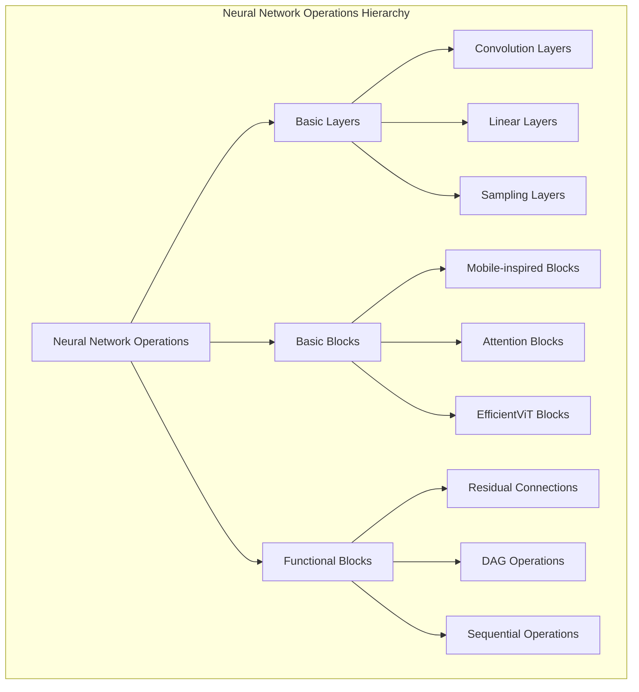

Sources: [efficientvit/models/nn/ops.py:11-29]()

## Basic Layers

### Convolution and Linear Layers

The framework provides enhanced convolution and linear layers that integrate normalization and activation functions.

#### ConvLayer

`ConvLayer` extends the standard convolution operation with built-in normalization and activation. It handles padding automatically to maintain spatial dimensions.

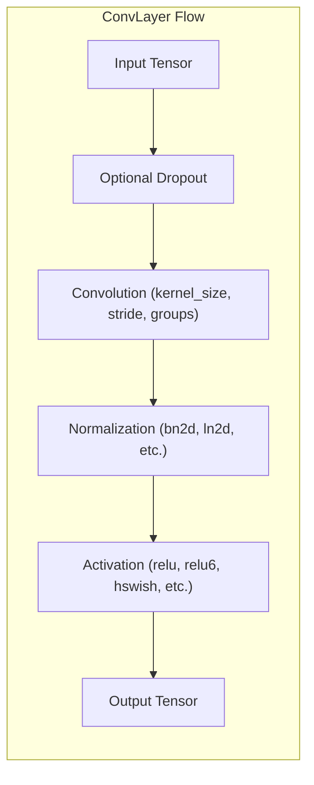

Sources: [efficientvit/models/nn/ops.py:37-78]()

#### LinearLayer

`LinearLayer` combines linear transformation with normalization and activation, and automatically handles tensor flattening.

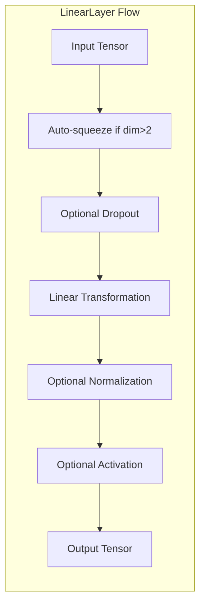

Sources: [efficientvit/models/nn/ops.py:226-257]()

### Sampling Layers

EfficientViT implements various upsampling and downsampling layers to efficiently manipulate feature map resolutions.

#### UpSampleLayer

Provides resolution upsampling using interpolation methods like bicubic.

Sources: [efficientvit/models/nn/ops.py:81-101]()

#### Pixel Shuffle Operations

Several specialized layers implement efficient resolution changes using pixel shuffling:

- `ConvPixelUnshuffleDownSampleLayer`: Combines convolution with pixel unshuffle for downsampling
- `PixelUnshuffleChannelAveragingDownSampleLayer`: Unshuffle followed by channel averaging for downsampling
- `ConvPixelShuffleUpSampleLayer`: Combines convolution with pixel shuffle for upsampling
- `ChannelDuplicatingPixelUnshuffleUpSampleLayer`: Channel duplication with pixel unshuffle for upsampling

Sources: [efficientvit/models/nn/ops.py:104-223]()

## Basic Blocks

### Mobile-inspired Blocks

EfficientViT implements several blocks inspired by mobile-efficient architectures:

#### DSConv (Depthwise Separable Convolution)

Splits a standard convolution into a depthwise (spatial) convolution followed by a pointwise (1x1) convolution to reduce parameters and computation.

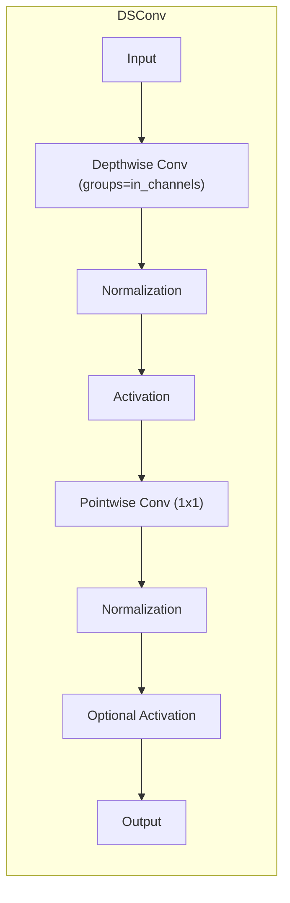

Sources: [efficientvit/models/nn/ops.py:270-309]()

#### MBConv (Mobile Inverted Bottleneck Convolution)

Expands channels, applies depthwise convolution, then projects back to original or desired channel count. Used extensively in EfficientNet and EfficientViT architectures.

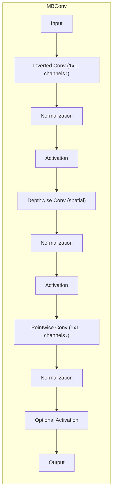

Sources: [efficientvit/models/nn/ops.py:312-364]()

#### FusedMBConv

A more efficient variant of MBConv that fuses the expansion and depthwise operations into a single regular convolution.

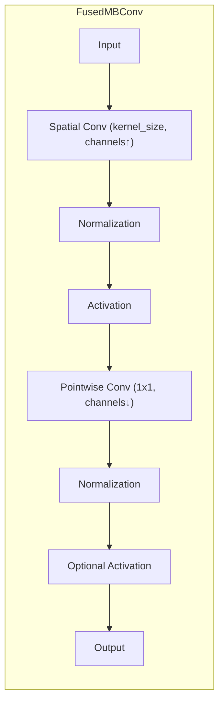

Sources: [efficientvit/models/nn/ops.py:367-410]()

#### GLUMBConv (Gated Linear Unit MBConv)

Adds gating mechanisms to the MBConv block, providing additional control over information flow.

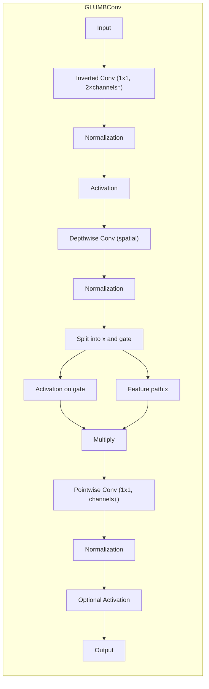

Sources: [efficientvit/models/nn/ops.py:413-470]()

### Attention Blocks

#### LiteMLA (Lightweight Multi-scale Linear Attention)

A key innovation in EfficientViT, this lightweight attention mechanism processes features at multiple scales for global context modeling while maintaining computational efficiency.

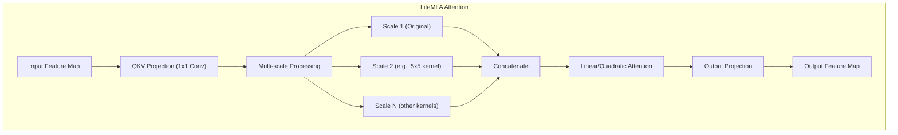

LiteMLA handles two attention modes:
- `relu_linear_att`: Used when feature map size is large (linear complexity)
- `relu_quadratic_att`: Used for small feature maps (quadratic complexity but more accurate)

Sources: [efficientvit/models/nn/ops.py:518-668]()

### EfficientViTBlock

The foundational building block of EfficientViT, combining context modeling and local processing.

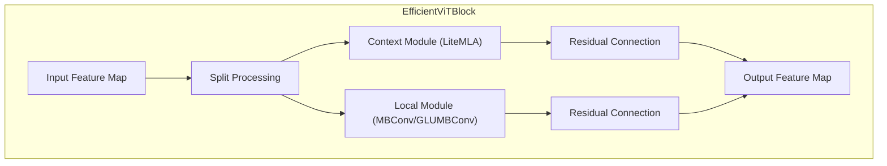

EfficientViTBlock processes features through two parallel paths:
1. **Context Module**: Captures global dependencies using LiteMLA
2. **Local Module**: Extracts local features using MBConv or GLUMBConv

Each path includes a residual connection, allowing for efficient gradient flow during training.

Sources: [efficientvit/models/nn/ops.py:671-729]()

## Functional Blocks

### ResidualBlock

Implements flexible residual connections with options for pre-normalization and post-activation.

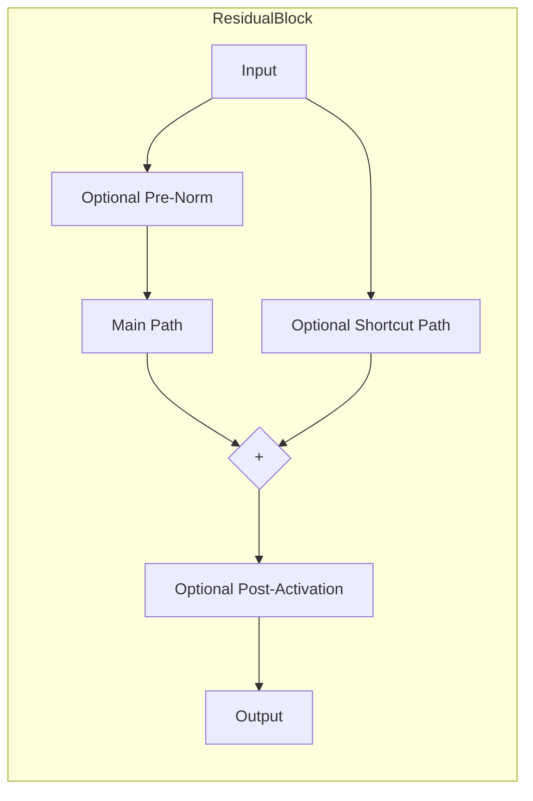

Sources: [efficientvit/models/nn/ops.py:737-767]()

### DAGBlock

Enables the creation of complex directed acyclic graph structures for flexible neural network architectures.

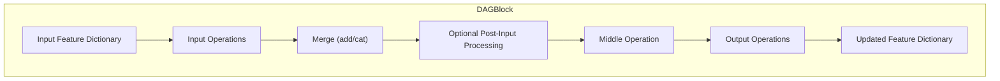

The DAGBlock allows operations on multiple input features from a dictionary, merges them, processes the result, and updates the feature dictionary with new outputs.

Sources: [efficientvit/models/nn/ops.py:770-804]()

### OpSequential

A variant of `nn.Sequential` that filters out None modules, making it easier to conditionally include or exclude operations in a sequence.

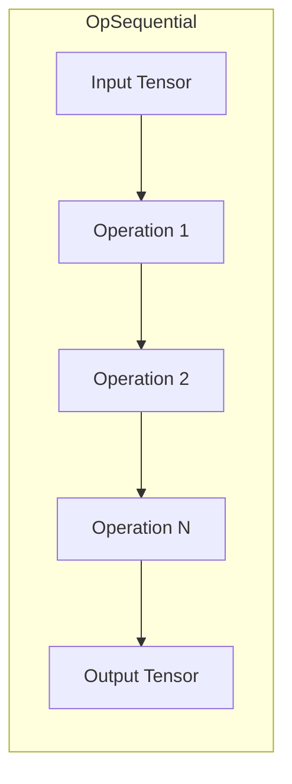

Sources: [efficientvit/models/nn/ops.py:807-819]()

## Relationships and Usage Patterns

The neural network operations in EfficientViT are designed to work together in specific patterns to achieve efficient vision processing:

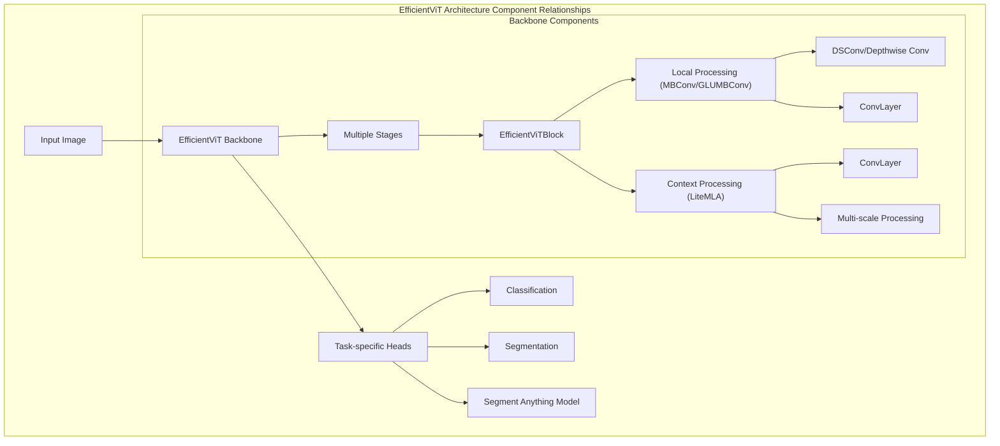

Sources: [efficientvit/models/nn/ops.py:671-729](), [efficientvit/models/nn/ops.py:312-364](), [efficientvit/models/nn/ops.py:518-668]()

## Implementation Considerations

### Parameter Efficiency

Many operations in EfficientViT are designed with parameter efficiency in mind:

| Operation | Parameter Efficiency Technique |
|-----------|--------------------------------|
| DSConv | Separates spatial and channel processing |
| MBConv | Uses inverted bottleneck for efficient feature extraction |
| LiteMLA | Employs linear attention to avoid quadratic complexity |
| FusedMBConv | Fuses operations to reduce memory transfers |
| GLUMBConv | Uses gating for controlled information flow |

Sources: [efficientvit/models/nn/ops.py:270-470]()

### Computational Efficiency

The operations are also optimized for computational efficiency:

| Operation | Computational Efficiency Feature |
|-----------|----------------------------------|
| LiteMLA | Switches between linear and quadratic attention based on feature size |
| Pixel Shuffle Operations | Efficient resolution changes without expensive interpolation |
| ResidualBlock | Optimizes gradient flow through residual connections |
| DSConv | Reduces computation by separating spatial and channel processing |

Sources: [efficientvit/models/nn/ops.py:518-668](), [efficientvit/models/nn/ops.py:104-223](), [efficientvit/models/nn/ops.py:737-767](), [efficientvit/models/nn/ops.py:270-309]()

---

