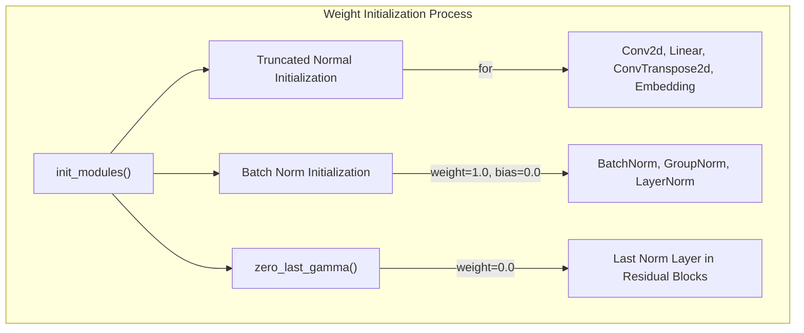
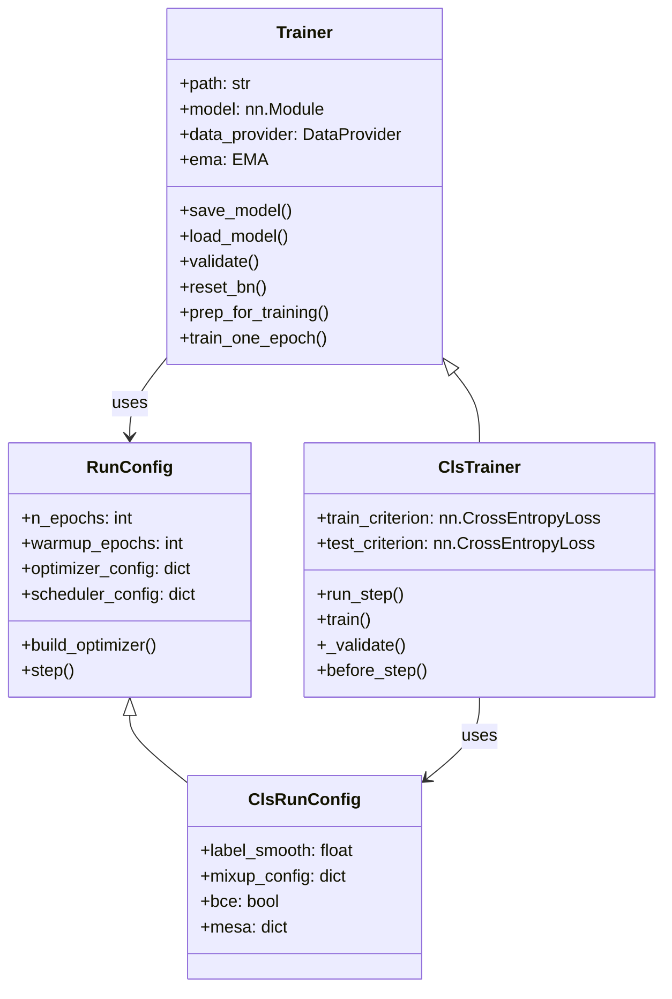
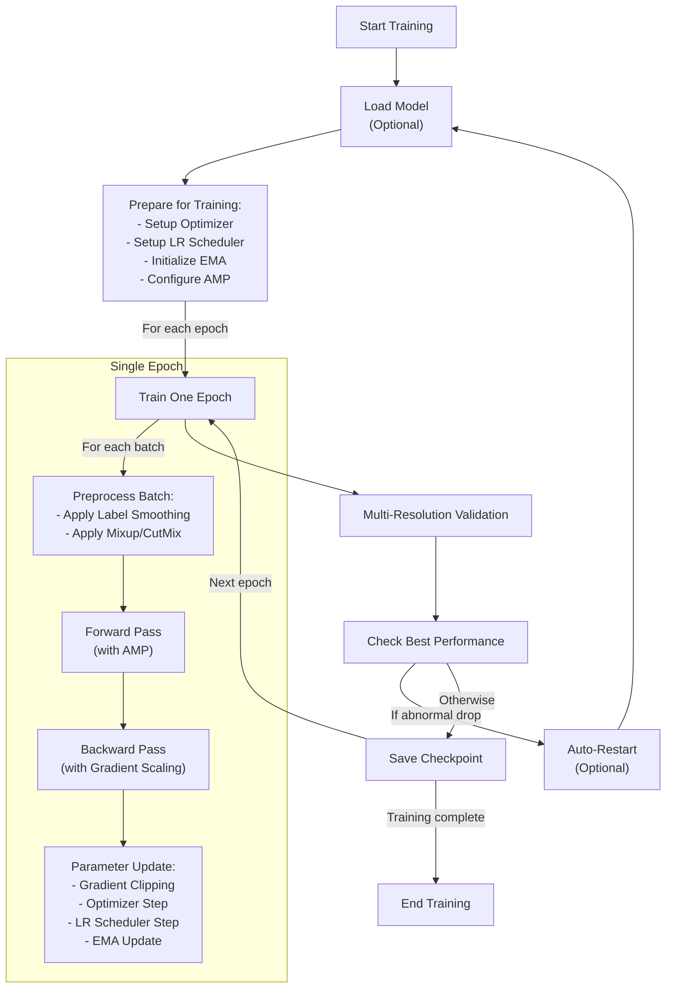
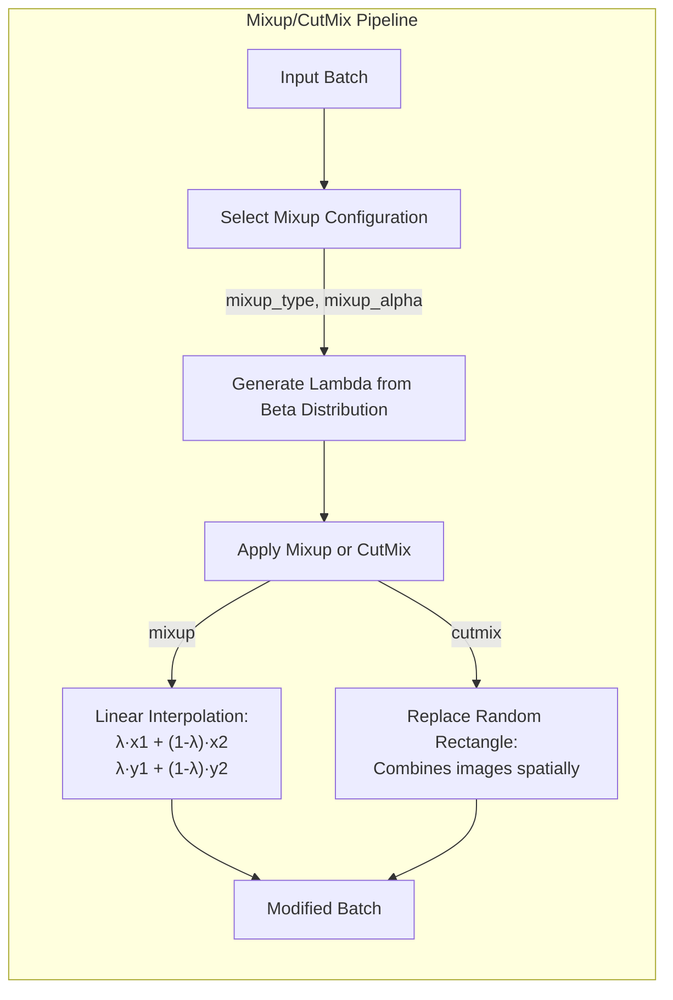

<!-- source: DeepWiki mcp.deepwiki.com · repo mit-han-lab/efficientvit · page 2.3 Model Initialization and Training · fetched 2026-10-30 -->

# Model Initialization and Training

<details>
<summary>Relevant source files</summary>

The following files were used as context for generating this wiki page:

- [efficientvit/apps/data_provider/augment/color_aug.py](efficientvit/apps/data_provider/augment/color_aug.py)
- [efficientvit/apps/trainer/base.py](efficientvit/apps/trainer/base.py)
- [efficientvit/apps/utils/init.py](efficientvit/apps/utils/init.py)
- [efficientvit/clscore/data_provider/imagenet.py](efficientvit/clscore/data_provider/imagenet.py)
- [efficientvit/clscore/trainer/cls_run_config.py](efficientvit/clscore/trainer/cls_run_config.py)
- [efficientvit/clscore/trainer/cls_trainer.py](efficientvit/clscore/trainer/cls_trainer.py)
- [efficientvit/clscore/trainer/utils/mixup.py](efficientvit/clscore/trainer/utils/mixup.py)
- [efficientvit/models/nn/drop.py](efficientvit/models/nn/drop.py)
- [efficientvit/models/utils/network.py](efficientvit/models/utils/network.py)

</details>


This document describes the initialization and training process for EfficientViT models. It covers how models are initialized with proper weight distributions, configured for training, and the training infrastructure that supports various advanced techniques including mixed precision training, regularization methods, and ensemble self-adaptation.

For information about the specific neural network operations used in the models, see [Neural Network Operations](#2.2). For details on training infrastructure setup, see [Training Infrastructure](#7.2).

## Model Initialization

The EfficientViT framework provides systematic methods for initializing model weights to ensure stable training and good convergence properties.

### Weight Initialization



The initialization process involves:

1. **Truncated Normal Initialization**: Applied to convolutional, linear, and embedding layers with a configurable standard deviation (default: 0.02)
2. **Normalization Layer Initialization**: Sets normalization layer weights to 1.0 and biases to 0.0
3. **Zero Gamma Initialization**: Optionally initializes the final normalization layer in residual blocks to zero for improved training stability

Sources: [efficientvit/apps/utils/init.py:8-62]()

### Initialization Implementation

Model initialization is applied using utility functions that traverse the model's modules recursively and apply appropriate initialization based on the module type:

```python
# Example usage of initialization functions
from efficientvit.apps.utils import init_modules, zero_last_gamma

# Initialize all model weights
init_modules(model, init_type="trunc_normal@0.02")

# Zero-initialize last gamma in residual blocks for stable training
zero_last_gamma(model)
```

For special initialization parameters, the initialization type can be formatted as `"init_type@param_value"`, allowing for customized initialization strength.

Sources: [efficientvit/apps/utils/init.py:8-42](), [efficientvit/apps/utils/init.py:44-62]()

## Model Training Framework

EfficientViT provides a comprehensive training framework with a hierarchical class structure that supports various training configurations and techniques.

### Training Architecture



The training framework consists of:

1. **Base Trainer**: Handles core training functions like model saving/loading and validation
2. **Specialized Trainers**: Extend the base trainer for specific tasks (e.g., ClsTrainer for classification)
3. **Run Configurations**: Define training hyperparameters and settings
4. **Task-Specific Configurations**: Extend base configurations with task-specific options

Sources: [efficientvit/apps/trainer/base.py:16-296](), [efficientvit/clscore/trainer/cls_trainer.py:19-230](), [efficientvit/clscore/trainer/cls_run_config.py:1-14]()

## Training Process

The training process in EfficientViT follows a standard but flexible workflow that incorporates several advanced techniques.

### Training Workflow



The complete training process involves:

1. **Preparation**: Setting up the model, optimizer, learning rate scheduler, and training configurations
2. **Epoch Loop**: Training for a specified number of epochs
3. **Batch Processing**: Applying data preprocessing, forward/backward passes, and parameter updates
4. **Validation**: Evaluating model performance, potentially at multiple resolutions
5. **Checkpointing**: Saving model state and handling automatic restart if performance degrades unexpectedly

Sources: [efficientvit/apps/trainer/base.py:201-296](), [efficientvit/clscore/trainer/cls_trainer.py:188-230]()

## Advanced Training Features

EfficientViT incorporates several advanced techniques to enhance training efficiency and model performance.

### Automatic Mixed Precision (AMP)

The framework supports automatic mixed precision training to speed up computation while maintaining numerical stability:

```python
# AMP setup in the Trainer class
self.amp = amp  # Can be "fp16", "bf16", or "fp32"
self.scaler = torch.cuda.amp.GradScaler(enabled=self.enable_amp)

# Usage during training
with torch.autocast(device_type="cuda", dtype=self.amp_dtype, enabled=self.enable_amp):
    output = self.model(images)
    loss = self.train_criterion(output, labels)
self.scaler.scale(loss).backward()
```

This implementation allows for training in:
- Full precision (FP32)
- Half precision (FP16)
- Brain floating point (BF16)

Sources: [efficientvit/apps/trainer/base.py:223-236](), [efficientvit/clscore/trainer/cls_trainer.py:121-128]()

### Regularization Techniques

The framework supports multiple regularization techniques to improve generalization:

#### Label Smoothing

Label smoothing prevents the model from becoming overconfident in its predictions by softening the one-hot encoded labels.

#### Mixup and CutMix



The framework supports mixup and cutmix augmentations:
- **Mixup**: Linearly interpolates between pairs of images and their labels
- **CutMix**: Replaces a random rectangle in one image with a patch from another image

Sources: [efficientvit/clscore/trainer/cls_trainer.py:77-105](), [efficientvit/clscore/trainer/utils/mixup.py:9-61]()

#### DropPath Regularization

```python
# Applied to residual blocks during model initialization
apply_drop_func(network, {
    "name": "droppath",
    "drop_prob": 0.2,
    "linear_decay": True,
    "scheduled": True
})
```

DropPath (also known as Stochastic Depth) randomly drops entire paths in residual networks during training:
- Implements a form of structured dropout for residual networks
- Can use linear decay with depth (deeper layers have higher drop probability)
- Can be scheduled to increase drop probability during training

Sources: [efficientvit/models/nn/drop.py:14-86]()

### Advanced Training Techniques

#### Exponential Moving Average (EMA)

```python
# EMA setup in prep_for_training
if ema_decay is not None:
    self.ema = EMA(self.network, ema_decay)

# EMA update after each training step
if self.ema is not None:
    self.ema.step(self.network, self.run_config.global_step)

# Using EMA model for evaluation
model = self.ema.shadows if self.ema is not None else self.model
```

EMA maintains a moving average of model weights during training:
- Produces more stable weights for evaluation
- Improves generalization by effectively ensemble averaging multiple training steps
- Used automatically during validation by default

Sources: [efficientvit/apps/trainer/base.py:219-220](), [efficientvit/apps/trainer/base.py:280-281](), [efficientvit/apps/trainer/base.py:37-43]()

#### MESA (Model-based Ensemble Self-Adaptation)

```python
# MESA implementation during training
if self.run_config.mesa is not None and self.run_config.mesa["thresh"] <= self.run_config.progress:
    ema_model = self.ema.shadows
    with torch.inference_mode():
        ema_output = ema_model(images).detach()
    ema_output = torch.clone(ema_output)
    ema_output = F.sigmoid(ema_output).detach()
    
    # Apply MESA loss
    mesa_loss = self.train_criterion(output, ema_output)
    loss = loss + self.run_config.mesa["ratio"] * mesa_loss
```

MESA is a self-distillation technique that:
- Uses the EMA model as a teacher for the current model
- Is activated after a certain training progress threshold
- Helps to stabilize training and improve generalization

Sources: [efficientvit/clscore/trainer/cls_trainer.py:112-127]()

## Model Checkpointing

The EfficientViT framework provides robust model checkpointing functionality to save and restore training state.

### Checkpoint Management

```python
# Saving a model checkpoint
self.save_model(
    only_state_dict=False,
    epoch=epoch,
    model_name="model_best.pt" if is_best else "checkpoint.pt",
)

# Checkpoint contents
checkpoint = {
    "state_dict": self.network.state_dict(),
    "epoch": epoch,
    "best_val": self.best_val,
    "optimizer": self.optimizer.state_dict(),
    "lr_scheduler": self.lr_scheduler.state_dict(),
    "ema": self.ema.state_dict() if self.ema is not None else None,
    "scaler": self.scaler.state_dict() if self.enable_amp else None,
}
```

Checkpoints in EfficientViT can store:
- Model weights (state dictionary)
- Training metadata (current epoch, best validation performance)
- Optimizer and learning rate scheduler states
- EMA model weights
- AMP scaler state

The checkpoint system also maintains pointers to the latest and best model checkpoints for easy resumption of training.

Sources: [efficientvit/apps/trainer/base.py:54-82](), [efficientvit/apps/trainer/base.py:84-126]()

### Auto-Restart Mechanism

```python
# Auto-restart logic in ClsTrainer
if self.auto_restart_thresh is not None:
    if self.best_val - avg_top1 > self.auto_restart_thresh:
        self.write_log(f"Abnormal accuracy drop: {self.best_val} -> {avg_top1}")
        self.load_model(os.path.join(self.checkpoint_path, "model_best.pt"))
        return self.train(trials + 1, save_freq)
```

The framework includes an auto-restart mechanism that:
- Monitors validation performance for abnormal drops
- Automatically restarts training from the best checkpoint if performance decreases beyond a threshold
- Helps recover from training instabilities or optimization difficulties

Sources: [efficientvit/clscore/trainer/cls_trainer.py:201-206]()

## Multi-Resolution Validation

EfficientViT supports validating models at multiple resolutions to assess performance across different input sizes.

```python
# Multi-resolution validation
def multires_validate(self, ..., eval_image_size=None):
    eval_image_size = self.run_config.eval_image_size if eval_image_size is None else eval_image_size
    
    output_dict = {}
    for r in eval_image_size:
        self.data_provider.assign_active_image_size(parse_image_size(r))
        if self.run_config.reset_bn:
            self.reset_bn(...)
        output_dict[f"r{r}"] = self.validate(...)
    return output_dict
```

This functionality enables:
- Testing model robustness at different resolutions
- Evaluating resolution-specific performance characteristics
- Optionally resetting batch normalization statistics for each resolution

Sources: [efficientvit/apps/trainer/base.py:173-199]()

## Conclusion

The EfficientViT initialization and training framework provides a comprehensive set of tools for effectively training vision transformer models. By integrating advanced techniques like mixed precision training, sophisticated regularization methods, and ensemble self-adaptation, the framework enables efficient and stable training while achieving strong performance across various tasks and resolutions.

---

