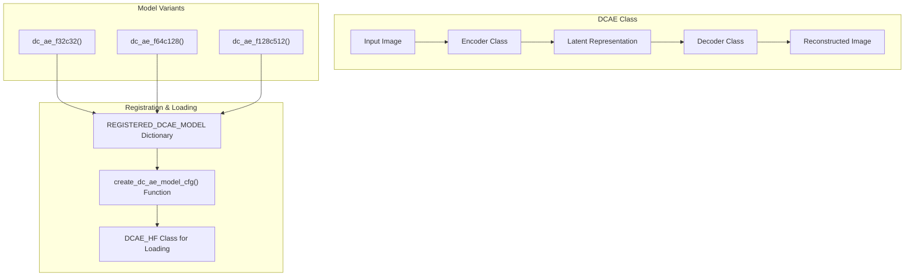
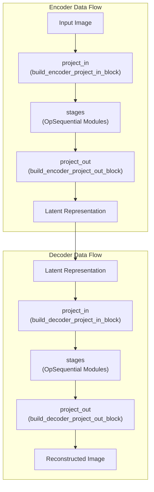
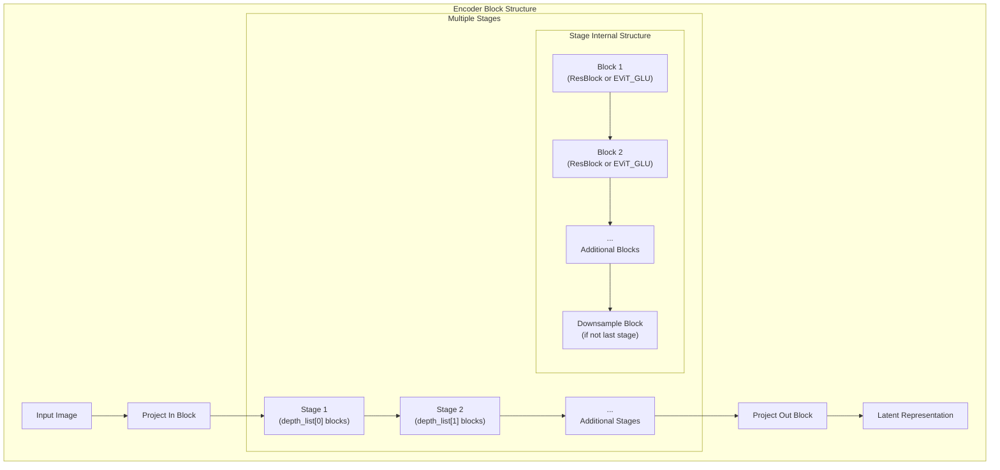
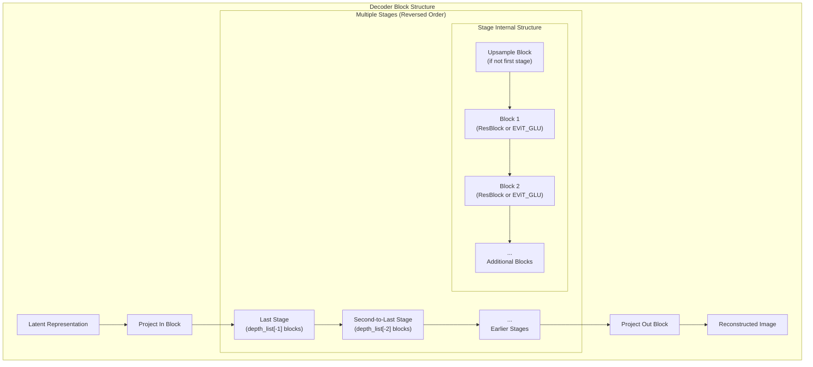
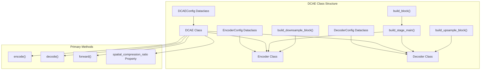
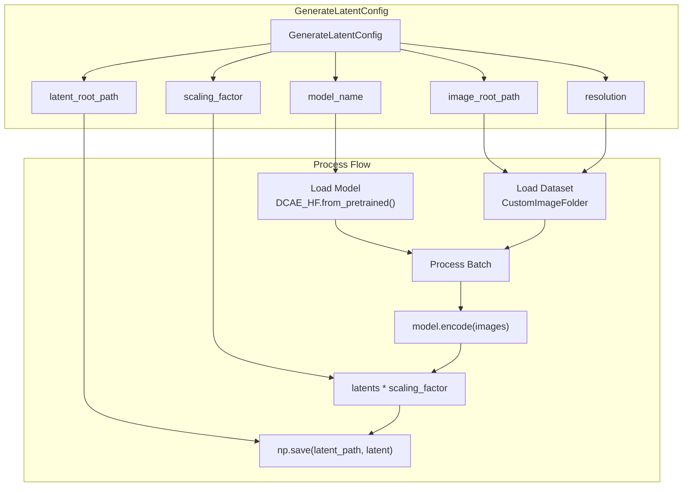
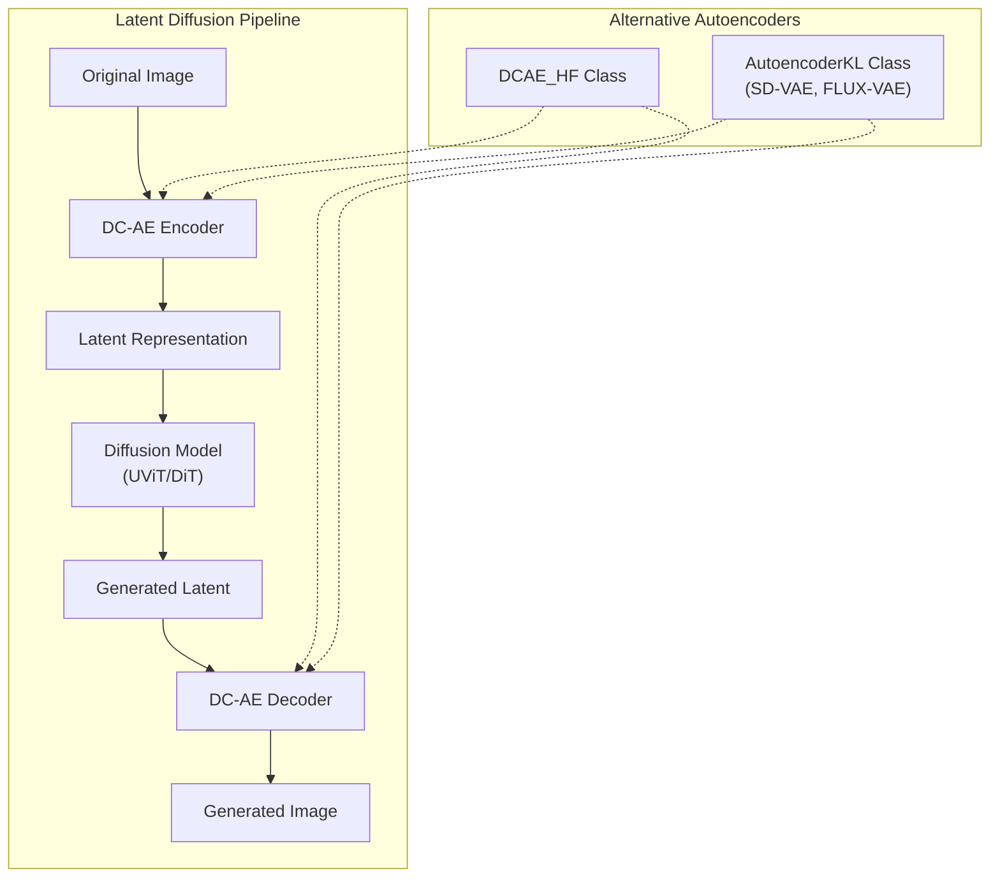

<!-- source: DeepWiki mcp.deepwiki.com · repo mit-han-lab/efficientvit · page 3 Deep Compression Autoencoder · fetched 2026-10-30 -->

# Deep Compression Autoencoder

<details>
<summary>Relevant source files</summary>

The following files were used as context for generating this wiki page:

- [applications/dc_ae/dc_ae_generate_latent.py](applications/dc_ae/dc_ae_generate_latent.py)
- [assets/cityscapes_l1.gif](assets/cityscapes_l1.gif)
- [assets/dc_ae_diffusion_demo.gif](assets/dc_ae_diffusion_demo.gif)
- [efficientvit/ae_model_zoo.py](efficientvit/ae_model_zoo.py)
- [efficientvit/models/efficientvit/dc_ae.py](efficientvit/models/efficientvit/dc_ae.py)
- [pyproject.toml](pyproject.toml)

</details>


## Purpose and Scope

The Deep Compression Autoencoder (DC-AE) is a specialized neural network architecture within the EfficientViT framework designed to achieve high spatial compression of images while preserving essential visual information. It transforms images into a compact latent representation with spatial reduction factors of 32×, 64×, or 128×. These compressed latent representations serve as the foundation for various diffusion models, enabling efficient image generation and manipulation.

For information about diffusion models that use DC-AE latent representations, see [Diffusion Models](#4).

Sources:
- [efficientvit/models/efficientvit/dc_ae.py:402-434]()
- [efficientvit/ae_model_zoo.py:13-22]()

## Architecture Overview

The DC-AE follows an encoder-decoder architecture specifically tailored for achieving high compression ratios while maintaining reconstruction quality.

DC-AE Architecture


Sources:
- [efficientvit/models/efficientvit/dc_ae.py:402-434]()
- [efficientvit/ae_model_zoo.py:13-37]()

### Key Features

1. **High Spatial Compression**: DC-AE achieves compression ratios of 32×, 64×, or 128× in spatial dimensions, significantly reducing memory requirements and computational costs for downstream tasks.

2. **Hybrid Block Architecture**: Combines ResBlocks and EfficientViT blocks to balance computational efficiency and representation capability.

3. **Configurable Components**: Flexible configuration system for specifying block types, channel widths, and depths for different compression requirements.

4. **Integration with Diffusion Models**: Designed specifically to work with latent diffusion models for image generation tasks.

Sources:
- [efficientvit/models/efficientvit/dc_ae.py:80-103]()
- [efficientvit/models/efficientvit/dc_ae.py:27-77]()

### Model Variants

DC-AE comes in three main variants with different compression factors and latent space dimensions:

| Variant | Function | Spatial Compression | Latent Channels | Configuration Structure |
|---------|----------|---------------------|-----------------|------------------------|
| dc_ae_f32c32 | `dc_ae_f32c32()` | 32× | 32 | 6 stages, mix of ResBlock and EViT_GLU |
| dc_ae_f64c128 | `dc_ae_f64c128()` | 64× | 128 | 7 stages, mix of ResBlock and EViT_GLU |
| dc_ae_f128c512 | `dc_ae_f128c512()` | 128× | 512 | 8 stages, mix of ResBlock and EViT_GLU |

Sources:
- [efficientvit/ae_model_zoo.py:13-22]()
- [efficientvit/models/efficientvit/dc_ae.py:437-492]()

## Encoder-Decoder Architecture

The DC-AE consists of an encoder that progressively compresses the input image and a decoder that reconstructs the image from the compressed latent representation.

Encoder-Decoder Data Flow


Sources:
- [efficientvit/models/efficientvit/dc_ae.py:323-330]()
- [efficientvit/models/efficientvit/dc_ae.py:392-399]()

### Encoder Implementation

The Encoder progressively compresses the input image through a series of configurable stages:

Block Structure and Flow


Sources:
- [efficientvit/models/efficientvit/dc_ae.py:278-331]()
- [efficientvit/models/efficientvit/dc_ae.py:290-312]()

### Decoder Implementation

The Decoder reconstructs the image from the latent representation through a similar series of stages:



Sources:
- [efficientvit/models/efficientvit/dc_ae.py:333-399]()
- [efficientvit/models/efficientvit/dc_ae.py:354-380]()

### Block Types

DC-AE employs several types of building blocks implemented in the `build_block` function:

1. **ResBlock**: Residual blocks with convolutional layers, normalization, and activation functions
2. **EViT_GLU**: EfficientViT blocks with GLU-based MBConv local modules without multi-scale attention
3. **EViTS5_GLU**: EfficientViT blocks with GLU-based MBConv and scale-5 multi-scale attention

Sources:
- [efficientvit/models/efficientvit/dc_ae.py:80-103]()
- [efficientvit/models/efficientvit/dc_ae.py:106-121]()

## Implementation Details

The DC-AE is implemented in the `efficientvit/models/efficientvit/dc_ae.py` file, with model configurations and utilities in the `efficientvit/ae_model_zoo.py` file.

### Main Classes and Methods

Code Structure


Sources:
- [efficientvit/models/efficientvit/dc_ae.py:27-77]()
- [efficientvit/models/efficientvit/dc_ae.py:402-434]()

### Configuration System

The DC-AE configuration system is based on dataclasses with nested structures:

1. **DCAEConfig**: Top-level configuration containing:
   - `in_channels`: Input image channels (typically 3 for RGB)
   - `latent_channels`: Number of channels in the latent space
   - `encoder`: Nested EncoderConfig
   - `decoder`: Nested DecoderConfig
   - `pretrained_path`: Path to pretrained weights
   - `scaling_factor`: Optional scaling factor for latent representations

2. **EncoderConfig**: Configuration for the encoder with:
   - `width_list`: List of channel dimensions for each stage
   - `depth_list`: List of block depths for each stage
   - `block_type`: Type of blocks to use (ResBlock, EViT_GLU, etc.)
   - `norm`: Normalization type
   - `act`: Activation function
   - `downsample_block_type`: Type of downsampling block

3. **DecoderConfig**: Similar configuration for the decoder

Example configuration for the dc_ae_f32c32 variant:

```
latent_channels=32
encoder.block_type=[ResBlock,ResBlock,ResBlock,EViT_GLU,EViT_GLU,EViT_GLU]
encoder.width_list=[128,256,512,512,1024,1024] 
encoder.depth_list=[0,4,8,2,2,2]
decoder.block_type=[ResBlock,ResBlock,ResBlock,EViT_GLU,EViT_GLU,EViT_GLU]
decoder.width_list=[128,256,512,512,1024,1024] 
decoder.depth_list=[0,5,10,2,2,2]
decoder.norm=[bn2d,bn2d,bn2d,trms2d,trms2d,trms2d] 
decoder.act=[relu,relu,relu,silu,silu,silu]
```

Sources:
- [efficientvit/models/efficientvit/dc_ae.py:27-77]()
- [efficientvit/models/efficientvit/dc_ae.py:439-446]()

## Usage and Applications

### Generating Latent Representations

DC-AE can be used to generate latent representations of images for use with diffusion models or other generative tasks.

Latent Generation Process


Sources:
- [applications/dc_ae/dc_ae_generate_latent.py:30-46]()
- [applications/dc_ae/dc_ae_generate_latent.py:57-145]()

Example code for generating latent representations:

```python
# Load model
model = DCAE_HF.from_pretrained("mit-han-lab/dc-ae-f32c32-in-1.0").to(device=device, dtype=dtype)

# Process image
images = load_and_preprocess_images()  # Your preprocessing code

# Generate latent representation
latents = model.encode(images)
latents = latents * scaling_factor  # Apply scaling factor

# Save latent representation
np.save("latent.npy", latents.cpu().numpy())
```

Sources:
- [applications/dc_ae/dc_ae_generate_latent.py:111-134]()

### Integration with Diffusion Models

DC-AE is designed to work seamlessly with diffusion models in the EfficientViT ecosystem:

Integration with Diffusion Pipeline


Sources:
- [applications/dc_ae/dc_ae_generate_latent.py:70-77]()
- [efficientvit/ae_model_zoo.py:40-66]()

## Conclusion

The Deep Compression Autoencoder (DC-AE) is a key component in the EfficientViT ecosystem, providing efficient image compression for latent diffusion models. Its configurable architecture with varying compression ratios allows for flexibility in balancing reconstruction quality and computational efficiency. The integration of ResBlocks and EfficientViT blocks ensures effective feature extraction while maintaining a lightweight design.

---

