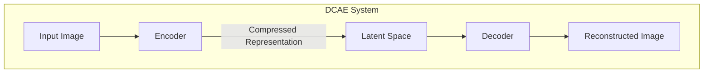
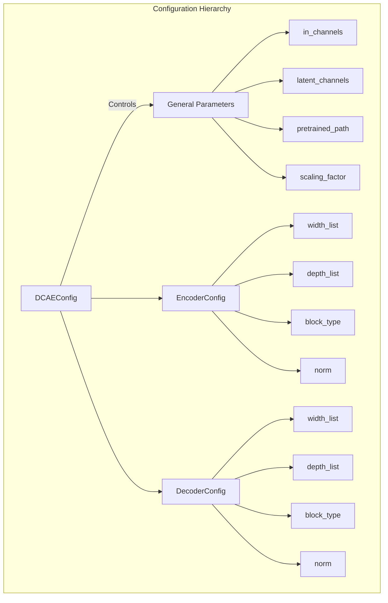
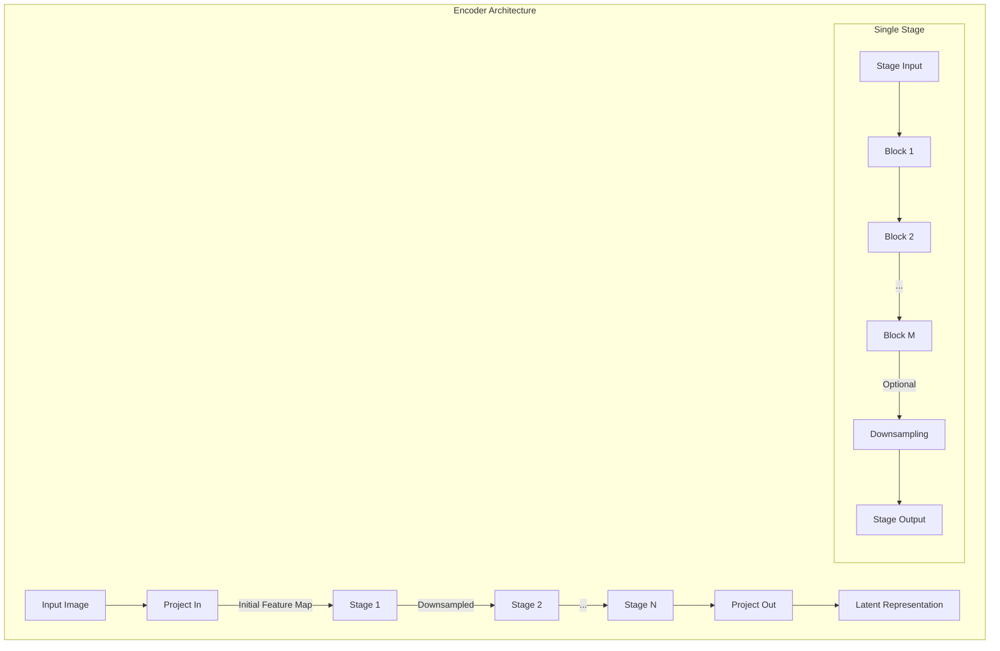
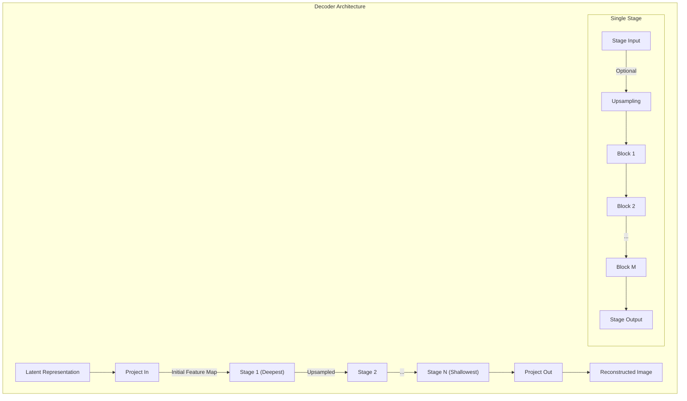
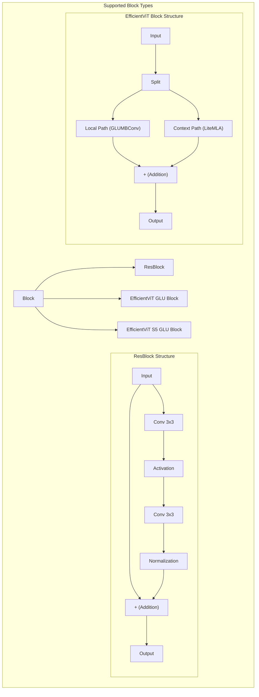
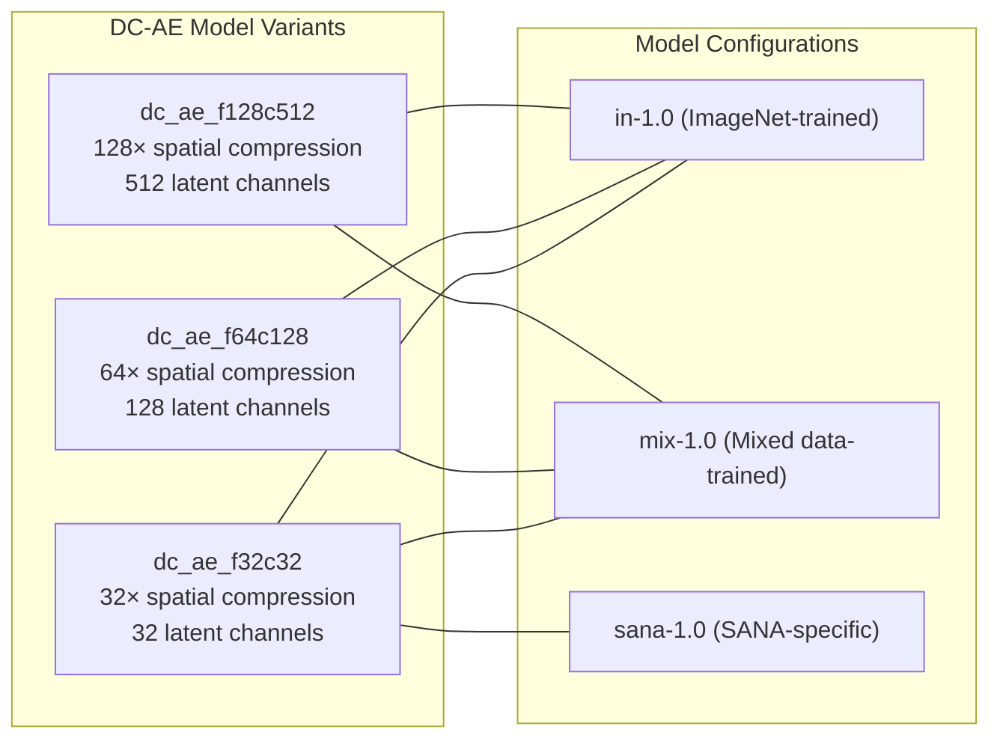
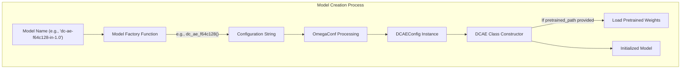
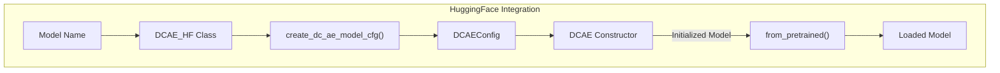
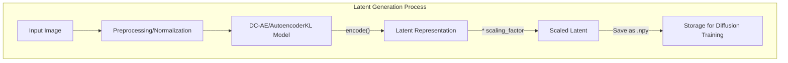

<!-- source: DeepWiki mcp.deepwiki.com · repo mit-han-lab/efficientvit · page 3.1 Architecture and Implementation · fetched 2026-10-30 -->

# Architecture and Implementation

Relevant source files

The following files were used as context for generating this wiki page:

- [applications/dc_ae/dc_ae_generate_latent.py](applications/dc_ae/dc_ae_generate_latent.py)
- [efficientvit/ae_model_zoo.py](efficientvit/ae_model_zoo.py)
- [efficientvit/models/efficientvit/dc_ae.py](efficientvit/models/efficientvit/dc_ae.py)
- [pyproject.toml](pyproject.toml)

This document details the architecture and implementation of the Deep Compression Autoencoder (DC-AE) system within the EfficientViT framework. DC-AE is designed for high spatial compression of images into latent representations, which are particularly useful for diffusion models and image generation. For information about latent generation with DC-AE, see [Latent Generation](#3.2).

## High-Level Architecture

The DC-AE system consists of two primary components: an Encoder that compresses images into latent representations and a Decoder that reconstructs images from these latent representations.

Sources: [efficientvit/models/efficientvit/dc_ae.py:402-434]()

The DCAE class is defined with an encoder and decoder component, configured through `DCAEConfig`. This class handles model initialization and loading pretrained weights.

## Configuration Structure

The DC-AE system uses a hierarchical configuration structure to define all architectural parameters.

Sources: [efficientvit/models/efficientvit/dc_ae.py:27-77]()

The configuration classes define all aspects of the network architecture:
- `DCAEConfig`: Top-level configuration containing encoder and decoder configs
- `EncoderConfig`: Controls encoder architecture details
- `DecoderConfig`: Controls decoder architecture details

## Encoder Architecture

The encoder transforms input images into compact latent representations through a series of stages with progressive downsampling.

Sources: [efficientvit/models/efficientvit/dc_ae.py:278-331]()

Key encoder components:
- `project_in`: Initial feature extraction and optional downsampling
- `stages`: Sequential processing blocks organized in stages
- `project_out`: Final projection to latent space with specified channel dimensions

The encoder can be configured with various block types and downsampling operations.

## Decoder Architecture

The decoder reverses the encoding process to reconstruct images from latent representations.

Sources: [efficientvit/models/efficientvit/dc_ae.py:333-399]()

Key decoder components:
- `project_in`: Initial projection from latent space
- `stages`: Sequential processing blocks with upsampling
- `project_out`: Final projection to image space with original dimensions

The decoder processes stages in reverse order compared to the encoder, gradually increasing spatial dimensions.

## Block Types

The DC-AE system supports multiple block types for feature processing:

Sources: [efficientvit/models/efficientvit/dc_ae.py:80-103]()

The block types include:
- `ResBlock`: Standard residual blocks with convolutions
- `EViT_GLU`: EfficientViT blocks with Gated Linear Units
- `EViTS5_GLU`: EfficientViT blocks with scale-5 multi-scale attention

## Downsampling and Upsampling Operations

The DC-AE implements various methods for spatial dimension reduction and expansion:

| Operation Type | Description | Implementation | 
|----------------|-------------|----------------|
| `ConvPixelUnshuffleDownSampleLayer` | Downsampling using pixel unshuffle + convolution | [efficientvit/models/efficientvit/dc_ae.py:136-138]() |
| `PixelUnshuffleChannelAveragingDownSampleLayer` | Downsampling with channel averaging for shortcut connections | [efficientvit/models/efficientvit/dc_ae.py:144-146]() |
| `ConvPixelShuffleUpSampleLayer` | Upsampling using convolution + pixel shuffle | [efficientvit/models/efficientvit/dc_ae.py:155-157]() |
| `InterpolateConvUpSampleLayer` | Upsampling using interpolation + convolution | [efficientvit/models/efficientvit/dc_ae.py:159-161]() |
| `ChannelDuplicatingPixelUnshuffleUpSampleLayer` | Upsampling with channel duplication for shortcut connections | [efficientvit/models/efficientvit/dc_ae.py:167-169]() |

Sources: [efficientvit/models/efficientvit/dc_ae.py:124-173]()

## Model Variants

The DC-AE system provides multiple model variants with different compression ratios and channel configurations:

Sources: [efficientvit/models/efficientvit/dc_ae.py:437-500](), [efficientvit/ae_model_zoo.py:13-23]()

Each model variant is defined with specific architectures through factory functions that create the appropriate configurations. The spatial compression ratio determines how much smaller the latent representation is compared to the original image.

## Configuration and Model Creation

The model creation process follows a structured pipeline:

Sources: [efficientvit/models/efficientvit/dc_ae.py:402-417](), [efficientvit/ae_model_zoo.py:26-31]()

The `create_dc_ae_model_cfg` function serves as the entry point for creating model configurations, which are then used to instantiate DCAE models.

## Integration with HuggingFace

The DC-AE models can be accessed through HuggingFace's model hub via the `DCAE_HF` class, which extends DCAE with PyTorchModelHubMixin:

Sources: [efficientvit/ae_model_zoo.py:34-37]()

## Latent Generation Pipeline

The DC-AE encoder is used to generate latent representations from images for use in diffusion models:

Sources: [applications/dc_ae/dc_ae_generate_latent.py:57-135]()

The latent generation process:
1. Loads images and applies normalization
2. Passes them through the DC-AE encoder
3. Applies a scaling factor to the latent representation
4. Saves the latent representations for later use in diffusion models

## Summary

The DC-AE architecture implements an efficient autoencoder system for image compression with the following key characteristics:

1. Configurable encoder-decoder architecture for different compression ratios
2. Support for multiple block types including ResBlocks and EfficientViT blocks
3. Various downsampling and upsampling operations with shortcut connections
4. Multiple pre-defined model variants with different compression capabilities
5. Integration with HuggingFace's model hub for easy access to pretrained models
6. Pipeline for generating latent representations for diffusion models

This architecture enables efficient image compression while maintaining the information needed for high-quality image reconstruction and generation.

---

