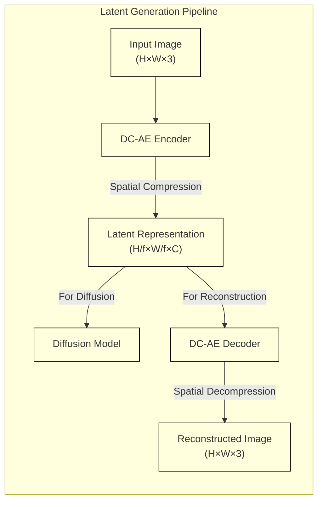
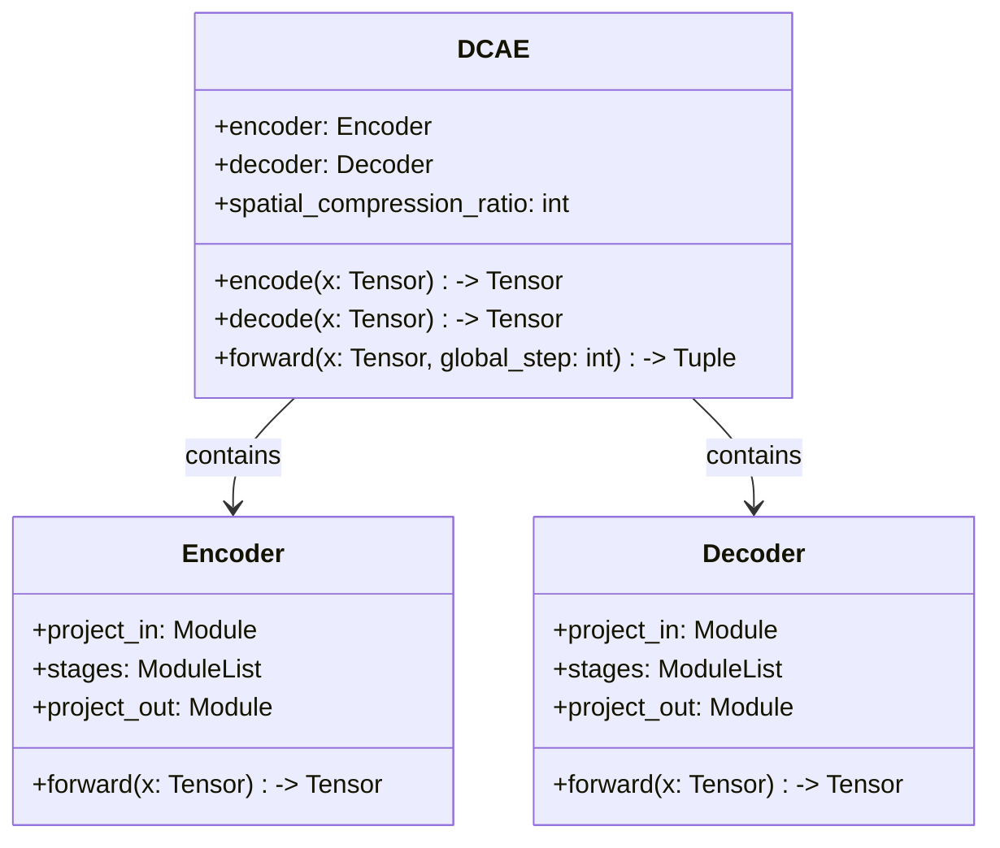
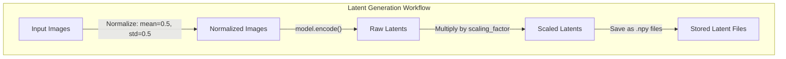
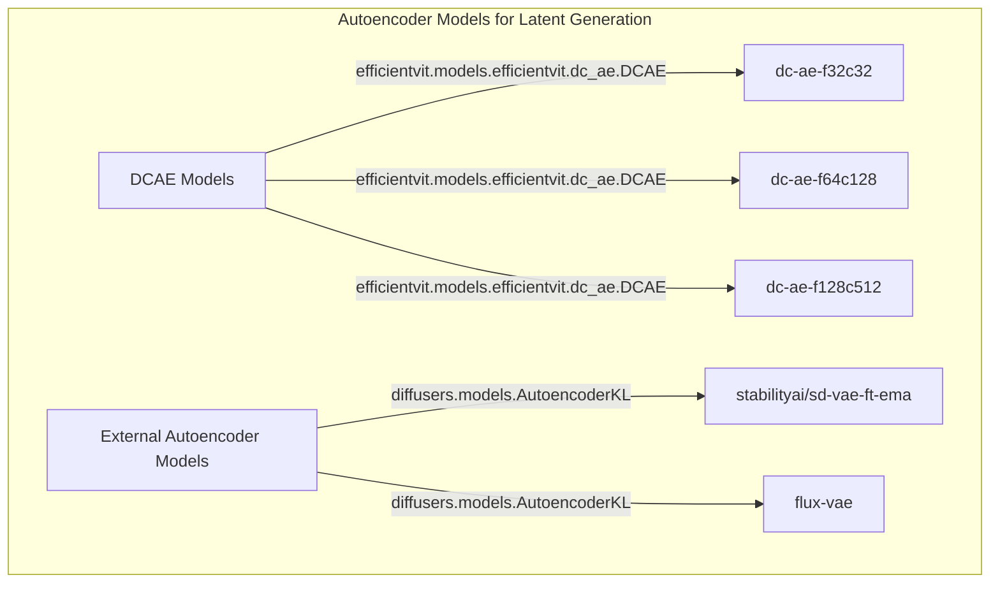

<!-- source: DeepWiki mcp.deepwiki.com · repo mit-han-lab/efficientvit · page 3.2 Latent Generation · fetched 2026-10-30 -->

# Latent Generation

<details>
<summary>Relevant source files</summary>

The following files were used as context for generating this wiki page:

- [applications/dc_ae/dc_ae_generate_latent.py](applications/dc_ae/dc_ae_generate_latent.py)
- [applications/dc_ae/demo_dc_ae_diffusion_model.py](applications/dc_ae/demo_dc_ae_diffusion_model.py)
- [assets/train_diffusion_with_flux_vae_f8.md](assets/train_diffusion_with_flux_vae_f8.md)
- [assets/train_diffusion_with_sd_vae_f8.md](assets/train_diffusion_with_sd_vae_f8.md)
- [efficientvit/ae_model_zoo.py](efficientvit/ae_model_zoo.py)
- [efficientvit/diffusioncore/models/dit_sampler/__init__.py](efficientvit/diffusioncore/models/dit_sampler/__init__.py)
- [efficientvit/models/efficientvit/dc_ae.py](efficientvit/models/efficientvit/dc_ae.py)
- [pyproject.toml](pyproject.toml)

</details>


## Purpose and Scope

This document describes the latent representation generation process in the EfficientViT codebase, specifically focusing on how the Deep Compression Autoencoder (DC-AE) generates and processes latent representations of images. These latent representations are crucial for efficient diffusion model training and inference in the latent space. For information about the DC-AE architecture itself, see [DC-AE Architecture and Implementation](#3.1), and for details on diffusion models, see [Diffusion Models](#4).

## Latent Representation Basics

Latent representations in the DC-AE system are compressed versions of input images, where spatial dimensions are reduced and information is encoded in a higher-dimensional channel space. This compression enables efficient processing by downstream models like diffusion transformers.



Sources: [efficientvit/models/efficientvit/dc_ae.py:402-434](), [efficientvit/ae_model_zoo.py:35-66]()

## DC-AE Compression Factors

The DC-AE models are available in different compression configurations, balancing between spatial compression and channel depth:

| Model | Spatial Compression Factor | Latent Channels | Use Case |
|-------|----------------------------|----------------|----------|
| f32c32 | 32× | 32 | Lightweight applications |
| f64c128 | 64× | 128 | Medium compression needs |
| f128c512 | 128× | 512 | High compression applications |

The spatial compression ratio is calculated as 2 raised to the power of (number of decoder stages - 1), implementing a progressive downsampling/upsampling approach.

Sources: [efficientvit/models/efficientvit/dc_ae.py:419-421](), [efficientvit/ae_model_zoo.py:13-22]()

## Latent Generation Process

### Core Components



Sources: [efficientvit/models/efficientvit/dc_ae.py:278-399](), [efficientvit/models/efficientvit/dc_ae.py:402-434]()

### Encoding and Scaling

The latent generation process involves:

1. **Image Preprocessing**: Normalization of input images to [-1, 1] range
2. **Encoding**: Passing images through the encoder to obtain latent representations
3. **Scaling**: Applying a scaling factor to the latent representations to optimize for diffusion model training



Sources: [applications/dc_ae/dc_ae_generate_latent.py:79-134]()

## Latent Generation Script

The codebase provides a dedicated script for generating and storing latent representations from images, which:

1. Loads a specified autoencoder model (either DC-AE or compatible models like SD-VAE)
2. Processes a dataset of images
3. Extracts their latent representations
4. Saves these representations as `.npy` files for later use in diffusion model training

Key configuration parameters include:

- `image_root_path`: Source of input images
- `latent_root_path`: Destination for latent representations
- `model_name`: Autoencoder model to use
- `resolution`: Image resolution
- `scaling_factor`: Scaling applied to latent representations

Sources: [applications/dc_ae/dc_ae_generate_latent.py:30-46](), [applications/dc_ae/dc_ae_generate_latent.py:57-142]()

## Supported Autoencoder Models

The system supports multiple autoencoder architectures for latent generation:



Sources: [efficientvit/ae_model_zoo.py:13-66]()

## Using Latent Representations with Diffusion Models

Latent representations generated by the DC-AE can be used with diffusion models in two main ways:

1. **Training Diffusion Models**: Using pre-extracted latent representations as training data
2. **Image Generation**: Using diffusion models to generate latent representations, which are then decoded to images

The demo script `demo_dc_ae_diffusion_model.py` demonstrates this second use case, where:

1. A diffusion model generates latent representations
2. These latents are scaled appropriately
3. The DC-AE decoder converts them back to images

Sources: [applications/dc_ae/demo_dc_ae_diffusion_model.py:27-58]()

## Training Workflows

The codebase includes example workflows for training diffusion models on latent representations from different autoencoder models:

1. **SD-VAE Workflow**:
   - Extract latents using SD-VAE (8× compression)
   - Train UViT model on these latents

2. **Flux-VAE Workflow**:
   - Extract latents using Flux-VAE (8× compression)
   - Train UViT model on these latents

These workflows demonstrate how the latent generation system integrates with various autoencoder architectures and diffusion models.

Sources: [assets/train_diffusion_with_sd_vae_f8.md](), [assets/train_diffusion_with_flux_vae_f8.md]()

## Technical Implementation Details

### Encoder Output Handling

For DC-AE models, the encoder output is processed through a `project_out` block that can optionally double the latent channels (when `double_latent=True`). This is particularly useful for diffusion models that predict both the mean and variance in the latent space.

```python
# In the DCAE Encoder
self.project_out = build_encoder_project_out_block(
    in_channels=cfg.width_list[-1],
    out_channels=2 * cfg.latent_channels if cfg.double_latent else cfg.latent_channels,
    norm=cfg.out_norm,
    act=cfg.out_act,
    shortcut=cfg.out_shortcut,
)
```

Sources: [efficientvit/models/efficientvit/dc_ae.py:315-321]()

### Latent Path Handling

When generating latents, the system maintains a parallel directory structure between source images and latent files, preserving the organization while changing the file extension to `.npy`:

```python
def image_path_to_latent_path(image_path: str, image_root_path: str, latent_root_path: str) -> str:
    relative_image_path = os.path.relpath(image_path, image_root_path)
    last_dot_pos = relative_image_path.rfind(".")
    relative_npz_path = relative_image_path[:last_dot_pos] + ".npy"
    latent_path = os.path.join(latent_root_path, relative_npz_path)
    return latent_path
```

Sources: [applications/dc_ae/dc_ae_generate_latent.py:49-54]()

## Summary

The Latent Generation system in EfficientViT provides a flexible framework for:

1. Generating compact latent representations from images using various autoencoder architectures
2. Supporting different compression ratios for different application needs
3. Preparing latent data for efficient diffusion model training
4. Enabling latent-space diffusion for high-quality image generation

This system forms a critical bridge between the raw image data and the diffusion models, enabling efficient training and generation workflows in the compressed latent space rather than the original high-dimensional pixel space.

---

