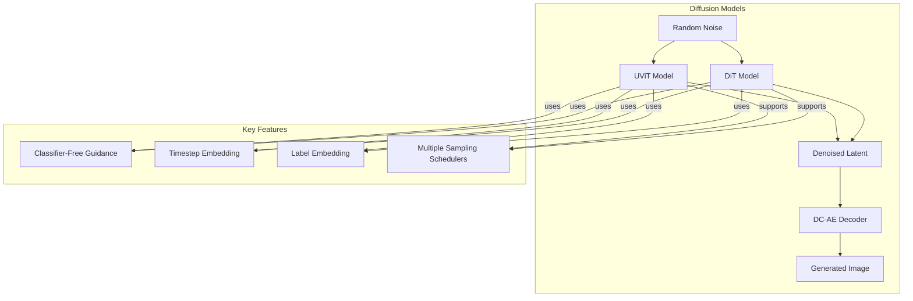
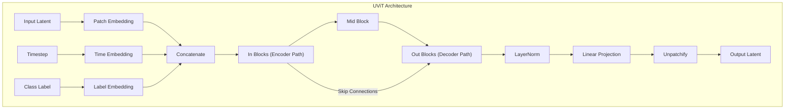
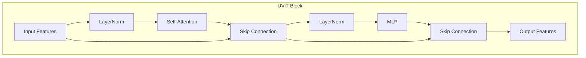
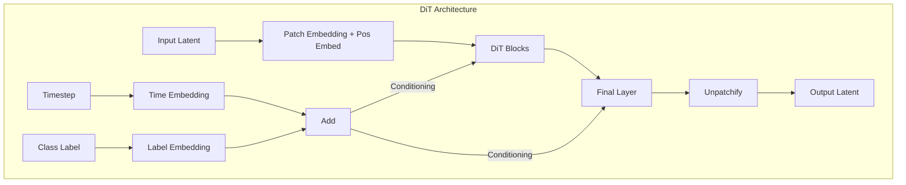
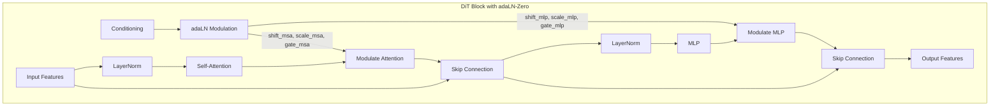
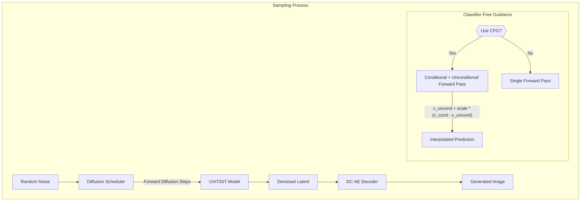

<!-- source: DeepWiki mcp.deepwiki.com · repo mit-han-lab/efficientvit · page 4.1 UViT and DiT Models · fetched 2026-10-30 -->

# UViT and DiT Models

Relevant source files

The following files were used as context for generating this wiki page:

- [efficientvit/diffusioncore/models/dit.py](efficientvit/diffusioncore/models/dit.py)
- [efficientvit/diffusioncore/models/uvit.py](efficientvit/diffusioncore/models/uvit.py)
- [efficientvit/diffusioncore/trainer.py](efficientvit/diffusioncore/trainer.py)

This document describes the U-shaped Vision Transformer (UViT) and Diffusion Transformer (DiT) models implemented in the EfficientViT repository. These models serve as diffusion-based generators that operate in the latent space provided by the Deep Compression Autoencoder (DC-AE). For information about the autoencoder component, see [Deep Compression Autoencoder](#1.2).

## Overview

UViT and DiT are transformer-based diffusion models that generate images by progressively denoising random noise in the latent space. They work with the highly compressed latent representations produced by the DC-AE to enable efficient, high-quality image generation.

Sources:
- [efficientvit/diffusioncore/models/uvit.py:1-579]()
- [efficientvit/diffusioncore/models/dit.py:1-472]()

## UViT Model

The UViT (U-shaped Vision Transformer) implements a transformer-based architecture with a U-Net-like structure. It features skip connections that bridge the encoder and decoder paths, allowing information to flow more effectively through the network.

### Architecture

UViT consists of three main components:
- Input blocks: First half of the transformer blocks (encoder path)
- Middle block: A central transformer block
- Output blocks: Second half of the transformer blocks with skip connections (decoder path)

Sources:
- [efficientvit/diffusioncore/models/uvit.py:265-459]()
- [efficientvit/diffusioncore/models/uvit.py:100-133]()

### Key Components

#### Blocks
Each block in UViT consists of self-attention and multilayer perceptron (MLP) layers with skip connections:

Sources:
- [efficientvit/diffusioncore/models/uvit.py:100-133]()

#### Embeddings

UViT uses three types of embeddings:
1. Patch embeddings: Convert input latents to token embeddings
2. Timestep embeddings: Encode diffusion timesteps 
3. Label embeddings: Encode class labels for conditional generation

Sources:
- [efficientvit/diffusioncore/models/uvit.py:30-48]() (Timestep embedding)
- [efficientvit/diffusioncore/models/uvit.py:136-148]() (Patch embedding)
- [efficientvit/diffusioncore/models/uvit.py:151-179]() (Label embedding)

## DiT Model

The DiT (Diffusion Transformer) model is based on the Facebook Research implementation of DiT. It uses a standard transformer architecture with adaptive layer normalization for conditioning.

### Architecture

DiT consists of a series of transformer blocks with adaptive layer norm zero (adaLN-Zero) conditioning, which modulates the layer normalization parameters based on timestep and class embeddings.

Sources:
- [efficientvit/diffusioncore/models/dit.py:229-372]()

### Key Components

#### DiT Block

The DiT block uses adaptive layer normalization (adaLN-Zero) for conditioning:

Sources:
- [efficientvit/diffusioncore/models/dit.py:180-208]()

#### Embedders

DiT has specialized embedders for timesteps and class labels:

1. **TimestepEmbedder**: Converts scalar timesteps to vector representations using sinusoidal embeddings
2. **LabelEmbedder**: Embeds class labels and handles label dropout for classifier-free guidance

Sources:
- [efficientvit/diffusioncore/models/dit.py:103-141]() (TimestepEmbedder)
- [efficientvit/diffusioncore/models/dit.py:144-172]() (LabelEmbedder)

## Diffusion Schedulers and Sampling

Both UViT and DiT support various diffusion schedulers for training and inference:

### UViT Schedulers
- **Training**: 
  - DPM_Solver: Using predefined noise schedules
  - SiTSampler: For SiT-based training
- **Inference**: 
  - DPM_Solver: For efficient sampling
  - ODE-based: Including ODE_dopri5 and ODE_heun2 for higher quality sampling

### DiT Schedulers
- **Training**: 
  - GaussianDiffusion: Standard diffusion training
- **Inference**: 
  - GaussianDiffusion: Standard diffusion sampling
  - UniPC: UniPCMultistepScheduler for faster sampling with comparable quality

Sources:
- [efficientvit/diffusioncore/models/uvit.py:362-390]() (UViT schedulers)
- [efficientvit/diffusioncore/models/uvit.py:490-527]() (UViT sampling)
- [efficientvit/diffusioncore/models/dit.py:261-275]() (DiT schedulers)
- [efficientvit/diffusioncore/models/dit.py:402-462]() (DiT sampling)

## Model Configurations

The codebase provides several predefined configurations for both UViT and DiT models:

### UViT Configurations

UViT has several variants with different sizes:

1. **UViT-S (Small)**:
   - Depth: 12 transformer blocks
   - Hidden size: 512
   - Number of heads: 8

2. **UViT-H (Huge)**:
   - Depth: 28 transformer blocks
   - Hidden size: 1152
   - Number of heads: 16

3. **UViT-2B (2 Billion)**:
   - Depth: 28 transformer blocks
   - Hidden size: 2048
   - Number of heads: 32

These configurations can be created through helper functions such as:
- `dc_ae_uvit_s_in_512px`
- `dc_ae_uvit_h_in_512px`
- `dc_ae_uvit_2b_in_512px`

Sources:
- [efficientvit/diffusioncore/models/uvit.py:530-578]()

### DiT Configuration

DiT has the XL configuration:

- Depth: 28 transformer blocks
- Hidden size: 1152
- Number of heads: 16

This can be created through the helper function `dc_ae_dit_xl_in_512px`.

Sources:
- [efficientvit/diffusioncore/models/dit.py:465-471]()

## Usage with DC-AE

Both UViT and DiT are designed to work with the latent representations from the Deep Compression Autoencoder (DC-AE). The typical workflow is:

1. Encode input images to the latent space using DC-AE encoder
2. Train the diffusion model (UViT/DiT) on these latent representations
3. For inference, sample from random noise using the diffusion model
4. Decode the generated latent representation using the DC-AE decoder

```mermaid
graph TB
    subgraph "Training Pipeline"
        TrainImages["Training Images"] --> Encoder["DC-AE Encoder"]
        Encoder --> Latents["Latent Representation"]
        Latents --> DiffTrainer["Diffusion Trainer"]
        DiffTrainer --> TrainedModel["Trained UViT/DiT Model"]
    end
    
    subgraph "Inference Pipeline"
        Noise["Random Noise"] --> DiffModel["UViT/DiT Model"]
        DiffModel --> |"Sampling Steps"| Denoised["Denoised Latent"]
        Denoised --> DCDecoder["DC-AE Decoder"]
        DCDecoder --> GeneratedImage["Generated Image"]
    end
    
    subgraph "Code Integration"
        TrainerClass["Trainer Class"]
        EvaluatorClass["Evaluator Class"]
        ModelClass["UViT/DiT Class"]
        
        TrainerClass --> |"Training Loop"| ModelClass
        EvaluatorClass --> |"Evaluation"| ModelClass
        ModelClass --> |"forward/generate"| DiffOutput["Diffusion Output"]
    end
```

Sources:
- [efficientvit/diffusioncore/trainer.py:72-425]()
- [efficientvit/diffusioncore/models/uvit.py:490-527]() (UViT generate method)
- [efficientvit/diffusioncore/models/dit.py:402-462]() (DiT generate method)

## Implementation Details

### Common Features

Both UViT and DiT implement:

1. **Classifier-free guidance**: Allows controlling the influence of class conditioning during sampling
2. **EMA model tracking**: Training uses an exponential moving average of model weights for better stability
3. **Multiple sampling strategies**: Different schedulers optimized for quality or speed
4. **Pretrained model loading**: Support for loading pretrained weights

### Configuration Options

The models are configured through dataclasses:

| Parameter | UViT | DiT | Description |
|-----------|------|-----|-------------|
| input_size | ✓ | ✓ | Size of input latent feature maps |
| patch_size | ✓ | ✓ | Size of patches for the patch embedding |
| in_channels | ✓ | ✓ | Number of input channels |
| hidden_size | ✓ | ✓ | Dimension of transformer features |
| depth | ✓ | ✓ | Number of transformer blocks |
| num_heads | ✓ | ✓ | Number of attention heads |
| mlp_ratio | ✓ | ✓ | Multiplier for MLP hidden dimension |
| class_dropout_prob | ✓ | ✓ | Probability of dropping class labels for CFG |
| num_classes | ✓ | ✓ | Number of class labels |
| eval_scheduler | ✓ | ✓ | Scheduler to use for inference |
| train_scheduler | ✓ | ✓ | Scheduler to use for training |
| post_norm | ✗ | ✓ | Whether to use post-layer normalization |
| mlp_time_embed | ✓ | ✗ | Whether to use MLP for time embedding |

Sources:
- [efficientvit/diffusioncore/models/uvit.py:182-208]() (UViT configuration)
- [efficientvit/diffusioncore/models/dit.py:18-41]() (DiT configuration)

## Summary

UViT and DiT represent two different approaches to transformer-based diffusion models in the EfficientViT ecosystem:

1. **UViT**: Uses a U-shaped architecture with skip connections, similar to U-Net but with transformer blocks
2. **DiT**: Uses a standard transformer architecture with specialized adaptive layer normalization for conditioning

Both models operate on the latent space provided by the DC-AE component, enabling efficient generation of high-quality images. They support various training and inference schedulers, classifier-free guidance, and can be configured with different model sizes to balance performance and computational requirements.

---

