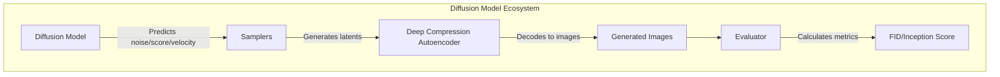
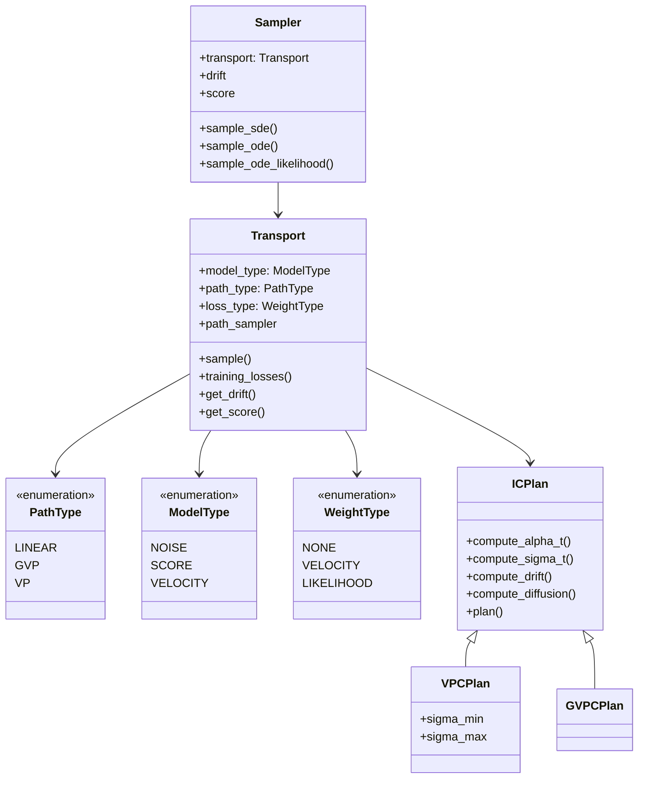
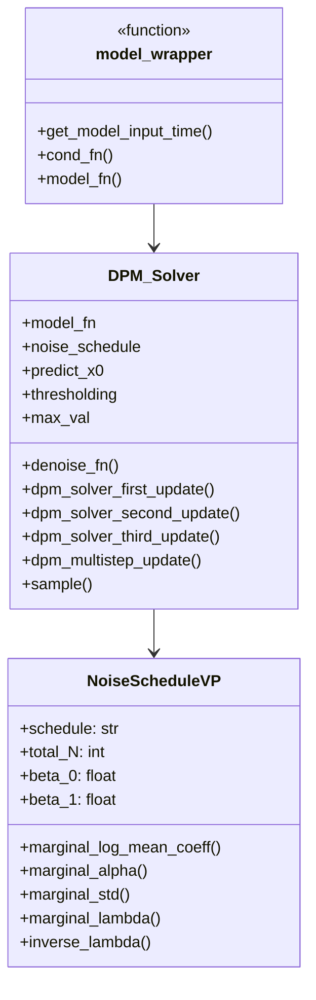
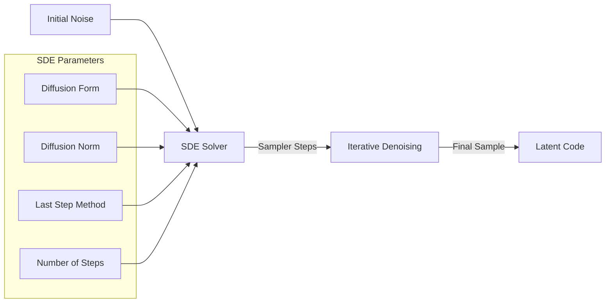
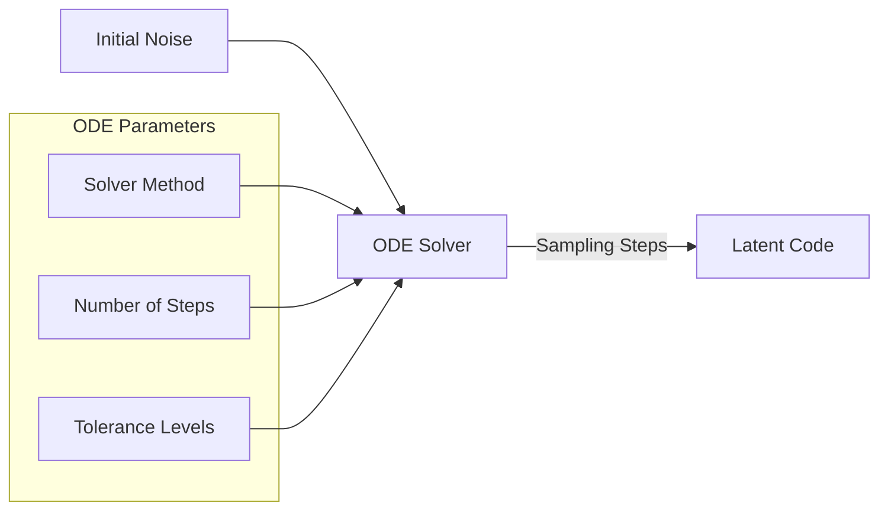
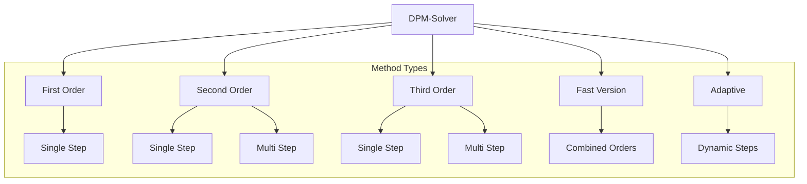
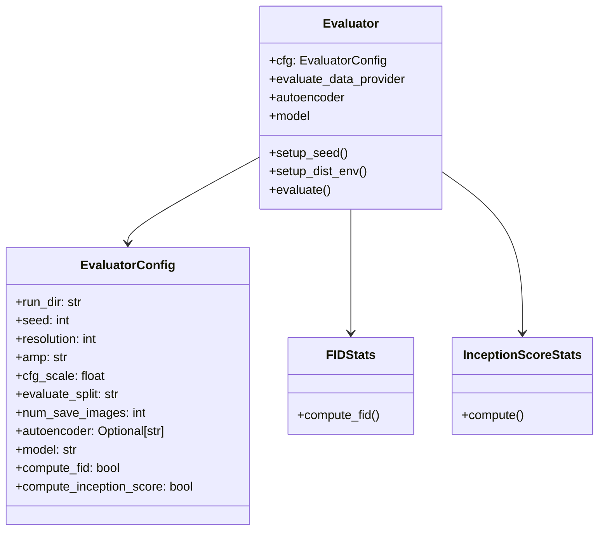
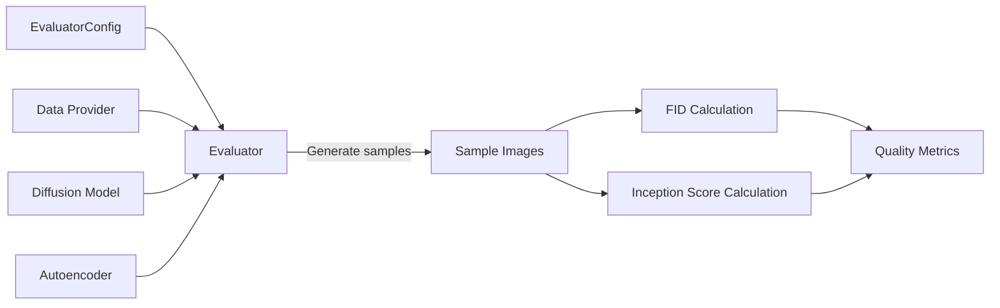
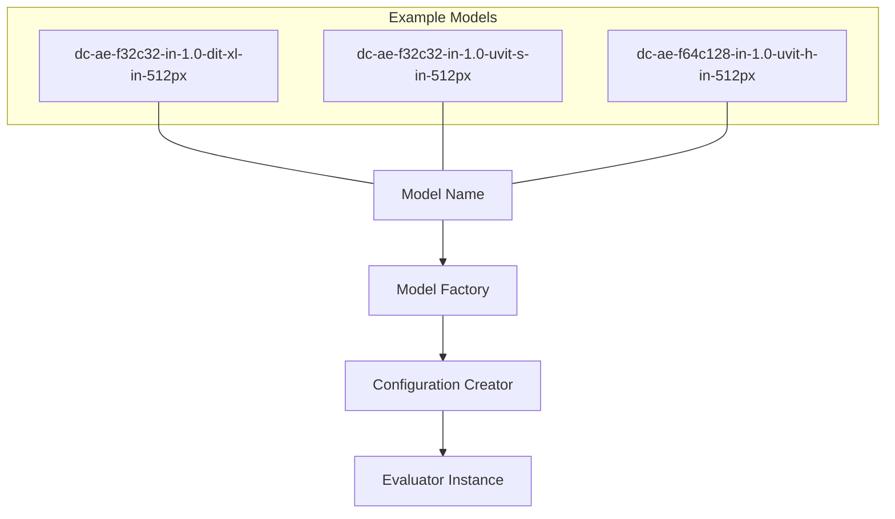

<!-- source: DeepWiki mcp.deepwiki.com · repo mit-han-lab/efficientvit · page 4.2 Samplers and Evaluation · fetched 2026-10-30 -->

# Samplers and Evaluation

<details>
<summary>Relevant source files</summary>

The following files were used as context for generating this wiki page:

- [applications/dc_ae/demo_dc_ae_model.py](applications/dc_ae/demo_dc_ae_model.py)
- [applications/dc_ae/demo_dc_ae_model_diffusers.py](applications/dc_ae/demo_dc_ae_model_diffusers.py)
- [efficientvit/diffusion_model_zoo.py](efficientvit/diffusion_model_zoo.py)
- [efficientvit/diffusioncore/evaluator.py](efficientvit/diffusioncore/evaluator.py)
- [efficientvit/diffusioncore/models/sit_sampler/__init__.py](efficientvit/diffusioncore/models/sit_sampler/__init__.py)
- [efficientvit/diffusioncore/models/sit_sampler/integrators.py](efficientvit/diffusioncore/models/sit_sampler/integrators.py)
- [efficientvit/diffusioncore/models/sit_sampler/path.py](efficientvit/diffusioncore/models/sit_sampler/path.py)
- [efficientvit/diffusioncore/models/sit_sampler/transport.py](efficientvit/diffusioncore/models/sit_sampler/transport.py)
- [efficientvit/diffusioncore/models/sit_sampler/utils.py](efficientvit/diffusioncore/models/sit_sampler/utils.py)
- [efficientvit/diffusioncore/models/uvit_sampler/dpm_solver_pp.py](efficientvit/diffusioncore/models/uvit_sampler/dpm_solver_pp.py)

</details>


This page documents the sampling methods and evaluation framework for diffusion models in the EfficientViT repository. It covers the different samplers available, their configuration options, and the evaluation system used to assess the quality of generated images.

## 1. Overview of Samplers and Evaluation

Diffusion models require specialized sampling algorithms to generate high-quality images, and robust evaluation metrics to assess generation quality. The EfficientViT codebase implements multiple samplers with different characteristics and an evaluation framework focused on industry-standard metrics.



Sources: [efficientvit/diffusioncore/evaluator.py:28-233](), [efficientvit/diffusion_model_zoo.py:1-123]()

## 2. Sampler Architecture

The EfficientViT codebase implements two main sampling frameworks:

1. **SiT Sampler**: Based on the Stable Image Transformer approach, implementing various coupling plans and transport methods
2. **DPM Solver**: A high-order solver for diffusion models that enables fast sampling with fewer steps

### 2.1 SiT Sampler Architecture

The SiT Sampler framework is organized around the concept of transport between a noise distribution and the data distribution:



Sources: [efficientvit/diffusioncore/models/sit_sampler/transport.py:1-434](), [efficientvit/diffusioncore/models/sit_sampler/path.py:1-199](), [efficientvit/diffusioncore/models/sit_sampler/__init__.py:1-65]()

### 2.2 DPM Solver Architecture

The DPM Solver is a high-order ordinary differential equation (ODE) solver designed specifically for diffusion probabilistic models:



Sources: [efficientvit/diffusioncore/models/uvit_sampler/dpm_solver_pp.py:9-1096]()

## 3. Sampling Methods

The EfficientViT codebase implements multiple sampling techniques with different tradeoffs between speed and quality.

### 3.1 SDE-based Sampling

Stochastic Differential Equation (SDE) sampling introduces noise during the generation process, which can improve sample diversity:



Sources: [efficientvit/diffusioncore/models/sit_sampler/integrators.py:1-81](), [efficientvit/diffusioncore/models/sit_sampler/transport.py:213-329]()

### 3.2 ODE-based Sampling

Ordinary Differential Equation (ODE) sampling is deterministic and often faster than SDE sampling:



Sources: [efficientvit/diffusioncore/models/sit_sampler/integrators.py:83-119](), [efficientvit/diffusioncore/models/sit_sampler/transport.py:329-375]()

### 3.3 DPM-Solver Techniques

DPM-Solver provides multiple high-order solvers with different acceleration capabilities:

- **Single-step methods**: Apply one solver step at a time
- **Multi-step methods**: Reuse previous computations for efficiency
- **Adaptive step size**: Dynamically adjust step size based on error estimates
- **Fast version**: Combines different orders of solvers for optimal performance



Sources: [efficientvit/diffusioncore/models/uvit_sampler/dpm_solver_pp.py:324-1095]()

## 4. Evaluation Framework

The `Evaluator` class provides a comprehensive framework for assessing the quality of generated images from diffusion models.

### 4.1 Evaluator Architecture



Sources: [efficientvit/diffusioncore/evaluator.py:32-66](), [efficientvit/diffusioncore/evaluator.py:68-138]()

### 4.2 Evaluation Process

The evaluation process generates samples from the diffusion model and computes quality metrics:



Sources: [efficientvit/diffusioncore/evaluator.py:139-232]()

## 5. Evaluation Metrics

### 5.1 Fréchet Inception Distance (FID)

FID measures the distance between the feature representations of real and generated images using the Inception v3 network. Lower FID scores indicate better quality and diversity of generated images.

The evaluator computes FID by:
1. Generating batches of images
2. Extracting features using the Inception network
3. Computing mean and covariance statistics
4. Calculating the Fréchet distance between real and generated distributions

```
FID = ||μ_r - μ_g||² + Tr(Σ_r + Σ_g - 2(Σ_r Σ_g)^(1/2))
```

Where:
- μ_r, μ_g are the mean feature vectors for real and generated images
- Σ_r, Σ_g are the covariance matrices

Sources: [efficientvit/diffusioncore/evaluator.py:156-158](), [efficientvit/diffusioncore/evaluator.py:227-228]()

### 5.2 Inception Score

Inception Score measures both the quality and diversity of generated images. Higher scores indicate better generation quality.

The computation involves:
1. Passing generated images through the Inception network
2. Obtaining class probability predictions
3. Computing the KL divergence between conditional and marginal distributions

```
IS = exp(E[KL(p(y|x) || p(y))])
```

Where:
- p(y|x) is the conditional class distribution for a generated image
- p(y) is the marginal class distribution across all generated images

Sources: [efficientvit/diffusioncore/evaluator.py:159-160](), [efficientvit/diffusioncore/evaluator.py:229-231]()

## 6. Using Samplers and Evaluation

### 6.1 Configuring Samplers

Each sampler type requires specific configuration parameters:

| Sampler Type | Key Parameters | Use Case |
|--------------|----------------|----------|
| SiT SDE | `diffusion_form`, `diffusion_norm`, `steps` | Better diversity, can be slower |
| SiT ODE | `solver_type`, `steps`, `atol`, `rtol` | Faster, deterministic sampling |
| DPM-Solver Fast | `steps`, `order`, `skip_type` | Best speed-quality tradeoff |
| DPM-Solver Adaptive | `order`, `atol`, `rtol` | Dynamic quality control |

Sources: [efficientvit/diffusioncore/models/sit_sampler/transport.py:286-329](), [efficientvit/diffusioncore/models/uvit_sampler/dpm_solver_pp.py:937-1095]()

### 6.2 Evaluation Configuration

The `EvaluatorConfig` class allows customization of the evaluation process:

```python
# Example configuration
config = EvaluatorConfig(
    run_dir="./results",           # Directory to save results
    resolution=512,                # Image resolution
    amp="fp16",                    # Mixed precision mode (fp16, fp32)
    cfg_scale=1.0,                 # Classifier-free guidance scale
    num_save_images=64,            # Number of images to save
    compute_fid=True,              # Enable FID computation
    compute_inception_score=True,  # Enable Inception Score computation
    autoencoder="dc-ae-f64c128",   # Autoencoder model
    model="uvit"                   # Diffusion model type
)
```

Sources: [efficientvit/diffusioncore/evaluator.py:32-66](), [efficientvit/diffusion_model_zoo.py:104-110]()

### 6.3 Integration with Model Zoo

The repository provides pre-configured diffusion models through the model zoo:



Sources: [efficientvit/diffusion_model_zoo.py:20-101](), [efficientvit/diffusion_model_zoo.py:113-122]()

## 7. Performance and Quality Tradeoffs

Different sampling methods offer tradeoffs between computational efficiency and generation quality:

| Sampling Method | Steps Needed | Quality | Speed | Memory |
|-----------------|--------------|---------|-------|--------|
| First-order methods | Many (50+) | Good | Slower | Lower |
| Second-order methods | Moderate (20-30) | Better | Medium | Medium |
| Third-order methods | Few (10-15) | Best | Faster | Higher |
| Fast method | Very few (10) | Good | Fastest | Medium |
| Adaptive method | Variable | Controlled | Variable | Medium |

For most applications, the DPM-Solver Fast method with 10-20 steps provides an excellent balance between speed and quality.

Sources: [efficientvit/diffusioncore/models/uvit_sampler/dpm_solver_pp.py:937-1007]()

---

