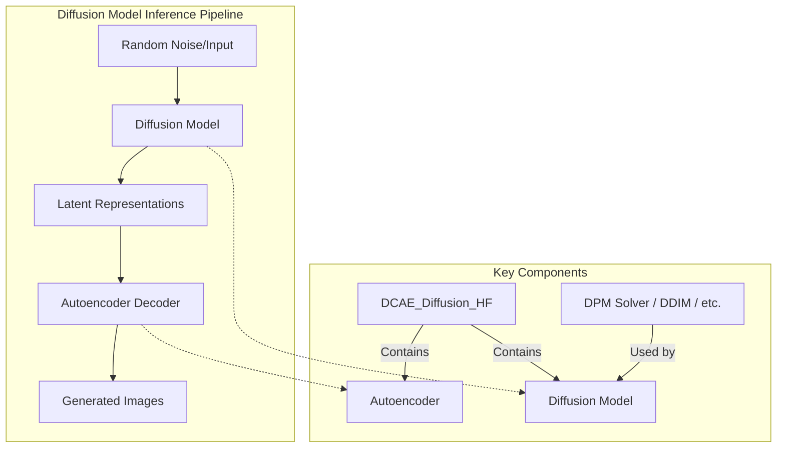
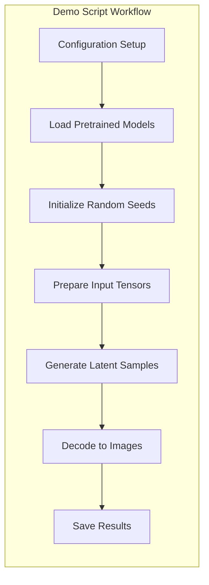
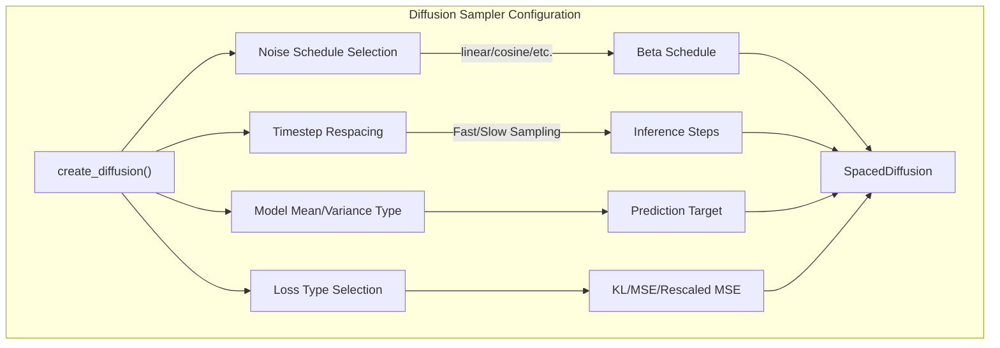

<!-- source: DeepWiki mcp.deepwiki.com · repo mit-han-lab/efficientvit · page 4.3 Inference and Demo · fetched 2026-10-30 -->

# Inference and Demo

<details>
<summary>Relevant source files</summary>

The following files were used as context for generating this wiki page:

- [applications/dc_ae/demo_dc_ae_diffusion_model.py](applications/dc_ae/demo_dc_ae_diffusion_model.py)
- [assets/cityscapes_l1.gif](assets/cityscapes_l1.gif)
- [assets/dc_ae_diffusion_demo.gif](assets/dc_ae_diffusion_demo.gif)
- [assets/train_diffusion_with_flux_vae_f8.md](assets/train_diffusion_with_flux_vae_f8.md)
- [assets/train_diffusion_with_sd_vae_f8.md](assets/train_diffusion_with_sd_vae_f8.md)
- [efficientvit/diffusioncore/models/dit_sampler/__init__.py](efficientvit/diffusioncore/models/dit_sampler/__init__.py)

</details>


This page provides a technical guide for running inference and demonstrations with the diffusion models in the EfficientViT framework. It focuses specifically on using the Deep Compression Autoencoder (DC-AE) based diffusion models for image generation. For information about the diffusion model architectures, see [UViT and DiT Models](#4.1), and for details on the sampling methods, see [Samplers and Evaluation](#4.2).

## Diffusion Model Inference Pipeline

The EfficientViT diffusion model inference pipeline combines a pretrained autoencoder with a diffusion model to generate images. The process involves:

1. Generating random noise or conditioning inputs
2. Running the diffusion model to produce latent representations
3. Decoding the latents with the autoencoder to obtain high-quality images



Sources: [applications/dc_ae/demo_dc_ae_diffusion_model.py:34-53]()

## Running the Demo Script

The EfficientViT repository provides a demo script for generating images with pretrained diffusion models.

### Prerequisites

- PyTorch installed with CUDA support
- OmegaConf for configuration management
- The EfficientViT repository cloned and set up

### Using the Demo Script

The demo script is located at `applications/dc_ae/demo_dc_ae_diffusion_model.py` and can be used to generate images with a pretrained diffusion model.



Sources: [applications/dc_ae/demo_dc_ae_diffusion_model.py:27-57]()

### Demo Configuration Parameters

The demo script accepts the following parameters:

| Parameter | Description | Default |
|-----------|-------------|---------|
| `model` | Pretrained model name (will be used as `mit-han-lab/{model}`) | Required |
| `diffusion_model_dtype` | Data type for the diffusion model (`fp32`, `fp16`, `bf16`) | `fp32` |
| `autoencoder_dtype` | Data type for the autoencoder model | `fp32` |
| `cfg_scale` | Classifier-free guidance scale | `6.0` |
| `run_dir` | Directory to save generated images | Required |

Sources: [applications/dc_ae/demo_dc_ae_diffusion_model.py:18-24]()

### Example Usage

To run the demo script:

```bash
python -m applications.dc_ae.demo_dc_ae_diffusion_model \
    model=dcae-diffusion-imagenet-512 \
    diffusion_model_dtype=fp16 \
    autoencoder_dtype=fp32 \
    cfg_scale=6.0 \
    run_dir=./demo_output
```

This will download the pretrained models from the Hugging Face Hub (from the `mit-han-lab` organization), generate images, and save them to the specified directory.

Sources: [applications/dc_ae/demo_dc_ae_diffusion_model.py]()

## Understanding the Generation Process

The demo script performs the following steps:

1. Loads the pretrained diffusion model and autoencoder from Hugging Face Hub
2. Sets both models to evaluation mode and moves them to the appropriate device and data type
3. Initializes random seeds for reproducibility
4. Prepares input tensors for class-conditional generation
5. Generates latent samples using the diffusion model
6. Decodes the latent samples into images using the autoencoder
7. Saves the generated images

```python
# Key components of the generation process
dc_ae_diffusion = DCAE_Diffusion_HF.from_pretrained(f"mit-han-lab/{cfg.model}")
# Generate latent samples with classifier-free guidance
latent_samples = dc_ae_diffusion.diffusion_model.generate(inputs, inputs_null, cfg.cfg_scale, eval_generator)
# Decode latents to images
image_samples = dc_ae_diffusion.autoencoder.decode(latent_samples)
```

Sources: [applications/dc_ae/demo_dc_ae_diffusion_model.py:34-53]()

## Customizing Inference

### Model Precision Options

The diffusion model and autoencoder can be run with different precision settings to optimize the speed-accuracy tradeoff:

| Precision | Description | Best For |
|-----------|-------------|----------|
| `fp32` | 32-bit floating point | Highest accuracy, slower inference |
| `fp16` | 16-bit floating point | Good balance of speed and accuracy |
| `bf16` | 16-bit brain floating point | Newer hardware, better numerical stability than fp16 |

Sources: [applications/dc_ae/demo_dc_ae_diffusion_model.py:18-24](), [applications/dc_ae/demo_dc_ae_diffusion_model.py:35-40]()

### Diffusion Sampler Options

The diffusion models in EfficientViT use a configurable sampling system, which can be customized for different inference needs:



Sources: [efficientvit/diffusioncore/models/dit_sampler/__init__.py:12-42]()

### Classifier-Free Guidance

The `cfg_scale` parameter controls the strength of classifier-free guidance, which balances between:

- Lower values (e.g., 1.0): More diversity but potentially less quality
- Higher values (e.g., 7.5+): Higher quality but less diversity

The default value of 6.0 provides a good balance for most use cases.

Sources: [applications/dc_ae/demo_dc_ae_diffusion_model.py:18-24](), [applications/dc_ae/demo_dc_ae_diffusion_model.py:51]()

## Available Pretrained Models

The EfficientViT framework provides several pretrained diffusion models:

| Model ID | Description | Resolution | VAE Type |
|----------|-------------|------------|----------|
| `dcae-diffusion-imagenet-512` | ImageNet-trained diffusion model | 512×512 | DC-AE |
| `dcae-diffusion-sd-vae-ft-ema` | Stable Diffusion VAE-based diffusion | 512×512 | SD VAE |
| `dcae-diffusion-flux-vae` | FLUX VAE-based diffusion model | 512×512 | FLUX VAE |

Sources: [assets/train_diffusion_with_flux_vae_f8.md](), [assets/train_diffusion_with_sd_vae_f8.md]()

## Visualizing Results

The demo script saves the generated images as a grid in PNG format. The results should look similar to the demonstration GIF below:


For custom visualization or further processing, you can modify the script to:

- Save individual images instead of a grid
- Apply additional post-processing
- Integrate with interactive visualization tools

Sources: [applications/dc_ae/demo_dc_ae_diffusion_model.py:54-57](), [assets/dc_ae_diffusion_demo.gif]()

## Example Pipeline Integration

To integrate the diffusion models into your own application:

```python
# Load model
dc_ae_diffusion = DCAE_Diffusion_HF.from_pretrained("mit-han-lab/dcae-diffusion-imagenet-512")
dc_ae_diffusion.to(device="cuda")

# Set up generator for reproducibility
generator = torch.Generator(device="cuda").manual_seed(seed)

# Define class conditioning (can be random or specific ImageNet classes)
class_labels = torch.tensor([232, 508, 933], dtype=torch.int, device="cuda")  # Example classes
null_labels = 1000 * torch.ones_like(class_labels)  # For classifier-free guidance

# Generate latents
latents = dc_ae_diffusion.diffusion_model.generate(
    class_labels, 
    null_labels,
    guidance_scale=6.0,
    generator=generator
)

# Scale latents and decode to images
latents = latents / dc_ae_diffusion.scaling_factor
images = dc_ae_diffusion.autoencoder.decode(latents)

# Process images (convert from [-1, 1] to [0, 1] range)
images = (images * 0.5 + 0.5).clamp(0, 1)
```

Sources: [applications/dc_ae/demo_dc_ae_diffusion_model.py:34-53]()

---

