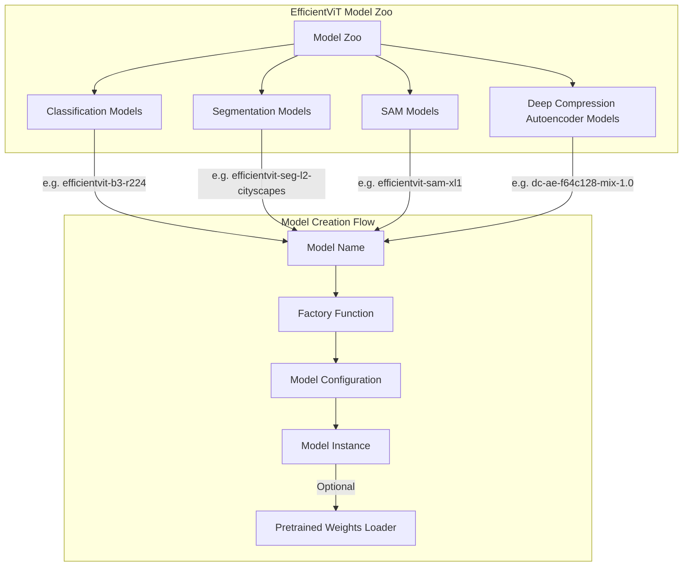
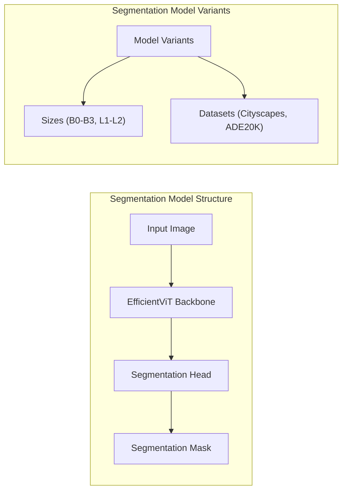
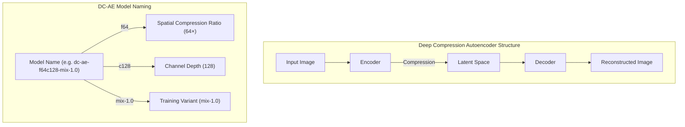
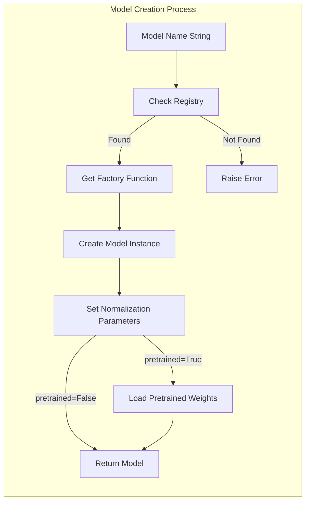

<!-- source: DeepWiki mcp.deepwiki.com · repo mit-han-lab/efficientvit · page 5 Model Zoo · fetched 2026-10-30 -->

# Model Zoo

<details>
<summary>Relevant source files</summary>

The following files were used as context for generating this wiki page:

- [applications/dc_ae/dc_ae_generate_latent.py](applications/dc_ae/dc_ae_generate_latent.py)
- [efficientvit/ae_model_zoo.py](efficientvit/ae_model_zoo.py)
- [efficientvit/cls_model_zoo.py](efficientvit/cls_model_zoo.py)
- [efficientvit/models/efficientvit/dc_ae.py](efficientvit/models/efficientvit/dc_ae.py)
- [efficientvit/sam_model_zoo.py](efficientvit/sam_model_zoo.py)
- [efficientvit/seg_model_zoo.py](efficientvit/seg_model_zoo.py)
- [pyproject.toml](pyproject.toml)

</details>


The EfficientViT Model Zoo provides a comprehensive collection of pre-trained models across several vision tasks. This page documents the available models, their configurations, and how to use them in your applications. The Model Zoo is designed to make it easy to select and instantiate appropriate models based on your specific requirements for accuracy, efficiency, and task.

For information about the core EfficientViT architecture, see [EfficientViT Architecture](#1.1).

## Model Zoo Overview

The Model Zoo contains four main categories of models, each tailored for different vision tasks:



Sources: [efficientvit/cls_model_zoo.py](), [efficientvit/seg_model_zoo.py](), [efficientvit/sam_model_zoo.py](), [efficientvit/ae_model_zoo.py]()

## Classification Models

EfficientViT Classification models are designed for image classification tasks. They come in various sizes (B0-B3, L1-L3) and support different input resolutions.

### Available Classification Models

| Model Name | Size | Resolution | Checkpoint Path |
|------------|------|------------|-----------------|
| efficientvit-b0 | B0 | Default | None |
| efficientvit-b0-r224 | B0 | 224×224 | assets/checkpoints/efficientvit_cls/efficientvit_b0_r224.pt |
| efficientvit-b1-r224 | B1 | 224×224 | assets/checkpoints/efficientvit_cls/efficientvit_b1_r224.pt |
| efficientvit-b1-r256 | B1 | 256×256 | assets/checkpoints/efficientvit_cls/efficientvit_b1_r256.pt |
| efficientvit-b1-r288 | B1 | 288×288 | assets/checkpoints/efficientvit_cls/efficientvit_b1_r288.pt |
| efficientvit-b2-r224 | B2 | 224×224 | assets/checkpoints/efficientvit_cls/efficientvit_b2_r224.pt |
| ... | ... | ... | ... |
| efficientvit-l3-r384 | L3 | 384×384 | assets/checkpoints/efficientvit_cls/efficientvit_l3_r384.pt |

For a complete list of available models, see [efficientvit/cls_model_zoo.py:19-54]()

### Using Classification Models

Classification models can be easily created using the `create_efficientvit_cls_model` function:

```python
from efficientvit.cls_model_zoo import create_efficientvit_cls_model

# Create a model with pretrained weights
model = create_efficientvit_cls_model(name="efficientvit-b3-r224", pretrained=True)

# Create a model without pretrained weights
model = create_efficientvit_cls_model(name="efficientvit-b1", pretrained=False)

# Create a model with custom pretrained weights
model = create_efficientvit_cls_model(
    name="efficientvit-l2", 
    pretrained=True, 
    weight_url="path/to/weights.pt"
)
```

Sources: [efficientvit/cls_model_zoo.py:57-76]()

## Segmentation Models

EfficientViT Segmentation models are designed for semantic segmentation tasks. They come in different sizes (B0-B3, L1-L2) and are pre-trained on specific datasets (Cityscapes, ADE20K).



Sources: [efficientvit/seg_model_zoo.py]()

### Available Segmentation Models

| Model Name | Size | Dataset | Checkpoint Path |
|------------|------|---------|-----------------|
| efficientvit-seg-b0-cityscapes | B0 | Cityscapes | assets/checkpoints/efficientvit_seg/efficientvit_seg_b0_cityscapes.pt |
| efficientvit-seg-b1-cityscapes | B1 | Cityscapes | assets/checkpoints/efficientvit_seg/efficientvit_seg_b1_cityscapes.pt |
| efficientvit-seg-b2-cityscapes | B2 | Cityscapes | assets/checkpoints/efficientvit_seg/efficientvit_seg_b2_cityscapes.pt |
| efficientvit-seg-b3-cityscapes | B3 | Cityscapes | assets/checkpoints/efficientvit_seg/efficientvit_seg_b3_cityscapes.pt |
| efficientvit-seg-l1-cityscapes | L1 | Cityscapes | assets/checkpoints/efficientvit_seg/efficientvit_seg_l1_cityscapes.pt |
| efficientvit-seg-l2-cityscapes | L2 | Cityscapes | assets/checkpoints/efficientvit_seg/efficientvit_seg_l2_cityscapes.pt |
| efficientvit-seg-b1-ade20k | B1 | ADE20K | assets/checkpoints/efficientvit_seg/efficientvit_seg_b1_ade20k.pt |
| ... | ... | ... | ... |

For a complete list of segmentation models, see [efficientvit/seg_model_zoo.py:19-77]()

### Using Segmentation Models

Segmentation models can be created using the `create_efficientvit_seg_model` function:

```python
from efficientvit.seg_model_zoo import create_efficientvit_seg_model

# Create a model with pretrained weights
model = create_efficientvit_seg_model(name="efficientvit-seg-b3-cityscapes", pretrained=True)

# Create a model with custom pretrained weights
model = create_efficientvit_seg_model(
    name="efficientvit-seg-l2-ade20k", 
    pretrained=True, 
    weight_url="path/to/weights.pt"
)
```

Sources: [efficientvit/seg_model_zoo.py:81-100]()

## SAM Models

EfficientViT SAM (Segment Anything Model) provides efficient implementations of the SAM architecture using EfficientViT backbones. These models support prompt-based segmentation for interactive applications.

### Available SAM Models

| Model Name | Size | Checkpoint Path |
|------------|------|-----------------|
| efficientvit-sam-l0 | L0 | assets/checkpoints/efficientvit_sam/efficientvit_sam_l0.pt |
| efficientvit-sam-l1 | L1 | assets/checkpoints/efficientvit_sam/efficientvit_sam_l1.pt |
| efficientvit-sam-l2 | L2 | assets/checkpoints/efficientvit_sam/efficientvit_sam_l2.pt |
| efficientvit-sam-xl0 | XL0 | assets/checkpoints/efficientvit_sam/efficientvit_sam_xl0.pt |
| efficientvit-sam-xl1 | XL1 | assets/checkpoints/efficientvit_sam/efficientvit_sam_xl1.pt |

Sources: [efficientvit/sam_model_zoo.py:17-23]()

### Using SAM Models

SAM models can be created using the `create_efficientvit_sam_model` function:

```python
from efficientvit.sam_model_zoo import create_efficientvit_sam_model

# Create a SAM model with pretrained weights
model = create_efficientvit_sam_model(name="efficientvit-sam-l2", pretrained=True)

# Create a SAM model with custom pretrained weights
model = create_efficientvit_sam_model(
    name="efficientvit-sam-xl1", 
    pretrained=True, 
    weight_url="path/to/weights.pt"
)
```

Sources: [efficientvit/sam_model_zoo.py:26-45]()

## Deep Compression Autoencoder Models

The Deep Compression Autoencoder (DC-AE) models are designed for high spatial compression of images, primarily used for latent diffusion models. These models vary in compression ratio and channel depths.



Sources: [efficientvit/models/efficientvit/dc_ae.py](), [efficientvit/ae_model_zoo.py]()

### Available DC-AE Models

| Model Name | Compression Ratio | Channel Depth | Training Variant |
|------------|-------------------|---------------|------------------|
| dc-ae-f32c32-in-1.0 | 32× | 32 | ImageNet 1.0 |
| dc-ae-f64c128-in-1.0 | 64× | 128 | ImageNet 1.0 |
| dc-ae-f128c512-in-1.0 | 128× | 512 | ImageNet 1.0 |
| dc-ae-f32c32-mix-1.0 | 32× | 32 | Mixed 1.0 |
| dc-ae-f64c128-mix-1.0 | 64× | 128 | Mixed 1.0 |
| dc-ae-f128c512-mix-1.0 | 128× | 512 | Mixed 1.0 |
| dc-ae-f32c32-sana-1.0 | 32× | 32 | SANA 1.0 |

Sources: [efficientvit/ae_model_zoo.py:13-23]()

### Using DC-AE Models

DC-AE models can be created using the `create_dc_ae_model_cfg` function or directly using the `DCAE_HF` class:

```python
from efficientvit.ae_model_zoo import create_dc_ae_model_cfg, DCAE_HF
from efficientvit.models.efficientvit.dc_ae import DCAE

# Create a model configuration
model_cfg = create_dc_ae_model_cfg(name="dc-ae-f64c128-mix-1.0", 
                                   pretrained_path="path/to/weights.pt")
model = DCAE(model_cfg)

# Or load directly from Hugging Face Hub
model = DCAE_HF.from_pretrained("mit-han-lab/dc-ae-f64c128-mix-1.0")
```

### Generating Latents with DC-AE

DC-AE models can be used to generate latent representations for diffusion models:

```python
# Sample code for encoding an image to latent space
latent = model.encode(image)  # Compress the image to latent space
reconstructed = model.decode(latent)  # Decode back to image space
```

For batch processing of datasets, the repository provides a script for generating latents:
[applications/dc_ae/dc_ae_generate_latent.py]()

Sources: [efficientvit/ae_model_zoo.py:26-32](), [applications/dc_ae/dc_ae_generate_latent.py]()

## Model Creation Pattern

All model zoo implementations follow a consistent pattern for creating and loading models:



Each model category (classification, segmentation, SAM, DC-AE) follows this pattern with specific registry dictionaries and factory functions:

1. Classification models: `REGISTERED_EFFICIENTVIT_CLS_MODEL` and `create_efficientvit_cls_model`
2. Segmentation models: `REGISTERED_EFFICIENTVIT_SEG_MODEL` and `create_efficientvit_seg_model`
3. SAM models: `REGISTERED_EFFICIENTVIT_SAM_MODEL` and `create_efficientvit_sam_model`
4. DC-AE models: `REGISTERED_DCAE_MODEL` and `create_dc_ae_model_cfg`

Sources: [efficientvit/cls_model_zoo.py:57-76](), [efficientvit/seg_model_zoo.py:81-100](), [efficientvit/sam_model_zoo.py:26-45](), [efficientvit/ae_model_zoo.py:26-31]()

---

