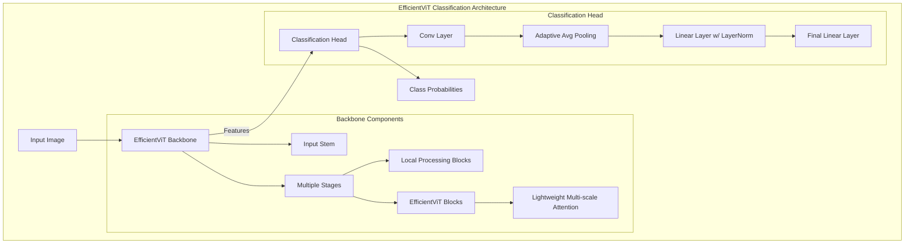
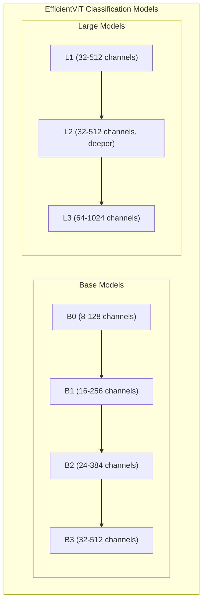
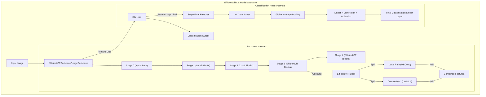

<!-- source: DeepWiki mcp.deepwiki.com · repo mit-han-lab/efficientvit · page 5.1 Classification Models · fetched 2026-10-30 -->

# Classification Models

<details>
<summary>Relevant source files</summary>

The following files were used as context for generating this wiki page:

- [.gitignore](.gitignore)
- [efficientvit/apps/data_provider/base.py](efficientvit/apps/data_provider/base.py)
- [efficientvit/cls_model_zoo.py](efficientvit/cls_model_zoo.py)
- [efficientvit/models/efficientvit/backbone.py](efficientvit/models/efficientvit/backbone.py)
- [efficientvit/models/efficientvit/cls.py](efficientvit/models/efficientvit/cls.py)
- [efficientvit/models/nn/act.py](efficientvit/models/nn/act.py)
- [efficientvit/models/nn/norm.py](efficientvit/models/nn/norm.py)
- [efficientvit/sam_model_zoo.py](efficientvit/sam_model_zoo.py)
- [efficientvit/seg_model_zoo.py](efficientvit/seg_model_zoo.py)

</details>


This documentation provides a detailed overview of the EfficientViT Classification Models available in the repository. These models are designed for efficient image classification tasks with various sizes and performance trade-offs. For information about segmentation models, see [Segmentation Models](#5.2), and for SAM (Segment Anything Models), see [SAM Models](#5.3).

## Overview

EfficientViT Classification Models are a family of vision transformer-based models optimized for image classification tasks. They combine the strong representational power of vision transformers with efficient neural network design principles, making them suitable for deployment on a range of hardware from mobile devices to high-performance servers.



Sources: [efficientvit/models/efficientvit/cls.py:1-159](), [efficientvit/models/efficientvit/backbone.py:1-375]()

## Model Family

EfficientViT classification models are available in two main families - the B-series (Base) and the L-series (Large), with increasing computational complexity and performance:

### B-Series
- **B0**: Smallest model for extremely resource-constrained environments
- **B1**: Small model with good accuracy-efficiency tradeoff 
- **B2**: Medium-sized model with better accuracy
- **B3**: Largest model in the B-series with the highest accuracy

### L-Series
- **L1**: Improved performance over B-series with moderate size increase
- **L2**: Higher capacity model with strong performance
- **L3**: Largest model with the highest accuracy in the EfficientViT family

Each model variant is available in multiple input resolutions (224×224, 256×256, 288×288, and for some models 320×320 and 384×384).



Sources: [efficientvit/cls_model_zoo.py:1-77](), [efficientvit/models/efficientvit/backbone.py:159-374]()

## Model Architecture

The EfficientViT classification models consist of two main components:

1. **EfficientViT Backbone**: Responsible for feature extraction
2. **Classification Head**: Processes backbone features for classification tasks

### Backbone Architecture

There are two backbone types:

1. **EfficientViTBackbone**: Used for B0-B3 models
2. **EfficientViTLargeBackbone**: Used for L1-L3 models

Both backbones follow a similar structure:
- Input stem: Initial convolution and processing stages
- Multiple stages with increasing channel width
- Earlier stages use lightweight local blocks (MBConv, FusedMBConv, DSConv)
- Later stages incorporate EfficientViT blocks with lightweight multi-scale attention

Key architectural details for each model variant:

| Model | Width List | Depth List | Dim | Primary Blocks |
|-------|------------|------------|-----|----------------|
| B0    | [8, 16, 32, 64, 128] | [1, 2, 2, 2, 2] | 16 | MBConv, DSConv, EfficientViT Block |
| B1    | [16, 32, 64, 128, 256] | [1, 2, 3, 3, 4] | 16 | MBConv, DSConv, EfficientViT Block |
| B2    | [24, 48, 96, 192, 384] | [1, 3, 4, 4, 6] | 32 | MBConv, DSConv, EfficientViT Block |
| B3    | [32, 64, 128, 256, 512] | [1, 4, 6, 6, 9] | 32 | MBConv, DSConv, EfficientViT Block |
| L1    | [32, 64, 128, 256, 512] | [1, 1, 1, 6, 6] | 32 | Res, FMB, MB, EfficientViT Block |
| L2    | [32, 64, 128, 256, 512] | [1, 2, 2, 8, 8] | 32 | Res, FMB, MB, EfficientViT Block |
| L3    | [64, 128, 256, 512, 1024] | [1, 2, 2, 8, 8] | 32 | Res, FMB, MB, EfficientViT Block |

Sources: [efficientvit/models/efficientvit/backbone.py:33-374]()

### Classification Head

The classification head (`ClsHead`) transforms features from the backbone into class predictions:

1. Initial 1×1 convolution that projects backbone features to a wider dimension
2. Global average pooling to reduce spatial dimensions (H×W → 1×1)
3. First linear layer with layer normalization and activation function
4. Final linear projection to class logits

Head configurations for each model:

| Model | Input Channels | Width List | Activation |
|-------|---------------|------------|------------|
| B0    | 128 | [1024, 1280] | hswish |
| B1    | 256 | [1536, 1600] | hswish |
| B2    | 384 | [2304, 2560] | hswish |
| B3    | 512 | [2304, 2560] | hswish |
| L1    | 512 | [3072, 3200] | gelu |
| L2    | 512 | [3072, 3200] | gelu |
| L3    | 1024 | [6144, 6400] | gelu |

Sources: [efficientvit/models/efficientvit/cls.py:22-46](), [efficientvit/models/efficientvit/cls.py:60-158]()

## Model Zoo

The EfficientViT model zoo provides pre-configured classification models with optional pre-trained weights. All registered models are accessible through the `create_efficientvit_cls_model` function.

```mermaid
flowchart TD
    subgraph "Classification Model Creation Flow"
        ModelName["Model Name\n(e.g., 'efficientvit-b3-r224')"] --> CreateModel["create_efficientvit_cls_model()"]
        CreateModel --> LookupRegistry["Look up in REGISTERED_EFFICIENTVIT_CLS_MODEL"]
        LookupRegistry --> ModelComponents["Get model function, norm_eps, and checkpoint path"]
        ModelComponents --> Instantiate["Instantiate model using function"]
        Instantiate --> SetNormEps["Set normalization epsilon"]
        SetNormEps --> PretrainedCheck["Check if pretrained=True"]
        PretrainedCheck --> |"Yes"| LoadWeights["Load pretrained weights"]
        PretrainedCheck --> |"No"| Return["Return Model"]
        LoadWeights --> Return
    end
```



Sources: [efficientvit/cls_model_zoo.py:19-76]()

### Available Models

The model zoo includes the following pre-trained classification models:

| Model Name | Resolution | Feature | Checkpoint Path |
|------------|------------|---------|----------------|
| efficientvit-b0 | - | Base model | None |
| efficientvit-b0-r224 | 224×224 | Pretrained | Available |
| efficientvit-b1 | - | Base model | None |
| efficientvit-b1-r224/r256/r288 | 224×224, 256×256, 288×288 | Pretrained | Available |
| efficientvit-b2 | - | Base model | None |
| efficientvit-b2-r224/r256/r288 | 224×224, 256×256, 288×288 | Pretrained | Available |
| efficientvit-b3 | - | Base model | None |
| efficientvit-b3-r224/r256/r288 | 224×224, 256×256, 288×288 | Pretrained | Available |
| efficientvit-l1 | - | Large model | None |
| efficientvit-l1-r224 | 224×224 | Pretrained | Available |
| efficientvit-l2 | - | Large model | None |
| efficientvit-l2-r224/r256/r288/r320/r384 | Multiple resolutions | Pretrained | Available |
| efficientvit-l3 | - | Large model | None |
| efficientvit-l3-r224/r256/r288/r320/r384 | Multiple resolutions | Pretrained | Available |

Sources: [efficientvit/cls_model_zoo.py:19-54]()

## Using Classification Models

### Basic Usage

To create and use an EfficientViT classification model:

```python
from efficientvit.cls_model_zoo import create_efficientvit_cls_model

# Create a model with pretrained weights
model = create_efficientvit_cls_model("efficientvit-b1-r224", pretrained=True)

# For inference
model.eval()
output = model(input_tensor)  # shape: [batch_size, 1000] for ImageNet classification
```

### Model Creation Parameters

The `create_efficientvit_cls_model` function accepts the following parameters:

- `name`: Model name from the registry
- `pretrained`: Whether to load pretrained weights (default: True)
- `weight_url`: Optional custom weight URL/path
- `**kwargs`: Additional arguments passed to model constructor

Sources: [efficientvit/cls_model_zoo.py:57-76]()

### Normalization and Training

All models use specific normalization epsilon values:
- B-series models: `norm_eps=1e-5`
- L-series models: `norm_eps=1e-7`

The standard ImageNet normalization parameters are used:
- Mean: [0.485, 0.456, 0.406]
- Standard deviation: [0.229, 0.224, 0.225]

Sources: [efficientvit/cls_model_zoo.py:19-54](), [efficientvit/apps/data_provider/base.py:39-39](), [efficientvit/models/nn/norm.py:138-143]()

## Technical Details

### Implementation Notes

1. **Activation Functions**:
   - B-series models use hardswish (hswish) activation 
   - L-series models use GELU activation

2. **Normalization**:
   - Models primarily use BatchNorm2D for normalization
   - The classification head uses LayerNorm for the penultimate layer

3. **Residual Connections**:
   - Used extensively throughout the network to improve gradient flow
   - Local blocks implement residual connections through the ResidualBlock wrapper

Sources: [efficientvit/models/nn/act.py:12-18](), [efficientvit/models/efficientvit/cls.py:22-46]()

### Architecture Diagram



Sources: [efficientvit/models/efficientvit/cls.py:48-57](), [efficientvit/models/efficientvit/backbone.py:150-156](), [efficientvit/models/efficientvit/backbone.py:333-338]()

## Summary

EfficientViT Classification Models provide a range of efficient vision transformers for image classification tasks. The family includes both smaller models (B-series) optimized for mobile and edge devices, as well as larger models (L-series) designed for higher accuracy in less constrained environments. The model zoo offers pretrained weights for multiple resolutions, making it easy to select the right model for specific performance and efficiency requirements.

Sources: [efficientvit/cls_model_zoo.py:1-77]()

---

