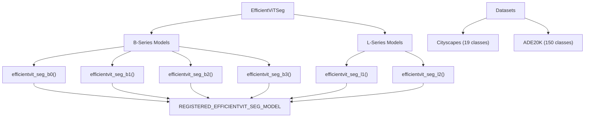
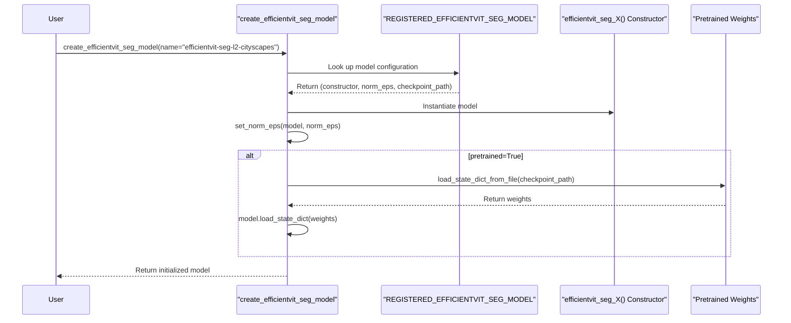

<!-- source: DeepWiki mcp.deepwiki.com · repo mit-han-lab/efficientvit · page 5.2 Segmentation Models · fetched 2026-10-30 -->

# Segmentation Models

<details>
<summary>Relevant source files</summary>

The following files were used as context for generating this wiki page:

- [applications/efficientvit_seg/README.md](applications/efficientvit_seg/README.md)
- [efficientvit/cls_model_zoo.py](efficientvit/cls_model_zoo.py)
- [efficientvit/sam_model_zoo.py](efficientvit/sam_model_zoo.py)
- [efficientvit/seg_model_zoo.py](efficientvit/seg_model_zoo.py)

</details>


This document provides a technical overview of the EfficientViT Segmentation Models, which are designed for semantic segmentation tasks. These models are based on the core EfficientViT architecture, optimized for efficient inference while maintaining high accuracy. This page covers the available segmentation model variants, their architecture, performance metrics, and usage.

For information about classification models, see [Classification Models](#5.1).
For information about SAM (Segment Anything) models, see [SAM Models](#5.3).

## Available Models and Variants

EfficientViT provides segmentation models in two series, each with several variants, and pre-trained weights for two popular datasets.

### Model Series and Architecture



Sources: [efficientvit/seg_model_zoo.py:3-12](), [efficientvit/seg_model_zoo.py:19-78]()

## Model Zoo Implementation

The segmentation models are implemented in the model zoo pattern, where:

1. Available variants are registered in a dictionary 
2. Each dictionary entry contains the model constructor, normalization epsilon, and checkpoint path
3. A factory function creates and loads the appropriate model



Sources: [efficientvit/seg_model_zoo.py:81-100]()

## Performance and Specifications

### Cityscapes Dataset Models

| Model | Resolution | mIoU | Parameters | MACs | Jetson Orin Latency | A100 Throughput |
|-------|------------|------|------------|------|---------------------|----------------|
| EfficientViT-L1 | 1024x2048 | 82.72% | 40M | 282G | 45.9ms | 122 img/s |
| EfficientViT-L2 | 1024x2048 | 83.23% | 53M | 396G | 60.0ms | 102 img/s |
| EfficientViT-B0 | 1024x2048 | 75.65% | 0.7M | 4.4G | 9.9ms | - |
| EfficientViT-B1 | 1024x2048 | 80.55% | 4.8M | 25G | 24.3ms | - |
| EfficientViT-B2 | 1024x2048 | 82.07% | 15M | 74G | 46.5ms | - |
| EfficientViT-B3 | 1024x2048 | 83.02% | 40M | 179G | 81.8ms | - |

### ADE20K Dataset Models

| Model | Resolution | mIoU | Parameters | MACs | Jetson Orin Latency | A100 Throughput |
|-------|------------|------|------------|------|---------------------|----------------|
| EfficientViT-L1 | 512x512 | 49.19% | 40M | 36G | 7.2ms | 947 img/s (bs16) |
| EfficientViT-L2 | 512x512 | 50.70% | 51M | 45G | 9.0ms | 758 img/s (bs16) |
| EfficientViT-B1 | 512x512 | 42.84% | 4.8M | 3.1G | 4.0ms | - |
| EfficientViT-B2 | 512x512 | 45.94% | 15M | 9.1G | 7.3ms | - |
| EfficientViT-B3 | 512x512 | 49.01% | 39M | 22G | 12.5ms | - |

Sources: [applications/efficientvit_seg/README.md:54-86]()

## Model Architecture

EfficientViT segmentation models follow an encoder-decoder architecture optimized for semantic segmentation tasks:


Sources: [efficientvit/models/efficientvit.py]() (reference to file mentioned in imports)

## Usage Guide

### Loading Pretrained Models

```python
from efficientvit.seg_model_zoo import create_efficientvit_seg_model

# For Cityscapes dataset
model = create_efficientvit_seg_model(name="efficientvit-seg-l2-cityscapes", pretrained=True)

# For ADE20K dataset
model = create_efficientvit_seg_model(name="efficientvit-seg-l2-ade20k", pretrained=True)
```

Sources: [applications/efficientvit_seg/README.md:92-98]()

### Available Model Names

All models follow the naming convention `efficientvit-seg-{series}{size}-{dataset}`:

| Series | Sizes | Datasets |
|--------|-------|----------|
| b | 0, 1, 2, 3 | cityscapes, ade20k (except b0) |
| l | 1, 2 | cityscapes, ade20k |

Examples: 
- `efficientvit-seg-b0-cityscapes`
- `efficientvit-seg-l2-ade20k`

Sources: [efficientvit/seg_model_zoo.py:19-77]()

## Evaluation and Demo

### Model Evaluation

EfficientViT provides an evaluation script to measure performance on the validation sets:

```bash
python applications/efficientvit_seg/eval_efficientvit_seg_model.py \
  --model efficientvit-seg-l2-cityscapes \
  --dataset cityscapes \
  --data_dir /path/to/cityscapes
```

Sources: [applications/efficientvit_seg/README.md:101-105]()

### Demo Visualization

To visualize segmentation on custom images:

```bash
# For ADE20K model
python applications/efficientvit_seg/demo_efficientvit_seg_model.py \
  --image_path assets/fig/indoor.jpg \
  --dataset ade20k \
  --crop_size 512 \
  --model efficientvit-seg-l2-ade20k

# For Cityscapes model
python applications/efficientvit_seg/demo_efficientvit_seg_model.py \
  --image_path assets/fig/city.png \
  --dataset cityscapes \
  --crop_size 1024 \
  --model efficientvit-seg-l2-cityscapes
```

Sources: [applications/efficientvit_seg/README.md:107-117]()

## Model Export

### ONNX Export

```bash
python assets/onnx_export.py \
  --export_path assets/export_models/efficientvit_seg_l2_cityscapes_r1024x2048.onnx \
  --task seg \
  --model efficientvit-seg-l2-cityscapes \
  --resolution 1024 2048 \
  --bs 1
```

Sources: [applications/efficientvit_seg/README.md:121-129]()

### TFLite Export

```bash
python assets/tflite_export.py \
  --export_path assets/export_models/efficientvit_seg_l2_ade20k_r512x512.tflite \
  --task seg \
  --model efficientvit-seg-l2-ade20k \
  --resolution 512 512
```

Sources: [applications/efficientvit_seg/README.md:131-139]()

## Dataset Requirements

### Cityscapes

The code expects the Cityscapes dataset to be organized as follows:

```
cityscapes/
├── gtFine/
│   ├── train/
│   ├── val/
├── leftImg8bit/
    ├── train/
    ├── val/
```

### ADE20K

The code expects the ADE20K dataset to be organized as follows:

```
ade20k/
├── annotations/
│   ├── training/
│   ├── validation/
├── images/
    ├── training/
    ├── validation/
```

Sources: [applications/efficientvit_seg/README.md:13-47]()

---

