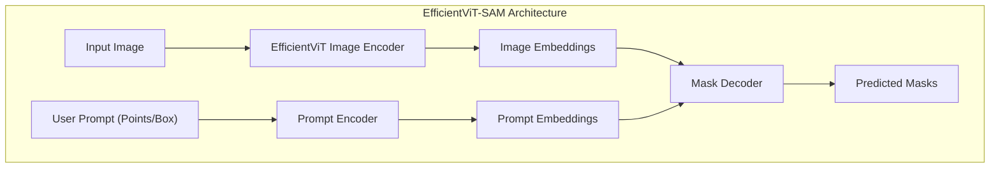
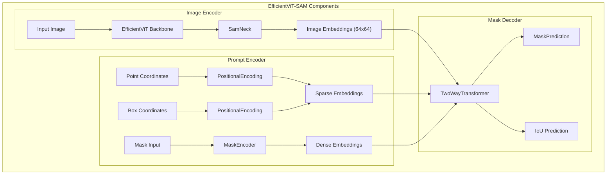
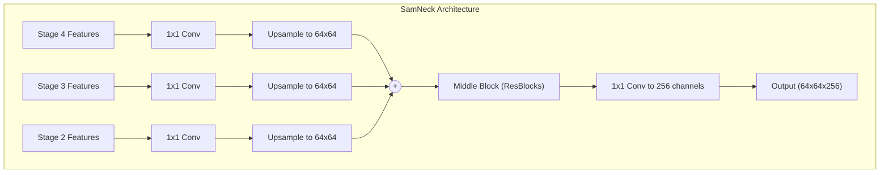
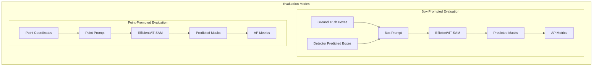

<!-- source: DeepWiki mcp.deepwiki.com · repo mit-han-lab/efficientvit · page 5.3 SAM Models · fetched 2026-10-30 -->

# SAM Models

<details>
<summary>Relevant source files</summary>

The following files were used as context for generating this wiki page:

- [applications/efficientvit_cls/README.md](applications/efficientvit_cls/README.md)
- [applications/efficientvit_sam/README.md](applications/efficientvit_sam/README.md)
- [assets/dc_ae_diffusion_example.png](assets/dc_ae_diffusion_example.png)
- [efficientvit/cls_model_zoo.py](efficientvit/cls_model_zoo.py)
- [efficientvit/models/efficientvit/sam.py](efficientvit/models/efficientvit/sam.py)
- [efficientvit/sam_model_zoo.py](efficientvit/sam_model_zoo.py)
- [efficientvit/seg_model_zoo.py](efficientvit/seg_model_zoo.py)

</details>


This document provides a detailed overview of the EfficientViT-SAM models available in the repository. EfficientViT-SAM is an accelerated implementation of the Segment Anything Model (SAM) that replaces the heavy image encoder with EfficientViT while preserving the original prompt encoder and mask decoder architecture. For information about the core EfficientViT architecture, see [EfficientViT Architecture](#1.1).

## Introduction to EfficientViT-SAM

EfficientViT-SAM models deliver significant acceleration compared to the original SAM models while maintaining competitive performance. The design philosophy focuses on efficiency by:

1. Keeping SAM's prompt encoder and mask decoder components intact
2. Replacing the image encoder with EfficientViT backbones 
3. Adding a custom neck architecture to adapt features from the backbone

This approach offers up to 48.9x speedup on A100 GPUs compared to SAM-ViT-H without sacrificing segmentation quality.



Sources: [efficientvit/models/efficientvit/sam.py:173-187](), [applications/efficientvit_sam/README.md:9-10]()

## Model Variants and Performance

EfficientViT-SAM comes in 5 variants with different performance and efficiency trade-offs:

| Model | Resolution | COCO mAP | LVIS mAP | Parameters | MACs | A100 Throughput (bs16) |
|-------|------------|----------|----------|------------|------|------------------------|
| EfficientViT-SAM-L0 | 512×512 | 45.7 | 41.8 | 34.8M | 35G | 762 images/s |
| EfficientViT-SAM-L1 | 512×512 | 46.2 | 42.1 | 47.7M | 49G | 638 images/s |
| EfficientViT-SAM-L2 | 512×512 | 46.6 | 42.7 | 61.3M | 69G | 538 images/s |
| EfficientViT-SAM-XL0 | 1024×1024 | 47.5 | 43.9 | 117.0M | 185G | 278 images/s |
| EfficientViT-SAM-XL1 | 1024×1024 | 47.8 | 44.4 | 203.3M | 322G | 182 images/s |

The **L** models utilize 512×512 resolution and are optimized for faster inference, while the **XL** models use 1024×1024 resolution for higher accuracy at the cost of more computation.

Sources: [applications/efficientvit_sam/README.md:45-52](), [efficientvit/sam_model_zoo.py:17-23]()

## Architecture Details

The EfficientViT-SAM architecture consists of three main components:



### Image Encoder

The Image Encoder consists of:

1. **EfficientViT Backbone**: Extracts multi-scale features from the input image
2. **SamNeck**: Adapts and fuses multi-scale features into a unified representation

The `EfficientViTSamImageEncoder` class combines these components and applies layer normalization to the output.

```python
class EfficientViTSamImageEncoder(nn.Module):
    def __init__(self, backbone: EfficientViTBackbone | EfficientViTLargeBackbone, neck: SamNeck):
        super().__init__()
        self.backbone = backbone
        self.neck = neck
        self.norm = build_norm("ln2d", 256)
```

The neck architecture is implemented as a Directed Acyclic Graph (DAG):



Sources: [efficientvit/models/efficientvit/sam.py:102-170](), [efficientvit/models/efficientvit/sam.py:173-187]()

### Model Factory Functions

The repository provides factory functions for creating different variants of EfficientViT-SAM models:

1. **L Series Models**: Use standard EfficientViT backbones
   - `efficientvit_sam_l0`: Smallest model with 512px resolution
   - `efficientvit_sam_l1`: Medium-sized model with 512px resolution
   - `efficientvit_sam_l2`: Largest L-series model with 512px resolution

2. **XL Series Models**: Use larger EfficientViT backbones with 1024px resolution
   - `efficientvit_sam_xl0`: Medium-large model
   - `efficientvit_sam_xl1`: Largest, most accurate model

Each factory function configures:
- The backbone architecture
- The SamNeck parameters
- The prompt encoder and mask decoder settings

Sources: [efficientvit/models/efficientvit/sam.py:580-682](), [efficientvit/sam_model_zoo.py:17-23]()

## Model Registry and Loading

The SAM models are registered in a model zoo dictionary for convenient access:

```python
REGISTERED_EFFICIENTVIT_SAM_MODEL: dict[str, tuple[Callable, float, str]] = {
    "efficientvit-sam-l0": (efficientvit_sam_l0, 1e-6, "assets/checkpoints/efficientvit_sam/efficientvit_sam_l0.pt"),
    "efficientvit-sam-l1": (efficientvit_sam_l1, 1e-6, "assets/checkpoints/efficientvit_sam/efficientvit_sam_l1.pt"),
    "efficientvit-sam-l2": (efficientvit_sam_l2, 1e-6, "assets/checkpoints/efficientvit_sam/efficientvit_sam_l2.pt"),
    "efficientvit-sam-xl0": (efficientvit_sam_xl0, 1e-6, "assets/checkpoints/efficientvit_sam/efficientvit_sam_xl0.pt"),
    "efficientvit-sam-xl1": (efficientvit_sam_xl1, 1e-6, "assets/checkpoints/efficientvit_sam/efficientvit_sam_xl1.pt"),
}
```

To create a model with pretrained weights, the `create_efficientvit_sam_model` function is used:

```python
from efficientvit.sam_model_zoo import create_efficientvit_sam_model

# Create a model with pretrained weights
model = create_efficientvit_sam_model(name="efficientvit-sam-xl1", pretrained=True)
```

This function:
1. Looks up the model creation function and default weights path
2. Sets appropriate normalization epsilon values 
3. Loads pretrained weights if requested

Sources: [efficientvit/sam_model_zoo.py:17-45]()

## Prediction Interfaces

EfficientViT-SAM provides two main interfaces for making predictions:

### 1. EfficientViTSamPredictor

For interactive, prompt-based segmentation:

```python
from efficientvit.models.efficientvit.sam import EfficientViTSamPredictor

# Create a predictor
predictor = EfficientViTSamPredictor(model)

# Set an image
predictor.set_image(image)

# Make predictions with point or box prompts
masks, scores, logits = predictor.predict(
    point_coords=[[500, 375]],  # [x, y] points
    point_labels=[1],           # 1 for foreground, 0 for background
    multimask_output=True       # Return multiple mask options
)
```

The predictor handles:
- Image preprocessing and embeddings caching
- Coordinate transformation between original and model resolution
- Running the mask decoder with provided prompts

### 2. EfficientViTSamAutomaticMaskGenerator

For automatic mask generation without user prompts:

```python
from efficientvit.models.efficientvit.sam import EfficientViTSamAutomaticMaskGenerator

# Create a mask generator
mask_generator = EfficientViTSamAutomaticMaskGenerator(model)

# Generate masks for an image
masks = mask_generator.generate(image)
```

The automatic mask generator:
- Creates a grid of point prompts across the image
- Filters and post-processes masks based on quality thresholds
- Handles NMS (Non-Maximum Suppression) to reduce redundancy

Sources: [efficientvit/models/efficientvit/sam.py:274-504](), [applications/efficientvit_sam/README.md:67-77]()

## Deployment and Optimization

The EfficientViT-SAM models support efficient deployment through export to:

1. **ONNX format**:
   ```bash
   # Export encoder
   python applications/efficientvit_sam/deployment/onnx/export_encoder.py \
       --model efficientvit-sam-xl1 \
       --output assets/export_models/efficientvit_sam/onnx/efficientvit_sam_xl1_encoder.onnx
   
   # Export decoder
   python applications/efficientvit_sam/deployment/onnx/export_decoder.py \
       --model efficientvit-sam-xl1 \
       --output assets/export_models/efficientvit_sam/onnx/efficientvit_sam_xl1_decoder.onnx \
       --return-single-mask
   ```

2. **TensorRT optimization**:
   ```bash
   # Convert encoder to TensorRT
   trtexec --onnx=assets/export_models/efficientvit_sam/onnx/efficientvit_sam_xl1_encoder.onnx \
       --minShapes=input_image:1x3x1024x1024 \
       --optShapes=input_image:4x3x1024x1024 \
       --maxShapes=input_image:4x3x1024x1024 \
       --saveEngine=assets/export_models/efficientvit_sam/tensorrt/efficientvit_sam_xl1_encoder.engine
   
   # Convert decoder to TensorRT
   trtexec --onnx=assets/export_models/efficientvit_sam/onnx/efficientvit_sam_xl1_decoder.onnx \
       --minShapes=point_coords:1x1x2,point_labels:1x1 \
       --optShapes=point_coords:16x2x2,point_labels:16x2 \
       --maxShapes=point_coords:16x2x2,point_labels:16x2 \
       --fp16 \
       --saveEngine=assets/export_models/efficientvit_sam/tensorrt/efficientvit_sam_xl1_decoder.engine
   ```

The architecture enables splitting the model into encoder and decoder components, allowing for efficient pipeline optimization:
1. The image encoder runs once per image
2. The prompt encoder + mask decoder run for each prompt interaction

This design is particularly beneficial for interactive segmentation applications.

Sources: [applications/efficientvit_sam/README.md:153-187]()

## Evaluation and Performance

EfficientViT-SAM models can be evaluated on standard benchmarks:



The repository provides evaluation scripts for:

1. **Box-prompted zero-shot instance segmentation**:
   - Using ground truth bounding boxes
   - Using detector-predicted bounding boxes (ViTDet, YOLOv8, GroundingDINO)

2. **Point-prompted zero-shot instance segmentation**:
   - Using single or multiple point clicks

Key benchmarks show that EfficientViT-SAM-XL1 achieves:
- 47.8% COCO mAP with box prompts from ViTDet
- 44.4% LVIS mAP with box prompts from ViTDet
- 59.8% point-prompted segmentation with a single click

Sources: [applications/efficientvit_sam/README.md:81-131]()

## Conclusion

EfficientViT-SAM models provide an efficient alternative to the original SAM model, with:

1. Significantly faster inference speed (up to 48.9x on A100 GPUs)
2. Comparable segmentation quality to the original SAM
3. Multiple model variants for different efficiency-accuracy trade-offs
4. Deployment optimization through ONNX and TensorRT

These models are particularly suitable for real-time interactive segmentation applications, mobile deployment, and large-scale automatic segmentation tasks.

---

