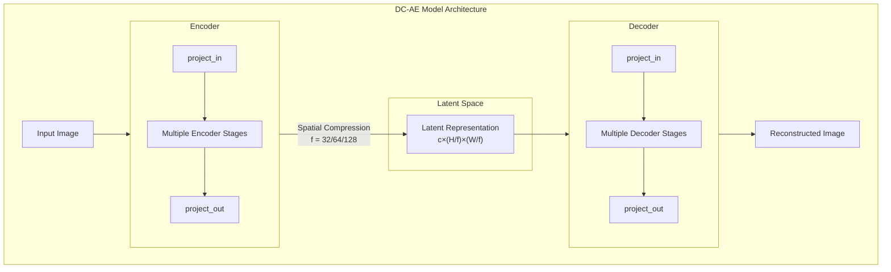
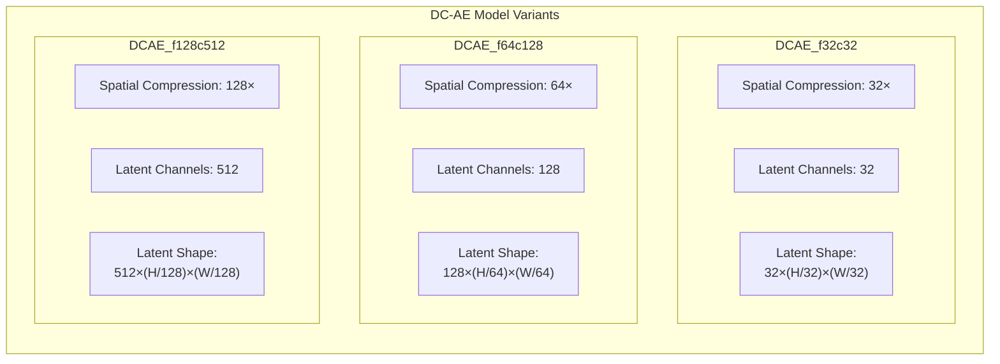
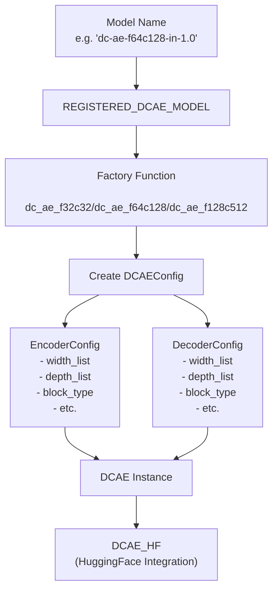
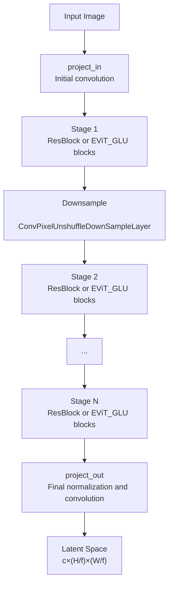
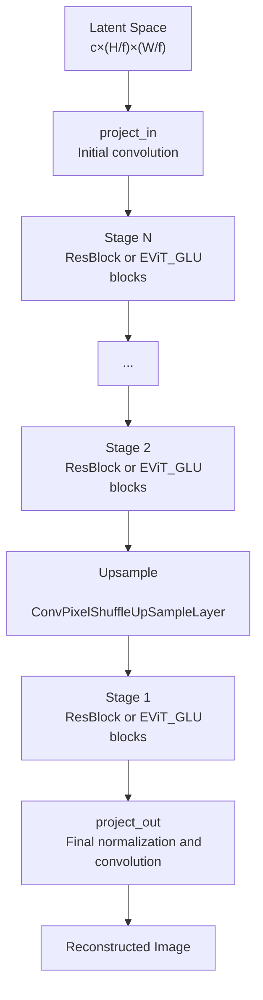
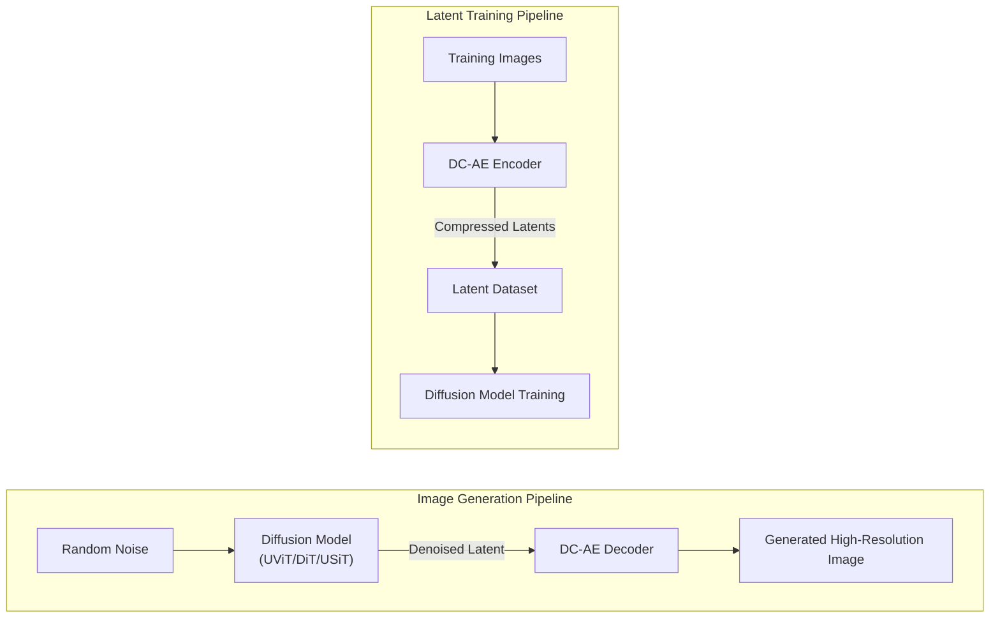

<!-- source: DeepWiki mcp.deepwiki.com · repo mit-han-lab/efficientvit · page 5.4 DC-AE Models · fetched 2026-10-30 -->

# DC-AE Models

<details>
<summary>Relevant source files</summary>

The following files were used as context for generating this wiki page:

- [README.md](README.md)
- [applications/dc_ae/README.md](applications/dc_ae/README.md)
- [applications/dc_ae/dc_ae_generate_latent.py](applications/dc_ae/dc_ae_generate_latent.py)
- [efficientvit/ae_model_zoo.py](efficientvit/ae_model_zoo.py)
- [efficientvit/models/efficientvit/dc_ae.py](efficientvit/models/efficientvit/dc_ae.py)
- [pyproject.toml](pyproject.toml)

</details>


## Purpose and Scope

This page documents the Deep Compression Autoencoder (DC-AE) models available in the EfficientViT framework. DC-AE models are designed for high spatial compression of images while maintaining reconstruction quality, with compression ratios of up to 128×. They serve as efficient encoders and decoders for latent diffusion models, significantly accelerating both training and inference of high-resolution image generation.

For information about using DC-AE models with diffusion models, see [Diffusion Models](#4). For a general overview of the DC-AE architecture, see [Deep Compression Autoencoder](#3).

## Model Architecture Overview

DC-AE models follow an encoder-decoder architecture designed specifically for high spatial compression ratios.



Sources: [efficientvit/models/efficientvit/dc_ae.py:278-400](), [applications/dc_ae/README.md:29-31]()

## Available DC-AE Models

The EfficientViT framework provides three main variants of DC-AE models with different compression ratios and channel configurations:



Sources: [efficientvit/models/efficientvit/dc_ae.py:437-500](), [applications/dc_ae/README.md:73-80]()

Each model variant is available with different training datasets:

| Model Name | Compression | Latent Shape | Training Dataset | Purpose |
|------------|-------------|--------------|------------------|---------|
| dc-ae-f32c32-in-1.0 | 32× | 32×(H/32)×(W/32) | ImageNet | General purpose |
| dc-ae-f64c128-in-1.0 | 64× | 128×(H/64)×(W/64) | ImageNet | Higher compression |
| dc-ae-f128c512-in-1.0 | 128× | 512×(H/128)×(W/128) | ImageNet | Maximum compression |
| dc-ae-f32c32-mix-1.0 | 32× | 32×(H/32)×(W/32) | Mixed datasets | Better generalization |
| dc-ae-f64c128-mix-1.0 | 64× | 128×(H/64)×(W/64) | Mixed datasets | Better generalization |
| dc-ae-f128c512-mix-1.0 | 128× | 512×(H/128)×(W/128) | Mixed datasets | Better generalization |
| dc-ae-f32c32-sana-1.0 | 32× | 32×(H/32)×(W/32) | Mixed datasets | Used in SANA text-to-image model |
| dc-ae-f32c32-sana-1.1 | 32× | 32×(H/32)×(W/32) | Mixed datasets | Improved SANA decoder |

Sources: [efficientvit/ae_model_zoo.py:13-23](), [applications/dc_ae/README.md:73-80]()

## Model Registry and Factory Functions

The DC-AE models are registered in the `REGISTERED_DCAE_MODEL` dictionary in `ae_model_zoo.py`, which maps model names to their factory functions:



Sources: [efficientvit/ae_model_zoo.py:1-36](), [efficientvit/models/efficientvit/dc_ae.py:437-500]()

## Model Components and Architecture Details

### Encoder Architecture

The encoder consists of multiple stages that progressively reduce spatial dimensions while increasing channel dimensions:



Sources: [efficientvit/models/efficientvit/dc_ae.py:278-331]()

### Decoder Architecture

The decoder mirrors the encoder structure but in reverse, with upsampling layers instead of downsampling:



Sources: [efficientvit/models/efficientvit/dc_ae.py:333-399]()

### Block Types

DC-AE models use two main types of blocks:

1. **ResBlock**: Traditional residual blocks with convolutions
2. **EViT_GLU/EViTS5_GLU**: EfficientViT blocks with Gated Linear Units for more powerful feature transformation

Sources: [efficientvit/models/efficientvit/dc_ae.py:80-103]()

## Configuration Details

The DC-AE models are configured through three main configuration classes:

1. **EncoderConfig**: Controls encoder structure and parameters
   - `width_list`: Channel dimensions for each stage
   - `depth_list`: Number of blocks in each stage
   - `block_type`: Types of blocks used (ResBlock or EViT variants)
   - Downsampling parameters

2. **DecoderConfig**: Controls decoder structure and parameters
   - `width_list`: Channel dimensions for each stage
   - `depth_list`: Number of blocks in each stage
   - `block_type`: Types of blocks used
   - Upsampling parameters

3. **DCAEConfig**: Top-level configuration that contains encoder and decoder configs
   - `in_channels`: Input image channels (typically 3)
   - `latent_channels`: Number of channels in latent space
   - `encoder`: EncoderConfig instance
   - `decoder`: DecoderConfig instance
   - `scaling_factor`: Optional scaling factor for latent space normalization

Sources: [efficientvit/models/efficientvit/dc_ae.py:27-78]()

## Usage Examples

### Loading a DC-AE Model

```python
from efficientvit.ae_model_zoo import DCAE_HF

# Load a DC-AE model from HuggingFace
dc_ae = DCAE_HF.from_pretrained("mit-han-lab/dc-ae-f64c128-in-1.0")
dc_ae = dc_ae.to("cuda").eval()
```

### Encoding and Decoding

```python
import torch
import torchvision.transforms as transforms
from PIL import Image
from efficientvit.apps.utils.image import DMCrop

# Prepare image preprocessing
transform = transforms.Compose([
    DMCrop(512),  # Target resolution
    transforms.ToTensor(),
    transforms.Normalize((0.5, 0.5, 0.5), (0.5, 0.5, 0.5)),
])

# Load and preprocess image
image = Image.open("image.png")
x = transform(image)[None].to("cuda")

# Encode to latent space
latent = dc_ae.encode(x)
print(f"Latent shape: {latent.shape}")  # [1, 128, 8, 8] for 512px input with f64c128

# Decode back to image space
reconstructed = dc_ae.decode(latent)
```

Sources: [applications/dc_ae/README.md:82-118]()

### Generating Latent Representations for Training

For training diffusion models on latent representations, DC-AE provides a utility to precompute and save latents:

```python
# Example command to generate latents for a dataset
torchrun --nnodes=1 --nproc_per_node=8 -m applications.dc_ae.dc_ae_generate_latent \
    resolution=512 \
    image_root_path=~/dataset/imagenet/train batch_size=64 \
    model_name=dc-ae-f64c128-in-1.0 scaling_factor=0.2889 \
    latent_root_path=assets/data/latent/dc_ae_f64c128_in_1.0/imagenet_512
```

Sources: [applications/dc_ae/README.md:255-269](), [applications/dc_ae/dc_ae_generate_latent.py:1-146]()

## Integration with Diffusion Models

DC-AE models are designed to work seamlessly with diffusion models for efficient high-resolution image generation:



Sources: [applications/dc_ae/README.md:120-134](), [applications/dc_ae/README.md:255-331]()

## Performance Comparisons

The following table shows the performance of DC-AE models with different diffusion backbones:

| Autoencoder | Diffusion Model | Params (M) | MACs (G) | ImageNet 512×512 FID (no cfg) | ImageNet 512×512 FID (with cfg) |
|-------------|-----------------|------------|----------|-------------------------------|--------------------------------|
| DC-AE-f32   | UViT-S          | 44.79      | 12.27    | 46.12                         | 18.08                          |
| DC-AE-f32   | DiT-XL          | 674.89     | 118.68   | 9.56                          | 2.84                           |
| DC-AE-f32   | UViT-H          | 500.87     | 133.25   | 9.83                          | 2.53                           |
| DC-AE-f64   | UViT-H          | 500.87     | 33.25    | 13.96                         | 3.01                           |
| DC-AE-f32   | UViT-2B         | 1580.40    | 414.91   | 8.13                          | 2.30                           |
| DC-AE-f64   | UViT-2B         | 1580.40    | 104.65   | 7.78                          | 2.47                           |
| DC-AE-f32   | USiT-H          | 500.87     | 33.25    | 3.80                          | 1.89                           |
| DC-AE-f32   | USiT-2B         | 1580.40    | 414.91   | 2.90                          | 1.72                           |

Sources: [applications/dc_ae/README.md:122-134]()

Compared to traditional VAE models with 8× compression (like the one used in Stable Diffusion), DC-AE provides significantly faster inference and training speeds, especially for high-resolution images. For example, DC-AE-f64 provides 19.1× inference speedup and 17.9× training speedup on H100 GPU for UViT-H while achieving better FID scores.

---

