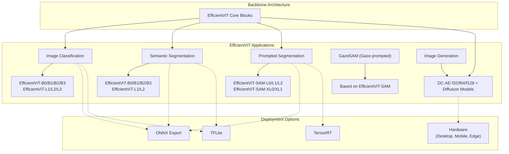
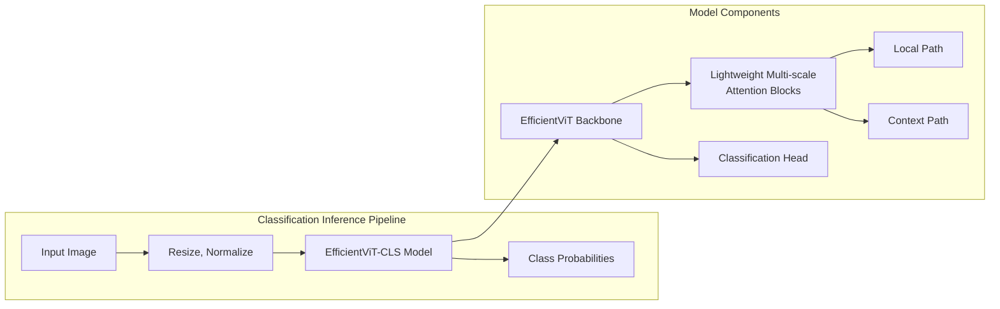
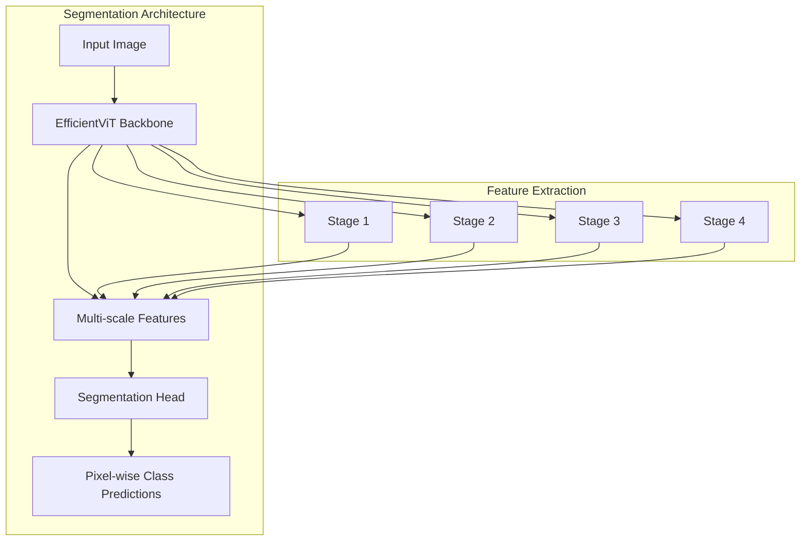
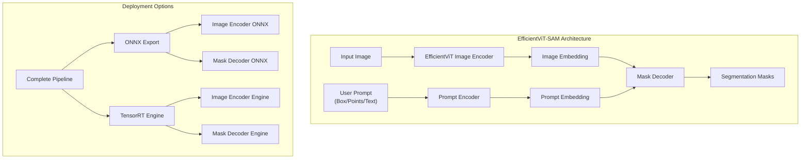
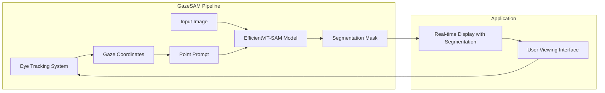
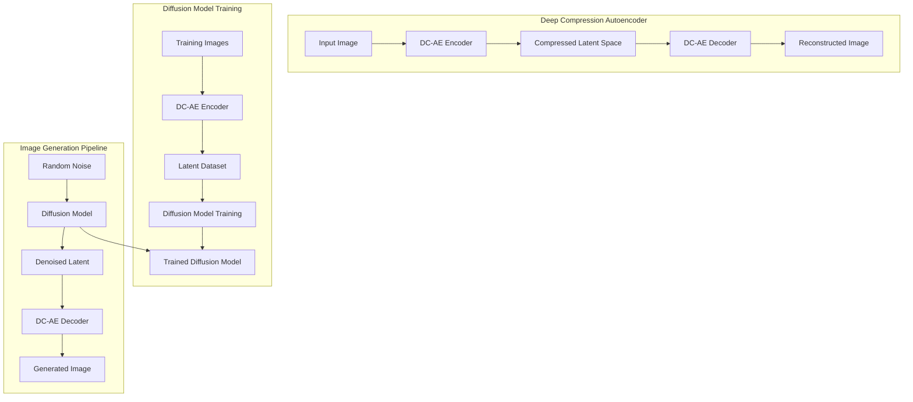
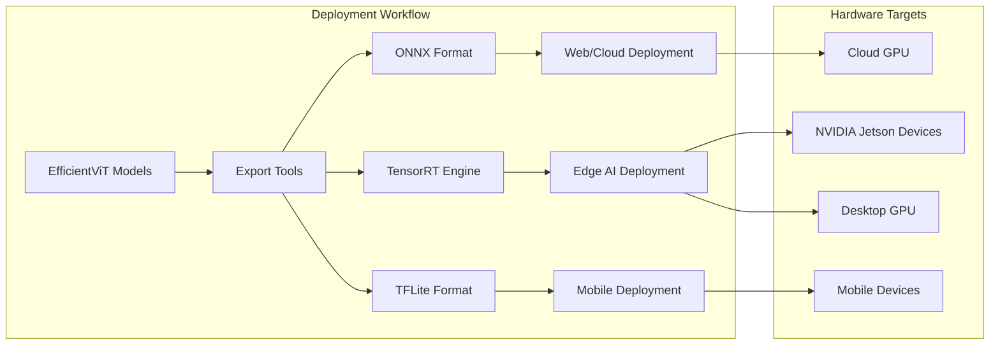

<!-- source: DeepWiki mcp.deepwiki.com · repo mit-han-lab/efficientvit · page 6 Applications · fetched 2026-10-30 -->

# Applications

<details>
<summary>Relevant source files</summary>

The following files were used as context for generating this wiki page:

- [README.md](README.md)
- [applications/dc_ae/README.md](applications/dc_ae/README.md)
- [applications/efficientvit_cls/README.md](applications/efficientvit_cls/README.md)
- [applications/efficientvit_sam/README.md](applications/efficientvit_sam/README.md)
- [applications/efficientvit_seg/README.md](applications/efficientvit_seg/README.md)
- [assets/dc_ae_diffusion_example.png](assets/dc_ae_diffusion_example.png)

</details>


This page provides an overview of the various applications and use cases for the EfficientViT model family. It covers how to use EfficientViT models for different vision tasks, including image classification, semantic segmentation, prompted segmentation with EfficientViT-SAM, and image generation with Deep Compression Autoencoder (DC-AE).

For information about the core architecture of EfficientViT, see [EfficientViT Architecture](#1.1). For details about the model zoo and available pre-trained models, see [Model Zoo](#5).

## Application Ecosystem Overview

EfficientViT provides a versatile foundation for various computer vision tasks, with specialized variants tailored for different applications.



Sources: [README.md:13-100](), [applications/dc_ae/README.md:1-30](), [applications/efficientvit_sam/README.md:1-15](), [applications/efficientvit_seg/README.md:1-15](), [applications/efficientvit_cls/README.md:1-12]()

## Image Classification

EfficientViT offers efficient models for image classification through the EfficientViT-CLS family. These models provide strong accuracy while maintaining low computational requirements, making them suitable for deployment on both resource-constrained devices and high-performance servers.

### Available Models

EfficientViT classification models come in multiple variants with different size-performance tradeoffs:

| Model Family | Variants | Resolution Range | Parameter Range | Accuracy Range (Top-1) |
|--------------|----------|------------------|-----------------|------------------------|
| B Series | B1, B2, B3 | 224x224 - 288x288 | 9.1M - 49M | 79.39% - 84.15% |
| L Series | L1, L2, L3 | 224x224 - 384x384 | 53M - 246M | 84.48% - 86.41% |

The L series models provide higher accuracy with more parameters, while the B series models are more lightweight and suitable for edge devices.

### Basic Usage

```python
from efficientvit.cls_model_zoo import create_efficientvit_cls_model

# Load a pre-trained model
model = create_efficientvit_cls_model(name="efficientvit-l3-r384", pretrained=True)
model = model.eval()

# Process an image
import torch
import torchvision.transforms as transforms
from PIL import Image

transform = transforms.Compose([
    transforms.Resize(384),
    transforms.CenterCrop(384),
    transforms.ToTensor(),
    transforms.Normalize(mean=[0.485, 0.456, 0.406], std=[0.229, 0.224, 0.225]),
])

image = Image.open("path/to/image.jpg")
input_tensor = transform(image).unsqueeze(0)
with torch.no_grad():
    output = model(input_tensor)
```

### Performance Characteristics

The EfficientViT-L3 model at 384x384 resolution achieves 86.41% top-1 accuracy on ImageNet, comparable to or exceeding the performance of EfficientNetV2-M (85.2%), while offering much higher throughput.



Sources: [applications/efficientvit_cls/README.md:27-47](), [README.md:72-87]()

## Semantic Segmentation

EfficientViT-SEG models enable efficient semantic segmentation, which involves assigning a class label to each pixel in an image. These models are particularly useful for applications such as autonomous driving, scene understanding, and medical image analysis.

### Available Models

EfficientViT segmentation models are available for two popular datasets:

1. **Cityscapes** (urban scene understanding):

| Model | Resolution | mIoU | Parameters | MACs |
|-------|------------|------|------------|------|
| EfficientViT-L1 | 1024x2048 | 82.72% | 40M | 282G |
| EfficientViT-L2 | 1024x2048 | 83.23% | 53M | 396G |

2. **ADE20K** (diverse scene understanding with 150 classes):

| Model | Resolution | mIoU | Parameters | MACs |
|-------|------------|------|------------|------|
| EfficientViT-L1 | 512x512 | 49.19% | 40M | 36G |
| EfficientViT-L2 | 512x512 | 50.70% | 51M | 45G |

Lightweight B-series models (B0-B3) are also available for both datasets.

### Basic Usage

```python
from efficientvit.seg_model_zoo import create_efficientvit_seg_model

# Load a pre-trained segmentation model for Cityscapes
model = create_efficientvit_seg_model(name="efficientvit-seg-l2-cityscapes", pretrained=True)
model = model.eval()

# Or for ADE20K
# model = create_efficientvit_seg_model(name="efficientvit-seg-l2-ade20k", pretrained=True)
```

For inference on an image:

```python
import torch
import torchvision.transforms as transforms
from PIL import Image
import numpy as np

def preprocess(image, target_size):
    # Preprocessing for segmentation
    transform = transforms.Compose([
        transforms.Resize(target_size),
        transforms.ToTensor(),
        transforms.Normalize(mean=[0.485, 0.456, 0.406], std=[0.229, 0.224, 0.225]),
    ])
    return transform(image).unsqueeze(0)

# Load and preprocess image
image = Image.open("path/to/image.jpg")
input_tensor = preprocess(image, (1024, 2048))  # For Cityscapes

# Run inference
with torch.no_grad():
    output = model(input_tensor)

# Get predicted segmentation mask
predicted_mask = torch.argmax(output, dim=1).squeeze().cpu().numpy()
```

### Performance Characteristics

EfficientViT-SEG models achieve competitive segmentation performance while maintaining real-time inference capabilities, particularly on Jetson AGX Orin (45.9ms latency for L1 model) and NVIDIA A100 (122 images/s for L1 model).



Sources: [applications/efficientvit_seg/README.md:54-87](), [README.md:89-100]()

## EfficientViT-SAM (Segment Anything Model)

EfficientViT-SAM is an accelerated version of the Segment Anything Model (SAM). It replaces the heavy image encoder of the original SAM with EfficientViT while retaining SAM's prompt encoder and mask decoder, enabling efficient prompted segmentation for interactive applications.

### Available Models

EfficientViT-SAM comes in several variants:

| Model | Resolution | COCO mAP | LVIS mAP | Parameters | MACs | 
|-------|------------|----------|----------|------------|------|
| EfficientViT-SAM-L0 | 512x512 | 45.7 | 41.8 | 34.8M | 35G |
| EfficientViT-SAM-L1 | 512x512 | 46.2 | 42.1 | 47.7M | 49G |
| EfficientViT-SAM-L2 | 512x512 | 46.6 | 42.7 | 61.3M | 69G |
| EfficientViT-SAM-XL0 | 1024x1024 | 47.5 | 43.9 | 117.0M | 185G |
| EfficientViT-SAM-XL1 | 1024x1024 | 47.8 | 44.4 | 203.3M | 322G |

### Key Features

1. **Prompt Types**: Supports multiple prompt types:
   - Bounding box prompts
   - Point prompts (single or multiple points)
   - Automatic segmentation (no prompt)

2. **Speed**: Delivers up to 48.9x measured TensorRT speedup on A100 GPU compared to the original SAM-ViT-H model without sacrificing accuracy.

3. **Zero-shot Capability**: Works well on unseen datasets without fine-tuning.

### Basic Usage

```python
# Import and initialize model
from efficientvit.sam_model_zoo import create_efficientvit_sam_model
from efficientvit.models.efficientvit.sam import EfficientViTSamPredictor

model = create_efficientvit_sam_model(name="efficientvit-sam-xl1", pretrained=True)
model = model.cuda().eval()
predictor = EfficientViTSamPredictor(model)

# Set the image
import numpy as np
from PIL import Image
image = np.array(Image.open("path/to/image.jpg"))
predictor.set_image(image)

# Box prompt
input_box = np.array([150, 70, 640, 400])  # [x1, y1, x2, y2]
masks, scores, logits = predictor.predict(
    point_coords=None,
    point_labels=None,
    box=input_box[None, :],
    multimask_output=True,
)

# Point prompt
input_point = np.array([[500, 375]])
input_label = np.array([1])  # 1 for foreground, 0 for background
masks, scores, logits = predictor.predict(
    point_coords=input_point,
    point_labels=input_label,
    multimask_output=True,
)

# Automatic mask generator
from efficientvit.models.efficientvit.sam import EfficientViTSamAutomaticMaskGenerator
mask_generator = EfficientViTSamAutomaticMaskGenerator(model)
masks = mask_generator.generate(image)
```

### Architecture



Sources: [applications/efficientvit_sam/README.md:42-77](), [applications/efficientvit_sam/README.md:157-187](), [README.md:58-72]()

## GazeSAM (Gaze-Prompted Segmentation)

EfficientViT-GazeSAM is a specialized application that uses gaze (eye tracking) as a prompt for segmentation. It leverages the EfficientViT-SAM architecture with a gaze-based prompting mechanism, enabling real-time interactive segmentation based on where the user is looking.

### Key Features

1. **Real-time Performance**: Runs in real-time with TensorRT on consumer GPUs like NVIDIA RTX 4070.
2. **Gaze Integration**: Uses eye tracking as a natural and intuitive way to specify regions of interest.
3. **Interactive Segmentation**: Automatically segments objects that the user is looking at.

### Implementation

GazeSAM combines EfficientViT-SAM with eye tracking technologies to create an intuitive segmentation interface. The system translates gaze points into prompts for the SAM model.



Sources: [README.md:102-106]()

## Deep Compression Autoencoder (DC-AE) for Image Generation

The Deep Compression Autoencoder (DC-AE) is a family of high-spatial compression autoencoders that enable efficient latent diffusion models for high-resolution image generation. DC-AE achieves spatial compression ratios of up to 128× while maintaining reconstruction quality, significantly accelerating diffusion models.

### Available Models

DC-AE models come in several variants with different compression ratios:

| Model | Latent Shape | Compression Ratio | Training Dataset |
|-------|--------------|-------------------|------------------|
| dc-ae-f32c32 | 32×(H/32)×(W/32) | 32× | ImageNet/Mixed |
| dc-ae-f64c128 | 128×(H/64)×(W/64) | 64× | ImageNet/Mixed |
| dc-ae-f128c512 | 512×(H/128)×(W/128) | 128× | ImageNet/Mixed |

Additionally, these autoencoders can be paired with diffusion models:

| Autoencoder | Diffusion Model | Parameters | MACs | FID (with cfg) |
|-------------|-----------------|------------|------|---------------|
| DC-AE-f32 | UViT-H | 500.87M | 133.25G | 2.53 |
| DC-AE-f64 | UViT-H | 500.87M | 33.25G | 3.01 |
| DC-AE-f32 | DiT-XL | 674.89M | 118.68G | 2.84 |
| DC-AE-f32 | USiT-2B | 1580.40M | 414.91G | 1.72 |

### Key Features

1. **Residual Autoencoding**: Learns residuals based on space-to-channel transformed features, alleviating optimization difficulties in high spatial-compression autoencoders.

2. **Decoupled High-Resolution Adaptation**: Uses an efficient decoupled three-phase training strategy to mitigate the generalization penalty of high spatial-compression autoencoders.

3. **Efficiency Gains**: Provides up to 19.1× inference speedup and 17.9× training speedup on an H100 GPU while maintaining or improving quality (FID).

### Usage Example

```python
# Using DC-AE with diffusers
from diffusers import AutoencoderDC
import torch
from PIL import Image
import torchvision.transforms as transforms
from torchvision.utils import save_image

device = torch.device("cuda")
dc_ae = AutoencoderDC.from_pretrained(
    "mit-han-lab/dc-ae-f64c128-in-1.0-diffusers", 
    torch_dtype=torch.float32
).to(device).eval()

# Transform image
transform = transforms.Compose([
    transforms.ToTensor(),
    transforms.Normalize(0.5, 0.5),
])

# Load and encode image
image = Image.open("path/to/image.png")
x = transform(image)[None].to(device)
latent = dc_ae.encode(x).latent

# Decode latent
y = dc_ae.decode(latent).sample
save_image(y * 0.5 + 0.5, "reconstructed.png")
```

For diffusion model generation:

```python
from efficientvit.diffusion_model_zoo import DCAE_Diffusion_HF
import torch
import numpy as np
from torchvision.utils import save_image

# Load model
dc_ae_diffusion = DCAE_Diffusion_HF.from_pretrained(
    "mit-han-lab/dc-ae-f64c128-in-1.0-uvit-h-in-512px-train2000k"
).to(device).eval()

# Set up generation
torch.manual_seed(0)
eval_generator = torch.Generator(device=device)
eval_generator.manual_seed(0)

# Generate class-conditional samples
prompts = torch.tensor(
    [279, 333, 979, 936, 933, 145, 497], dtype=torch.int, device=device
)
prompts_null = 1000 * torch.ones((prompts.shape[0],), dtype=torch.int, device=device)

# Generate latents and decode
latent_samples = dc_ae_diffusion.diffusion_model.generate(
    prompts, prompts_null, 6.0, eval_generator
)
latent_samples = latent_samples / dc_ae_diffusion.scaling_factor
image_samples = dc_ae_diffusion.autoencoder.decode(latent_samples)

# Save generated images
save_image(image_samples * 0.5 + 0.5, "generated_samples.png", nrow=int(np.sqrt(len(prompts))))
```

### Architecture and Workflow



Sources: [applications/dc_ae/README.md:30-73](), [applications/dc_ae/README.md:122-169](), [README.md:26-56]()

## Integration and Deployment Options

The EfficientViT applications can be deployed in various environments using different export formats:

### ONNX Export

All EfficientViT models can be exported to ONNX format for deployment in various environments:

- Classification: `python assets/onnx_export.py --export_path <path> --task cls --model efficientvit-l3 --resolution 224 224 --bs 1`
- Segmentation: `python assets/onnx_export.py --export_path <path> --task seg --model efficientvit-seg-l2-cityscapes --resolution 1024 2048 --bs 1`
- SAM: Separate exporters for encoder and decoder components are provided in the SAM application directory.

### TensorRT

EfficientViT-SAM models in particular benefit from TensorRT optimization, with dedicated export scripts provided for both the image encoder and mask decoder components.

### TFLite

Lightweight models (especially B-series) can be exported to TFLite for mobile deployment.



Sources: [applications/efficientvit_cls/README.md:84-102](), [applications/efficientvit_seg/README.md:122-139](), [applications/efficientvit_sam/README.md:152-187]()

## Summary

EfficientViT provides a versatile framework for computer vision applications, ranging from classification and segmentation to generative models. The key advantages across all applications include:

1. **Efficiency**: All models deliver significant performance with lower computational requirements compared to state-of-the-art alternatives.

2. **Scalability**: Each application offers a range of model sizes (B-series, L-series, etc.) to accommodate different computational budgets.

3. **Deployment Options**: Support for various export formats (ONNX, TensorRT, TFLite) enables deployment across different hardware platforms.

4. **State-of-the-Art Performance**: Despite being efficient, the models achieve competitive accuracy across different vision tasks.

Whether you need image classification for mobile applications, real-time segmentation for autonomous driving, or efficient high-resolution image generation, the EfficientViT ecosystem provides suitable solutions with optimal performance-efficiency trade-offs.

Sources: [README.md:1-157]()

---

