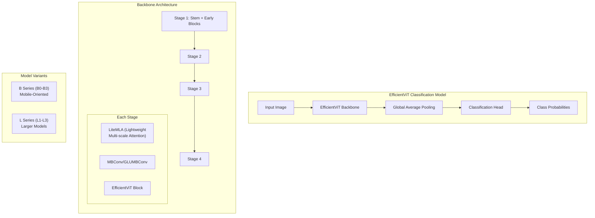
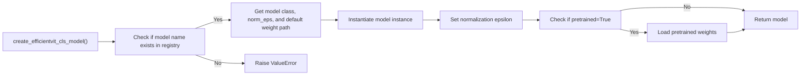

<!-- source: DeepWiki mcp.deepwiki.com · repo mit-han-lab/efficientvit · page 6.1 Image Classification · fetched 2026-10-30 -->

# Image Classification

<details>
<summary>Relevant source files</summary>

The following files were used as context for generating this wiki page:

- [applications/efficientvit_cls/README.md](applications/efficientvit_cls/README.md)
- [applications/efficientvit_sam/README.md](applications/efficientvit_sam/README.md)
- [assets/dc_ae_diffusion_example.png](assets/dc_ae_diffusion_example.png)
- [efficientvit/cls_model_zoo.py](efficientvit/cls_model_zoo.py)
- [efficientvit/sam_model_zoo.py](efficientvit/sam_model_zoo.py)
- [efficientvit/seg_model_zoo.py](efficientvit/seg_model_zoo.py)

</details>


This page documents the image classification capabilities of the EfficientViT repository. It covers how to create, use, and evaluate EfficientViT classification models for tasks involving categorizing images into predefined classes. For other tasks like semantic segmentation, see [Semantic Segmentation](#6.2), or for prompted segmentation, see [EfficientViT-SAM](#6.3).

## Architecture Overview

EfficientViT classification models are based on the EfficientViT backbone architecture with an added classification head. These models are designed to be lightweight and efficient while maintaining high accuracy.



Sources: [efficientvit/cls_model_zoo.py:3-11](), [applications/efficientvit_cls/README.md:1-47]()

## Model Initialization

The EfficientViT repository offers a comprehensive model zoo for classification tasks. Models can be instantiated using the `create_efficientvit_cls_model` function:



The classification models are registered in a dictionary called `REGISTERED_EFFICIENTVIT_CLS_MODEL`, which maps model names to a tuple containing:
1. The model class function (e.g., `efficientvit_cls_b0`)
2. The normalization epsilon value
3. The default path to pretrained weights

Sources: [efficientvit/cls_model_zoo.py:19-54](), [efficientvit/cls_model_zoo.py:57-76]()

## Available Model Variants

EfficientViT classification models come in multiple variants:

1. **B Series (B0-B3)**: Mobile-oriented models with balanced performance and efficiency
2. **L Series (L1-L3)**: Larger models for higher accuracy

Each model variant is available in multiple resolution configurations (e.g., 224x224, 256x256, etc.), allowing users to choose the appropriate trade-off between accuracy and performance for their application.

| Model Series | Variants | Resolution Options | Parameters | Use Case |
|--------------|----------|-------------------|------------|----------|
| B Series | B0, B1, B2, B3 | 224, 256, 288 | 9.1M - 49M | Mobile/Edge devices |
| L Series | L1, L2, L3 | 224, 256, 288, 320, 384 | 53M - 246M | Higher accuracy requirements |

### Model Naming Convention

Model names follow the pattern:
- `efficientvit-{series}{number}[-r{resolution}]`

Examples:
- `efficientvit-b1`: B series, variant 1, no specific resolution
- `efficientvit-l3-r384`: L series, variant 3, 384x384 resolution with pretrained weights

Sources: [efficientvit/cls_model_zoo.py:19-54](), [applications/efficientvit_cls/README.md:22-66]()

## Using Classification Models

Here's how to use EfficientViT classification models in your Python code:

1. Import the model creation function:
```python
from efficientvit.cls_model_zoo import create_efficientvit_cls_model
```

2. Create a model instance:
```python
# Create with pretrained weights
model = create_efficientvit_cls_model(name="efficientvit-l3-r384", pretrained=True)

# Create without pretrained weights
model = create_efficientvit_cls_model(name="efficientvit-b1", pretrained=False)
```

3. Move the model to the desired device and set to evaluation mode (for inference):
```python
model = model.to(device).eval()
```

4. Process input images and get predictions:
```python
# For a normalized tensor of shape [batch_size, 3, height, width]
with torch.no_grad():
    logits = model(input_tensor)
    probabilities = torch.softmax(logits, dim=1)
    predicted_class = torch.argmax(probabilities, dim=1)
```

Sources: [applications/efficientvit_cls/README.md:67-74]()

## Performance and Benchmarks

The EfficientViT classification models have been benchmarked on the ImageNet dataset, with impressive accuracy-efficiency trade-offs:

### L Series Models

| Model | Resolution | Top-1 Acc (%) | Top-5 Acc (%) | Params | MACs | A100 Throughput |
|-------|------------|--------------|--------------|--------|------|----------------|
| EfficientViT-L1 | 224x224 | 84.484 | 96.862 | 53M | 5.3G | 6207 img/s |
| EfficientViT-L2 | 224x224 | 85.050 | 97.090 | 64M | 6.9G | 4998 img/s |
| EfficientViT-L2 | 384x384 | 85.978 | 97.518 | 64M | 20G | 1784 img/s |
| EfficientViT-L3 | 224x224 | 85.814 | 97.198 | 246M | 28G | 2081 img/s |
| EfficientViT-L3 | 384x384 | 86.408 | 97.632 | 246M | 81G | 724 img/s |

### B Series Models

| Model | Resolution | Top-1 Acc (%) | Top-5 Acc (%) | Params | MACs | Jetson Nano (ms) |
|-------|------------|--------------|--------------|--------|------|-----------------|
| EfficientViT-B1 | 224x224 | 79.390 | 94.346 | 9.1M | 0.52G | 24.8 |
| EfficientViT-B2 | 224x224 | 82.100 | 95.782 | 24M | 1.6G | 50.6 |
| EfficientViT-B3 | 224x224 | 83.468 | 96.356 | 49M | 4.0G | 101 |

The B series models are optimized for edge devices like NVIDIA Jetson Nano, while L series models offer higher accuracy and are still efficient on server-grade hardware like NVIDIA A100 GPUs.

Sources: [applications/efficientvit_cls/README.md:22-66]()

## Model Evaluation

To evaluate EfficientViT classification models on the ImageNet dataset or your custom dataset, you can use the provided evaluation script:

```bash
python applications/efficientvit_cls/eval_efficientvit_cls_model.py \
    --model efficientvit-l3-r384 \
    --data_path /path/to/imagenet/val \
    --batch_size 64
```

This will output the model's Top-1 and Top-5 accuracy on the validation set.

Sources: [applications/efficientvit_cls/README.md:76-80]()

## Model Export

For deployment, EfficientViT classification models can be exported to optimized formats:

### ONNX Export

```bash
python assets/onnx_export.py \
    --export_path assets/export_models/efficientvit_cls_l3_r224.onnx \
    --model efficientvit-l3 \
    --resolution 224 224 \
    --bs 1
```

### TFLite Export

```bash
python assets/tflite_export.py \
    --export_path assets/export_models/efficientvit_cls_b3_r224.tflite \
    --model efficientvit-b3 \
    --resolution 224 224
```

These exported models can be deployed on various hardware platforms for efficient inference.

Sources: [applications/efficientvit_cls/README.md:82-102]()

## Training Classification Models

EfficientViT classification models can be trained on ImageNet or custom datasets using the provided training script. Here's an example for training an EfficientViT-L1 model:

```bash
torchrun --nnodes 1 --nproc_per_node=8 \
python applications/efficientvit_cls/train_efficientvit_cls_model.py \
    applications/efficientvit_cls/configs/imagenet/efficientvit_l1.yaml \
    --amp bf16 \
    --data_provider.data_dir ~/dataset/imagenet \
    --path .exp/efficientvit_cls/imagenet/efficientvit_l1_r224/
```

The training process includes:
1. Data loading and augmentation
2. Model creation and initialization
3. Training with the specified optimizer and learning rate schedule
4. Evaluation on the validation set
5. Checkpointing the best models

For the B series models, you can also train with dynamic image sizes for better generalization:

```bash
torchrun --nnodes 1 --nproc_per_node=8 \
python applications/efficientvit_cls/train_efficientvit_cls_model.py \
    applications/efficientvit_cls/configs/imagenet/efficientvit_b1.yaml \
    --data_provider.image_size "[128,160,192,224,256,288]" \
    --data_provider.data_dir ~/dataset/imagenet \
    --run_config.eval_image_size "[288]" \
    --path .exp/efficientvit_cls/imagenet/efficientvit_b1_r288/
```

Sources: [applications/efficientvit_cls/README.md:104-171]()

## Conclusion

EfficientViT classification models offer an excellent balance of accuracy and efficiency for image classification tasks. With multiple variants and resolution options, you can choose the appropriate model for your specific requirements, from mobile/edge deployment to high-accuracy server applications.

When using these models, consider:
1. The resolution trade-off: higher resolutions generally provide better accuracy but require more computation
2. The model size trade-off: larger models (L series) offer better accuracy but require more memory and computation
3. The deployment environment: B series models are better suited for edge devices, while L series models can leverage server-grade hardware

For further customization, you can also fine-tune these models on your domain-specific datasets following the training guidelines provided.

---

