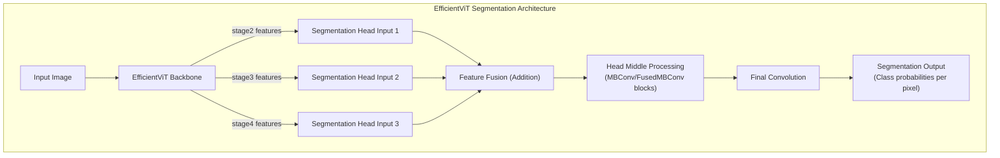
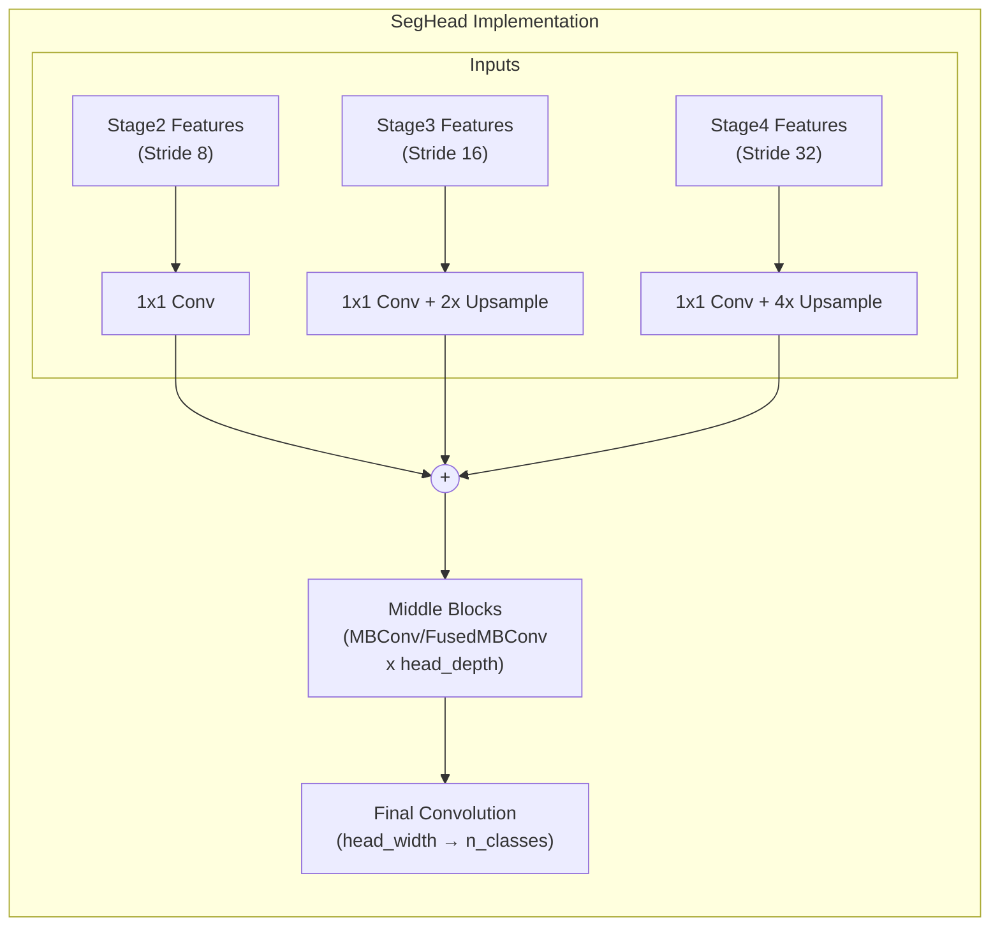
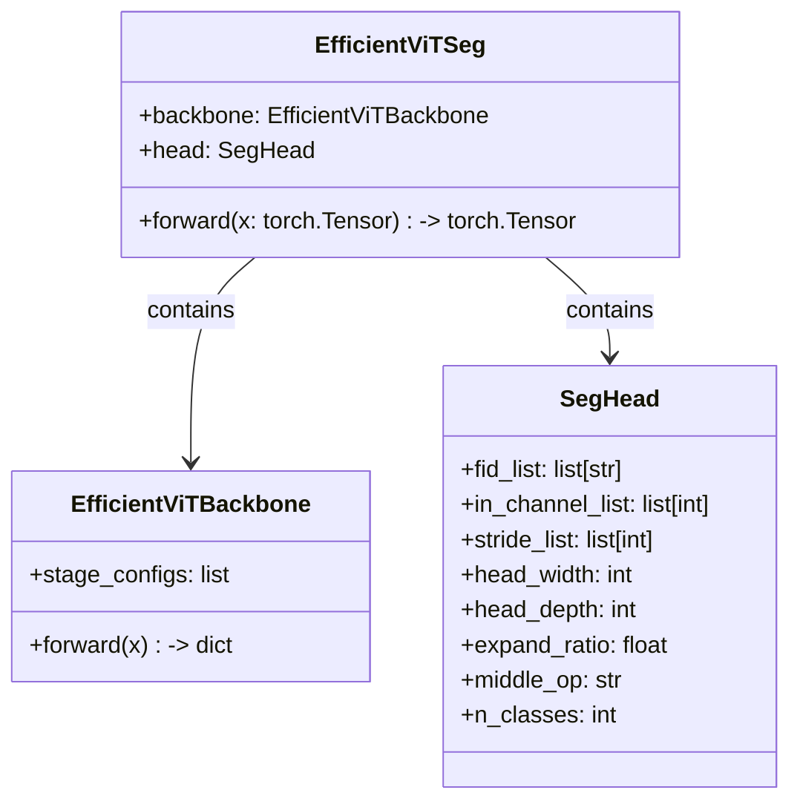
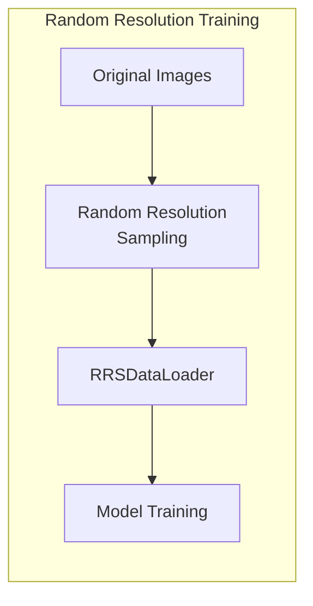

<!-- source: DeepWiki mcp.deepwiki.com · repo mit-han-lab/efficientvit · page 6.2 Semantic Segmentation · fetched 2026-10-30 -->

# Semantic Segmentation

<details>
<summary>Relevant source files</summary>

The following files were used as context for generating this wiki page:

- [applications/efficientvit_seg/README.md](applications/efficientvit_seg/README.md)
- [efficientvit/apps/data_provider/random_resolution/__init__.py](efficientvit/apps/data_provider/random_resolution/__init__.py)
- [efficientvit/apps/data_provider/random_resolution/_data_loader.py](efficientvit/apps/data_provider/random_resolution/_data_loader.py)
- [efficientvit/models/efficientvit/seg.py](efficientvit/models/efficientvit/seg.py)

</details>


This document covers the semantic segmentation capabilities within the EfficientViT framework. It details the architecture, available models, and usage for performing pixel-level classification tasks where each pixel in an image is assigned to a specific class (such as road, pedestrian, or building).

For information about other vision tasks, see [Image Classification](#6.1) or the [EfficientViT-SAM](#6.3) implementation for prompt-based segmentation.

## 1. Semantic Segmentation Architecture

The EfficientViT semantic segmentation architecture combines an efficient backbone with a specialized segmentation head to create lightweight models with strong performance on standard benchmarks. The segmentation models are built from two main components:

1. **EfficientViT backbone**: Provides multi-scale feature extraction
2. **Segmentation head**: Combines and processes features to produce the final segmentation maps



Sources: [efficientvit/models/efficientvit/seg.py:30-105](), [efficientvit/models/efficientvit/seg.py:107-118]()

The segmentation head fuses multi-scale features from the backbone using a Directed Acyclic Graph (DAG) block structure. It takes features from three stages of the backbone, processes them to a consistent resolution, and then combines them through addition. The fused features go through a series of convolutional blocks before producing the final pixel-wise class predictions.



Sources: [efficientvit/models/efficientvit/seg.py:30-105]()

## 2. Model Variants

EfficientViT provides multiple segmentation model variants with different size/performance trade-offs:

### 2.1 Model Series

- **B Series**: Smaller models (B0-B3) optimized for mobile and edge devices
- **L Series**: Larger models (L1-L2) with stronger performance for server deployments

### 2.2 Dataset Support

EfficientViT segmentation models are pre-trained on:

1. **Cityscapes**: Urban scene understanding with 19 classes
2. **ADE20K**: Scene parsing with 150 classes

### 2.3 Performance and Metrics

#### Cityscapes Models

| Model | Resolution | mIoU | Parameters | MACs | Latency (Jetson Orin) | Throughput (A100) |
|-------|------------|------|------------|------|-------------------|------------------|
| EfficientViT-L1 | 1024×2048 | 82.72% | 40M | 282G | 45.9ms | 122 img/s |
| EfficientViT-L2 | 1024×2048 | 83.23% | 53M | 396G | 60.0ms | 102 img/s |
| EfficientViT-B0 | 1024×2048 | 75.65% | 0.7M | 4.4G | 9.9ms | - |
| EfficientViT-B1 | 1024×2048 | 80.55% | 4.8M | 25G | 24.3ms | - |
| EfficientViT-B2 | 1024×2048 | 82.07% | 15M | 74G | 46.5ms | - |
| EfficientViT-B3 | 1024×2048 | 83.02% | 40M | 179G | 81.8ms | - |

#### ADE20K Models

| Model | Resolution | mIoU | Parameters | MACs | Latency (Jetson Orin) | Throughput (A100) |
|-------|------------|------|------------|------|-------------------|------------------|
| EfficientViT-L1 | 512×512 | 49.19% | 40M | 36G | 7.2ms | 947 img/s |
| EfficientViT-L2 | 512×512 | 50.70% | 51M | 45G | 9.0ms | 758 img/s |
| EfficientViT-B1 | 512×512 | 42.84% | 4.8M | 3.1G | 4.0ms | - |
| EfficientViT-B2 | 512×512 | 45.94% | 15M | 9.1G | 7.3ms | - |
| EfficientViT-B3 | 512×512 | 49.01% | 39M | 22G | 12.5ms | - |

Sources: [applications/efficientvit_seg/README.md:49-88]()

## 3. Model Implementation

The segmentation models are implemented as a combination of a backbone and a segmentation head. The `EfficientViTSeg` class manages this composition and defines the forward pass:



Sources: [efficientvit/models/efficientvit/seg.py:107-118]()

The segmentation process works as follows:

1. The input image passes through the EfficientViT backbone
2. The backbone extracts multi-scale features
3. The segmentation head takes features from different scales, upsamples them as needed, and combines them
4. The combined features go through additional processing in the middle blocks
5. A final convolution produces the pixel-wise class predictions

Each model variant is defined by a specific function that creates the backbone and head with appropriate parameters:

- `efficientvit_seg_b0` to `efficientvit_seg_b3` for the B series models
- `efficientvit_seg_l1` and `efficientvit_seg_l2` for the L series models

These functions configure the architecture based on the target dataset, adjusting parameters like the number of output classes (19 for Cityscapes, 150 for ADE20K).

Sources: [efficientvit/models/efficientvit/seg.py:120-341]()

## 4. Usage

### 4.1 Basic Usage

Loading and using a pre-trained segmentation model is straightforward:

```python
from efficientvit.seg_model_zoo import create_efficientvit_seg_model

# Load a pre-trained Cityscapes model
model = create_efficientvit_seg_model(name="efficientvit-seg-l2-cityscapes", pretrained=True)

# Or load an ADE20K model
model = create_efficientvit_seg_model(name="efficientvit-seg-l2-ade20k", pretrained=True)
```

The model returns a tensor of shape `[batch_size, num_classes, height, width]`, where `num_classes` is 19 for Cityscapes or 150 for ADE20K.

Sources: [applications/efficientvit_seg/README.md:90-99]()

### 4.2 Visualization

EfficientViT provides a demo script to visualize segmentation results:

```bash
python applications/efficientvit_seg/demo_efficientvit_seg_model.py --image_path assets/fig/indoor.jpg --dataset ade20k --crop_size 512 --model efficientvit-seg-l2-ade20k

python applications/efficientvit_seg/demo_efficientvit_seg_model.py --image_path assets/fig/city.png --dataset cityscapes --crop_size 1024 --model efficientvit-seg-l2-cityscapes
```

Sources: [applications/efficientvit_seg/README.md:107-117]()

### 4.3 Evaluation

To evaluate a model's performance on a dataset:

```bash
# Example from the evaluation script
python applications/efficientvit_seg/eval_efficientvit_seg_model.py
```

Refer to the evaluation script for specific options and parameters.

Sources: [applications/efficientvit_seg/README.md:101-105]()

## 5. Dataset Configuration

The segmentation models expect datasets to be organized in specific directory structures:

### 5.1 Cityscapes Dataset

```
cityscapes/
├── gtFine/
│   ├── train/
│   ├── val/
├── leftImg8bit/
│   ├── train/
│   ├── val/
```

### 5.2 ADE20K Dataset

```
ade20k/
├── annotations/
│   ├── training/
│   ├── validation/
├── images/
│   ├── training/
│   ├── validation/
```

Sources: [applications/efficientvit_seg/README.md:13-47]()

## 6. Advanced Features

### 6.1 Random Resolution Sampling

EfficientViT supports training with random resolution sampling for improved scale robustness:



The `RRSDataLoader` class extends PyTorch's standard `DataLoader` to support dynamic resolution changes during training, which helps the model learn to handle various input scales more effectively.

Sources: [efficientvit/apps/data_provider/random_resolution/__init__.py:1-7](), [efficientvit/apps/data_provider/random_resolution/_data_loader.py:124-591]()

### 6.2 Model Export

For deployment, models can be exported to optimized formats:

#### 6.2.1 ONNX Export

```bash
python assets/onnx_export.py --export_path assets/export_models/efficientvit_seg_l2_cityscapes_r1024x2048.onnx --task seg --model efficientvit-seg-l2-cityscapes --resolution 1024 2048 --bs 1
```

#### 6.2.2 TFLite Export

```bash
python assets/tflite_export.py --export_path assets/export_models/efficientvit_seg_l2_ade20k_r512x512.onnx --task seg --model efficientvit-seg-l2-ade20k --resolution 512 512
```

These export options enable deployment on a variety of platforms, from mobile devices to edge computing hardware.

Sources: [applications/efficientvit_seg/README.md:120-139]()

## 7. Conclusion

EfficientViT semantic segmentation models provide an excellent balance of accuracy and efficiency for pixel-level classification tasks. The architecture's multi-scale feature fusion and lightweight design make it well-suited for both resource-constrained environments and high-throughput server applications. 

The availability of model variants spanning from tiny (B0) to large (L2) allows users to select the appropriate trade-off between performance and computational requirements for their specific use case, whether it's real-time segmentation on embedded devices or high-quality scene parsing on servers.

---

